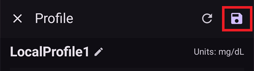
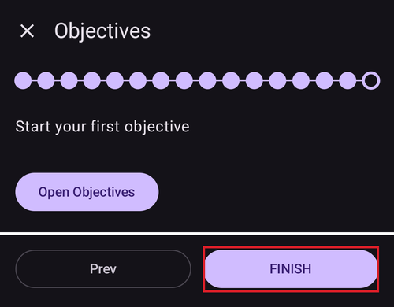

# Съветник за настройване на AAPS

```{contents} In this page
:backlinks: entry
:depth: 2
```

Когато стартирате **AAPS** за първи път, „**Съветник за настройване**“ ви води през всички основни настройки на приложението наведнъж. **Съветник за настройване** ви води стъпка по стъпка, за да не забравите нещо важно. Например **настройките на разрешенията** са основни за правилната настройка на **AAPS**.

Не е задължително обаче да настроите всичко докрай още при първото използване на **Съветник за настройване**. Можете лесно да излезете от съветника и да се върнете към него по-късно. След **Съветник за настройване** има три начина да подобрите или промените конфигурацията. Те ще бъдат обяснени в следващия раздел. Затова е нормално да пропуснете някои точки в Съветника за настройване – можете лесно да ги конфигурирате по-късно.

По време на **Съветник за настройване** и веднага след него може да не забележите големи видими промени в **AAPS**. За да включите кръга на **AAPS**, трябва да изпълните **Цели**, които отключват функциите една по една. Ще започнете **Цел 1** в края на съветника за настройване. Вие управлявате **AAPS**, а не обратното.

```{admonition} Preview Objectives
:class: note
Ако искате да знаете как са подредени целите, прочетете [Изпълнение на целите](../SettingUpAaps/CompletingTheObjectives.md), но след това се върнете тук, за да преминете първо през съветника за настройване.

```

От опит знаем, че начинаещите често се притискат да настроят **AAPS** възможно най-бързо. Това може да доведе до разочарование, защото има много неща за научаване.

Затова, моля, не бързайте с настройката на кръга. Ползите от добре работещ кръг с **AAPS** са огромни.

```{admonition} Ask for Help
:class: note
Ако има грешка в документацията или имате по-добра идея как нещо да бъде обяснено, можете да поискате помощ от общността, както е обяснено в [Свържете се с други потребители](../GettingHelp/WhereCanIGetHelp.md).
```
## Приветствено съобщение

Когато съветникът за настройване се отвори, той ви поздравява с кратко съобщение и веднага показва панел „**Нужни са разрешения**“ в долната част на екрана (вижте следващия раздел).

След като дадете разрешенията, панелът се затваря и на екрана за добре дошли се появява бутон „**Следващ**“. Натиснете „**Следващ**“, за да продължите:


## Необходими разрешения

**AAPS** се нуждае от няколко разрешения, за да работи правилно. Съветникът ги събира в един панел „**Нужни са разрешения**“ и всяко от тях има собствен бутон „**Позволи**“. Дайте ги едно по едно – иконата до всеки ред се променя на отметка, когато е готово.


### Оптимизиране на батерията

Разходът на батерията на смартфоните е важен въпрос, защото възможностите на батериите все още са доста ограничени. Затова операционната система Android на смартфона ви ограничава приложенията да работят и да използват процесорно време, а с това и енергия от батерията.

**AAPS** обаче трябва да работи редовно, _напр._ за да получава стойностите на глюкозата на всеки няколко минути и след това да прилага алгоритъма, за да реши какво да направи с нивата на глюкозата ви според вашите настройки. Затова приложението трябва да бъде изключено от оптимизирането на батерията.

Натиснете „**Позволи**“ до „**Оптимизиране на батерията**“ и после изберете „**Разрешаване**“ (Allow) в прозореца „Let app always run in background?“ (Да се разреши ли на приложението винаги да работи на заден план?):


(SetupWizard-StoragePermission)=

### AAPS директория

**AAPS** трябва да записва своите настройки и записите в лога в постоянната памет на смартфона ви. Постоянна памет означава, че информацията ще бъде налична дори след рестартиране на смартфона. Друга информация просто се губи, защото не се записва в постоянната памет.

Натиснете „**Позволи**“ до „**AAPS директория**“. Така се отваря файловата система на телефона ви и можете да изберете къде **AAPS** да записва своята информация.

```{tip}
Препоръчваме да изберете директорията на AAPS по подразбиране.</br>
**Не** избирайте поддиректория на AAPS.
```

Директорията по подразбиране е **AAPS**, но можете да използвате всяка отделна директория по ваш избор. Ако е нужно, създайте директорията, влезте в нея и изберете „**ИЗПОЛЗВАНЕ НА ТАЗИ ПАПКА**“ (USE THIS FOLDER):


Потвърдете с „**РАЗРЕШАВАНЕ**“ (ALLOW), че давате на **AAPS** достъп до избраната директория:


### Известия

Android изисква специално разрешение за приложенията, които искат да ви изпращат известия.

Добре е да изключите известията _напр._ от приложения за социални мрежи, но е задължително да позволите на **AAPS** да ви изпраща известия.

Натиснете „**Позволи**“ до „**Нотификации**“ и изберете „**Разрешаване**“ (Allow) в системния прозорец:


### Аларми и напомняния

На **Android 14 и по-нови** **AAPS** се нуждае от разрешението „**Аларми и напомняния**“, за да могат алармите да събуждат екрана, докато **AAPS** работи на заден план, и за да звънят напомнянията (например от **Автоматизация**) навреме.

Този ред се показва само докато е нужен. След като **AAPS** бъде изключено от оптимизирането на батерията (вижте по-горе), Android автоматично разрешава точните аларми и редът изчезва. Ако редът все още е в списъка, натиснете „**Позволи**“ до „**Аларми и напомняния**“. Така се отваря системен екран с настройки за **AAPS**. Включете превключвателя и се върнете в **AAPS**. На Android 13 и по-стари този ред не се показва и не е нужно да правите нищо.

Когато всички разрешения покажат отметка (три или четири на Android 14 и по-нови), панелът „**Нужни са разрешения**“ се затваря сам и можете да натиснете „**Следващ**“ на екрана за добре дошли, за да продължите.

(setup-wizard-bluetooth-battery-optimisation)=
### Оптимизиране на батерията за Bluetooth

```{admonition} Extra Android setting, not part of the Wizard
:class: note
Следващите стъпки са допълнителни настройки на Android, които се правят извън съветника за настройване. Те не са сред бутоните „Позволи“ по-горе, но са важни за надеждна връзка с помпата.
```

По-новите версии на Android добавиха оптимизиране на батерията и за системното приложение Bluetooth.

Освен че изключвате оптимизирането на батерията за **AAPS**, вероятно ще трябва да го изключите и за системното приложение Bluetooth. Ако не направите това, връзката с помпата може да прекъсва и да има проблеми.

***ЗАБЕЛЕЖКА: Документацията на xDrip описва как да направите това тук: [документация на xDrip](https://navid200.github.io/xDrip/docs/BluetoothBatteryOpt.html)***

Изпълнете тези стъпки на Android 16. При другите версии екраните ще са малко по-различни от показаните снимки:

1. Отворете настройките на Android, потърсете **Приложения** (Apps) и отворете настройките за приложения.

   

2. Ще видите настройките за приложения, но трябва да покажем всички приложения. Натиснете **Преглед на всички приложения** (See all apps), за да ги покажете.

   

3. Приложението Bluetooth е системно приложение и по подразбиране е скрито, затова трябва да покажем системните приложения. Натиснете **трите точки** (⋮) горе вдясно (1). После натиснете **Показване на системните** (Show system) (2).

   

4. Потърсете приложението `Bluetooth` и натиснете `Bluetooth` и/или `Legacy Bluetooth`. Ако има и двете, изпълнете стъпките и за двете.

   ***ЗАБЕЛЕЖКА: Можете спокойно да пренебрегнете `Bluetooth MIDI Service`, AAPS не го използва***

           

   1. On Android 12 click on `Battery`, on Android 13+ click on `App battery usage`.

      

5. На Android 12+ изберете опцията `Unrestricted` (Без ограничения). На Android 15+ трябва да разгънете настройката `Allow background usage` (Разрешаване на използването на заден план). За целта натиснете частта, оградена в червено, и след това изпълнете стъпка 6, за да завършите.

       

6. На Android 16 изберете `Unrestricted` (Без ограничения)

   

## Лицензионно споразумение

Лицензионното споразумение с крайния потребител съдържа важна информация за правните аспекти при използването на **AAPS**. Моля, прочетете го внимателно.

Ако не разбирате лицензионното споразумение с крайния потребител или не можете да се съгласите с него, моля, изобщо не използвайте **AAPS**!

Ако разбирате и сте съгласни, моля, натиснете бутона „**Разбирам и приемам**“ и следвайте съветника за настройване:


След като се съгласите, се появява бутон „**Следващ**“. Натиснете „**Следващ**“.

На следващия екран, „**Разрешения**“, разрешенията са изброени отново. Всички трябва да показват отметка, защото вече сте ги дали в началото. Ако някое липсва, натиснете „**Разрешаване**“ до него. Натиснете „**Следващ**“, за да продължите:


## Главна парола

Конфигурацията на **AAPS** съдържа някои чувствителни данни (_напр._ токена за достъп до вашия Nightscout сървър), затова тя се шифрова с парола, която задавате тук.

Съветникът показва „**Паролата не е зададена**“. Натиснете „**Приложи**“:


Така се отваря екранът „**Защита**“. Натиснете „**Главна парола**“ (показва се като „Паролата не е зададена“):


Въведете една и съща парола в двете полета и натиснете „**ОК**“:


Върнете се назад със стрелката в горния ляв ъгъл. Сега съветникът показва „**Паролата е зададена!**“:


```{admonition} Do not lose your Master Password
:class: danger
Моля, **НЕ ГУБЕТЕ ГЛАВНАТА СИ ПАРОЛА**. Запишете я _напр._ в Google Drive. Това е добро място, защото Google прави резервно копие вместо вас. Вашият смартфон или компютър може да се повреди и може да се окаже, че нямате копие. Ако забравите главната парола, по-късно може да е трудно да възстановите конфигурацията на профила си и напредъка си в **Целите**.
```

Когато сте готови, натиснете „**Следващ**“, за да отидете на следващия екран.

(setup-wizard-import-settings)=
## Импорт настройки

Този екран се показва само когато **AAPS** намери по-рано експортирани настройки в директорията на **AAPS** („Открити са предишни настройки“), например когато инсталирате приложението отново или минавате на нов телефон.

- За да възстановите предишната си конфигурация, натиснете „**Импорт настройки**“ – вижте [Експорт и импорт на настройките](../Maintenance/ExportImportSettings.md).
- За да започнете с нова конфигурация, натиснете „**Следващ**“ и продължете със съветника.


## Единици (mg/dl <-> mmol/l)

Моля, изберете дали стойностите на глюкозата ви са в mg/dl или в mmol/l и после натиснете бутона „**Следващ**“:


## Настройки за визуализация

Тук задавате „**Ниска КЗ под**“ и „**Висока КЗ над**“ за показването на глюкозата от сензора. Стойностите на глюкозата между тези две граници се показват като „в диапазон“. Засега можете да оставите стойностите по подразбиране (72 и 180 mg/dl) и да ги промените по-късно.

Стойностите, които изберете, засягат само графичното представяне на диаграмата и нищо друго.

Вашата целева КЗ _напр._ се задава отделно във вашия профил.

Диапазонът за анализ на TIR (време в целта) се настройва отделно в сървъра за отчети.

Ако е нужно, променете границите с бутоните „−“ / „+“ и после натиснете бутона „**Следващ**“:


(SetupWizard-synchronization-with-the-reporting-server-and-more)=
## Комуникация

Екранът „**Комуникация**“ показва плъгините, които се използват за качване, синхронизиране и разпращане на данните ви:

- **SMS комуникатор** – дистанционно управление на **AAPS** чрез SMS команди
- **NSClientV3** – синхронизира данните ви с Nightscout чрез v3 API
- **Tidepool** – качва данни в Tidepool
- **xDrip** – изпраща данни към xDrip
- **Open Humans** – качване и даряване на данните ви за диабета за научни проекти
- **Часовник** – наблюдение и управление на **AAPS** от часовник с WearOS
- **Външни приложения за проследяване** – разпращане на данни към различни външни приложения
- **Garmin** – връзка с устройство Garmin


Превъртете надолу, за да видите останалата част от списъка:


Можете да настроите няколко от тях още сега, но при първото преминаване ще се съсредоточим само върху сървъра за отчети. Ако в момента не можете да го настроите, засега го пропуснете – можете да го настроите по-късно.

В този пример използваме Nightscout като сървър за отчети. Отметнете полето вдясно от „**NSClientV3**“, за да го включите. За Tidepool е още по-просто, защото ви трябват само личните данни за вход.

След като е включен, натиснете „**Настройки**“ под NSClientV3, за да го настроите:


Тук настройвате сървъра за отчети Nightscout. Настройките на NSClientV3 се показват като една страница, която се превърта:


Натиснете „**Nightscout адрес**“ и въведете адреса на вашия личен Nightscout сървър (адреса (URL), който сте настроили сами или сте получили от доставчика на услугата). Потвърдете с „**ОК**“.

Натиснете „**Токен за достъп до Nightscout**“ и въведете токена за достъп до вашия Nightscout сървър. Без този токен достъпът няма да работи. Ако все още нямате такъв, моля, вижте документацията за настройване на сървъра за отчети.

Оставете „**Използвай websockets**“ включено за връзка с Nightscout в реално време.

Останалите раздели засега могат да останат с настройките по подразбиране. Те са описани тук, за да знаете къде да ги намерите по-късно:

**Опции за аларми** — аларми, съобщения и прагове за остарели данни в Nightscout. Засега оставете превключвателите изключени. Отваряме ги само за да знаете за тези опции.

**Настройки за свързване** — изберете как да се предават данните. Болногледачите трябва да включат „**Използвай мобилни данни**“, иначе телефонът на човека, за когото се грижат (_напр._ дете), не може да качва данни извън обхвата на Wi-Fi, _напр._ по пътя към училище. Другите потребители могат да изключат предаването през мобилни данни, за да пестят трафик или батерия. Ако се колебаете, оставете всичко включено.


**Разширени настройки** — включете „**Записвай стартиране на AAPS**“, ако искате да виждате в Nightscout кога приложението се рестартира (полезно за болногледачи). Оставете включени „**Създавай съобщения за грешки**“ и „**Създавай съобщения при нужда от въглехидрати**“. Оставете „**Използвай бавна синхронизация**“ изключено. Използвате го само ако Nightscout сървърът обработва бавно голямо количество данни.


Върнете се към списъка с плъгини и натиснете „**Следващ**“, за да отидете на следващия екран.

## Контрол от клиентско приложение

От версия 4 на **AAPS** клиентските устройства с **AAPSClient** могат да бъдат **свързани** с този телефон (**главния**) и да го управляват с подписани команди, изпратени през Nightscout. Това е новият препоръчан начин за дистанционно управление на **AAPS** – вижте [Контрол главен ↔ клиент](../RemoteFeatures/ClientMasterControl.md) за пълното обяснение и настройката.

На този екран сега не е нужно да настройвате нищо. Можете да свържете клиенти по всяко време по-късно от **Управление → Оторизирани клиенти**. Там добавяте клиент с **QR код** (той настройва и Nightscout на клиента) или с **PIN** и му давате **роля**.

- „**Оторизирани клиенти**“ — управление на свързаните клиентски устройства, на които е позволено да управляват този главен телефон.
- „**Приемане на данни от Nightscout**“ — приемането на лечения и данни, въведени директно в Nightscout (старият, по-малко сигурен начин), вече е изключено по подразбиране. Отваряйте тези настройки само ако все още ви трябва, _напр._ за да въвеждате данни през Nightscout или приложения на трети страни.

Когато контролът от клиентско приложение вече е включен – винаги в [Опростен режим](#preferences-simple-mode) – този телефон е в [режим на засилена защита](#client-master-control-hardened-mode): той приема промени само от свързани клиенти, затова екранът обяснява режима на засилена защита, вместо да предлага настройките „**Приемане на данни от Nightscout**“.


„**Приемане на данни от Nightscout**“ отваря настройките „**Синхронизация**“, където всеки вид данни, получени от Nightscout, има собствен превключвател:


Натиснете „**Следващ**“, за да отидете на следващия екран.

(setup-wizard-instance-name)=
## Кой използва този телефон?

Тук въвеждате името на човека, който използва този телефон. То отличава тази инсталация на **AAPS** от другите в отчетите и при синхронизиране, например ако две деца в семейството ви използват **AAPS**. Използва се и в имената на файловете с експортирани настройки и се показва на часовника.

Може да бъде всичко. Можете да го промените по-късно в **Настройки → Основни → Име на инстанцията**.

Натиснете „**Следващ**“, за да отидете на следващия екран.


## Тип пациент

Тук избирате „Тип пациент“. Това е важно, защото софтуерът **AAPS** има различни граници в зависимост от възрастта на пациента. Това е важно от съображения за сигурност и безопасност.

Тук задавате и **максималния разрешен болус** за едно хранене. Тоест най-големият болус, който ви е нужен за типичните ви хранения. Това е функция за безопасност, която помага да избегнете случайно предозиране, когато давате болус за хранене.

Второто ограничение е подобно, но се отнася за максималното количество въглехидрати, което очаквате да приемете.

След като зададете тези стойности, натиснете „**Следващ**“, за да отидете на следващия екран:


## Инсулин

Тук настройвате инсулина, който се използва в помпата ви. Новите профили на инсулин изискват **DIA най-малко 5 ч**.

Натиснете бутона „**Инсулин**“, за да отворите редактора на инсулин:


В редактора можете да дадете на инсулина **кратко име** и да зададете неговия **Пик** (в минути) и **DIA** (в часове). Най-бързият начин е да заредите готова настройка с „**Избери пик от**“ – изберете **Novorapid**, **Fiasp** или **Lyumjev** – и пикът се попълва автоматично. Графиката в долната част показва предварително получената крива на действие на инсулина.


Изберете готовата настройка, която отговаря на вашия инсулин, например **Fiasp**:


```{admonition} Use your insulin brand's preset peak
:class: danger
Моля, не променяйте пика, освен ако не сте експерт – обикновено готовите стойности работят добре за всяка марка инсулин.
```

Ако сте нов потребител на **AAPS**, задайте **DIA** на 9 часа – вижте [Време на действие на инсулина (DIA) и пик](#Config-Builder-insulin-dia), за да разберете защо.

```{admonition} "Insulin configuration changed" dialog
:class: note
Ако свързан клиент (_напр._ друг телефон) е променил конфигурацията на инсулина, се появява диалогов прозорец. Натиснете **ОК**, за да заредите неговите промени, или **Откажи**, за да продължите да редактирате (следващото ви записване ще презапише неговите промени).
```


Натиснете иконата за записване (горе вдясно) и после натиснете „**Следващ**“, за да отидете на следващия екран.

## Източник на КЗ

Тук избирате откъде **AAPS** получава данните за глюкозата. Моля, прочетете документацията за вашия [източник на КЗ](../Getting-Started/CompatiblesCgms.md).

Има много източници – превъртете списъка и изберете този, който използвате:


Когато изберете източник, картата му се разгъва и показва два бутона: „**Настройки**“, за да промените как се получават данните, и „**Отвори плъгин**“, за да отворите собствения екран на източника. В примера по-долу е избран **BYODA**. Някои източници нямат какво да се настройва на този етап, затова обикновено можете да отидете направо на следващия екран:


След като направите избора си, натиснете „**Следващ**“, за да отидете на следващия екран.

(setup-wizard-profile)=
## Профил

Сега стигаме до много важна част от Съветника за настройване.

Моля, прочетете документацията за [профилите](../SettingUpAaps/YourAapsProfile.md), преди да въведете данните на профила си на следващия екран.

```{admonition} Working profile required - no exceptions here !
:class: danger
Точният профил е необходим, за да действа **AAPS** безопасно.

Задължително е да сте определили и обсъдили профила си с лекаря си и той да е доказал, че работи, чрез успешни тестове на базалната доза, ISF и IC!

Ако робот получи грешни входни данни, той ще греши – всеки път. **AAPS** може да работи само с информацията, която му е дадена. Ако профилът ви е твърде силен, рискувате хипогликемия, а ако е твърде слаб, рискувате хипергликемия. 
```

Натиснете бутона „**Профил**“, за да отворите редактора на профили:


Редакторът се отваря празен („Няма налични записи“). Натиснете бутона „**+**“ в долната част, за да създадете нов профил:


Ако е нужно, с времето можете да имате няколко профила. Тук създаваме само един.

```{admonition} Profile only for tutorial - not for your usage
:class: note
Примерният профил тук е само за да ви покаже как да въвеждате данни.

Той не е предназначен да бъде точен или много добре оптимизиран профил, защото нуждите на всеки човек са много различни.

Не я използвайте за истински затворен кръг!
```

Новият профил (например „**LocalProfile1**“) има четири раздела: **И / Въгл** (IC), **Чувств** (ISF), **БАЗА** и **ЦЕЛ**. Натиснете молива до името на профила, за да го преименувате. Попълнете всеки раздел – разделът остава червен и показва съобщение за грешка, докато не съдържа валидни стойности:


Натиснете „**И / Въгл**“ и въведете стойностите си за [IC](#your-aaps-profile-insulin-to-carbs-ratio). С бутона „**+**“ добавяте още времеви интервали:


Натиснете „**Чувств**“ и въведете своите [стойности за ISF](#your-aaps-profile-insulin-sensitivity-factor):


Натиснете „**БАЗА**“ и въведете своите [стойности на базала](#your-aaps-profile-basal-rates):


Натиснете „**ЦЕЛ**“ и въведете целевите си стойности на кръвната захар.

При отворен кръг тази цел може да бъде по-широк диапазон. Иначе **AAPS** постоянно ще ви известява да промените временния базал или друга настройка, което може да е изтощително.

По-късно, при затворен кръг, обикновено ще имате само една стойност за горна и долна граница. Така на **AAPS** му е по-лесно да достигне целта и да ви даде по-добър общ контрол на диабета.


Когато и четирите раздела са валидни, **иконата за записване** (горе вдясно) става активна. Натиснете я, за да запишете профила:



Затворете редактора с „**X**“ в горния ляв ъгъл. След това обобщението на профила показва името му, общия дневен базал (∑), единиците и стойностите на IC и ISF с техните графики:


```{admonition} Several defined but only one active profile
:class: note
Можете да имате няколко създадени профила, но в даден момент работи само един активен профил.
```

Натиснете бутона „**▶**“ (активиране) долу вдясно. Отваря се екранът „**Активиране**“. Тъй като още не се използва инсулин, екранът първо ви моли да изберете инсулина, който използвате, за да може смяната на профил да го запише. Бутонът „**Активиране**“ остава сив, докато не го направите:


Натиснете „**Изберете инсулин**“ и изберете инсулина, който настроихте по-рано. Оставете процента на 100 % и натиснете „**Активиране**“:


Появява се диалогов прозорец за смяна на профил. В този случай оставете го както е зададен и потвърдете с „**ОК**“:

```{admonition} Profile switch dialog
:class: note
По-късно ще научите как да използвате този общ диалогов прозорец при ситуации като болест или спорт, когато трябва да промените профила си според обстоятелствата.
```


Профилът ви вече е активен. Натиснете „**Следващ**“, за да отидете на следващия екран.

## Инсулинова помпа

Сега избирате инсулиновата си помпа. Моля, прочетете документацията за вашата [инсулинова помпа](../Getting-Started/CompatiblePumps.md).

Превъртете списъка и изберете помпата си. В този пример използваме „**Виртуална помпа**“. Тя е полезна, докато още се учите и не сте свързали истинска помпа:


Поддържат се много помпи – превъртете надолу, за да намерите вашата:


Когато изберете истинска помпа, **AAPS** иска потвърждение, защото ще копира базалните дози от профила ви в помпата и ще презапише базалните дози, записани там. Натиснете „**ОК**“ само ако базалните дози във вашия профил в **AAPS** са правилни. Иначе натиснете „**Откажи**“ и сменете помпата по-късно:


If the pump you select communicates over Bluetooth, **AAPS** asks for permission to connect to nearby devices once you finish the Wizard (see [Bluetooth permission](#setup-wizard-bluetooth-permission)).

Ако вече сте настроили профила си и знаете как да свържете помпата си, можете да я свържете сега. Иначе засега оставете **Виртуална помпа** – можете да я смените по всяко време или да излезете от съветника за настройване със стрелката в горния ляв ъгъл и да оставите **AAPS** първо да ви покаже няколко стойности на кръвната захар.

Натиснете „**Следващ**“, за да отидете на следващия екран.

## Алгоритъм на APS

Използвайте алгоритъма OpenAPS SMB като APS алгоритъм. Въпреки името, функцията SMB на алгоритъма е изключена, докато не се запознаете с AAPS и не изпълните първите цели. OpenAPS SMB така или иначе е по-нов и като цяло по-добър от OpenAPS AMA.

SMB е изключен в началото, защото функцията SMB реагира по-бързо на покачване на кръвната захар, като използва Super Micro Bolus вместо да увеличава процента на базалната доза. В началото профилът ви обикновено не е толкова добър, колкото след известен опит, затова функцията първоначално е изключена.

```{admonition} Only use the older algorithm **OpenAPS AMA** if you know what you are doing
:class: note
OpenAPS AMA е най-простият алгоритъм. Той не поддържа микроболуси за коригиране на високи стойности. Може да има случаи, в които е по-добре да използвате този алгоритъм, но това не е препоръката.
```

Изберете „**OpenAPS SMB**“ и после натиснете „**Настройки**“, за да видите подробностите:


Единствената опция тук е „**Използвай динамична чувствителност**“. Засега я оставете изключена и не променяйте нищо – само прочетете текста.

Заради ограниченията, които налагат **Цели**, в момента така или иначе не можете да използвате нито „затворен кръг“, нито „функциите на SMB“.

Върнете се назад и натиснете „**Следващ**“, за да отидете на следващия екран:


## Определяне на чувствителност

Оставете избран „**Чрез Oref1**“ (Sensitivity Oref1) като стандартен плъгин за чувствителност:


Ако натиснете „**Настройки**“, можете да прегледате настройките за усвояване. Стойностите по подразбиране (_напр._ граница на усвояването от 6 ч) засега са подходящи.


Натиснете „**Следващ**“, за да отидете на следващия екран.

## Стартиране на Цел 1

Сега започвате Целите – стъпките, с които получавате достъп до още функции на **AAPS**.

Натиснете „**Отвори целите**“:


Тук стартираме Цел 1, въпреки че в момента настройката ни още не е напълно готова, за да изпълним успешно тази цел. Но това е началото.

Press the "**Start**" button of **Objective 1**:


Целта се разгъва и показва отделните си проверки. Виждате, че вече имате известен напредък, а други точки още предстоят:


Върнете се назад и натиснете „**КРАЙ**“, за да завършите съветника за настройване:



След като натиснете „**КРАЙ**“, попадате на главния екран на **AAPS**. Може да се отвори панел „**Известие**“ с информационни съобщения, например за смяната на профил, която току-що направихте – натиснете „**Откажи**“ под всяко съобщение, за да го изчистите.

Ако случайно излезете от съветника за настройване в някой момент, можете просто да стартирате съветника отново или да промените ръчно [конфигурацията на кръга на AAPS](../SettingUpAaps/ChangeAapsConfiguration.md).

(setup-wizard-bluetooth-permission)=
## Разрешение за Bluetooth

Ако изберете помпа, която се свързва чрез Bluetooth (например **Omnipod Dash**), банер ви напомня, че **AAPS** се нуждае от разрешение за Bluetooth. Засега можете да натиснете „**Откажи**“ – разрешението се дава, след като завършите съветника:


След като съветникът за настройване завърши, главният екран на **AAPS** показва панел „**Нужни са разрешения**“. Другите разрешения вече са дадени. Натиснете „**Позволи**“ до „**Bluetooth**“:


Изберете „**Разрешаване**“ (Allow), за да може **AAPS** да намери помпата ви и да се свърже с нея:


Ако кръгът ви с **AAPS** вече е напълно настроен, моля, преминете към следващия раздел [„Изпълнение на целите“](../SettingUpAaps/CompletingTheObjectives.md).
