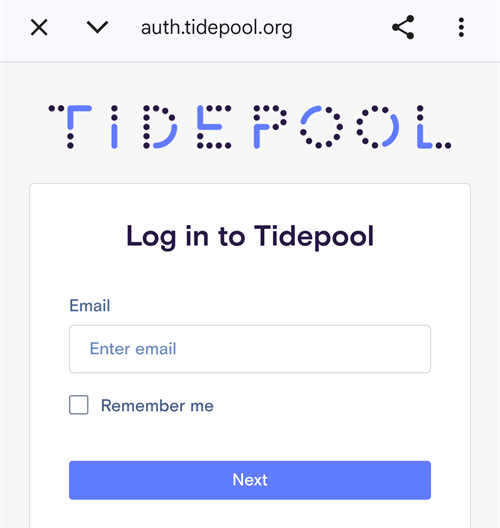

# Tidepool

Tidepool е инструмент на трета страна, който събира данни за КЗ, инсулин и въглехидрати (и бележките, които добавяте към леченията си). С него можете да анализирате тези данни и да ги споделяте с медицинския си екип. От версия 3.2 на AAPS Tidepool може да се използва вместо Nightscout за изпълнение на част от Цел 1. Може да се използва и заедно с Nightscout като алтернативна платформа за отчети, която се интегрира добре в клинична среда. Това може да е желаният вариант за деца, които използват AAPS и искат възможностите на Nightscout за дистанционно наблюдение и управление, но и платформа за отчети, с която медицинският им екип е по-запознат.

Важно е да разберете, че Tidepool служи само за отчети. Това НЕ е приложение за следене в реално време. Ако имате нужда от последователи освен основния телефон с AAPS, трябва да настроите и Nightscout.

Бележка: организацията Tidepool пусна на пазара продукта Loop за iOS с одобрение от FDA. Това усилие няма нищо общо с тяхната платформа за отчети или с AAPS.

## Стъпка 1 – Създайте профил в Tidepool

- Отидете на [tidepool.org](https://www.tidepool.org/)

- Изберете „Personal Sign Up“ (лична регистрация) или „Sign Up“ (регистрация)

- Създайте имейл и парола и ги запишете

- Изберете „Personal Account“ (личен профил) и натиснете „Continue“ (продължи)

- Попълнете раздела с информация за пациента и приемете условията за ползване

- Потвърдете имейл адреса си, като следвате инструкциите, които ще получите по имейл

## Стъпка 2 – Свържете AAPS с Tidepool

- Отворете **менюто** (☰) в горния ляв ъгъл на главния екран и изберете „**Конфигурация**“

- Отворете категорията „**Комуникация**“ и включете „**Tidepool**“:

- Докоснете „**Отвори плъгин**“ под Tidepool, след това докоснете иконата **Вход** (стрелка, която влиза във врата) в горния десен ъгъл

- Отваря се прозорец на браузъра със страницата за вход в Tidepool. Влезте с имейл адреса и паролата, които създадохте в Стъпка 1 по-горе:

- След успешен вход браузърът се затваря и екранът на Tidepool показва състояние „**Свързана**“; дневникът (log) по-долу показва качванията на данни. Ако входът не успее, проверете дали данните ви за вход са верни и дали сте потвърдили имейл адреса си в Tidepool.

- В „**Настройки**“ на плъгина Tidepool отворете „**Настройки за свързване**“. По подразбиране „**Използвай настройките за връзка с Nightscout**“ е включено, така че Tidepool качва данни при същите условия, които сте задали за Nightscout. Изключете го, ако искате отделни условия за Tidepool, например да качвате в Tidepool само през Wi-Fi и по време на зареждане, докато Nightscout използва и мобилни данни.

 

За повече помощ как да използвате данните си, след като са качени в Tidepool, посетете: [https://www.tidepool.org/viewing-your-data](https://www.tidepool.org/viewing-your-data)

(tidepool-menu)=
## Бутоните на Tidepool

В горния десен ъгъл на екрана на Tidepool:

- Иконата **Вход** или **Изход** – свързване към профила ви в Tidepool или прекъсване на връзката с него. Показва се само една от тях: **Вход**, докато не сте влезли, и **Изход**, докато сте влезли. **AAPS** ви моли за потвърждение, преди да ви изведе от профила.
- Иконата със зъбно колело – настройките на Tidepool.

Бутоните в долната част на екрана на Tidepool:

- „**Качи сега**“ – качва новите данни веднага, вместо да чака следващото автоматично качване.
- „**Пълна синхронизация**“ – качва отново всички данни, запазени в **AAPS**.
- „**Изтрий всички данни**“ – изтрива **всички** данни, които **AAPS** е качил във вашия профил в Tidepool. Това не може да бъде отменено. Използвайте го само за да премахнете грешни или повтарящи се данни, след това стартирайте „**Пълна синхронизация**“, за да качите данните си отново.
- „**Изчисти лога**“ – изчиства дневника (log), показан на екрана на Tidepool.

В Tidepool данните, качени от **AAPS** 4, се показват под името на устройство **AAPS**. Вижте [Какво се промени в AAPS v4](#v4changes-tidepool), ако сте използвали Tidepool с по-стара версия. 
