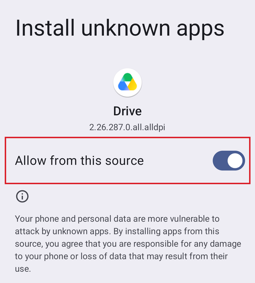
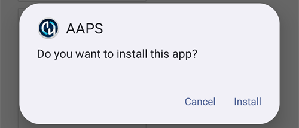

# Прехвърляне и инсталиране на AAPS на вашия смартфон

В предишния раздел, [компилиране на **AAPS**](../SettingUpAaps/BuildingAaps.md), компилирахте приложението **AAPS** (файл .apk) на компютър.

Следващите стъпки са да **прехвърлите** APK файла на **AAPS** (както и други приложения, които може да са ви нужни, например BYODA, xDrip или друго приложение за приемане на данни от CGM) на своя смартфон с Android и след това да **инсталирате** приложението (приложенията). След като инсталирате **AAPS** на смартфона, можете да преминете към [**настройването на кръга на AAPS**](../SettingUpAaps/SetupWizard.md).

Тази страница обяснява също [проверката на разработчиците на Android](#android-developer-verification) – промяна, която Google въвежда от септември 2026 г. и която засяга инсталирането на приложения, компилирани от самия потребител, както и [безплатните начини за инсталиране](#android-developer-verification-free-methods), които продължават да работят след промяната.

```{contents} Table of contents
:depth: 1
:local: true
```

## Инсталиране на AAPS чрез докосване на APK файла

Днес инсталирате **AAPS**, като прехвърлите APK файла на телефона си и го отворите („докоснете“). Има няколко начина да прехвърлите APK файла на **AAPS** от компютъра на смартфона. Тук обясняваме два различни начина:

* Вариант 1 – Използвайте своя Google Drive (Gdrive)
* Вариант 2 – Използвайте USB кабел

Имайте предвид, че прехвърлянето по имейл може да създаде трудности и не се препоръчва.

```{admonition} Android developer verification
:class: warning
Google въвежда [проверката на разработчиците на Android](#android-developer-verification) от септември 2026 г. (първо в Бразилия, Индонезия, Сингапур и Тайланд; в целия свят през 2027 г.). Там, където тя се прилага, инсталирането на APK чрез докосване на файла – както е описано в двата варианта по-долу – е блокирано. В такъв случай използвайте някой от [безплатните начини за инсталиране](#android-developer-verification-free-methods) по-надолу на тази страница.
```

### Вариант 1. Използвайте Google Drive за прехвърляне на файлове

Отворете [Google.com](https://www.google.com/) в уеб браузъра си и влезте в своя профил в Google.

Горе вдясно изберете приложението Drive в менюто на Google.


Натиснете **Нов** (New) горе вляво (или щракнете с десния бутон на мишката в празно място под файловете и папките си) и изберете **Качване на файл** (File upload).


Файлът apk вече трябва да е качен в Google Drive.

#### Използвайте приложението Google Drive, за да стартирате файла apk за инсталиране

Преминете на мобилния телефон и стартирайте приложението Google Drive. То е предварително инсталирано и може да се намери там, където са другите приложения на Google, или чрез търсене по името на приложението.


Стартирайте инсталирането на apk файла, като докоснете името на файла в приложението Google Drive на телефона.


Ако получите известие за сигурност, че в момента не е разрешено да инсталирате приложения от Google Drive, докоснете „Настройки“ (Settings) и разрешете това само за кратко, а след това го забранете отново, защото е риск за сигурността да остане разрешено през цялото време.




След като инсталирането приключи, тази стъпка е завършена.

Трябва да виждате иконата на **AAPS** и да можете да отворите приложението.

```{warning}
**ВАЖНО ИЗВЕСТИЕ ЗА БЕЗОПАСНОСТ**
Забранихте ли отново инсталирането от Google Drive?
```

Моля, продължете с [настройването на кръга на AAPS](../SettingUpAaps/SetupWizard.md).

### Вариант 2. Използвайте USB кабел за прехвърляне на файлове

Вторият начин да прехвърлите apk файла на AAPS е с [USB кабел](https://support.google.com/android/answer/9064445?hl=en).

Прехвърлете файла от мястото му на компютъра в папката „downloads“ (Изтегляния) на телефона.

На телефона ще трябва да разрешите инсталиране от неизвестни източници. Обяснения как да направите това можете да намерите в интернет (_напр._ [тук](https://www.expressvpn.com/de/support/vpn-setup/enable-apk-installs-android/) или [тук](https://www.androidcentral.com/unknown-sources)).

След като прехвърлите файла чрез плъзгане, отворете папката „Downloads“ (Изтегляния) на телефона и натиснете apk файла на AAPS:


Първия път Android ви казва, че на телефона не е разрешено да инсталира неизвестни приложения от този източник. Натиснете „**Настройки**“ (Settings):


Включете „**Разрешаване от този източник**“ (Allow from this source) и се върнете назад:


Натиснете отново apk файла и изберете „**Инсталиране**“ (Install):



Когато инсталирането приключи, натиснете „**Отваряне**“ (Open), за да стартирате **AAPS**, или „**Готово**“ (Done), за да го отворите по-късно:


```{warning}
**ВАЖНО ИЗВЕСТИЕ ЗА БЕЗОПАСНОСТ**
Не забравяйте след инсталирането отново да изключите „Разрешаване от този източник“ (Allow from this source), защото е риск за сигурността да остане включено през цялото време.
```

Моля, продължете с [настройването на кръга на AAPS](../SettingUpAaps/SetupWizard.md).

(transferring-installing-play-protect-warning)=
## Предупреждение от Google Play Protect

Когато инсталирате **AAPS**, Google Play Protect може да ви предупреди, че приложението не е безопасно, че е създадено за по-стара версия на Android и че не включва най-новите защити на поверителността.


Това е очаквано за приложение, което сте компилирали сами. Докоснете **Още подробности** (More details), след това **Инсталиране въпреки това** (Install anyway).

Ако инсталирането е **блокирано** със съобщение за непотвърден разработчик (а не е само предупреждение), вижте [Проверка на разработчиците на Android](#android-developer-verification) по-долу.

(android-developer-verification)=

## Проверка на разработчиците на Android

Google въвежда **проверка на разработчиците на Android**: на повечето телефони с Android приложенията ще се инсталират само ако са регистрирани в Google от потвърден разработчик. Това важи и за приложения, инсталирани от APK файл („sideloading“) – а точно така инсталирате приложението **AAPS**, което сте компилирали сами.

### Какво се променя

Когато инсталирате **AAPS** на телефон с услуги на Google („сертифицирано“ устройство с Android – практически всеки телефон, който се продава с Play Store), Android ще провери дали приложението е от разработчик, регистриран в Google. Ако не е, обичайното инсталиране чрез докосване на APK файла се блокира.

**Проверката се извършва, когато приложение се инсталира или актуализира.** Тя не премахва приложения, които вече са инсталирани и работят.

Google въвежда това постепенно:

| Кога                 | Какво се случва                                                                                                                                                                              |
| -------------------- | -------------------------------------------------------------------------------------------------------------------------------------------------------------------------------------------- |
| Август 2026 г.       | Безплатните профили на разработчик за „ограничено разпространение“ (limited distribution) са отворени за целия свят, а „разширеният процес“ (advanced flow) започва да достига до телефоните |
| 30 септември 2026 г. | Проверката се прилага в **Бразилия, Индонезия, Сингапур и Тайланд** за приложения, инсталирани от Google Play и от няколко други магазина за приложения                                      |
| 2027                 | Прилагането се разширява към **останалата част от света** и към **всички инсталации**, включително APK файлове                                                                               |

Подробностите са публикувани от Google на страниците [Android developer verification](https://developer.android.com/developer-verification) (проверка на разработчиците на Android), включително [често задавани въпроси (FAQ)](https://developer.android.com/developer-verification/guides/faq). Google все още може да промени датите и подробностите; тази страница ще бъде актуализирана, докато въвеждането напредва.

### Засяга ли ме това?

- **Компилирането на AAPS изобщо не е засегнато.** [Компилирането в браузъра](#browser-build), [компилирането с Android Studio](ComputerBuild.md) и [компилирането от командния ред](CLIBuild.md) работят точно както преди, а вашето хранилище за ключове (keystore) не се променя.
- **Текущото ви AAPS продължава да работи.** Проверката се извършва само при инсталиране или актуализиране на приложение.
- **Ако живеете в Бразилия, Индонезия, Сингапур или Тайланд:** от 30 септември 2026 г. проверката се прилага за приложения, инсталирани от Google Play и от няколко други магазина за приложения. Google заявява, че директното инсталиране на APK файл не е обхванато от тази първа стъпка, така че **AAPS** би трябвало да се инсталира както обикновено. Въпреки това подгответе още сега някой от [безплатните начини за инсталиране](#android-developer-verification-free-methods) по-долу, за да не бъдете изненадани, ако това се промени.
- **Ако живеете другаде:** за вас нищо не се променя преди 2027 г. и засега е напълно допустимо да не правите нищо. Но настройте някой от [безплатните начини за инсталиране](#android-developer-verification-free-methods) по-долу, докато всичко работи: най-неподходящият момент да откриете блокирането е денят, в който актуализация бъде отказана, а пред вас е 24-часовото чакане на [разширения процес](#android-developer-verification-advanced-flow).
- **Стари телефони:** проверката важи за телефони с Android 7 или по-нова версия, т.е. за всеки телефон, на който може да работи **AAPS**.

(android-developer-verification-free-methods)=

## Безплатни начини за инсталиране на AAPS

**Не** е нужно да плащате нищо на Google, за да продължите да използвате **AAPS**. Има няколко безплатни начина; изберете този, който отговаря на вашата ситуация.

```{admonition} Which method should I use?
:class: tip
- Имате **компютър** (без значение как сте компилирали **AAPS**): използвайте [ADB](#android-developer-verification-adb) или, ако предпочитате да избегнете командния ред, [уеб инсталатора](#android-developer-verification-web). И двата начина са освободени от проверката, нямат ограничения и не изискват профил в Google.
- **Нямате компютър**: използвайте [разширения процес](#android-developer-verification-advanced-flow) на телефона си.
- Предпочитате да се регистрирате в Google, за да продължи да работи обичайното инсталиране „чрез докосване на APK“: има [безплатен профил за ограничено разпространение](#android-developer-verification-limited-account), но той не е изпробван с **AAPS**.
```

(android-developer-verification-adb)=

### Вариант 1: Инсталиране с ADB (нужен е компютър)

ADB (Android Debug Bridge) е официалният инструмент на Google за инсталиране на приложения от компютър на телефон чрез USB кабел. Google потвърди, че **приложенията, инсталирани с ADB, не изискват проверка** – няма период на изчакване, няма ограничение за броя устройства и няма регистрация.

Еднократна подготовка:

1. На телефона си включете скритите опции за разработчици: отидете в **Настройки** (Settings) > **Всичко за телефона** (About phone) (на някои телефони **Информация за софтуера** (Software information)) и докоснете **Номер на компилацията** (Build number) седем пъти, докато телефонът потвърди, че сте разработчик.
1. Върнете се в основните **Настройки** (Settings), отворете новия елемент **Опции за разработчици** (Developer options) и включете **Отстраняване на грешки през USB** (USB debugging).
1. На компютъра се уверете, че ADB е наличен:
   - Ако използвате **Android Studio**, ADB вече е инсталиран заедно с него.
   - В противен случай изтеглете безплатните [SDK Platform Tools](https://developer.android.com/tools/releases/platform-tools) на Google и разархивирайте папката. Не е нужно инсталиране; ADB е програмата `adb` в тази папка.

Инсталиране (и по-късно актуализиране) на **AAPS**:

1. Свържете телефона с компютъра чрез USB кабел. Не е нужно първо да прехвърляте APK файла на телефона: ADB го изпраща направо от компютъра.
1. На телефона приемете запитването **Да се разреши ли отстраняването на грешки през USB?** (Allow USB debugging?) (само първия път).
1. На компютъра отворете терминал (команден ред) в папката, която съдържа ADB и APK файла на **AAPS**, и изпълнете:

   ```
   adb install -r app-full-release.apk
   ```

   Заменете `app-full-release.apk` с действителното име на вашия APK файл. Опцията `-r` актуализира вече инсталирано **AAPS**, като запазва всичките му данни и настройки.

1. Изчакайте да се покаже `Success`. **AAPS** вече е инсталирано на телефона ви.

Същата команда се използва за всяка бъдеща актуализация. [Страниците за Wear OS](../WearOS/WearOsSmartwatch.md) вече използват ADB по същия начин за инсталиране на приложението за часовника.

Ако предпочитате да не използвате кабел: на Android 11 и по-нови версии **безжичното отстраняване на грешки** (wireless debugging) (също в **Опции за разработчици**) може да направи същото през Wi-Fi след еднократно сдвояване с код, показан на телефона.

(android-developer-verification-web)=

### Вариант 2: Инсталиране от уеб страница (компютър, без команден ред)

Ако командният ред не е за вас, уеб страница може да направи точно това, което прави ADB, направо от браузъра ви. Тъй като тя комуникира с телефона чрез същия механизъм като ADB, тя има **същото освобождаване от проверката** – но няма нищо за изтегляне, няма папка за разархивиране и няма команда за въвеждане.

Това е най-лесният начин, ако сте използвали [компилиране в браузъра](#browser-build) и никога не сте отваряли команден ред.

1. Включете **Отстраняване на грешки през USB** (USB debugging) на телефона (стъпки 1 и 2 от [метода с ADB](#android-developer-verification-adb) по-горе – еднократна настройка).
1. Отворете **[уеб инсталатора на AAPS](#web-installer)** в браузъра си.
1. Свържете телефона с USB кабел и следвайте инструкциите на страницата: свържете, изберете своя APK файл и инсталирайте.

Три неща, които трябва да знаете:

- Работи само в **Chrome, Edge или Opera**. Firefox и Safari не могат да комуникират с USB устройства.
- Само една програма може да използва ADB връзката на телефона в даден момент, затова **затворете Android Studio** (или всичко друго, което използва ADB), преди да се свържете.
- Уеб страница, свързана по този начин, получава пълен контрол над телефона ви. **Използвайте само адреса по-горе** от документацията на **AAPS** – никога страница за инсталиране, намерена чрез търсачка. Уеб инсталаторът на **AAPS** работи изцяло в браузъра ви: вашият APK файл не се качва никъде.

```{admonition} No computer? A second phone works too
:class: tip
Уеб инсталаторът работи и от **Chrome на друг телефон с Android** с кабел USB-C към USB-C – така родител може да инсталира **AAPS** на телефона на детето, без да има компютър вкъщи.
```

(android-developer-verification-advanced-flow)=

### Вариант 3: „Разширеният процес“ (advanced flow) на телефона (не е нужен компютър)

Google предоставя резервен изход за опитни потребители, които разбират рисковете от инсталиране на непотвърдени приложения. Той се нарича **разширен процес** (advanced flow). Google започна да го въвежда на телефоните през август 2026 г., преди проверката да започне да се прилага, така че можете да го настроите още сега. Това е еднократна настройка на самия телефон, която **отнема 24 часа**:

1. Включете скритите опции за разработчици (вижте стъпка 1 от метода с ADB по-горе), след това отворете **Настройки** (Settings) > **Опции за разработчици** (Developer options) > **Приложения от непотвърдени разработчици** (Apps from unverified developers).
1. Включете **Разрешаване на приложения от непотвърдени разработчици** (Allow apps from unverified developers). Телефонът иска да въведете заключването на екрана, за да потвърди, че сте вие.
1. Телефонът пита дали някой ви моли да включите тази настройка и обяснява, че банки, държавни институции или полицията никога не биха ви помолили да го направите. Прочетете предупреждението и потвърдете, че никой не ви притиска и не ви напътства (това е защита срещу измамници).
1. **Рестартирайте телефона си.** Така започва еднократен **24-часов период на изчакване**.
1. След 24 часа отидете отново в **Настройки** (Settings) > **Опции за разработчици** (Developer options) > **Приложения от непотвърдени разработчици** (Apps from unverified developers), за да завършите настройката.
1. Изберете дали да разрешите непотвърдени приложения за **7 дни** или **за неопределено време** (indefinitely). За **AAPS** изберете **за неопределено време**, иначе следващата ви актуализация ще бъде блокирана, след като изминат 7-те дни.

След тази настройка инсталирането или актуализирането на APK файла на **AAPS** работи както днес, с едно допълнително предупреждение, че приложението е от непотвърден разработчик – докоснете **Инсталиране въпреки това** (Install anyway).

Добре е да знаете:

- След това можете отново да изключите **Опции за разработчици**: разширеният процес остава включен. Google също така не дава на приложенията (например банковите приложения) начин да разберат, че разширеният процес е включен.
- Ако изключите разширения процес, инсталирането **или актуализирането** на **AAPS** отново се блокира (инсталираното ви **AAPS** продължава да работи). Имате 10 минути, за да го включите отново; след това 24-часовият период на изчакване започва отначало.
- Промяната на часовника на телефона не съкращава периода на изчакване и ADB не може да го пропусне.
- Google заявява, че изборът ви следва профила ви в Google към другите ви устройства, така че нов телефон не би трябвало да означава ново 24-часово чакане.
- Ако не можете да намерите **Приложения от непотвърдени разработчици** (Apps from unverified developers) в опциите за разработчици, телефонът ви все още не е получил тази функция. Тя се доставя от системен компонент, наречен **Android Developer Verifier**, който Google разпространява постепенно чрез Play Store. Можете да ускорите това, като отворите **Android Developer Verifier** в Play Store.

```{note}
Google описва това като първа версия и все още може да промени екраните и стъпките; този раздел ще бъде актуализиран с екранни снимки, когато окончателната версия е налична.
```

(android-developer-verification-limited-account)=

### Вариант 4: Регистрация в Google (безплатен профил за ограничено разпространение)

Google предлага **безплатен** вид профил на разработчик за любители и за лична употреба, наречен **профил за ограничено разпространение** (limited distribution account). Той е отворен за всички от август 2026 г.:

- **Без държавен документ за самоличност** и **без такса** (за разлика от платения профил на разработчик, който не е нужен за лична употреба на **AAPS**). Нужни са ви профил в Google с потвърждаване в 2 стъпки, платежен профил в Google с вашето законно име и адрес, както и имейл адрес за контакт.
- Регистрирате името на пакета на приложението си в Android Developer Console на Google и разрешавате телефоните, на които то може да се инсталира (до **20 устройства**), чрез свързване (handshake) с QR код или връзка между телефона и конзолата.
- След регистрацията обичайното инсталиране (докосване на APK файла) отново работи на разрешените телефони, без ADB и без разширения процес.
- Профил за ограничено разпространение може по-късно да бъде надграден до пълен профил, но не и обратно.

```{warning}
Google не е обяснил как работи регистрацията, когато много хора компилират едно и също приложение с отворен код: всяко самостоятелно компилирано **AAPS** използва едно и също име на пакет (`info.nightscout.androidaps`) с различен ключ за подписване, а в често задаваните въпроси (FAQ) на Google се посочва, че име на пакет, което вече се използва от други, не може просто да бъде заявено и изисква допълнителен преглед. Резултатът от такъв преглед не е известен, а платеният профил на разработчик ($25 и държавен документ за самоличност) не помага тук: плащането премахва само ограничението от 20 устройства, но не и прегледа на името на пакета.

Затова все още не могат да бъдат написани инструкции стъпка по стъпка. Този раздел ще бъде допълнен, след като регистрацията бъде изпробвана с **AAPS**. Дотогава ADB, уеб инсталаторът и разширеният процес по-горе са надеждни алтернативи.
```

## Какво не се променя

- Самостоятелното компилиране на **AAPS** с всеки от трите [начина за компилиране](BuildingAaps.md).
- Вашият профил в GitHub, хранилището (repository) ви за компилиране (AAPS Builder) или fork, както и хранилището ви за ключове (keystore).
- Инсталираното ви приложение **AAPS**, настройките ви и вашите [цели](CompletingTheObjectives.md).
- Телефоните без услуги на Google и [инсталирането с ADB](#android-developer-verification-adb) като цяло.

## Къде да получите помощ

1. **Прочетете** [често задаваните въпроси за проверката на разработчиците](https://developer.android.com/developer-verification/guides/faq) на Google за въпроси относно самата проверка.
2. **Попитайте** в канала *#AAPS* в [Discord](https://discord.gg/4fQUWHZ4Mw) или в някой от другите [канали на общността](../GettingHelp/WhereCanIGetHelp.md), ако инсталирането е блокирано.
3. Когато търсите помощ, посочете марката и модела на телефона си, версията на Android, държавата си и точното съобщение, което се показва, когато инсталирането не успее.

```{toctree}
:hidden:

Уеб инсталатор на AAPS <WebInstaller.md>
```
