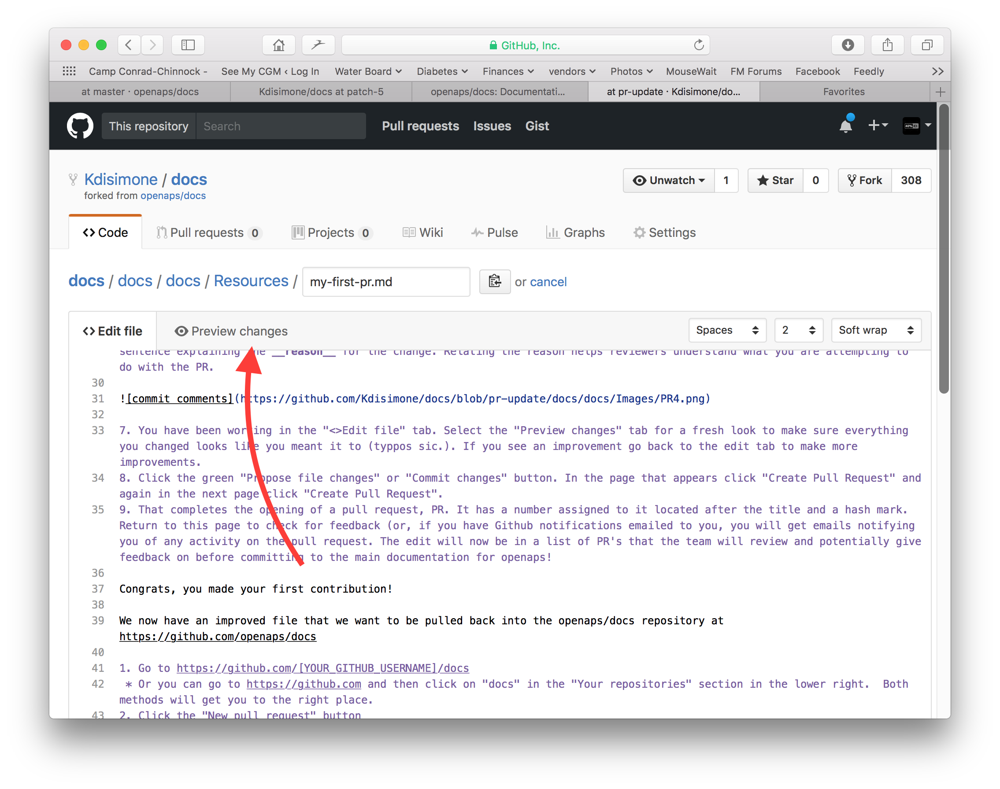
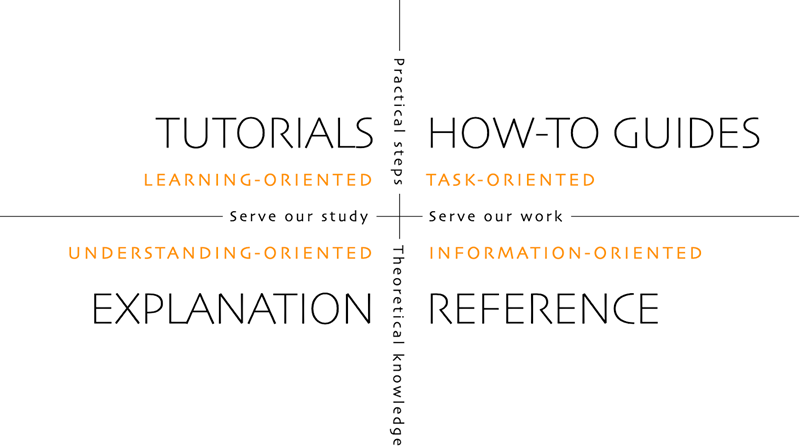

# Как да редактирате документацията

**Това описание е само за редактиране на документацията на английски език. Цялата нова информация трябва първо да се добави на английски език. Ако искате да превеждате на други езици (благодарим ви), моля, използвайте [crowdin](https://crowdin.com/project/androidapsdocs).**

За съвети как да форматирате текст (заглавие, удебелен шрифт...) и да добавяте връзки, вижте раздела [„Синтаксис на кода“](#code-syntax) на тази страница.

## Общи

За въпроси, обратна връзка или нови идеи можете да се свържете с екипа на документацията в [Discord](https://discord.gg/4fQUWHZ4Mw).

В даден момент може да ви предложат да направите заявка за сливане (pull request, PR). Чрез нея промените ви в документацията наистина влизат в уеб страниците на AAPS, които се съхраняват в GitHub. Всъщност не е много трудно да направите PR и това е чудесен начин да помогнете. Четете тази документация в момента, защото хора като вас са направили PR. Не се притеснявайте, че ще сгрешите или по някакъв начин ще редактирате грешните документи. Промените ви се преглеждат, преди да бъдат слети в „официалното“ хранилище на документацията на AAPS. Не можете да развалите оригиналите по погрешка по време на процеса. Общият процес е следният:

- Направете промени и подобрения в кода или документацията, като редактирате съществуващото съдържание.
- Проверете още веднъж дали промените ви изглеждат добре.
- Напишете кратки бележки какво е променено, за да могат другите да разберат промените.
- Създайте заявка за сливане (pull request), с която молите администраторите да приемат промените ви.
- Те ще направят преглед и или (1) ще слеят промените ви, (2) ще ви отговорят с коментар за промените, или (3) ще започнат нов документ с вашите промени.

(Забележка: Ако учите по-лесно визуално, има видео в YouTube [тук](https://youtu.be/4b6tsL0_kzg), което показва работния процес с PR.)

За пример ще направим промяна в AndroidAPSdocs. Това може да се направи на всеки компютър с Windows, Mac и т.н. (всеки компютър с достъп до интернет).

1. Отидете на <https://github.com/openaps/AndroidAPSdocs> и натиснете Fork горе вдясно, за да направите собствено копие на хранилището.


2. Отидете на която и да е страница и стигнете до страницата, която искате да редактирате. Можете да натиснете връзката „Edit in GitHub“ в горния десен ъгъл. Това е възможно само за страниците на английски език. 


Или натиснете иконата с молив, която се появява в горната лента на съдържанието на страницата, която ще редактирате. За това трябва вече да сте влезли в профила си в GitHub (ако нямате такъв, той се създава лесно).


3. Всеки от двата варианта в стъпка 2 ще създаде нов клон във ВАШЕТО хранилище (repository), където ще се запазят промените ви. Направете промените си във файла.

За страниците на документацията използваме Markdown. The files have the suffix ".md". The Markdown specification is not fixed and we use at the moment the myst_parser for our markdown files. Внимавайте да използвате правилния синтаксис, както е [описано по-долу](#code-syntax).


4. Вие работите в раздела „<>Edit file“. Изберете раздела „Preview changes“, за да погледнете промените отново и да се уверите, че всичко изглежда така, както сте искали (проверете и за правописни грешки). Ако видите, че нещо трябва да се подобри, върнете се в раздела за редактиране и направете още подобрения. 



5. Когато приключите с промените, превъртете до края на страницата. В полето най-долу напишете коментарите си в текстовото поле с надпис „Add an optional extended description...“. Заглавието по подразбиране съдържа името на файла. Опитайте да добавите изречение, което обяснява **причината** за промяната. Когато посочите причината, проверяващите по-лесно разбират какво искате да постигнете с PR.


6. Натиснете зеления бутон „Propose file changes“ или „Commit changes“. На страницата, която се появи, натиснете „Create Pull Request“ и на следващата страница отново натиснете „Create Pull Request“.


7. С това отварянето на заявката за сливане (PR) е завършено. GitHub дава на PR номер, който стои след заглавието и знака „#“. Връщайте се на тази страница, за да проверите за обратна връзка (или, ако получавате известията от GitHub по имейл, ще получавате имейли за всяка активност по PR). Промяната вече ще е в списъка с PR, които екипът ще прегледа и евентуално ще коментира, преди да бъдат включени в основната документация на AAPS! Ако искате да проверите докъде е стигнал PR, можете да натиснете иконата с камбанка в горния десен ъгъл на профила си в GitHub и да видите всички свои PR.


П.П.: Вашият fork и клон ще останат във вашия личен профил в GitHub. След като получите известие, че вашият PR е слят, можете да изтриете клона си, ако вече не ви трябва (зоната за известия от стъпка 8 ще ви даде връзка за изтриване на клона, след като PR бъде затворен или слят). При бъдещи промени, ако следвате тази процедура, промените винаги ще започват от актуална версия на хранилищата на AndroidAPSdocs. Ако изберете друг начин да започнете PR (например като редактирате, започвайки от клона master на вашето fork хранилище), първо трябва да се уверите, че хранилището ви е актуално, като направите „compare“ и слеете всички промени, направени след последното обновяване на вашия fork. Тъй като хората често забравят да обновяват хранилищата си, препоръчваме да използвате описания по-горе процес за PR, докато свикнете да правите „compare“.

(edit-the-docs-code-syntax)=

## Синтаксис на кода

За страниците на документацията използваме Markdown. Файловете имат разширение „.md“.

Markdown е много прост език за форматиране на текст, който отделя съдържанието на текста от форматирането му.

Авторът само отбелязва например едно заглавие като заглавие от ниво 1, а процесорът на Markdown създава нужния HTML код по време на обработката, за да покаже заглавието в HTML.

Идеята е, че

- авторът трябва първо да мисли за текста, а не за форматирането,
- текстът в Markdown може да се използва с различни инструменти за Markdown, вместо например със собственически инструменти като Microsoft Windows, и
- можете да създавате няколко изходни формата от един файл в Markdown.

Markdown не е 100 % фиксиран стандарт и се опитваме да сме възможно най-близо до стандарта, за да

- можем да останем гъвкави и да сменяме инструментите за Markdown, когато е нужно или когато бъдещото развитие на инструментите и SaaS услугите за Markdown го наложи, и
- можем да използваме услуги за превод, които превеждат от английски на целеви език, например френски или немски. Те могат да работят с Markdown, но не и със сложни кодове за форматиране, защото не могат да отделят съдържанието от оформлението, а това може да има фатални последици.

### Заглавия

- Заглавие 1: `# headline`
- Заглавие 2: `## headline`
- Заглавие 3: `### headline`
- Заглавие 4: `#### headline`

Опитваме се да не използваме повече нива на заглавия.

### Форматиране на текст

- **удебелен**: `**text**`
- *курсив*: `*text*`
- ***удебелен курсив***: `***text***`

### Номериран списък

    1. първи
    1. втори
    1. трети
    

1. първи
2. втори
3. трети

### Неномериран списък

    - един елемент
    - друг елемент
    - и още един елемент
    

- един елемент
- друг елемент
- и още един елемент

### Многостепенен списък

Можете да вмъквате списъци в списъци, като отместите следващото ниво с 4 интервала повече надясно от предишното.

    1. първи
    1. втори
    1. трети
      1. един елемент
      1. друг елемент
      1. и още един елемент
    1. четвърти
    1. пети
    1. шести
    

1. първи
2. втори
3. трети 
    1. един елемент
    2. друг елемент
    3. и още един елемент
4. четвърти
5. пети
6. шести

### Изображения

За да добавите изображения, използвайте този синтаксис на Markdown.

- изображения: ``

Изображението трябва да е във формат PNG или JPEG.

Image names should conform to one of the following naming rules. В примера използвам png като разширение. Ако използвате JPEG, моля, използвайте jpeg като разширение.

- `filename-image-xx.png`, където xx е уникално двуцифрено число за изображенията в този файл.
- `filename-image-xx.png` where xx is a meaningful name chosen by the author of the md file.

Изображенията се намират в папката images за английския език и Crowdin ги пренася автоматично към другите езици. Не е нужно да правите нищо за това!

В момента не превеждаме изображенията: изображенията трябва да съдържат **възможно най-малко текст**, за да са достъпни за читатели, които не владеят английски.

(make-a-PR-image-size)= Използвайте разумен размер за изображенията, така че да се четат на компютър, таблет и мобилен телефон.

- Екранните снимки от уеб страници трябва да са с ширина до **1050 пиксела**.
- Диаграмите на процеси трябва да са с ширина до **1050 пиксела**.
- Екранните снимки от приложението трябва да са с ширина до **500 пиксела**. Не ги поставяйте една до друга, ако не е необходимо.
- Екранните снимки от часовника (**Wear OS**) трябва да са с ширина до **360 пиксела**. Никога не увеличавайте екранна снимка, която е по-малка.

### Връзки

#### Външни връзки

Външните връзки са връзки към външни уеб сайтове.

- външна връзка: `[alt text](www.url.tld)`

#### Вътрешни връзки към началото на md файл

Вътрешните връзки към страници са връзки към началото на md файл, който се намира на нашия собствен сървър.

- вътрешна връзка към .md страница: `[alt text](../folder/file.md)`

#### Вътрешни връзки към именувани препратки в текста

Вътрешните връзки към именувани препратки са връзки към произволно място в md файл, който се намира на нашия собствен сървър и където е поставена препратка, към която да сочи връзката.

Добавете именувана препратка на мястото в целевия md файл, към което искате да прескочите.

`(name-of-my-md-file-this-is-my-fancy-named-reference)=`

Именуваната препратка трябва да е уникална във всички md файлове на AndroidAPSDocs, а не само в md файла, в който се намира!

Затова е добра практика да започнете с името на файла и след това да добавите избраното от вас име на препратката.

Използвайте само малки букви и свързвайте думите с тире.

След това добавете връзка към тази препратка в текста, който пишете, със следния вид връзка.

- Вътрешни връзки към именувани препратки: `[alt text](name-of-my-md-file-this-is-my-fancy-named-reference)`

### Бележки, предупреждения, сгъваеми бележки

Можете да добавяте в документацията полета с бележки и предупреждения.

Furthermore you can add collapsing notes for detailed information, so that users who are not interested in the details are not put off reading the text. Моля, използвайте ги внимателно, защото документацията трябва да се чете възможно най-лесно.

#### Бележки

    ```{admonition} Заглавие на бележката
    :class: note
    Това е бележка.
    ```
    

```{admonition} Заглавие на бележката :class: note Това е бележка.

    <br />#### Предупреждения
    
    ````
    ```{admonition} Внимание
    :class: warning
    Това е предупреждение.
    

    ```{admonition} Заглавие на предупреждението
    :class: warning
    Това е предупреждение.
    ```
    
    #### Сгъваеми бележки
    
    

    {admonition} по-подробна информация за интересуващите се читатели
    :class: dropdown
    
    Този блок е сгънат,
    което означава, че тук можете да добавите по-дълго съдържание,
    без то да заема много място на страницата.
    

````

```{admonition} по-подробна информация за интересуващите се читатели :class: dropdown Този блок е сгънат, което означава, че тук можете да добавите по-дълго съдържание, без то да заема много място на страницата.

```

## Таблици

Избягвайте таблици с дълги текстове, защото съдържанието им е трудно за оформяне в Markdown, обикновено не се побират в ширината на екрана на мобилен телефон и вероятно няма да изглеждат по същия начин след превод.

## Ръководство за стил

### Съдържание

1. Съвети за писане на английски език

2. Бележки за писане, специфични за AAPS

3. Полезни източници

###  1\. Съвети за писане на английски език

#### Използвайте език, подходящ за читателя

Използвайте прост английски език навсякъде, където е възможно. Това помага на читателите, за които английският не е роден език, и улеснява превода на документите на AAPS на други езици. Пишете като в разговор с потребителя – представете си, че седите на бюрото срещу човека, за когото пишете. Запомнете – повечето потребители на AAPS нямат опит в програмирането. Самият диабет също има много специфични термини и съкращения. Имайте предвид, че някои хора може да са диагностицирани наскоро, може да нямат вашия опит с диабета или да са получили различно обучение за диабета. Ако използвате съкращение, изпишете го изцяло първия път, когато го използвате, и поставете съкращението веднага след него в скоби, например „super micro bolus (SMB)“. Също така добавете връзка към речника. Технически термини, които може да не са познати на читателя, също могат да се добавят в скоби.

Вместо: *“What causes high postprandial BG peaks in closed loop?"*

Използвайте: *“What causes a high BG peak **after lunch** (postprandial) in closed loop?"*

##### Използвайте прости думи, които всеки може да разбере

Тук ще намерите списък от А до Я с алтернативни думи, които правят текста по-лесен за разбиране:

<https://www.plainenglish.co.uk/the-a-z-of-alternative-words.html>

#### Въпроси за поверителност и лицензи:

Особено ако записвате видео или правите екранни снимки, внимавайте да не разкриете личните си данни (API ключ, пароли). Уверете се, че съдържанието в YouTube не е публично в списъците и може да се гледа само чрез връзка от документацията. Не привличайте внимание към материали, които нарушават авторски права (BYODA и др.).

#### Пишете кратки изречения, говорете по същество

- Ясният текст трябва да има средна дължина на изречението от 15 до 20 думи.

- Това не означава всяко изречение да е със същата дължина. Пишете стегнато. Разнообразявайте текста, като смесвате кратки изречения (като предишното) с по-дълги (като това).

- Придържайте се към една основна идея в изречение, плюс може би още една свързана мисъл.

- Възможно е понякога пак да напишете дълго изречение, особено когато обяснявате нещо сложно. Но повечето дълги изречения могат да се разделят по някакъв начин.

- Премахвайте слабите думи: „you can“, „there is/are/were“, „in order to“.

- Поставяйте ключовите думи близо до началото на заглавията, изреченията и абзаците.

- Бъдете нагледни! Когато е възможно, добавете кратка диаграма, екранна снимка или видео.

#### Не се страхувайте да давате инструкции

Командите са най-бързият начин да дадете инструкции, но авторите понякога се страхуват да дават команди и пишат „you should do this“ вместо просто „do this“. Може би хората се притесняват, че командите звучат твърде грубо. Често можете да решите това, като поставите думата „please“ (моля) отпред. Ако обаче нещо задължително трябва да се направи, по-добре е да не казвате „please“, защото това дава на читателя възможност да откаже.

Вместо: *“You should just think of it as a complete statement."*

Използвайте: *“Think of it as a complete statement.”*

#### Използвайте предимно глаголи в деятелен залог, а не в страдателен залог

Пример за **глагол в деятелен залог**:

- *“The pump (subject) delivers (verb) the insulin (object).”*

„delivers“ тук е глагол в деятелен залог. Изречението казва кой извършва подаването, преди да каже какво се подава.

Пример за **глагол в страдателен залог**:

- *“The insulin (subject) is delivered (verb) by the pump (object)”*

*“delivered”* is a passive verb here. Подлогът и допълнението са разменени в сравнение с изречението с деятелен залог. Трябваше да направим изречението по-дълго, като добавихме „is“ и „by the“. Помислете също дали да не започнете с глагола в деятелен залог.

Вместо: *“You can connect your pump with the phone through the AAPS pump menu, and there are a number of pumps available for you to connect with.”*

Използвайте: *“Connect your desired pump to the phone through the AAPS pump menu.”*

Страдателният залог може да създаде проблеми:

- Може да обърква.

- Често прави текста по-разтеглен.

- Прави текста по-малко жив.

##### Добри случаи за страдателен залог

Понякога страдателният залог може да е подходящ.

- За да звучи нещо по-малко враждебно – „this bill has not been paid“ (страдателен залог) е по-меко от „you have not paid this bill“ (деятелен залог).

- За да не търсите вина – „a mistake was made“ (страдателен залог) вместо „You made a mistake“ (деятелен залог).

- Когато не знаете кой или какво извършва действието – „the England team has been picked“.

- Ако просто звучи по-добре.

#### Избягвайте номинализациите (отглаголните съществителни)

Номинализацията е име на нещо, което не е физически предмет, например процес, техника или емоция. Номинализациите се образуват от глаголи.

Например:

| Глагол    | Номинализация |
| --------- | ------------- |
| complete  | completion    |
| introduce | introduction  |
| provide   | provision     |
| fail      | failure       |

Те често се използват **вместо** глаголите, от които произлизат, но могат да звучат така, сякаш всъщност нищо не се случва. Твърде много номинализации правят текста много скучен и тежък за четене.

Вместо: *“The implementation of the method has been done by a team.”*

Използвайте: *“A team has implemented the method.”*

#### Използвайте списъци, където е подходящо

Списъците са отличен начин да разделите информацията. Има два основни вида списъци:

- Едно продължително изречение с няколко изброени точки в началото, в средата или в края.

- Отделни водещи точки с въвеждащо изречение.

В списъка с водещи точки по-горе всяка точка е пълно изречение, затова всяка започва с главна буква и завършва с точка. Използвайте водещи точки вместо цифри или букви, защото те насочват вниманието ви към всяка точка, без да ви дават допълнителна информация, която да обработвате.

#### Разбиване на митове

- Можете да започнете изречение с **and, but, because, so or however**.

- Можете да разделяте инфинитива (split infinitive). Така можете да кажете **“to boldly go”**.

- Можете да завършите изречение с предлог. Всъщност това е нещо, което трябва да отстояваме (**we should stand up for**).

- И **вие** можете да използвате една и съща **дума** два пъти в изречение, ако **вие** не намерите по-добра **дума**.

#### Оптимизиране на стила на писане според целта

За да е документацията ясна и кратка, пишем различните ѝ раздели в различни стилове.

Стилът „обяснение“ (explanation) се използва за въведението, основната информация и разделите за задълбочаване на знанията.

Стилът „ръководство как да“ (how-to guide), с минимални обяснения, се използва за компилирането и конфигурирането на AAPS и за някои от разделите за отстраняване на неизправности.

Урокът (tutorial) помага на обучаващия се да придобие основни умения. Потребителят ще **се учи, като прави**.



#####  Уроци (tutorials) (например как да научите дете да разбива белтъци)

- разказвачът говори директно на читателя: In this tutorial **you** will (we) може да се използва в редки случаи, за да предаде усещането „ние сме заедно в това“

- Бъдеще време -> за да покажете крайната цел

- Повелително наклонение -> за изпълнение на задачите -> Конкретни стъпки – избягвайте абстрактни понятия

- Минало време -> за да покажете изпълнените задачи -> Бързи и веднага видими резултати

- Минимум обяснения -> само строго необходимото за изпълнение на задачата – **какво и защо**

- Пропускайте опциите/алтернативите/…. Без двусмислие

- Преходи между стъпките: завършвайте всяка стъпка с изречение, което води към следващата стъпка като логично продължение. Пример: *You have now installed the Let’s Encrypt client, but before obtaining certificates, you need to make sure that all required ports are open. To do this, you will update your firewall settings in the next step.*

- Заглавие на **урок** (заглавие от ниво 1)

- Въведение (без заглавие)

- Предпоставки (заглавие от ниво 2)

- Стъпки:

- Стъпка 1 — Изпълнение на първото действие (заглавие от ниво 2)

- Стъпка 2 — Изпълнение на следващото действие (заглавие от ниво 2)

- Стъпка n — Изпълнение на последното действие (заглавие от ниво 2)

- Заключение (заглавие от ниво 2)
    
    - **Езикът на уроците**
        
        *In this tutorial, you will…*
        
        Опишете какво ще постигне обучаващият се (забележка – не: „you will learn…“).
        
        *First, do x. Now, do y. Now that you have done y, do z.*
        
        Без място за двусмислие или съмнение.
        
        *We must always do x before we do y because… (see Explanation for more details).*
        
        Давайте минимални обяснения на действията с възможно най-простия език. Дайте връзка към по-подробно обяснение.
        
        *The output should look something like this…*
        
        Дайте на обучаващия се ясни очаквания.
        
        *Notice that… Remember that…*
        
        Давайте на обучаващия се много подсказки, които да му помогнат да потвърди, че е на прав път, и да се ориентира.
        
        *You have built a secure, three-layer hylomorphic stasis engine…*
        
        Опишете (и похвалете умерено) какво е постигнал обучаващият се (забележка – не: „you have learned…“)

#####  Ръководства „как да“ (how-to guides) (например рецепта)

Целта на ръководството „как да“ е да помогне на вече подготвения потребител да изпълни правилно определена задача.

- КАК да (HOW-to)

- разказвачът говори директно на читателя: In this tutorial **you** will

- Бъдеще време -> за да покажете крайната цел

- Условно повелително наклонение -> за да получите X, направете y -> Конкретни стъпки – избягвайте абстрактни понятия

- Минимум обяснения -> само строго необходимото за изпълнение на задачата -> **какво и защо**

- Пропускайте опциите/алтернативите/…. Без двусмислие, но можете да дадете връзка към справочния запис или към обяснението

- **Как да**: заглавие (заглавие от ниво 1)

- Въвеждащ абзац

- Предпоставки по избор (абзац или заглавие от ниво 2, ако са повече от 1)

- Стъпки:

- Стъпка 1 — Изпълнение на първото действие (заглавие от ниво 2)

- Стъпка 2 — Изпълнение на следващото действие (заглавие от ниво 2)

- Стъпка n — Изпълнение на последното действие (заглавие от ниво 2)

- Заключителен абзац
    
    - **Езикът на ръководствата „как да“**
        
        *This guide shows you how to…*
        
        Опишете ясно проблема или задачата, които ръководството показва как да се решат.
        
        *If you want x, do y. To achieve w, do z.*
        
        Използвайте условно повелително наклонение.
        
        *Refer to the x reference guide for a full list of options.*
        
        Не претрупвайте практическото си ръководство „как да“ с всичко възможно, което потребителят би могъл да направи във връзка с x.

#####  Обяснение (explanation) (например науката зад това защо белтъците се втвърдяват, когато ги разбивате)

Обяснението изяснява, задълбочава и разширява разбирането на читателя за дадена тема.

- ЗАЩО

- Започнете с **About** („Относно“)

- Дайте контекст, добавете връзки към ВСИЧКИ свързани източници

- Обсъдете опциите/алтернативите

- Не давайте инструкции и справочна информация (дайте връзка към тях)

- Посочете неизвестните неща, променящите се цели и т.н.…

- Заглавие с **About** (заглавие от ниво 1)

- Въведение (без заглавие)

- Предпоставки по избор (заглавие от ниво 2)

- Подтема 1 (заглавие от ниво 2)

- Заключение (заглавие от ниво 2)
    
    - **Езикът на обясненията**
    
    *The reason for x is because historically, y…*
    
    Обяснявайте.
    
    *W is better than z, because…*
    
    Offer judgements and even opinions where appropriate.
    
    *An x in system y is analogous to a w in system z. However…*
    
    Дайте контекст, който помага на читателя.
    
    *Some users prefer w (because z). This can be a good approach, but…*
    
    Претеглете алтернативите.
    
    *An x interacts with a y as follows:…*
    
    Разкрийте вътрешните тайни на механизма, за да помогнете да се разбере защо нещо прави това, което прави.

### 2\. Бележки за писане/обновяване, специфични за AAPS

#### Автор и редактор

Когато пишете или обновявате документацията на AAPS, разглеждайте процеса като два етапа. Те могат да се изпълнят от един и същ човек в различно време или от повече от един човек.

**Авторът (например вие!)** пише/редактира раздел от документацията в сбит разговорен тон и след това го предава на редактора.

**Редакторът (например друг потребител на AAPS или човекът, който получава заявката за сливане)** проверява дали е спазено ръководството за стил, редактира раздела за яснота и достъпност и премахва колкото се може повече думи (особено в разделите тип урок/„как да“). Може да помогне да прочетете текста на глас.

#### Общи бележки за AAPS

- За стойностите на глюкозата посочвайте и mg/dl, и mmol/l всеки път (помислете за това и при екранните снимки, ако е възможно).

- За последователност използвайте „AAPS“, а не „Android APS“.

- Посочете ясно версията на Android Studio/AAPS, за която пишете или от която са направени екранните снимки.

### 3\. Полезни източници

<https://dev.readthedocs.io/en/latest/style-guide.html>

[Diátaxis (diataxis.fr)](https://diataxis.fr/)

[Technical Writer Style Guide Examples | Technical Writer HQ](https://technicalwriterhq.com/writing/technical-writing/technical-writer-style-guide/)

[DigitalOcean's Technical Writing Guidelines | DigitalOcean](https://www.digitalocean.com/community/tutorials/digitalocean-s-technical-writing-guidelines)

[Top 10 tips for Microsoft style and voice - Microsoft Style Guide | Microsoft Learn](https://learn.microsoft.com/en-us/style-guide/top-10-tips-style-voice?source=recommendations)

<https://www.plainenglish.co.uk/how-to-write-in-plain-english.html>

<https://developers.google.com/style>

<https://www.mongodb.com/docs/meta/style-guide/screenshots/screenshot-guidelines/>