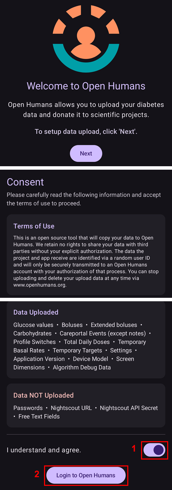
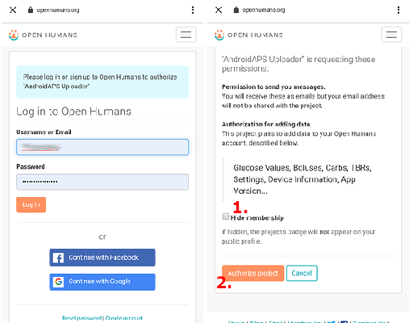

# Качване на данни в Open Humans

## Дарете данните си за науката

Можете да помогнете на общността, като дарите данните си за изследователски проекти! Това помага на учените да предадат доброто нататък, да развиват нови научни идеи и да разширяват отворения подход на системите със затворен кръг с отворен код. AAPS е готов да синхронизира данните ви с [Open Humans](https://www.openhumans.org) – платформа, която ви позволява да качвате, свързвате и съхранявате личните си данни, например генетични данни, данни за активност и за здравето.

Вие запазвате пълен контрол върху това какво се случва с данните ви и кои проекти искате да подкрепите, като им дадете достъп до данните си. В зависимост от проекта, към който сте се присъединили, данните се оценяват и използват по различни начини и в различна степен.

Следните данни ще бъдат качени във вашия профил в Open Humans:

- Стойности на КЗ
- Събития от Портал за лечения (без бележки)
- Удължени болуси
- Смени на профил
- Общи дневни дози
- Временни базали
- Временни цели
- Опции
- Версия на приложението
- Модел на устройството
- Размер на екрана

Тайна или лична информация, като адреса (URL) на Nightscout или API secret, няма да бъде качвана.

## Настройка

1. Създайте профил в [Open Humans](https://www.openhumans.org), ако все още нямате такъв. Ако желаете, можете да използвате съществуващия си профил в Google или Facebook.
2. Активирайте плъгина **Open Humans** в [**Конфигурация** > **Комуникация**](../SettingUpAaps/ConfigBuilder.md).


3. Докоснете **Настройки** в картата **Open Humans**. Можете да ограничите качването до времето, когато телефонът използва Wi-Fi (**Само с WiFi**) и/или се зарежда (**Само когато телефонът се зарежда**).


4. Докоснете **Отвори плъгин** в картата **Open Humans**, след това докоснете **Настройка**.


5. На екрана **Добре дошли в Open Humans** докоснете **Напред**. Прочетете внимателно екрана **Съгласие**: той показва условията за ползване и кои данни се качват и кои не се качват.
6. Включете **Разбирам и съм съгласен.** (1) и докоснете **Вход в Open Humans** (2).



7. Ще се отвори уеб сайтът на Open Humans. Влезте с данните си за вход.
8. Решете дали искате да скриете членството си в AAPS Uploader в публичния си профил в Open Humans (1).
9. Натиснете **Authorize project** (упълномощаване на проекта) (2).



```{admonition} Older screenshot
:class: note
Екранните снимки по-горе показват по-стара версия на уеб сайта на Open Humans и все още използват старото име на проекта **AndroidAPS Uploader**. Стъпките са същите.
```

10. Обратно в **AAPS** екранът **Последни настройки** ви пита дали искате да продължите. Докоснете **Продължи**.
11. Изчакайте да се появи **Готови сме!**, след това докоснете **Затвори**. Отсега нататък телефонът ви ще качва данни на заден фон от време на време.
12. Екранът на плъгина **Open Humans** вече показва вашия **Номер на участник в проекта**. Докоснете **Качи сега**, ако искате да започнете качване веднага.
13. Докоснете **Изход**, ако искате да спрете качването на данни в Open Humans.
14. Известие в Android ще ви информира, че тече качване.


```{admonition} Older screenshot
:class: note
Екранната снимка по-горе е от по-стара версия на **AAPS**. В **AAPS** 4 екраните за потвърждение са **Последни настройки** и **Готови сме!**, няма размер на опашката, а бутоните са **Качи сега** и **Изход**.
```

15. Можете да управлявате данните си, като влезете в [уеб сайта на Open Humans](https://www.openhumans.org).


## Възможности за споделяне

### [Проектът „OPEN“](https://www.open-diabetes.eu/)

Проектът „OPEN“ обединява международен и междусекторен консорциум от пациенти иноватори, лекари, социолози, компютърни специалисти и организации за защита на пациентите, за да изследва различни аспекти на системите за изкуствен панкреас „Направи си сам“ (DIY APS), които се използват от все повече хора с диабет. За повече подробности вижте техния [уеб сайт](https://www.open-diabetes.eu/).

През септември 2020 г. проектът „OPEN“ стартира [проучване](https://survey.open-diabetes.eu/), което включва и възможност да дарите данните, които сте качили в Open Humans. На техния сайт и в самото проучване има [ръководство](https://open-diabetes.eu/en/open-survey/survey-tutorials/) как да дарите данните си на проекта „OPEN“.

### [OpenAPS Data Commons](https://www.openhumans.org/activity/openaps-data-commons/)

OpenAPS Data Commons е създаден, за да даде лесен начин за споделяне на набори от данни от общността DIYAPS за изследвания. Данните се споделят както с традиционни изследователи, които правят традиционни научни изследвания, така и с групи или хора от общността, които искат да прегледат данните като част от собствените си изследователски проекти. OpenAPS Data Commons използва платформата „Open Humans“, за да могат хората лесно да качват и споделят данните си от DIYAPS системи, включително AAPS, Loop и OpenAPS.

Можете да качите данните си в Open Humans по един от три начина:

1. използвайте функцията за качване в AAPS, за да качите данните си в Open Humans
2. използвайте Nightscout Data Transfer, за да качите данните си в Open Humans
3. качете файловете с данни ръчно в Open Humans.

След като създадете профил и данните ви започнат да постъпват в Open Humans, не забравяйте да се присъедините и към OpenAPS Data Commons, за да дарите данните си за изследвания, ако желаете.

## Условия за ползване

Това е инструмент с отворен код, който ще копира данните ви в [Open Humans](https://www.openhumans.org). Ние не запазваме никакви права да споделяме данните ви с трети страни без вашето изрично разрешение. Данните, които проектът и приложението получават, се идентифицират чрез случаен потребителски идентификатор (ID) и ще бъдат предадени по сигурен начин към профил в Open Humans само с вашето разрешение за този процес. Можете да спрете качването и да изтриете качените данни по всяко време чрез [www.openhumans.org](https://www.openhumans.org). Имайте предвид, че някои проекти, които получават данни, може да не поддържат това.

Вижте също [Условията за ползване на Open Humans](https://www.openhumans.org/terms/).

## Поверителност на данните

Open Humans защитава поверителността ви, като ви дава числов идентификатор (ID) за всеки проект. This allows projects to recognize but not identify you. Идентификаторът на приложението (Application ID), който AAPS качва, е подобен и служи само за управление на данните. Повече информация можете да намерите тук:

- [Политика за използване на данни на Open Humans](https://www.openhumans.org/data-use/)
- [Open Humans и GDPR](https://www.openhumans.org/gdpr/)
