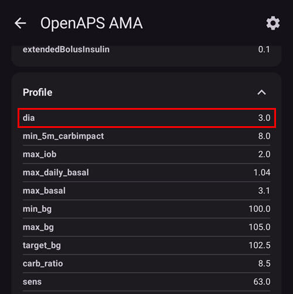

# Често задавани въпроси

Как да добавите въпроси към този списък: следвайте тези [инструкции](../SupportingAaps/HowToEditTheDocs.md)

## Общи

### Мога ли просто да изтегля инсталационния файл на AAPS?

Не. Няма APK файл на AAPS за изтегляне. Трябва сами да го [компилирате](../SettingUpAaps/BuildingAaps.md). Ето защо:

AAPS се използва за управление на помпата и за подаване на инсулин. Според действащите правила в Европа всички системи от клас IIa или IIb са медицински изделия, за които е нужно регулаторно одобрение (маркировка CE). За това одобрение са нужни различни проучвания и разрешения. Разпространяването на нерегулирано (несертифицирано) устройство е незаконно. Подобни правила има и в други части на света.

Тези правила не се отнасят само за продажбата (в смисъл на получаване на пари), а за всяко разпространение (дори безплатно). Единственият начин да използвате приложението в рамките на тези правила е сами да изградите медицинското изделие за себе си.

Затова няма готови APK файлове.

(FAQ-how-to-begin)=

### Как да започна?

Започнете с [Подготовка за започване с AAPS](../Getting-Started/PreparingForAaps.md): там всичко по-долу е описано по-подробно, стъпка по стъпка.

Първо трябва да **се снабдите с хардуерни компоненти, подходящи за затворен кръг**:

* [поддържана инсулинова помпа](../Getting-Started/CompatiblePumps.md), 
* [смартфон с Android](../Getting-Started/Phones.md) (Apple iOS не се поддържа от AAPS – можете да разгледате [iOS Loop](https://loopkit.github.io/loopdocs/)) и
* [система за продължително наблюдение на глюкозата](../Getting-Started/CompatiblesCgms.md). 

Второ, трябва да **настроите софтуерните компоненти**: [AAPS](../SettingUpAaps/BuildingAaps.md), [източник на данни от CGM/FGM](../Getting-Started/CompatiblesCgms.md) и [сървър за отчети](../SettingUpAaps/SettingUpTheReportingServer.md).

Трето, трябва да научите и **да разберете референтния дизайн на OpenAPS, за да проверите своите настройки за лечение**. Основният принцип на затворения кръг е, че вашата [базална доза и коефициент за въглехидрати](../SettingUpAaps/YourAapsProfile.md) са точни. Всички препоръки предполагат, че базалните ви нужди са покрити и че всички пикове или спадове, които виждате, се дължат на други фактори, които изискват еднократни корекции (физическа активност, стрес и др.). Корекциите, които затвореният кръг може да прави от съображения за безопасност, са ограничени (вижте максималния разрешен временен базал в [OpenAPS Reference Design](https://openaps.org/reference-design/)). Затова не бива да хабите разрешените дози за коригиране на грешен основен базал. Ако например често получавате нисък временен базал преди хранене, вероятно базалът ви трябва да се коригира. Можете да използвате [Autotune](#autotune-how-autotune-calculates-adjustments), за да анализирате голямо количество данни и да получите предложение дали и как трябва да се коригират базалите и/или ISF, както и дали трябва да се промени коефициентът за въглехидрати. Или можете да тествате и настроите базала си по [стария начин](https://integrateddiabetes.com/basal-testing/).

### Какви практически въпроси ще имам при използване на затворен кръг?

#### Защита с парола

Ако не искате настройките ви да могат лесно да се променят, можете да ги защитите с парола, ПИН или биометрично удостоверяване на телефона (пръстов отпечатък, лице). Отворете **Настройки** > **Защита** > **Защита на настройките** и изберете вида защита. На същото място можете да защитите и цялото приложение или само болусите. Вижте [Защита на настройките](#Preferences-settings-protection) за подробности.

#### Смарт часовници с Android Wear

Ако използвате приложението AAPS за часовник, за да правите болус или да променяте настройки, всяка заявка трябва да се потвърди на часовника: след като я изпратите, часовникът показва обобщение с бутон **ПОТВЪРДИ**. Вижте [Управление на AAPS чрез смарт часовник с Wear OS](../RemoteFeatures/RemoteControlWearOS.md).

(FAQ-disconnect-pump)=

#### Разкачване на помпата

Ако свалите помпата за душ, вана, плуване, спорт или други дейности, трябва да съобщите на AAPS, че не се подава инсулин, за да остане IOB правилен.

Помпата може да се разкачи чрез [иконата на кръга](#AapsScreens-loop-status) на главния екран на AAPS: натиснете я и изберете **Разкачи помпата** с нужната продължителност. Ако дейността продължи по-дълго от планираното, натиснете иконата отново и изберете нова продължителност: не е нужно първо да свързвате помпата отново. Вижте [Разкачване на помпата за душ или физическа активност](#pumps-cannulas-disconnecting), за да разберете как да избегнете липса на инсулин при дълго разкачване.

#### Препоръките не се основават само на едно измерване от CGM

От съображения за безопасност препоръките се основават не на едно измерване от CGM, а на средната делта (средната промяна). Затова, ако пропуснете някои стойности, може да мине известно време след възстановяването на данните, преди AAPS отново да започне да работи в затворен кръг.

#### Допълнителни материали за четене

Има няколко блога с добри съвети, които ще ви помогнат да разберете практическата страна на затворения кръг. Някои от тях вече не са онлайн: връзките по-долу, отбелязани с „архивно копие“, отварят запазено копие в Internet Archive.

    * [Фина настройка на параметрите](https://web.archive.org/web/20171029031305/http://seemycgm.com/2017/10/29/fine-tuning-settings/) See my CGM (архивно копие)
    * [Защо DIA е важно](https://web.archive.org/web/20231130035027/http://seemycgm.com/2017/08/09/why-dia-matters/) See my CGM (архивно копие)
    * [Ограничаване на скоковете след хранене](https://diyps.org/2016/07/11/picture-this-how-to-do-eating-soon-mode/) #DIYPS
    * [Хормони и autosens](https://web.archive.org/web/20170902081839/http://seemycgm.com/2017/06/06/hormones-2/) See my CGM (архивно копие)
    

(what-emergency-equipment-is-recommended-to-take-with-me)= (FAQ-emergency-equipment)=

### Какво оборудване за спешни случаи се препоръчва да нося със себе си?

Трябва да носите със себе си същите средства за спешни случаи като всеки друг човек с диабет тип 1 на терапия с инсулинова помпа. Когато използвате затворен кръг с AAPS, силно се препоръчва да имате следното допълнително оборудване със себе си или наблизо:

* Външна батерия и кабели за зареждане на смартфона, часовника и (ако е нужно) BT четеца или устройството Link
* Батерии за помпата
* Достъп до резервните ви копия – както на телефона, така и в облака (напр. Google Drive, Dropbox), за да можете да настроите AAPS отново на друг телефон (вижте [Създаване и възстановяване на резервни копия](../Maintenance/ExportImportSettings.md)): 
  * текущия [apk](../SettingUpAaps/BuildingAaps.md) на AAPS и на всички други приложения, които използвате (напр. xDrip, Juggluco, BYODA).
  * файла с хранилището за ключове (от компилирането на apk) и паролата за него,
  * последните файлове с експорт на настройките от AAPS и от другите ви приложения,
  * главната парола на **AAPS**: без нея не можете да импортирате файла с настройки.

(FAQ-organize-backups)=

#### Как да организирам резервните си копия?

Експортирайте настройките много редовно: след всяка смяна на пача или на резервоара, след промяна на профила, когато сте изпълнили цел, ако смените помпата… Дори нищо да не се променя, експортирайте веднъж месечно. Пазете няколко стари файла с експорт на настройките.

**AAPS** може да направи това вместо вас: може да експортира настройките автоматично (например с [Автоматизация](#ExportImportSettings-Automating-Settings-Export) след всяка смяна на пача) и да записва експорта директно в папка в облака (Google Drive). Вижте [Създаване и възстановяване на резервни копия](../Maintenance/ExportImportSettings.md).

### Как да закрепя сигурно и безопасно CGM/FGM?

Можете да го залепите. Има няколко вида предварително перфорирани лепенки („overpatches“) за често използвани CGM системи (търсете в Google, eBay или Amazon). Някои потребители на затворен кръг използват по-евтина стандартна кинезиологична лента или rocktape.

Можете да го закрепите. Можете също да купите ленти за горната част на ръката, които закрепват CGM/FGM (търсете в Google, eBay или Amazon).

## Алгоритъм на APS

### Защо OpenAPS AMA показва „dia: 3“, въпреки че в профила ми е зададено друго DIA?

Когато в **Конфигурация** > **APS** е избран **OpenAPS AMA**, **Отвори плъгин** показва данните, изпратени към алгоритъма. В секцията **Профил** `dia` винаги е 3.0 или по-малко:

При AMA DIA всъщност не означава „време на действие на инсулина“. Това е параметър, който преди беше свързан с DIA. Сега той означава „за колко време трябва да приключи корекцията“. Той няма нищо общо с изчисляването на IOB. В OpenAPS SMB този параметър вече не е нужен.

## Други настройки

### Настройки на Nightscout

(FAQ-nsclient-blocked)=

#### AAPSClient (или AAPS) не качва данни: „Блокирано от…“. Какво мога да направя?

Статусът на NSClient показва защо не се изпращат данни:

* **Блокирано от настройките за връзка**: настройките за връзка не позволяват текущата връзка. Например използвате мобилни данни, но е разрешен само Wi-Fi, или не сте свързани с някоя от разрешените Wi-Fi мрежи (SSID).
* **Блокирано от настройките за зареждане**: настройките за връзка позволяват синхронизация само докато телефонът се зарежда (или само на батерия), а в момента това не е така.
* **Няма връзка**: телефонът няма връзка с интернет.

Проверете [настройките за връзка на NSClient](#Preferences-nsclient): **Използвай мобилни данни**, **Използвай данни в роуминг**, **Използвай WiFi**, **WiFi SSID на мрежа**, **Синхронизирай NS на батерия** и **Синхронизирай, докато телефонът се зарежда**.

### Настройки на CGM

(FAQ-advanced-filtering)=

#### Защо AAPS показва „SMB „винаги включен“ и „след въглехидрати“ е забранен, защото е активен източник на КЗ, който не поддържа необходимата филтрация“?

**Винаги използвай SMB** и **Разреши SMB след въглехидрати** могат да се използват само с [надежден източник на данни за КЗ](#GettingStarted-TrustedBGSource): сензор и CGM приложение, които могат да съобщят на **AAPS** от кой сензор идват стойностите. При всеки друг източник на КЗ **AAPS** изключва тези две опции и показва това съобщение. Проверете списъка с надеждни източници и ако сензорът ви е в него, уверете се, че използвате едно от CGM приложенията, посочени за него. Вижте също [Изглаждане на данните за кръвната захар](../CompatibleCgms/SmoothingBloodGlucoseData.md).

### Помпа

#### Батерии

Затвореният кръг може да изтощава батерията на помпата по-бързо от нормалната употреба, защото системата комуникира през Bluetooth много повече от потребител, който управлява помпата ръчно. Най-добре е да смените батерията при 25 %, защото след това комуникацията става трудна. Можете да зададете аларми за батерията на помпата чрез променливата PUMP_WARN_BATT_P в сайта си Nightscout. Начини да удължите живота на батерията:

* намалете времето, през което LCD дисплеят остава включен (в менюто с настройки на помпата)
* намалете времето, през което подсветката остава включена (в менюто с настройки на помпата)
* настройте известията да са със звуков сигнал вместо с вибрация (в менюто с настройки на помпата)
* натискайте бутоните на помпата само при презареждане; използвайте AAPS, за да виждате цялата история, нивото на батерията и количеството в резервоара.
* На някои телефони приложението AAPS често може да бъде затваряно, за да се пести енергия или да се освободи RAM. Когато AAPS се стартира отново, при всяко стартиране създава Bluetooth връзка с помпата и отново прочита текущата базална доза и историята на болусите. Това изразходва батерията. За да видите дали това се случва, включете **Записвай стартиране на AAPS** в **Разширени настройки** на NSClient: Nightscout ще получава събитие при всяко рестартиране на AAPS и така проблемът се проследява лесно. За да намалите вероятността това да се случва, изключете оптимизацията на батерията за AAPS, за да не го затваря телефонът: вижте [пестене на батерията](#FAQ-battery-savings) по-долу.
* почистете контактите на батерията с кърпичка със спирт, за да няма остатъци от фабричен восък/грес.
* при [помпите Dana R/RS](../CompatiblePumps/DanaRS-Insulin-Pump.md) процедурата при стартиране пропуска силен ток през батерията, за да разруши нарочно пасивиращия слой (той предотвратява загубата на енергия при съхранение), но това не винаги го разрушава на 100 %. Извадете и поставете отново батерията 2–3 пъти, докато на екрана се покаже 100 %, или използвайте ключа за батерията, за да направите кратко съединение на батерията преди поставянето ѝ: допрете го до двата контакта за част от секундата.
* вижте още съвети за [определени видове батерии](#Accu-Chek-Combo-Tips-for-Basic-usage-battery-type-and-causes-of-short-battery-life)

#### Смяна на резервоари и канюли

Резервоарът трябва да се смени директно на помпата, след което смяната се записва в **AAPS**. Следвайте стъпка по стъпка [ръководството за смяна на резервоара и канюлата на помпата](#pumps-cannulas-changing-reservoir-and-cannula).

### Тапет

Тапета на AAPS за телефона си можете да намерите на [страницата „Телефони“](#Phones-phone-wallpaper).

### Ежедневна употреба

Много от ситуациите по-долу могат да се подготвят веднъж като [сценарий](#scenes): предварителна настройка, която сменя профила, временната цел и други настройки с едно докосване. **AAPS** предлага готови шаблони, например *Физ. активност*, *Сън*, *Алкохол* или *Душ*.

#### Хигиена

(what-to-do-when-taking-a-shower-or-bath)=

##### Какво да правя, когато се къпя под душа или във ваната?

Можете да свалите помпата, докато се къпете под душа или във ваната. За този кратък период може да нямате нужда от нея, но трябва да съобщите на AAPS, че сте я разкачили, за да са правилни изчисленията на IOB. Вижте [описанието по-горе](#FAQ-disconnect-pump). Шаблонът за [сценарий](#scenes) *Душ* прави това вместо вас.

#### Работа

В зависимост от работата си можете да използвате различни настройки за лечение в работните дни. Като потребител на затворен кръг трябва да обмислите [смяна на профил](../DailyLifeWithAaps/ProfileSwitch-ProfilePercentage.md) за обичайния си работен ден. Например можете да превключите на профил над 100 %, ако работата ви е по-малко натоварваща (напр. седите на бюро), или под 100 %, ако сте активни и на крака цял ден. You could also consider a high or low temporary target or a [time shift of your profile](#ProfileSwitch-ProfilePercentage-time-shift-of-the-circadian-percentage-profile) when working much earlier or later than regular, or if you work different shifts. Можете също да създадете втори профил (напр. „вкъщи“ и „работен ден“) и всеки ден да правите смяна на профил към профила, който ви е нужен, или да запишете настройките си за работен ден като [сценарий](#scenes).

### Свободно време

(FAQ-sports)=

#### Спорт

Трябва да промените старите си навици при спорт отпреди затворения кръг. Ако просто приемете един или повече „спортни“ въглехидрати както преди, системата със затворен кръг ще ги разпознае и ще ги коригира.

Така ще имате повече активни въглехидрати, но в същото време кръгът ще противодейства и ще подава инсулин.

Когато използвате затворен кръг, опитайте следните стъпки:

* Make a [profile switch](#ProfileSwitch-change-percentage) below 100%: tap the profile name on the main screen, tap the round **▶** button, then set **Percentage** and **Duration**.
* Задайте [временна цел за физическа активност](#TempTargets-activity-temp-target) над стандартната си цел. При процент под 100 % и зададена продължителност същият екран **Активиране** предлага превключвател **Временна цел / Физ. активност**, който стартира и двете едновременно.
* Ако използвате SMB, уверете се, че [„Използвай SMB с високи цели“](#Open-APS-features-enable-smb-with-high-temp-targets) и [„Винаги използвай SMB“](#Open-APS-features-enable-smb-always) са изключени.

Важно е какво правите с тези настройки преди и след спорта. Направете промените навреме преди спорта и имайте предвид ефекта от попълването на запасите в мускулите.

Шаблоните за [сценарий](#scenes) *Физ. активност* и *Вечер след физ. активност* събират тези настройки заедно, така че можете да ги стартирате с едно докосване. Ако спортувате редовно по едно и също време (напр. тренировка във фитнеса), можете да използвате [автоматизация](../DailyLifeWithAaps/Automations.md), за да стартирате смяната на профил и TT или сценария. Автоматизация въз основа на местоположението също е вариант, но прави предварителната подготовка по-трудна.

Процентът при смяната на профил, стойността на временната цел за физическа активност и най-доброто време за промените са индивидуални. Започнете внимателно, когато търсите правилната стойност за себе си (започнете с по-нисък процент и по-висока TT).

#### Секс

Можете да свалите помпата, за да сте „свободни“, но трябва да съобщите на AAPS, за да са правилни изчисленията на IOB. Вижте [описанието по-горе](#FAQ-disconnect-pump).

#### Пиене на алкохол

Пиенето на алкохол е рисковано в режим Затворен кръг, защото алгоритъмът не може да предвиди правилно КЗ под влиянието на алкохола. Трябва сами да намерите свой начин за справяне с това, като използвате следните функции в AAPS:

* Да изключите режима Затворен кръг и да лекувате диабета ръчно или
* setting high temp targets and deactivating UAM to avoid the loop increasing IOB due to an unannounced meal or
* направете [смяна на профил](#ProfileSwitch-change-percentage) на стойност, значително по-ниска от 100 % 

Шаблонът за [сценарий](#scenes) *Алкохол* е отправна точка, която можете да промените според своя начин.

Когато пиете алкохол, трябва постоянно да следите CGM, за да избегнете хипогликемия, като ръчно приемате въглехидрати.

#### Сън

##### Как да използвам затворен кръг през нощта без мобилни данни и Wi-Fi (без излъчване)?

Много потребители включват самолетния режим на телефона си през нощта. Ако искате кръгът да ви помага, докато спите, направете следното (това работи само ако CGM приложението ви работи на същия телефон като AAPS, например xDrip, Juggluco или BYODA; НЯМА да работи, ако получавате стойностите на КЗ чрез Nightscout):

1. Включете самолетния режим на телефона си.
2. Изчакайте, докато самолетният режим се включи.
3. Включете Bluetooth.

Тогава не получавате обаждания и не сте свързани с интернет. Но кръгът продължава да работи.

Някои хора са забелязали проблеми с локалното излъчване (AAPS не получава стойности на КЗ от xDrip), когато телефонът е в самолетен режим. В xDrip отидете в Settings > Inter-app settings > Identify receiver и въведете `info.nightscout.androidaps`.

Ако искате различни настройки през нощта (например по-висока цел), шаблонът за [сценарий](#scenes) *Сън* е добра отправна точка.

#### Пътуване

##### Как да се справя със смяната на часовата зона?

При Dana R и Dana R Korean не е нужно да правите нищо. За другите помпи вижте страницата [пътуване със смяна на часовата зона](../DailyLifeWithAaps/TimezoneTraveling-DaylightSavingTime.md) за повече подробности.

### Медицински въпроси

#### Хоспитализация

Ако искате да споделите информация за AAPS и затворения кръг „направи си сам“ (DIY) с лекарите си, можете да разпечатате [ръководството за AAPS за лекари](../UsefulLinks/ClinicianGuideToAaps.md).

#### Преглед при вашия ендокринолог

##### Отчети

Можете да покажете отчетите си от Nightscout (https://YOUR-NS-SITE.com/report) или да използвате [Nightscout Reporter](https://nightscout-reporter.zreptil.de/).

## Чести въпроси в Discord и отговорите им...

### Моят проблем не е описан тук.

Вижте [Къде мога да получа помощ?](../GettingHelp/WhereCanIGetHelp.md). Ако сте намерили решението сами, **напомнете ни да го добавим към този списък!**

### Компилиране и инсталиране

(FAQ-build-errors)=

#### Имам проблеми и грешки при компилирането на приложението.

Моля, проверете страницата за отстраняване на неизправности за начина, по който компилирате **AAPS** (вижте [Компилиране на AAPS](../SettingUpAaps/BuildingAaps.md)):

* компилиране в браузъра: [Отстраняване на неизправности при компилиране в браузъра](#aaps-ci-troubleshooting),
* компилиране с Android Studio: [Отстраняване на неизправности в Android Studio](../GettingHelp/TroubleshootingAndroidStudio.md).

(FAQ-build-error-file-name-too-long)=

#### Грешка при компилиране: file name too long (твърде дълго име на файл)

Тази грешка може да се появи при компилиране с Android Studio: компилирането спира с грешка, че името на файла е твърде дълго. Възможни решения: Преместете изходния код в папка по-близо до основната папка на диска (напр. "C:\src\AndroidAPS").

В Android Studio: Уверете се, че „Gradle“ е завършил синхронизирането и индексирането, след като отворите проекта и изтеглите промените (pull) от GitHub. Изпълнете Build->Clean Project, преди да изпълните Rebuild Project. Изпълнете File->Invalidate Caches and Restart в Android Studio.

(FAQ-running-dev-version)=

#### Аларма: Използвате dev версия. Затвореният кръг е изключен

**AAPS** показва това съобщение, когато използвате версия за разработка (dev) без инженерен режим: в dev версия затвореният кръг работи само в инженерен режим.

Версията dev е предназначена за тестване, а не за реално използване на затворен кръг: прочетете [Клон за разработка](../AdvancedOptions/DevBranch.md), преди да продължите.

За да включите инженерния режим:

1. Поставете файл с име `engineering_mode` в подпапката `extra` на директорията на AAPS (папката, която сте избрали в съветника за настройване, обикновено `AAPS/extra`). Подходящ е всеки файл, стига да е правилно наименуван.
2. Рестартирайте **AAPS**, за да намери файла.

Подсказка: направете копие на съществуващ лог файл и го преименувайте на „engineering_mode“ (внимание: без разширение на файла!).

### Цели

#### Блокирал съм на една цел и имам нужда от помощ.

Първо прочетете [Изпълнение на целите](../SettingUpAaps/CompletingTheObjectives.md). Ако все още не можете да продължите, направете снимка на екрана с въпроса и отговорите и я публикувайте в канала на AAPS в Discord. Не забравяйте да напишете кои опции сте избрали (или не сте избрали) и защо. Ще получите подсказки и помощ, но ще трябва сами да намерите отговорите.

### Настройки, пароли и резервни копия

(FAQ-reset-master-password)=

#### Как да нулирам главната парола?

Ако сте забравили главната си парола, можете да я нулирате до серийния номер на помпата си:

1. Създайте празен файл с име `PasswordReset` (без разширение на файла) в подпапката `extra` на директорията на AAPS (обикновено `AAPS/extra`).
2. Рестартирайте **AAPS**. Помпата ви трябва да е свързана: **AAPS** показва „Чакаме помпата…“ и трябва да прочете серийния номер на помпата в рамките на 30 секунди.
3. **AAPS** показва „Паролата е зададена!“: главната ви парола вече е **серийният номер на помпата**. Файлът `PasswordReset` се изтрива автоматично.
4. Отворете **Настройки** > **Защита** > **Главна парола** и задайте нова парола.

Ако помпата не бъде достигната навреме, нищо не се променя: проверете връзката с помпата и опитайте отново.

Това нулира само главната парола. Паролата или ПИН кодът за настройките, за приложението или за болус не се нулират, но винаги можете да използвате главната парола вместо тях.

    {admonition} Стари файлове с настройки
    :class: warning
    Файловете с настройки, експортирани със старата главна парола, могат да се импортират само с тази стара парола.

(FAQ-where-are-settings-files)=

#### Къде мога да намеря файловете с настройки?

Файловете с настройки се съхраняват в подпапката `preferences` на директорията на AAPS, която сте избрали в [съветника за настройване](#SetupWizard-StoragePermission) (например `/internal storage/AAPS/preferences`). Ако сте настроили папка в облака (Google Drive), експортите ви могат да се записват и там. Вижте [Създаване и възстановяване на резервни копия](../Maintenance/ExportImportSettings.md).

ВНИМАНИЕ: Не губете паролата си, защото без нея няма да можете да импортирате шифрован файл с настройки!

(FAQ-import-settings-earlier-versions)=

#### Как да импортирам настройки от по-стари версии на AAPS в AAPS v3 или v4?

В AAPS v3 или v4 можете да импортирате само настройки, които са експортирани с AAPS v2.8x или по-нова версия. Ако сте използвали версия на AAPS, по-стара от v2.8x, или трябва да използвате експорт на настройки, по-стар от v2.8x, първо трябва да инсталирате AAPS v2.8. Импортирайте по-старите настройки от v2.x във v2.8. След като проверите, че всичко е наред, можете да експортирате настройките от v2.8. Инсталирайте текущата версия на AAPS и импортирайте в нея настройките от v2.8.

Ако използвате същия ключ за компилиране на старата и на новата версия, дори няма да е нужно да импортирате настройките. Можете да инсталирате новата версия върху старата.

Добавени са някои нови цели. Ще трябва да ги изпълните.

(FAQ-delete-treatments)=

#### Къде мога да изтрия лечения?

Отворете **менюто** (☰) и изберете **История на леченията**. Задръжте продължително запис, за да го изберете, докоснете още записи, ако е нужно, след това докоснете иконата **кошче** и потвърдете. Вижте [История на леченията](#aaps-screens-treatments).

### Проблеми с телефона и връзката

(FAQ-aaps-stops)=

#### AAPS спира всеки ден по едно и също време.

* На някои телефони Google Play Protect може да спира **AAPS** всяка сутрин. Ако това се случва, отидете в опциите на Google Play и изключете **Google Play Protect**.
* Проверете за приложения за „почистване“ (напр. CCleaner и др.) и ги деинсталирайте.
* Изключете всички оптимизации на батерията за **AAPS** (вижте [пестене на батерията](#FAQ-battery-savings) по-долу).

(FAQ-battery-savings)=

#### Как да настроя пестенето на батерията?

Телефонът ви може да спира **AAPS** и свързаните приложения (CGM приложението, Bluetooth), когато не го използвате. Тогава **AAPS** не може да върши работата си, а Bluetooth връзките със сензора и помпата (или RileyLink) може да бъдат прекъснати. Това води до аларми „Помпата е недостъпна“ и грешки в комуникацията.

Изключете оптимизацията на батерията за **AAPS**, за CGM приложението си (напр. xDrip) и за системното приложение Bluetooth. Начинът зависи от марката, модела и версията на Android на телефона:

* вижте [Оптимизация на батерията](#generaltroubleshooting-android-related-issues) за телефони Pixel, Samsung и Huawei,
* в **AAPS** отворете **менюто** (☰) > **За приложението** и докоснете **Don't kill my app?** или посетете [Don't kill my app](https://dontkillmyapp.com/) за други марки.

Ако не сте сигурни, че проблемът ви се дължи на пестенето на батерията, можете временно да изключите всички функции за пестене на батерията на телефона: батерията ще се изтощава по-бързо, но бързо ще видите дали проблемът изчезва.

(FAQ-pump-unreachable-alerts)=

#### Аларми „Помпата е недостъпна“ няколко пъти на ден или през нощта.

Телефонът ви може да спира **AAPS** или дори Bluetooth, при което се губи връзката с помпата или с RileyLink (вижте [пестене на батерията](#FAQ-battery-savings) по-горе).

Можете също да промените кога се подава алармата: натиснете иконата **Настройки** (зъбно колело) горе вдясно на главния екран, след това изберете **Локални аларми** > **Граница за недостъпна помпа** (от 30 до 300 минути). Проверете страницата на вашата помпа: за някои помпи има препоръчана стойност, напр. 120 минути за [Omnipod DASH](../CompatiblePumps/OmnipodDASH.md).

(FAQ-link-unresponsive)=

#### Моят Link/помпа/пач не реагира (RL/OL/EmaLink…)

With some phones, there are Bluetooth disconnects from the Links (RL/OL/EmaLink).

Some also have non responsive Links (AAPS says that they are connected but the Links can't reach or command the pump).

Първо опитайте бутона **Ресет на RileyLink** на екрана на помпата (вижте страницата на вашата помпа: [Medtronic](#MedtronicPump-what-to-do-if-i-loose-connection-to-rileylink-and-or-pump), [Omnipod Eros](#OmnipodEros-reset-rileylink-config-notes)). Ако това не помогне, най-лесният начин всички тези части отново да работят заедно е:

1. Изключете устройството Link.
2. Затворете **AAPS** (**меню** (☰) > **Изход**).
3. Задръжте продължително иконата на **AAPS**, отворете **Информация за приложението** (App info) на Android, докоснете **Принудително спиране** (Force stop), след това **Хранилище** (Storage) > **Изчистване на кеша** (Clear cache) (НЕ изчиствайте хранилището/данните!).
4. Рядко на някои телефони тук може да е нужно рестартиране. Можете да опитате без рестартиране.
5. Включете устройството Link.
6. Стартирайте **AAPS**.
7. На екрана на помпата докоснете **Свързване на RileyLink** и изберете отново своето устройство Link.

### Дистанционно управление

(FAQ-aapsclient)=

#### Настройване и използване на приложението за дистанционно управление AAPSClient

**AAPSClient** е отделно приложение, с което болногледач/родител може да следи и да управлява **AAPS** дистанционно. От **AAPS** v4 управлението на **AAPS** от AAPSClient изисква еднократно свързване на двете приложения. Вижте:

* [Приложението AAPSClient](#aapsclient-app): инсталиране, първо стартиране и свързване,
* [Контрол главен ↔ клиент](#client-master-control): какво може да се управлява и как работи свързването,
* [AAPSClient на смарт часовник](#remotecontrol-smartwatches).

(FAQ-hardened-mode)=

#### Леченията, които въвеждам в уебсайта на Nightscout, не се прилагат

Това е [режимът на засилена защита](#client-master-control-hardened-mode). Докато контролът от клиентско приложение е включен – а в Опростен режим той винаги е включен – **AAPS** приема промени само от свързани клиенти, а не от уебсайта на Nightscout или от други приложения. Вместо това ги въведете в свързано приложение **AAPSClient**.

### Аларми и предупреждения

#### Имам червен предупредителен знак (червен триъгълник) / AAPS не включва затворения кръг / Кръгът остава в LGS / Имах жълт триъгълник

Червеният предупредителен знак върху прекия път към източника на КЗ е функция за безопасност в AAPS. Вижте [Предупредителен знак за КЗ](#aaps-screens-bg-warning-sign) за пълното обяснение.

Червеният предупредителен знак върху прекия път към източника на КЗ в долната лента (червеният триъгълник в по-старите версии) означава, че имате дублирани стойности на КЗ и AAPS не може да изчисли точно делтите. Затвореният кръг се превключва в режим **Спиране на базал при ниска КЗ**: той все още намалява или спира базала, за да ви предпази от ниска КЗ, но не подава инсулин за корекция. Трябва да изтриете по една стойност от всяка дублирана стойност на КЗ, за да изчезне предупреждението. Докоснете прекия път, за да отворите [екрана на източника на КЗ](#aaps-screens-bg-source): дублираната стойност е оцветена в червено. Задръжте продължително един ред, който искате да изтриете, отметнете по един от всеки дублиран ред и докоснете иконата на кошчето. Може да се наложи да нулирате базите данни на AAPS, ако има твърде много двойни стойности на КЗ. In this case, you'll also lose stats, IOB, COB, selected profile.

След като предупреждението изчезне, AAPS не се връща сам в **Затворен кръг**. Натиснете иконата на кръга на главния екран и изберете отново **Затворен кръг**.

Възможна причина за проблема: xDrip и/или NS добавят по-късно (backfilling) пропуснати стойности на КЗ.

Жълтият триъгълник в по-старите версии означаваше нестабилен интервал между стойностите на КЗ (стойностите не идват редовно на всеки 5 мин или липсват стойности). Това често се случва при Libre или след смяна на трансмитера на G6. **AAPS** 4 вече не го показва: той преизчислява стойностите във фонов режим и кръгът работи правилно.

### Omnipod DASH

(FAQ-move-dash-pod)=

#### Мога ли да преместя активен пач DASH на друг телефон?

Състоянието на пача се включва в експортираните настройки. Затова активен пач може да се премести на друг телефон, като експортирате настройките точно преди преместването и ги импортирате на другия телефон. Това не се поддържа официално и има риск да загубите пача: ако е възможно, опитайте, когато пачът ви скоро ще изтече.

Първо прочетете тези раздели:

* [Export and import settings](#omnipod-dash-export-import) on the Omnipod DASH page, and [Tubeless pumps](#ExportImportSettings-tubeless-pumps): on the new phone, tick **Also replace pump settings** and use a file exported while wearing your current Pod,
* [Изхвърляне на пач](#omnipod-dash-discard-pod), за да премахнете след това пача от стария телефон. Keep the old phone in airplane mode until the Pod is discarded, so that the two phones never talk to the Pod at the same time.