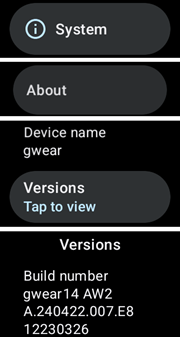
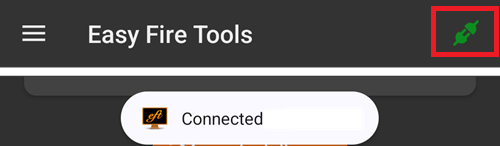

# Настройване на AAPS на часовник с Wear OS

Инструкциите по-долу се отнасят за apk файла **AAPS Wear**, който трябва да компилирате. Ако още не сте го компилирали, вижте свързаното ръководство [тук](../WearOS/BuildingAapsWearOS.md). Когато компилирате, използвайте същия файл на хранилището за ключове (keystore), който сте използвали за apk файла на **AAPS** за телефона.

Можете да използвате част от информацията и за apk файловете **Wear** на **AAPSClient** и **PumpControl**. Each **Wear** app will communicate with its matching phone app. Например приложението **AAPSClient Wear** може да се използва за показване на данни от **AAPSClient**, а не на данни от **AAPS**. Когато са инсталирани едновременно няколко варианта на клиента (**AAPSClient**, **AAPSClient2**, **AAPSClient3**), тайловете на всеки от тях имат малко заглавие в цвета на съответния вариант, за да ги различавате, докато плъзгате.

## Версии на Wear OS и съвместимост

(wearos-watchface-changes)=

### Промени в циферблатите при Wear OS (влияние върху циферблатите на AAPS)

```{admonition} Why newer Wear OS watches break AAPS watchfaces
:class: warning

През юни 2025 г. Google [обяви промени](https://android-developers.googleblog.com/2025/06/upcoming-changes-to-wear-os-watch-faces.html), с които постепенно се премахва старият механизъм за циферблати (AndroidX / Wearable Support Library, или „WSL“) в полза на новия декларативен **Watch Face Format**. Персонализираните циферблати на **AAPS** са изградени със стария механизъм, затова колкото по-нова е версията на Wear OS, толкова по-вероятно е циферблатът на AAPS да работи неправилно или да спре да работи.

Това засяга конкретно **циферблатите** — **усложненията** на AAPS, тайловете и функциите за дистанционно управление не са засегнати. Затова и **актуализация на фърмуера/системата на часовник с Wear OS може да развали циферблатите на AAPS**, а след това часовникът не може да се върне към по-стара версия на Wear OS. Ако циферблатът на AAPS в момента работи, **изключете автоматичните актуализации на часовника**.
```

Таблицата по-долу обобщава как промяната на Google засяга циферблатите на AAPS (със стария механизъм) според версията на Wear OS:

| Версия на Wear OS       | Базова версия на Android | Ниво на API | Влияние върху (старите) циферблати на AAPS                                                                                                                                                                     |
| ----------------------- | ------------------------ | ----------- | -------------------------------------------------------------------------------------------------------------------------------------------------------------------------------------------------------------- |
| Wear OS 6               | Android 16               | 36          | **Старите циферблати вече не са налични** — вместо тях AAPS инсталира [циферблат във формата Watch Face Format](#wearos-aaps-v4-watchface): вашия персонализиран циферблат или циферблата с усложнения AAPS V4 |
| Wear OS 5               | Android 14               | 34          | **Сериозно** — активният (интерактивният) режим често не работи, усложненията замръзват, анимациите спират                                                                                                     |
| Wear OS 4               | Android 13               | 33          | **Умерено** — ограничаване на честотата (throttling), пропуснати обновявания, частични откази                                                                                                                  |
| Wear OS 3.0 / 3.2 / 3.5 | Android 11               | 30          | **Слабо** — старият механизъм все още се поддържа                                                                                                                                                              |

Ако на часовника ви работи версия, при която циферблатите на AAPS не са надеждни, можете вместо това да показвате данните на AAPS чрез **усложнения** на съвместим циферблат или да използвате [GlucoDataHandler](https://play.google.com/store/apps/details?id=de.michelinside.glucodatahandler) с усложнение, което получава данни от плъгина [Външни приложения за проследяване](#external-companion-apps) на **AAPS**. На **Wear OS 6 и по-нови версии** AAPS инсталира заместващ циферблат, създаден в новия формат — вижте по-долу.

(wearos-aaps-v4-watchface)=

### Wear OS 6 и по-нови версии — циферблатът, който AAPS инсталира

Часовниците с **Wear OS 6 или по-нова версия** не могат да използват класическите циферблати на AAPS като циферблати. За тези часовници приложението AAPS за часовника има два циферблата, създадени в новия **Watch Face Format** на Google. Wear OS позволява на едно приложение да инсталира само **един** циферблат, затова избирате кой от двата да е на часовника:

- **Персонализиран Watchface** (по подразбиране): показва персонализирания циферблат, който сте заредили от телефона със **Зареди Watchface** (вижте [Смяна към циферблат на AAPS](#WearOS_changing-to-AAPS-watchface)). Часовникът показва вашия дизайн като картина, затова всеки съществуващ персонализиран циферблат работи. Местата за усложнения, които може да определя персонализираният циферблат, **не са налични** в тази картина, защото Wear OS подава данни за усложнения само към истински циферблат. Натиснете продължително циферблата, за да стигнете до единствената му настройка: дали дисплеят в режим „винаги включен“ да показва обикновен часовник или вашия собствен дизайн, затъмнен.
- **Циферблат с усложнения** (циферблатът **AAPS V4**): неговите **седем места за усложнения** са **предварително настроени с данни от AAPS**: стойност на КЗ, IOB, COB, [усложнението „Графика на КЗ“](#Watchfaces-complications), базална доза / временна цел и иконата **Текущ режим** в горното ляво място (докоснете я, за да смените режима на кръга от часовника). Докоснете часа в горната част, за да отворите приложението за аларми на часовника. Можете да промените какво показва всяко място в редактора на циферблата.

Избирате на телефона: отворете плъгина **Часовник** и в **Циферблат, инсталиран на часовника** изберете един от двата. Тази карта се показва само докато е свързан часовник с Wear OS 6 или по-нова версия. **AAPS** ви моли да потвърдите, защото часовникът сменя циферблата си веднага. Смяната от **Циферблат с усложнения** към другия циферблат също връща усложненията, които сте променили в редактора на циферблата, към стойностите по подразбиране, и потвърждението ви предупреждава за това. Докато е избран **Циферблат с усложнения**, бутоните за персонализиран циферблат са скрити и вместо тях се показва преглед на циферблата. Ако заредите персонализиран циферблат, докато е избран **Циферблат с усложнения**, **AAPS** ви напомня да превключите на **Персонализиран Watchface**, за да го видите на часовника.

- Избраният циферблат се **инсталира и активира автоматично** първия път, когато приложението AAPS за часовника се стартира на такъв часовник, и се **актуализира автоматично** заедно с приложението за часовника.
- Ако сте премахнали циферблата, в долната част на **главното меню** на AAPS на часовника се появява елемент **Инсталирай на часовник** — докоснете го, за да го инсталирате отново.

Докато е свързан часовник с Wear OS 5 или по-стара версия, картата **Циферблат, инсталиран на часовника** изобщо не се показва (механизмът, на който тя разчита, изисква Wear OS 6); там класическите циферблати работят както преди.

(wearos-complications-watchface-setup)=

### Циферблат с усложнения — препоръчителна настройка

**Циферблат с усложнения** има седем места за усложнения. Натиснете продължително циферблата, докоснете **Персонализиране** (Customize) и изберете източник на данни за всяко място. Местата са номерирани като в редактора на циферблата: **1** вляво, **2** в центъра, **3** вдясно, **4** графиката, **5** долу, **6** горе вляво и **7** горе вдясно.

| Настройка по подразбиране                                                                                  | Алтернативна настройка                                                                                      |
| ---------------------------------------------------------------------------------------------------------- | ----------------------------------------------------------------------------------------------------------- |
|  |  |

| Място | Позиция     | По подразбиране                                                                 | Алтернативна                                     |
| ----- | ----------- | ------------------------------------------------------------------------------- | ------------------------------------------------ |
| 1     | Ляво        | IoB икона                                                                       | ВЪГЛ & IoB                                       |
| 2     | Център      | Кръвна захар                                                                    | Кръвна захар                                     |
| 3     | Дясно       | Икона за ВЪГЛ                                                                   | БАЗА & Цел                                       |
| 4     | Графика     | Графика на КЗ                                                                   | Графика на КЗ                                    |
| 5     | Долу        | БАЗА & Цел                                                                      | Качване/батерия на телефон                       |
| 6     | Горе вляво  | Текущ режим                                                                     | Текущ режим                                      |
| 7     | Горе вдясно | Качване/батерия на телефон или пряк път към приложение за **AAPS Snooze Alert** | Пряк път към приложение за **AAPS Snooze Alert** |

Прекият път **AAPS Snooze Alert** се избира от собствените усложнения **App shortcut** (пряк път към приложение) на часовника. Докосването му отлага алармата, която звъни на телефона.

```{tip}
Включете **Винаги включен дисплей** (Always-on display) на часовника (**Настройки** > **Дисплей** (Display)). Тогава циферблатът продължава да показва глюкозата ви, когато ръката е спусната, вместо празен екран или обикновен часовник.
```

```{admonition} No complication data while the watch is locked
:class: note
Ако в **Настройки** > **Сигурност и поверителност** (Security and privacy) е зададен **Тип заключване** (Lock type), часовникът скрива данните на усложненията, докато е заключен, и циферблатът показва празни места, докато не го отключите. За да останат данните видими, изключете **Скриване на информацията** (Hide information) в същото меню.
```

### Wear OS 3

Инсталирайте apk файла **AAPS Wear** с [Wear Installer 2](https://youtu.be/abgN4jQqHb0?si=5L7WUeYMSd_8IdPV), Easy Fire Tools (описано по-долу) или ADB.  
Няма ограничения в работата на **AAPS Wear**.

(BuildingAapsWearOs-WearOS5)=

### Wear OS 4 и Wear OS 5

Пример: Galaxy Watch 4, 5, 6, 7 и Ultra или Pixel Watch, които **още не** са актуализирани до Wear OS 6. Проверете версията в **Настройки** > **Всичко за часовника** > **Софтуер** (About watch, Software).

Инсталирайте apk файла **AAPS Wear** с [Wear Installer 2](https://youtu.be/abgN4jQqHb0?si=5L7WUeYMSd_8IdPV) (за Wear OS 5 следвайте [това видео](https://www.youtube.com/watch?v=yef_qGvcCnk)). Всички функции на **AAPS Wear** работят, но класическите циферблати на **AAPS** са ограничени, както е описано в таблицата по-горе: забавени (throttled) на Wear OS 4, често не работят на Wear OS 5.

```{admonition} Wear OS 5
:class: warning
На Wear OS 5 циферблатът на AAPS трябва да се избере с Wear Installer 2 веднага след инсталирането на приложението Wear: в края на инсталацията инсталаторът предлага циферблата **AAPS(Персонализиран)** (AAPS (Custom)). Ако по невнимание превключите на друг циферблат, повторете инсталацията. Changing the watchface settings (Dark, Matching divider, etc.) may not be possible.

Ако класическият циферблат в момента работи при вас, **изключете автоматичните актуализации на часовника**: следващата актуализация на фърмуера вероятно ще го развали. Ако все пак актуализирате до Wear OS 6, прочетете раздела по-горе: тогава **AAPS** инсталира собствен циферблат в новия формат.
```

Ако циферблатът е твърде ненадежден, помислете вместо това за [GlucoDataHandler](https://play.google.com/store/apps/details?id=de.michelinside.glucodatahandler) с усложнение. То изисква плъгинът [Външни приложения за проследяване](#external-companion-apps) да е включен в **AAPS**.

### Wear OS 6 и по-нови версии

Пример: Galaxy Watch 4 и по-нови с One UI 8 Watch, Pixel Watch след актуализацията от 2025 г. Повечето часовници Galaxy и Pixel са получили тази актуализация.

Инсталирайте apk файла **AAPS Wear** с [Wear Installer 2](https://youtu.be/abgN4jQqHb0?si=5L7WUeYMSd_8IdPV). Класическите циферблати не са налични; **AAPS** автоматично инсталира циферблата, избран на телефона, вижте [циферблата, който AAPS инсталира](#wearos-aaps-v4-watchface). Няма ограничения в работата на **AAPS Wear**.

## How to set up a Samsung Galaxy Watch 4 smartwatch with **AAPS**

Този раздел приема, че смарт часовниците са съвсем нови за вас. Той дава основна ориентация за популярен часовник – **Galaxy Watch 4**, а след това ръководство стъпка по стъпка за настройване на **AAPS** на часовника.

_Това ръководство е написано за Galaxy Watch с Wear OS 3._ На Wear OS 4 и по-нови версии часовникът иска **код за сдвояване**, когато телефон или компютър се свързва чрез ADB. Wear Installer 2 и процедурата с терминала [по-долу](#BuildingAapsWearOs-WearOS5-TShoot) поддържат това.

Ето ръководства за основна настройка на [Galaxy Watch 5](https://www.youtube.com/watch?v=Y5upzOIxwTU) и [Galaxy Watch 6](https://www.youtube.com/watch?v=D6bq20KzPW0)

## Основно запознаване със смарт часовника

After basic setup of your watch according to the video above, go to the playstore on the phone and download the following apps: "Galaxy Wearable", “Samsung” and either “Easy Fire tools” or "Wear Installer 2".

Има много видеа в YouTube от трети страни, които ще ви помогнат да се запознаете с новия си смарт часовник, например:

[https://www.youtube.com/watch?v=tSVkqWNmO2c](https://www.youtube.com/watch?v=tSVkqWNmO2c)

Приложението „Galaxy Wearable“ също има раздел с ръководство за употреба. Отворете Galaxy Wearable на телефона, потърсете часовника и опитайте да го сдвоите с телефона. Depending on your version, this may prompt you to install one more app, “galaxy watch 4 plugin”, from the playstore (takes a while to download). Инсталирайте го на телефона и след това опитайте отново да сдвоите часовника и телефона в приложението Wearable. Преминете през поредица от менюта и отметнете различни предпочитания.

## Създаване на профил в Samsung

Уверете се, че имейл адресът, с който създавате профила в Samsung, е с дата на раждане, според която потребителят е на 13 или повече години, защото иначе разрешенията на Samsung се одобряват много трудно. Ако сте дали на детето си под 13 години профил в Gmail и използвате този имейл адрес, не можете просто да го смените на профил за възрастен. One way around this is to modify the current date-of-birth to make the current age 12 years and 364 days old. На следващия ден профилът ще бъде превърнат в профил за възрастен и можете да продължите с настройката на профила в Samsung.

(remote-control-transferring-the-aaps-wear-app-onto-your-aaps-phone)=

## Прехвърляне на приложението **AAPS** Wear на телефона с **AAPS**

Можете да прехвърлите Wear.apk от Android Studio на телефона по един от тези начини:

a)  с USB кабел копирайте apk файла на **AAPS** wear на телефона и след това го инсталирайте („side-load“) на часовника. Прехвърлете Wear.apk на телефона чрез USB в папката за изтегляния; или

b)  изрежете и поставете Wear.apk от Android Studio в своя Google Drive.


За да инсталирате AAPS на часовника, можете да използвате: 1) Wear Installer 2 2) Easy Fire tools 3) Android Debug Bridge (ADB) Тук препоръчваме Wear Installer 2, защото инструкциите и процесът във видеото са много ясни и добре обяснени. Ако Wear Installer 2 не работи при вас, опитайте Easy Fire Tools или ADB – и двете са описани по-долу.

### Инсталиране на **AAPS** Wear от телефона на часовника с Wear Installer 2

 

Wear Installer 2, разработено от [Malcolm Bryant](https://www.youtube.com/@Freepoc), може да се изтегли от Google Play на телефона и да се използва за инсталиране (side-load) на приложението AAPS wear на часовника. В приложението има полезно ръководство „how to sideload“ (как да инсталирате) във [видео.](https://youtu.be/abgN4jQqHb0?si=5L7WUeYMSd_8IdPV)

```{tip}
За часовници с Wear OS 5 следвайте [това видео](https://www.youtube.com/watch?v=yef_qGvcCnk).
Вижте съветите за отстраняване на неизправности [по-долу](#BuildingAapsWearOs-WearOS5-TShoot).
```

Това дава всички нужни подробности (най-добре отворете видеото на друго устройство, за да го гледате, докато настройвате телефона).

Както е казано във видеото, след като приключите, изключете отстраняването на грешки чрез ADB (ADB debugging) на часовника, за да не се изтощава батерията на смарт часовника.

Като алтернатива, но не за Wear OS 5, можете да:

### Инсталиране на **AAPS** wear на часовника с Easy Fire tools

1)   Изтеглете _[Easy Fire Tools](https://play.google.com/store/apps/details?id=de.agondev.easyfiretools&hl=en)_ от Play Store на телефона


2)  Станете разработчик на часовника (след като е настроен и свързан с телефона):

Отидете в **Настройки** > **Система** > **Информация** > **Версии** (Settings, System, About, Versions; имената на менютата се различават според марката на часовника — на някои часовници това е **Всичко за часовника** > **Информация за софтуера** > **Версия на софтуера**).



Докоснете бързо няколко пъти **Номер на компилацията** (Build number) или **Версия на софтуера** (Software version), докато съобщение не ви каже, че вече сте разработчик.


Върнете се в **Настройки** > **Система**: вече се показва ново меню **Опции за разработчици** (Developer options).

В **Опции за разработчици** включете **Отстраняване на грешки чрез ADB** (ADB debugging) и **Безжично отстраняване на грешки** (Wireless debugging) и потвърдете запитванията. След това безжичното отстраняване на грешки показва **IP адреса и порта** на часовника, например: **192.168.1.214** : 5555. Нужен ви е само IP адресът (тук **192.168.1.214**), а не номерът на порта след двоеточието. Имайте предвид, че IP адресът може да се промени, например всеки път, когато смените телефона, който използвате за AAPS.


СТЪПКА 3)     Въведете IP адреса, _напр._ **192.168.1.214**, в Easy Fire tools на телефона (отворете лявото меню, след това настройките и въведете IP адреса).


След това натиснете иконата с щепсел горе вдясно. Когато се свърже, ще стане зелено.




СТЪПКА 4) Следвайте инструкциите [тук](https://wearablestouse.com/blog/2022/01/04/install-apps-apk-samsung-galaxy-watch-4/?utm_content=cmp-true), за да инсталирате (т.е. прехвърлите) aaps-wear.apk на смарт часовника с Easy Fire tools


(BuildingAapsWearOs-WearOS5-TShoot)=

### Използване на терминала
Свържете смарт часовника и компютъра към една и съща Wi-Fi мрежа.

- За да инсталирате ADB, изтеглете го от: https://developer.android.com/tools/releases/platform-tools
- Отворете терминал.
- За Windows създайте нова папка с име `adb` на диск `C:`. Отворете файла `platform-tools-latest-windows.zip`, който изтеглихте по-горе. Копирайте всички файлове от `platform-tools` в `C:\adb` и отворете тази папка в команден ред (десен бутон и Open in Terminal (Отваряне в терминал)). Въведете командата по-долу, за да зададете пътя до папката, в която е ADB: `setx PATH "%PATH%;C:\adb"`
- За Mac вместо ръчно инсталиране можете да използвате homebrew: `brew install android-platform-tools`

На часовника:
- Отидете в Настройки (Settings) → Всичко за часовника (About watch) → **Информация за софтуера** (Software Information)
- Докоснете Версия на софтуера (Software version) 7 пъти, докато видите, че режимът за разработчици е включен.
- Отидете в Настройки → Опции за разработчици (Developer options). Включете **Отстраняване на грешки чрез ADB** (ADB debugging)
- Отидете в Настройки → Опции за разработчици → Безжично отстраняване на грешки (Wireless debugging) → **Сдвояване на ново устройство** (Pair new device)

Ще видите да се появяват код за сдвояване по Wi-Fi, IP адрес и порт:


- В терминала: `adb pair ipaddress:port` Напр. `adb pair 10.10.1.125:36299`
- Ще бъдете попитани за кода за сдвояване. Въведете го.
- Ще видите отговор:<br> `Successfully paired to 10.10.1.125:36299 [guid=adb-RXXXW20LMKJY-eh5zBj]`<br>
- В терминала въведете: <br>`adb devices`.<br> Трябва да видите нещо подобно:<br> `List of devices attached`<br> `10.10.1.125:36299  offline`<br> `adb-RFAW20LMKJY-eh5zBj._adb-tls-connect._tcp   device`<br>

- Now go to the folder on your computer where the Wear apk is and type<br> `adb install wear-full.apk` <br>with wear-full.apk replaced by the name of your apk file.
- Ще видите:<br> `Performing Streamed Install`<br> `Success`


(wear-os-5-troubleshooting)=

### Общи препоръки за отстраняване на неизправности при Wear OS 5

- Не използвайте споделяне на Wi-Fi (Wi-Fi Tethering). Това няма да работи.
- Не е нужно да включвате отстраняване на грешки чрез adb (adb debugging) на телефона (само на часовника). Изключете отстраняването на грешки чрез adb на телефона.
- Уверете се, че се свързвате към локалната си мрежа, в която телефонът и часовникът се виждат един друг (не използвайте мрежата за гости на Wi-Fi).
- Уверете се, че часовникът и телефонът са в една и съща мрежа и на едно и също Wi-Fi устройство. Особено Wi-Fi повторителите (repeaters) или точките за достъп може да създават проблеми.
- Бъдете близо до основния си рутер и след това рестартирайте и телефона, и часовника.

**Сдвояване:**

- Часовник: Wireless Debugging (безжично отстраняване на грешки): запишете IP адреса.
- Wear Installer: Enter the IP in the Wear Installer app.
- Изберете Pair new (ново сдвояване), запишете показания код за сдвояване и номера на порта.
- Wear Installer: въведете кода за сдвояване + интервал + номера на порта.
- Wear Installer трябва да съобщи, че сдвояването е успешно. Ако не стане, излезте от Wear Installer и опитайте отново.

След сдвояването би трябвало да можете да инсталирате apk файла AAPS wear:

- Излезте/затворете и стартирайте отново Wear Installer.
- В безжичното отстраняване на грешки запишете IP адреса и номера на порта и ги проверете/въведете в Wear Installer.
- Забележка: номерът на порта е различен от този, използван за сдвояването!

## Настройване на връзката между часовника и телефона от **AAPS**

Последната стъпка е да настроите **AAPS** на телефона да работи с **Wear.apk** на часовника. За да направите това, включете плъгина Часовник (Wear):

* Отворете приложението **AAPS** на телефона

* Отворете **менюто** (☰) в горния ляв ъгъл и отидете в **Конфигурация** > **Комуникация**

* Отметнете полето **Часовник**


За да давате болус или да изпълнявате други действия от часовника, включете и **Контрол от часовник** в [Настройки > Часовник](#preferences-wear).

To change to a different **AAPS**  watchface, long-press the watchface on the home screen of the watch and tap **Customize**. След това плъзнете надясно, докато стигнете до всички циферблати на **AAPS**.

Ако Wear.apk на **AAPS** е инсталиран успешно на смарт часовника, ще изглежда така:


При някои смарт часовници, например Samsung Galaxy, „Remote Connection“ (Отдалечена връзка) в Advanced Features (Разширени функции) на Samsung Galaxy трябва да е **включено**, за да използвате **Wear.apk** и **AAPS** дистанционно през Wi-Fi.


(wear-os-watch-phone-communication)=

### Отстраняване на неизправности във връзката между часовника с **AAPS** и телефона с **AAPS**

1.  Ако Easy Fire tools не се свързва или получавате ‘authorisation failed’ > проверете дали IP адресът е въведен правилно.
2.  Проверете дали смарт часовникът е свързан с интернет (а не само с телефона чрез Bluetooth).
3.  Проверете дали телефонът с **AAPS** и смарт часовникът са сдвоени или свързани в приложението на Samsung.
4.  Може да помогне и пълно рестартиране на телефона и на смарт часовника (т.е. изключване и включване на телефона)
5.  Ако сте успели да изтеглите Wear.apk на телефона, но не получавате данни за КЗ, _проверете_ дали сте инсталирали правилния apk файл на **AAPS** Wear на часовника: приложението за часовника при компилиране в браузъра е файлът `aaps-wear-….apk`, вижте [Компилиране на приложението Wear](../WearOS/BuildingAapsWearOS.md). Ако инсталираният файл е някой от следните: a) apk файл **AAPSClient** Wear (докато на телефона работи **AAPS**); b) файл `.aab`; или c) файл с думата ‘debug’ в името, значи не сте избрали правилния apk файл за Wear OS при компилирането.
6.  Проверете дали рутерът не изолира устройствата едно от друго.

Още съвети за отстраняване на неизправности ще намерите [тук](https://freepoc.org/wear-installer-help-page/#:~:text=If%20you%20are%20having%20problems,your%20phone%20and%20your%20watch.)

(WearOS_changing-to-AAPS-watchface)=

## Смяна към циферблат на AAPS на часовник с Wear OS

В стандартната компилация на AAPS Wear OS APK има няколко налични циферблата. След като инсталирате AAPS Wear APK на часовника, те ще бъдат налични. Ето стъпките за избор на циферблат:

1. На часовника (с Wear OS) натиснете продължително текущия циферблат, за да се отвори екранът за избор на циферблат, превъртете докрай надясно, докато видите бутона „Add Watch Face“ (Добавяне на циферблат), и го изберете


2. Превъртете списъка, докато намерите „AAPS(Персонализиран)“ (в зависимост от часовника циферблатите на инсталираните приложения са в раздел „Downloaded“ (Изтеглени) или са групирани по приложение) и натиснете средата на изображението, за да го добавите към краткия си списък с текущи циферблати. Не се притеснявайте от сегашния вид на циферблата „AAPS(Персонализиран)“ (AAPS (Custom)) – в следващата стъпка ще изберете предпочитания от вас дизайн.


3. Сега отворете AAPS на телефона и отворете плъгина Часовник: **Конфигурация** > **Комуникация** > **Часовник** > **Отвори плъгин** (първо отметнете **Часовник**, ако не е включен).


4. Натиснете бутона „Зареди Watchface“ и изберете циферблата, който харесвате


5. Проверете часовника – циферблатът „AAPS(Персонализиран)“ вече трябва да показва избрания от вас дизайн. Изчакайте няколко секунди да се обнови. Екранът **Часовник** на телефона вече показва името на заредения циферблат и негов преглед. **Информация за Watchface** показва подробностите за него и полетата, които съдържа, а **Още циферблати** отваря [сайта за обмен](../ExchangeSiteCustomWatchfaces/index.md), където можете да изтеглите други персонализирани циферблати. Сега можете да персонализирате усложненията и т.н., като натиснете продължително циферблата и след това натиснете бутона „Персонализиране“ (Customize) върху изображението на циферблата.

```{admonition} Complications on a custom watchface
:class: note
Персонализираните циферблати, създадени с версия 3.0 или по-нова на формата за персонализирани циферблати, могат да съдържат до пет места за усложнения, като позицията и размерът им се определят от циферблата (**Изглед на усложнение**). На часовника натиснете продължително циферблата, докоснете **Персонализиране** (Customize) и докоснете от **Усложнение 1** до **Усложнение 5**, за да изберете източника на данни за всяко място. Същите редове има в приложението AAPS на часовника в **Настройки** > **AAPS(Персонализиран)**; докосването на някой от тях там отваря същия избор. **Приоритет на усложнение** определя дали едно място да предпочита стойност или уред, текст или икона, когато източникът на данни предлага няколко от тях. Промененият приоритет се прилага едва следващия път, когато изберете източник на данни за това място.

Тези места работят само на часовници с **Wear OS 5 или по-стара версия**, където персонализираният циферблат работи като истински циферблат. На **Wear OS 6 и по-нови версии** персонализираният циферблат се показва като картина без местата за усложнения и стъпки 1 и 2 по-горе не са нужни: уверете се, че в **Циферблат, инсталиран на часовника** в плъгина **Часовник** на телефона е избран **Персонализиран Watchface** (вижте [циферблата, който AAPS инсталира](#wearos-aaps-v4-watchface)).
```

## Циферблат AAPSv2 – легенда


A – време от последното изпълнение на кръга

B – стойност от CGM

C – минути от последната стойност от CGM

D – промяна спрямо последната стойност от CGM (в mmol/l или mg/dl)

E – средна промяна на стойността от CGM за последните 15 минути

F – батерия на телефона

G – базална доза (в U/h при стандартна доза и в % при временен базал)

H - BGI (blood glucose impact) -> the degree to which BG “should” be rising or falling based on insulin activity alone.

I – въглехидрати (активни въглехидрати | бъдещи удължени въглехидрати (e-carbs))

J – активен инсулин (от болус | от базал)
