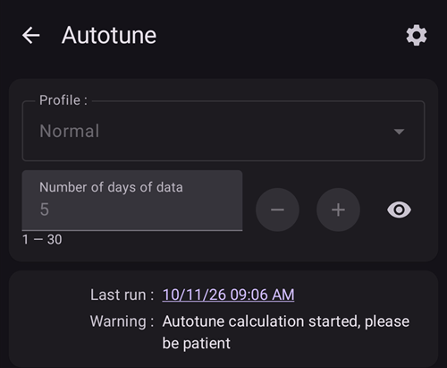
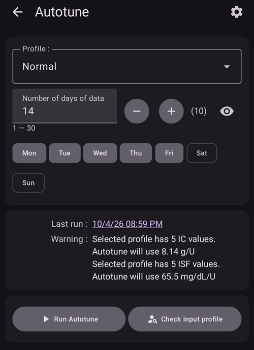
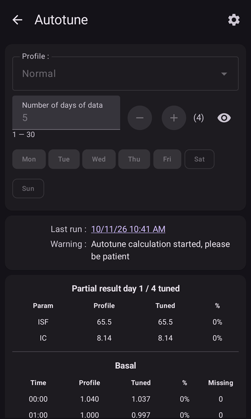

# Com utilitzar el plugin Autotune

El plugin Autotune és una implementació dins d'AAPS de l'algoritme Autotune d'OpenAPS. Analitza el vostre historial recent d'AAPS per suggerir ajustos de les vostres taxes basals, l'ISF i la ràtio de carbohidrats.

El plugin Autotune està disponible a les versions d'AAPS des de la [3.4](#version3400), però per defecte està amagat.

(autotune-how-autotune-calculates-adjustments)=
## Com calcula Autotune els ajustos

Autotune revisa el vostre historial recent d'AAPS (lectures del CGM, bolus, carbohidrats i basals temporals) i calcula on el vostre **Perfil** (taxes basals, ISF, ràtio de carbohidrats) no coincideix del tot amb el que realment ha passat amb la vostra glucèmia.

Per a cada punt de dades de 5 minuts, compara el vostre **canvi real de glucèmia** amb el canvi que preveia el vostre perfil, i classifica la desviació resultant en un d'aquests tres grups:

* desviacions que han passat sense carbohidrats a bord i sense activitat de la insulina (es fan servir per ajustar les **taxes basals**, hora per hora),
* desviacions que han passat després d'un bolus o una correcció sense carbohidrats (es fan servir per ajustar l'**ISF**), o
* desviacions que han passat mentre s'absorbien carbohidrats (es fan servir per ajustar la **ràtio de carbohidrats**).

Després mira el patró de les desviacions de cada grup (amb percentils en lloc d'una mitjana simple, perquè uns quants punts de dades sorollosos no falsegin el resultat) i proposa un valor nou per a aquella hora o aquell paràmetre.

Perquè una sola execució no corregeixi massa, cada execució d'Autotune només mou un valor una part del camí cap al que suggereixen les dades: fins a un 10% per a l'ISF i la ràtio de carbohidrats, i fins a un 20% per a cada tram de basal. A més, la desviació total està limitada per les opcions **Ràtio màxima d'Autosens** / **Ràtio mínima d'Autosens** (vegeu [Altres opcions](#autotune-other-settings) més avall), els mateixos límits que limiten Autosens. Per això Autotune està pensat per executar-se de manera repetida (dia rere dia, o cada nit) i no per confiar-hi després d'una sola execució: els resultats s'han d'anar apropant a poc a poc, i un salt gran en una execució és un senyal per revisar bé les vostres dades (carbohidrats no introduïts, un dia dolent del sensor, _etc._) en lloc de confiar-hi a cegues.

Autotune es pot executar de tres maneres: manualment, una sola vegada, des del plugin (tal com es descriu més avall), automàticament cada nit amb una [regla d'automatització](#autotune-run-autotune-with-an-automation-rule), o bé (del tot fora d'AAPS) com a eina independent de línia d'ordres amb dades exportades. Algunes guies de la comunitat descriuen aquesta última manera per fer-lo servir sense un telèfon que executi AAPS.

*Per veure l'algoritme oref0 en què es basa, amb tot el detall matemàtic, consulteu la [documentació d'Autotune d'OpenAPS](https://openaps.readthedocs.io/en/latest/docs/Customize-Iterate/autotune.html).*

## Mostrar el plugin Autotune

Creeu un fitxer buit anomenat `enable_autotune` a la subcarpeta `extra` de la [carpeta d'AAPS](#preferences-maintenance-settings) del vostre telèfon.

***NOTA: comproveu a la configuració d'AAPS on és la vostra carpeta d'AAPS, i que heu posat el fitxer a la carpeta correcta. Diversos usuaris han posat el fitxer a la carpeta equivocada.***


Reinicieu **AAPS**. Després obriu el **menú** (☰), seleccioneu **Configurador**, després la categoria **General**, i marqueu **Autotune**. Aleshores la targeta mostra **Configuració** i **Obrir plugin**:


## Interfície d'usuari d'Autotune

Toqueu **Obrir plugin** a la targeta **Autotune** per obrir la pantalla d'Autotune:


- Al menú desplegable de perfil podeu triar el perfil d'entrada que voleu ajustar (per defecte, està seleccionat el vostre perfil actiu actual)
  - Nota: cada vegada que seleccioneu un perfil nou, els resultats anteriors s'eliminaran i el **Nombre de dies de dades** tornarà al seu valor per defecte
- Després, **Nombre de dies de dades** (anomenat **Dies d'ajust** en versions anteriors) serveix per seleccionar el nombre de dies que es fan servir al càlcul per ajustar el vostre perfil. El valor mínim és 1 dia i el valor màxim és 30 dies. Aquest nombre no ha de ser massa petit per obtenir resultats iteratius i suaus correctes (més de 7 dies per a cada càlcul)
  - Nota: cada vegada que canvieu el **Nombre de dies de dades**, els resultats anteriors s'eliminaran
- Última execució és un enllaç que recupera el vostre últim càlcul vàlid. Si no heu iniciat Autotune el dia actual, o si els resultats anteriors s'han eliminat perquè heu modificat un paràmetre de càlcul de dalt, podeu recuperar els paràmetres i els resultats de l'última execució correcta.
- L'avís us mostra, per exemple, informació sobre el perfil seleccionat (si teniu diversos valors d'IC o diversos valors d'ISF)
  - Nota: el càlcul d'Autotune funciona només amb un sol valor d'IC i un sol valor d'ISF. De moment no hi ha cap algoritme d'Autotune per ajustar una IC circadiària o un ISF circadiari. Si el vostre perfil d'entrada té diversos valors, a la secció d'avís podeu veure el valor mitjà que es fa servir per ajustar el vostre perfil.
- El botó «Comprovar perfil d'entrada» obre el visor de perfils perquè pugueu comprovar ràpidament el vostre perfil (unitats, IC, ISF, basal i objectiu)
  - Nota: Autotune només ajusta la vostra IC (un sol valor), l'ISF (un sol valor) i la basal (amb variació circadiària). Les unitats i l'objectiu no canviaran al perfil de sortida.

- «Executar Autotune» inicia el càlcul d'Autotune amb el perfil seleccionat i el nombre de dies de dades seleccionat
  - Nota: el càlcul d'Autotune pot trigar molt. Un cop iniciat, podeu anar a una altra vista (inici, ...) i tornar més tard al plugin Autotune per veure els resultats

  

- Després, durant l'execució, veureu els resultats intermedis a sota

  - Nota: durant l'execució, la configuració està bloquejada, de manera que ja no podeu canviar el perfil d'entrada seleccionat ni el nombre de dies. Si voleu iniciar una altra execució amb altres paràmetres, haureu d'esperar que acabi el càlcul actual.

  

- Quan acabi el càlcul d'Autotune, veureu el resultat (perfil ajustat) i quatre botons a sota.

  

- És important comparar sempre el perfil d'entrada (columna «Perfil»), el perfil de sortida (columna «Ajustat») i el percentatge de variació de cada valor (columna «%»).

- Per a les taxes basals, també teniu el nombre de «dies que falten». Falten dies quan Autotune no té prou dades classificades com a «Basal» per ajustar la taxa basal d'aquest període (per exemple, després de cada àpat, quan hi ha absorció de carbohidrats). Aquest nombre ha de ser tan baix com sigui possible, sobretot quan la basal és important (per exemple, durant la nit o al final de la tarda)

- El botó «Comparar perfils» obre la vista per comparar perfils. El perfil d'entrada és en blau i el perfil de sortida (anomenat «Ajustat») és en vermell.

  - Nota: a l'exemple de sota, el perfil d'entrada té variació circadiària per a la IC i l'ISF, però el perfil de sortida calculat té un sol valor. Si per a vosaltres és important obtenir un perfil de sortida circadiari, vegeu [Perfil d'IC o ISF circadiari](#autotune-circadian-ic-or-isf-profile) més avall.

  

- Si confieu en els resultats (percentatge de variació baix entre el perfil d'entrada i el perfil de sortida), podeu fer clic al botó «Activar perfil» i després a OK per confirmar.

  - «Activar perfil» crearà automàticament un perfil nou «Ajustat» a la vostra llista de perfils (**Gestionar → Perfil**).
  - Si ja teniu un perfil anomenat «Ajustat» a **Gestionar → Perfil**, aquest perfil s'actualitzarà amb el perfil calculat per Autotune abans de l'activació

  

- Si creieu que cal modificar el perfil ajustat (per exemple, si creieu que algunes variacions són massa grans), podeu fer clic al botó «Copiar a perfil local»

  - Es crearà un perfil nou a **Gestionar → Perfil**, amb el prefix «Ajustat» i la data i l'hora de l'execució

  

- Després podeu editar el perfil ajustat: obriu **Gestionar** > **Perfil**, llisqueu fins a la targeta anomenada «Ajustat» amb la data i l'hora de l'execució, i toqueu el botó **Editar** (llapis)

  - a la interfície d'usuari, els valors del perfil s'arrodoniran segons les capacitats de la vostra bomba

  

- Si voleu substituir el vostre perfil d'entrada pel resultat d'Autotune, feu clic al botó «Actualitzar perfil d'entrada» i confirmeu la finestra emergent amb OK

  - Nota: si feu clic a «Activar perfil» després d'«Actualitzar perfil d'entrada», activareu el vostre perfil actualitzat i no el perfil «Ajustat» per defecte.

  

- Si heu actualitzat el vostre perfil d'entrada, el botó «Actualitzar perfil d'entrada» se substitueix pel botó «Restaurar perfil d'entrada» (vegeu la captura de pantalla de sota). D'aquesta manera podeu veure de seguida si el vostre perfil d'entrada actual a **Gestionar → Perfil** ja inclou el resultat de l'última execució o no. Amb aquest botó també podeu recuperar el vostre perfil d'entrada sense el resultat d'Autotune

  


## Configuració d'Autotune

(autotune-plugin-settings)=

### Configuració del plugin Autotune

  

```{admonition} Only DEV
:class: note
La funció **Canvi automàtic de perfil** només està disponible en mode Dev/Engineering.
```

- **Canvi automàtic de perfil** (per defecte desactivat): vegeu [Executar Autotune amb una regla d'automatització](#autotune-run-autotune-with-an-automation-rule) més avall. Si activeu aquesta opció, el perfil d'entrada s'actualitzarà automàticament amb el perfil ajustat, i aquest s'activarà.
  - **Aneu amb compte: durant els dies següents heu de confiar i comprovar que, després d'actualitzar i activar el perfil ajustat sense modificar-lo, el vostre llaç millora**

- **Classificar UAM com a basal** (per defecte desactivat): aquesta opció és per als usuaris que fan servir AAPS sense introduir cap carbohidrat (UAM complet). Quan està desactivada, evita que l'UAM es classifiqui com a basal.
  - Nota: si durant un dia es detecta com a mínim una hora d'absorció de carbohidrats, totes les dades classificades com a «UAM» es classificaran com a basal, sigui quina sigui aquesta opció (activada o desactivada)
- **Dies d'ajust per defecte** (per defecte 5): amb aquesta opció podeu definir el valor per defecte. Cada vegada que seleccioneu un perfil nou al plugin Autotune, el **Nombre de dies de dades** se substituirà per aquest valor per defecte
- **Utilitzar IC/ISF circadiari** (per defecte desactivat): vegeu [Perfil d'IC o ISF circadiari](#autotune-circadian-ic-or-isf-profile) més avall.

(autotune-other-settings)=
### Altres configuracions

- Autotune també fa servir la ràtio màxima d'Autosens i la ràtio mínima d'Autosens per limitar la variació. Podeu veure i ajustar aquests valors a [**Configuració** > **Configuració absorció** > **Configuració avançada**](../SettingUpAaps/Preferences.md) (**Autosens màx.** i **Autosens mín.**).

  


## Funció avançada

(autotune-circadian-ic-or-isf-profile)=

### Perfil d'IC o ISF circadiari

- Si teniu una variació important de la IC i/o de l'ISF al vostre perfil, i confieu del tot en els vostres horaris i variacions circadiaris, podeu activar **Utilitzar IC/ISF circadiari** (anomenat «Apply average result in circadian IC/ISF» en versions anteriors)

  - Tingueu en compte que el càlcul d'Autotune sempre es fa amb un sol valor, i que Autotune no ajusta la variació circadiària. Aquesta opció només aplica als vostres valors circadiaris la variació mitjana calculada per a la IC i/o l'ISF

- Vegeu a la captura de sota el perfil ajustat amb l'aplicació de la variació mitjana desactivada (a l'esquerra) i activada (a la dreta)

  


### Ajustar dies concrets de la setmana

- Si toqueu la icona de l'**ull** a la dreta del camp **Nombre de dies de dades**, veureu la selecció de dies. Podeu indicar quins dies de la setmana s'inclouen al càlcul d'Autotune (a la captura de sota podeu veure un exemple de «dies laborables», amb el dissabte i el diumenge exclosos del càlcul d'Autotune)
  - Si el nombre de dies inclosos al càlcul d'Autotune és més baix que el **Nombre de dies de dades**, veureu quants dies s'hi inclouran a la dreta del selector de dies (10 dies a l'exemple de sota)
  - Aquesta opció només dona bons resultats si el nombre de dies que queden no és massa petit (per exemple, si ajusteu un perfil concret per als dies de cap de setmana amb només el diumenge i el dissabte seleccionats, heu de posar el **Nombre de dies de dades** a com a mínim 21 o 28 per tenir 6 o 8 dies inclosos al càlcul d'Autotune)

  

- Durant el càlcul d'Autotune, podeu veure el progrés dels càlculs («Resultat parcial: dia 1 / 4 ajustat» a l'exemple de sota, amb el dissabte i el diumenge exclosos)

  


(autotune-run-autotune-with-an-automation-rule)=

## Executar Autotune amb una regla d'automatització

```{admonition} Only DEV
:class: note
La funció **Canvi automàtic de perfil** només està disponible en mode Dev/Engineering.
```

El primer pas és definir l'activador correcte per a una regla d'automatització amb Autotune:

Nota: per obtenir més informació sobre com configurar una regla d'automatització, vegeu [aquí](../DailyLifeWithAaps/Automations.md).

- Heu de seleccionar l'activador de temps recurrent: executeu Autotune només una vegada al dia. Autotune està pensat per executar-se cada dia (a cada nova execució avanceu un dia, i ràpidament els canvis del perfil haurien de ser molt petits)

  

- Al principi és millor executar Autotune durant el dia, per poder comprovar els resultats. Si voleu executar Autotune durant la nit, heu de seleccionar a l'activador les 4:00 o més tard, perquè el dia actual s'inclogui al següent càlcul d'Autotune.

  

- Després podeu seleccionar l'acció **Executar Autotune** (al grup **Llaç i insulina**)

  

- Després podeu ajustar els paràmetres de l'acció per a la vostra execució. En una acció nova, **Seleccioneu el perfil a ajustar** mostra el primer perfil de la vostra llista de perfils locals, el camp **Dies d'ajust** és buit i tots els dies estan seleccionats. Trieu el perfil que voleu ajustar i introduïu el nombre de **Dies d'ajust** (de 1 a 30).

  

- Després d'uns quants dies, si confieu del tot en els resultats d'Autotune i el percentatge de modificació és baix, podeu activar «**Canvi automàtic de perfil**» a la [configuració d'Autotune](#autotune-plugin-settings) perquè el perfil ajustat s'actualitzi i s'activi automàticament després del càlcul.

Nota: si voleu ajustar automàticament perfils per a dies concrets de la setmana (per exemple, un perfil per als «dies de cap de setmana» i un altre per als «dies laborables»), creeu una regla per a cada perfil i seleccioneu els mateixos dies a l'activador i a l'acció d'Autotune. Els dies d'ajust han de ser prou alts perquè l'ajust es faci amb com a mínim 6 o 8 dies, i no oblideu seleccionar una hora després de les 4:00 a l'activador...

- Vegeu a sota un exemple de regla que s'executa cada dia laborable (de dilluns a divendres) a les 04:00 i ajusta el perfil «Normal» amb 14 **Dies d'ajust**, només dies laborables (així només s'inclouen 10 dies al càlcul d'Autotune).

  


## Consells i trucs

Autotune funciona amb la informació que hi ha a la vostra base de dades. Per tant, si acabeu d'instal·lar AAPS en un telèfon nou, haureu d'esperar uns quants dies abans de poder iniciar Autotune amb prou dies per obtenir resultats útils.

Autotune només és una ajuda. És important comprovar regularment si esteu d'acord amb el perfil calculat. Si teniu cap dubte, canvieu la configuració d'Autotune (per exemple, el nombre de dies) o copieu els resultats a un perfil local i ajusteu el perfil abans de fer-lo servir.

Feu servir sempre Autotune manualment durant uns quants dies per comprovar els resultats abans d'aplicar-los. I només quan confieu del tot en els resultats d'Autotune, i quan la variació entre el perfil anterior i el perfil calculat sigui molt petita, comenceu a fer servir l'automatització (mai abans)

- Autotune pot funcionar molt bé per a alguns usuaris i no per a d'altres, així que **si no confieu en el resultat d'Autotune, no el feu servir**

També és important analitzar els resultats d'Autotune per entendre (o intentar entendre) per què Autotune proposa aquestes modificacions

- pot haver-hi un augment o una disminució general de la força del vostre perfil (per exemple, un augment de la basal total juntament amb una disminució dels valors d'ISF i IC). pot estar relacionat amb diversos dies seguits amb una correcció d'Autosens per sobre del 100% (cal més agressivitat) o per sota del 100% (sou més sensibles)
- De vegades Autotune proposa un equilibri diferent entre les taxes basals i la IC/ISF (per exemple, una basal més baixa i una IC/ISF més agressiva)

Us recomanem no fer servir Autotune en els casos següents:

- No introduïu tots els vostres carbohidrats
  - Si no introduïu els carbohidrats de correcció d'una hipoglucèmia, Autotune veurà una pujada inesperada de la vostra glucèmia i augmentarà les vostres taxes basals 4 hores abans. Això pot ser el contrari del que necessiteu per evitar una hipo, sobretot si passa a mitjanit. Per això és important introduir tots els carbohidrats, sobretot els de correcció d'una hipo.
- Teniu molts períodes amb UAM detectat durant el dia.
  - Heu introduït tots els vostres carbohidrats i els heu estimat correctament?
  - Tots els períodes d'UAM (excepte si no introduïu cap carbohidrat durant un dia i l'opció de classificar UAM com a basal està desactivada): tots els vostres períodes d'UAM es classificaran com a basal, i això pot augmentar molt la vostra basal (molt més del necessari)

- La vostra absorció de carbohidrats és molt lenta: si la major part de la vostra absorció de carbohidrats es calcula amb el paràmetre min_5m_carbimpact (podeu veure aquests períodes amb un petit punt taronja a la part de dalt de la corba del COB), el càlcul del COB pot ser incorrecte i donar resultats incorrectes.
  - Quan feu esport, normalment sou més sensibles i la vostra glucèmia no puja gaire, de manera que durant o després de l'exercici és normal veure alguns períodes amb carbohidrats lents. Però si molt sovint teniu una absorció de carbohidrats lenta inesperada, pot ser que calgui ajustar el perfil (un valor d'IC més alt) o que el min_5m_carbimpact sigui una mica massa alt.
- Teniu «dies molt dolents», per exemple, unes quantes hores encallats en hiperglucèmia amb una quantitat enorme d'insulina per poder tornar a baixar dins del rang, o bé, després d'un canvi de sensor, llargs períodes amb valors de glucèmia incorrectes. Si les últimes setmanes només teniu un o 2 «dies dolents», podeu desactivar manualment aquests dies al càlcul d'Autotune per excloure'ls del càlcul, i de nou **comproveu amb atenció si podeu confiar en els resultats**
- Si el percentatge de modificació és massa gran
  - Podeu provar d'augmentar el nombre de dies per obtenir resultats més suaus
