# Com utilitzar el plugin Autotune

El plugin Autotune és una implementació dins d'AAPS de l'algoritme Autotune d'OpenAPS. It analyzes your recent AAPS history to suggest adjustments to your basal rates, ISF and carb ratio.

Autotune Plugin is available in AAPS releases since [3.4](#version3400) but is hidden by default.

(autotune-how-autotune-calculates-adjustments)=
## How Autotune calculates adjustments

Autotune looks back over your recent AAPS history — CGM readings, boluses, carbs and temporary basal rates — and works out where your **Profile** (basal rates, ISF, carb ratio) doesn't quite match what actually happened to your BG.

For each 5-minute data point, it compares your **actual BG change** to the change your Profile predicted, and sorts the resulting deviation into one of three buckets:

* deviations that happened with no carbs on board and no insulin activity (used to tune **basal rates**, hour by hour),
* deviations that happened after a bolus/correction with no carbs (used to tune **ISF**), or
* deviations that happened while carbs were absorbing (used to tune **carb ratio**).

It then looks at the pattern of deviations in each bucket (using percentiles rather than a simple average, so a few noisy data points don't skew the result) and proposes a new value for that hour/parameter.

To keep any single run from overcorrecting, each Autotune run only ever moves a value a fraction of the way towards what the data suggests: up to 10% for ISF and carb ratio, and up to 20% for each basal segment. Overall drift is further capped by the **Max autosens ratio** / **Min autosens ratio** settings (see [Other settings](#autotune-other-settings) below) — the same bounds that limit Autosens. This is why Autotune is meant to be run repeatedly (day after day, or nightly) rather than trusted after a single run: results should converge gradually, and a big jump on one run is a sign to double check your data (missed carbs, a bad sensor day, _etc._) rather than to trust it blindly.

Autotune can be run three ways: manually as a one-off from within the plugin (as described below), automatically every night via an [automation rule](#autotune-run-autotune-with-an-automation-rule), or — outside of AAPS entirely — as a standalone command-line tool against exported data, which is how some community guides describe using it without a phone actively running AAPS.

*For the underlying oref0 algorithm in full mathematical detail, see [OpenAPS's Autotune documentation](https://openaps.readthedocs.io/en/latest/docs/Customize-Iterate/autotune.html).*

## Mostrar el plugin Autotune

Creeu un fitxer buit anomenat `enable_autotune` a la subcarpeta `extra` de la [carpeta d'AAPS](#preferences-maintenance-settings) del vostre telèfon.

***NOTE: Ensure you check in the AAPS settings where your AAPS Directory is, and that you placed the file in the correct one. Several users have put the file into the wrong folder.***

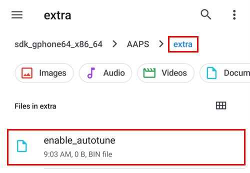

Restart **AAPS**. Then open the **menu** (☰), select **Configuration**, then the **General** category, and tick **Autotune**. The card then shows **Settings** and **Open plugin**:

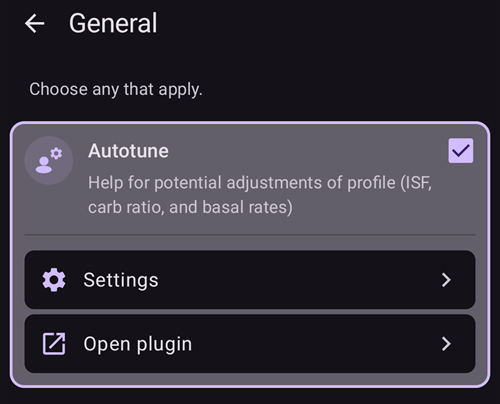

## Interfície d'usuari d'Autotune

Tap **Open plugin** on the **Autotune** card to open the Autotune screen:

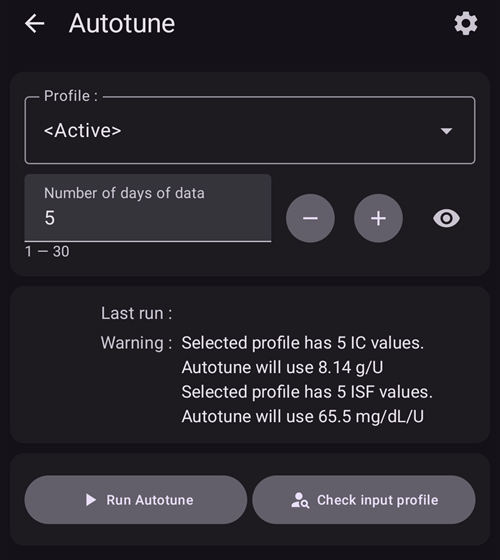

- Al menú desplegable de perfil podeu triar el perfil d'entrada que voleu ajustar (per defecte, està seleccionat el vostre perfil actiu actual)
  - Note: each time you select a new profile, previous results will be removed and the **Number of days of data** will be set to its default value
- Then **Number of days of data** (called **Tune days** in older versions) is to select the number of days used in calculation to tune your profile. El valor mínim és 1 dia i el valor màxim és 30 dies. Aquest nombre no ha de ser massa petit per obtenir resultats iteratius i suaus correctes (més de 7 dies per a cada càlcul)
  - Note: each time you change the **Number of days of data**, previous results will be removed
- Última execució és un enllaç que recupera el vostre últim càlcul vàlid. Si no heu iniciat Autotune el dia actual, o si els resultats anteriors s'han eliminat perquè heu modificat un paràmetre de càlcul de dalt, podeu recuperar els paràmetres i els resultats de l'última execució correcta.
- L'avís us mostra, per exemple, informació sobre el perfil seleccionat (si teniu diversos valors d'IC o diversos valors d'ISF)
  - Nota: el càlcul d'Autotune funciona només amb un sol valor d'IC i un sol valor d'ISF. De moment no hi ha cap algoritme d'Autotune per ajustar una IC circadiària o un ISF circadiari. Si el vostre perfil d'entrada té diversos valors, a la secció d'avís podeu veure el valor mitjà que es fa servir per ajustar el vostre perfil.
- Check Input Profile button open the Profile Viewer to allow you a quick verification of your profile (Units, IC, ISF, basal and target)
  - Nota: Autotune només ajusta la vostra IC (un sol valor), l'ISF (un sol valor) i la basal (amb variació circadiària). Units and target will remain unchanged in output profile.

- "Run Autotune" will launch Autotune calculation with selected profile and the selected number of days of data
  - Nota: el càlcul d'Autotune pot trigar molt. Un cop iniciat, podeu anar a una altra vista (inici, ...) i tornar més tard al plugin Autotune per veure els resultats

  

- Després, durant l'execució, veureu els resultats intermedis a sota

  - Nota: durant l'execució, la configuració està bloquejada, de manera que ja no podeu canviar el perfil d'entrada seleccionat ni el nombre de dies. Si voleu iniciar una altra execució amb altres paràmetres, haureu d'esperar que acabi el càlcul actual.

  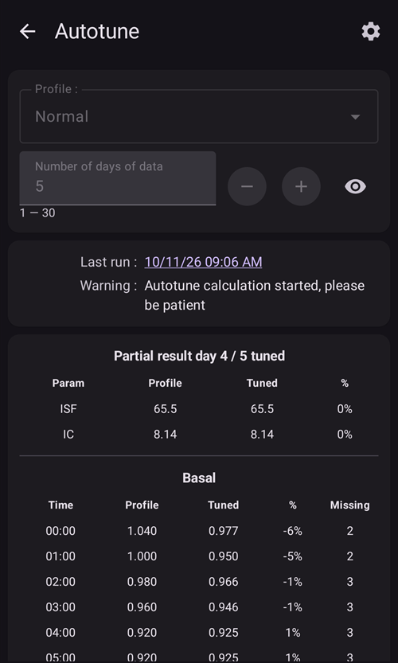

- Quan acabi el càlcul d'Autotune, veureu el resultat (perfil ajustat) i quatre botons a sota.

  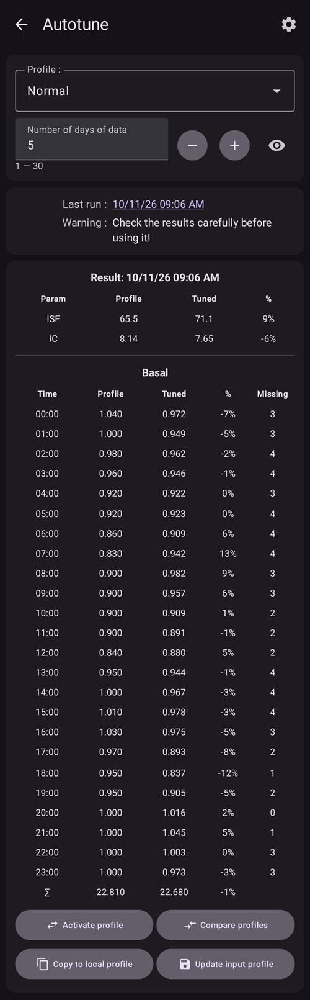

- És important comparar sempre el perfil d'entrada (columna «Perfil»), el perfil de sortida (columna «Ajustat») i el percentatge de variació de cada valor (columna «%»).

- Per a les taxes basals, també teniu el nombre de «dies que falten». Falten dies quan Autotune no té prou dades classificades com a «Basal» per ajustar la taxa basal d'aquest període (per exemple, després de cada àpat, quan hi ha absorció de carbohidrats). Aquest nombre ha de ser tan baix com sigui possible, sobretot quan la basal és important (per exemple, durant la nit o al final de la tarda)

- El botó «Comparar perfils» obre la vista per comparar perfils. El perfil d'entrada és en blau i el perfil de sortida (anomenat «Ajustat») és en vermell.

  - Nota: a l'exemple de sota, el perfil d'entrada té variació circadiària per a la IC i l'ISF, però el perfil de sortida calculat té un sol valor. Si per a vosaltres és important obtenir un perfil de sortida circadiari, vegeu [Perfil d'IC o ISF circadiari](#autotune-circadian-ic-or-isf-profile) més avall.

  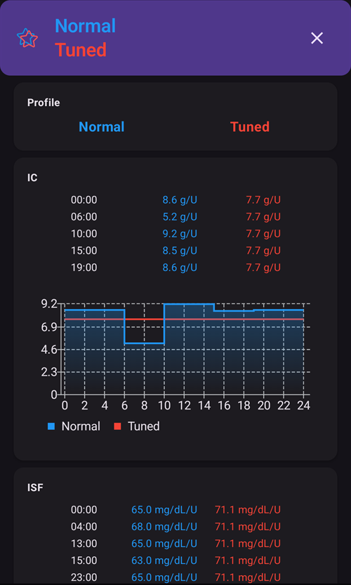

- Si confieu en els resultats (percentatge de variació baix entre el perfil d'entrada i el perfil de sortida), podeu fer clic al botó «Activar perfil» i després a OK per confirmar.

  - "Activate profile" will automatically create a new profile "Tuned" in your profile list (**Manage → Profile**).
  - If you already have a profile named "Tuned" in **Manage → Profile**, then this profile will be updated with calculated Autotune profile before the activation

  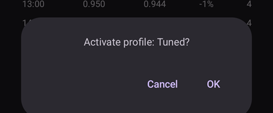

- Si creieu que cal modificar el perfil ajustat (per exemple, si creieu que algunes variacions són massa grans), podeu fer clic al botó «Copiar a perfil local»

  - A new profile with the prefix "Tuned" and the date and time of the run will be created in **Manage → Profile**

  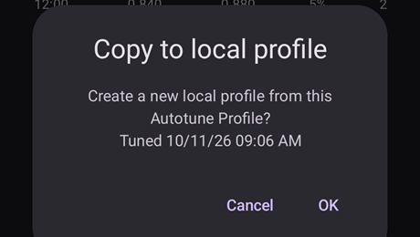

- You can then edit the Tuned profile: open **Manage** > **Profile**, swipe to the card named "Tuned" with the date and time of the run, and tap the **Edit** (pencil) button

  - the values in the profile will be rounded in the user interface to your pump capabilities

  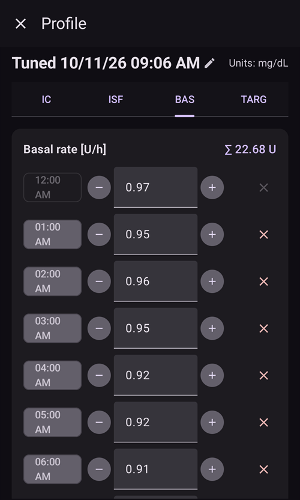

- Si voleu substituir el vostre perfil d'entrada pel resultat d'Autotune, feu clic al botó «Actualitzar perfil d'entrada» i confirmeu la finestra emergent amb OK

  - Note: if you click on "Activate profile" after "Update input profile", then you will activate your updated profile and not the default "Tuned" profile.

  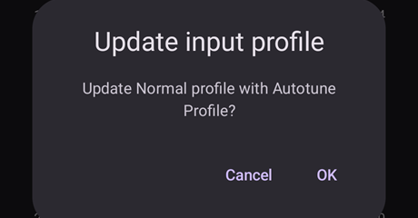

- Si heu actualitzat el vostre perfil d'entrada, el botó «Actualitzar perfil d'entrada» se substitueix pel botó «Restaurar perfil d'entrada» (vegeu la captura de pantalla de sota). You can that way immediately see if your current input profile in **Manage → Profile** already includes the result of last run or not. You also have the possibility to recover your input profile without autotune result with this button

  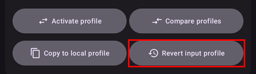


## Configuració d'Autotune

(autotune-plugin-settings)=

### Configuració del plugin Autotune

  

```{admonition} Only DEV
:class: note
The **Auto switch profile** feature is only available in Dev/Engineering mode.
```

- **Auto switch profile** (default Off): see [Run Autotune with an automation rule](#autotune-run-autotune-with-an-automation-rule) below. Si activeu aquesta opció, el perfil d'entrada s'actualitzarà automàticament amb el perfil ajustat, i aquest s'activarà.
  - **Aneu amb compte: durant els dies següents heu de confiar i comprovar que, després d'actualitzar i activar el perfil ajustat sense modificar-lo, el vostre llaç millora**

- **Categorize UAM as basal** (default Off): This setting is for the users using AAPS without any carbs entered (Full UAM). Quan està desactivada, evita que l'UAM es classifiqui com a basal.
  - Nota: si durant un dia es detecta com a mínim una hora d'absorció de carbohidrats, totes les dades classificades com a «UAM» es classificaran com a basal, sigui quina sigui aquesta opció (activada o desactivada)
- **Default tune days** (default 5): You can define the default value with this setting. Each time you select a new profile in the Autotune plugin, the **Number of days of data** will be replaced by this default value
- **Use circadian IC/ISF** (default Off): see [Circadian IC or ISF profile](#autotune-circadian-ic-or-isf-profile) below.

(autotune-other-settings)=
### Altres configuracions

- Autotune també fa servir la ràtio màxima d'Autosens i la ràtio mínima d'Autosens per limitar la variació. You can see and adjust these values in [**Settings** > **Absorption settings** > **Advanced Settings**](../SettingUpAaps/Preferences.md) (**Autosens max** and **Autosens min**).

  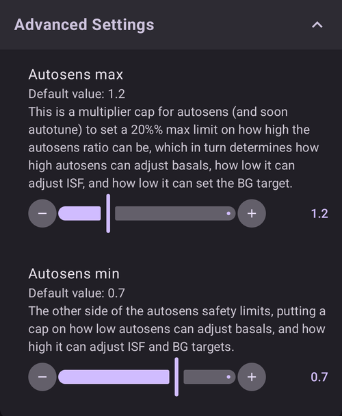


## Funció avançada

(autotune-circadian-ic-or-isf-profile)=

### Perfil d'IC o ISF circadiari

- If you have important variation of IC and/or you ISF in your profile, and you fully trust in your circadian time and variation, then you can enable **Use circadian IC/ISF** (called "Apply average result in circadian IC/ISF" in older versions)

  - Tingueu en compte que el càlcul d'Autotune sempre es fa amb un sol valor, i que Autotune no ajusta la variació circadiària. Aquesta opció només aplica als vostres valors circadiaris la variació mitjana calculada per a la IC i/o l'ISF

- Vegeu a la captura de sota el perfil ajustat amb l'aplicació de la variació mitjana desactivada (a l'esquerra) i activada (a la dreta)

  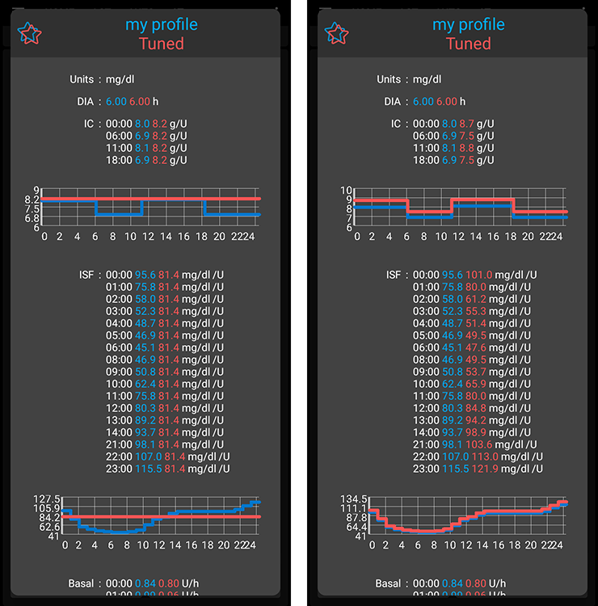


### Ajustar dies concrets de la setmana

- If you tap the **eye** icon on the right of the **Number of days of data** field, you will see the day selection. Podeu indicar quins dies de la setmana s'inclouen al càlcul d'Autotune (a la captura de sota podeu veure un exemple de «dies laborables», amb el dissabte i el diumenge exclosos del càlcul d'Autotune)
  - If the number of days included in Autotune calculation is lower than the **Number of days of data**, then you will see how many days will be included on the right of the days selector (10 days in the example below)
  - This setting gives good results only if the number of remaining days is not too small (for example if you Tune a specific profile for week end days with only Sunday and Saturday selected, you should set **Number of days of data** to at least 21 or 28 to have 6 or 8 days included in Autotune calculation)

  

- During Autotune calculation, you can see the progress of the calculations ("Partial result day 1 / 4 tuned" in the example below, with Saturday and Sunday excluded)

  


(autotune-run-autotune-with-an-automation-rule)=

## Executar Autotune amb una regla d'automatització

```{admonition} Only DEV
:class: note
The **Auto switch profile** feature is only available in Dev/Engineering mode.
```

El primer pas és definir l'activador correcte per a una regla d'automatització amb Autotune:

Nota: per obtenir més informació sobre com configurar una regla d'automatització, vegeu [aquí](../DailyLifeWithAaps/Automations.md).

- Heu de seleccionar l'activador de temps recurrent: executeu Autotune només una vegada al dia. Autotune està pensat per executar-se cada dia (a cada nova execució avanceu un dia, i ràpidament els canvis del perfil haurien de ser molt petits)

  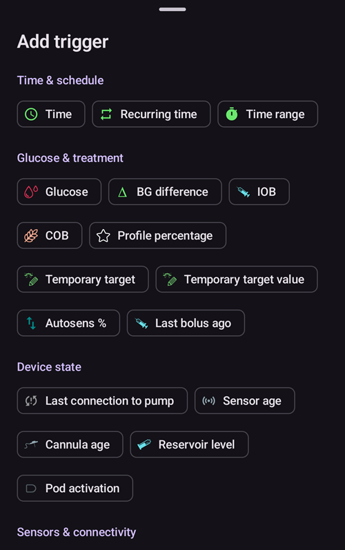

- Al principi és millor executar Autotune durant el dia, per poder comprovar els resultats. Si voleu executar Autotune durant la nit, heu de seleccionar a l'activador les 4:00 o més tard, perquè el dia actual s'inclogui al següent càlcul d'Autotune.

  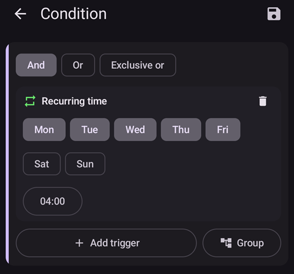

- Then you can select the **Run Autotune** action (in the **Loop & insulin** group)

  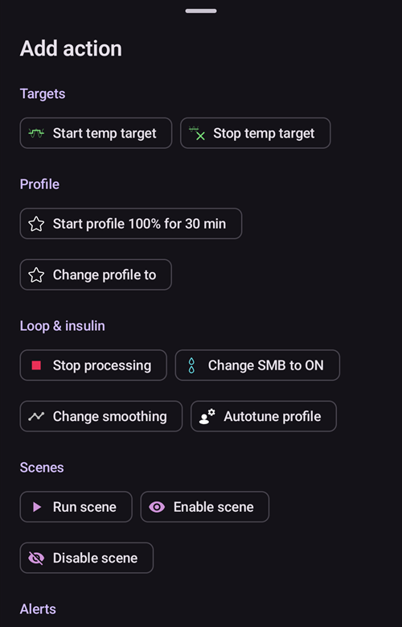

- You can then adjust the parameters of the action for your run. In a new action, **Select profile to tune** shows the first profile of your local profile list, the **Tune days** field is empty and all days are selected. Choose the profile to tune and enter the number of **Tune days** (1 to 30).

  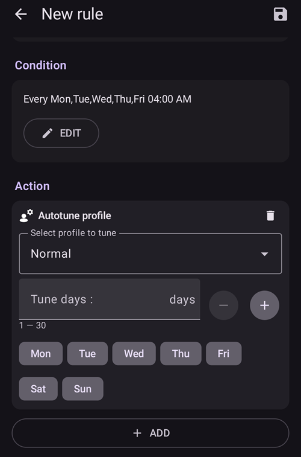

- After a few days, if you fully trust Autotune results and percentage of modification is low, you can modify [Autotune settings](#autotune-plugin-settings) "**Auto switch profile**" to enabled to automatically update and activate profile tuned after calculation.

Nota: si voleu ajustar automàticament perfils per a dies concrets de la setmana (per exemple, un perfil per als «dies de cap de setmana» i un altre per als «dies laborables»), creeu una regla per a cada perfil i seleccioneu els mateixos dies a l'activador i a l'acció d'Autotune. Els dies d'ajust han de ser prou alts perquè l'ajust es faci amb com a mínim 6 o 8 dies, i no oblideu seleccionar una hora després de les 4:00 a l'activador...

- See below an example of rule that runs every working day (Monday to Friday) at 04:00 and tunes the profile "Normal" with 14 **Tune days**, working days only (so only 10 days are included in the Autotune calculation).

  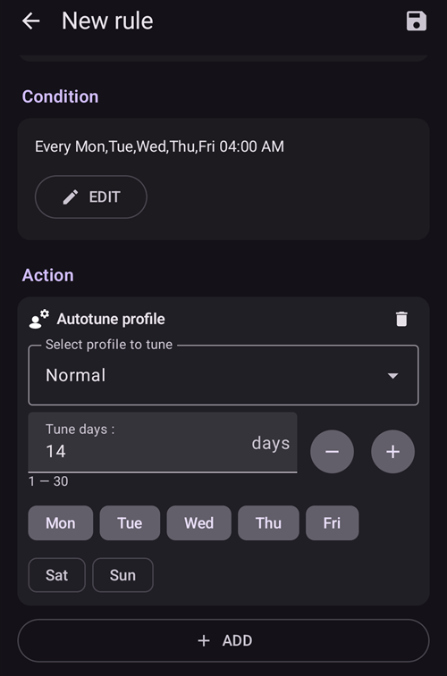


## Consells i trucs

Autotune funciona amb la informació que hi ha a la vostra base de dades. Per tant, si acabeu d'instal·lar AAPS en un telèfon nou, haureu d'esperar uns quants dies abans de poder iniciar Autotune amb prou dies per obtenir resultats útils.

Autotune només és una ajuda. És important comprovar regularment si esteu d'acord amb el perfil calculat. Si teniu cap dubte, canvieu la configuració d'Autotune (per exemple, el nombre de dies) o copieu els resultats a un perfil local i ajusteu el perfil abans de fer-lo servir.

Feu servir sempre Autotune manualment durant uns quants dies per comprovar els resultats abans d'aplicar-los. And it's only when you fully trust Autotune results, and when variation becomes tiny between previous profile and calculated profile then you start to use Automation (Never before)

- Autotune pot funcionar molt bé per a alguns usuaris i no per a d'altres, així que **si no confieu en el resultat d'Autotune, no el feu servir**

It's also important to analyze Autotune results to understand (or try to understand) why Autotune proposes these modifications

- pot haver-hi un augment o una disminució general de la força del vostre perfil (per exemple, un augment de la basal total juntament amb una disminució dels valors d'ISF i IC). pot estar relacionat amb diversos dies seguits amb una correcció d'Autosens per sobre del 100% (cal més agressivitat) o per sota del 100% (sou més sensibles)
- De vegades Autotune proposa un equilibri diferent entre les taxes basals i la IC/ISF (per exemple, una basal més baixa i una IC/ISF més agressiva)

Us recomanem no fer servir Autotune en els casos següents:

- No introduïu tots els vostres carbohidrats
  - Si no introduïu els carbohidrats de correcció d'una hipoglucèmia, Autotune veurà una pujada inesperada de la vostra glucèmia i augmentarà les vostres taxes basals 4 hores abans. Això pot ser el contrari del que necessiteu per evitar una hipo, sobretot si passa a mitjanit. Per això és important introduir tots els carbohidrats, sobretot els de correcció d'una hipo.
- Teniu molts períodes amb UAM detectat durant el dia.
  - Heu introduït tots els vostres carbohidrats i els heu estimat correctament?
  - Tots els períodes d'UAM (excepte si no introduïu cap carbohidrat durant un dia i l'opció de classificar UAM com a basal està desactivada): tots els vostres períodes d'UAM es classificaran com a basal, i això pot augmentar molt la vostra basal (molt més del necessari)

- La vostra absorció de carbohidrats és molt lenta: si la major part de la vostra absorció de carbohidrats es calcula amb el paràmetre min_5m_carbimpact (podeu veure aquests períodes amb un petit punt taronja a la part de dalt de la corba del COB), el càlcul del COB pot ser incorrecte i donar resultats incorrectes.
  - Quan feu esport, normalment sou més sensibles i la vostra glucèmia no puja gaire, de manera que durant o després de l'exercici és normal veure alguns períodes amb carbohidrats lents. Però si molt sovint teniu una absorció de carbohidrats lenta inesperada, pot ser que calgui ajustar el perfil (un valor d'IC més alt) o que el min_5m_carbimpact sigui una mica massa alt.
- Teniu «dies molt dolents», per exemple, unes quantes hores encallats en hiperglucèmia amb una quantitat enorme d'insulina per poder tornar a baixar dins del rang, o bé, després d'un canvi de sensor, llargs períodes amb valors de glucèmia incorrectes. Si les últimes setmanes només teniu un o 2 «dies dolents», podeu desactivar manualment aquests dies al càlcul d'Autotune per excloure'ls del càlcul, i de nou **comproveu amb atenció si podeu confiar en els resultats**
- Si el percentatge de modificació és massa gran
  - Podeu provar d'augmentar el nombre de dies per obtenir resultats més suaus
