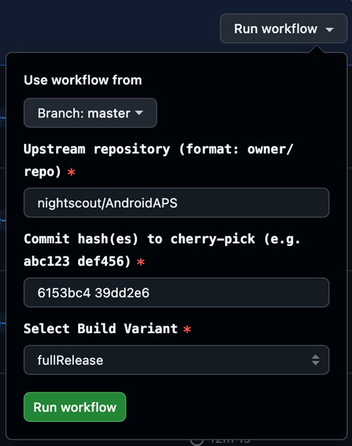

(github-cherry-pick)=

# Compilació al navegador: cherry-pick d'un commit

```{note}
Aquesta és una operació opcional i avançada. Només funciona si compileu amb un **fork** ([passos 1–4 de la compilació al navegador](../SettingUpAaps/BrowserBuild.md)). Els repositoris d'**AAPS Builder** no inclouen aquest workflow.
```

Feu-ho només quan un desenvolupador us demani provar un canvi concret (us donarà un o més hashos de commit) abans que sigui en una versió publicada.

## Abans de començar

- [Sincronitzeu el vostre fork](#Update-to-new-version-update-your-repo): aquest workflow compila l'estat actual de la vostra branca, no una versió que trieu d'una llista.
- Google Drive ha d'estar autoritzat ([pas 3](../SettingUpAaps/BrowserBuildGoogleDrive.md)): l'aplicació compilada s'hi desa, com en una compilació normal.

## Executeu el workflow

1. Al vostre fork d'AndroidAPS a GitHub, obriu **Actions**.
2. Desplegueu **All workflows** i seleccioneu **Cherry Pick CI (Pre-release Feature Backport)**.
3. Toqueu **Run workflow** i ompliu:

   

   - **Use workflow from**: la branca on s'afegiran els commits, normalment `master`.
   - **Upstream repository**: d'on vénen els commits. Deixeu `nightscout/AndroidAPS`, tret que el desenvolupador us hagi dit una altra cosa.
   - **Commit hash(es) to cherry-pick**: els hashos que us han donat, separats per espais.
   - **Select Build Variant**: vegeu les [variants](#browserbuild-variant) (normalment `fullRelease`).
4. Toqueu **Run workflow**. Quan acabi, l'aplicació serà al vostre Google Drive, com després d'una [compilació normal](../SettingUpAaps/BrowserBuildAPK.md).
