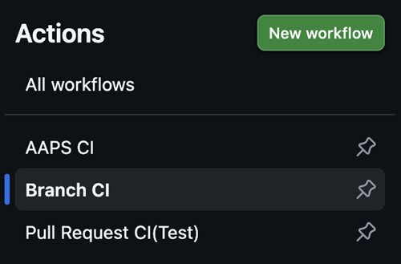
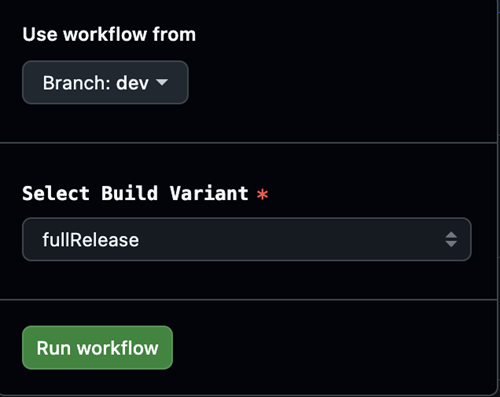
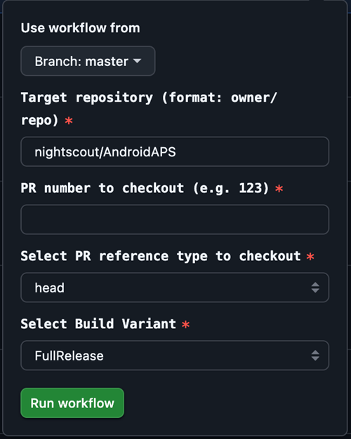

# Branca de desenvolupament

```{warning}
La branca dev és només per al desenvolupament d'AAPS. S'ha de fer servir en un telèfon separat per fer proves, <font color="#FF0000">**no per fer llaç de veritat!**</font>
```

La versió més estable d'AAPS és la de la [branca Master](https://github.com/nightscout/AndroidAPS/tree/master). Es recomana quedar-se a la branca Master per fer llaç de veritat.

La versió dev d'AAPS és només per a desenvolupadors i provadors que se senten còmodes amb stacktraces, que revisen fitxers de registre i que potser fan servir el depurador per preparar informes d'errors útils per als desenvolupadors (en resum: persones que saben què fan sense ajuda!). Per això moltes funcions no acabades estan desactivades. To enable these features enter **Engineering Mode** by creating a file named `engineering_mode` in the directory /AAPS/extra. Activar el mode enginyeria pot fer que el llaç deixi de funcionar del tot.

Tot i així, la branca dev és un bon lloc per veure quines funcions s'estan provant, per ajudar a corregir errors i per donar opinions sobre com funcionen les funcions noves a la pràctica. Sovint la gent prova la branca dev en un telèfon i una bomba antics fins que està segura que és estable. Qualsevol ús és sota la vostra responsabilitat. Quan proveu funcions noves, recordeu que heu decidit provar una funció que encara està en desenvolupament. Feu-ho sota la vostra responsabilitat i amb la cura necessària per mantenir-vos segurs.

Si trobeu un error o creieu que alguna cosa ha anat malament amb la branca dev, mireu la [pestanya d'issues](https://github.com/nightscout/AndroidAPS/issues) per comprovar si algú més ja l'ha trobat; si no, afegiu-lo vosaltres. The more information you can share here the better (don't forget you may need to share your [log files](../GettingHelp/AccessingLogFiles.md)). També podeu parlar de les funcions noves a [Discord](https://discord.gg/4fQUWHZ4Mw).

Una versió dev té una data de caducitat. Això sembla incòmode quan funciona bé, però té una finalitat. When a single dev version is doing the rounds, it is easier to keep track of bugs that people are reporting. Els desenvolupadors no volen trobar-se amb tres versions dev en circulació, amb errors corregits en unes i no en altres, i amb gent que continua informant d'errors ja corregits.

(branch-ci-test)=

## Provar una branca concreta (branch-ci)

Per compilar una branca de prova, seleccioneu branch-ci, que permet triar una branca concreta per crear l'APK. Podeu fer servir aquest mètode quan necessiteu provar la branca dev.





(github-pr-test)=

## Provar canvis d'una pull request (desplegament amb GitHub CI actions)

Disponible a partir de la versió 3.3.2.1.dev

- Adequat per a provadors o per a qui ajuda a fer proves.

```{eval-rst}
.. raw:: html

    <!--crowdin: exclude-->
    <div align="center" style="max-width: 360px; margin: auto; margin-bottom: 2em;">
      <div style="position: relative; width: 100%; aspect-ratio: 9/16;">
        <iframe
          src="https://geo.dailymotion.com/player/x9rdx1q.html?video=x9rdx1q&loop=true&mute=true"
          loading="lazy"
          style="position: absolute; top: 0; left: 0; width: 100%; height: 100%;"
          frameborder="0"
          allowfullscreen>
        </iframe>
      </div>
    </div>
```



- Target repository: the repository that contains the PR, in the format owner/repo. Leave the default **nightscout/AndroidAPS** unless you were told to use another repository (only developers should do this).

- PR number: Introduïu el número de la PR que voleu provar.

- PR reference types: els tipus de referència de la PR tenen dues opcions:
    
    - head:
    - Agafa el contingut real de la branca de l'autor de la PR (és a dir, l'historial de commits original, sense cap operació de merge).
    - Equival a l'estat original de la branca de la PR, com si s'agafés directament d'un fork o d'una branca de funcionalitat.
    
    - merge:
    
    - Agafa el resultat del merge que GitHub simula per avançat entre la PR i la branca de destinació (p. ex. dev).
    - És un commit de merge virtual que GitHub crea automàticament.
    - Aquest commit només existeix quan la PR no té conflictes i es pot fusionar.
    
    - variant:
    
    - Vegeu [variant](#browserbuild-variant)