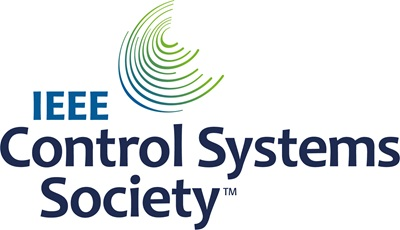
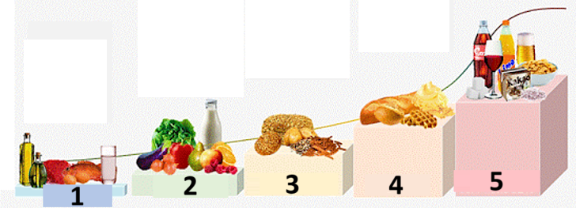
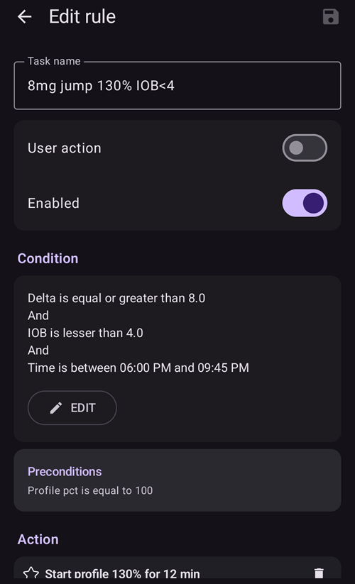
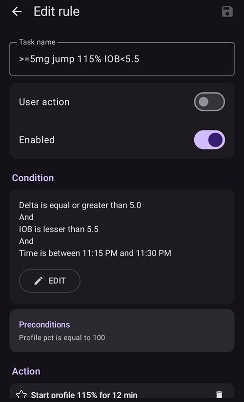
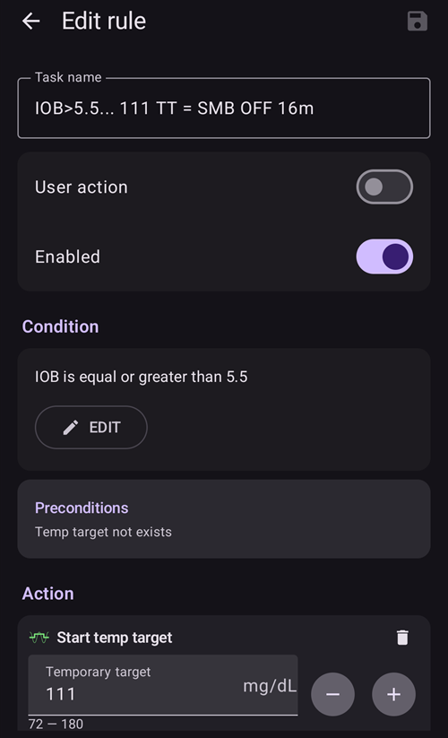
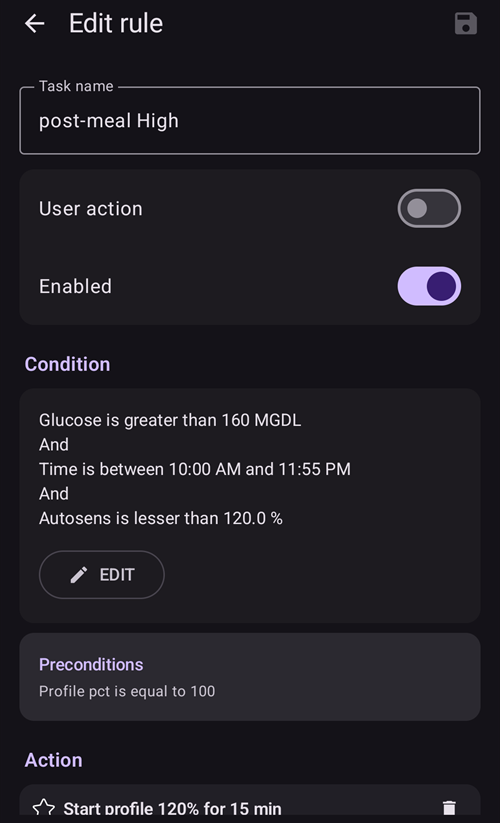
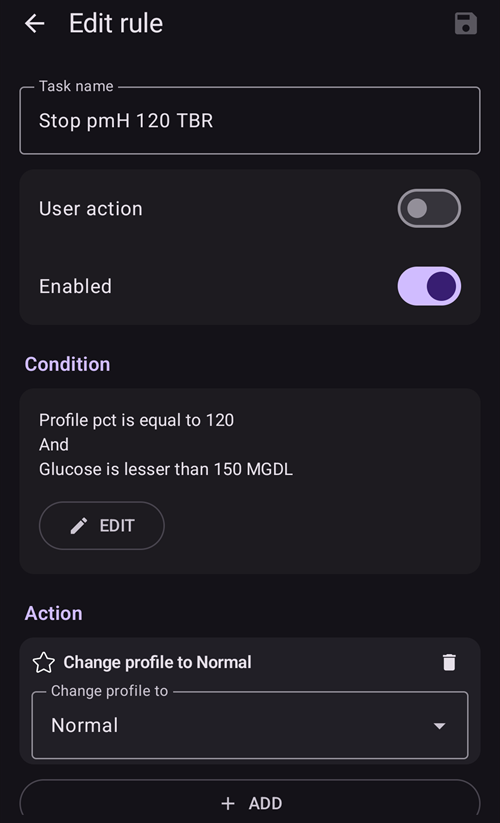

# Llaç tancat complet

```{contents} In this page
:backlinks: entry
:depth: 2
```

El gran atractiu del llaç tancat complet (**FCL**) és que pot imitar un pàncrees artificial i fer més fàcil el control diari sense haver de posar bolus per als àpats.

Encara que el **llaç tancat híbrid** («HCL») funciona amb un algoritme, l'usuari ha de lliurar bolus manualment abans dels àpats. Com a resultat, el llaç pot fer una aturada temporal (basal temporal zero) per evitar lliurar massa insulina.

Amb el **FCL** ja no calen bolus segons la mida de l'àpat: deixeu-ho a l'algoritme!  **AAPS** can handle meals without the user giving any bolus, and without making carb inputs, in a mode called ‘un-announced meals’ **(‘UAM’)**. **UAM** permet que **AAPS** toleri millor les entrades de carbohidrats incorrectes, perquè és més agressiu.

## Què podeu esperar?

Hi ha molts estudis publicats sobre els bons resultats que pot aconseguir el **FCL**. Per llegir-ne més, consulteu:

1)   National Library of Medicine, PubMed [First Use of Open-Source Automated Insulin Delivery AndroidAPS in Full Closed-Loop Scenario: Pancreas4ALL Randomized Pilot Study](https://pubmed.ncbi.nlm.nih.gov/36826996/);

2)  ClinicalTrials.gov National Library of Medicine, assaig clínic [Feasibility and Safety Study of the Automated Insulin Delivery Closed Loop System Pancreas4ALL (ASAP)](https://www.clinicaltrials.gov/study/NCT04835350?term=Feasibility%20and%20Safety%20Study%20of%20the%20Automated%20Insulin%20Delivery%20Closed%20Loop%20System%20Pancreas4ALL%20(ASAP)&rank=1)

Per tenir èxit amb el **FCL**, l'usuari ha de:

- comprovar si compleix els requisits del **FCL**;
- configurar **automatitzacions** adaptades a les necessitats del seu control diari; i
- ajustar amb precisió la configuració d'**AAPS** (sobretot les **automatitzacions**).


## Consideracions generals: per què passar (o no) d'HCL a FCL

El **FCL** no és per a tothom:

- Alguns usuaris de **FCL** aconsegueixen un TIR (70-180) d'un 90% i una HbA1c per sota del 6%; altres usuaris prefereixen un control més estricte. Notably, minimizing values over 140 mg/dL at diets with rapid carbs probably requires pre-bolusing.
- Ajustar **AAPS** pot ser difícil. It is not for those users who feel overwhelmed by AAPS.  Haureu de dedicar unes quantes setmanes a ajustar amb precisió el vostre **FCL**. Dedicar-hi aquest temps pot donar millors resultats i un millor control de la **glucèmia**.
- El control dels àpats pot ser més fàcil, però l'esport encara pot ser difícil amb el **FCL**. A la majoria de nosaltres ens agrada limitar els snacks per a l'esport per controlar el pes corporal.
- Encara és difícil establir un **FCL** per a nens (vegeu més avall).


## Llaç tancat híbrid ben ajustat

It is advisable to first establish a well-tuned **HCL** before considering the transition to **FCL**.  L'èxit amb el **FCL** necessita un ajust molt personalitzat de la configuració de l'usuari, perquè **AAPS** pugui donar insulina imitant de prop el VOSTRE mode de llaç tancat híbrid que ja funciona bé.

El **FCL** necessita que l'usuari configuri i ajusti les seves **automatitzacions**. Però l'usuari ha d'entendre bé les seves necessitats d'insulina abans de començar amb el **FCL**. Uns errors poden quedar amagats per altres errors que els compensen. Això pot crear un sistema **FCL** inestable i difícil de corregir més tard. Amb el FCL podeu esperar arribar a un %TIR comparable al que veieu avui amb el vostre **HCL**.

**FCL is a DIY set up of Automations determined by the user by analyzing their data from both their successful HCL and  initial FCL experience when tuning your settings.**

## Insulina ràpida (Lyumjev, Fiasp)

El **FCL** necessita una insulina ràpida.  This is so that at the start of meal-related **BG** rise, **FCL** is able to keep **BG** in range (by common definition, under 180 mg/dL (10 mmol/L)).

Un estudi de modelització (detalls a LINK FullLoop V2/March2023; allà, secció 2.2) pot mostrar en xifres que les *insulines més ràpides*

Font:

 


IEEE Control Systems Magazine, ResearchGate [The Artificial Pancreas and Meal Control: An Overview of Postprandial Glucose Regulation in Type 1 Diabetes](https://www.researchgate.net/publication/322866519_The_Artificial_Pancreas_and_Meal_Control_An_Overview_of_Postprandial_Glucose_Regulation_in_Type_1_Diabetes);

- will result in significantly lower **BG** peaks than slower insulins;
- toleren un primer bolus d'àpat uns minuts més tard sense pics massa alts; i
- minimize the effect on **BG** peak from different carb loads (meal sizes).

És poc probable que el **FCL** sigui eficaç amb una insulina que no sigui Lyumjev o Fiasp, tret que l'usuari faci una dieta de pocs carbohidrats o molt moderada.

However, Fiasp or Lyumjev can result in frequent pump occlusions, even after optimizing things like needle length. És important vigilar el temps de la cànula o del pod. Molts usuaris veuen que 48 hores és el límit d'eficàcia de la insulina abans que la cànula o el pod fallin.

## Requisits

**BG** values and stable Bluetooth connectivity are required to ensure **AAPS** can optimally perform without losing valuable time. El **FCL** necessita un sistema tècnicament estable 24 hores al dia, 7 dies a la setmana:

- your **CGM’s performance**. Your CGM should not produce jumpy **BG** values that could be misinterpreted by **FCL** as a sign of a starting meal. De la mateixa manera, les calibracions del **CGM** poden donar valors amb salts.
- com i on es fa el suavitzat del **CGM**, i què pot implicar per al vostre ajust. Notably how delta is defined, and AAPS recognizing this as being sign of a starting meal.
- Bluetooth stability for the pump and CGM;
- evitar l'oclusió de la bomba (o almenys detectar-la aviat);
- el flux de dades, les aplicacions del telèfon que feu servir i la diferència entre els dies d'ús del sensor;
- tenir tots els components d'**AAPS** ben carregats i les peces de recanvi a prop; i
- fer els canvis de cànula (o de pod) sempre prou aviat per reduir el risc d'oclusió;

Tot això canvia segons els components del vostre sistema **AAPS** i el vostre estil de vida.

## Limitacions relacionades amb els àpats

- Configurar un **FCL** pot ser més fàcil per a persones amb una dieta sense aliments que pugin la **glucèmia** ràpidament i molt, i amb àpats que no canvien gaire d'un dia a l'altre. Això no vol dir necessàriament una dieta de pocs carbohidrats.

- Les dietes riques en greixos o proteïnes, o una digestió lenta o gastroparèsia, fan les coses més fàcils, no més difícils, per al **FCL**, perquè els carbohidrats tardans cobreixen bé les inevitables «cues» d'acció tardana dels bolus necessaris al voltant del pic.

### Índex glucèmic i efecte sobre la glucèmia

The challenge for the **UAM** mode rises with rising 'Effect on Blood Glucose' ('EBG')

- Comenceu de manera moderada o baixa i ajusteu la configuració del vostre **perfil**. Només després, «proveu» àpats amb un **EBG** alt.
- Penseu en un bolus inicial de < 50% si mengeu aliments amb un **EBG** molt alt.

1) **Sense EBG**: per exemple carn fresca, peix, ous, cansalada, olis, formatge. 2) **EBG baix**: per exemple verdures fresques i fruits del bosc, bolets, fruits secs, llet, iogurt, mató. 3) **EBG moderat**: per exemple pa o pasta integral, patates, arròs salvatge, civada, fruita seca. 4) **High EBG**: e.g. wheat breads, baguette, toast, waffles, cookies, mash potatoes, noodles, rice. 5) **EBG molt alt**: per exemple sucre, begudes ensucrades, sucs de fruita, cornflakes, caramels, dolços, patates xips, bastonets salats (pretzels).



Els àpats més difícils per al **FCL** són els que tenen només components d'**EBG** molt alt i alt (vegeu el vermell a la imatge): la **glucèmia** no només puja molt ràpid, sinó que també hi ha pocs greixos, proteïnes o fibra per compensar la inevitable «cua» d'activitat de la insulina que ve quan s'intenta controlar abans la glucèmia alta.

Menjar snacks i begudes ensucrades amb carbohidrats d'absorció ràpida de manera irregular és un problema per al **FCL**.


## Preparar-se per a l'activitat física i l'esport

Quan feu esport o esteu actius, amb una bomba o amb un llaç tancat híbrid es recomana que l'usuari redueixi la **IOB** abans de l'esport.

Amb el **FCL**, l'algoritme està ajustat per detectar **UAM** i lliurar insulina automàticament per contrarestar les pujades de **glucèmia**.  Cal posar un **objectiu temporal** alt i un **percentatge del perfil** més baix (que ja tinguin efecte cap a l'inici de l'àpat) amb molta antelació abans de qualsevol activitat.

Els nivells d'activitat física inusuals o irregulars són un problema per al **FCL**. Per a l'esport cal planificar amb antelació (sobretot si voleu reduir la necessitat de carbohidrats o snacks de rescat per hipoglucèmies durant l'esport). After an active day it is recommended that a lower  **Percentage Profile** is set for overnight after the evening meal is fully digested: set in **Automations** an elevated (>100 mg/dL) **BG**  target, with **Enable SMB with high temp target** switched off in **AAPS** **Settings**.

## Dificultats per als nens

El **FCL** pot tenir dificultats extra amb els nens, per exemple:

- Lyumjev or Fiasp may not be available or well tolerated.
- Hourly basal rate may be very low, providing a poor basis for big **SMBs**.
- La dieta pot ser rica en aliments dolços. Amb el poc volum de sang típic d'un cos petit, hi ha una forta tendència a pics de **glucèmia** molt alts.
- Les hormones del creixement i els canvis forts de sensibilitat a la insulina fan difícil mantenir el **FCL** ben ajustat.


## Activar SMB reforçats: seguretat

En l'**HCL** hi ha límits de seguretat per a la mida dels bolus que el llaç pot donar automàticament.

Els usuaris de **FCL** ja no han de donar un bolus gran a l'inici de l'àpat. Per això, els límits de mida dels **SMB** s'han d'ampliar perquè el llaç pugui lliurar **SMB** prou grans.

If you are operating with **AAPS** in the Master release, it is suggested **AAPS**' **Settings** are set up with the maximum allowed **SMB** size so that **FCL** can give (maxUAMSMBBasalMinutes=120, i.e. 2 hours worth of basal at that daytime).

Si la vostra taxa basal és molt baixa, els límits d'**SMB** que en resulten poden ser massa baixos per controlar prou les pujades de **glucèmia** després dels àpats. One possible solution is to avoid diets that cause strong **BG** spikes. The [Auto ISF](#Open-APS-features-auto-isf) algorithm (only available in a dev build with engineering mode) has a **SMB max range extension** setting that expands the standard maximum of 2 hours worth of basal by a factor of >1, and lets you raise the default 50% **SMB delivery ratio**.

**Seguiu les instruccions perquè AAPS imiti els vostres bolus amb uns quants SMB**.

Check the **APS** plugin screen (**Configuration → APS → Open plugin**) periodically to see whether your **SMBs** are allowed to be sufficient enough to deliver the required insulin needed for the loop around meal starts.

Si no és així, de vegades els vostres esforços d'ajust no serviran de res!


```{admonition} Boosting **ISF** can become dangerous
:class: danger

Carefully observe/analyze the **SMB** sizes shortly after your meal commences. Ajusteu pas a pas i no canvieu més d'1 o 2 paràmetres alhora.

La configuració d'**AAPS** ha d'estar prou ben feta per a la (vostra!) varietat d'àpats.
```

## Detecció d'àpats i les vostres automatitzacions de reforç

Per a un **FCL** amb èxit, l'**ISF** és el paràmetre d'ajust clau. Quan feu servir **AAPS** Master + **automatitzacions**, **un canvi de perfil de > 100% s'ha d'activar automàticament quan es detecta un àpat** (per les deltes de glucèmia), i donar l'**ISF** més agressiu.

**AAPS** Master allows up to 130% temporary **Profile** in **HCL** mode. L'impuls de l'**ISF** es fa en 3 passos:

- Step 1 -  review the **ISF** applicable for this meal time hour within the **Profile**, and see whether e.g. Autosens suggest a modification that takes care of the current (last few hours’) insulin sensitivity status of the body.
- Pas 2 - apliqueu un factor (1/Perfil%, com s'ha establert a l'**automatització**) per reforçar l'**ISF**.
- Pas 3 - comproveu que l'**ISF** suggerit és dins dels límits de seguretat establerts.

### Plantilles d'automatització per al FCL

Caselles per marcar a la part de dalt. Teniu l'opció:

- A la vostra llista d'**automatitzacions**, podeu desmarcar la casella (a l'esquerra de cada camp) => Això desactiva aquella **automatització**. Per exemple, podeu fer-ho per a totes les **automatitzacions** **FCL** de l'esmorzar per passar a **HCL** en els esmorzars.

- Per a cada regla d'**automatització** podeu marcar la casella Acció de l'usuari => aleshores les accions definides no s'executaran automàticament quan es compleixin les condicions. En canvi, la pantalla principal d'**AAPS** us avisarà cada vegada que el vostre **FCL** donaria automàticament un **SMB**. Llavors podeu dir «sí» o «no». Això és molt útil durant la fase d'ajust.

This feature can be useful for certain situations like “foot to floor” syndrome where there is a sudden rise in **BG** when getting up in the morning, but the user wants to prevent a fully automatic “breakfast started” response.

La secció següent explica com agrupar les condicions de les **automatitzacions** i com tractar les situacions en què **AAPS** hauria d'augmentar (o reduir) el lliurament d'insulina. Com que l'**ISF** no es pot ajustar directament, pujar el **percentatge del perfil** per sobre del 100% fa el mateix per al nostre objectiu.

### SMB grans automàtics quan puja la glucèmia

The key to successful **FCL**: **at the beginning of BG increases from meals, very large automatic SMBs must be given by the loop as quickly as possible** “to catch up” with the required **IOB** needed (compare with your typical administered bolus for similar meal in **HCL**!)

To achieve this, data from your **HCL** should be analyzed to determine which **deltas** might not be meal-related and which might be.

- As you can define the **Automation** within a pre-defined time-window, you need only to analyze there.
- Si feu àpats molt diferents (per exemple, un esmorzar amb força carbohidrats però un dinar amb pocs carbohidrats), podeu fer dues automatitzacions (o dos grups d'**automatitzacions**) diferents, una per a cada franja horària.
- Excloeu les nits si veieu salts ocasionals per hipoglucèmies de compressió.
- Normalment n'hi ha prou amb la delta dels últims 5 minuts.
- Però també podeu fer servir una de les deltes mitjanes. Si compareu les deltes a les condicions de les vostres **automatitzacions**, fins i tot podeu definir accions més o menys agressives segons si la **glucèmia** puja de manera accelerada o no.

> ( delta – delta mitjana curta )>n   és una expressió que es pot fer servir per detectar l'acceleració , per activar el primer **SMB** al primer signe de pujada de la **glucèmia**. -                                                                             
> Caution: not possible to use with poor or highly smoothened **CGM** values!

Un **CGM** amb dades irregulars posa l'usuari en una mala situació, perquè, per anar sobre segur, heu de ser «conservadors» a l'hora de definir quina delta és segur un signe de l'inici d'un àpat. Això vol dir:

- el **FCL** perd temps addicional, i això dona pics de **glucèmia** més alts i un %**TIR** més baix;
- no podeu fer servir una delta més primerenca o més petita, que podria activar també sense àpat els **SMB** que en el **FCL** han de substituir el bolus de l'usuari.

A més, les primeres pujades després d'un àpat tenen una **iob baixa**. Amb això en ment, una automatització (#1) per al sopar pot ser així:



Automatització #1

Si es compleixen les condicions, **AAPS** donaria 1 o 2 **SMB** en els 12 minuts següents, amb un **ISF** reforçat segons el **percentatge del perfil** elevat establert (a l'exemple, un 30% més d'insulinReq). Mentre es compleixin aquestes condicions, la regla d'**automatització**  s'allarga 12 minuts més. Un àpat amb pocs carbohidrats pot fer pujar la **glucèmia** més lentament. És útil tenir una altra automatització (#2) que s'activi amb una delta més baixa i doni un impuls d'insulina més suau.



La mateixa **automatització** probablement també s'activarà en àpats amb més carbohidrats, un cop acabada la pujada forta definida a l'automatització #1.

Heu d'«escalonar» aquestes dues (+ potser una tercera) **automatitzacions** perquè encaixin amb el que veieu en els vostres àpats (varietat) => Trobar la mida dels salts, els criteris de **iob** i els reforços adequats serà un procés d'ajust repetit.  A més, si a les condicions hi poseu les franges horàries adequades, podeu fer fàcilment automatitzacions diferents per als diferents àpats del dia (esmorzar, dinar, sopar).

Tingueu en compte que, encara a la fase de pujada (!), cal bloquejar el «desbordament» de **iob**, perquè els efectes tardans de la **insulina** (la «**cua**» després de 3-5 hores) no superin la capacitat de frenada del llaç amb basal temporal zero («treure» basal per reduir el risc d'hipoglucèmia).

Amb àpats grans hi ha **de vegades una segona pujada**. En aquell moment, normalment la iob també ha baixat una mica, i les automatitzacions més agressives tornen a fer efecte. (Check that your iob condition in Automation #2 is not set too low for this to happen).

Poc després dels primers **SMB** ve una **fase equilibrada**, en què un lliurament moderat d'insulina hauria de cobrir els carbohidrats addicionals absorbits. (Except in low carb meals, where the loop might see too weak of a **BG** rise, and go into zero-temping right away already now).

En aquesta fase, la pantalla principal d'**AAPS** (on veieu cob=0 en el llaç complet amb **UAM**) pot demanar més carbohidrats necessaris. En el mode **UAM** això només vol dir que podeu fer una comprovació aproximada: és probable que hi hagi aquesta quantitat de carbohidrats encara sense absorbir al vostre cos, de l'àpat de fa més o menys una hora (del qual no vau donar cap informació al llaç)?


### Llindar de iob

Sovint, les **automatitzacions** #1 i/o #2 fan pujar la iob a nivells que normalment són suficients per als **vostres** àpats. Per a un ajust personalitzat, mireu a les vostres dades de l'**HCL** els valors màxims de iob en àpats ben controlats (sovint: el vostre bolus d'àpat), i a partir de quina quantitat al final va venir una hipoglucèmia (o calien carbohidrats extra).

Els **llindars de iob** raonables a partir dels quals cal reduir l'agressivitat del llaç poden no ser els mateixos per a tots els àpats. Però sobretot en la primera hora després de començar un àpat, que és molt important en el mode **UAM**. It will differ for each user. Per a alguns usuaris s'absorbeixen només uns 30 g/hora, i pot ser possible definir una **iob** útil que no depengui de l'àpat exacte.

Per a àpats excepcionals, o per baixar-lo si després feu esport, el llindar de **iob** es pot canviar ràpidament a la vostra **automatització**.

Automation (#3), "iobTH reached => **SMBs** off”, is defined to end (or pause, until another wave of carb-related rise hits) the aggressive **SMB** boosting.



Automatització #3

Diu al llaç que per sobre del vostre **llindar de iob** és millor no fer servir més **SMB**

- The given example does that by setting TT=111 (which is kind of arbitrary; pick a number>100 that you easy recognize as your automated **SMB** shut-off)
- In **AAPS**' [Settings → OpenAPS SMB](#Preferences-openaps-smb-settings), generally do not allow **SMB** at elevated target.                                                                                                                   
  The insulin required will then have to be delivered with much more caution through the bottleneck of **TBRs**

**Atenció: l'automatització #3 només funciona quan no hi ha cap OT actiu.** Per tant, si heu fet servir un EatingSoonTT, a aquella hora ja ha d'haver acabat. Normalment hauria de ser 30–40 minuts després de començar l'àpat.

Una manera de fer-ho és configurar una condició d'**automatització** que acabi un possible EatingSoonTT actiu amb la condició **iob**>65% * iobTH.
> Maneres de treballar amb EatingSoonTT Alguns usuaris del llaç posen un EatingSoonTT una hora o més abans de començar l'àpat (amb el botó d'OT, o de manera automàtica amb un objectiu de **glucèmia** més baix al **perfil** si els horaris dels àpats són força fixos), només per assegurar una **glucèmia** inicial baixa i una **iob** una mica més alta. But, assuming the **FCL** is always en route towards target, this might not yield much and you may prefer to define an **Automation** that sets an EatingSoonTT at recognition of meal start (glucose delta, or acceleration = delta > avg delta). Un **OT** baix és important en aquesta fase, perquè el llaç calcula cada **SMB** amb (glucèmia prevista menys OT)/sens; per tant, un OT baix fa més gran l'insulinReq resultant.

After the first boosted **SMB**s were given, your set iobTH and **Automation** #3 should strike a good balance of limiting the glucose peak, but also not leading to a hypo after the meal.

Si el vostre esmorzar té molts més o molts menys carbohidrats que el vostre sopar mitjà, us pot anar bé definir **automatitzacions** per a les hores del dia corresponents, amb un **iobTH** diferent (i potser també deltes diferents i un **percentatge del perfil** diferent). Tots dos, vosaltres en definir el vostre ventall d'àpats i la configuració (sobretot l'**iobTH**), i el llaç en gestionar la corba de **glucèmia**, heu d'acceptar uns certs pics per reduir el perill d'hipoglucèmia cap al final de la **DIA** dels **SMB**.

### Estancament amb glucèmia alta

In case, after a “rich” meal, a long-lasting stagnation with **high BG** value is seen, **Automation** #4 (below), “post-meal High”, helps deal with fatty acid resistance: After multi-course meals, large greasy pizza, raclette evening, the glucose curve can form two humps or, very often, an elongated high plateau.



Automatització #4



Automatització #5

L'automatització #4, «post-meal High», també és útil en el llaç tancat híbrid.

A més, cal una automatització de finalització, la #5, «Stop pmH», per reduir l'agressivitat de l'administració d'insulina tan aviat com la glucèmia baixi. (Però sovint el llaç ja limitarà igualment més insulina per evitar una hipoglucèmia, perquè la glucèmia prevista ja és baixa).

## Prevenció d'hipoglucèmies

El problema principal és que el **FCL** amb **UAM** (sense entrades de carbohidrats) **no pot saber quants grams de carbohidrats queden per absorbir**, i que podrien consumir aquella insulina de la «cua» sense que patiu una hipoglucèmia.

Amb **SMB** reforçats, el **FCL** ha «recuperat» el que abans fèiem amb un bolus d'àpat. Però **al final de l'activitat de la insulina (la «cua»), evitar una hipoglucèmia pot ser un tema seriós**.

Per preparar-se per al **FCL**, l'usuari ha de mirar amb atenció l'**evolució de la iob en el temps** en els àpats típics, i valorar **quan és massa i com es pot evitar ajustant les automatitzacions**. Això és possible perquè tenim diversos «cargols» per ajustar. Pot ser difícil fer-ho bé

Generally, it makes no sense to keep optimizing settings for one kind of meal. Quan tingueu una configuració prou bona, per exemple per a un tipus de dinar que feu sovint, proveu com funciona amb altres tipus d'àpat i com hauríeu de trobar un «compromís».

Per evitar una hipoglucèmia a les hores 3–5 després de l'àpat, reduïu l'agressivitat abans que s'acumuli massa iob. Maneres concretes:

- Feu l'**ISF** cada vegada més suau ja durant la pujada de la glucèmia, com als exemples d'automatització #1 i #2.
- Definiu el llindar de iob a partir del qual **AAPS** es torna molt més prudent (automatització #3, més amunt). Note this **iob** can be exceeded, by the last **SMB** before it went into effect; and then further by TBRs if the loop sees insulinReq. Carbs getting absorbed will provide a counter-movement towards lower iob.
- El llindar de iob es podria diferenciar segons els àpats: si cloneu les automatitzacions, podeu diferenciar fàcilment les franges d'esmorzar, dinar i sopar (o fins i tot llocs, com el menjador de la feina o a casa de la sogra, etc.)
> Dins d'aquestes franges horàries podríeu diferenciar encara més amb OT diferents per a pocs carbohidrats o carbohidrats ràpids, etc. Així podeu «codificar» diferents tipus d'àpat que poden passar a aquesta hora del dia i activar-los amb **automatitzacions** ajustades especialment per a ells. Probablement no cal, tret que els vostres hàbits alimentaris canviïn molt.

Before a special meal challenge, you can raise your **iob** threshold, or make another change in any of your Automations within under 5 seconds, right on your AAPS phone (**Manage → Automation**).

El perill d'hipoglucèmia unes hores després de l'àpat depèn sobretot de si la composició de l'àpat era tal que les **cues d'insulina de lluitar contra la major part dels carbohidrats** seran **consumides per «carbohidrats estesos»** (absorció de carbohidrats excessiva o retardada, proteïnes, greixos, fibra).

Amb el temps aprendreu patrons i ajustareu les vostres automatitzacions. Potser fins i tot canviareu una mica els vostres hàbits alimentaris, per exemple amb un petit(!) snack tardà de tant en tant, que pot ajudar a mantenir un bon **equilibri entre l'activitat de la insulina i l'absorció de carbohidrats** durant **tot** el temps de l'àpat (digestió, absorció). Així la vida és més fàcil per al llaç (i per a vosaltres).

### Ordre de les automatitzacions programades

Hi pot haver problemes quan les definicions de les **automatitzacions** se superposen. Exemple: el problema és que delta >8 també és delta >5, és a dir, hi pot haver dues **automatitzacions** que competeixen. Què fa el llaç llavors? It always decides according to the sequence in which your **Automations** appear in **Manage → Automation**.  Exemple: la regla delta > +8 ha d'anar primer (i llançar l'impuls més fort si es compleixen totes les condicions); després ve la comprovació de delta >5 (amb una resposta més suau). Si es fa a l'inrevés, la regla delta>8 no s'aplicaria mai, perquè la delta>5 ja s'aplica i el cas queda tancat.
> Consell per a les automatitzacions: canviar l'ordre és molt fàcil. In **Manage → Automation**, touch and hold the **=** handle on the right of a rule and drag it to another position.

A més, és molt fàcil i ràpid ajustar qualsevol condició o acció en qualsevol moment, en pocs segons, directament al vostre telèfon amb AAPS; per exemple, si aneu a un àpat molt especial. (Però no oblideu tornar-ho a posar normal per al dia següent).

(full-closed-loop-troubleshooting)=

## Resolució de problemes

### Com tornar al llaç tancat híbrid

You can untick the checkboxes of the **Automations** related to your **FCL**, and go back to bolusing for meals and make carb inputs again. If you had removed the **Insulin** or **Calculator** buttons from your main screen, add them back in the [QuickLaunch toolbar](#quicklaunch) configuration (they always remain available under **Treatments** in the bottom navigation). Be aware that now it is again up to you to bolus for meals.

It may be wise to do **FCL** only for meals (time slots) where **Automations** are fully defined and clicked on, and un-click only those for the other meal times when you like to do **HCL** (or have none defined yet, in your transition period).

For instance, it is perfectly possible, without any extra steps after **Automations** for dinner time slots are defined, to do **FCL** only for dinners, while breakfast and lunch are done in a **HCL** as you are used to.


### Encara es compleixen els requisits per al FCL?

- El **perfil** bàsic encara és correcte?
- Ha empitjorat la qualitat del **CGM**?
- Consulteu els requisits (més amunt).

### La glucèmia puja massa

- Els àpats no es detecten prou aviat
    - Comproveu l'(in)estabilitat del Bluetooth
    - Comproveu si podeu posar deltes més petites per activar el primer **SMB**
    - Experiment with an aperitif, soup a couple of minutes before meal start
- Els SMB són massa febles
    - Comproveu l'ordre de les **automatitzacions** (per exemple: delta gran abans que delta petita)
    - Check (real-time) in the **APS** plugin screen whether hourly profile basal and set minutes (max 120) limit allowed SMB size
    - Check (real-time) in the **APS** plugin screen whether %profile must  be set bigger
- Si tota la vostra configuració ja és al límit, potser haureu d'acceptar la hiperglucèmia temporal o canviar la vostra dieta.
> If you are ready to test a dev build, [Auto ISF](#Open-APS-features-auto-isf) also allows further expanded SMB sizes. Alguns usuaris també fan servir un petit prebolus en el seu «FCL». Però això afecta el comportament de la corba de glucèmia i, per tant, la detecció de pujades i els **SMB** activats; per això no és fàcil de fer amb un benefici global clar.
- Una observació important dels usuaris pilot és que la manera com les corbes de glucèmia i de iob arriben a l'inici de l'àpat influeix molt en el pic que provoquen els carbohidrats: Baixar (per exemple cap a un EatingSoonTT establert), acumular una mica de iob i tenir la corba ja cap a una acceleració positiva forta sembla molt útil per mantenir els pics baixos.

### La glucèmia baixa massa

- Es detecten àpats per error
    - Comproveu si podeu posar deltes més grans per activar el primer **SMB**
    - Click “User action” in the related Automation, so in the future you can ad hoc decide to block execution of the Automation if not meal-related
    - Per evitar que els snacks activin **SMB** com si fossin un àpat, poseu un OT>100 quan mengeu un snack (com faríeu igualment per a l'esport i per als snacks contra la hipoglucèmia)
- En total, els SMB lliuren massa insulina
    - Check (real-time) in the **APS** plugin screen whether **SMB max range extension** must be set smaller
    - Check (real-time) in the **APS** plugin screen whether **Percentage Profile** must  be set smaller
    - Probablement podeu posar més petita la ràtio de lliurament d'SMB. Tingueu en compte que en aquest cas s'aplica a tots els **SMB** (totes les franges horàries),
- Problemes amb la «cua» d'insulina després dels àpats
    - Potser haureu de menjar un snack (si veieu una predicció d'hipoglucèmia) o prendre pastilles de glucosa (si ja sou en zona d'hipoglucèmia). Però tingueu en compte que els carbohidrats necessaris que el llaç us pot indicar en algun moment són molt probablement exagerats, perquè el llaç no té cap informació sobre els carbohidrats que heu menjat i que encara esperen ser absorbits (mentre que vosaltres potser podeu endevinar quants més en queden, també dels greixos i les proteïnes).
    - Una informació valuosa seria saber si el problema ja ve sobretot de la fase de pujada de la glucèmia. Aleshores, posar un iobTH més baix pot ser una solució fàcil.
    - Si sovint necessiteu carbohidrats addicionals, anoteu quants grams calien (sense comptar el que potser vau prendre de més i que va tornar a necessitar insulina extra).  Després feu servir el valor IC del vostre perfil per calcular quanta insulina menys hauria d'haver lliurat l'**SMB**, i feu servir aquesta informació per al vostre ajust (el **percentatge del perfil** a les **automatitzacions**, o potser també el vostre iobTH). This may relate to the **SMBs** given when glucose was high, or also to the **SMBs** during the **BG** rise.
    - Pot ser que simplement hàgiu d'acceptar pics de **glucèmia** més alts per no baixar massa. Or change diet to something with lower amounts of carbs, and higher amount of protein and fats.


### Més informació

Make sure you stay in touch with other **FCL** users.

Discussion Full Closed Loop using Automations:

- Anglès:   [Canal de Discord](https://discord.gg/ChXj8BaKwA)

- Alemany:  [German Looper Community](https://de.loopercommunity.org/t/ueber-die-kategorie-full-loop/10107)
