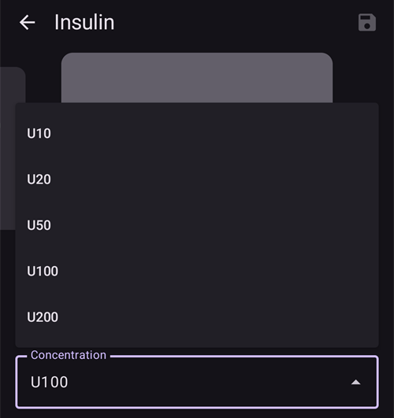
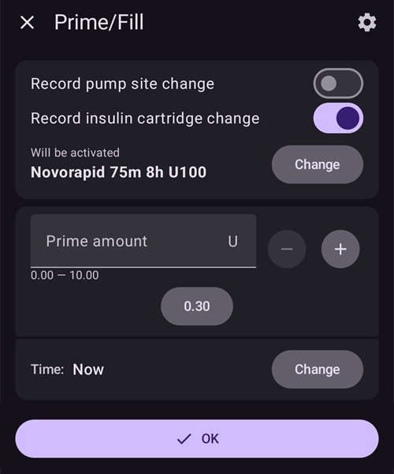

(Insulin-Concentration)=
# Concentració d'insulina

```{warning}
Totes les bombes comercials estan dissenyades per fer-se servir **NOMÉS** amb insulina U100. Fer servir una altra concentració d'insulina en una bomba pot ser perillós. Tot i que cada vegada més usuaris fan servir AAPS amb altres concentracions, la conversió sempre s'ha de gestionar i sovint porta a errors (fins i tot en usuaris molt experts!).
```

## Recordatori dels conceptes bàsics de la insulina

Aquest capítol explica els conceptes essencials de la mesura i el lliurament d'insulina.

### La unitat d'insulina: una mesura de l'acció

La insulina es mesura en **unitats internacionals (UI)**, que quantifiquen la seva activitat biològica (capacitat de fer baixar la glucèmia), no només la seva massa física.

- **Definició:** 1 UI correspon a l'activitat d'una quantitat concreta d'insulina, estandarditzada a **aproximadament 0,04167 mg**.
- **Punt clau:** una «unitat» vol dir el mateix efecte biològic en tots els tipus d'insulina, i així la dosificació és coherent.

### Concentracions d'insulina

La insulina es presenta en diferents concentracions, definides pel nombre d'unitats per mil·lilitre (ml).

- **U100:** l'estàndard mundial, amb **100 UI/ml**.
- **U200-U500:** insulines més concentrades (p. ex. la U200 té 200 UI/ml) per a volums d'injecció més petits.
- **U40/U50:** concentracions històriques, menys habituals (40 UI/ml i 50 UI/ml). **La U40 necessita xeringues específiques per a U40.**
- **Dilució manual:** una pràctica clínica per obtenir insulina molt diluïda (p. ex. U50, U10) en casos poc freqüents, com l'ús en nadons o una sensibilitat extrema. Això requereix una preparació molt acurada a la farmàcia.

```{admonition} Critical Warning
:class: danger
Fer servir una concentració amb un dispositiu que no hi correspon és extremadament perillós i pot provocar una sobredosi o una infradosi greu. **Comproveu sempre tres vegades que la concentració de la insulina correspon a les especificacions de la xeringa, la ploma o la bomba.**
```

## Quan es fa servir una concentració no estàndard?

Tot i que les bombes d'insulina estan dissenyades per a insulina U100, algunes situacions mèdiques concretes requereixen concentracions no estàndard. Aquests casos requereixen una precaució extrema i una gestió molt acurada.

### Cas d'ús 1: insulina diluïda per a dosis molt baixes

- **Situació:** tractar la diabetis tipus 1 en nadons i infants molt petits.
- **Problema:** les seves necessitats d'insulina són tan baixes que la dosi mínima que pot lliurar la bomba (p. ex. 0,05 U) encara pot ser massa gran. Això fa difícil un control glucèmic precís i comporta un risc alt d'hipoglucèmia.
- **Solució:** fer servir insulina molt diluïda (p. ex. U10, que vol dir 10 UI/ml).
- **Efecte:** augmenta el volum de líquid lliurat per cada unitat d'insulina. Com que els «paquets» d'insulina tenen més volum però menys concentració, es poden fer ajustos molt més fins i dosificar amb més precisió amb la configuració actual de la bomba.

```{admonition} Critical Safety Note on Dilution
:class: danger
La dilució d'insulina és un procediment d'alt risc que mai no s'ha de fer a casa sense formació específica i supervisió mèdica. L'ha de fer un professional sanitari o un cuidador format, amb un diluent estèril dissenyat específicament per a aquell tipus d'insulina. **No feu servir mai aigua de l'aixeta, sèrum fisiològic ni cap altre líquid**, perquè pot desactivar la insulina, alterar-ne l'acció i introduir contaminants perillosos.
```

### Cas d'ús 2: insulina concentrada per a necessitats d'insulina altes o una resistència a la insulina important

- **Situació:** tractar adults o adolescents amb una resistència a la insulina important, o persones que tenen dolor local pels additius de la insulina estàndard.
- **Problema:**
  1. **Necessitats altes:** unes necessitats diàries d'insulina molt altes poden superar el bolus màxim de la bomba o els seus límits de lliurament diari.
  1. **Dolor:** els conservants de la insulina poden provocar coïssor o irritació durant la infusió.
- **Solució:** fer servir una insulina més concentrada, com la U200 (200 UI/ml).
- **Efecte:** la dosi d'insulina necessària es lliura amb la meitat del volum. Per a l'usuari, cal ajustar la configuració interna de la bomba (p. ex. reduir a la meitat les taxes basals i els bolus) per tenir en compte la concentració doble, perquè es lliuri el nombre correcte d'unitats. Això també redueix el volum de líquid potencialment irritant que es lliura per via subcutània.

## Com es gestiona la concentració d'insulina amb AAPS (AAPS 3 i anteriors)?

Fer servir insulina que no és U100 en un llaç d'AAPS requereix una configuració molt acurada perquè els càlculs del programari coincideixin amb la insulina que es lliura realment. Un mètode habitual és «Fer servir un perfil modificat».

### Fer servir un perfil modificat

Aquest mètode consisteix a fer creure a AAPS que les necessitats d'insulina del pacient són més baixes del que són, per compensar que la bomba lliura una insulina més concentrada que aquella per a la qual està dissenyada. El cas d'ús següent és per a insulina U200 posada en una bomba dissenyada per a U100.

- **El problema principal:** una bomba dissenyada per a U100 està calibrada per lliurar **10 µl** per **1 unitat**. Si l'ompliu amb U200 (1 unitat d'U200 correspon a **5 µl** d'insulina), quan seleccioneu **1 unitat** a la bomba, lliura **10 µl** d'insulina, però aquest volum ara conté **2 unitats d'insulina U200**. Això porta a una sobredosi del 100%.
- **La solució del «Canvi de perfil al 50%»:** Per corregir-ho, tot el perfil de teràpia del pacient s'escala dins d'AAPS perquè sigui «el doble de feble».
  1. L'usuari crea un perfil nou a partir del seu perfil U100 estàndard, amb la funció «Canvi de perfil al **50%**».
  1. Això crea un perfil nou en què:
     - Les **taxes basals** es redueixen a la meitat.
     - La **ràtio insulina:carbohidrats (IC)** es duplica (p. ex. 1:10 g passa a ser 1:20 g).
     - L'**ISF (factor de sensibilitat a la insulina)** es duplica (p. ex. «1 unitat fa baixar la glucèmia 50 mg/dl (2,8 mmol/l)» passa a ser «1 unitat la fa baixar 100 mg/dl (5,6 mmol/l)»).
- **El resultat corregit:** Ara AAPS creu que el pacient només necessita la meitat de la insulina. Quan calcula i ordena un bolus d'**1 unitat**, la bomba (dissenyada per a U100 però omplerta amb U200) lliura els **10 µl**, que contenen **2 unitats reals d'insulina U200**. Com que AAPS ha calculat aquesta dosi a partir d'un perfil «a mitja potència», aquest lliurament de **2 unitats reals** és la dosi correcta i prevista. Els càlculs «a mitja potència» del llaç coincideixen amb el lliurament «a doble potència» de la bomba.

```{admonition} Critical Risks and Common Errors
:class: caution

Aquest mètode comporta riscos importants, perquè crea una diferència permanent entre les dades de l'aplicació i la realitat física.

**L'error principal: la discrepància del «bolus extern»**

L'error més habitual passa quan es lliura i es registra insulina **fora** del sistema AAPS-bomba.

- **La situació:** AAPS, amb el perfil modificat, calcula un bolus de **5 unitats** per a un àpat. L'usuari l'injecta amb una ploma U200.
- **El doble error:**
  1. **Selecció de dosi incorrecta:** l'usuari pensa «AAPS calcula 5 unitats» i, com que fa servir la ploma U200, espera lliurar **5 unitats reals d'U200** sense cap conversió. Però, com que el perfil està reduït a la meitat, el cos en realitat necessita **10 unitats reals**. Això és una **infradosi del 50%**, que pot provocar hiperglucèmia.
  1. **Càlcul incorrecte de la insulina a bord (IOB sobreestimada):** quan l'usuari registra aquest bolus extern a AAPS, hi anota **5 unitats**. Això és incorrecte. Com que el perfil d'AAPS és per a U200, **1 unitat a AAPS equival a 2 unitats reals**. Per tant, les 5 unitats reals lliurades amb la ploma s'haurien de registrar com a **2,5 unitats** a l'aplicació. Si registra 5 unitats, l'usuari sobreestima la IOB un 100%. Ara AAPS creu que hi ha 5 «unitats concentrades» a bord (equivalents a 10 unitats reals), quan només n'hi ha 5 de reals actives. Això pot fer que el llaç suspengui la insulina basal o redueixi els bolus següents, i això augmenta el risc d'hiperglucèmia causat per la infradosi inicial.

**Altres riscos:**

- **Dades i informes enganyosos:** totes les dades d'AAPS o de Nightscout, inclosos la IOB, la dosi diària total (TDD) i els informes de l'historial, són en «unitats concentrades». Això dona una imatge distorsionada a l'usuari i al seu equip mèdic. Un metge que revisa un informe pot veure una TDD de 30 unitats i no adonar-se que el pacient en realitat ha rebut 60 unitats reals, i això porta a valoracions incorrectes de la teràpia.
- **Model mental alterat:** després d'un ús llarg, l'usuari comença a «pensar» amb els valors reduïts a la meitat de l'aplicació. Interioritza que el seu ISF és 100 mg/dl (5,6 mmol/l) o que la seva basal és 0,5 U/h, i oblida que són valors «concentrats». Això crea una dependència perillosa del sistema i una pèrdua de contacte amb les seves necessitats reals d'insulina, cosa que és crítica per a la seguretat quan falla la bomba o hi ha problemes amb l'aplicació.

**Conclusió:** aquest mètode requereix una vigilància absoluta i obliga l'usuari a convertir contínuament entre un «món concentrat» a l'aplicació i el món físic. Qualsevol lliurament d'insulina extern o revisió de dades trenca aquest model mental i comporta un risc greu. Canvia de manera fonamental el significat de cada número del sistema.
```

## Fer servir el paràmetre de concentració (funció nova d'AAPS 4.0)

Per reduir els riscos d'un perfil modificat, una funció nova gestiona la concentració d'insulina directament dins d'AAPS. Aquesta funció fa les conversions automàticament, i així l'aplicació principal sempre treballa en **unitats internacionals (UI) reals**.

### Com funciona: conversió automàtica

El principi bàsic és una separació clara entre la lògica de l'aplicació i la comunicació amb la bomba:

- **AAPS fa servir unitats internacionals:** la base de dades principal d'AAPS, els algoritmes, els informes i els registres **sempre fan servir UI reals**. Això vol dir que la vostra IOB, la TDD i la configuració de la teràpia (basal, ISF, IC) reflecteixen les unitats biològiques reals d'insulina.
- **El controlador de bomba fa servir unitats concentrades:** tots els valors enviats al controlador de bomba o rebuts d'ell es converteixen automàticament per gestionar «unitats concentrades» dins del controlador de bomba, segons la concentració seleccionada.
  - **Exemple amb U200:** quan l'usuari demana un **bolus d'1 unitat**, el controlador de bomba rep **0,5 CU (unitats concentrades)** abans d'enviar-ho a la bomba. Després la bomba (configurada per a U100) lliura **5 µl**, que contenen **1 UI d'insulina U200**.

### Avantatges i riscos que queden

**Avantatges:**

- Ja no cal un perfil modificat ni els errors de conversió mental que porta.
- Els usuaris sempre poden «pensar» en UI reals.
- Per a un bolus extern amb una ploma, només cal seleccionar a la ploma la quantitat d'insulina prevista (sigui quina sigui la ploma i la concentració d'insulina). No cal cap conversió, perquè les plomes U100 i U200 sempre fan servir UI per seleccionar les unitats.
- Tots els informes i les dades d'AAPS (TDD, IOB) són en UI reals, i això els fa clars per a l'usuari i el seu equip mèdic.
- Desapareix el risc de calcular malament els bolus externs, perquè es registren en UI reals.

**Riscos que queden:**

- **Canvi de model mental:** els usuaris que deixen el mètode del «perfil modificat» han de tornar al perfil real correcte (és a dir, el doble de fort si venen de U200) i necessiten temps per adaptar el seu **model mental**. Després d'acostumar-se als valors «concentrats» a l'aplicació, han de tornar a aprendre a confiar en els **valors reals en UI, sense amagar res**, que es mostren a tot arreu. Aquest període d'adaptació comporta un risc d'interpretar malament les dades.
- **Bolus manual a la bomba:** fer servir la funció de bolus de la mateixa bomba (sense passar per AAPS) provoca una sobredosi del 100%, perquè la bomba lliura insulina U200 amb càlculs de volum per a U100.
- **Advertència general:** fer servir concentracions no estàndard continua sent un procediment avançat amb riscos i no està recomanat oficialment.

```{admonition} Never use the pump's own interface (tube pump users) to deliver a bolus manually
:class: danger
Enganxeu a la bomba una nota permanent **«Insulina U200»** com a recordatori, per no oblidar-ho mai!
```

### Visualització a la interfície d'usuari

Perquè tot sigui clar, la interfície d'usuari mostra tant les unitats reals com les concentrades quan cal. Tingueu en compte que la interfície d'usuari no canvia si la insulina actual és U100.

**Exemples de visualització:**

- **Diàleg de progrés del bolus:**
  - El diàleg de progrés del bolus forma part de l'aplicació principal d'AAPS, per això només mostra la informació en UI (coherent amb el que ha seleccionat l'usuari): **`Lliurat: 2,50 U / 10,00 U`**
- **Interfície del controlador de bomba (estat actual):**
  - A la vista general de la bomba, la quantitat lliurada es mostra en les dues unitats; per exemple, si s'ha seleccionat `U200`: **`Darrer bolus: 10 U (5 CU) (10')`**

**Atenció:** les dues unitats (U i CU) només es veuen a la vista general principal de la bomba. Segons la vostra bomba, pot haver-hi altres pantalles on només es mostren les unitats concentrades. Les dades de l'historial dins dels controladors de bomba normalment es mantenen en «unitats concentrades».

### Activar la funció

A causa dels riscos de seguretat que comporta, aquest paràmetre no està activat per defecte. Per activar-lo, acabeu l'Objectiu 3 i activeu **Suport per a concentracions d'insulina** a la configuració general.

### Crear una insulina nova amb una altra concentració

Per crear una insulina amb una altra concentració, primer obriu **Gestionar → Configuració d'insulina**.

- Feu clic a la icona «+» a la part inferior de la pantalla.
- Seleccioneu la nova concentració prevista al menú desplegable (hi ha U10, U20, U50, U100 i U200).
  - Les concentracions diluïdes com U10, U20 o U50 són per a nens amb taxes basals molt baixes.
  - La U200 és més per a adults amb necessitats d'insulina altes.

  

- Ajusteu el temps del pic, la durada de l'acció de la insulina (DIA) i, si voleu, personalitzeu l'àlies de la insulina.
- Feu servir el botó de desar a la part superior dreta de la pantalla.

En aquest pas la insulina ja està creada, però no es pot seleccionar directament des de **Configuració d'insulina**.

### Canviar la concentració de U100 a Uxxx (AAPS 4)

```{admonition} Switching concentration is only allowed during a reservoir or patch/pod change
:class: warning
Per seguretat, AAPS només registra un canvi de concentració durant un canvi de reservori o un canvi de patch/pod.
```

Quan comenceu amb insulina U100, tot el perfil, les dades de l'historial i els informes són coherents amb l'estàndard d'unitats internacionals, per això el canvi és molt «fàcil»:

- En una bomba patch/pod, hi ha un pas específic quan canvieu la bomba per seleccionar la insulina que hi poseu.
- En una bomba amb tub, feu clic al botó Encebar (per al canvi d'insulina) al Resum (vista ampliada de la barra d'estat) i després feu clic al botó «Canviar».

1. Seleccioneu la concentració desitjada al menú desplegable (p. ex. `U200`).
1. Després seleccioneu la insulina correcta a sota. Fins que no confirmeu, el text sobre el seu nom diu **S'activarà** (en lloc d'**Activa actualment**).

   

1. **Important:** el canvi de concentració només es registra a AAPS després que el canvi de perfil s'aplica a la bomba.
   - Aquest pas és obligatori per a totes les bombes patch/pod.
   - En les bombes amb tub, espereu que el canvi de perfil s'apliqui a la bomba, o feu-lo a **Gestionar → Perfil** o a **Configuració d'insulina**.

Això és tot!

Si hi ha un **canvi de perfil** temporal (amb una durada) en curs quan canvieu la insulina, la insulina nova també s'assigna al perfil que torna quan s'acaba el canvi temporal. La insulina antiga no torna.

### Canviar la concentració per a usuaris amb insulina U200 associada a un perfil del 50% (AAPS 4)

Si ja feu servir U200 a la bomba, però associada a un perfil del 50%, heu de fer passos addicionals en comparació amb el canvi estàndard des d'insulina U100.

Tingueu en compte que la part més difícil probablement no serà gestionar correctament el canvi a AAPS, sinó entrenar de nou el cervell per pensar en «UI» en lloc de «CU». Tots els valors habituals dels bolus (esmorzar, dinar, sopar...) seran el doble d'alts, i el mateix passa amb les TDD, les taxes basals, etc. Heu d'anar amb molt de compte per no fer errors durant les primeres setmanes, fins que «torneu a pensar» en unitats internacionals.

- Primer, prepareu un perfil nou amb tots els valors coherents amb les unitats internacionals:
  - Feu un canvi de perfil temporal al 200% del vostre perfil estàndard actiu.
  - Obriu el menú (☰) → **Tractaments**, aneu a la pestanya **Canvi de perfil** i cloneu el nou perfil del 200% (vegeu [Clonar un canvi de perfil](#your-aaps-profile-clone-profile-switch)).
  - Torneu al vostre perfil estàndard fins al següent canvi de reservori o de patch.
  - Aneu a **Gestionar → Perfil** i canvieu el nom d'aquest perfil nou per un nom clar (serà el vostre futur perfil associat a la insulina U200 configurada a AAPS 4).
- Si feu servir la funció ISF dinàmic (DynISF), l'heu de desactivar com a mínim una setmana:
  - Tot l'historial registrat a AAPS o a Nightscout és en unitats incorrectes (CU), la meitat del valor real en unitats internacionals. Espereu com a mínim una setmana amb la insulina U200 en ús abans de tornar-la a activar.
- Ara ja podeu canviar d'insulina (amb una nova U200 definida a **Configuració d'insulina**) en el següent canvi d'insulina o canvi de pod.
- Quan la nova insulina U200 estigui aplicada correctament, no oblideu aplicar el nou perfil estàndard definit al primer pas.

## Com es gestionen els bolus externs amb plomes diferents?

### Amb insulina U200 associada a un perfil del 50% (AAPS 3)

Tingueu en compte que totes les graduacions de les plomes són en unitats internacionals. Per tant, sigui quina sigui la ploma (U100, U200), si feu servir una ploma per a un bolus extern, heu de fer la conversió en els dos sentits:

- D'AAPS a la ploma: si la Calculadora proposa un bolus, o si teniu en ment una quantitat concreta, multipliqueu per 2 quan seleccioneu la quantitat a la ploma, en comparació amb el mateix bolus aplicat des d'AAPS.
- De la ploma a AAPS: si heu seleccionat una quantitat a la ploma per fer un bolus extern, dividiu aquesta quantitat per 2 per registrar la quantitat correcta a AAPS (botó Insulina, bolus extern), i així obtenir el càlcul correcte de la IOB en CU (unitats concentrades).

### Amb insulina U200 i la gestió de la concentració inclosa a AAPS 4

Amb la gestió interna de la concentració a AAPS tot és molt més senzill: només cal seleccionar a la ploma la quantitat prevista (sigui quina sigui la ploma i la insulina corresponent) i registrar-la a AAPS.

- Al botó Insulina, si seleccioneu un bolus extern, podeu triar qualsevol tipus d'insulina definit a **Configuració d'insulina** (sobretot U100 i U200 per a plomes). Així obteniu una IOB calculada molt precisa, encara que el pic/DIA de la insulina de la ploma sigui molt diferent del pic/DIA de la insulina de la bomba.
