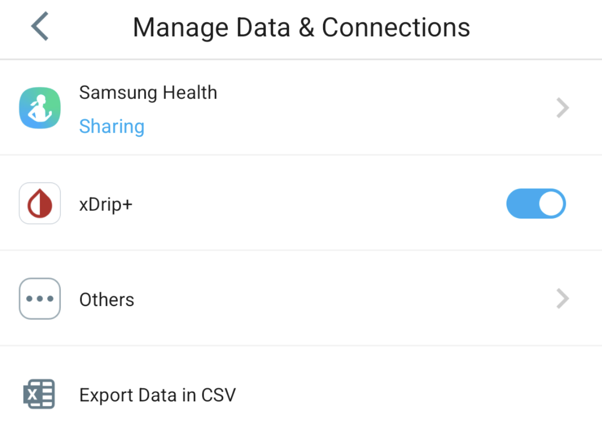

# CareSens

Hi ha diverses maneres de fer servir les dades de CareSens amb **AAPS**:

- xDrip
- Juggluco

**Nota:** No necessiteu l'aplicació de seguiment Sens365 per connectar-vos a AAPS.

## 1. xDrip

1. Instal·leu i configureu l'aplicació oficial de CareSens.
2. A l'aplicació CareSens, aneu a configuració -> Manage Data and Connections -> activeu l'interruptor xDrip. Si ho preferiu, desactiveu les connexions de dades a CareLevo, DIA:CONN, CloudLoop, etc. a «others».

2. Instal·leu xDrip: [xDrip](https://github.com/NightscoutFoundation/xDrip).
3. A xDrip, aneu a configuració -> hardware data source i seleccioneu `Companion App` com a font de dades.
4. A **AAPS**, seleccioneu xDrip a [**Configurador → Origen glucèmia**](#Config-Builder-bg-source).

## 2. Juggluco

1. Instal·leu l'aplicació Juggluco.
2. A Juggluco, obriu el menú de l'esquerra i seleccioneu `Photo`
3. Escanegeu el codi QR de l'embalatge del sensor.
4. Al menú de l'esquerra -> settings -> exchange data, assegureu-vos que xDrip broadcast està activat.
5. A **AAPS**, seleccioneu xDrip a [**Configurador → Origen glucèmia**](#Config-Builder-bg-source).
