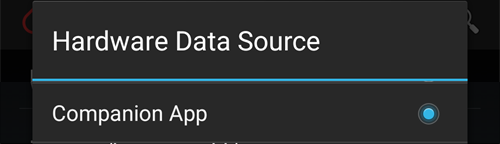
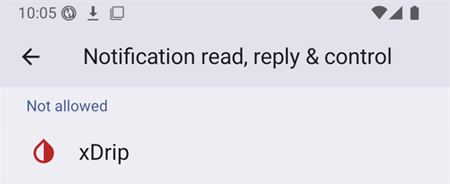
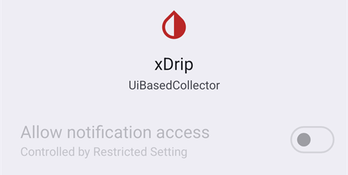
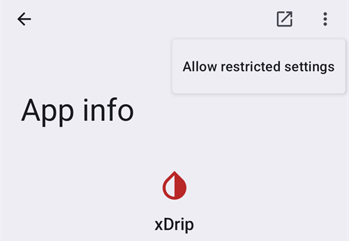
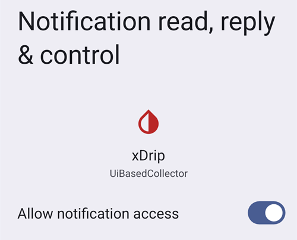
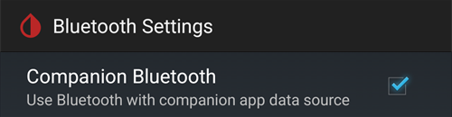

# Dexcom G7, ONE+ i Stelo


## Coses fonamentals abans de començar

Cal destacar que els sistemes G7, ONE+ i Stelo, a diferència del G6, no suavitzen els valors, ni a l'aplicació ni al receptor. Més detalls sobre això [aquí](https://www.dexcom.com/en-us/faqs/why-does-past-cgm-data-look-different-from-past-data-on-receiver-and-follow-app).

```{admonition} Smoothing method 
Llegiu els suggeriments de [mètode de suavitzat](../CompatibleCgms/SmoothingBloodGlucoseData.md) per fer servir amb Dexcom G7/ONE+/Stelo
```

## 1. xDrip (connexió directa amb G7, ONE+ o Stelo)

- xDrip es connecta directament al sensor: desinstal·leu l'aplicació de Dexcom, perquè només una aplicació es pot connectar al sensor. Si voleu mantenir l'aplicació de Dexcom, feu servir l'[xDrip Companion App](#DexcomG7-xdrip-companion-app).
- Seguiu les instruccions d'aquí: [xDrip G7, ONE+ i Stelo](https://navid200.github.io/xDrip/docs/Dexcom/G7.html). Cal una versió recent de xDrip: vegeu la pàgina enllaçada per saber la versió mínima.
- Seleccioneu xDrip a [**Configurador → Origen glucèmia**](#Config-Builder-bg-source).

- Ajusteu la configuració de xDrip segons les explicacions de la pàgina [Configuració de xDrip](../CompatibleCgms/xDrip.md).

## 2. Build Your Own Dexcom App (només G7)

```{admonition} Old app version
:class: warning
Dexcom BYODA ara és una versió molt antiga de l'aplicació i no es pot actualitzar. No està disponible per a ONE+ ni Stelo.
```

-   [Build Your Own Dexcom App](https://docs.google.com/forms/d/e/1FAIpQLScD76G0Y-BlL4tZljaFkjlwuqhT83QlFM5v6ZEfO7gCU98iJQ/viewform?fbzx=2196386787609383750) (BYODA) admet l'enviament local (broadcast) a AAPS

-   Aquesta aplicació us permet fer servir el Dexcom G7 amb qualsevol telèfon Android.
-   Desinstal·leu l'aplicació original de Dexcom
-   Instal·leu l'apk descarregat
-   Introduïu el codi del sensor a l'aplicació modificada
-   Al cap de poc temps, BYODA hauria de detectar el senyal del sensor.

(DexcomG7-xdrip-companion-app)=

## 3. xDrip Companion App (G7, ONE+ i Stelo)

L'aplicació oficial de Dexcom continua connectada al sensor. xDrip llegeix els valors de glucèmia de les notificacions de l'aplicació de Dexcom i els envia a **AAPS**.

```{admonition} Not a trusted data source
:class: note
**AAPS** no considera xDrip en mode Companion App una [font de glucèmia de confiança](#GettingStarted-TrustedBGSource): els SMB no es permeten sempre.

Per llegir les notificacions de l'aplicació de Dexcom sense xDrip, com a font de dades de confiança, feu servir el [Lector de notificacions](#DexcomG7-notification-reader).
```

### Llegir les notificacions de l'aplicació de Dexcom

- Mantingueu l'aplicació de Dexcom instal·lada i connectada al sensor. Les seves notificacions han de continuar visibles: no les silencieu ni les amagueu.
- Descarregueu i instal·leu [xDrip](https://github.com/NightscoutFoundation/xDrip). Feu servir a xDrip les mateixes unitats de glucèmia que a l'aplicació de Dexcom.
- A xDrip, aneu a **Settings** > **Hardware Data Source** i seleccioneu **Companion App**.

  

- xDrip demana permís per llegir les notificacions. Premeu **OK**, després seleccioneu **xDrip** a la llista i activeu **Permet l'accés a les notificacions**.

  

- Si **Permet l'accés a les notificacions** apareix en gris (*Controlat per una configuració restringida* (Controlled by Restricted Setting)), Android el bloqueja perquè xDrip no s'ha instal·lat des de Play Store:

  

  Obriu la informació de l'aplicació xDrip (manteniu premuda la icona de xDrip > **Informació de l'aplicació**), premeu el menú de tres punts a la part superior dreta i seleccioneu **Permet la configuració restringida**. Després torneu a la pantalla d'accés a les notificacions i permeteu-lo.

  

  

- Les lectures apareixen a xDrip quan l'aplicació de Dexcom mostra un valor nou. Si no apareix res, potser haureu d'iniciar un sensor a xDrip: això no afecta el sensor real. En aquest mode, Stelo dona una lectura cada 15 minuts.

### Companion Bluetooth (G7)

Quan l'aplicació de Dexcom està connectada a un sensor G7, xDrip també pot escoltar per Bluetooth les lectures que el sensor envia a l'aplicació de Dexcom. xDrip no s'emparella amb el sensor i no cal introduir el codi del sensor: l'aplicació de Dexcom continua tenint el control.

Amb **Companion Bluetooth**, xDrip obté del sensor l'hora exacta i la tendència de cada lectura, en lloc de l'hora en què va aparèixer la notificació, i omple els buits de quan el telèfon era fora d'abast (backfill).

- A xDrip, aneu a **Settings** > **Less common settings** > **Bluetooth Settings** i activeu **Companion Bluetooth**.

  

- Això no funciona a tots els telèfons ni a totes les versions d'Android. Desactiveu-ho si veieu problemes.
- Si un sensor Dexcom antic encara és a la llista de Bluetooth del telèfon, xDrip podria escoltar el sensor equivocat: a **Configuració** > **Dispositius connectats** d'Android, oblideu els sensors que ja no feu servir.
- Companion Bluetooth està fet per al G7. Amb ONE+ i Stelo, feu servir les notificacions.

### Configuració a AAPS

- Seleccioneu xDrip a [**Configurador → Origen glucèmia**](#Config-Builder-bg-source).
- Ajusteu la configuració de xDrip segons les explicacions de la pàgina [Configuració de xDrip](../CompatibleCgms/xDrip.md).

## 4. Juggluco (G7 i ONE+)

Cal la versió 9.0 o posterior

- Desactiveu l'aplicació que estava connectada abans al sensor: desinstal·leu l'aplicació o feu servir «Força l'aturada». Desactiveu el permís «Dispositius propers» a la configuració de l'aplicació. Restringiu l'ús de la bateria de l'aplicació.

- Oblideu el sensor a la configuració del Bluetooth: a la configuració d'Android, cerqueu el sensor als dispositius vinculats i seleccioneu «Oblida». Els noms dels sensors Dexcom G7 comencen per DXCM.

- Eviteu interferències d'altres sensors: mantingueu els sensors Dexcom antics fora de l'abast del Bluetooth.

- Connecteu el sensor G7 a Juggluco: obriu Juggluco → menú esquerre → Photo. Escanegeu el codi data matrix de l'aplicador del sensor G7. Espereu fins a 5 minuts que Juggluco trobi el sensor.

- Requisits per a l'emparellament: accepteu emparellar el sensor amb Juggluco. Assegureu-vos que la pantalla no estigui bloquejada durant l'emparellament. Si l'emparellament falla, espereu 5 minuts abans de tornar-ho a provar.

- Excepció: els rellotges Wear OS es poden vincular sense prémer cap botó d'acceptar.

(DexcomG7-notification-reader)=

## 5. Lector de notificacions (G7, ONE+ i Stelo)

L'aplicació oficial de Dexcom continua connectada al sensor. **AAPS** llegeix el valor de glucèmia directament de la notificació de l'aplicació de Dexcom, sense cap altra aplicació entremig.

```{admonition} Trusted data source
:class: note
Les lectures de les aplicacions Dexcom G7, ONE+ i Stelo són una [font de glucèmia de confiança](#GettingStarted-TrustedBGSource): els SMB es poden permetre sempre.
```

En comparació amb els altres mètodes d'aquesta pàgina, el Lector de notificacions té límits:

- **No hi ha fletxa de tendència** ni **recuperació de dades (backfill)**: les lectures perdudes mentre el telèfon estava apagat o fora d'abast es perden.
- Cada lectura rep l'hora en què va aparèixer la notificació, no l'hora exacta de la lectura del sensor.
- Només es llegeixen valors entre 40 i 405 mg/dl (2,2 i 22,5 mmol/l). "LOW" i "HIGH" no es llegeixen.
- Stelo dona una lectura cada 15 minuts.

### Configureu l'aplicació de Dexcom

- Mantingueu l'aplicació de Dexcom instal·lada i connectada al sensor.
- Assegureu-vos que l'aplicació de Dexcom mostra el valor actual de glucèmia a la seva notificació. Les seves notificacions han de continuar visibles: no les silencieu ni les amagueu.
- Feu servir les mateixes unitats de glucèmia (mg/dl o mmol/l) a l'aplicació de Dexcom que a **AAPS**. Si no, **AAPS** no pot llegir el valor.

### Configuració a AAPS

- Seleccioneu **Lector de notificacions** a [**Configurador → Origen glucèmia**](#Config-Builder-bg-source) i confirmeu el canvi.

  

- De tornada a la pantalla principal, **AAPS** mostra **Permisos necessaris**. Al costat d'**Accés a les notificacions**, premeu **Concedir**.

  

- Android obre la seva llista d'accés a les notificacions (el nom depèn de la versió d'Android, per exemple *Lectura, resposta i control de notificacions*). Seleccioneu **AAPS**, activeu **Permet l'accés a les notificacions** i confirmeu amb **Permet**.

  

  Android avisa que **AAPS** podria llegir totes les vostres notificacions. **AAPS** només llegeix les notificacions de les aplicacions de CGM compatibles i no fa cas de totes les altres.

  

- Si **Permet l'accés a les notificacions** està en gris (*Controlat per una opció de configuració restringida*), Android ho bloqueja perquè **AAPS** no s'ha instal·lat des de Play Store. Obriu la informació de l'aplicació **AAPS** (manteniu premuda la icona d'**AAPS** > **Informació de l'aplicació**), premeu el menú de tres punts a dalt a la dreta i seleccioneu **Permet la configuració restringida**. Després torneu a la pantalla d'accés a les notificacions i permeteu-lo.
- Les lectures apareixen a **AAPS** quan l'aplicació de Dexcom mostra un valor nou.

```{warning}
Si la notificació de l'aplicació de Dexcom mostra més d'un valor de glucèmia, o cap, **AAPS** no fa cas d'aquesta notificació.
```
