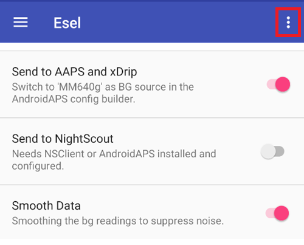
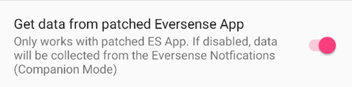

# Eversense

Hi ha quatre mètodes diferents per obtenir les lectures d'Eversense:

- ESEL en mode Companion
- ESEL en mode Patched (aplicació modificada)
- Aplicació complementària xDrip
- Lector de notificacions (integrat a **AAPS**)

## ESEL

Obteniu i instal·leu l'[aplicació ESEL](https://github.com/BernhardRo/Esel/tree/master/apk) seguint aquestes [instruccions](https://github.com/BernhardRo/Esel?tab=readme-ov-file#esel).

- A ESEL, obriu el menú de tres punts (⋮) a la part superior dreta i seleccioneu **Settings** (també disponible des del menú ☰). A la configuració:
  - Activeu "Send to AAPS and xDrip"
  - **Desactiveu** "Send to Nightscout"
  - Com que les dades de glucèmia d'Eversense poden ser sorolloses, es recomana activar "Smooth Data" a ESEL.



### Mode Companion

Llegeix les dades de les notificacions de l'aplicació Eversense (funciona amb l'aplicació Eversense normal, disponible des de la versió 3.0.1 d'ESEL).

1. Feu servir l'aplicació oficial Eversense de Google Play Store
   - Opcional, però necessari per recuperar les dades que falten (backfill): inicieu la sessió al vostre compte d'Eversense
   - A Sync, activeu Auto synchronization
2. Configuració d'ESEL:
   - Desactiveu l'opció "Get data from patched Eversense App"
   - Per recuperar les dades que falten (backfill): activeu "Fill missing data from eversensedms.com"
   - Com a adreça electrònica i contrasenya, introduïu les dades d'inici de sessió d'Eversense
3. Seleccioneu «MM640g» com a origen de glucèmia a [**Configurador → Origen glucèmia**](#Config-Builder-bg-source).

### Aplicació Eversense modificada

 Necessita una versió modificada de l'aplicació Eversense (funciona totalment fora de línia, també la recuperació de dades que falten).

1. Desinstal·leu l'aplicació Eversense (Atenció: perdreu les vostres dades històriques locals de més d'una setmana!)

2. Instal·leu l'[aplicació Eversense modificada](https://cr4ck3d3v3r53n53.club) i feu-la servir com descriu el proveïdor

   - Obriu l'aplicació Eversense, inicieu la sessió, connecteu-vos al transmissor i feu-la servir com l'aplicació normal.

3. Configuració d'ESEL:

   - Activeu l'opció "Get data from patched Eversense App"




Si feu servir ESEL amb una instal·lació nova d'Eversense per primer cop, poden passar fins a 15 min fins que apareguin els primers valors a xDrip!

4. Seleccioneu «MM640g» com a origen de glucèmia a [**Configurador → Origen glucèmia**](#Config-Builder-bg-source).

## xDrip

xDrip pot llegir les notificacions de l'aplicació del fabricant, igual que ESEL. No es poden recuperar les dades que falten.

- Descarregueu i instal·leu xDrip: [xDrip](https://github.com/NightscoutFoundation/xDrip)
- A xDrip, cal seleccionar «Companion App» com a origen de dades.
- Seleccioneu xDrip a [**Configurador → Origen glucèmia**](#Config-Builder-bg-source).
- Ajusteu la configuració de xDrip segons les explicacions de la pàgina [Configuració de xDrip](../CompatibleCgms/xDrip.md).
- Activeu el [Suavitzat exponencial](../CompatibleCgms/SmoothingBloodGlucoseData.md) a AAPS.

## Lector de notificacions

**AAPS** pot llegir els valors de glucèmia directament de les notificacions de l'aplicació oficial d'Eversense, sense cap altra aplicació entremig. No es poden recuperar les dades que falten.

- Seleccioneu **Lector de notificacions** a [**Configurador → Origen glucèmia**](#Config-Builder-bg-source) i doneu a **AAPS** accés a les notificacions quan ho demani.
- Assegureu-vos que l'aplicació Eversense mostra el valor de glucèmia actual a la seva notificació.

```{warning}
La freqüència de lectura dels valors de glucèmia no sempre és de 5 minuts i hi pot haver duplicats.
```