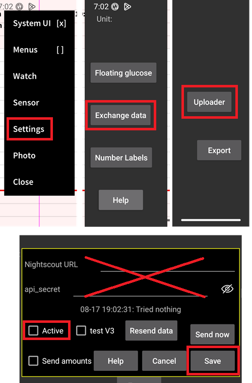
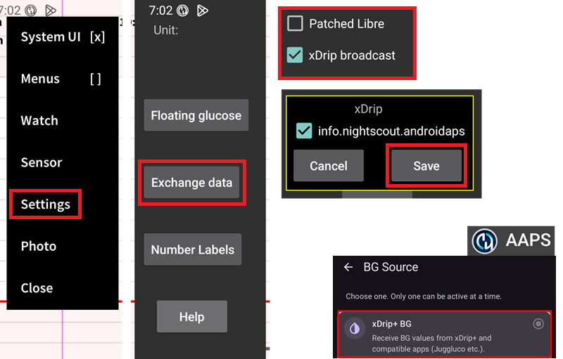
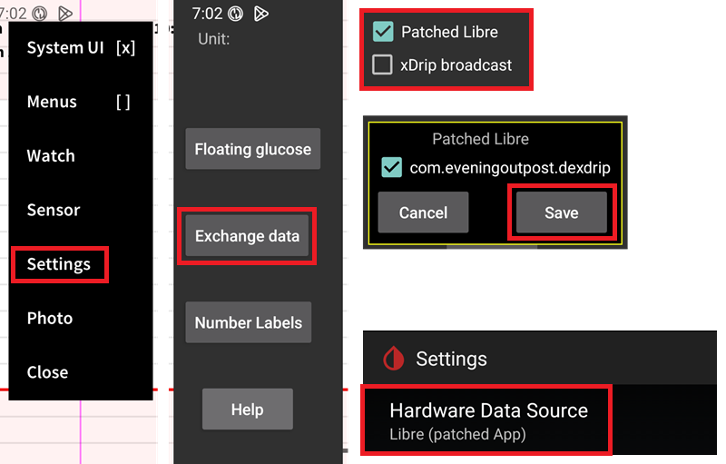

# Configuració de Juggluco

Si encara no el teniu configurat, descarregueu [Juggluco](https://www.juggluco.nl/Juggluco/download.html).

Seguiu les [instruccions](https://www.juggluco.nl/Jugglucohelp/introhelp.html) per connectar el vostre sensor.

## Configuració bàsica per a tots els sistemes CGM

### Desactivar l'enviament a Nightscout

No deixeu que cap altra aplicació enviï dades (glucèmia i tractaments) a Nightscout.

Desactiveu a Juggluco qualsevol enviament actiu a Nightscout.

(juggluco-to-aaps)=

## De Juggluco a AAPS

Juggluco pot enviar la glucèmia directament a AAPS. Si feu servir un [sensor de confiança](#GettingStarted-TrustedBGSource), això permet tenir els SMB sempre activats.

Amb un sensor Libre 2/2+/3/3+, les lectures de cada minut s'envien a AAPS, però AAPS no fa un càlcul cada minut.

Activeu xDrip broadcast a Juggluco (no activeu Patched Libre), confirmeu i deseu la informació del paquet d'AAPS. Seleccioneu l'origen de glucèmia xDrip a AAPS.

Apliqueu un [suavitzat](./SmoothingBloodGlucoseData.md) suficient a AAPS.

(juggluco-to-xdrip)=

## De Juggluco a xDrip

Juggluco pot enviar la glucèmia a xDrip, i xDrip l'envia després a AAPS.

Activeu Patched Libre a Juggluco (no activeu xDrip broadcast), confirmeu i deseu la informació del paquet de dexdrip. Seleccioneu l'origen de glucèmia xDrip a AAPS.

Si cal, apliqueu un [suavitzat](./SmoothingBloodGlucoseData.md) suficient a AAPS. Amb un sensor Libre 2/2+/3/3+, xDrip fa la mitjana de les lectures de cada minut per obtenir lectures de 5 minuts i [també les suavitza](#libre2-value-smoothing-raw-values).

