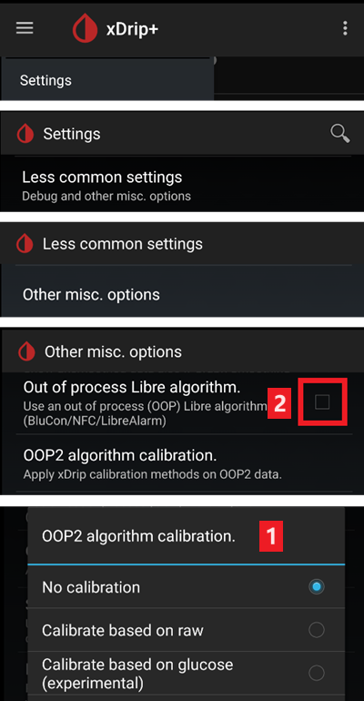
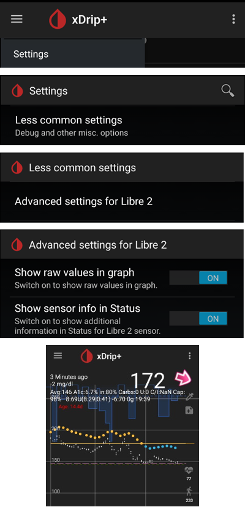
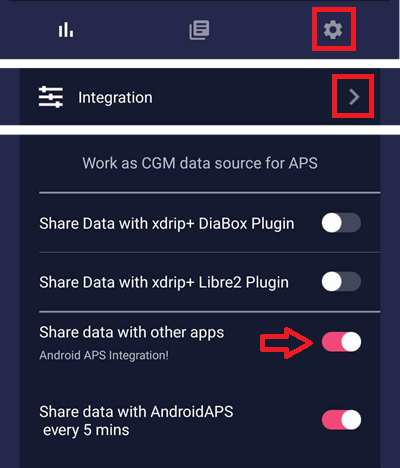

# Freestyle Libre 2 i 2+

El sensor Freestyle Libre 2 ara és un CGM real, també amb l'aplicació oficial. Tot i així, LibreLink no pot enviar dades a AAPS. Hi ha diverses solucions per fer-lo servir amb AAPS.

## 1. Fer servir un pont Bluetooth i OOP

Els transmissors Bluetooth es poden fer servir amb el Libre 2 (EU) o el 2+ (EU) i una aplicació amb algoritme extern (out of process, OOP). Podeu rebre lectures de glucèmia cada 5 minuts, com amb el [Libre 1](./Libre1.md).

Comproveu que el pont i l'aplicació que voleu fer servir són compatibles amb el vostre sensor i amb xDrip.

El Libre2 OOP (el trobareu [aquí](#Libre2_OOP2)) crea les mateixes lectures de glucèmia que el lector original. AAPS amb Libre 2 fa un suavitzat de 10 a 25 minuts per evitar alguns salts. Vegeu més avall [Suavitzat de valors i valors en brut](#libre2-value-smoothing-raw-values). OOP genera lectures cada 5 minuts amb la mitjana dels últims 5 minuts. Per això les lectures de glucèmia no són tan suaus, però coincideixen amb el lector original i segueixen més de pressa les lectures de glucèmia «reals». Si voleu fer el llaç amb OOP, activeu tots els ajustos de suavitzat a xDrip.

Hi ha algunes bones raons per fer servir un transmissor Bluetooth:

-   You can choose various OOP2 calibration strategies (1): have the reader values using "no calibration", or calibrate the sensor like a Libre 1 using "calibrate based on raw" or ultimately calibrate the reader-like values with "calibrate based on glucose".  
  Make sure to leave OOP1 disabled (2).

    → Menú hamburguesa → Settings → Less common settings → Other misc. options



-   El sensor Libre 2 es pot fer servir 14,5 dies, com el Libre 1
-   La recuperació de 8 hores de dades (backfill) funciona del tot

Nota: el transmissor es pot fer servir alhora amb l'aplicació LibreLink sense interferir-hi.

### Inicieu el sensor

- → Menú hamburguesa (1) → Start sensor (2) → Start sensor (3) → Responeu «Not Today» (4).


Això no inicia físicament cap sensor Libre2 ni s'hi comunica de cap manera. Això només serveix per indicar a xDrip que un sensor nou envia valors de glucèmia. If available, enter two blood-measured values for the initial calibration. Ara els valors de glucèmia s'haurien de mostrar a xDrip cada 5 minuts. Els valors que falten, per exemple perquè éreu massa lluny del telèfon, no es recuperen.

Després d'un canvi de sensor, xDrip detecta automàticament el sensor nou i elimina totes les dades de calibració. You may check your blood glucose after activation and make a new initial calibration.

### Configurar AAPS (només per fer el llaç)

-   A **AAPS**, obriu el **menú** (☰) a la cantonada superior esquerra, aneu a **Configurador** > **Origen glucèmia** i seleccioneu **xDrip+**


-   If AAPS does not receive BG values when phone is in airplane mode, use 'Identify receiver' as described on [xDrip settings page](#xdrip-identify-receiver).

## 2. Fer servir la connexió directa de xDrip

```{admonition} Libre 2 EU only
:class: warning
xDrip no admet la connexió directa amb el Libre 2 US i AUS.
Només els models Libre 2 i 2+ **EU**.
```

- Seguiu [aquestes instruccions](./Libre2MinimalL00per.md) per configurar xDrip, perquè la documentació original enllaça una versió d'OOP2 obsoleta.
- Seguiu les instruccions de configuració de la pàgina [Configuració de xDrip](../CompatibleCgms/xDrip.md).

-   Seleccioneu xDrip+ a [Configurador > Origen glucèmia](#Config-Builder-bg-source).

(libre2-value-smoothing-raw-values)=

### Suavitzat de valors i valors en brut

Tècnicament, el valor actual de glucèmia s'envia a xDrip cada minut. Un filtre de mitjana ponderada calcula per defecte un valor suavitzat dels últims 25 minuts. Podeu canviar el període al menú NFC Scan features.

→ Menú hamburguesa → Settings → NFC Scan features → Smooth libre 3 data when using xxx method


Això és obligatori per fer el llaç. Les corbes són suaus i els resultats del llaç són molt bons. Els valors en brut en què es basen les alarmes salten una mica més, però corresponen als valors que també mostra el lector. A més, els valors en brut es poden mostrar al gràfic de xDrip per poder reaccionar a temps als canvis ràpids. Activeu Less Common Settings \> Advanced Settings for Libre2 \> "show Raw values" i "show Sensors Infos". Llavors els valors en brut també es mostren com a punts blancs petits i hi ha més informació del sensor al menú del sistema.

Els valors en brut són molt útils quan la glucèmia canvia de pressa. Even if the dots are jumpier you would detect the tendency much better than using the smoothed line to make proper therapy decisions.

→ Menú hamburguesa → Settings → Less common settings → Advanced settings for Libre 2




#### Calibració

You can calibrate the Libre2 **with an offset of -40 mg/dL to +20 mg/dL \[-2.2 mmol/L to +1.1 mmol/L\]** (intercept). El pendent no es pot canviar. Comproveu-ho amb una punxada al dit després de posar un sensor nou; tingueu en compte que pot no ser precís les primeres 12 hores després d'inserir-lo. Com que hi pot haver grans diferències amb les mesures de sang, verifiqueu-ho cada 24 hores i calibreu si cal. Si el sensor està completament desajustat després d'uns quants dies, cal canviar-lo.

## 3. Fer servir Diabox

- Instal·leu [Diabox](https://www.bubblesmartreader.com/_files/ugd/6afd37_f183eabd4fbd44fcac4b1926a79b094f.pdf). A «Settings», «Integration», activeu «Share data with other apps».



- Seleccioneu xDrip+ a [Configurador > Origen glucèmia](#Config-Builder-bg-source).

## 4. Fer servir Juggluco

Vegeu [aquí](./Juggluco.md).
