# Com configurar FSL 2 i OOP2 per fer servir la connexió Bluetooth nativa a xDrip

Passat de [MinimalL00per](https://www.minimallooper.com/post/how-to-setup-freestyle-libre-2-and-oop2-to-use-a-native-Bluetooth-connection-in-xdrip) a markdown i **revisat/actualitzat**: 25 d'agost de 2025, psonnera

Al final d'aquest document hi ha una llista de definicions. Si no coneixeu algun terme o abreviatura, podeu *[anar més avall](#minimallooper-definitions)* per trobar-ne l'explicació.

 

## Configuració

### Maquinari

- *FSL2 i 2+* **NOTA: les versions dels EUA, el Canadà, Nova Zelanda i Austràlia NO són compatibles**

**(OPCIONAL) Lector** (no compatible amb FSL2+)

- Lector 1 (amb el firmware actualitzat)

- Lector 2

*NOTA: Si voleu fer servir el lector en aquesta solució, HEU D'INICIAR el sensor PRIMER AMB EL LECTOR. Si no ho feu així, no podreu fer servir el lector per obtenir lectures del sensor activat. Quan el sensor s'ha escalfat, podeu fer lectures amb l'aplicació LL o amb xDrip.*

### Programari

**OOP** (Out of Process Algorithm): una aplicació APK d'Android externa que ajuda a obtenir les dades en brut del sensor per calcular els valors de glucèmia. xDrip envia a OOP les dades BT en brut que ha recollit del FSL2, i OOP retorna els valors de glucèmia a xDrip.

- **OOP2**

  - **Només funciona amb sensors FSL2/2+ europeus**

  - Codi tancat (no disponible a GitHub)

  - Serveix per desxifrar els valors en brut xifrats del sensor i retornar-los a xDrip. Després xDrip pot fer servir les dades en brut, que cal calibrar, o donar valors de glucèmia semblants als del lector 1.

[***xDrip***](https://jamorham.github.io/)

- [*Nightly*](https://github.com/NightscoutFoundation/xDrip/releases): l'últim codi font, compilat cada nit. No s'ha provat a fons

- [*Stable*](https://xdrip-plus-updates.appspot.com/stable/xdrip-plus-latest.apk): l'última versió estable i provada.

- **NOTA: els sensors nous necessiten una aplicació OOP2 actualitzada. Per això es recomana fer servir com a mínim l'última versió estable (Stable) de xDrip, que correspon a l'última versió d'OOP2.**

 

## Procés

- *Primer descarregueu i instal·leu les aplicacions de més avall*
- *Desinstal·lar les aplicacions que poden causar conflictes*
- *Com iniciar un sensor FSL2 en mode Bluetooth natiu amb LL i xDrip
  - [*Pas 1: Instal·lació i configuració de les aplicacions*](#minimallooper-step1)
  - [*Pas 2: Configuració de xDrip*](#minimallooper-step2)
  - [*Pas 3: Inserir físicament el sensor*](#minimallooper-step3)
  - [*Pas 4: Obrir l'aplicació LL i iniciar el sensor amb el primer escaneig NFC*](#minimallooper-step4)
  - [*Pas 5: Obrir xDrip i ESCANEJAR PER NFC el sensor FSL2*](#minimallooper-step5)
  - [*Pas 6: Iniciar el sensor nou a xDrip*](#minimallooper-step6)
  - [*Pas 7: Esperar 60 segons i tornar a escanejar el sensor per NFC*](#minimallooper-step7)
  - [*Pas 8: Recollida de dades entre 3 i 15 minuts*](#minimallooper-step8)
  - [*Pas 9: Comprovar que el sensor està connectat i envia dades*](#minimallooper-step9)

- *[Notes](#minimallooper-notes)*
- *[Avantatges](#minimallooper-advantages)*
- *[Inconvenients](#minimallooper-disadvantages)*
- <u>*\[Resolució de problemes\](#minimallooper-troubleshooting)*</u>

## Abans de començar

És molt recomanable seguir aquest procés amb un **sensor nou**. Tot i que s'ha informat que es pot connectar amb un sensor que ja funciona (***vegeu [més avall](#minimallooper-started-sensor)***), és molt probable que l'aplicació LL o el lector creïn una nova clau privada compartida per a la comunicació durant la connexió. Això vol dir que, després de la vinculació, xDrip no coneix la clau nova i no es podrà comunicar amb el sensor. Si proveu de connectar amb un sensor que ja funciona, ho feu sota la vostra responsabilitat, millor cap al final de la vida del sensor.

### Primer descarregueu i instal·leu les aplicacions de més avall

(Libre2_OOP2)=

- **OOP2**: les versions de l'oop2 es poden trobar a:

  (*Nota: heu d'haver iniciat la sessió a Google per obrir l'enllaç.*)

*[oop2.apk](https://drive.google.com/file/d/1106h2s12b3Ev9gKCTU2G75q8h9ChHjcz/view?usp=sharing)* - OOP2_21_09_25 (05d1989) **2025.09.21** (última versió)

- **xDrip**: l'**<u>última versió</u>** (versió mínima 2025.09.26) es pot trobar a:

[*xDrip.apk*](https://github.com/NightscoutFoundation/xDrip/releases)

(minimallooper-started-sensor)=

### I si el meu sensor ja està iniciat? Puc continuar rebent lectures a xDrip? SÍ!

Molta gent ha preguntat si aquest mètode es pot fer servir amb un sensor que ja està actiu, i puc dir amb un **SÍ** ben clar que podeu iniciar un sensor que ja funciona.

1.  **PRIMER**, assegureu-vos que heu fet els canvis de configuració a xDrip i que heu instal·lat i configurat OOP2 com es mostra més avall.

2.  **DESPRÉS**, aneu al *Pas 5* i **ASSEGUREU-VOS** que heu forçat el tancament de LL abans de començar. Després seguiu el procés fins al final.

*NOTA: No podreu fer servir el vostre sensor FSL2 activat amb el FSLReader SI no el vau iniciar primer amb el FSLReader. Si SÍ que el vau iniciar primer amb el FSLReader, podreu **escanejar** el sensor i obtenir lectures TANT amb el lector com amb aplicacions com LL i xDrip.*

## Com iniciar un sensor FSL2 en mode Bluetooth natiu amb LL i xDrip

*NOTA: Si a les captures de pantalla hi ha opcions que no estan marcades específicament amb un QUADRE i que estan DESMARCADES (és a dir, desactivades), SI US PLAU, DEIXEU-LES DESACTIVADES. Les captures de pantalla mostren una configuració que funciona per a TOTES les opcions que s'hi veuen. Si voleu experimentar activant o desactivant altres funcions quan el sensor ja funciona, podeu fer-ho sota la vostra responsabilitat.*

(minimallooper-step1)=

### Pas 1: Instal·lació i configuració de les aplicacions

**Instal·leu i configureu OOP2** i comproveu que funciona només obrint l'aplicació.


**Configuració**

- *Use service* **on**

- *Use foreground service* **on**

- *Timer Duration* **5 minutes**

  - Canvieu-ho a **1 sec** si no obteniu resultats prou ràpid (la captura de pantalla de més avall mostra aquesta opció).

**Versió 2: 93e5cac-2020.12.08 (última versió)**

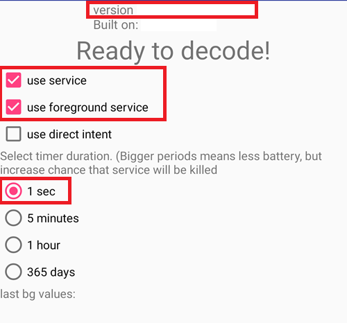

**Instal·leu xDrip**, versió mínima: l'última versió publicada. Trobareu més documentació sobre la instal·lació i configuració de xDrip [*aquí*](../CompatibleCgms/xDrip.md).

(minimallooper-step2)=

### Pas 2: Configuració de xDrip

**Hardware Data Source**: Libre Bluetooth

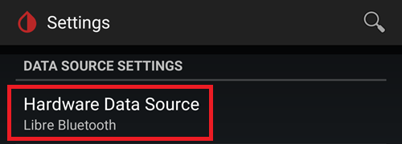

**NFC Scan features**: *les opcions que no s'esmenten es consideren desactivades.*

- *Use NFC feature*: **on**
- *Sensor Age or Expiry*: **on**
- *Scan when not in xDrip*: **on**
- *Use Any-tag optimized reading method*: **off**, però proveu **on** si teniu problemes per escanejar

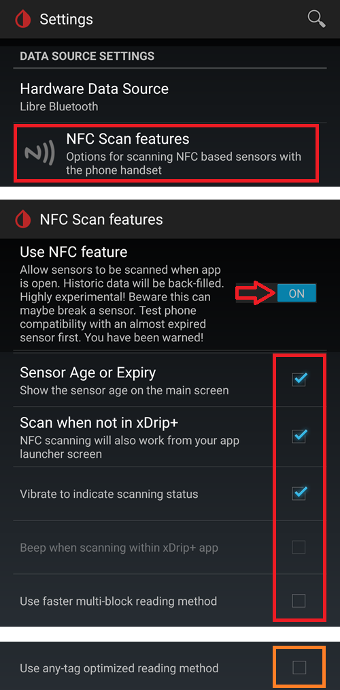

- *Starting Bluetooth connection with FSL2 sensor*: **Always connect to libre2 sensors**

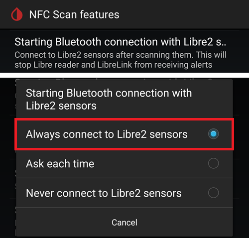

- *Smooth libre 3 data when using xxx method*: deixeu el valor per defecte. Augmenteu el valor per a sensors sorollosos i reduïu-lo quan siguin estables.

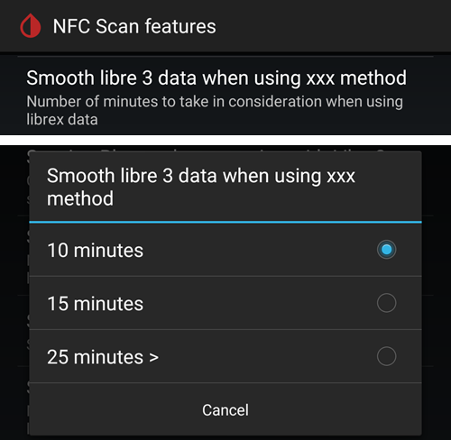

**Less Common Settings -\> Bluetooth Settings** (*són importants i poden canviar segons el vostre telèfon o configuració*)

- *Turn Bluetooth on*: **on**
- *Trust Auto-Connect*: **on**
- *Use Background Scans*: **on**
- *Always discover services*: **on**

Podeu configurar xDrip amb el codi QR de més avall. L'heu d'escanejar (o carregar la imatge) a xDrip -> Auto Configure.

```{admonition} QR Code
:class: dropdown

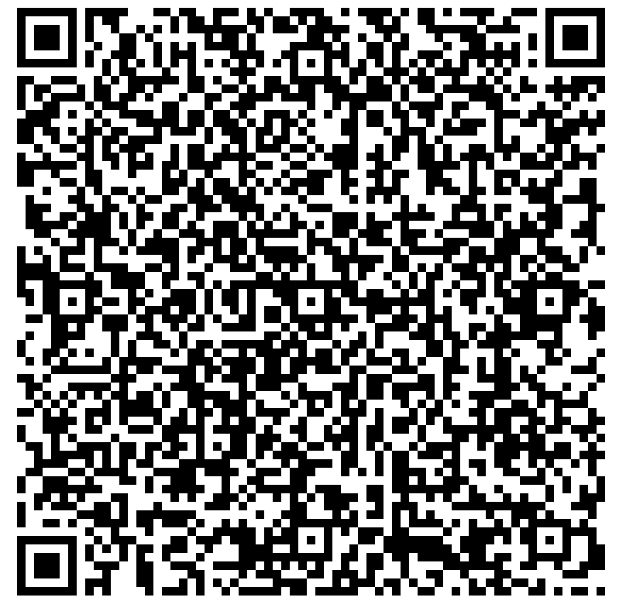
```

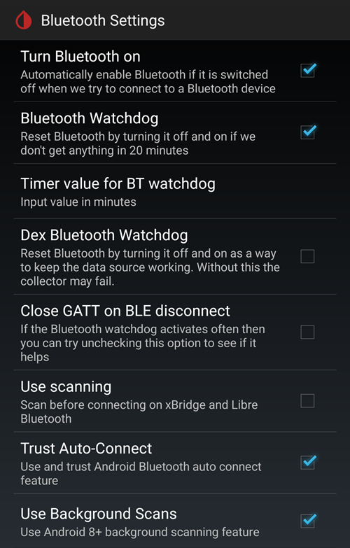

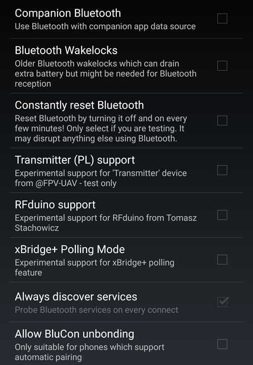

Després d'escanejar el codi QR de dalt, si teniu un telèfon Samsung (també és útil per a moltes marques xineses), escanegeu l'altre codi QR de més avall per canviar la configuració i tenir una connexió més fiable:

- *Trust Auto-Connect*: **off**
- *Use Background Scans*: **off**

```{admonition} QR Code
:class: dropdown


```

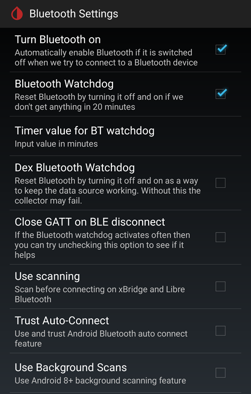

**Advanced settings for FSL2** (*opcional però útil*)

- *show Raw values in Graph*: **on**

- *show Sensor info in Status*: **on**

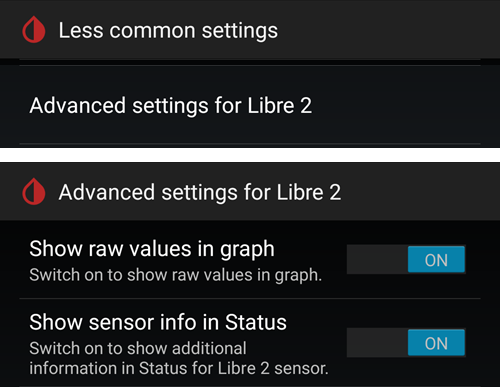

**Extra Logging Settings** (*cal per trobar errors si no funciona bé*)

- *Extra tags for logging*: introduïu aquest valor

`BgReading:d,jamorham librereceiver:v,LibreOOPAlgorithm:v,jamorham nsemulator:v,DexCollectionService:v`

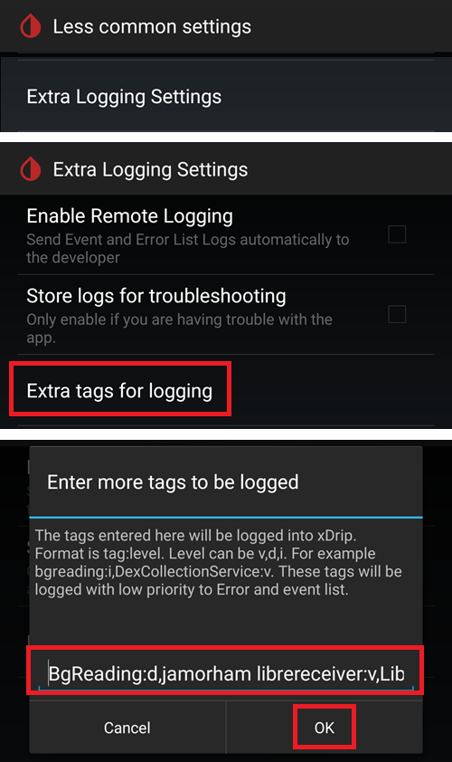

(minimallooper-OOPsettings)=

**Less Common Settings -\> Other misc options**

> **Configuració per a OOP2**

- *Out of process Libre algorithm*: **OFF**

(*ASSEGUREU-VOS QUE AIXÒ ESTÀ EN **OFF** PER A OOP2, SI NO, NO REBREU LECTURES!*)

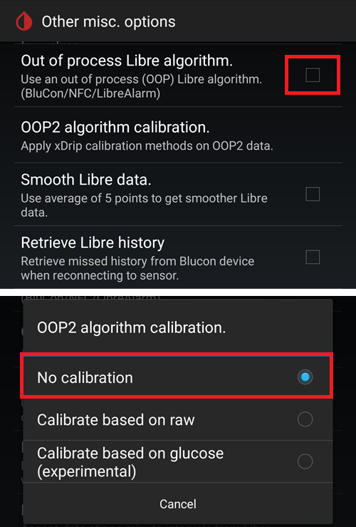

(minimallooper-step3)=

### Pas 3: Inserir físicament el sensor

(minimallooper-step4)=

### Pas 4: Obrir l'aplicació LL i iniciar el sensor amb el primer escaneig NFC

Obriu l'aplicació LL, escanegeu el sensor que acabeu d'inserir i després tanqueu i desactiveu o desinstal·leu l'aplicació LL. **Igualment heu d'esperar els 60 minuts sencers d'escalfament del sensor abans de continuar i iniciar el sensor a xDrip**. No us fieu de les lectures d'abans, perquè el sensor encara s'està calibrant internament i els valors canvien molt.

#### Pas 4a (OPCIONAL, fer servir el FSLReader):

**Inicieu el sensor FSL2 (no 2+) escanejant-lo amb el FSLReader, amb el primer escaneig NFC**

Si voleu poder fer servir el **FSLReader** i també l'aplicació LL o xDrip per llegir els valors del sensor FSL2, **heu d'escanejar PRIMER el sensor FSL2 acabat d'inserir amb el lector FSL.** Quan s'acabi l'escalfament del sensor, ja podeu fer servir l'aplicació LL o xDrip per escanejar lectures.

*NOTA: L'aplicació LL només cal per al PRIMER escaneig NFC després d'inserir el sensor. Serveix per enviar el senyal d'inici de l'escalfament; després l'aplicació S'HA DE desactivar (configuració de l'aplicació -\> forçar l'aturada) o desinstal·lar. Podeu fer servir l'aplicació Patched 2.3 o les versions oficials, no importa. El més important és evitar que l'aplicació LL funcioni mentre xDrip intenta començar la vinculació BT amb el sensor, perquè l'aplicació LL interfereix amb la reconnexió Bluetooth i talla la comunicació.*

*S'ha informat que només cal desactivar el **permís d'ubicació** de l'aplicació LL a la configuració del sistema Android perquè no interfereixi amb la connexió. Alguns usuaris han informat que això funciona. Un altre cop, **recomano desactivar o desinstal·lar l'aplicació**, però si voleu experimentar podeu provar això.*

(minimallooper-step5)=

### Pas 5: Obrir xDrip i ESCANEJAR PER NFC el sensor FSL2

(*Recordeu! Assegureu-vos que LL està desactivada (ubicació desactivada) o desinstal·lada I que heu esperat els 60 minuts sencers perquè el sensor s'escalfi i es calibri internament.*)

**ESCANEGEU PER NFC** el sensor FSL2 amb xDrip. Això envia un senyal al sensor perquè activi l'emparellament Bluetooth i comenci el procés de vinculació. A la part de baix de la pantalla Overview de xDrip apareixerà breument un petit avís amb el text **Scanning** i després l'avís **Scanned OK!** quan l'escaneig NFC del sensor FSL 2 hagi funcionat.

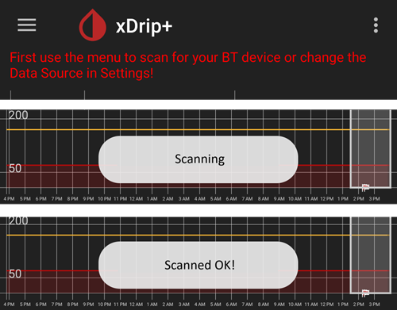

(minimallooper-step6)=

### Pas 6: Iniciar el sensor nou a xDrip

A la **pantalla Overview de xDrip** premeu el **menú hamburguesa** a la cantonada de dalt a l'esquerra. Després trieu **Start Sensor**.

A la pantalla **Start New Sensor** premeu **Start Sensor**. Us preguntarà **Did you insert it today?** (l'heu inserit avui?). Responeu prement **NOT TODAY**.

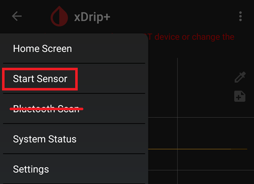

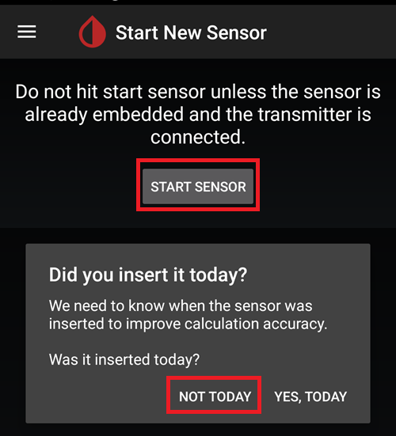

*NOTA: Si per error heu premut "YES, TODAY", haureu de fer "stop sensor" des del menú principal de xDrip i després "start sensor" tornant a fer el Pas 5.*

(minimallooper-step7)=

### Pas 7: Esperar 60 segons i tornar a escanejar el sensor per NFC

Cal un segon escaneig NFC per **AFEGIR** el sensor com el dispositiu Bluetooth que xDrip farà servir per obtenir les lectures. Quan s'acabi, veureu un avís que diu **NEW SENSOR STARTED**.

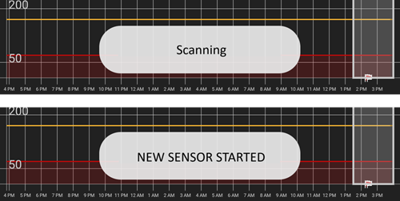

Cal esperar 60 segons perquè durant aquest procés el sensor no es pot escanejar més d'una vegada per minut. Si escanegeu el sensor massa aviat, a la pantalla Overview de xDrip surt l'avís **Not so quickly, wait 60 seconds**.

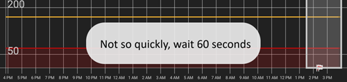

Obriu els registres d'esdeveniments (event logs) de xDrip i comproveu que el sensor s'ha emparellat bé amb xDrip.

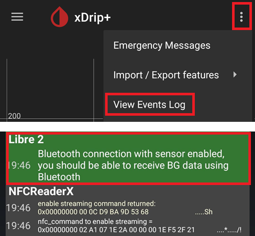

(minimallooper-step8)=

### Pas 8: Recollida de dades entre 3 i 15 minuts

Entre 3 i 15 minuts després, ja hi ha prou dades per mostrar els primers valors. *Si en aquest moment encara no rebeu lectures, de vegades ajuda reiniciar el telèfon.*

Si feu servir un Samsung (o molts telèfons de marques xineses) i teniu problemes per rebre dades, escanegeu el codi QR de més avall a xDrip -> Auto Configure.

```{admonition} QR Code
:class: dropdown


```

Canviarà la configuració Bluetooth de xDrip a:

- *Trust Auto-Connect*: **off**
- *Use Background Scans*: **off**

(minimallooper-step9)=

### Pas 9: Comprovar que el sensor està connectat i envia dades

Premeu el menú hamburguesa a dalt a l'esquerra de la pantalla Overview de xDrip i seleccioneu **System Status**. A la pantalla System Status, el camp **Bluetooth Device:** actiu mostra el nom Bluetooth del FSL2 amb el format **ABB___XXXXXXXXXXX**, on les X són el número de sèrie del sensor. El camp **Connection Status** mostra **Connected** i el camp **Sensor Start:** mostra l'hora en què es va iniciar el sensor.

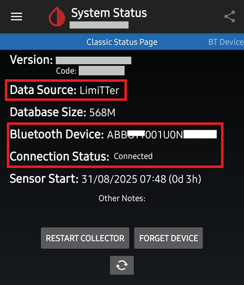

A la pantalla **BT Device** (llisqueu cap a l'esquerra) podeu comprovar més detalls de la connexió del sensor i també fer servir aquesta pantalla per resoldre problemes de connexió. A continuació hi ha una llista de camps i per a què serveixen, per ajudar a resoldre problemes de connexió.

*NOTA: **<u>NO TOQUEU</u> NI CANVIEU Bluetooth Pairing de <u>Disabled</u>** en aquesta finestra. Si ho feu, intentarà un emparellament directe, fallarà (Not bonded) i haureu de tornar a començar tot el procés des del Pas 5.*

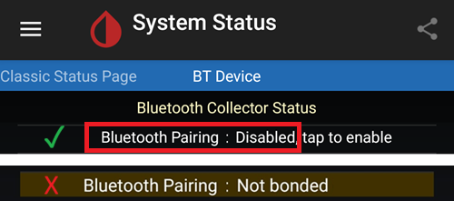

- **Phone Service State:** l'última vegada que el telèfon va fer una connexió BT amb el sensor (hauria de ser fa menys de 5 minuts)
- **Bluetooth Device:** mostra l'estat actual de la connexió (**Connected** o **Disconnected**)
- **Device Mac Address**: és l'identificador de maquinari del sensor
- **Bluetooth Pairing**: hauria de dir **<u>Disabled, tap to enable</u>**. Aneu amb compte de NO tocar això. Si ho toqueu per error, torneu-ho a tocar fins que torni a «disabled».
- **Slowest wake up**: podeu ignorar-ho. xDrip no es passa el temps esperant lectures: les comença a esperar després d'un temps determinat (normalment 5 minuts). Si en aquell moment no arriben dades, veureu "Woke up early", que vol dir que xDrip esperava tenir dades a punt però no n'hi ha. Slowest wake up és el retard més gran que hi ha hagut abans de rebre les dades normalment.
- **Next Wake up**: hauria de dir 5 minuts

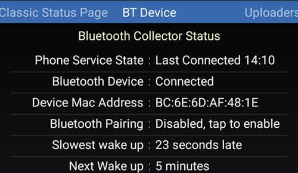

(minimallooper-notes)=

### Notes

- **Fer escanejos NFC amb LL DESPRÉS d'acabar la vinculació/emparellament a xDrip**: podeu fer escanejos NFC, però primer s'ha d'acabar la vinculació/emparellament amb xDrip. Mireu sempre xDrip i comproveu si falta poc per a la lectura dels 5 minuts (per exemple, fa 4 minuts); si és a prop dels 5 min, espereu que arribi la nova lectura BT i després feu l'escaneig NFC. Si ho feu en mal moment, interrompreu el procés BT de xDrip i no rebrà lectures BT. Pot trigar una estona a tornar a vincular-se i enviar dades, i de vegades LL pot «robar» la connexió BT del sensor. Però entre aquestes lectures BT no he tingut cap problema per fer un escaneig NFC i desactivar l'aplicació just després. No estic segur si cal desactivar LL cada vegada, però jo la desactivo per seguretat.

- **Què passa?** Quan es fa una connexió Bluetooth, es crea una clau privada compartida que cal perquè el sensor i l'aplicació o dispositiu que s'hi connecta es puguin comunicar. És molt probable que l'aplicació LL o el lector creïn una nova clau privada compartida per a la comunicació durant la connexió. Això vol dir que, després de la vinculació, xDrip no coneix la clau nova i no es podrà comunicar amb el sensor.

  - Diversos usuaris han informat que es pot tornar a obrir l'aplicació LL després d'haver iniciat bé el sensor i de rebre lectures a xDrip. Als permisos d'Android de l'aplicació LL només heu de desactivar l'opció **Permetre la ubicació**. Quan ho hàgiu fet, hauríeu de poder fer servir l'aplicació LL i xDrip al mateix temps. Recomano no triar cap aplicació per defecte per a l'escaneig NFC i escollir cada vegada amb quina aplicació voleu llegir el sensor. A més, NO US OBLIDEU, en el proper canvi de sensor, de forçar el tancament de l'aplicació LL després del primer escaneig NFC d'escalfament del sensor nou. Quan el sensor estigui configurat i rebi lectures a xDrip, ja podeu tornar a obrir l'aplicació LL.

&nbsp;

- **Reiniciar el telèfon**: després de reiniciar, i després de desactivar o forçar el tancament de l'aplicació, RECORDEU comprovar que l'aplicació LL NO s'està executant. Us suggereixo provar un reinici per veure si LL torna a arrencar sola. Podeu mirar-ho a la configuració de l'aplicació LL, a la configuració d'aplicacions d'Android del vostre telèfon. Si encara està activada, torneu a desactivar l'aplicació LL; desinstal·lar-la pot ser l'única manera d'evitar-ho. Així s'evita que LL robi per accident la vinculació BT. A més, després de reiniciar, també caldran 3–15 minuts per rebre lectures BT del sensor. Tingueu paciència i tingueu-ho en compte si reinicieu poc abans d'un moment en què necessiteu una lectura de glucèmia per fer un bolus, per a un àpat, etc.

&nbsp;

- **Opcions d'optimització de la bateria**: assegureu-vos d'EXCLOURE aquestes aplicacions de l'optimització de la bateria del vostre telèfon

  - xDrip

  - OOP 2

  - LL

  - AAPS

&nbsp;

- **Fer servir el mode avió:** En algunes situacions cal activar el mode avió (quan agafeu un avió ;-), o quan dormiu i no voleu senyals Wi-Fi o de dades mòbils amb el telèfon a prop del cap), i això pot causar problemes amb la comunicació Bluetooth en activar el mode avió. Si activeu el mode avió al telèfon i després activeu el Bluetooth, es perdran les lectures de glucèmia. L'única solució és reiniciar el col·lector a xdrip+ -\> System Status -\> Classic Status Page. Després de reiniciar el col·lector, les lectures de glucèmia van tornar a aparèixer.

 

(minimallooper-advantages)=

### Avantatges

- **Ja no cal l'aplicació LL modificada (patched)** Ja no necessiteu una versió modificada de l'aplicació LL per obtenir els valors del sensor FSL2. Podeu fer servir l'aplicació LL modificada, però les versions oficials de l'aplicació LL també poden fer el primer escaneig NFC d'inicialització igual que l'aplicació modificada. Pel que fa a l'escaneig NFC d'inicialització per iniciar el sensor, no hi ha cap diferència.

&nbsp;

- **3rd party NFC scanning device no longer required** 3rd party NFC scanning devices such as (Miaomiao or Blucon) are no longer needed *(but can still be used)* to collect readings as the sensor alone can deliver them now via Bluetooth. Menys maquinari vol dir menys coses que poden fallar, menys dispositius per carregar i una configuració més simple.

&nbsp;

- **Podreu continuar fent lectures NFC amb el lector FSL2 (versió 1 amb el FW actualitzat o versió 2) SI el sensor FSL2 es va iniciar PRIMER amb el lector FSL.** El lector FSL2 independent es pot continuar fent servir per escanejar lectures del sensor actiu quan ja està vinculat per Bluetooth a xDrip.

  - **HEU D'**iniciar el sensor amb el primer escaneig NFC, que inicia l'escalfament del sensor, **PRIMER AMB EL LECTOR FSL**. A partir d'aquí, altres aplicacions també podran fer lectures NFC del sensor, que ja està activat.
- Pel que entenc, el sensor FSL2 (mentre no ha establert una connexió ni intenta establir-ne una) sempre anuncia la seva presència (i que està disponible) per BLE exactament cada 2 minuts (ho pot veure qualsevol dispositiu que pugui cercar dispositius Bluetooth). El primer dispositiu que respon a aquest anunci guanya la cursa i és l'*únic* dispositiu que es pot connectar i llegir el sensor, perquè durant la connexió de l'escaneig NFC es crea una clau privada compartida que serveix per desxifrar la comunicació del FSL 2. Després el sensor no està disponible per a altres dispositius que no tenen aquesta clau privada compartida i que potser també s'hi intenten connectar. Sembla que el lector FSL 2 sempre guanya aquesta cursa, sigui quin sigui l'«adversari».

&nbsp;

- **Configuració amb el mínim de dispositius** El meu objectiu sempre ha estat portar el mínim de dispositius mèdics enganxats al cos. El FSL2 juntament amb el sistema Omnipod ho aconsegueix. Això és encara més important quan viatjo (tant a prop com lluny), perquè hi ha menys coses i menys recanvis per portar, i així tinc més lloc a l'equipatge per a altres coses. Tant de bo en el futur hi hagi una bomba patch que només tingui un reservori que es pugui canviar, i que el xip i el motor siguin una peça que es pugui guardar i reutilitzar. Això reduiria els residus i els embalatges dels canvis de cànula, i un altre cop tindria més lloc a la maleta per a altres coses.

&nbsp;

- **Ja no hi ha forats d'una hora en canviar el sensor** Com que podeu iniciar un altre sensor amb l'aplicació LL fent un primer escaneig NFC, el sensor actual pot continuar funcionant i enviant lectures per Bluetooth al mateix temps. Després de 20 minuts ja podeu obtenir lectures del sensor nou, però és millor esperar 1 hora perquè el sensor es calibri bé internament. Això vol dir que podeu aturar el sensor actual i iniciar el nou (després d'haver-lo col·locat i escalfat amb l'escaneig NFC de LL una hora abans), i en 3–15 minuts tindreu les primeres calibracions i lectures.

&nbsp;

(minimallooper-disadvantages)=

### Inconvenients

- **Reinici del telèfon:** Com que el procés Bluetooth ha de tornar a començar quan el telèfon es reinicia, primer us heu d'assegurar que desactiveu a mà l'aplicació LL (si no l'heu desinstal·lada) i tenir paciència fins que arribin les primeres lectures (3–15 min). Per tant, heu de triar bé el moment de reiniciar el telèfon perquè no sigui en moments importants, com bolus de correcció o hores d'àpats i berenars.

&nbsp;

- **No podeu fer funcionar LL i xDrip alhora per a les lectures Bluetooth**. LL sempre intentarà «robar» la connexió Bluetooth amb el sensor i la vinculació. Si passa això, haureu de fer servir LL durant la resta de vida del sensor. Per això fer funcionar les aplicacions al mateix temps no funciona sempre. Com dic més avall, podeu activar l'aplicació LL i fer un escaneig NFC per tenir la lectura a LL (si voleu comparar, o voleu l'historial per a vosaltres o per als informes de l'endocrinòleg), però l'heu de desactivar tan aviat com tingueu la lectura, i no ho heu de fer durant el minut abans que xDrip agafi la seva lectura Bluetooth. No sé com funciona el lector FSL2 mentre es fa això, però ho provaré més endavant.
- Diversos usuaris han informat que es pot tornar a obrir l'aplicació LL després d'haver iniciat bé el sensor i de rebre lectures a xDrip. Als permisos d'Android de l'aplicació LL només heu de desactivar l'opció **Permetre la ubicació**. Quan ho hàgiu fet, hauríeu de poder fer servir l'aplicació LL i xDrip al mateix temps. Recomano no triar cap aplicació per defecte per a l'escaneig NFC i escollir cada vegada amb quina aplicació voleu llegir el sensor. A més, NO US OBLIDEU, en el proper canvi de sensor, de forçar el tancament de l'aplicació LL després del primer escaneig NFC d'escalfament del sensor nou. Quan el sensor estigui configurat i rebi lectures a xDrip, ja podeu tornar a obrir l'aplicació LL.

&nbsp;

- **Encara es poden fer servir lectors NFC externs**. Sí, ho he posat com a desavantatge, però també volia dir que, si alguna cosa va malament amb el sensor i LL en pren el control, sempre podeu tornar a posar un lector NFC sobre el sensor per rebre lectures a xDrip. You can also use this device instead of a direct Bluetooth connection if you are more comfortable with a setup consisting of a 3rd party NFC scanning device (Miaomiao, Blucon). De vegades alguns telèfons no funcionen bé amb la vinculació Bluetooth nativa del sensor i la recollida de dades. Podeu fer servir aquests dispositius com a reserva o d'ús normal; en tot cas, continueu tenint aquesta opció.
- Si voleu fer servir el **lector FSL** com a lector NFC per fer lectures, HEU D'iniciar el sensor FSL2 amb el **PRIMER ESCANEIG NFC** per escalfar el sensor **PRIMER AMB EL LECTOR**.

&nbsp;

- **Les dades no s'envien automàticament a LV** Com que l'aplicació LL no té una connexió Bluetooth contínua (perquè LL no ha de funcionar al mateix temps que xDrip quan el sensor ja envia lectures per Bluetooth), no rep lectures del sensor automàticament. Això vol dir que les dades de glucèmia no s'envien automàticament a LV ni, per tant, a altres telèfons amb LL. Ho poso com a desavantatge perquè sé que molts pares depenen d'aquesta funció, i també les persones que han de fer servir els informes de LV per al seu equip mèdic. Encara podeu obrir l'aplicació LL i escanejar cada 8 hores per passar les dades guardades del sensor a LL (3 vegades al dia, com a mínim cada 8 hores, però probablement caldrien més escanejos per tenir les dades de les 24 hores), però un altre cop és un procés manual.

&nbsp;

(minimallooper-definitions)=

### Definicions

- **BT**: Bluetooth

- **BLE**: Bluetooth Low Energy

- **FSL**: FreeStyle Libre
  - **Libre 1 (FSL1)**: només NFC. Primera versió del sensor

  - **Libre 2 (FSL2)**: Bluetooth i NFC. Segona versió del sensor.

  - **Libre 3 (FSL3)**: Bluetooth i NFC. Tercera versió del sensor, més petita. OOP2 no la suporta (vegeu Juggluco).

- **LL**: LibreLink, **aplicació** que es fa servir per iniciar el sensor amb el primer escaneig NFC

- **LV**: LibreView, servei al núvol per compartir dades amb el vostre equip d'endocrinologia (penseu a fer servir Tidepool o Nightscout)

- **MM**: MiaoMiao, nom i fabricant d'un lector NFC extern que envia lectures per Bluetooth a xDrip.

- **NFC**: Near Field Communication (comunicació de camp proper), una acció física en què apropeu el lector NFC del telèfon al sensor per començar una lectura. Sovint se'n diu «escanejar el sensor», «escaneig del sensor» o «escaneig NFC». Aquest procés no fa servir el Bluetooth de cap manera.

- **OOP1**: Out of Process Algorithm versió 1, l'aplicació externa que rep els valors en brut (enviats del sensor a xDrip per Bluetooth o per escaneig NFC), els processa amb un algoritme (molt semblant a l'algoritme del xip del sensor) i torna a xDrip una glucèmia calibrada (per l'algoritme OOP1, no per les calibracions pròpies de xDrip). xDrip la mostra o, si cal, la processa més amb la seva calibració (amb una glucèmia capil·lar).

- **OOP2**: Out of Process Algorithm versió 2, l'aplicació externa que rep les dades xifrades del sensor FSL 2 (per Bluetooth o per escaneig NFC) i després les desxifra. Un cop desxifrades, les dades s'envien a xDrip.

 

(minimallooper-troubleshooting)=

### Resolució de problemes

#### No es pot escanejar el sensor per NFC

- Assegureu-vos que el lector NFC del telèfon està activat a la configuració d'Android.
- El lector NFC ha de ser compatible amb etiquetes **ISO 15693**. Alguns telèfons Cubot són molt difícils de fer servir.
- Mireu la documentació del vostre telèfon per saber on és l'antena NFC. Apropeu-lo al sensor i mantingueu-lo a sobre 10 segons: la lectura NFC de xDrip triga més que l'aplicació del fabricant o el lector.
- Proveu de tancar xDrip abans d'escanejar el sensor.
- Assegureu-vos que cap altra aplicació no vol llegir el sensor (en escanejar potser veureu una llista per triar l'aplicació: seleccioneu xDrip però no mogueu el telèfon).
- Proveu totes les combinacions de les opcions NFC de xDrip *Use faster multi-block reading method* i *Use Any-tag optimized reading method*. Tingueu en compte que els escanejos NFC normalment són més fiables amb aquestes dues opcions en **off**.

#### Encallat a «collecting initial readings» (recollint les primeres lectures)

*Nota: el FSL 2 no es reconeix com a font de dades de confiança quan es calibra a mà.*

Poseu l'estratègia de [calibració d'OOP2](#minimallooper-OOPsettings) a "No calibration" fins que tot funcioni.

Després podeu decidir si calibreu o no.

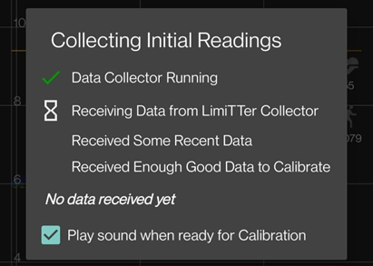

#### El sensor surt com a FSL1

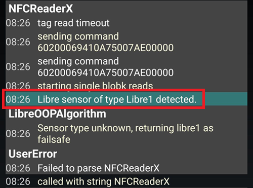

Assegureu-vos que feu servir les últimes versions de xDrip i d'OOP2.

#### La connexió amb el sensor falla

- Comproveu que OOP1 està desactivat (vegeu [aquí](#minimallooper-OOPsettings))

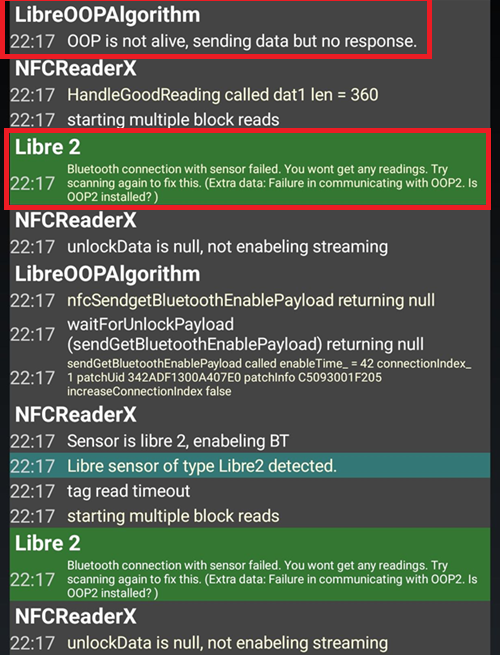

- Comproveu que les aplicacions i les opcions d'estalvi de bateria del telèfon no posen OOP2 a dormir
- Comproveu que Google Play Protect està desactivat, perquè si no tancarà OOP2
- Heu canviat Bluetooth Pairing a System Status? Toqueu-lo un altre cop per tornar-lo a posar a **<u>Disabled</u>**


#### Lectures perdudes

Assegureu-vos que OOP2 mostra valors que no són 0 ni -1; si no, pot ser un senyal que el sensor està fallant (exemple de més avall en mmol/l).

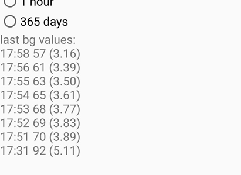

Si l'edat del sensor no avança, també pot ser un senyal que el sensor té problemes. Això vol dir que xDrip ha rebut un valor, però l'ha descartat perquè no era acceptable (error del sensor).

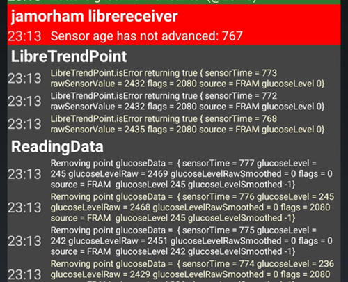

#### Tornar a començar l'emparellament del sensor des de zero

1. Menú de xDrip -> Stop sensor (no atura el FSL2, només canvia l'estat de xDrip a no iniciat)
2. Menú de xDrip -> System status -> Forget device
3. Escanegeu el sensor amb l'NFC de xDrip. Espereu com a mínim un minut
4. Menú de xDrip -> Start sensor. Espereu com a mínim un minut
5. Escanegeu el sensor amb l'NFC de xDrip unes quantes vegades, esperant sempre com a mínim un minut entre dos escanejos.
