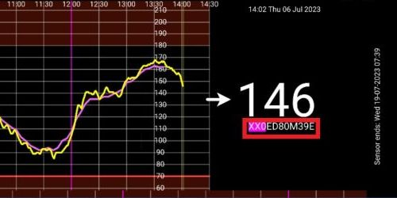
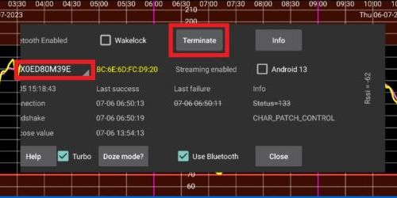

# **Freestyle Libre 3** i 3+

El Freestyle Libre 3 (FSL3) necessita una configuració especial perquè AAPS rebi els valors de glucèmia. Hi ha dues maneres possibles de portar els valors del Freestyle Libre 3 (FSL3) a AAPS.

Els mètodes següents fan servir l'aplicació separada Juggluco. Fa servir Juggluco per rebre les dades en brut del sensor, a intervals d'1 minut, que després es passen a xDrip o a AAPS. Els sensors nous es poden iniciar amb l'aplicació Libre 3 o directament a Juggluco. La guia següent explica com iniciar un sensor amb l'aplicació Juggluco. Si el sensor s'ha iniciat amb un compte de LibreView connectat, també és possible canviar de receptor entre Juggluco i l'aplicació Libre 3.

Juggluco també pot passar les dades a LibreView per compartir-les amb els professionals sanitaris si el sensor s'ha iniciat amb l'aplicació Libre 3.

A xDrip el sensor es pot calibrar en el rang de -40 mg/dl a +20 mg/dl (-2,2 mmol/l a +1,1 mmol/l) per compensar les diferències entre una mesura manual amb glucòmetre i les lectures del sensor.

## Mètode 1: fer servir directament les lectures d'1 minut
**AAPS** està pensat per a lectures cada 5 minuts. Per això, processar valors d'1 minut té de vegades algunes limitacions.

Vegeu [aquí](#juggluco-to-aaps).

## Mètode 2: convertir les lectures d'1 minut en valors de 5 minuts amb xDrip
Aquest mètode fa servir Juggluco per rebre les dades en brut del sensor, a intervals d'1 minut, que després es passen a xDrip per suavitzar-les en dades a intervals de 5 minuts que s'envien a AAPS.

### Pas 1: Configurar Juggluco
Descarregueu i instal·leu l'aplicació Juggluco des d'[aquí](https://www.juggluco.nl/Juggluco/download.html). Seguiu les instruccions d'[aquí](https://www.juggluco.nl/Juggluco/libre3/)

Assegureu-vos d'enviar els valors de glucèmia a xDrip: a la configuració de Juggluco podeu fer que Juggluco enviï els seus valors de glucèmia a altres aplicacions. Juggluco can send three types of such broadcasts: The **Patched Libre broadcast** was originally used by the patched Librelink app and can be used to send glucose values to xDrip.

### Pas 2: Configurar xDrip

L'aplicació xDrip del telèfon rep els valors de glucèmia.

- Si encara no ho heu fet, descarregueu [xDrip](https://github.com/NightscoutFoundation/xDrip) i seguiu les instruccions de la [pàgina de configuració de xDrip](../CompatibleCgms/xDrip.md).
- A xDrip seleccioneu "Libre2 (patched app)" com a font de dades.
- Si cal, introduïu "BgReading:d,xdrip libre_receiver:v" a Less Common Settings → Extra Logging Settings → Extra tags for logging. Així es registren missatges d'error addicionals per a la resolució de problemes.

- Tècnicament, el valor actual de glucèmia s'envia a xDrip cada minut. Un filtre de mitjana ponderada calcula per defecte un valor suavitzat dels últims 25 minuts. Podeu canviar el període al menú NFC Scan features.

  → Menú hamburguesa → Settings → NFC Scan features → Smooth libre 3 data when using xxx method

  

### Pas 3: Iniciar el sensor a xDrip

A xDrip inicieu el sensor amb "Start Sensor" i "not today". No cal acostar el telèfon mòbil al sensor. De fet, "Start Sensor" no inicia físicament cap sensor Libre 3 ni interactua amb ells de cap manera. Això només serveix per indicar a xDrip que un sensor nou envia valors de glucèmia. If available, enter two blood-measured values for the initial calibration. Ara els valors de glucèmia s'haurien de mostrar a xDrip cada 5 minuts. Els valors perduts, per exemple perquè éreu massa lluny del telèfon, no es recuperaran.

Espereu com a mínim 15–20 minuts si encara no hi ha dades.

Després d'un canvi de sensor, xDrip detectarà automàticament el sensor nou i eliminarà totes les dades de calibració. You may check your blood glucose after activation and make a new initial calibration.

### Pas 4: Configurar AAPS

- Vegeu [aquí](#juggluco-to-xdrip) i torneu.

- Si **AAPS** no rep valors de glucèmia quan el telèfon està en mode avió, feu servir "Identify receiver"
- Desactiveu el suavitzat (xDrip ja el fa)

## Canvis de sensor posteriors

1. Obriu Juggluco i anoteu el número de sèrie del sensor actual

2. Ara només cal escanejar el sensor nou amb el lector NFC del telèfon. Juggluco mostrarà un avís si el procés s'ha iniciat correctament.
3. Quan estigueu a punt per desactivar el sensor antic, obriu el menú de Juggluco fent clic en qualsevol lloc de l'espai buit a la cantonada superior esquerra de la pantalla.
4. Seleccioneu el sensor caducat i premeu "Terminate"

Nota: quan hi ha dos sensors actius, Juggluco enviarà a xDrip el valor més recent de qualsevol dels dos sensors. If the sensors are not calibrated to read BG similarly, this may result in jumpy BG values being reported to xDrip. Si finalitzeu el sensor equivocat, el podeu tornar a activar simplement escanejant-lo.

## Canviar el sensor entre l'aplicació Libre 3 i Juggluco

Si el sensor s'ha iniciat amb un compte de LibreView connectat, també és possible canviar de receptor entre Juggluco i l'aplicació Libre 3. Cal seguir aquests passos:

1. Instal·leu l'aplicació Libre 3 des de Google Play Store
2. Configureu l'aplicació Libre 3 amb el compte de LibreView amb què es va activar el sensor.
3. Forceu l'aturada de l'aplicació Juggluco a la configuració d'Android.
4. Al menú de Libre 3, feu clic a "Start Sensor", seleccioneu "Yes", "Next" i escanegeu el sensor.
5. Al cap d'uns minuts, els valors de glucèmia s'haurien de veure a l'aplicació Libre 3.

Per passar de l'aplicació Libre 3 a Juggluco, heu de forçar l'aturada de l'aplicació Libre 3 a la configuració d'Android i seguir els passos 1 i 2.

(libre3-experiences-and-troubleshooting)=
## Experiències i resolució de problemes

### Resolució de problemes de la connexió Libre3 -> Juggluco

- Assegureu-vos que feu servir una versió actual de l'aplicació Juggluco
- Comproveu la configuració segons aquesta guia
- De vegades potser haureu de forçar l'aturada de l'aplicació Libre 3 i de Juggluco i tornar-les a iniciar.
- Desactiveu el Bluetooth i torneu-lo a activar
- Espereu una estona o proveu de tancar Juggluco
- Les versions antigues de Juggluco (anteriors a la 2.9.6) no envien les dades següents del sensor Libre3 als dispositius connectats (p. ex. Juggluco a WearOS). Potser haureu de fer clic a "Resend data" a l'aplicació Libre3 modificada (menú de Juggluco).

### Més ajuda

Instruccions originals: [lloc web de jkaltes](https://www.juggluco.nl/Juggluco/libre3/)

Additional GitHub repo: [GitHub link](https://github.com/maheini/FreeStyle-Libre-3-patch)
