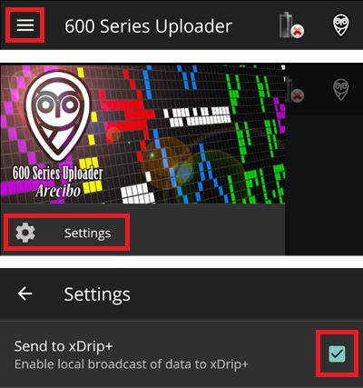

# MM640g or MM630g

-   Si encara no el teniu configurat, descarregueu [600SeriesAndroidUploader](https://pazaan.github.io/600SeriesAndroidUploader/) i seguiu les instruccions de [Nightscout](https://nightscout.github.io/uploader/setup/?h=uploader#medtronic-600-series-with-uploader).
-   In 600 Series Uploader go to Settings > Send to xDrip and select ON (tick).

-   Select MM640g in [**Configuration → BG Source**](#Config-Builder-bg-source).

