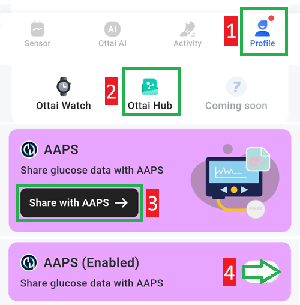

# Ottai M8

## Ús de l'M8 amb l'aplicació Ottai

-   Descarregueu i instal·leu l'apk des de <https://play.google.com/store/apps/details?id=com.ottai.seas>. Per a la versió xinesa d'Ottai, feu servir <https://ottai.com.cn/70ICjxAI4i>

-   Inicieu el sensor

- Select **Syai/Ottai** in [**Configuration → BG Source**](#Config-Builder-bg-source).

Activeu l'emissió (broadcast) a l'aplicació Ottai:

1. Seleccioneu «Profile»
2. Ottai hub
3. Toqueu «Share with AAPS» i accepteu l'acord de transferència de dades a tercers
4. Activeu «Share glucose data with AAPS»

