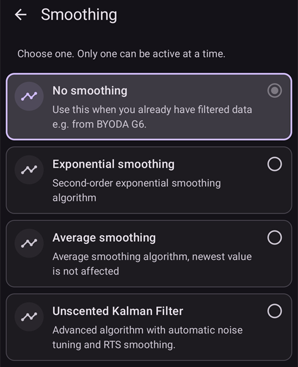

# Suavitzat de les dades de glucèmia

Si les dades de **glucèmia** salten o són sorolloses, **AAPS** pot dosificar la insulina malament i provocar hiperglucèmies o hipoglucèmies. Si veieu errors o dades que salten al vostre CGM, és important desactivar el llaç fins que el problema estigui resolt. Segons el vostre CGM, aquests problemes poden venir de la configuració del CGM a **AAPS** (com s'explica més avall) o d'un problema al punt del sensor del CGM (que pot obligar a canviar el sensor).

## Suavitzat de les dades a AAPS

**AAPS** ofereix l'opció de suavitzar les dades dins d'**AAPS** en lloc de fer-ho a l'aplicació del CGM. Obriu el **menú** (☰), seleccioneu [**Configurador**](../SettingUpAaps/ConfigBuilder.md) i després **Suavitzat**. Hi ha quatre opcions, i només una pot estar activa alhora: **Sense suavitzat**, **Suavitzat exponencial**, **Suavitzat per mitjana** i **Filtre de Kalman Unscented**.

### Suavitzat exponencial

En general, aquesta és l'opció recomanada per començar, perquè és la més agressiva per eliminar el soroll i reescriu el valor més recent. Però vegeu la taula de sota per a altres recomanacions concretes.

### Suavitzat per mitjana

Aquesta opció funciona de manera semblant al suavitzat cap enrere («back smoothing») que tenien abans algunes plataformes de CGM. Reacciona més als canvis recents de la glucèmia i, per tant, és més fàcil que respongui malament a dades sorolloses del CGM.

### Sense suavitzat

Feu servir aquesta opció només si la vostra aplicació col·lectora ja suavitza bé les dades del CGM abans d'enviar-les a **AAPS**.

### Filtre de Kalman Unscented (UKF)

Aquesta opció fa servir un model estadístic per estimar contínuament el vostre valor real de glucèmia i la seva velocitat de canvi a partir de les lectures que arriben (que poden ser sorolloses), i s'adapta automàticament al soroll actual del vostre sensor. També detecta i rebutja les lectures anòmales sobtades. És una alternativa més avançada al suavitzat exponencial i per mitjana, útil si voleu que el suavitzat s'adapti sol al nivell de soroll canviant del vostre sensor en lloc de fer servir un mètode fix.

(smoothing-xdrip-dexcom-g6)=

## Recomanacions per fer servir el suavitzat

També podeu canviar el mètode de suavitzat automàticament, per exemple segons l'edat del sensor, amb l'[acció d'automatització](#automations-automation-action) **Canviar el suavitzat**.

|               |   Exponencial   |  Per mitjana  | Sense suavitzat |
| ------------- |:---------------:|:-------------:|:---------------:|
| G5/G6/ONE     | Si hi ha soroll |               |    Recomanat    |
| G7/ONE+/Stelo | Si hi ha soroll | Si és estable |                 |

Els sensors Libre són sorollosos i poden necessitar suavitzat. Quan feu servir la connexió directa de xDrip, o l'origen de dades de l'aplicació modificada (que rep les dades d'una altra aplicació, Juggluco inclosa), [el suavitzat ja es fa dins de l'aplicació](#libre2-value-smoothing-raw-values).

| Sensor / Origen de les dades |  Juggluco   | xDrip directe | Pont xDrip (bridge) | Aplicació modificada xDrip |
| ---------------------------- |:-----------:|:-------------:|:-------------------:|:--------------------------:|
| Libre 1/14 dies/Pro          |     N/D     |      N/D      |     Per mitjana     |            N/D             |
| Libre 2/2+ (UE)              | Per mitjana |      Cap      |     Per mitjana     |            Cap             |
| Libre 2/2+/3/3+              | Per mitjana |      N/D      |         N/D         |            Cap             |
