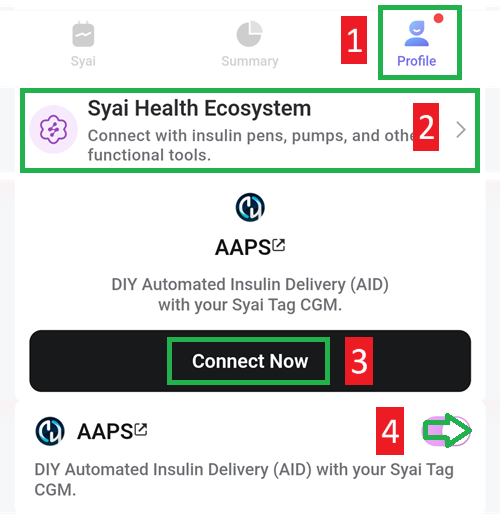

# Syai X1

## Utilitzar el X1 amb l'aplicació Syai Tag

-   Instal·leu l'apk des de <https://play.google.com/store/apps/details?id=com.syai.tag>.

-   Inicieu el sensor X1

- Seleccioneu **Syai/Ottai** a [**Configurador → Origen glucèmia**](#Config-Builder-bg-source).

Activeu l'emissió (broadcast) a l'aplicació Syai:

1. Seleccioneu «Profile»
2. Syai Health Ecosystem
3. Premeu Connect Now with AAPS i accepteu l'acord de transferència de dades a tercers
4. Activeu la compartició de dades amb AAPS

