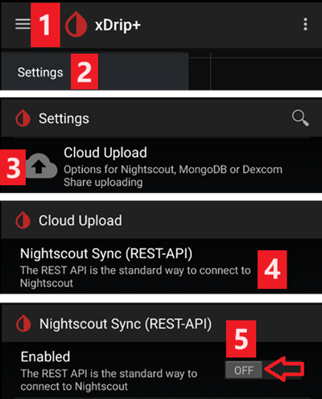
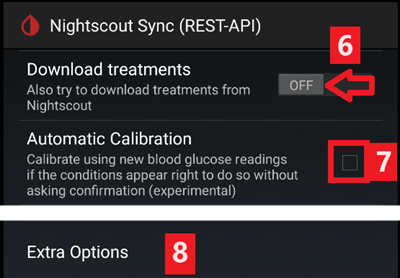
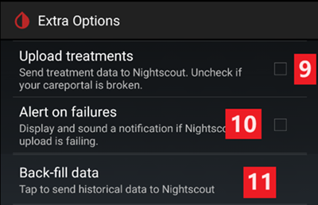
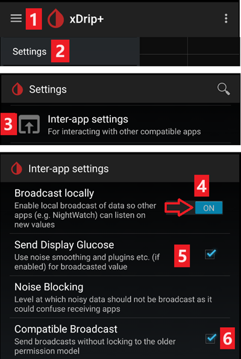
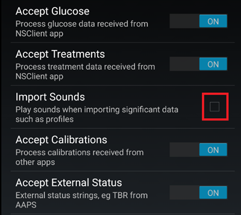
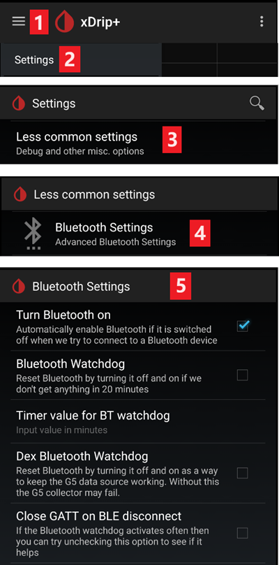
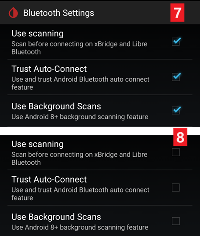
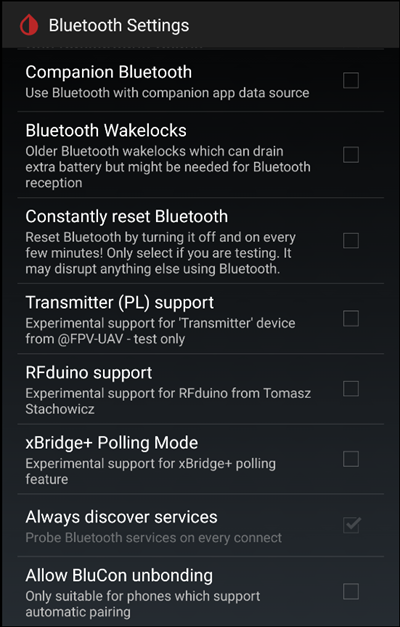
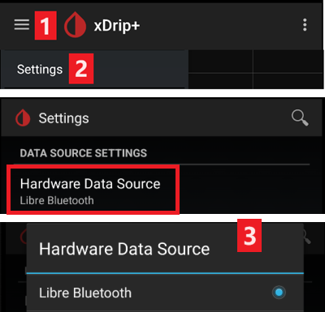
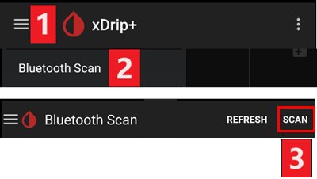

# Configuració de xDrip

Si encara no ho heu fet, descarregueu i instal·leu l'última versió de xDrip de la [pàgina de versions de xDrip](https://github.com/NightscoutFoundation/xDrip/releases).

Desactiveu l'optimització de bateria i permeteu l'activitat en segon pla per a l'aplicació xDrip.

## Configuració bàsica per a tots els sistemes CGM i FGM

### Desactivar l'enviament a Nightscout

No deixeu que cap altra aplicació enviï dades (glucèmia i tractaments) a Nightscout.

→ Menú hamburguesa (1) → Settings (2) → Cloud Upload (3) → Nightscout Sync (REST-API) (4) → Poseu `Enabled` a **OFF** (5)

#### Desactivar la calibració automàtica i els tractaments

Assegureu-vos que `Automatic Calibration` (7) està desactivat. Si la casella `Automatic Calibration` està marcada, activeu `Download treatments` (6) una vegada, després desmarqueu la casella `Automatic Calibration` i torneu a desactivar `Download treatments`.

Toqueu `Extra Options`(8)

    {admonition} Avís de seguretat
    :class: warning
    Heu de desactivar «Upload treatments» a xDrip; si no, els tractaments es poden duplicar a AAPS i donar COB i IOB falsos.

Desactiveu `Upload treatments`(9) i assegureu-vos que **NO** fareu servir `Back-fill data` (11).

L'opció `Alert on failures` també s'ha de desactivar (10). Si no, rebreu una alarma cada 5 minuts quan hi hagi problemes de Wi-Fi o de xarxa mòbil, o si el servidor no està disponible.

### **Inter-app Settings** (Broadcast)

Si feu servir AAPS, heu d'activar el broadcast a la configuració Inter-App de xDrip perquè les dades arribin a AAPS.

→ Menú hamburguesa (1) → Settings (2) → Inter-app settings (3) → Broadcast locally **ON** (4)

Perquè els valors d'AAPS siguin idèntics als de xDrip, heu d'activar `Send the displayed glucose value` (5).

Activeu Compatible Broadcast (6).

Si també heu activat `Accept treatments` a xDrip i `Enable broadcasts to xDrip` al plugin xDrip d'AAPS, xDrip rebrà d'AAPS la informació d'insulina, carbohidrats i taxa basal.

Si activeu `Accept Calibrations`, xDrip farà servir les calibracions d'AAPS. Aneu amb compte si feu servir aquesta funció amb sensors Dexcom: primer llegiu [això](https://navid200.github.io/xDrip/docs/Calibrate-G6.html).

Recordeu desactivar Import Sounds perquè xDrip no faci sonar un to cada vegada que AAPS envia un canvi de basal o de perfil.

(xdrip-identify-receiver)=

#### Identify receiver (identificar el receptor)

- Si teniu problemes amb el broadcast local (AAPS no rep valors de glucèmia de xDrip), aneu a → Menú hamburguesa (1) Settings (2) → Inter-app settings (3) → Identify receiver (7) i escriviu `info.nightscout.androidaps` per a la compilació d'AAPS (si feu servir la compilació PumpControl, escriviu `info.nightscout.aapspumpcontrol`!!).
- Atenció: la correcció automàtica de vegades canvia la i per una majúscula. **Heu de fer servir només lletres minúscules** quan escriviu `info.nightscout.androidaps` (o `info.nightscout.aapspumpcontrol` per a PumpControl). Una I majúscula impediria que l'aplicació rebés valors de glucèmia de xDrip.
    
    

## Fer servir AAPS per calibrar a xDrip

- Si voleu poder calibrar amb AAPS, a xDrip aneu a Settings → Interapp Compatibility → Accept Calibrations i seleccioneu ON. 
- També podeu revisar les opcions a Settings → Less Common Settings → Advanced Calibration Settings.

## Sensors Dexcom

Tot el que té a veure amb el sensor i el transmissor Dexcom (iniciar, aturar, substituir, calibrar, resoldre problemes) està documentat i actualitzat a la [documentació de xDrip per a Dexcom](https://navid200.github.io/xDrip/docs/Dexcom_page.html). Seguiu aquestes instruccions per al sensor; la configuració que connecta xDrip amb **AAPS** (descrita més amunt en aquesta pàgina) és l'única part específica d'AAPS.

### Dexcom G6 i ONE

- Configureu xDrip seguint la [configuració recomanada](https://navid200.github.io/xDrip/docs/G6-Recommended-Settings.html).
- Els transmissors Dexcom G6 i ONE es poden connectar alhora al receptor Dexcom (o bé a la bomba t:slim) i a una aplicació del telèfon.
- Si feu servir xDrip com a receptor, primer desinstal·leu l'aplicació de Dexcom. **No podeu connectar xDrip i l'aplicació Dexcom al transmissor alhora!**
- Si necessiteu Clarity i voleu aprofitar les funcions de xDrip, feu servir la [Build Your Own Dexcom App](#DexcomG6-if-using-g6-with-build-your-own-dexcom-app) amb broadcast local cap a xDrip, o feu servir xDrip com a aplicació Companion que rep les notificacions de l'aplicació oficial de Dexcom (amb possibles retards en els valors de glucèmia).

#### Reinicis del sensor

- Amb els transmissors actuals, xDrip sempre fa servir l'[algoritme natiu](https://navid200.github.io/xDrip/docs/Native-Algorithm.html) del transmissor; no hi ha cap motiu per desactivar-lo.
- Els [reinicis preventius](https://navid200.github.io/xDrip/docs/Preemptive-Restart.html) només funcionen amb transmissors antics (firmware 1.6.5.25 o anterior), on calen per evitar que el sensor s'aturi després de 10 dies. Els transmissors recents (Firefly) no els tenen en compte.
- Per reiniciar un sensor amb un transmissor Firefly cal [treure el transmissor](https://navid200.github.io/xDrip/docs/Remove-transmitter.html), i després del reinici els valors poden tenir errors importants, cosa que és perillosa amb el llaç: llegiu sencera la pàgina [Reiniciar un sensor](https://navid200.github.io/xDrip/docs/Restart-G6-sensor.html) i [calibreu amb cura](https://navid200.github.io/xDrip/docs/Calibrate-after-G6Restart.html).

(xdrip-connect-g6-transmitter-for-the-first-time)=

#### Iniciar, aturar i substituir sensors

Seguiu les instruccions:

- [Iniciar un transmissor G6 o ONE](https://navid200.github.io/xDrip/docs/Starting-G6.html)
- [Aturar i iniciar un sensor G6 o ONE](https://navid200.github.io/xDrip/docs/Dexcom/StartG6Sensor.html)
- [Treure el transmissor d'un sensor](https://navid200.github.io/xDrip/docs/Remove-transmitter.html)
- La [vida del transmissor](https://navid200.github.io/xDrip/docs/Transmitter-lifetime.html) només es pot allargar ([hard reset](https://navid200.github.io/xDrip/docs/Hard-Reset.html)) en transmissors amb bateria canviada o modificats, no en els Firefly.

(xdrip-replace-transmitter)=

#### Substituir un transmissor

- Apagueu el receptor original de Dexcom (si el feu servir) i no el torneu a engegar fins que xDrip mostri valors.
- Oblideu el dispositiu a xDrip (System Status → Forget Device) I a la configuració Bluetooth del telèfon (apareix com a DexcomXX, on XX són els dos últims dígits del número de sèrie del transmissor).
- Mantingueu el transmissor antic fora de l'abast del Bluetooth perquè no es torni a connectar.
- Després seguiu [Iniciar un transmissor G6 o ONE](https://navid200.github.io/xDrip/docs/Starting-G6.html).

### Dexcom G7, ONE+ i Stelo

- Seguiu les [instruccions per a G7, ONE+ i Stelo](https://navid200.github.io/xDrip/docs/Dexcom/G7.html) (cal una versió recent de xDrip; vegeu la pàgina enllaçada).
- Vegeu també la pàgina [Dexcom G7, ONE+ i Stelo](../CompatibleCgms/DexcomG7.md) per conèixer les configuracions disponibles amb **AAPS**.

(xdrip-troubleshooting-dexcom-g5-g6-and-xdrip)=

### Resolució de problemes de Dexcom i xDrip

- [Resolució de problemes de connexió de G6/ONE](https://navid200.github.io/xDrip/docs/Connectivity-troubleshoot.html)
- [Resolució de problemes de G7/ONE+/Stelo](https://navid200.github.io/xDrip/docs/Dexcom/G7_Troubleshooting.html)
- [Problema en iniciar un sensor nou](https://navid200.github.io/xDrip/docs/Dexcom/SensorFailedStart.html)
- Llista completa: vegeu **Troubleshooting** a la [pàgina de xDrip sobre Dexcom](https://navid200.github.io/xDrip/docs/Dexcom_page.html).

## Libre 1

- Configurar el vostre pont NFC a Bluetooth a xDrip
    
    → Menú hamburguesa (1) → Settings (2) → Less common settings (3) → Bluetooth Settings (4)

- A Bluetooth Settings, marqueu les caselles exactament com a les captures de pantalla de sota (5)
    
    - Desactiveu els watchdogs, perquè reinicien el Bluetooth del telèfon i interrompen la connexió amb la bomba.
    
    

- Podeu provar d'activar aquestes opcions (7)
    
    - Fer servir l'escaneig
    - Trust Auto-Connect
    - Use Background Scans

- Si perdeu fàcilment la connexió amb el pont o us costa recuperar-la, **DESACTIVEU-LES** (8).
    
    

- Deixeu desactivades totes les altres opcions, tret que sapigueu per què les voleu activar.
    
    

### Nivell de bateria del lector intel·ligent Libre

- Battery level of bridges such as MiaoMiao can be displayed in AAPS (not Blucon).
- Trobareu els detalls a la [pàgina de captures de pantalla](#screens-sensor-level-battery).

### Connectar el transmissor Libre i iniciar el sensor

- Si el vostre sensor ho necessita (Libre 2 EU i Libre 1 US), instal·leu l'últim algoritme «out of process».

- El sensor ja s'ha d'haver iniciat amb l'aplicació del fabricant o amb el lector (xDrip no pot iniciar ni aturar sensors Libre).

- Poseu com a font de dades Libre Bluetooth.
    
    → Menú hamburguesa (1) → Settings (2) → Seleccioneu Libre Bluetooth a Hardware Data source (3)
    
    

- Escanegeu el Bluetooth i connecteu el pont.
    
    → Menú hamburguesa (1) → Scan Bluetooth (2) → Scan (3)
    
    - Si xDrip no troba el pont, assegureu-vos que no està connectat a l'aplicació del fabricant. Poseu-lo a carregar i reinicieu-lo.
    
    

- Inicieu el sensor a xDrip.
    
        {admonition} Avís de seguretat
        :class: warning
        No feu servir les dades del sensor abans que acabi l'hora d'escalfament: els valors poden ser molt alts i fer que AAPS prengui decisions errònies.
    
    → Menú hamburguesa (1) → Start sensor (2) → Start sensor (3) → Poseu l'hora exacta en què el vau iniciar amb el lector o amb l'aplicació del fabricant. Si no el vau iniciar avui, responeu «Not Today» (4).

(xdrip-libre2-patched-app)=

## Aplicació Libre 2 modificada (patched)

- Poseu com a font de dades l'aplicació Libre modificada.
    
    → Menú hamburguesa (1) → Settings (2) → Seleccioneu Libre (patched App) a Hardware Data source (3)
    
    

- Podeu afegir `BgReading:d,xdrip libre_receiver:v` a Less Common Settings->Extra Logging Settings->Extra tags for logging. Així es registren més missatges d'error per resoldre problemes.

