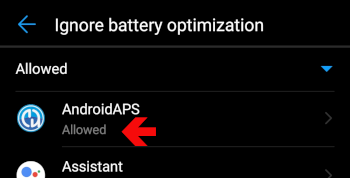
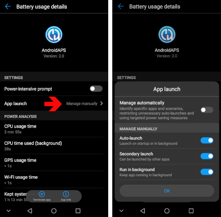
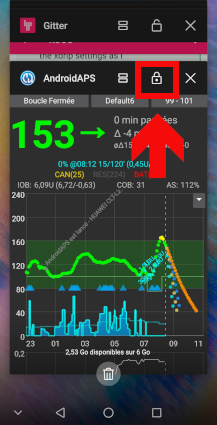

# Com configurar un telèfon Huawei

**Telèfons que tracta aquesta pàgina:** telèfons Huawei amb **EMUI 12 a EMUI 15**. Totes aquestes versions es basen en Android 12, el mínim per a la versió actual d'**AAPS**. En un telèfon amb una versió d'EMUI més antiga, només podeu fer servir una [versió d'AAPS més antiga](#maintenance-android-version-aaps-version).

```{admonition} Telèfons amb HarmonyOS NEXT / HarmonyOS 5 :class: warning

Els telèfons Huawei recents que es venen a la Xina funcionen amb HarmonyOS NEXT (HarmonyOS 5 i posteriors). Aquest sistema ja no és Android i no pot executar **AAPS**. ```

Els telèfons Huawei tanquen de manera molt agressiva les aplicacions que funcionen en segon pla. Apliqueu tots els ajustos següents a **AAPS** i a la vostra aplicació de CGM (per exemple xDrip+ o Juggluco). Si no ho feu, el llaç i les lectures de glucèmia es poden aturar quan la pantalla està apagada.

Els noms dels menús poden ser una mica diferents segons el model. Si no trobeu un ajust, escriviu-ne el nom a la barra de cerca de la part superior de **Configuració**.

Les captures de pantalla següents són d'una versió d'EMUI més antiga. Els ajustos són els mateixos a EMUI 12 a 15.

## Ignorar l'optimització de la bateria

1. Obriu **Configuració > Aplicacions > Aplicacions**.
2. Toqueu el menú **⋮** a l'angle superior dret i seleccioneu **Accés especial > Optimització de la bateria**.
3. Toqueu la fletxa de la part superior de la llista i seleccioneu **Totes les aplicacions**.
4. Seleccioneu **AAPS** i trieu **No permetre**. Huawei ja no optimitzarà les aplicacions d'aquesta llista.
5. Repetiu-ho per a la vostra aplicació de CGM.



## Inici d'aplicacions: permetre el funcionament en segon pla

1. Obriu **Configuració > Bateria > Inici d'aplicacions** (o **Configuració > Aplicacions > Aplicacions >** seleccioneu l'aplicació **> Bateria > Inici d'aplicacions**).
2. Cerqueu **AAPS** i desactiveu **Gestionar automàticament**.
3. A la finestra **Gestionar manualment**, activeu les tres opcions: 
    - **Inici automàtic**
    - **Inici secundari** (altres aplicacions la poden iniciar)
    - **Executar en segon pla**
4. Repetiu-ho per a la vostra aplicació de CGM.



## Bloquejar AAPS a les aplicacions recents

Les aplicacions bloquejades no es tanquen quan esborreu la llista d'aplicacions recents.

1. Obriu la llista d'aplicacions recents.
2. Llisqueu cap avall sobre la targeta d'**AAPS**. Apareix un símbol de cadenat a la targeta.
3. Feu el mateix per a la vostra aplicació de CGM.



## Mode d'estalvi d'energia

Mantingueu desactivats el **Mode d'estalvi d'energia** i l'**Estalvi d'energia ultra** (**Configuració > Bateria**). Tanquen les aplicacions en segon pla, encara que hàgiu fet els ajustos anteriors.

## Si AAPS encara s'atura en segon pla

Consulteu [Don't kill my app](https://dontkillmyapp.com/huawei) per trobar més solucions específiques per a Huawei.

## Telèfons Honor

Ara Honor és una marca independent i els seus telèfons funcionen amb MagicOS en lloc d'EMUI. Els ajustos de segon pla són molt semblants: cerqueu **Inici d'aplicacions** a la configuració de bateria de l'aplicació, desactiveu **Gestionar automàticament** i permeteu les tres opcions. Després, traieu l'aplicació de l'optimització de la bateria.