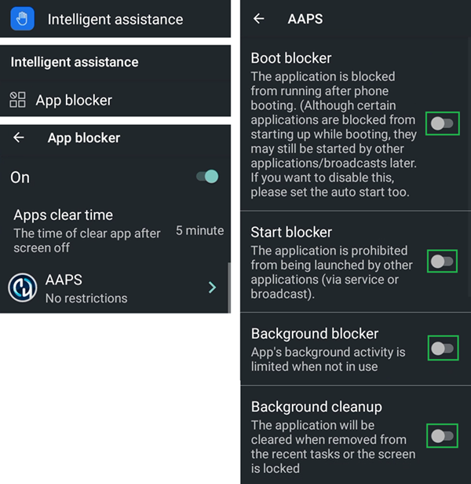

# Jelly

## Jelly Star Mini

**Funcions**

* Android 13
* 8 GB de RAM

**Avantatges**

* És molt petit.
* Even if you tell people, they might not consider it as a normal smartphone and will accept it more easily as an exception when phones are normally not allowed.

**Inconvenients**

* Recommended only for experienced loopers. Some settings are not easy to recognize: you have to know from experience with a big Android AAPS phone how and where things are located. Some AAPS buttons are small and hard to tap: you need a precise touch, not stubby fingers.
* Només es pot fer servir com a telèfon del llaç (LooperPhone). És millor tenir un telèfon intel·ligent normal a la butxaca. 

### Optimització de la durada de la bateria

El Jelly té funcions d'optimització fortes que **s'han** de desactivar per a AAPS (i per a altres aplicacions DIY com BYODA, xDrip, OOP2, Juggluco, etc.).

Podeu deixar activada l'«Assistència intel·ligent» (Intelligent assistance), però **s'ha de desactivar per a les aplicacions DIY**.

Podeu activar l'NFC per als sensors Libre.

### Optimització de la durada de la bateria

To avoid interference with **AAPS**, the Jelly Star 'battery usage' should be disabled by selecting 'unrestricted' for **AAPS** (and for other **DIY apps** like BYODA, xDrip, OOP2, Juggluco, etc...).

### Google Play Protect

Recordeu desactivar Google Play Protect.

### Connexió remota per a l'apk de Wear

For certain smart watches, like the Samsung Galaxy, 'Remote connection' under Advanced features in the Galaxy Wearable app must be switched **on** to use the Jelly, **Wear.apk** & **AAPS** remotely via Wi-Fi.

