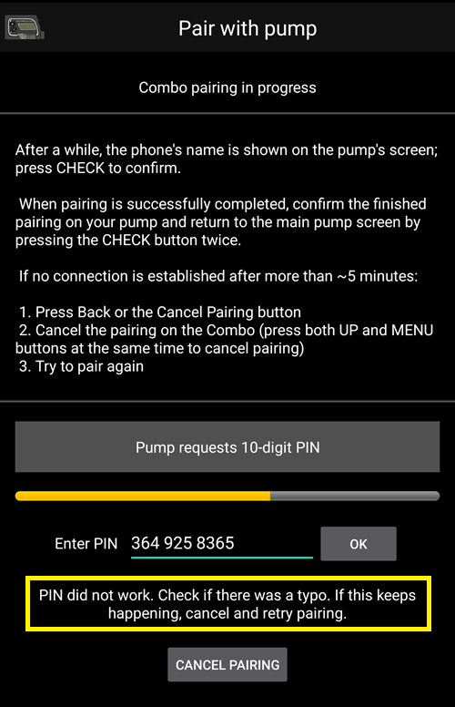

# Accu-Chek Combo

**Aquest programari forma part d'una solució «fes-ho tu mateix» (DIY) i no és un producte. Cal que VOSALTRES llegiu, aprengueu i entengueu el sistema, també com s'utilitza. No és una cosa que gestiona tota la diabetis per vosaltres, però us permet millorar la diabetis i la qualitat de vida si hi voleu dedicar el temps necessari. No tingueu pressa: doneu-vos temps per aprendre. Només vosaltres sou responsables del que feu amb el sistema.**

```{admonition} Accu-Chek Combo is being phased out
:class: note

Roche is withdrawing from the insulin pump market to refocus its diabetes portfolio on the Accu-Chek SmartGuide CGM. Roche ha anunciat la fi de la venda de les bombes Accu-Chek Combo i Accu-Chek Insight. La micro-bomba Accu-Chek Solo, l'única que queda, també s'està retirant (darrers lliuraments a Alemanya a finals de 2025). El canvi arriba per regions: comença a Alemanya i després hi seguiran altres mercats europeus. Si depeneu d'aquesta bomba, planifiqueu amb temps el pas a una bomba compatible.
```

```{contents} Table of contents
:depth: 1
:local: true
```

## Capacitats de la bomba amb AAPS

* Communicates with **AAPS** over your phone's native Bluetooth, without an additional communication device.
* Gestió automàtica de l'horari d'estiu i del fus horari.

## Requisits de maquinari i programari

* Una Roche Accu-Chek Combo (qualsevol firmware, totes funcionen).
* Un dispositiu Smartpix o Realtyme amb el programari 360 Configuration Software per configurar la bomba. (Roche envia gratuïtament els dispositius Smartpix i el programari de configuració als seus clients si ho demanen.)
* A compatible phone running Android 12 or newer. Vegeu les [notes de la versió](#maintenance-android-version-aaps-version) per a més detalls.
* The **AAPS** app installed on your phone.

Alguns telèfons poden funcionar millor que d'altres. Depèn de la qualitat del seu suport de Bluetooth i de si tenen una lògica d'estalvi d'energia addicional i molt agressiva. Trobareu una llista de telèfons al document [Telèfons](#Phones-list-of-tested-phones). Tingueu en compte que aquesta llista no és completa i reflecteix l'experiència personal dels usuaris. Us animem a afegir també la vostra experiència i així ajudar els altres (aquests projectes es basen a tornar l'ajuda rebuda).

(combov2-before-you-begin)=
## Abans de començar

**PRIMER, LA SEGURETAT**: no feu aquest procés en un entorn on no us podeu recuperar d'un error. Tingueu a mà el dispositiu Smartpix / Realtyme i el programari 360 Configuration Software. Calculeu aproximadament una hora per configurar-ho tot i comprovar que tot funciona correctament.

Tingueu en compte aquestes limitacions:

* El bolus estès i el bolus multiona ara no s'admeten (en lloc d'això, podeu fer servir [Carbohidrats estesos / «e-carbs»](../DailyLifeWithAaps/ExtendedCarbs.md)).
* Només s'admet un perfil basal (el primer).
* The lowest basal rate in your **Profile** is 0.05 U/h. **AAPS** refuses a **Profile** with a lower rate. The Combo rounds basal rates to its own steps (0.01 U/h below 1 U/h, 0.05 U/h up to 10 U/h, 0.1 U/h above). **AAPS** uses the rates the pump really gives.
* Temporary basal rates are limited to 500% of the current basal rate. **AAPS** takes this limit into account.
* El llaç es desactiva si el perfil actiu a la bomba no és el perfil núm. 1. This continues until profile no. 1 is made the active one; when that is done, the next time AAPS connects (either on its own after a while or because you tap **Refresh** on the Accu-Chek Combo pump screen), it will notice that profile no. 1 is the current one, and enable the loop again.
* Si el llaç demana cancel·lar una TBR en curs, la Combo estableix en lloc d'això una TBR del 90% o del 110% durant 15 minuts. Això és perquè cancel·lar de debò una TBR provoca una alerta a la bomba amb moltes vibracions, i aquestes vibracions no es poden desactivar.
* L'estabilitat de la connexió Bluetooth varia segons el telèfon. Això provoca alertes de «bomba no accessible», quan ja no s'estableix cap connexió amb la bomba. If that error occurs, make sure Bluetooth is enabled, tap **Refresh** on the pump screen (**Manage** > **Pump**) to see if this was caused by an intermittent issue and if still no connection is established, reboot the phone which should usually fix this.
* There is another issue where a restart doesn't help but a button on the pump must be pressed (which resets the pump's Bluetooth stack), before the pump accepts connections from the phone again.
* Cal evitar establir una TBR a la bomba, perquè el llaç pren el control de les TBR. Detectar una nova TBR a la bomba pot tardar fins a 20 minuts, i l'efecte de la TBR només es compta des del moment en què es detecta. Per tant, en el pitjor cas pot haver-hi 20 minuts d'una TBR que no es reflecteixen a l'IOB.

The driver is currently written to support the following languages on the Combo. (Això no té relació amb l'idioma d'AAPS: és l'idioma que es mostra a la pantalla LCD de la Combo.)

* Anglès
* Espanyol
* Francès
* Italià
* Rus
* Turc
* Polonès
* Txec
* Hongarès
* Eslovac
* Romanès
* Croat
* Neerlandès
* Grec
* Finès
* Noruec
* Portuguès
* Suec
* Danès
* Alemany
* Eslovè
* Lituà

**Important**: Si la vostra bomba té un idioma que no és en aquesta llista, poseu-vos en contacte amb els desenvolupadors i canvieu l'idioma de la bomba a un d'aquesta llista. Si no, el controlador no funcionarà correctament.

## Configuració del telèfon

És molt important assegurar-se que les optimitzacions de bateria estan desactivades. AAPS ja detecta automàticament si està afectat per aquestes optimitzacions, i a la seva interfície demana que es desactivin. Però als telèfons Android moderns, el Bluetooth _mateix_ és una aplicació (una aplicació del sistema). I normalment aquesta «aplicació Bluetooth» s'executa _amb les optimitzacions de bateria activades per defecte_. Com a resultat, el Bluetooth pot deixar de respondre quan el telèfon vol estalviar energia, perquè tanca l'aplicació Bluetooth. Això vol dir que també cal desactivar les optimitzacions de bateria a la configuració d'aquesta aplicació del sistema Bluetooth. Malauradament, la manera de trobar aquesta aplicació del sistema Bluetooth és diferent a cada telèfon. A l'Android estàndard, aneu a Configuració -> Aplicacions -> Mostra totes les N aplicacions (N = el nombre d'aplicacions del vostre telèfon). Després obriu el menú de la cantonada superior dreta i toqueu «Mostra el sistema», «Mostra les aplicacions del sistema» o «Totes les aplicacions». Ara, a la llista ampliada d'aplicacions, busqueu una aplicació «Bluetooth». Seleccioneu-la i, a la pantalla «Informació de l'aplicació», toqueu «Bateria». Allà, desactiveu les optimitzacions de bateria (de vegades s'anomenen «ús de la bateria»).

## Configuració de la Combo

* Configureu la bomba amb el programari Accu-Chek 360 Configuration Software. Si no teniu el programari, poseu-vos en contacte amb el servei d'atenció d'Accu-Chek. Normalment envien als usuaris registrats un CD amb el «360° Pump Configuration Software» i un dispositiu de connexió USB-infraroig SmartPix (el dispositiu Realtyme també funciona, si en teniu un).

  - **Configuració obligatòria** (marcada en verd a les captures de pantalla):

     * Establiu o deixeu la configuració del menú com a «Standard». Així la bomba només mostra els menús i les accions admesos i amaga els que no s'admeten (bolus estès / multiona, diverses taxes basals). Si es fan servir, aquestes funcions limiten el llaç, perquè no és possible fer funcionar el llaç de manera segura.
     * Comproveu que el _Quick Info Text_ està establert a «QUICK INFO» (sense les cometes; és a _Insulin Pump Options_).
     * Establiu el _Maximum Adjustment_ de la TBR al 500%
     * Desactiveu _Signal End of Temporary Basal Rate_
     * Establiu el _Duration increment_ de la TBR a 15 min
     * Activeu el Bluetooth

  - **Configuració recomanada** (marcada en blau a les captures de pantalla)

     * Establiu l'alarma de cartutx baix al vostre gust
     * Configureu un bolus màxim adequat a la vostra teràpia per protegir-vos d'errors del programari
     * De la mateixa manera, configureu una durada màxima de TBR com a mesura de seguretat. Permeteu com a mínim 3 hores, perquè l'opció de desconnectar la bomba durant 3 hores estableix un 0% durant 3 hores.
     * Activeu el bloqueig de tecles a la bomba per evitar fer bolus des de la bomba, sobretot si ja feu servir la bomba abans i teníeu el costum de fer bolus ràpids.
     * Establiu el temps d'espera de la pantalla i el del menú al mínim, 5,5 i 5 respectivament. Això permet a AAPS recuperar-se més ràpidament de situacions d'error i redueix la quantitat de vibracions que es poden produir durant aquests errors

  

  

  

  

## Activar el controlador i emparellar-lo amb la Combo

* Open the **menu** (☰) in the top-left corner, go to [**Configuration** > **Pump**](../SettingUpAaps/ConfigBuilder.md) and select **Accu-Chek Combo**.

  

  Once it is selected, the **Accu-Chek Combo** card shows two buttons, **Settings** and **Open plugin**:

  

  **Settings** opens the settings of the Accu-Chek Combo driver (see [Settings](#combov2-preferences) below):

  

  **Open plugin** (or **Manage** > **Pump**) opens the Accu-Chek Combo pump screen. Before a pump is paired it shows **Not paired to a pump**:

  

* On the pump screen, tap **Pairing**. The **Pair with pump** screen opens. Follow the steps shown on screen, then tap **Start pairing**. When Android asks for permission to make the phone visible to other Bluetooth devices, tap **Allow**. Eventually, the Combo shows a 10-digit pairing PIN on its screen, and **AAPS** asks for it. Enter that PIN in the **10-digit PIN** field.

  

  

  

  The next pictures are from an older **AAPS** version. The steps and texts are the same, but the screens look slightly different.

  

  

  

* If the PIN is entered incorrectly, **AAPS** shows **PIN did not work. Check if there was a typo. If this keeps happening, cancel and retry pairing.**

  

* When **Successfully paired with Combo** is shown, tap **OK**. You return to the pump screen, which now shows the pump status (see [Accu-Chek Combo pump screen contents](#combov2-tab-contents) below). The **Pairing** button is replaced by **Unpair**.

* Per comprovar la configuració (amb la bomba **desconnectada** de qualsevol cànula, per seguretat!), feu servir AAPS per establir una TBR del 500% durant 15 min i lliurar un bolus. Ara la bomba hauria de tenir una TBR en curs i el bolus a l'historial. AAPS també hauria de mostrar la TBR activa i el bolus lliurat.

* A la Combo, es recomana activar el bloqueig de tecles per evitar fer bolus des de la bomba, sobretot si ja feu servir la bomba abans i teníeu el costum de fer servir la funció «bolus ràpid».

## Notes sobre l'emparellament

L'Accu-Chek Combo es va desenvolupar abans que sortís el Bluetooth 4.0, i només un any després de la primera versió d'Android. Per això la seva manera d'emparellar-se amb altres dispositius no és 100% compatible amb com es fa avui a Android. Per resoldre-ho del tot, AAPS necessitaria permisos de nivell de sistema, que només tenen les aplicacions del sistema. Aquestes aplicacions les instal·len els fabricants del telèfon; els usuaris no poden instal·lar aplicacions del sistema.

The consequence of this is that pairing will never be 100% without problems. En concret, durant l'emparellament, el diàleg de PIN de Bluetooth d'Android pot aparèixer un moment i desaparèixer sol. Però de vegades es queda a la pantalla i demana un PIN de 4 dígits. (No el confongueu amb el PIN d'emparellament de 10 dígits de la Combo.) No introduïu res, només premeu Cancel·lar. Si l'emparellament no continua, seguiu les instruccions de la pantalla per tornar a intentar l'emparellament.

(combov2-tab-contents)=
## Accu-Chek Combo pump screen contents

To open the pump screen, go to **Manage** > **Pump**. Once a pump is paired, it shows the following information (items are listed from top to bottom):


1. **Driver state**: The driver can be in one of the following states:
   - **Disconnected**: There is no Bluetooth connection; the driver is in this state most of the time, and only connects to the pump when needed - this saves power
   - **Connecting**
   - **Checking pump**: the pump is connected, but the driver is currently performing safety checks to ensure that everything is OK and up to date
   - **Ready**: the driver is ready to accept commands from AAPS
   - **Suspended**: the pump is suspended (shown as "stopped" in the Combo)
   - A description of the command being executed, for example **Setting basal profile** or **Updating pump status**
   - **Error**: an error occurred; the connection was terminated, any ongoing command was aborted
2. **Last connection**: How many minutes ago the driver successfully connected to the Combo; if this goes beyond 30 minutes, this item is shown with a red color
3. **Battery**: Battery level; the Combo only indicates **Full**, **Low** or **Empty**, and does not offer anything more accurate (like a percentage), so only these three levels are shown here
4. **Reservoir**: How many IU are currently in the Combo's reservoir
5. **Last bolus**: How many minutes ago the last bolus was delivered; if none was delivered yet after AAPS was started, this is not shown
6. **Temp basal**: Details about the currently active temporary basal; if none is currently active, this is not shown
7. **Base basal rate**: Currently active base basal rate ("base" means the basal rate without any active TBR influencing the basal rate factor)
8. **Serial number**: Combo serial number as indicated by the pump (this corresponds to the serial number shown on the back of the Combo)
9. **Bluetooth address**: The Combo's 6-byte Bluetooth address, shown in the `XX:XX:XX:XX:XX:XX` format

While the driver is doing something (for example, setting a basal profile), a box below the list describes the current activity, with a thin progress bar showing the progress.

La Combo es pot fer funcionar per Bluetooth en el mode _terminal remot_ o en el mode _ordres_. El mode terminal remot correspon al «mode de control remot» del glucòmetre de la Combo, que imita la pantalla LCD i els quatre botons de la bomba. El controlador ha de fer algunes ordres en aquest mode, perquè no tenen equivalent en el mode ordres. Aquest últim mode és molt més ràpid, però, com s'ha dit, té un abast limitat. When the remote-terminal mode is active, the current remote-terminal screen is shown in the field that is located just above the Combo drawing. En canvi, quan el controlador passa al mode ordres, aquest camp es queda en blanc.

(You do not influence this; the driver fully decides on its own what mode to use. This is merely a note for you to know why sometimes you can see Combo frames in that field.)

At the bottom, there are these buttons:

- **Refresh**: Triggers an immediate pump status update. It is also used to let AAPS know that a previously discovered error is now fixed and that AAPS can check again that everything is OK (more on that below in [the section about alerts](#combov2-alerts)). You can only tap it when the driver is disconnected, suspended or in the error state.
- **Unpair**: Unpairs the paired Combo from **AAPS** and Android, after you confirm **Do you really want to unpair the pump?**. When no pump is paired, this button is replaced by **Pairing**.

(combov2-preferences)=
## Configuració

These settings are available for the Combo driver (**Configuration** > **Pump** > **Accu-Chek Combo** > **Settings**, or the settings icon (cog wheel) on the pump screen). Items are listed from top to bottom:

1. **Discovery duration (in seconds)**: When pairing, the driver makes the phone discoverable by the pump. Això controla quant de temps dura aquesta visibilitat. Per defecte, s'hi selecciona el màxim (300 segons = 5 minuts). Android no permet que la visibilitat duri indefinidament, per això cal triar una durada.
2. **Autodetect and automatically enter insulin reservoir change**: If enabled, the driver enters the "reservoir change" that you would normally enter yourself with **Manage** > **Prime/Fill**. S'explica [amb més detall més avall](#combov2-autodetections).
3. **Autodetect and automatically enter battery change**: If enabled, the driver enters the "battery change" that you would normally enter yourself with **Manage** > **Pump Battery Change**. S'explica [amb més detall més avall](#combov2-autodetections).
4. **Enable verbose Combo logging**: This greatly expands the amount of logging done by the driver. **ATENCIÓ**: No ho activeu si no us ho demana un desenvolupador. Otherwise, this can add a lot of noise to **AAPS** logs and lessen their usefulness.

Pairing and unpairing are done on the pump screen, not in the settings (see above).

(combov2-autodetections)=
## Detecció i registre automàtics dels canvis de pila i de reservori

El controlador pot detectar els canvis de pila i de reservori perquè segueix els nivells de la pila i del reservori. Si la Combo va informar d'un nivell de pila baix l'última vegada que es va actualitzar l'estat de la bomba, i ara, en la nova actualització de l'estat, el nivell de la pila surt normal, el controlador conclou que l'usuari ha canviat la pila. Es fa servir la mateixa lògica per al nivell del reservori: si ara és més alt que abans, s'interpreta com un canvi de reservori.

Això només funciona si la pila i el reservori es canvien quan aquests nivells surten com a baixos _i_ la pila i el reservori nous estan prou plens.

These autodetections can be turned off in the driver [settings](#combov2-preferences).

(combov2-alerts)=
## Alertes (avisos i errors) i com es gestionen

La Combo mostra les alertes com a pantalles del terminal remot. Warnings are shown with a "Wx" code (x is a digit), along with a short description. Un exemple és «W7», «TBR OVER». Els errors són semblants, però apareixen amb un codi «Ex».

El controlador descarta automàticament alguns avisos. Són aquests:

- W1 "reservoir low" : the driver turns this into a "low reservoir" warning that is shown on the AAPS main screen
- W2 "battery low" : the driver turns this into a "low battery" warning that is shown on the AAPS main screen
- W3, W6, W7, W8: tots són només informatius per a l'usuari, per tant el controlador els pot descartar automàticament sense perill

Els altres avisos _no_ es descarten automàticament. A més, els errors _mai_ no es descarten automàticament. Tots dos es gestionen de la mateixa manera: el controlador mostra un diàleg d'alerta a sobre de la interfície d'AAPS i també atura qualsevol ordre que s'estigui executant. The driver then switches to the "error" state (see [the Accu-Chek Combo pump screen contents above](#combov2-tab-contents)). En aquest estat no es pot executar cap ordre. L'usuari ha de resoldre l'error a la bomba; per exemple, un error d'oclusió pot requerir canviar la cànula. Once the user took care of the error, normal operation can be resumed by tapping **Refresh** on the Accu-Chek Combo pump screen. Aleshores el controlador es connecta a la Combo i n'actualitza l'estat, i comprova, per exemple, si encara es mostra un error a la pantalla. A més, el controlador actualitza automàticament l'estat de la bomba al cap d'una estona, per tant no és obligatori prémer aquest botó manualment.

El bolus és un cas especial. Es fa en el mode ordres de la Combo, que no informa durant el bolus que ha aparegut una alerta. Per això el controlador no pot descartar automàticament els avisos _durant_ un bolus. Això vol dir que, malauradament, la bomba farà bips fins que acabi el bolus. L'alerta més habitual durant un bolus sol ser W1 «reservoir low» (reservori baix). **Don't** dismiss Combo warnings on the pump itself manually during a bolus. Us arrisqueu a interrompre el bolus. El controlador s'encarregarà de l'avís quan acabi el bolus.

El controlador no detecta les alertes que es produeixen mentre no està connectat a la Combo. La Combo no té cap manera d'enviar l'alerta al telèfon automàticament; sempre és el telèfon qui ha d'iniciar la connexió. Per això l'alerta es manté fins que el controlador es connecta a la bomba. You can tap **Refresh** on the pump screen to trigger a connection and let the driver handle the alert right then and there (instead of waiting until AAPS itself decides to initiate a connection).

**IMPORTANT**: Si es produeix un error, o apareix un avís que no és dels que es descarten automàticament, el controlador entra en l'estat d'error. En aquest estat, el llaç **QUEDARÀ BLOQUEJAT** fins que s'actualitzi l'estat de la bomba! It is unblocked after the pump status is updated (either by tapping **Refresh** or by the driver's eventual auto-update) and no error is shown anymore.

## Coses amb què cal anar amb compte quan feu servir la Combo

* Recordeu que això no és un producte. Sobretot al principi, l'usuari ha de vigilar i entendre el sistema, les seves limitacions i com pot fallar. Es desaconsella totalment fer servir aquest sistema si la persona que l'utilitza no és capaç d'entendre'l del tot.
* Per la manera com funciona el control remot de la Combo, diverses operacions (sobretot establir un perfil basal) són lentes comparades amb altres bombes. És una limitació de la Combo que, malauradament, no es pot superar.
* No establiu ni cancel·leu cap TBR a la bomba. El llaç pren el control de les TBR i no pot funcionar de manera fiable d'una altra manera, perquè no és possible saber l'hora d'inici d'una TBR que l'usuari ha establert a la bomba.
* No premeu cap botó de la bomba mentre AAPS s'hi comunica (la bomba mostra el logotip de Bluetooth mentre està connectada a AAPS). Si ho feu, s'interromprà la connexió Bluetooth. Feu-ho només si hi ha problemes per establir la connexió (vegeu [la secció «Abans de començar» més amunt](#combov2-before-you-begin)).
* No premeu cap botó mentre la bomba fa un bolus. En concret, no intenteu descartar alertes prement botons. Vegeu [la secció sobre les alertes](#combov2-alerts) per a una explicació més detallada del perquè.

## Llista de comprovació quan no es pot establir la connexió amb la Combo

El controlador fa tot el possible per connectar-se a la Combo i fa servir alguns trucs per ser tan fiable com sigui possible. Tot i així, de vegades no s'estableix la connexió. Aquí teniu alguns passos per intentar resoldre aquesta situació.

1. Premeu un botó de la Combo. De vegades, la pila Bluetooth de la Combo deixa de respondre i ja no accepta connexions. Si premeu un botó de la Combo i feu que la pantalla LCD mostri alguna cosa, la pila Bluetooth es reinicia. La majoria de vegades, aquest és l'únic pas necessari per resoldre els problemes de connexió.
2. Reinicieu el telèfon. Pot caldre si hi ha un problema amb la pila Bluetooth del mateix telèfon.
3. Si la tapa de la pila de la Combo és vella, penseu a canviar-la. Les tapes de pila velles poden causar problemes amb l'alimentació de la Combo, i això afecta el Bluetooth.
4. Si els intents de connexió continuen fallant, penseu a desemparellar la bomba i tornar-la a emparellar.

(combov2-tips-for-basic-usage)=
## Tips for basic usage

### How to ensure smooth operations

* Always **carry the smartphone with you**, leave it next to your bed at night. As your pump may lay behind or under your body while you sleep, a higher position (on a shelf or board) works best.
* Always make sure that the pump battery is as full as possible. See the battery section for tips regarding the battery.
* Whenever possible, only operate the pump via the AAPS app. To facilitate this, activate the key lock on the pump under **PUMP SETTINGS / KEY LOCK / ON**. Only when changing the battery or the cartridge, it is necessary to use the pump's keys.


### Pump not reachable. What to do?

#### Activate pump unreachable alarm
* In **AAPS**, tap the **Settings** (gear) icon at the top right of the main screen, go to **Local alerts**, activate **Alert if pump is unreachable** and set **Pump unreachable threshold** to **31** minutes.
* This will give you enough time to not trigger the alarm when leaving the room while your phone is left on the desk, but informs you if the pump cannot be reached for a time that exceeds the duration of a temporary basal rate.

#### Restore reachability of the pump

* When AAPS reports a **pump unreachable** alarm, first release the keylock and **press any key on the pump** (e.g. "down" button). As soon as the pump display has turned off, tap **Refresh** on the Accu-Chek Combo pump screen (**Manage** > **Pump**). Mostly then the communication works again.
* If that does not help, reboot your smartphone. After the restart, AAPS will be reactivated and a new connection will be established with the pump.

* The tests with different smartphones have shown that certain smartphones trigger the "pump unreachable" error more often than others. See [AAPS Phones](#Phones-list-of-tested-phones) for successfully tested smartphones.

#### Root causes and consequences of frequent communication errors
* On phones with **low memory** (or **aggressive power-saving** settings), AAPS is often shut down. You can tell by the fact that the treatment buttons (QuickLaunch toolbar) on the main screen are not shown when opening AAPS because the system is initializing. This can trigger "pump unreachable alarms" at startup. In the **Last connection** field of the pump screen (**Manage** > **Pump**), you can check when AAPS last communicated with the pump.


* This error can drain the pump's battery faster because the basal profile is read from the pump when the app is restarted.
* It also increases the likelihood of causing the error that causes the pump to reject all incoming connections until a button on the pump is pressed.

### Cancellation of temporary basal rate fails
* Occasionally, AAPS cannot automatically cancel a **TBR CANCELED** alert. Then you have to either tap **Refresh** on the Accu-Chek Combo pump screen or the alarm on the pump will need to be confirmed.

### Pump battery considerations

#### Changing the battery
* After a **low battery** alarm, the battery should be changed as soon as possible to always have enough energy for a reliable Bluetooth communication with the smartphone, even if the phone is within a wider distance of the pump.
* Even after a **low battery** alarm, the battery might be used for a significant amount of time. However, it is recommended to always have a fresh battery with you after a "low battery" alarm rang.
* Before changing the battery, press on the **Loop** symbol on the main screen and select **Suspend loop** for 1 hour.
* Wait for the phone to communicate with the pump and for the Bluetooth logo on the pump to fade.


* Release the key lock on the pump, put the pump into stop mode, confirm a possibly canceled temporary basal rate, and change the battery quickly.
* You don't need to re-set the pump's clock after the battery change: AAPS automatically updates the pump's date and time.
* Then put the pump back in run mode and select **Resume** when pressing on the **Suspended Loop** icon on the main screen.
* AAPS will re-set a necessary temporary basal rate with the arrival of the next blood sugar value.

(Accu-Chek-Combo-Tips-for-Basic-usage-battery-type-and-causes-of-short-battery-life)=
#### Battery type and causes of short battery life
* As intensive Bluetooth communication consumes a lot of energy, only use **high-quality batteries** like Energizer Ultimate Lithium, the "power one"s from the "large" Accu-Chek service pack, or if you are going for a rechargeable battery, use Eneloop batteries.

 

Ranges for typical life time of the different battery types are as follows:
* **Energizer Ultimate Lithium**: 4 to 7 weeks
* **Power One Alkaline** (Varta) from the service pack: 2 to 4 weeks
* **Eneloop rechargeable** batteries (BK-3MCCE): 1 to 3 weeks

If your battery life is significantly shorter than the ranges given above, please check the following possible causes:
* There are some variants of the screw-on battery cap of the Combo pump, which partially short circuit the batteries and drain them quickly. The caps without this problem can be recognized by the golden metal contacts.
* If the pump clock does not "survive" a short battery change, it is likely that the capacitor is broken which keeps the clock running during a brief power outage. In this case, a replacement of the pump by Roche might help, which is not a problem during the warranty period.
* The smart phone hardware and software (Android operating system and Bluetooth stack) also impact the battery lifetime of the pump, even though the exact factors are not completely known yet. If you have the opportunity, try another smartphone and compare battery lifetimes.

### Extended bolus, multiwave bolus
The OpenAPS algorithm does not support a parallel extended bolus or multiwave bolus. But a similar treatment can be achieved by the following alternatives:
* Use **e-Carbs** when entering carbs or using the Bolus wizard by entering the carbs of the full meal and the duration you expect the carbs to arrive as glucose in your blood. The system will then calculate small carbs equally distributed over the whole duration which will cause the algorithm to provide equivalent insulin dosing while still permanently checking the overall rise/decrease of the blood glucose level. For a multiwave bolus approach, you can also combine a smaller immediate bolus with e-carbs.
* Before eating, set a temporary **Eating Soon** target of 80 mg/dL (4.4 mmol/L) for several hours (press the target on the main screen, or **Manage** > **Temp Target**). The duration should be based on the interval you would choose for an extended bolus. This will keep your target lower than usual and therefore increase the amount of insulin delivered.
* Then use the **Bolus wizard** to enter the full carbs of the meal, but do not directly apply the values it suggests. If a multiwave-like bolus is to be delivered, correct the insulin dosage down. Depending on the meal, the algorithm now has to deliver additional SMBs or higher temporary basal rates to counteract the increase in blood sugar. Here, the safety limitation of the basal rate (Max U/h, Maximum basal IOB) should be very carefully experimented with and, if necessary, temporarily changed.

* Don't use the extended or multiwave bolus directly on the pump. The driver does not support them (see [Before you begin](#combov2-before-you-begin)); if a multiwave bolus is given on the pump anyway, **AAPS** records it from the pump history as a normal bolus plus an extended bolus, so it is counted in IOB. An extended bolus does not work in a closed loop environment (see [this page](#extended-bolus-and-why-they-wont-work-in-closed-loop-environment) for details).

### Alarms at bolus delivery
* After each bolus, the driver reads the pump's bolus history. This is a safety mechanism to correctly calculate insulin on board (IOB), even when a bolus is delivered directly from the pump.
* Before a bolus, if the pump history has a bolus that **AAPS** did not know about (for example, a bolus given directly on the pump), the requested bolus is **not given**, because it was calculated without that insulin. **AAPS** shows **The pump history has a bolus that AAPS did not know about. The requested bolus was not given...** Check the bolus history on the pump and your IOB. If a bolus is still needed, calculate it again. This also applies when the unknown bolus is found on a new connection.
* If the bolus was given but the pump history also had other boluses that **AAPS** did not know about, they are recorded now and **AAPS** asks you to check IOB before the next bolus.
* If the connection to the pump is lost **during** a bolus, **AAPS** does not record 0 U: it shows how much the pump had given by then and warns that the pump may still give the rest. **Do not bolus again.** **AAPS** reads the real amount from the pump history at the next connection.
* If the connection is lost while **AAPS** sends the bolus, it is not known whether the pump got it. Check the bolus history on the pump before the next bolus.
* If **AAPS** cannot confirm that a bolus was delivered, it shows **Bolus delivery failed. It appears no bolus was delivered. To be sure, please check the pump to avoid a double bolus and then bolus again.** Boluses are never retried automatically.

## On trobar ajuda

Development of the Combo driver is done by the community on a **volunteer** basis. Abans de demanar ajuda:

1. **Read** the relevant section of this documentation to confirm how the feature is meant to work.
2. **Ask** on the *#AAPS* channel on [Discord](https://discord.gg/4fQUWHZ4Mw), or in one of the other [community channels](../GettingHelp/WhereCanIGetHelp.md).
3. **Report a bug** by searching the [existing issues](https://github.com/nightscout/AndroidAPS/issues); if yours is not listed, open a [new issue](https://github.com/nightscout/AndroidAPS/issues) and attach your [log files](../GettingHelp/AccessingLogFiles.md).

When asking for help, include your phone make and model, Android version, **AAPS** version, and a plain-English description of the problem (what changed, when it last worked).
