# Accu-Chek Combo

**Aquest programari forma part d'una solució «fes-ho tu mateix» (DIY) i no és un producte. Cal que VOSALTRES llegiu, aprengueu i entengueu el sistema, també com s'utilitza. No és una cosa que gestiona tota la diabetis per vosaltres, però us permet millorar la diabetis i la qualitat de vida si hi voleu dedicar el temps necessari. No tingueu pressa: doneu-vos temps per aprendre. Només vosaltres sou responsables del que feu amb el sistema.**

```{admonition} Accu-Chek Combo is being phased out
:class: note

Roche es retira del mercat de les bombes d'insulina per centrar la seva cartera de diabetis en el CGM Accu-Chek SmartGuide. Roche ha anunciat la fi de la venda de les bombes Accu-Chek Combo i Accu-Chek Insight. La micro-bomba Accu-Chek Solo, l'única que queda, també s'està retirant (darrers lliuraments a Alemanya a finals de 2025). El canvi arriba per regions: comença a Alemanya i després hi seguiran altres mercats europeus. Si depeneu d'aquesta bomba, planifiqueu amb temps el pas a una bomba compatible.
```

```{contents} Table of contents
:depth: 1
:local: true
```

## Capacitats de la bomba amb AAPS

* Es comunica amb **AAPS** amb el Bluetooth propi del telèfon, sense cap dispositiu de comunicació addicional.
* Gestió automàtica de l'horari d'estiu i del fus horari.

## Requisits de maquinari i programari

* Una Roche Accu-Chek Combo (qualsevol firmware, totes funcionen).
* Un dispositiu Smartpix o Realtyme amb el programari 360 Configuration Software per configurar la bomba. (Roche envia gratuïtament els dispositius Smartpix i el programari de configuració als seus clients si ho demanen.)
* Un telèfon compatible amb Android 12 o més nou. Vegeu les [notes de la versió](#maintenance-android-version-aaps-version) per a més detalls.
* L'aplicació **AAPS** instal·lada al vostre telèfon.

Alguns telèfons poden funcionar millor que d'altres. Depèn de la qualitat del seu suport de Bluetooth i de si tenen una lògica d'estalvi d'energia addicional i molt agressiva. Trobareu una llista de telèfons al document [Telèfons](#Phones-list-of-tested-phones). Tingueu en compte que aquesta llista no és completa i reflecteix l'experiència personal dels usuaris. Us animem a afegir també la vostra experiència i així ajudar els altres (aquests projectes es basen a tornar l'ajuda rebuda).

(combov2-before-you-begin)=
## Abans de començar

**PRIMER, LA SEGURETAT**: no feu aquest procés en un entorn on no us podeu recuperar d'un error. Tingueu a mà el dispositiu Smartpix / Realtyme i el programari 360 Configuration Software. Calculeu aproximadament una hora per configurar-ho tot i comprovar que tot funciona correctament.

Tingueu en compte aquestes limitacions:

* El bolus estès i el bolus multiona ara no s'admeten (en lloc d'això, podeu fer servir [Carbohidrats estesos / «e-carbs»](../DailyLifeWithAaps/ExtendedCarbs.md)).
* Només s'admet un perfil basal (el primer).
* La taxa basal més baixa del vostre **Perfil** és de 0,05 U/h. **AAPS** rebutja un **Perfil** amb una taxa més baixa. La Combo arrodoneix les taxes basals als seus propis passos (0,01 U/h per sota d'1 U/h, 0,05 U/h fins a 10 U/h, 0,1 U/h per sobre). **AAPS** fa servir les taxes que la bomba lliura de debò.
* Les taxes basals temporals estan limitades al 500% de la taxa basal actual. **AAPS** té en compte aquest límit.
* El llaç es desactiva si el perfil actiu a la bomba no és el perfil núm. 1. Això continua fins que el perfil núm. 1 passa a ser l'actiu. Quan és així, la propera vegada que AAPS es connecti (sol, al cap d'una estona, o perquè toqueu **Actualitzar** a la pantalla de la bomba Accu-Chek Combo), veurà que el perfil núm. 1 és l'actual i tornarà a activar el llaç.
* Si el llaç demana cancel·lar una TBR en curs, la Combo estableix en lloc d'això una TBR del 90% o del 110% durant 15 minuts. Això és perquè cancel·lar de debò una TBR provoca una alerta a la bomba amb moltes vibracions, i aquestes vibracions no es poden desactivar.
* L'estabilitat de la connexió Bluetooth varia segons el telèfon. Això provoca alertes de «bomba no accessible», quan ja no s'estableix cap connexió amb la bomba. Si es produeix aquest error, assegureu-vos que el Bluetooth està activat i toqueu **Actualitzar** a la pantalla de la bomba (**Gestionar** > **Bomba**) per veure si era un problema puntual. Si encara no s'estableix la connexió, reinicieu el telèfon; normalment això ho resol.
* Hi ha un altre problema en què reiniciar no ajuda, sinó que cal prémer un botó de la bomba (així es reinicia la pila Bluetooth de la bomba) perquè la bomba torni a acceptar connexions del telèfon.
* Cal evitar establir una TBR a la bomba, perquè el llaç pren el control de les TBR. Detectar una nova TBR a la bomba pot tardar fins a 20 minuts, i l'efecte de la TBR només es compta des del moment en què es detecta. Per tant, en el pitjor cas pot haver-hi 20 minuts d'una TBR que no es reflecteixen a l'IOB.

Ara el controlador està fet per admetre aquests idiomes a la Combo. (Això no té relació amb l'idioma d'AAPS: és l'idioma que es mostra a la pantalla LCD de la Combo.)

* Anglès
* Espanyol
* Francès
* Italià
* Rus
* Turc
* Polonès
* Txec
* Hongarès
* Eslovac
* Romanès
* Croat
* Neerlandès
* Grec
* Finès
* Noruec
* Portuguès
* Suec
* Danès
* Alemany
* Eslovè
* Lituà

**Important**: Si la vostra bomba té un idioma que no és en aquesta llista, poseu-vos en contacte amb els desenvolupadors i canvieu l'idioma de la bomba a un d'aquesta llista. Si no, el controlador no funcionarà correctament.

## Configuració del telèfon

És molt important assegurar-se que les optimitzacions de bateria estan desactivades. AAPS ja detecta automàticament si està afectat per aquestes optimitzacions, i a la seva interfície demana que es desactivin. Però als telèfons Android moderns, el Bluetooth _mateix_ és una aplicació (una aplicació del sistema). I normalment aquesta «aplicació Bluetooth» s'executa _amb les optimitzacions de bateria activades per defecte_. Com a resultat, el Bluetooth pot deixar de respondre quan el telèfon vol estalviar energia, perquè tanca l'aplicació Bluetooth. Això vol dir que també cal desactivar les optimitzacions de bateria a la configuració d'aquesta aplicació del sistema Bluetooth. Malauradament, la manera de trobar aquesta aplicació del sistema Bluetooth és diferent a cada telèfon. A l'Android estàndard, aneu a Configuració -> Aplicacions -> Mostra totes les N aplicacions (N = el nombre d'aplicacions del vostre telèfon). Després obriu el menú de la cantonada superior dreta i toqueu «Mostra el sistema», «Mostra les aplicacions del sistema» o «Totes les aplicacions». Ara, a la llista ampliada d'aplicacions, busqueu una aplicació «Bluetooth». Seleccioneu-la i, a la pantalla «Informació de l'aplicació», toqueu «Bateria». Allà, desactiveu les optimitzacions de bateria (de vegades s'anomenen «ús de la bateria»).

## Configuració de la Combo

* Configureu la bomba amb el programari Accu-Chek 360 Configuration Software. Si no teniu el programari, poseu-vos en contacte amb el servei d'atenció d'Accu-Chek. Normalment envien als usuaris registrats un CD amb el «360° Pump Configuration Software» i un dispositiu de connexió USB-infraroig SmartPix (el dispositiu Realtyme també funciona, si en teniu un).

  - **Configuració obligatòria** (marcada en verd a les captures de pantalla):

     * Establiu o deixeu la configuració del menú com a «Standard». Així la bomba només mostra els menús i les accions admesos i amaga els que no s'admeten (bolus estès / multiona, diverses taxes basals). Si es fan servir, aquestes funcions limiten el llaç, perquè no és possible fer funcionar el llaç de manera segura.
     * Comproveu que el _Quick Info Text_ està establert a «QUICK INFO» (sense les cometes; és a _Insulin Pump Options_).
     * Establiu el _Maximum Adjustment_ de la TBR al 500%
     * Desactiveu _Signal End of Temporary Basal Rate_
     * Establiu el _Duration increment_ de la TBR a 15 min
     * Activeu el Bluetooth

  - **Configuració recomanada** (marcada en blau a les captures de pantalla)

     * Establiu l'alarma de cartutx baix al vostre gust
     * Configureu un bolus màxim adequat a la vostra teràpia per protegir-vos d'errors del programari
     * De la mateixa manera, configureu una durada màxima de TBR com a mesura de seguretat. Permeteu com a mínim 3 hores, perquè l'opció de desconnectar la bomba durant 3 hores estableix un 0% durant 3 hores.
     * Activeu el bloqueig de tecles a la bomba per evitar fer bolus des de la bomba, sobretot si ja feu servir la bomba abans i teníeu el costum de fer bolus ràpids.
     * Establiu el temps d'espera de la pantalla i el del menú al mínim, 5,5 i 5 respectivament. Això permet a AAPS recuperar-se més ràpidament de situacions d'error i redueix la quantitat de vibracions que es poden produir durant aquests errors

  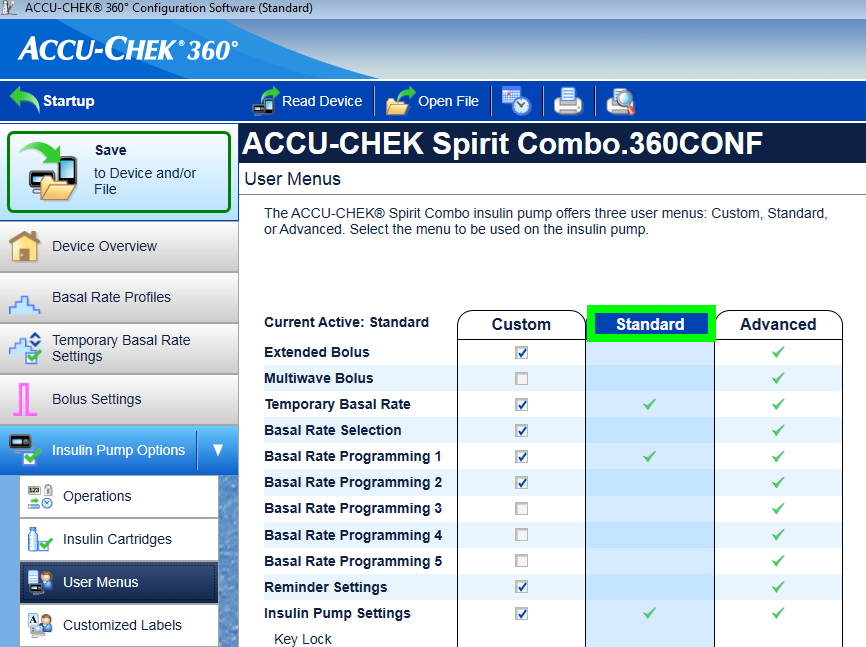

  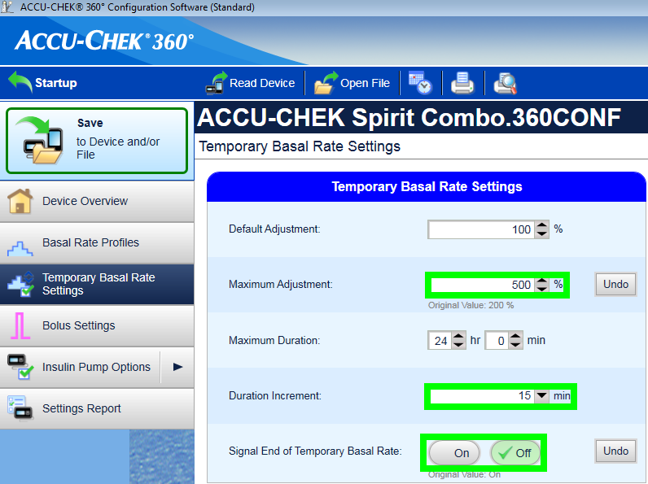

  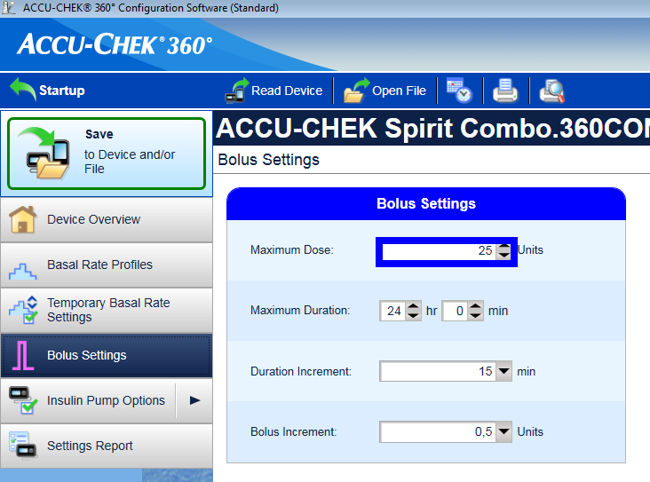

  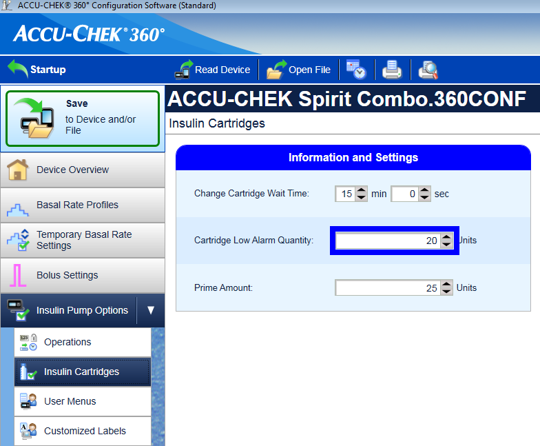

## Activar el controlador i emparellar-lo amb la Combo

* Obriu el **menú** (☰) a la cantonada superior esquerra, aneu a [**Configurador** > **Bomba**](../SettingUpAaps/ConfigBuilder.md) i seleccioneu **Accu-Chek Combo**.

  

  Quan està seleccionat, la targeta **Accu-Chek Combo** mostra dos botons, **Configuració** i **Obrir plugin**:

  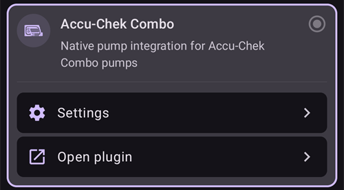

  **Configuració** obre la configuració del controlador Accu-Chek Combo (vegeu [Configuració](#combov2-preferences) més avall):

  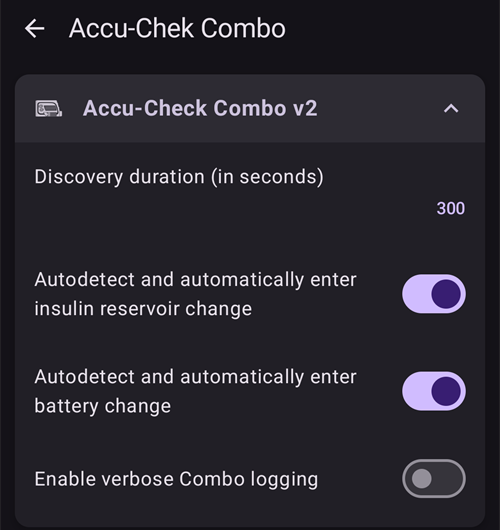

  **Obrir plugin** (o **Gestionar** > **Bomba**) obre la pantalla de la bomba Accu-Chek Combo. Abans d'emparellar una bomba, mostra **No emparellat amb cap bomba**:

  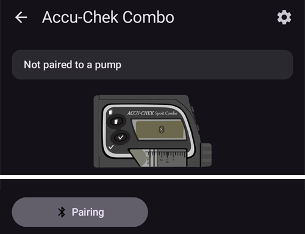

* A la pantalla de la bomba, toqueu **Emparellament**. S'obre la pantalla **Emparellar amb la bomba**. Seguiu els passos que es mostren a la pantalla i després toqueu **Iniciar emparellament**. Quan Android demani permís per fer el telèfon visible per a altres dispositius Bluetooth, toqueu **Permet**. Al final, la Combo mostra un PIN d'emparellament de 10 dígits a la seva pantalla, i **AAPS** us el demana. Introduïu aquest PIN al camp **PIN de 10 dígits**.

  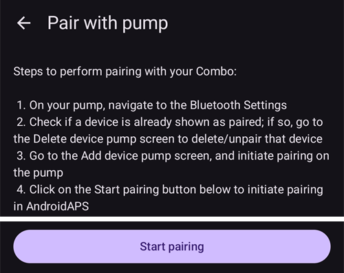

  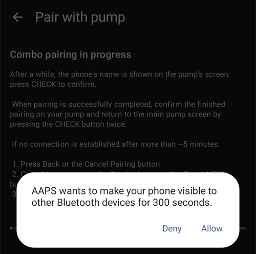

  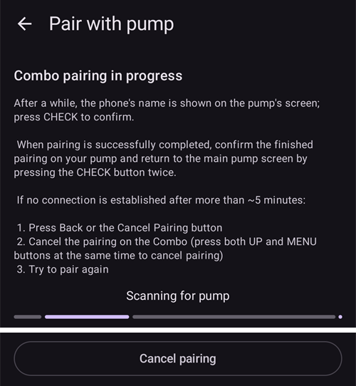

  Les imatges següents són d'una versió més antiga d'**AAPS**. Els passos i els textos són els mateixos, però les pantalles són una mica diferents.

  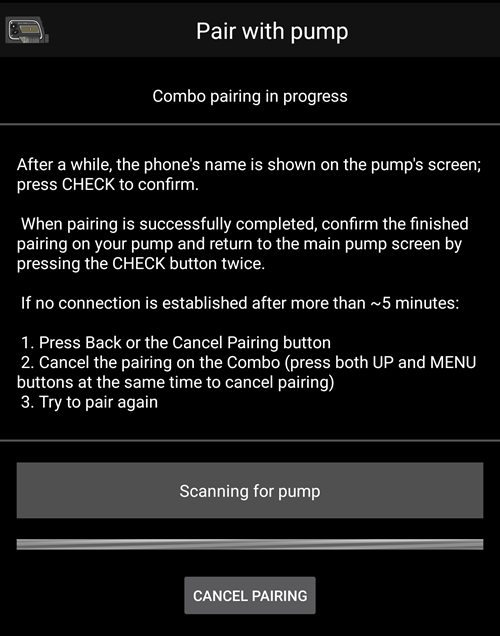

  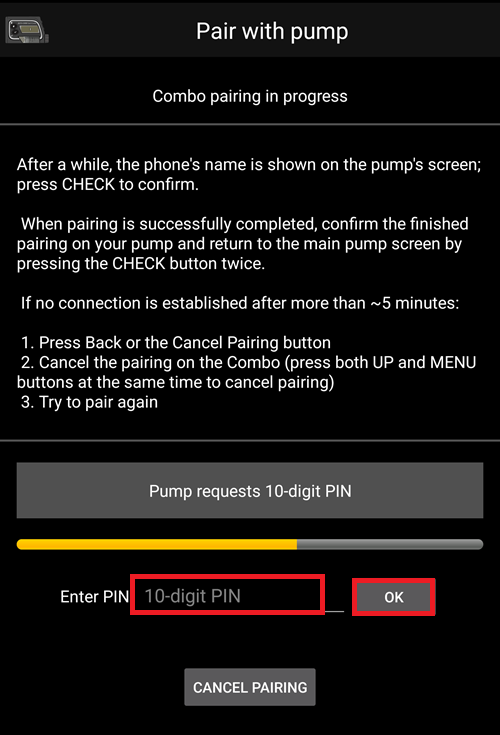

  

* Si el PIN no és correcte, **AAPS** mostra **El PIN no ha funcionat. Comproveu si hi ha cap error d'escriptura. Si torna a passar, cancel·leu i torneu a intentar l'emparellament.**

  

* Quan es mostri **Combo emparellada correctament**, toqueu **OK**. Tornareu a la pantalla de la bomba, que ara mostra l'estat de la bomba (vegeu [Contingut de la pantalla de la bomba Accu-Chek Combo](#combov2-tab-contents) més avall). El botó **Emparellament** se substitueix per **Desemparellar**.

* Per comprovar la configuració (amb la bomba **desconnectada** de qualsevol cànula, per seguretat!), feu servir AAPS per establir una TBR del 500% durant 15 min i lliurar un bolus. Ara la bomba hauria de tenir una TBR en curs i el bolus a l'historial. AAPS també hauria de mostrar la TBR activa i el bolus lliurat.

* A la Combo, es recomana activar el bloqueig de tecles per evitar fer bolus des de la bomba, sobretot si ja feu servir la bomba abans i teníeu el costum de fer servir la funció «bolus ràpid».

## Notes sobre l'emparellament

L'Accu-Chek Combo es va desenvolupar abans que sortís el Bluetooth 4.0, i només un any després de la primera versió d'Android. Per això la seva manera d'emparellar-se amb altres dispositius no és 100% compatible amb com es fa avui a Android. Per resoldre-ho del tot, AAPS necessitaria permisos de nivell de sistema, que només tenen les aplicacions del sistema. Aquestes aplicacions les instal·len els fabricants del telèfon; els usuaris no poden instal·lar aplicacions del sistema.

Per això l'emparellament mai no funcionarà al 100% sense problemes. En concret, durant l'emparellament, el diàleg de PIN de Bluetooth d'Android pot aparèixer un moment i desaparèixer sol. Però de vegades es queda a la pantalla i demana un PIN de 4 dígits. (No el confongueu amb el PIN d'emparellament de 10 dígits de la Combo.) No introduïu res, només premeu Cancel·lar. Si l'emparellament no continua, seguiu les instruccions de la pantalla per tornar a intentar l'emparellament.

(combov2-tab-contents)=
## Contingut de la pantalla de la bomba Accu-Chek Combo

Per obrir la pantalla de la bomba, aneu a **Gestionar** > **Bomba**. Quan hi ha una bomba emparellada, mostra la informació següent (els elements es llisten de dalt a baix):

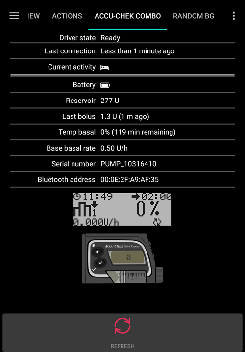

1. **Estat del controlador**: El controlador pot estar en un d'aquests estats:
   - **Desconnectat**: No hi ha connexió Bluetooth. El controlador està en aquest estat la major part del temps i només es connecta a la bomba quan cal; així s'estalvia energia
   - **Connectant**
   - **Comprovant la bomba**: la bomba està connectada, però el controlador està fent comprovacions de seguretat per assegurar-se que tot està bé i actualitzat
   - **A punt**: el controlador està preparat per acceptar ordres d'AAPS
   - **Suspesa**: la bomba està suspesa (a la Combo es mostra com a «stopped»)
   - Una descripció de l'ordre que s'està executant, per exemple **Establint perfil basal** o **Actualitzant estat de la bomba**
   - **Error**: s'ha produït un error; la connexió s'ha tancat i qualsevol ordre en curs s'ha aturat
2. **Última connexió**: Fa quants minuts que el controlador es va connectar correctament a la Combo. Si passa de 30 minuts, aquest element es mostra en vermell
3. **Bateria**: Nivell de la pila. La Combo només indica **Plena**, **Baixa** o **Buida** i no ofereix res més precís (com un percentatge), per això aquí només es mostren aquests tres nivells
4. **Reservori**: Quantes U hi ha ara al reservori de la Combo
5. **Darrer bolus**: Fa quants minuts es va lliurar l'últim bolus. Si encara no se n'ha lliurat cap des que s'ha iniciat AAPS, no es mostra
6. **Basal temporal**: Detalls de la basal temporal activa. Si no n'hi ha cap d'activa, no es mostra
7. **Taxa basal base**: Taxa basal base activa ara («base» vol dir la taxa basal sense cap TBR activa que n'influeixi el factor)
8. **Nr. de sèrie**: Número de sèrie de la Combo tal com l'indica la bomba (correspon al número de sèrie que hi ha a la part posterior de la Combo)
9. **Adreça Bluetooth**: L'adreça Bluetooth de 6 bytes de la Combo, en el format `XX:XX:XX:XX:XX:XX`

Mentre el controlador fa alguna cosa (per exemple, establir un perfil basal), un quadre sota la llista descriu l'activitat actual, amb una barra de progrés prima que mostra l'avenç.

La Combo es pot fer funcionar per Bluetooth en el mode _terminal remot_ o en el mode _ordres_. El mode terminal remot correspon al «mode de control remot» del glucòmetre de la Combo, que imita la pantalla LCD i els quatre botons de la bomba. El controlador ha de fer algunes ordres en aquest mode, perquè no tenen equivalent en el mode ordres. Aquest últim mode és molt més ràpid, però, com s'ha dit, té un abast limitat. Quan el mode terminal remot està actiu, la pantalla actual del terminal remot es mostra al camp que hi ha just a sobre del dibuix de la Combo. En canvi, quan el controlador passa al mode ordres, aquest camp es queda en blanc.

(No hi podeu influir; el controlador decideix tot sol quin mode fa servir. Això només és una nota perquè sapigueu per què de vegades veieu imatges de la Combo en aquest camp.)

A baix de tot hi ha aquests botons:

- **Actualitzar**: Actualitza immediatament l'estat de la bomba. També serveix per dir a AAPS que un error detectat abans ja està resolt i que AAPS pot tornar a comprovar que tot està bé (més informació a [la secció sobre les alertes](#combov2-alerts) més avall). Només el podeu tocar quan el controlador està desconnectat, en pausa o en l'estat d'error.
- **Desemparellar**: Desemparella la Combo d'**AAPS** i d'Android, després que confirmeu **Segur que voleu desemparellar la bomba?**. Quan no hi ha cap bomba emparellada, aquest botó se substitueix per **Emparellament**.

(combov2-preferences)=
## Configuració

Aquesta configuració està disponible per al controlador de la Combo (**Configurador** > **Bomba** > **Accu-Chek Combo** > **Configuració**, o la icona de configuració (roda dentada) a la pantalla de la bomba). Els elements es llisten de dalt a baix:

1. **Durada de la cerca (en segons)**: Durant l'emparellament, el controlador fa que la bomba pugui trobar el telèfon. Això controla quant de temps dura aquesta visibilitat. Per defecte, s'hi selecciona el màxim (300 segons = 5 minuts). Android no permet que la visibilitat duri indefinidament, per això cal triar una durada.
2. **Detectar i registrar automàticament el canvi de reservori d'insulina**: Si està activat, el controlador registra el «canvi de reservori» que normalment registraríeu vosaltres amb **Gestionar** > **Encebar**. S'explica [amb més detall més avall](#combov2-autodetections).
3. **Detectar i registrar automàticament el canvi de pila**: Si està activat, el controlador registra el «canvi de pila» que normalment registraríeu vosaltres amb **Gestionar** > **Canvi de pila de la bomba**. S'explica [amb més detall més avall](#combov2-autodetections).
4. **Activar registre detallat de la Combo**: Això augmenta molt la quantitat de registre que fa el controlador. **ATENCIÓ**: No ho activeu si no us ho demana un desenvolupador. Si no, pot afegir molt de soroll als registres d'**AAPS** i fer-los menys útils.

L'emparellament i el desemparellament es fan a la pantalla de la bomba, no a la configuració (vegeu més amunt).

(combov2-autodetections)=
## Detecció i registre automàtics dels canvis de pila i de reservori

El controlador pot detectar els canvis de pila i de reservori perquè segueix els nivells de la pila i del reservori. Si la Combo va informar d'un nivell de pila baix l'última vegada que es va actualitzar l'estat de la bomba, i ara, en la nova actualització de l'estat, el nivell de la pila surt normal, el controlador conclou que l'usuari ha canviat la pila. Es fa servir la mateixa lògica per al nivell del reservori: si ara és més alt que abans, s'interpreta com un canvi de reservori.

Això només funciona si la pila i el reservori es canvien quan aquests nivells surten com a baixos _i_ la pila i el reservori nous estan prou plens.

Aquestes deteccions automàtiques es poden desactivar a la [configuració](#combov2-preferences) del controlador.

(combov2-alerts)=
## Alertes (avisos i errors) i com es gestionen

La Combo mostra les alertes com a pantalles del terminal remot. Els avisos es mostren amb un codi «Wx» (x és una xifra) i una descripció curta. Un exemple és «W7», «TBR OVER». Els errors són semblants, però apareixen amb un codi «Ex».

El controlador descarta automàticament alguns avisos. Són aquests:

- W1 «reservoir low»: el controlador ho converteix en un avís de «reservori baix» que es mostra a la pantalla principal d'AAPS
- W2 «battery low»: el controlador ho converteix en un avís de «pila baixa» que es mostra a la pantalla principal d'AAPS
- W3, W6, W7, W8: tots són només informatius per a l'usuari, per tant el controlador els pot descartar automàticament sense perill

Els altres avisos _no_ es descarten automàticament. A més, els errors _mai_ no es descarten automàticament. Tots dos es gestionen de la mateixa manera: el controlador mostra un diàleg d'alerta a sobre de la interfície d'AAPS i també atura qualsevol ordre que s'estigui executant. Aleshores el controlador passa a l'estat d'«error» (vegeu [el contingut de la pantalla de la bomba Accu-Chek Combo més amunt](#combov2-tab-contents)). En aquest estat no es pot executar cap ordre. L'usuari ha de resoldre l'error a la bomba; per exemple, un error d'oclusió pot requerir canviar la cànula. Quan l'usuari ha resolt l'error, es pot tornar al funcionament normal tocant **Actualitzar** a la pantalla de la bomba Accu-Chek Combo. Aleshores el controlador es connecta a la Combo i n'actualitza l'estat, i comprova, per exemple, si encara es mostra un error a la pantalla. A més, el controlador actualitza automàticament l'estat de la bomba al cap d'una estona, per tant no és obligatori prémer aquest botó manualment.

El bolus és un cas especial. Es fa en el mode ordres de la Combo, que no informa durant el bolus que ha aparegut una alerta. Per això el controlador no pot descartar automàticament els avisos _durant_ un bolus. Això vol dir que, malauradament, la bomba farà bips fins que acabi el bolus. L'alerta més habitual durant un bolus sol ser W1 «reservoir low» (reservori baix). **No** descarteu manualment els avisos de la Combo a la mateixa bomba durant un bolus. Us arrisqueu a interrompre el bolus. El controlador s'encarregarà de l'avís quan acabi el bolus.

El controlador no detecta les alertes que es produeixen mentre no està connectat a la Combo. La Combo no té cap manera d'enviar l'alerta al telèfon automàticament; sempre és el telèfon qui ha d'iniciar la connexió. Per això l'alerta es manté fins que el controlador es connecta a la bomba. Podeu tocar **Actualitzar** a la pantalla de la bomba per iniciar una connexió i deixar que el controlador gestioni l'alerta en aquell mateix moment (en lloc d'esperar que AAPS decideixi iniciar una connexió).

**IMPORTANT**: Si es produeix un error, o apareix un avís que no és dels que es descarten automàticament, el controlador entra en l'estat d'error. En aquest estat, el llaç **QUEDARÀ BLOQUEJAT** fins que s'actualitzi l'estat de la bomba! Es desbloqueja després d'actualitzar l'estat de la bomba (tocant **Actualitzar** o amb l'actualització automàtica del controlador) i quan ja no es mostra cap error.

## Coses amb què cal anar amb compte quan feu servir la Combo

* Recordeu que això no és un producte. Sobretot al principi, l'usuari ha de vigilar i entendre el sistema, les seves limitacions i com pot fallar. Es desaconsella totalment fer servir aquest sistema si la persona que l'utilitza no és capaç d'entendre'l del tot.
* Per la manera com funciona el control remot de la Combo, diverses operacions (sobretot establir un perfil basal) són lentes comparades amb altres bombes. És una limitació de la Combo que, malauradament, no es pot superar.
* No establiu ni cancel·leu cap TBR a la bomba. El llaç pren el control de les TBR i no pot funcionar de manera fiable d'una altra manera, perquè no és possible saber l'hora d'inici d'una TBR que l'usuari ha establert a la bomba.
* No premeu cap botó de la bomba mentre AAPS s'hi comunica (la bomba mostra el logotip de Bluetooth mentre està connectada a AAPS). Si ho feu, s'interromprà la connexió Bluetooth. Feu-ho només si hi ha problemes per establir la connexió (vegeu [la secció «Abans de començar» més amunt](#combov2-before-you-begin)).
* No premeu cap botó mentre la bomba fa un bolus. En concret, no intenteu descartar alertes prement botons. Vegeu [la secció sobre les alertes](#combov2-alerts) per a una explicació més detallada del perquè.

## Llista de comprovació quan no es pot establir la connexió amb la Combo

El controlador fa tot el possible per connectar-se a la Combo i fa servir alguns trucs per ser tan fiable com sigui possible. Tot i així, de vegades no s'estableix la connexió. Aquí teniu alguns passos per intentar resoldre aquesta situació.

1. Premeu un botó de la Combo. De vegades, la pila Bluetooth de la Combo deixa de respondre i ja no accepta connexions. Si premeu un botó de la Combo i feu que la pantalla LCD mostri alguna cosa, la pila Bluetooth es reinicia. La majoria de vegades, aquest és l'únic pas necessari per resoldre els problemes de connexió.
2. Reinicieu el telèfon. Pot caldre si hi ha un problema amb la pila Bluetooth del mateix telèfon.
3. Si la tapa de la pila de la Combo és vella, penseu a canviar-la. Les tapes de pila velles poden causar problemes amb l'alimentació de la Combo, i això afecta el Bluetooth.
4. Si els intents de connexió continuen fallant, penseu a desemparellar la bomba i tornar-la a emparellar.

(combov2-tips-for-basic-usage)=
## Consells d'ús bàsic

### Com assegurar un funcionament sense problemes

* **Porteu sempre el telèfon a sobre**, i deixeu-lo al costat del llit a la nit. Com que la bomba pot quedar darrere o sota el vostre cos mentre dormiu, una posició més alta (en un prestatge o una lleixa) és la millor.
* Assegureu-vos sempre que la pila de la bomba està tan plena com sigui possible. Vegeu la secció sobre la pila per a consells sobre la pila.
* Sempre que sigui possible, feu servir la bomba només a través de l'aplicació AAPS. Per facilitar-ho, activeu el bloqueig de tecles a la bomba a **PUMP SETTINGS / KEY LOCK / ON**. Només cal fer servir les tecles de la bomba per canviar la pila o el cartutx.


### Bomba no accessible. Què cal fer?

#### Activar l'alarma de bomba no accessible
* A **AAPS**, toqueu la icona **Configuració** (engranatge) a la part superior dreta de la pantalla principal, aneu a **Alertes locals**, activeu **Alertar si la bomba no és accessible** i establiu el **Llindar de bomba no accessible** a **31** minuts.
* Així tindreu prou temps per no fer saltar l'alarma quan sortiu de l'habitació i deixeu el telèfon a la taula, però us avisarà si no es pot accedir a la bomba durant més temps que la durada d'una basal temporal.

#### Recuperar l'accés a la bomba

* Quan AAPS mostra una alarma de **bomba no accessible**, primer desbloquegeu les tecles i **premeu qualsevol tecla de la bomba** (per exemple, el botó «avall»). Quan la pantalla de la bomba s'hagi apagat, toqueu **Actualitzar** a la pantalla de la bomba Accu-Chek Combo (**Gestionar** > **Bomba**). Normalment, després d'això la comunicació torna a funcionar.
* Si no ajuda, reinicieu el telèfon. Després del reinici, AAPS es tornarà a activar i s'establirà una nova connexió amb la bomba.

* Les proves amb diferents telèfons han mostrat que alguns telèfons provoquen l'error «bomba no accessible» més sovint que d'altres. Vegeu [Telèfons](#Phones-list-of-tested-phones) per als telèfons provats amb èxit.

#### Causes i conseqüències dels errors de comunicació freqüents
* En telèfons amb **poca memòria** (o amb una configuració d'**estalvi d'energia agressiu**), el sistema tanca AAPS sovint. Ho podeu veure perquè, quan obriu AAPS, els botons de tractament (barra d'accés ràpid) de la pantalla principal no es mostren, ja que el sistema s'està inicialitzant. Això pot provocar «alarmes de bomba no accessible» en iniciar l'aplicació. Al camp **Última connexió** de la pantalla de la bomba (**Gestionar** > **Bomba**), podeu comprovar quan es va comunicar AAPS amb la bomba per última vegada.

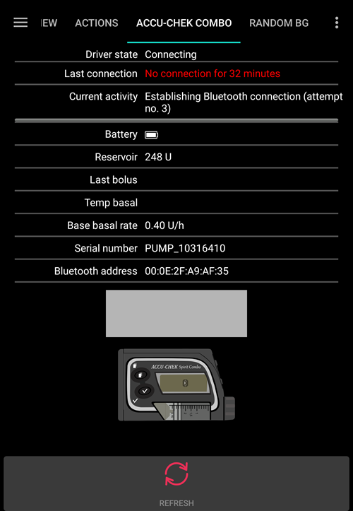

* Aquest error pot gastar la pila de la bomba més ràpidament, perquè el perfil basal es llegeix de la bomba quan es reinicia l'aplicació.
* També augmenta la probabilitat de provocar l'error que fa que la bomba rebutgi totes les connexions entrants fins que es prem un botó de la bomba.

### La cancel·lació de la basal temporal falla
* De vegades, AAPS no pot descartar automàticament una alerta **TBR CANCELED**. Aleshores cal tocar **Actualitzar** a la pantalla de la bomba Accu-Chek Combo o confirmar l'alarma a la bomba.

### Consideracions sobre la pila de la bomba

#### Canviar la pila
* Després d'una alarma de **pila baixa**, cal canviar la pila com més aviat millor per tenir sempre prou energia per a una comunicació Bluetooth fiable amb el telèfon, encara que el telèfon estigui més lluny de la bomba.
* Fins i tot després d'una alarma de **pila baixa**, la pila es pot fer servir encara durant força temps. Tot i així, es recomana portar sempre una pila nova a sobre després que hagi sonat una alarma de «pila baixa».
* Abans de canviar la pila, premeu el símbol **Llaç** a la pantalla principal i seleccioneu **Suspendre el llaç** durant 1 hora.
* Espereu que el telèfon es comuniqui amb la bomba i que el logotip de Bluetooth de la bomba desaparegui.

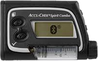

* Desbloquegeu les tecles de la bomba, poseu la bomba en mode stop, confirmeu una possible basal temporal cancel·lada i canvieu la pila ràpidament.
* No cal tornar a posar en hora el rellotge de la bomba després del canvi de pila: AAPS actualitza automàticament la data i l'hora de la bomba.
* Després torneu a posar la bomba en mode run i seleccioneu **Reprendre** en prémer la icona **Llaç suspès** a la pantalla principal.
* AAPS tornarà a establir la basal temporal necessària quan arribi el següent valor de glucèmia.

(Accu-Chek-Combo-Tips-for-Basic-usage-battery-type-and-causes-of-short-battery-life)=
#### Tipus de pila i causes d'una durada curta de la pila
* Com que la comunicació Bluetooth intensiva consumeix molta energia, feu servir només **piles d'alta qualitat**, com les Energizer Ultimate Lithium, les «Power One» del paquet de servei «gran» d'Accu-Chek, o, si voleu una pila recarregable, les Eneloop.

 

La durada habitual dels diferents tipus de pila és aproximadament aquesta:
* **Energizer Ultimate Lithium**: de 4 a 7 setmanes
* **Power One Alkaline** (Varta) del paquet de servei: de 2 a 4 setmanes
* Piles **Eneloop recarregables** (BK-3MCCE): d'1 a 3 setmanes

Si la pila us dura molt menys que els intervals indicats més amunt, comproveu aquestes possibles causes:
* Hi ha algunes variants de la tapa de rosca de la pila de la bomba Combo que fan un curtcircuit parcial a les piles i les buiden ràpidament. Les tapes sense aquest problema es reconeixen pels contactes metàl·lics daurats.
* Si el rellotge de la bomba no «sobreviu» a un canvi de pila curt, probablement s'ha espatllat el condensador que manté el rellotge en marxa durant un tall breu d'alimentació. En aquest cas, pot ajudar que Roche us substitueixi la bomba, cosa que no és cap problema durant el període de garantia.
* El maquinari i el programari del telèfon (sistema operatiu Android i pila Bluetooth) també influeixen en la durada de la pila de la bomba, tot i que encara no se'n coneixen del tot els factors exactes. Si en teniu l'oportunitat, proveu un altre telèfon i compareu la durada de la pila.

### Bolus estès, bolus multiona
L'algoritme d'OpenAPS no admet un bolus estès o un bolus multiona en paral·lel. Però es pot aconseguir un tractament semblant amb aquestes alternatives:
* Feu servir **e-carbs** quan introduïu carbohidrats o feu servir la Calculadora de bolus: introduïu els carbohidrats de tot l'àpat i la durada en què espereu que els carbohidrats arribin a la sang com a glucosa. Aleshores el sistema calcularà petites quantitats de carbohidrats repartides per igual durant tota la durada. Això fa que l'algoritme doni una dosi d'insulina equivalent, i alhora vigila contínuament la pujada o baixada global de la glucèmia. Per a un bolus semblant al multiona, també podeu combinar un bolus immediat més petit amb e-carbs.
* Abans de menjar, establiu un objectiu temporal **Menjar aviat** de 80 mg/dl (4,4 mmol/l) durant unes quantes hores (premeu l'objectiu a la pantalla principal o **Gestionar** > **Objectiu temporal**). La durada s'hauria de basar en l'interval que triaríeu per a un bolus estès. Així l'objectiu es manté més baix que de costum i, per tant, augmenta la quantitat d'insulina lliurada.
* Després feu servir la **Calculadora de bolus** per introduir tots els carbohidrats de l'àpat, però no apliqueu directament els valors que proposa. Si voleu lliurar un bolus semblant al multiona, reduïu la dosi d'insulina. Segons l'àpat, ara l'algoritme ha de lliurar SMB addicionals o basals temporals més altes per contrarestar la pujada de la glucèmia. Aquí cal experimentar amb molt de compte amb el límit de seguretat de la taxa basal (Màx. U/h, IOB basal màxim) i, si cal, canviar-lo temporalment.

* No feu servir el bolus estès ni el bolus multiona directament a la bomba. El controlador no els admet (vegeu [Abans de començar](#combov2-before-you-begin)). Si tot i així es fa un bolus multiona a la bomba, **AAPS** el registra des de l'historial de la bomba com un bolus normal més un bolus estès, i així es compta a l'IOB. Un bolus estès no funciona en un entorn de llaç tancat (vegeu [aquesta pàgina](#extended-bolus-and-why-they-wont-work-in-closed-loop-environment) per a més detalls).

### Alarmes en lliurar un bolus
* Després de cada bolus, el controlador llegeix l'historial de bolus de la bomba. És un mecanisme de seguretat per calcular correctament la insulina a bord (IOB), també quan es lliura un bolus directament des de la bomba.
* Abans d'un bolus, si l'historial de la bomba té un bolus que **AAPS** no coneixia (per exemple, un bolus fet directament a la bomba), el bolus sol·licitat **no es lliura**, perquè s'havia calculat sense aquesta insulina. **AAPS** mostra **L'historial de la bomba té un bolus que AAPS no coneixia. El bolus sol·licitat no s'ha lliurat...** Comproveu l'historial de bolus a la bomba i el vostre IOB. Si encara cal un bolus, torneu-lo a calcular. Això també passa quan el bolus desconegut es troba en una nova connexió.
* Si el bolus s'ha lliurat però l'historial de la bomba també tenia altres bolus que **AAPS** no coneixia, ara es registren i **AAPS** us demana que comproveu l'IOB abans del proper bolus.
* Si es perd la connexió amb la bomba **durant** un bolus, **AAPS** no registra 0 U: mostra quanta insulina havia lliurat la bomba fins aleshores i avisa que la bomba encara pot lliurar la resta. **No torneu a fer el bolus.** **AAPS** llegeix la quantitat real de l'historial de la bomba en la propera connexió.
* Si es perd la connexió mentre **AAPS** envia el bolus, no se sap si la bomba l'ha rebut. Comproveu l'historial de bolus a la bomba abans del proper bolus.
* Si **AAPS** no pot confirmar que s'ha lliurat un bolus, mostra **Error en lliurar bolus. Sembla que no s'ha lliurat cap bolus. Per estar segurs, comproveu la bomba per evitar un bolus doble i després torneu a fer el bolus.** Els bolus mai no es tornen a intentar automàticament.

## On trobar ajuda

El desenvolupament del controlador de la Combo el fa la comunitat de manera **voluntària**. Abans de demanar ajuda:

1. **Llegiu** la secció corresponent d'aquesta documentació per confirmar com ha de funcionar la funció.
2. **Pregunteu** al canal *#AAPS* de [Discord](https://discord.gg/4fQUWHZ4Mw), o en un dels altres [canals de la comunitat](../GettingHelp/WhereCanIGetHelp.md).
3. **Informeu d'un error**: cerqueu primer entre les [incidències existents](https://github.com/nightscout/AndroidAPS/issues); si la vostra no hi és, obriu una [incidència nova](https://github.com/nightscout/AndroidAPS/issues) i adjunteu-hi els vostres [fitxers de registre](../GettingHelp/AccessingLogFiles.md).

Quan demaneu ajuda, indiqueu la marca i el model del telèfon, la versió d'Android, la versió d'**AAPS** i una descripció del problema amb paraules senzilles (què ha canviat, quan va funcionar per última vegada).
