# Accu-Chek Insight

**Aquest programari forma part d'una solució «fes-ho tu mateix» (DIY) i no és un producte. Cal que VOSALTRES llegiu, aprengueu i entengueu el sistema, també com s'utilitza. No és una cosa que gestiona tota la diabetis per vosaltres, però us permet millorar la diabetis i la qualitat de vida, si hi voleu dedicar el temps necessari. No tingueu pressa: doneu-vos temps per aprendre. Només vosaltres sou responsables del que feu amb el sistema.**

```{admonition} La Accu-Chek Insight es deixa de vendre :class: note

Roche surt del mercat de les bombes d'insulina per centrar la seva oferta de diabetis en el CGM Accu-Chek SmartGuide. Roche ha anunciat la fi de la venda de les bombes Accu-Chek Combo i Accu-Chek Insight. La micro-bomba Accu-Chek Solo, l'única que queda, també s'està retirant (darrers lliuraments a Alemanya a finals de 2025). El canvi arriba per regions: comença a Alemanya i després hi seguiran altres mercats europeus. El suport per a la Insight ja consta com a finalitzat (vegeu [Bombes que ja no es venen](./Future-possible-Pump-Drivers.md)). Si depeneu d'aquesta bomba, planifiqueu amb temps el pas a una bomba compatible.

    <br />```{note}
    Abans que **AAPS** tingués un controlador propi per a la Insight, la Insight es controlava amb l'aplicació separada [SightRemote](https://github.com/TebbeUbben/SightRemote). SightRemote ja no cal i ja no es manté: si encara la teniu instal·lada d'aquella època, desinstal·leu-la i feu servir una versió actual d'**AAPS**.
    

```{contents} Taula de continguts :depth: 1 :local: true

    <br />## Funcions de la bomba amb AAPS
    
    * Es comunica amb **AAPS** pel Bluetooth propi del telèfon, sense cap dispositiu de comunicació addicional.
    * Gestió automàtica de l'horari d'estiu i del fus horari.
    
    ## Requisits de maquinari i programari
    
    * Una bomba Roche Accu-Chek Insight (qualsevol firmware, totes funcionen)
    
    Nota: AAPS sempre escriu les dades al **primer perfil de taxa basal de la bomba**.
    
    * Un telèfon Android amb Android 12 o més nou (vegeu [Telèfons](../Getting-Started/Phones.md))
    * L'aplicació AAPS instal·lada al telèfon
    
    ## Configuració
    
    * La bomba Insight només ha d'estar connectada a un dispositiu alhora. Si abans heu fet servir el comandament a distància de la Insight (glucòmetre), heu de treure el glucòmetre de la llista de dispositius emparellats de la bomba: **Menu** > **Settings** > **Communication** > **Remove device**.
    
       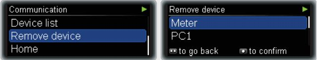
    
    * A [Configurador > Bomba](#Config-Builder-pump), seleccioneu la targeta **Accu-Chek Insight**. Només pot estar activa una bomba alhora.
    
       
    
       Quan està seleccionada, la targeta **Accu-Chek Insight** mostra dos botons, **Configuració** i **Obrir plugin**:
    
       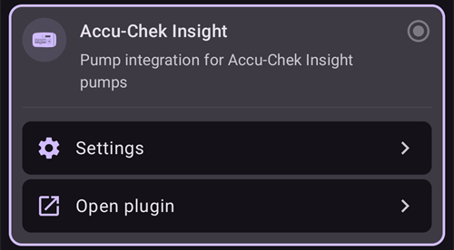
    
       **Configuració** obre la configuració del controlador Accu-Chek Insight (vegeu [Configuració a AAPS](#Accu-Chek-Insight-Pump-settings-in-aaps)).
    
       **Obrir plugin** (o **Gestionar → Bomba**) obre la pantalla de la bomba Accu-Chek Insight. Abans d'emparellar una bomba, es veu així:
    
       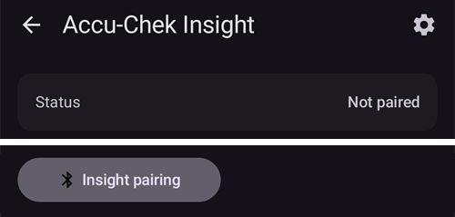
    
    (accu-chek-insight-pairing)=
    ### Emparellament
    
    * A la pantalla de la bomba, premeu **Emparellament Insight**. S'obre l'assistent d'emparellament i cerca dispositius Bluetooth propers (part de dalt de la imatge de sota).
    * A la bomba Insight, aneu a **Menu** > **Settings** > **Communication** > **Add Device**. La bomba mostra la pantalla següent (part de baix de la imatge de sota) amb el número de sèrie de la bomba.
    
       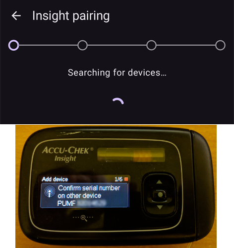
    
    * Torneu al telèfon i premeu el número de sèrie de la bomba a la llista de dispositius Bluetooth. Si Android us demana que confirmeu l'emparellament, premeu **Emparellar**.
    
       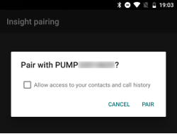
    
    * La bomba i el telèfon mostren tots dos un codi. Comproveu que els codis són iguals als dos dispositius. Confirmeu a la bomba i premeu **Sí** al telèfon. (Premeu **No** si els codis no coincideixen.)
    
       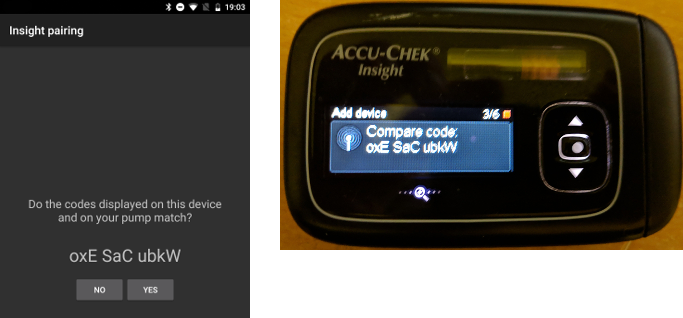
    
    * El telèfon mostra **Emparellament completat**. Premeu **Sortir** per tornar a la pantalla de la bomba.
    
       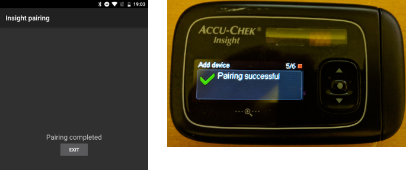
    
    * Per comprovar que tot va bé, mireu la pantalla de la bomba (**Gestionar → Bomba**). Quan la bomba està emparellada, mostra informació sobre la bomba, com ara **Nr. de sèrie**, **Data de fabricació**, **Versió de software** i **Adreça Bluetooth**.
    
       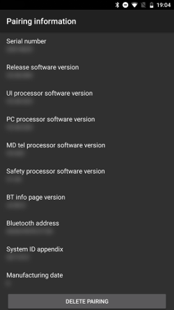
    
       ```{admonition} Captura de pantalla antiga
       :class: note
       Excepte la part de dalt de la primera imatge, les captures d'emparellament d'aquí dalt són d'una versió anterior d'**AAPS** i poden ser diferents a **AAPS** 4.
       ```
    
    * Per treure l'emparellament, premeu **Desemparellar** a la pantalla de la bomba i confirmeu **Restablir la informació d'emparellament?**. Després torna a aparèixer el botó **Emparellament Insight**.
    
    Nota: no hi ha una connexió permanent entre la bomba i el telèfon. **AAPS** només es connecta quan cal (per exemple, per establir una taxa basal temporal, donar un bolus o llegir l'historial de la bomba). Si no fos així, les bateries del telèfon i de la bomba es gastarien massa de pressa.
    
    (Accu-Chek-Insight-Pump-settings-in-aaps)=
    ## Configuració a AAPS
    
    Obriu la configuració amb **Configuració** a la targeta **Accu-Chek Insight** de **Configurador** > **Bomba**, o amb la icona de l'engranatge a la cantonada de dalt a la dreta de la pantalla de la bomba.
    
    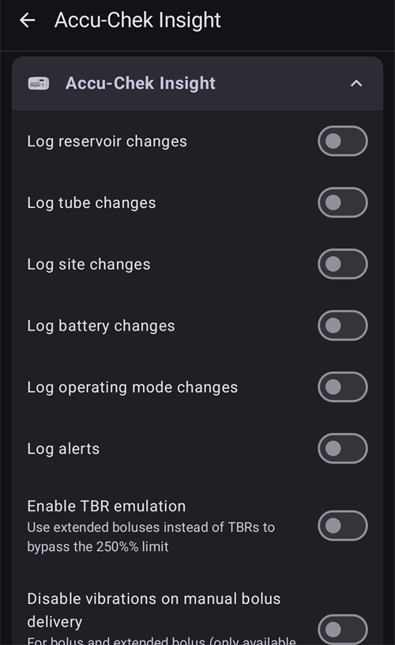
    
    In the Insight settings in **AAPS** you can enable the following options:
    
    * **Log reservoir changes**: automatically records an insulin cartridge change when you change the cartridge in the pump.
    
    * **Enregistrar canvis de tub**: afegeix una nota a la base de dades d'**AAPS** quan feu servir el programa «omplir el tub» (tube filling) a la bomba.
    
    * **Enregistrar canvis de cànula**: afegeix una nota a la base de dades d'**AAPS** quan feu servir el programa «omplir la cànula» (cannula filling) a la bomba. **Nota: un canvi de cànula també reinicia Autosens.**
    
    * **Enregistrar canvis de bateria**: registra un canvi de pila quan poseu una pila nova a la bomba.
    
    * **Enregistrar canvis de mode de funcionament**: afegeix una nota a la base de dades d'**AAPS** cada vegada que inicieu, atureu o poseu en pausa la bomba.
    
    * **Enregistrar alertes**: afegeix una nota a la base de dades d'**AAPS** cada vegada que la bomba dona una alerta (excepte recordatoris, cancel·lació de bolus i cancel·lació de TBR, que no es registren).
    
    * **Activar emulació TBR**: la bomba Insight només pot establir taxes basals temporals (TBR) fins al 250%. Per superar aquest límit, l'emulació de TBR fa que la bomba lliuri un bolus estès per a la insulina addicional si es demana una TBR de més del 250%.
    
      **Nota: feu servir només un bolus estès alhora. Diversos bolus estesos alhora poden provocar errors.**
    
    * **Desactivar vibracions en lliurar bolus manual**: la bomba Insight no vibra quan lliura un bolus manual (o un bolus estès). Només disponible amb el firmware 3.x de la Insight.
    
    * **Desactivar vibracions en lliuraments automatitzats de bolus**: la bomba Insight no vibra quan lliura un bolus automàtic (SMB o basal temporal amb emulació de TBR). Només disponible amb el firmware 3.x de la Insight.
    
    * **Min. durada recuperació [s]** i **Màx. durada recuperació [s]**: quant de temps espera **AAPS** abans de tornar a provar després d'un intent de connexió fallit. Podeu triar de 0 a 20 segons. Si teniu problemes de connexió, trieu un temps d'espera més llarg.
        <br><br>Exemple per a min. durada recuperació = 5 i màx. durada recuperació = 20
        <br><br>sense connexió -> esperar <b>5</b> s.
          <br>  tornar a provar -> sense connexió -> esperar <b>6</b> s.
          <br>  tornar a provar -> sense connexió -> esperar <b>7</b> s.
          <br>  tornar a provar -> sense connexió -> esperar <b>8</b> s.
          <br>...
          <br>tornar a provar -> sense connexió -> esperar <b>20</b> s.
          <br>tornar a provar -> sense connexió -> esperar <b>20</b> s.
          <br>...
    
    * **Retard desconnexió [s]**: quant de temps (en segons) espera **AAPS** abans de desconnectar-se de la bomba quan acaba una operació. Podeu triar de 0 a 15 segons. El valor per defecte és 5 segons.
    
    Per als períodes en què la bomba estava aturada, **AAPS** registra una taxa basal temporal del 0%.
    
    ### La pantalla de la bomba
    
    La pantalla de la bomba Accu-Chek Insight (**Gestionar → Bomba**) mostra l'estat actual de la bomba, per exemple **Estat**, **Darrera connexió**, **Mode de funcionament**, **Bateria**, **Nivell del reservori**, les dosis diàries totals d'avui (**TDD Bolus**, **TDD Basal**), les taxes basals i el darrer bolus. Quan la bomba està emparellada, té aquests botons:
    
    * **Actualitzar**: actualitza l'estat de la bomba.
    * **Activar avisos de fi de TBR (configuració bomba)** / **Desactivar avisos de fi de TBR (configuració bomba)**: una bomba Insight normal fa sonar una alarma quan acaba una TBR. Aquest botó activa o desactiva aquesta alarma sense necessitat de programari de configuració.
    * **Desemparellar**: treu l'emparellament amb la bomba (vegeu [Emparellament](#accu-chek-insight-pairing)).
    
    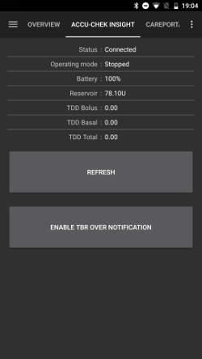
    
    ```{admonition} Captura de pantalla antiga
    :class: note
    La captura de pantalla de dalt és d'una versió anterior d'**AAPS**. A **AAPS** 4 la pantalla de la bomba és diferent i també té un botó **Desemparellar**.
    

## Configuració a la bomba

Configureu les alarmes a la bomba així:

* Menu > Settings > Device settings > Mode settings > Quiet > Signal > Sound
* Menu > Settings > Device settings > Mode settings > Quiet > Volume > 0 (traieu totes les barres)
* Menu > Modes > Signal mode > Quiet

Així se silencien totes les alarmes de la bomba i AAPS pot decidir si una alarma és important per a vosaltres. Si AAPS no confirma una alarma, el volum augmenta (primer bip, després vibració).

(Accu-Chek-Insight-Pump-vibration)=

### Vibració

Segons la versió del firmware de la bomba, la Insight vibra breument cada vegada que lliura un bolus (per exemple, quan AAPS dona un SMB o quan l'emulació de TBR lliura un bolus estès).

* Firmware 1.x: no vibra, per disseny.
* Firmware 2.x: la vibració no es pot desactivar.
* Firmware 3.x: AAPS lliura el bolus en silenci.

La versió del firmware es troba al menú.

## Canvi de pila

Battery life for Insight when looping ranges from 10 to 14 days, maximum 20 days. L'usuari que ho va informar fa servir piles de liti Energizer.

La bomba Insight té una petita bateria interna que manté les funcions bàsiques, com el rellotge, mentre canvieu la pila extraïble. Si el canvi de pila tarda massa, aquesta bateria interna es pot esgotar. Llavors el rellotge es reinicia i, després de posar la pila nova, la bomba us demana una nova hora i data. Si passa això, cap entrada d'AAPS d'abans del canvi de pila es farà servir en els càlculs, perquè no se'n pot saber l'hora correcta.

(Accu-Chek-Insight-Pump-insight-specific-errors)=

## Errors específics de la Insight

### Bolus estès

Feu servir només un bolus estès alhora, perquè diversos bolus estesos alhora poden provocar errors.

### Temps d'espera

De vegades la bomba Insight no respon mentre **AAPS** estableix la connexió. Llavors **AAPS** mostra l'avís «Temps d'espera excedit en establir la connexió - Reiniciar bluetooth».

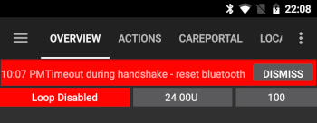

Si passa això, apagueu el Bluetooth a la bomba I al telèfon durant uns 10 segons i després torneu-lo a encendre.

## Canvi de fus horari amb la bomba Insight

Per a informació sobre viatges entre fusos horaris, vegeu la secció [Canvi de fus horari amb bombes](#timezone-traveling-insight).

## On trobar ajuda

El desenvolupament del controlador de la Insight el fa la comunitat de manera **voluntària**. Abans de demanar ajuda:

1. **Llegiu** la secció corresponent d'aquesta documentació per confirmar com ha de funcionar la funció.
2. **Pregunteu** al canal *#AAPS* de [Discord](https://discord.gg/4fQUWHZ4Mw) o en un dels altres [canals de la comunitat](../GettingHelp/WhereCanIGetHelp.md).
3. **Informeu d'un error** buscant entre les [incidències existents](https://github.com/nightscout/AndroidAPS/issues); si la vostra no hi és, obriu una [incidència nova](https://github.com/nightscout/AndroidAPS/issues) i adjunteu els vostres [fitxers de registre](../GettingHelp/AccessingLogFiles.md).

Quan demaneu ajuda, indiqueu la marca i el model del telèfon, la versió d'Android, la versió d'**AAPS** i una descripció senzilla del problema (què ha canviat, quan va funcionar per darrera vegada).