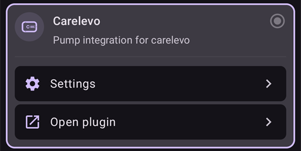
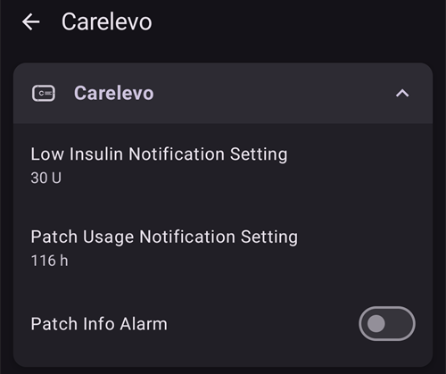
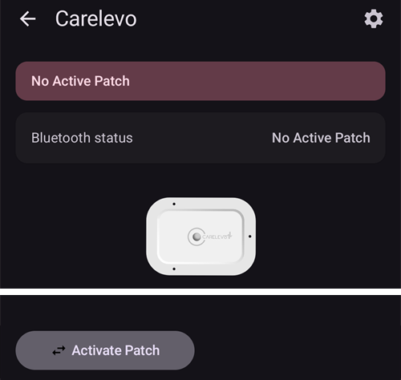

# CareLevo

CareLevo és una bomba patch sense tub fabricada per CareMedi. Cada patch conté fins a 300 U d'insulina i es porta fins a 7 dies (168 hores). Es comunica amb **AAPS** pel Bluetooth del vostre telèfon, sense cap altre dispositiu.

```{admonition} New driver
:class: warning
El controlador CareLevo és nou a **AAPS**. Llegiu tota aquesta pàgina abans d'activar el vostre primer patch, i tingueu a mà les instruccions d'ús de la bomba.
```

La dosi més petita que pot lliurar el patch és 0,05 U. Al **Perfil**, poseu les taxes basals a un mínim de 0,05 U/h en passos de 0,05 U/h; si no, la insulina que espera el **Perfil** i la insulina que lliura el patch són una mica diferents. **AAPS** fa servir les taxes basals que el patch ha acceptat.

```{contents} Table of contents
:depth: 1
:local: true
```

## Capacitats de la bomba amb AAPS

* Es comunica amb **AAPS** amb el Bluetooth propi del telèfon, sense cap dispositiu de comunicació addicional.
* Bolus en passos de 0,05 U.
* Taxes basals de 0,05 U/h a 15 U/h en passos de 0,05 U/h, amb segments basals de 30 minuts.
* Basals temporals com a taxa absoluta, fins a 12 hores.
* Bolus estès fins a 8 hores.
* Els canvis d'horari d'estiu i de fus horari s'han de fer a mà. El patch us avisa quan canvia la zona horària.

## Configuració de la bomba

1. Obriu el **menú** (☰) a l'angle superior esquerre de la pantalla principal d'**AAPS** i seleccioneu **Configurador**.
1. Seleccioneu **Carelevo** a la secció Bomba.
1. Premeu la tecla Enrere per tornar a la pantalla principal.



## Configuració

Obriu la pantalla de la bomba amb **Gestionar → Bomba** (o **Configurador → Bomba → Obrir plugin**).

Obriu la configuració de CareLevo amb la icona de **Configuració** (engranatge) a la cantonada superior dreta. Hi ha tres opcions:



### Avís d'insulina baixa

El patch us avisa quan la insulina que queda al reservori arriba a la quantitat triada. Es pot posar de 20 U a 50 U en passos de 5 U. El valor per defecte és 30 U. Independentment d'aquesta opció, el patch fa sonar una alarma crítica i deixa de lliurar insulina quan queden menys de 10 U.

### Avís de temps d'ús del patch

El patch us avisa quan s'ha portat durant el nombre d'hores triat, perquè pugueu planificar el canvi. Es pot posar de 24 a 167 hores. El valor per defecte és 116 hores.

### Alarma d'informació del patch

Quan aquesta opció està activada, el patch fa un bip quan comença i quan acaba un bolus, un bolus estès o una basal temporal. Per defecte està desactivada.

## La pantalla de la bomba



La pantalla de la bomba mostra l'**Estat Bluetooth** (Cap patch actiu, Desconnectat o Connectat), el **Nr. de sèrie** del patch, la seva **Hora d'activació** i **Caducitat**, la **Taxa basal** i la **Taxa basal temporal** actuals, la **Insulina restant** (restant / omplerta), el **Temps restant del patch** i la **Insulina total lliurada**.

Els botons depenen de l'estat del patch:

* **Activar patch**: inicia l'activació d'un patch nou, vegeu més avall.
* **Guia de la insulina**: mostra els dotze passos per omplir un patch amb insulina.
* **Suspendre infusió** / **Reprendre infusió**: atura i torna a iniciar el lliurament d'insulina, vegeu més avall.
* **Descartar patch**: atura el patch actual perquè se'n pugui activar un de nou.

## Activar un patch

Abans de començar, assegureu-vos que hi ha un **Perfil** actiu a **AAPS** i que el Bluetooth està activat. Un cop engegat, el patch s'ha d'activar en un temps limitat; si el temps s'esgota, el patch fa sonar l'alarma **Temps de col·locació del patch esgotat** i ja no es pot fer servir.

Premeu **Activar patch** a la pantalla de la bomba i seguiu els passos. Podeu cancel·lar en qualsevol moment abans d'inserir l'agulla; el que hàgiu introduït es descarta.

### Seleccioneu la insulina

Confirmeu la insulina que feu servir. El patch necessita insulina d'acció ràpida U-100.

### Ompliu el patch amb insulina

Ompliu el patch amb 50 a 300 U, tenint en compte quant de temps el portareu. Premeu **Guia de la insulina** si necessiteu les instruccions per omplir-lo. Després toqueu la quantitat omplerta i seleccioneu la quantitat que hi heu posat; **AAPS** la fa servir per mostrar la insulina restant.

### Connecteu el patch

1. Traieu el patch del blíster i traieu el tap de l'agulla.
1. Premeu el botó d'engegada del patch durant més d'un segon. Després del bip, toqueu **Cercar patch**.
1. Quan el patch trobat sigui el correcte, toqueu **Confirmar**. Si no ho és, toqueu **Tornar a cercar**.

### Comprovació de seguretat

Quan el patch estigui connectat, premeu **Control de seguretat**. El patch es comprova a si mateix i s'enceba. Comproveu que s'ha format una gota d'insulina a la punta de l'agulla. Si no veieu cap gota, premeu **Reintentar**. Quan el control s'hagi completat, premeu **Següent**.

### Lloc i col·locació del patch

1. Seleccioneu el lloc on portareu el patch.
1. Netegeu bé el lloc amb un tovalló amb alcohol.
1. Traieu la cinta protectora i enganxeu el patch a la pell amb el punt marcat cap amunt.
1. Premeu **Següent** quan el patch estigui enganxat.

### Inseriu l'agulla

1. Gireu el tap de seguretat en la direcció de la fletxa i traieu-lo.
1. Premeu el botó de l'aplicador fins al fons i manteniu-lo premut durant 10 segons. Sona un bip quan l'agulla s'ha inserit.
1. Traieu l'aplicador i premeu **Confirmar inserció**.

Si la inserció falla, **AAPS** us diu quants intents queden. Quan no queda cap intent, el patch fa sonar l'alarma **Error d'inserció de l'agulla** i s'ha de canviar.

El lliurament d'insulina comença tan aviat com es confirma la inserció.

## Missatges de bolus

Si el patch rebutja un bolus, **AAPS** us diu per què. Per exemple, *No es pot lliurar el bolus. Bolus disponible: 2,8 U* vol dir que ara el patch només pot lliurar aquesta quantitat.

Si atureu un bolus i el patch no confirma l'aturada, **AAPS** espera que acabi el bolus i registra la quantitat que indica el patch. Si un bolus no s'ha registrat (per exemple, perquè s'ha aturat mentre s'estava lliurant), **AAPS** l'afegeix a partir del total del patch i us demana que comproveu l'IOB abans de tornar-ho a provar.

## Suspendre i reprendre el lliurament d'insulina

Premeu **Suspendre infusió** a la pantalla de la bomba i seleccioneu quant de temps s'ha d'aturar el lliurament: de 30 minuts a 4 hores, en passos de 30 minuts. El lliurament no es reprèn sol: quan acaba la pausa, el patch mostra l'alerta **Iniciar insulina**. Premeu **Reprendre infusió** a la pantalla de la bomba, o **Iniciar insulina** a l'alerta, i confirmeu.

## Descartar un patch

Premeu **Descartar patch** a la pantalla de la bomba i confirmeu. El lliurament d'insulina s'atura i el patch ja no es pot fer servir. Traieu-vos el patch del cos i activeu-ne un de nou.

Quan una alarma crítica ha aturat el patch, l'alarma ofereix **Desactivar patch**. Si el premeu, el patch es descarta de la mateixa manera.

(carelevo-alarms-and-notifications)=

## Alarmes i avisos

El patch informa de tres nivells d'esdeveniments. Tots es mostren com a avisos d'**AAPS**.

### Alarmes crítiques

El lliurament d'insulina s'ha aturat. Actueu ara:

* **Insulina baixa**: queden menys de 10 U. Desactiveu el patch i canvieu-lo.
* **Patch caducat**: el patch ha arribat al final de la seva vida útil. Desactiveu el patch i canvieu-lo.
* **Bateria baixa**: descarteu el patch i canvieu-lo.
* **Temperatura alta/baixa**: aneu a un lloc amb una temperatura adequada, entre 40 ℉ i 99 ℉ (4,4 ℃ i 37,2 ℃).
* **Apagada automàtica**: el patch s'ha aturat perquè s'ha ignorat l'alerta d'apagada automàtica. Premeu **Iniciar insulina** per tornar a iniciar el lliurament basal.
* **Temps de col·locació del patch esgotat**, **Autodiagnòstic fallit**, **Error del patch**, **Oclusió** i **Error d'inserció de l'agulla**: desactiveu el patch i canvieu-lo.

### Alertes

El lliurament d'insulina continua, però hi ha alguna cosa que necessita la vostra atenció:

* **Insulina baixa**: el reservori ha arribat a la quantitat posada a **Avís d'insulina baixa**. Prepareu-vos per canviar el patch.
* **El patch caducarà aviat** i **Vida útil del patch esgotada**: canvieu el patch.
* **Bateria baixa**: prepareu-vos per canviar el patch.
* **Temperatura alta/baixa**: el lliurament s'atura fins que el patch torna a estar entre 40 ℉ i 99 ℉ (4,4 ℃ i 37,2 ℃).
* **Apagada automàtica**: toqueu **OK**. Si s'ignora, l'alerta passa a ser una alarma crítica i el lliurament s'atura.
* **Activació del patch incompleta**: toqueu **OK** per completar l'activació.
* **Iniciar insulina**: la pausa que heu posat ha acabat. Toqueu **Iniciar insulina** per reprendre el lliurament.
* **Activar el Bluetooth** i **BLE no connectat**: el telèfon no pot contactar amb el patch. Activeu el Bluetooth o comproveu la connexió del patch.

### Avisos

Només informatius: **Insulina baixa**, **Avís de temps d'ús del patch** (ha passat el temps posat a **Avís de temps d'ús del patch**), **Avís de comprovació del patch**, **Canvi de zona horària** i **Comproveu la glucèmia** (un temps fixat després d'un bolus).

El patch també informa quan la seva pròpia funció de suspensió per glucèmia baixa (**LGS**) comença o acaba. **AAPS** no fa servir aquesta funció; el llaç gestiona ell mateix la glucèmia baixa.

## On trobar ajuda

Informeu dels problemes amb el controlador CareLevo a la [pàgina d'incidències d'AAPS a GitHub](https://github.com/nightscout/AndroidAPS/issues) o als canals de la comunitat AAPS, vegeu [On puc trobar ajuda?](../GettingHelp/WhereCanIGetHelp.md).
