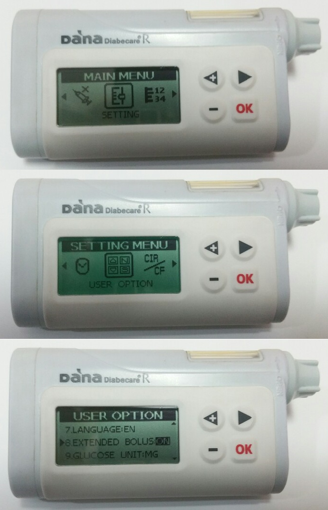

# DanaR

*Aquestes instruccions serveixen per configurar l'aplicació i la bomba si teniu una DanaR. Si en lloc d'això teniu la DanaRS, que va sortir el 2017, vegeu [DanaRS, Dana-i i Dana-i2](./DanaRS-Insulin-Pump.md).*

## Capacitats de la bomba amb AAPS

* Es comunica amb **AAPS** pel Bluetooth del telèfon, sense cap dispositiu de comunicació addicional.
* Els canvis de fus horari i d'horari d'estiu no necessiten cap acció especial, perquè la bomba no fa servir el seu propi historial.

## Configuració

* A la bomba, aneu a Main Menu > Setting > User Option
* Activeu "8. Extended Bolus"

* Aneu a Main Menu > Setting > Discovery
* A la configuració del telèfon, aneu a Bluetooth, cerqueu dispositius propers, seleccioneu el número de sèrie de la vostra DanaR i introduïu la contrasenya (la contrasenya d'emparellament és 0000). Si la DanaR no apareix a la cerca, reinicieu el telèfon, traieu la pila de la DanaR, torneu-la a posar i repetiu aquests dos passos.

* A **AAPS**, obriu el **menú** (☰) a la part superior esquerra, aneu a **Configurador** > **Bomba** i seleccioneu el tipus de DanaR que teniu (**DanaR**, **DanaR Korean** o **DanaRv2**).
  
  

* Obriu la pantalla de la bomba: toqueu **Obrir plugin** a la targeta DanaR (o aneu a **Gestionar** > **Bomba**).

* Toqueu **Emparellament**. A la pantalla d'emparellament: 
  * Introduïu la contrasenya de la bomba a **Contrasenya bomba** (la contrasenya per defecte és 1234).
  * A **Seleccioneu el dispositiu emparellat**, toqueu el número de sèrie de la vostra DanaR. Si la llista és buida, toqueu **Obrir la configuració de Bluetooth** i primer emparelleu la bomba amb el telèfon (vegeu el pas anterior). Quan torneu a **AAPS**, la bomba apareix a la llista. Si no hi apareix, toqueu la icona d'actualitzar.
  * Toqueu **Emparellament**. **AAPS** es connecta a la bomba i comprova la contrasenya.
* Per canviar la configuració del controlador, toqueu **Configuració** a la targeta DanaR a **Configurador** > **Bomba**: 
  * **Velocitat bolus** (DanaR i DanaRv2): canvieu la velocitat del bolus per defecte (12 s/U, 30 s/U o 60 s/U).
  * **Utilitzar bolus estesos per a >200%** (DanaR i DanaR Korean): activeu-ho si voleu que **AAPS** permeti una taxa basal per sobre del 200%. Tingueu en compte que això vol dir que no podeu fer llaç amb TBR altes mentre feu servir bolus estesos per als àpats.
* Configureu el pas de la basal a la bomba a 0,01 U/h
* Configureu el pas del bolus a la bomba a 0,1 U. **AAPS** llegeix el pas del bolus de la bomba i el fa servir per a cada bolus.
* Activar els bolus estesos a la bomba

## Canvi de fus horari amb la bomba Dana R

Per a informació sobre viatjar entre fusos horaris, vegeu la secció [Canvi de fus horari amb bombes](#timezone-traveling-danarv2-danars).

## On trobar ajuda

El desenvolupament del controlador DanaR el fa la comunitat de manera **voluntària**. Abans de demanar ajuda:

1. **Llegiu** la secció corresponent d'aquesta documentació per confirmar com ha de funcionar la funció.
2. **Pregunteu** al canal *#AAPS* de [Discord](https://discord.gg/4fQUWHZ4Mw) o en un dels altres [canals de la comunitat](../GettingHelp/WhereCanIGetHelp.md).
3. **Informeu d'un error** buscant entre les [incidències existents](https://github.com/nightscout/AndroidAPS/issues); si la vostra no hi és, obriu una [incidència nova](https://github.com/nightscout/AndroidAPS/issues) i adjunteu els vostres [fitxers de registre](../GettingHelp/AccessingLogFiles.md).

Quan demaneu ajuda, indiqueu la marca i el model del telèfon, la versió d'Android, la versió d'**AAPS** i una descripció senzilla del problema (què ha canviat, quan va funcionar per darrera vegada).