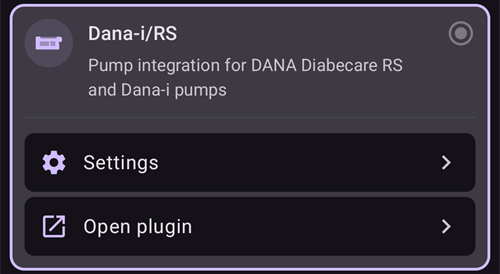
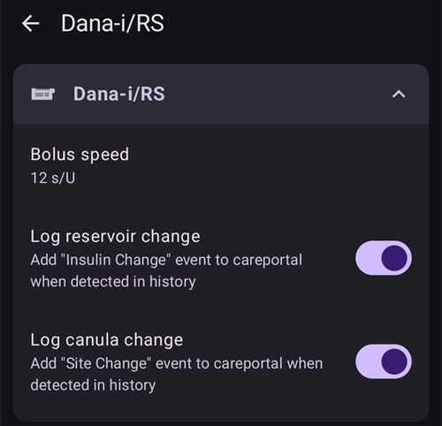
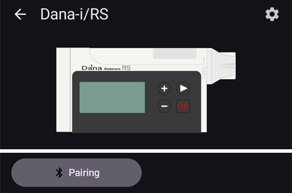
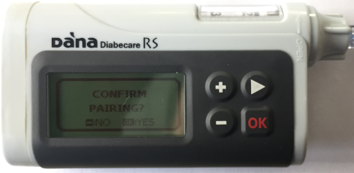
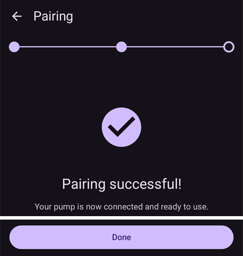
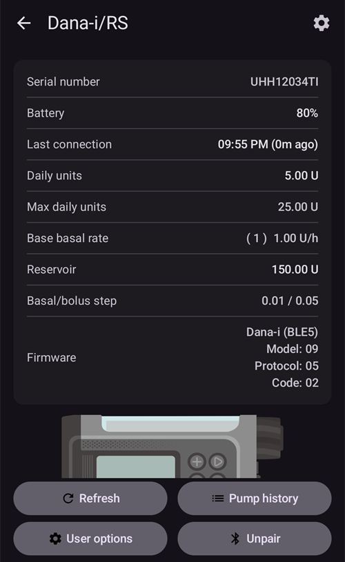
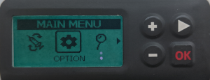
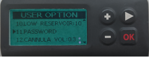
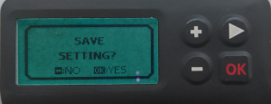
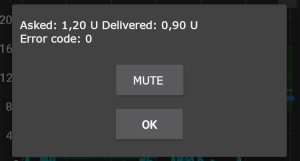

# DanaRS, Dana-i i Dana-i2

*Aquestes instruccions serveixen per configurar l'aplicació i la bomba si teniu una DanaRS del 2017 o posterior, una Dana-i o una Dana-i2. Si en canvi teniu la DanaR original, aneu a [DanaR](./DanaR-Insulin-Pump.md).*

**La Dana-i2 es pot fer servir a partir de la versió 4.0 d'AAPS.** Fa servir el mateix controlador **Dana-i/RS** que la Dana-i.

* A la bomba DanaRS/i/i2, l'aplicació fa servir "BASAL A". Les dades que hi hagi se sobreescriuen.

    {contents} Taula de continguts
    :depth: 1
    :local: true

## Capacitats de la bomba amb AAPS

* Es comunica amb **AAPS** pel Bluetooth del telèfon, sense cap dispositiu de comunicació addicional.
* Els canvis d'horari d'estiu i de fus horari s'han de fer manualment (vegeu [Viatges amb canvi de fus horari](#timezone-traveling-danarv2-danars)).

(DanaRS-Insulin-Pump-pairing-pump)=

## Emparellar la bomba

* Obriu el **menú** (☰) de la cantonada superior esquerra de la pantalla principal d'**AAPS** i seleccioneu **Configurador**.
* Toqueu **Bomba** i seleccioneu **Dana-i/RS**.
    
    
    
    Quan està seleccionat, la targeta **Dana-i/RS** mostra dos botons, **Configuració** i **Obrir plugin**:
    
    
    
    **Configuració** obre la configuració del controlador Dana-i/RS:
    
    
    
    **Obrir plugin** (o **Gestionar** > **Bomba**) obre la pantalla de la bomba Dana-i/RS. Abans d'emparellar una bomba, es veu així:
    
    

* A la pantalla de la bomba, toqueu **Emparellament**. **AAPS** cerca bombes properes.

* Toqueu la vostra bomba a la llista.
    
    

* **Heu de confirmar l'emparellament a la bomba!** Funciona igual que altres emparellaments Bluetooth que potser coneixeu (per exemple, el telèfon i l'equip de so del cotxe).
    
    

* Seguiu el procés d'emparellament segons el tipus i el firmware de la vostra bomba:
    
    * Per a la DanaRS v1, **AAPS** demana la **Contrasenya bomba (només v1)**. Introduïu la contrasenya de la bomba (vegeu [Contrasenya per defecte](#DanaRS-Insulin-Pump-default-password)).
    * Per a la DanaRS v3, **AAPS** us demana que premeu OK a la bomba i que escriviu les 2 seqüències de números i lletres que es mostren a la bomba. Manteniu la pantalla de la bomba encesa prement el botó de menys fins que hàgiu acabat. Després toqueu **Fet**.
    * Per a la Dana-i i la Dana-i2, apareix el diàleg d'emparellament estàndard d'Android. Introduïu el número de 6 xifres que es mostra a la bomba.

* Quan es mostri **Emparellament correcte!**, toqueu **Fet**.
    
    
    
    Torneu a la pantalla de la bomba, que ara mostra l'estat de la vostra bomba.
    
    

* A **Configuració**, seleccioneu **Velocitat bolus** per canviar la velocitat del bolus per defecte (12 s/U, 30 s/U o 60 s/U).

* Configureu l'increment de basal a la bomba a 0,01 U/h amb el menú del metge (Doctors menu) (vegeu el manual d'usuari de la bomba).
* Configureu l'increment de bolus a la bomba a 0,05 U amb el menú del metge (Doctors menu) (vegeu el manual d'usuari de la bomba). **AAPS** llegeix de la bomba els increments de basal i de bolus i els fa servir per a cada bolus, de manera que un bolus sempre correspon a l'increment configurat a la bomba. La pantalla de la bomba els mostra a la fila **Increment basal/bolus**.
* Activar els bolus estesos a la bomba

### Opcions que només es mostren en alguns models

* **Bloqueig automàtic**: en una Dana-i2, la pantalla **Opcions d'usuari** (a la pantalla de la bomba, **Gestionar** > **Bomba**) té un interruptor **Bloqueig automàtic** per a la configuració de bloqueig automàtic de la bomba. Després de canviar-lo, premeu **Desar les opcions a la bomba**.
* **Mode fàcil**: als models de bomba que tenen un mode de menú fàcil, la pantalla de la bomba mostra una fila **Mode fàcil** amb **On** o **Off**.
* Si una Dana-i2 rebutja un bolus, **AAPS** en mostra el motiu, per exemple *La bomba no està encebada*, *No hi ha prou insulina al reservori* o *El mode Easy sleep està activat a la bomba*.

(DanaRS-Insulin-Pump-default-password)=

### Contrasenya per defecte

* Per a la DanaRS amb firmware v1 i v2, la contrasenya per defecte és 1234.
* Per a la DanaRS amb firmware v3 o la Dana-i, la contrasenya per defecte surt de la data de fabricació i es calcula com MMDD, on MM és el mes i DD és el dia en què es va fabricar la bomba (p. ex. '0124' vol dir mes 01 i dia 24).
    
    * Al MAIN MENU seleccioneu REVIEW i després obriu SHIPPING INFORMATION al submenú
    * El número 3 és la data de fabricació. 
    * Per a la v3/i, aquesta contrasenya només serveix per bloquejar el menú de la bomba. No serveix per a la comunicació i no cal introduir-la a AAPS.

(DanaRS-Insulin-Pump-change-password-on-pump)=

## Canviar la contrasenya a la bomba

* Premeu el botó OK de la bomba
* Al menú principal seleccioneu "OPTION" (moveu-vos a la dreta prement el botó de fletxa diverses vegades)
    
    

* Al menú d'opcions seleccioneu "USER OPTION"
    
    

* Feu servir el botó de fletxa per baixar fins a "11. password"
    
    

* Premeu OK per introduir la contrasenya antiga.

* Introduïu la **contrasenya antiga** (per a la contrasenya per defecte, vegeu [més amunt](#DanaRS-Insulin-Pump-default-password)) i premeu OK
    
    

* Si aquí introduïu una contrasenya incorrecta, no apareixerà cap missatge d'error!

* Definiu la **contrasenya nova** (canvieu els números amb els botons + i - / moveu-vos a la dreta amb el botó de fletxa).
    
    

* Confirmeu amb el botó OK.

* Premeu OK per desar la configuració.
    
    

* Baixeu fins a "14. EXIT" i premeu OK per sortir.
    
    

(DanaRS-Insulin-Pump-dana-rs-specific-errors)=

## Errors específics de la Dana RS

### Error durant el lliurament d'insulina

Si es perd la connexió entre AAPS i la Dana RS durant el lliurament d'un bolus (p. ex. us allunyeu del telèfon mentre la Dana RS lliura insulina), veureu el missatge següent i sentireu una alarma.

* En la majoria de casos és només un problema de comunicació i la quantitat correcta d'insulina s'ha lliurat.
* Comproveu a l'historial de la bomba que s'ha lliurat el bolus correcte. Ho podeu fer a la mateixa bomba o a **AAPS**, a la pantalla de la bomba (**Gestionar** > **Bomba**) > **Historial de la bomba** > **Bolus**.
* Si voleu, elimineu l'entrada d'error a [tractaments](#screens-bolus-carbs).
* La quantitat real es llegeix i es registra a la connexió següent. Per forçar-ho, toqueu **Actualitzar** a la pantalla de la bomba, o simplement espereu la connexió següent.

## Nota especial quan canvieu de telèfon

Quan canvieu a un telèfon nou, cal fer aquests passos:

* [Exporteu la configuració](../Maintenance/ExportImportSettings.md) al telèfon antic
* Transferir la configuració del telèfon antic al nou

### DanaRS v1

* **Emparelleu manualment** la Dana RS amb el telèfon nou
* Si en importar marqueu **Substituir també la configuració de la bomba**, també s'importa la configuració de connexió de la bomba i AAPS al telèfon nou ja «coneixerà» la bomba i, per tant, no iniciarà una cerca Bluetooth. Per això, el telèfon nou i la bomba s'han d'emparellar manualment.
* Instal·leu AAPS al telèfon nou.
* [Importeu la configuració](../Maintenance/ExportImportSettings.md) al telèfon nou

### DanaRS v3, Dana-i, Dana-i2

* Comenceu el procés d'emparellament com es descriu [més amunt](#DanaRS-Insulin-Pump-pairing-pump).
* De vegades potser primer haureu d'esborrar la informació d'emparellament a **AAPS**. A la pantalla de la bomba (**Gestionar** > **Bomba**), toqueu **Desemparellar** i confirmeu **Restablir la informació d'emparellament?**. Després toqueu **Emparellament** una altra vegada.

## Viatges amb canvi de fus horari amb les bombes DanaRS, Dana-i i Dana-i2

Per a informació sobre viatjar entre fusos horaris, vegeu la secció [Canvi de fus horari amb bombes](#timezone-traveling-danarv2-danars).

## On trobar ajuda

El desenvolupament del controlador DanaRS/Dana-i/Dana-i2 el fa la comunitat de manera **voluntària**. Abans de demanar ajuda:

1. **Llegiu** la secció corresponent d'aquesta documentació per confirmar com ha de funcionar la funció.
2. **Pregunteu** al canal *#AAPS* de [Discord](https://discord.gg/4fQUWHZ4Mw) o en un dels altres [canals de la comunitat](../GettingHelp/WhereCanIGetHelp.md).
3. **Informeu d'un error** buscant entre les [incidències existents](https://github.com/nightscout/AndroidAPS/issues); si la vostra no hi és, obriu una [incidència nova](https://github.com/nightscout/AndroidAPS/issues) i adjunteu els vostres [fitxers de registre](../GettingHelp/AccessingLogFiles.md).

Quan demaneu ajuda, indiqueu la marca i el model del telèfon, la versió d'Android, la versió d'**AAPS** i una descripció senzilla del problema (què ha canviat, quan va funcionar per darrera vegada).