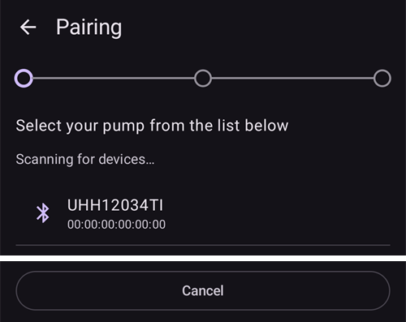
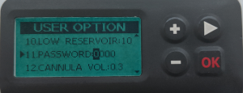

# DanaRS, Dana-i and Dana-i2

*These instructions are for configuring the app and your pump if you have a DanaRS from 2017 onwards, a Dana-i or a Dana-i2. Si en canvi teniu la DanaR original, aneu a [DanaR](./DanaR-Insulin-Pump.md).*

**Dana-i2 can be used from AAPS version 4.0 onwards.** It uses the same **Dana-i/RS** driver as the Dana-i.

* In DanaRS/i/i2 pump "BASAL A" is used by the app. Existing data gets overwritten.

    {contents} Table of contents
    :depth: 1
    :local: true

## Capacitats de la bomba amb AAPS

* Es comunica amb **AAPS** pel Bluetooth del telèfon, sense cap dispositiu de comunicació addicional.
* DST and timezone changes must be handled manually (see [Timezone traveling](#timezone-traveling-danarv2-danars)).

(DanaRS-Insulin-Pump-pairing-pump)=

## Emparellar la bomba

* Open the **menu** (☰) in the top-left corner of the **AAPS** main screen and select **Configuration**.
* Tap **Pump** and select **Dana-i/RS**.
    
    
    
    Once it is selected, the **Dana-i/RS** card shows two buttons, **Settings** and **Open plugin**:
    
    
    
    **Settings** opens the settings of the Dana-i/RS driver:
    
    
    
    **Open plugin** (or **Manage** > **Pump**) opens the Dana-i/RS pump screen. Before a pump is paired it looks like this:
    
    

* On the pump screen, tap **Pairing**. **AAPS** scans for nearby pumps.

* Tap the entry for your pump in the list.
    
    

* **You have to confirm the pairing on the pump!** This works the same way as other Bluetooth pairings you may know (for example, smartphone and car audio).
    
    

* Seguiu el procés d'emparellament segons el tipus i el firmware de la vostra bomba:
    
    * For DanaRS v1, **AAPS** asks for the **Pump password (v1 only)**. Enter your pump password (see [Default password](#DanaRS-Insulin-Pump-default-password)).
    * For DanaRS v3, **AAPS** asks you to press OK on the pump and type the 2 sequences of numbers and letters shown on the pump. Keep the pump display on by pressing the minus button until you have finished. Then tap **Done**.
    * For Dana-i and Dana-i2, the standard Android pairing dialog appears. Enter the 6-digit number shown on the pump.

* When **Pairing successful!** is shown, tap **Done**.
    
    
    
    You are back on the pump screen, which now shows your pump's status.
    
    

* In **Settings**, select **Bolus speed** to change the default bolus speed (12 s/U, 30 s/U or 60 s/U).

* Configureu l'increment de basal a la bomba a 0,01 U/h amb el menú del metge (Doctors menu) (vegeu el manual d'usuari de la bomba).
* Set bolus step on pump to 0.05 U using Doctors menu (see pump user guide). **AAPS** reads the basal and bolus steps from the pump and uses them for every bolus, so a bolus always matches the step set on the pump. The pump screen shows them in the **Basal/Bolus step** row.
* Activar els bolus estesos a la bomba

### Options shown only for some models

* **Auto lock**: on a Dana-i2, the **User options** screen (on the pump screen, **Manage** > **Pump**) has an **Auto lock** switch for the pump's auto lock setting. Press **Save options to pump** after changing it.
* **Easy mode**: on pump models that have an easy menu mode, the pump screen shows an **Easy mode** row with **On** or **Off**.
* If a Dana-i2 refuses a bolus, **AAPS** shows the reason, for example *Pump is not primed*, *Not enough insulin in the reservoir* or *Easy sleep mode is on in the pump*.

(DanaRS-Insulin-Pump-default-password)=

### Contrasenya per defecte

* Per a la DanaRS amb firmware v1 i v2, la contrasenya per defecte és 1234.
* Per a la DanaRS amb firmware v3 o la Dana-i, la contrasenya per defecte surt de la data de fabricació i es calcula com MMDD, on MM és el mes i DD és el dia en què es va fabricar la bomba (p. ex. '0124' vol dir mes 01 i dia 24).
    
    * Al MAIN MENU seleccioneu REVIEW i després obriu SHIPPING INFORMATION al submenú
    * Number 3 is manufacturing date. 
    * Per a la v3/i, aquesta contrasenya només serveix per bloquejar el menú de la bomba. No serveix per a la comunicació i no cal introduir-la a AAPS.

(DanaRS-Insulin-Pump-change-password-on-pump)=

## Canviar la contrasenya a la bomba

* Premeu el botó OK de la bomba
* Al menú principal seleccioneu "OPTION" (moveu-vos a la dreta prement el botó de fletxa diverses vegades)
    
    

* Al menú d'opcions seleccioneu "USER OPTION"
    
    

* Feu servir el botó de fletxa per baixar fins a "11. password"
    
    

* Premeu OK per introduir la contrasenya antiga.

* Introduïu la **contrasenya antiga** (per a la contrasenya per defecte, vegeu [més amunt](#DanaRS-Insulin-Pump-default-password)) i premeu OK
    
    

* Si aquí introduïu una contrasenya incorrecta, no apareixerà cap missatge d'error!

* Definiu la **contrasenya nova** (canvieu els números amb els botons + i - / moveu-vos a la dreta amb el botó de fletxa).
    
    

* Confirmeu amb el botó OK.

* Premeu OK per desar la configuració.
    
    

* Baixeu fins a "14. EXIT" i premeu OK per sortir.
    
    

(DanaRS-Insulin-Pump-dana-rs-specific-errors)=

## Errors específics de la Dana RS

### Error durant el lliurament d'insulina

Si es perd la connexió entre AAPS i la Dana RS durant el lliurament d'un bolus (p. ex. us allunyeu del telèfon mentre la Dana RS lliura insulina), veureu el missatge següent i sentireu una alarma.

* En la majoria de casos és només un problema de comunicació i la quantitat correcta d'insulina s'ha lliurat.
* Check in the pump history that the correct bolus was given. You can do this on the pump itself, or in **AAPS** on the pump screen (**Manage** > **Pump**) > **Pump history** > **Boluses**.
* Delete the error entry in [treatments](#screens-bolus-carbs) if you wish.
* The real amount is read and recorded at the next connection. To force this, tap **Refresh** on the pump screen, or just wait for the next connection.

## Nota especial quan canvieu de telèfon

Quan canvieu a un telèfon nou, cal fer aquests passos:

* [Exporteu la configuració](../Maintenance/ExportImportSettings.md) al telèfon antic
* Transferir la configuració del telèfon antic al nou

### DanaRS v1

* **Emparelleu manualment** la Dana RS amb el telèfon nou
* If you tick **Also replace pump settings** when importing, the pump connection settings are imported too and AAPS on your new phone will already "know" the pump and therefore not start a Bluetooth scan. Per això, el telèfon nou i la bomba s'han d'emparellar manualment.
* Instal·leu AAPS al telèfon nou.
* [Importeu la configuració](../Maintenance/ExportImportSettings.md) al telèfon nou

### DanaRS v3, Dana-i, Dana-i2

* Comenceu el procés d'emparellament com es descriu [més amunt](#DanaRS-Insulin-Pump-pairing-pump).
* Sometimes you may need to clear the pairing information in **AAPS** first. On the pump screen (**Manage** > **Pump**), tap **Unpair** and confirm **Reset pairing information?**. Then tap **Pairing** again.

## Timezone traveling with DanaRS, Dana-i and Dana-i2 pumps

Per a informació sobre viatjar entre fusos horaris, vegeu la secció [Canvi de fus horari amb bombes](#timezone-traveling-danarv2-danars).

## On trobar ajuda

Development of the DanaRS/Dana-i/Dana-i2 driver is done by the community on a **volunteer** basis. Abans de demanar ajuda:

1. **Llegiu** la secció corresponent d'aquesta documentació per confirmar com ha de funcionar la funció.
2. **Pregunteu** al canal *#AAPS* de [Discord](https://discord.gg/4fQUWHZ4Mw) o en un dels altres [canals de la comunitat](../GettingHelp/WhereCanIGetHelp.md).
3. **Informeu d'un error** buscant entre les [incidències existents](https://github.com/nightscout/AndroidAPS/issues); si la vostra no hi és, obriu una [incidència nova](https://github.com/nightscout/AndroidAPS/issues) i adjunteu els vostres [fitxers de registre](../GettingHelp/AccessingLogFiles.md).

Quan demaneu ajuda, indiqueu la marca i el model del telèfon, la versió d'Android, la versió d'**AAPS** i una descripció senzilla del problema (què ha canviat, quan va funcionar per darrera vegada).