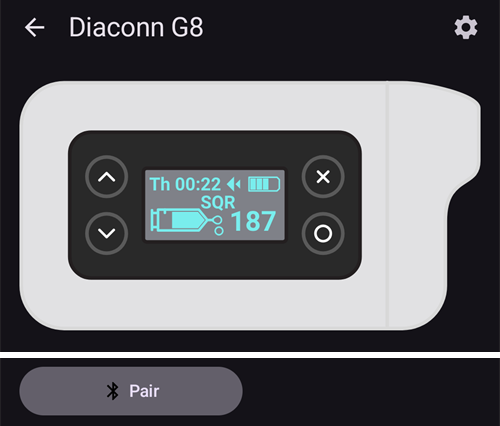
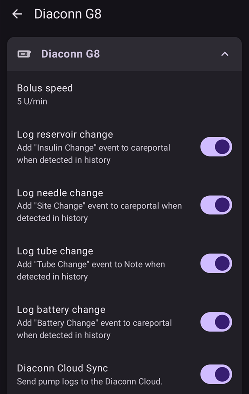

# Diaconn G8

```{contents} Table of contents
:depth: 1
:local: true
```

## Capacitats de la bomba amb AAPS

* Es comunica amb **AAPS** amb el Bluetooth propi del telèfon, sense cap dispositiu de comunicació addicional.
* Els canvis d'horari d'estiu i de fus horari s'han de fer a mà.

## Emparellament Bluetooth de la bomba d'insulina

- Toqueu el **menú** (☰) a la cantonada superior esquerra.


- Toqueu **Configurador** > **Bomba** i seleccioneu **Diaconn G8**.


Quan està seleccionat, la targeta **Diaconn G8** mostra dos botons, **Configuració** i **Obrir plugin**:


**Configuració** obre la configuració del controlador Diaconn G8 (vegeu [Configuració de les opcions de la bomba d'insulina Diaconn G8](#diaconn-g8-insulin-pump-option-setting) més avall).

**Obrir plugin** (o **Gestionar** > **Bomba**) obre la pantalla de la bomba Diaconn G8. Abans d'emparellar una bomba, es veu així:




```{admonition} Older screenshot
:class: note
La captura de pantalla de dalt és d'una versió anterior d'**AAPS**. A **AAPS** 4 l'emparellament comença amb el botó **Emparellar** de la pantalla de la bomba; no hi ha cap opció **Bomba seleccionada**.
```

- A la pantalla de la bomba, toqueu **Emparellar**. S'obre la pantalla **Emparellament bomba Diaconn** i **AAPS** cerca bombes properes.
- Toqueu el número de model de la vostra bomba d'insulina quan aparegui a la llista (per exemple **DIACONN-65010**).


- Hi ha dues maneres de comprovar el número de model:

1. Els 5 últims dígits del número de sèrie (SN) a la part de darrere de la bomba.
2. Premeu el botó O > Information > BLE > els 5 últims dígits.


- Quan seleccioneu la bomba, apareix una finestra que demana un codi PIN. Introduïu el número PIN que mostra la bomba per completar la connexió.

 

- Quan aparegui **Emparellament correcte!**, toqueu **OK** per tornar a la pantalla de la bomba.

## Comprovació de l'estat de la bomba i sincronització del registre

- Quan la bomba estigui connectada, obriu la pantalla de la bomba (**Gestionar** > **Bomba**). Mostra l'estat de la bomba (pila, reservori, última connexió, últim bolus, taxa basal i més).
- Toqueu **Actualitzar** per connectar amb la bomba, actualitzar l'estat i sincronitzar el registre.
- Toqueu **Historial de la bomba** per veure l'historial llegit de la bomba.


```{admonition} Older screenshot
:class: note
La captura de pantalla de dalt és d'una versió anterior d'**AAPS**. A **AAPS** 4 l'estat de la bomba es mostra a la pantalla de la bomba (**Gestionar** > **Bomba**) i se sincronitza amb el botó **Actualitzar**.
```

(diaconn-g8-bluetooth-troubleshooting)=

## Resolució de problemes de Bluetooth

**Què fer si la connexió Bluetooth amb la bomba és inestable.**

### Mètode 1) Reinicieu AAPS i després torneu a comprovar la bomba

- Toqueu el **menú** (☰) a la cantonada superior esquerra.
- Toqueu **Sortir** a la part de baix del menú.


- Torneu a iniciar **AAPS** i comproveu la connexió amb la bomba.

### Mètode 2) Si el primer mètode no funciona, desconnecteu el Bluetooth i torneu-lo a connectar.

- Manteniu premut el botó Bluetooth de la part de dalt durant uns 3 segons.


- Premeu el botó Setting de la bomba d'insulina Diaconn G8 emparellada.


- Desemparelleu-la (Unpair).


- A **AAPS**, obriu la pantalla de la bomba (**Gestionar** > **Bomba**), toqueu **Desemparellar** i confirmeu **Restablir la informació d'emparellament?**.
- Repetiu el procés d'emparellament Bluetooth de la bomba (vegeu més amunt).

## Més informació

(diaconn-g8-insulin-pump-option-setting)=

### Configuració de les opcions de la bomba d'insulina Diaconn G8

- **Configurador** > **Bomba** > **Diaconn G8** > **Configuració**
- O bé, a la pantalla de la bomba (**Gestionar** > **Bomba**), toqueu la icona de configuració (roda dentada) a la cantonada superior dreta.



- **Velocitat del bolus** defineix la velocitat amb què la bomba lliura un bolus.
- Si l'opció **Enregistrar canvi de reservori** està activada, els detalls corresponents s'envien automàticament al portal de cures quan es produeix un esdeveniment «Canvi d'insulina».
- Si l'opció **Enregistrar canvi d'agulla** està activada, els detalls corresponents s'envien automàticament al portal de cures quan es produeix un esdeveniment «Canvi de cànula».
- Si l'opció **Enregistrar canvi de tub** està activada, els detalls corresponents s'afegeixen automàticament com a nota quan es produeix un esdeveniment «Canvi de tub».
- Si l'opció **Enregistrar canvi de pila** està activada, els detalls corresponents s'envien automàticament al portal de cures quan es produeix un esdeveniment «Canvi de pila». També podeu registrar vosaltres mateixos un canvi de pila amb **Gestionar** > **Canvi de pila de la bomba**. (Nota: per canviar la pila, atureu primer totes les funcions d'injecció en curs.)
- **Sincronització amb el núvol de Diaconn** envia els registres de la bomba al núvol de Diaconn (Diaconn Cloud).


```{admonition} Older screenshot
:class: note
La captura de pantalla de dalt és d'una versió anterior d'**AAPS**. A **AAPS** 4 un canvi de pila es registra amb **Gestionar** > **Canvi de pila de la bomba**; no hi ha cap pestanya **Accions**.
```

### Funció de bolus estès

- Si feu servir el bolus estès, es desactivarà el llaç tancat.
- Vegeu [aquesta pàgina](#extended-bolus-and-why-they-wont-work-in-closed-loop-environment) per saber per què el bolus estès no funciona en un entorn de llaç tancat.

## On trobar ajuda

El desenvolupament del controlador Diaconn G8 el fa la comunitat de manera **voluntària**. Abans de demanar ajuda:

1. **Llegiu** la secció corresponent d'aquesta documentació per confirmar com ha de funcionar la funció.
2. **Pregunteu** al canal *#AAPS* de [Discord](https://discord.gg/4fQUWHZ4Mw), o en un dels altres [canals de la comunitat](../GettingHelp/WhereCanIGetHelp.md).
3. **Informeu d'un error**: cerqueu primer entre les [incidències existents](https://github.com/nightscout/AndroidAPS/issues); si la vostra no hi és, obriu una [incidència nova](https://github.com/nightscout/AndroidAPS/issues) i adjunteu-hi els vostres [fitxers de registre](../GettingHelp/AccessingLogFiles.md).

Quan demaneu ajuda, indiqueu la marca i el model del telèfon, la versió d'Android, la versió d'**AAPS** i una descripció del problema amb paraules senzilles (què ha canviat, quan va funcionar per última vegada).
