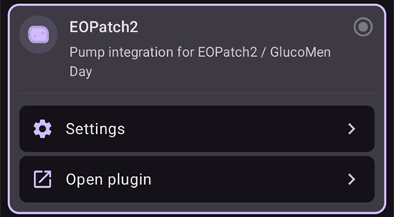
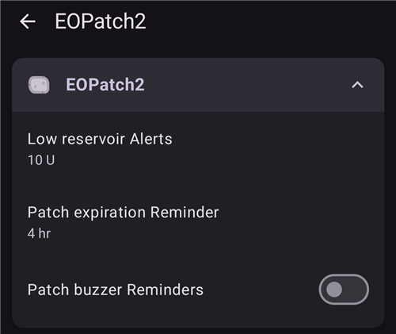
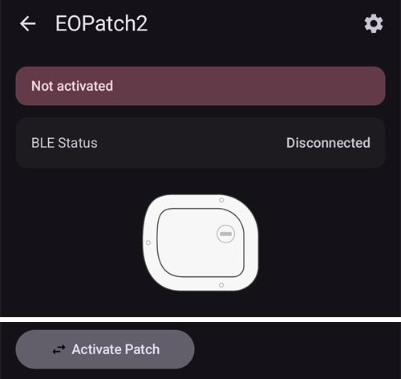
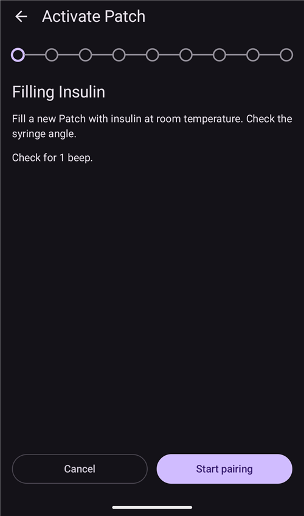

# EOPatch2

El patch necessita insulina d'acció ràpida U-100, com ara NovoRapid o Humalog. Feu servir la insulina d'acció ràpida que us ha receptat el vostre metge.

La dosi més petita que pot lliurar el patch és de 0,05 U. Definiu cada taxa basal del vostre **Perfil** com a mínim a 0,05 U/h, en passos de 0,05 U/h. Si no ho feu, **AAPS** arrodoneix cada taxa als 0,05 U/h més propers (mai cap avall fins a 0) i fa servir les taxes que el patch lliura de veritat. Per això, la insulina total per dia és una mica diferent de la del vostre **Perfil**. De la mateixa manera, els bolus han de ser com a mínim de 0,05 U.

```{contents} Table of contents
:depth: 1
:local: true
```

## Capacitats de la bomba amb AAPS

* Es comunica amb **AAPS** amb el Bluetooth propi del telèfon, sense cap dispositiu de comunicació addicional.
* Els canvis d'horari d'estiu i de fus horari s'han de fer a mà.

## Configuració de la bomba

1. Obriu el **menú** (☰) a l'angle superior esquerre de la pantalla principal d'**AAPS** i seleccioneu **Configurador**.
1. A la secció **Bomba**, seleccioneu **EOPatch2**.
1. Premeu la tecla Enrere per tornar a la pantalla principal.

 

Quan està seleccionat, la targeta d'**EOPatch2** mostra dos botons, **Configuració** i **Obrir plugin**:



## Configuració

Podeu obrir la configuració d'EOPatch2 de dues maneres:

* premeu **Configuració** a la targeta d'**EOPatch2** del **Configurador**, o bé
* obriu la pantalla de la bomba (**Gestionar** → **Bomba**) i premeu la icona de l'engranatge a l'angle superior dret.

Hi ha tres opcions de configuració:



### Alertes de reservori baix

Apareix un avís quan la insulina que queda al patch baixa fins a aquesta quantitat o menys. El podeu definir entre 10 i 50 U, en passos de 5 U. El valor per defecte és 10 U.

### Recordatori d'expiració del patch

Us recorda quant temps queda abans que caduqui el patch actual. El podeu definir entre 1 i 24 hores, en passos d'1 hora. El valor per defecte és 4 hores.

### Recordatoris sonors del patch

Quan aquesta opció està activada, el patch fa un bip quan comença i quan acaba un bolus, un bolus estès o una basal temporal. No afecta la vostra basal normal. Per defecte està desactivada.

## Activar un patch nou

### Obrir l'assistent d'activació

Obriu la pantalla de la bomba amb **Gestionar** → **Bomba** (o premeu **Obrir plugin** a la targeta d'**EOPatch2** del **Configurador**). Quan no hi ha cap patch actiu, la pantalla mostra **No activat** i un botó **Activar patch** a la part inferior.

Premeu **Activar patch** per iniciar l'assistent.



L'assistent us guia per cada pas. La fila de punts de la part superior mostra fins on heu arribat.

```{note}
Si mai no heu activat cap **Perfil** a **AAPS**, l'assistent primer mostra la pàgina **Cal un perfil**. Seleccioneu el perfil que voleu fer servir i premeu **Activar perfil**.
```

### Ompliment d'insulina

Inseriu l'agulla de la xeringa al port d'ompliment d'insulina del patch. Premeu lentament l'èmbol per omplir el patch. Quan hi ha més de 80 U al patch, fa un bip i s'engega (arrencada).

Quan sentiu el bip, premeu **Iniciar emparellament**.



```{warning}
- No gireu la palanca de l'agulla fins que l'assistent us ho digui. Si la gireu massa aviat, pot causar problemes greus durant l'ompliment o la comprovació de seguretat.
- El patch admet de 80 a 200 U. Si hi poseu menys de 80 U, el patch no funciona.
- Traieu la insulina de la nevera 15–30 minuts abans d'omplir el patch, perquè arribi a temperatura ambient. La insulina ha d'estar com a mínim a 10 °C.
```

### Emparellament del patch

Ara **AAPS** intenta emparellar-se amb el patch automàticament. Durant l'emparellament apareixen dues sol·licituds d'emparellament Bluetooth d'Android. Premeu **OK** a la primera. Torneu a prémer **OK** a la segona, que mostra una clau d'accés.

```{warning}
- Mantingueu el patch i el telèfon a menys de 30 cm l'un de l'altre durant l'emparellament.
- Després que el patch s'hagi engegat, fa un bip cada 3 minuts fins que s'acaba l'emparellament.
- Heu d'acabar d'activar el patch en els 60 minuts següents a l'arrencada. Si no podeu, descarteu el patch.
```

  

```{admonition} Older screenshot
:class: note
Les dues captures de pantalla de l'emparellament Bluetooth són d'una versió anterior d'**AAPS**: la pantalla d'**AAPS** que hi ha darrere de la sol·licitud d'emparellament d'Android és diferent a **AAPS** 4.
```

### Seleccionar insulina

Seleccioneu la insulina amb què heu omplert el patch i premeu **Següent**. Després de l'activació, **AAPS** aplica un canvi de perfil amb aquesta insulina.

### Preparació per col·locar el patch

Retireu la cinta adhesiva del patch i després premeu **Següent**.

Si sobresurt una agulla, o si el patch està moll o brut o la cinta adhesiva està doblegada, premeu **Descartar** i feu servir un patch nou.


### Punt d'inserció

Aquest pas només apareix si l'opció **Gestionar la rotació del punt d'infusió de la bomba** està activada a la configuració de rotació del punt d'infusió. Toqueu el lloc del diagrama del cos on col·locareu el patch i premeu **Següent**, o premeu **Ometre**.

### Col·locació del patch

La insulina s'ha d'injectar en un lloc amb teixit greixós sota la pell, però amb pocs nervis o vasos sanguinis. L'abdomen, el braç o la cuixa són bones opcions. Netegeu i assequeu el lloc i després enganxeu el patch a la pell.

Comproveu el punt d'infusió i després premeu **Iniciar comprovació de seguretat**.

```{warning}
- Premeu les vores de la cinta del patch de manera uniforme, perquè tot el patch quedi ben enganxat a la pell.
- Si el patch no s'enganxa del tot, pot entrar aire entre el patch i la pell. Això debilita l'adhesiu i la resistència a l'aigua del patch.
```


### Comprovació de seguretat

La comprovació de seguretat triga uns 30 segons. Quan acaba, el patch fa un bip. Si falla, premeu **Reintentar**.

```{warning}
Per a un ús segur, no gireu la palanca de l'agulla fins que s'hagi completat la comprovació de seguretat.
```

 

```{admonition} Older screenshot
:class: note
Les captures de pantalla des de **Preparació per col·locar el patch** fins a **Comprovació de seguretat** són d'una versió anterior d'**AAPS** i poden ser diferents a **AAPS** 4.
```

### Inserció de l'agulla

Subjecteu el patch amb fermesa. Gireu la palanca de l'agulla cap amunt més de 100° per inserir l'agulla. El patch fa un bip quan l'agulla s'ha inserit correctament. Després continueu girant la palanca fins al final per retirar-la. Premeu **Següent**.

```{caution}
Si passeu al pas següent sense sentir el bip, apareix un **Error d'inserció de l'agulla**. Comproveu el bip i premeu **Reintentar**. Si l'error continua, premeu **Descartar** per desactivar el patch.
```

### Activació del patch completada

L'última pàgina confirma que el patch està actiu i que us avisarà quan s'acosti l'hora d'expiració. Premeu **Finalitzar** per tornar a la pantalla de la bomba.

## Descartar el patch

Canvieu el patch quan li quedi poca insulina, quan caduqui o si falla. Us recomanem que no feu servir cada patch més de 84 hores després de la seva arrencada.

1. Obriu la pantalla de la bomba (**Gestionar** → **Bomba**). Mentre hi ha un patch actiu, premeu **Descartar patch**.
1. La pàgina **Descartar patch** mostra el temps i la insulina que queden al patch. Premeu **Descartar patch**.
1. Un diàleg us demana que ho confirmeu. Torneu a prémer **Descartar patch**.
1. Quan el patch s'ha desactivat, l'assistent mostra **S'ha descartat el patch.** Retireu el patch del cos i premeu **Confirmar**.

Després, l'assistent continua directament amb l'activació d'un patch nou (vegeu més amunt). Premeu la fletxa enrere si voleu aturar-vos aquí.

Mentre no hi ha cap patch actiu, **AAPS** mostra la bomba com a suspesa i registra una basal temporal de 0 U/h. Així no es compta cap insulina basal a l'IOB fins que s'activa el patch següent.

   

```{admonition} Older screenshot
:class: note
Les captures de pantalla de dalt són d'una versió anterior d'**AAPS**. A **AAPS** 4, la pantalla de la bomba s'obre des de **Gestionar** → **Bomba**, i el botó que hi ha s'anomena **Descartar patch**.
```

```{admonition} If the patch does not respond
:class: warning
Si **AAPS** no pot comunicar-se amb el patch, pot mostrar una pàgina sobre com apagar a mà l'alarma del patch: retireu el patch del cos, desenganxeu la cinta adhesiva i, amb un clip, premeu amb força el forat que hi ha al costat del port d'ompliment d'insulina.

La pàgina **Descartar patch** també té un botó **Forçar restabliment**. Només esborra el patch d'**AAPS**, sense enviar cap ordre al patch. El patch continua lliurant insulina fins que se li acaba la pila o fins que l'apagueu a mà. Feu-lo servir només si el descart normal falla, i retireu el patch del cos.
```

## Suspendre i reprendre el lliurament d'insulina

Suspendre el lliurament d'insulina també cancel·la qualsevol bolus estès i basal temporal. Quan el reprengueu, aquests **no** es tornen a iniciar. Mentre el lliurament d'insulina està suspès, el patch fa un bip cada 15 minuts.

### Suspendre el lliurament d'insulina

1. Obriu la pantalla de la bomba (**Gestionar** → **Bomba**) i premeu **Suspendre bomba**.
1. Un diàleg explica què se suspendrà. Premeu **Confirmar**.
1. Al diàleg **Temps de suspensió de la basal**, trieu quant de temps voleu suspendre: 30 min, 1 h, 1 h 30 min o 2 h. Premeu **Confirmar**.

El lliurament d'insulina se suspèn durant el temps que heu triat.

  

```{admonition} Older screenshot
:class: note
Les captures de pantalla de dalt són d'una versió anterior d'**AAPS**. A **AAPS** 4, la pantalla de la bomba s'obre des de **Gestionar** → **Bomba**, i el botó que hi ha s'anomena **Suspendre bomba**.
```

### Reprendre el lliurament d'insulina

1. Obriu la pantalla de la bomba (**Gestionar** → **Bomba**) i premeu **Reprendre bomba**.
1. Al diàleg **Reprendre lliurament d'insulina**, premeu **Confirmar**.

 

```{admonition} Older screenshot
:class: note
Les captures de pantalla de dalt són d'una versió anterior d'**AAPS**. A **AAPS** 4, la pantalla de la bomba s'obre des de **Gestionar** → **Bomba**, i el botó que hi ha s'anomena **Reprendre bomba**.
```

```{warning}
Quan s'acaba el temps de suspensió, **AAPS** mostra l'avís **Fi de la suspensió d'insulina**. El lliurament d'insulina **no** es reprèn fins que no ho confirmeu. Si no ho feu, podríeu tenir una hiperglucèmia.
```

(eopatch2-alarms-and-warnings)=

## Alarmes i avisos

### Alarmes

Les alarmes són per a situacions urgents i de màxima prioritat, i cal que actueu immediatament. **AAPS** fa sonar una alarma que no s'atura fins que la confirmeu, i mostra el missatge com a avís a la pantalla **Resum**. Una alarma vol dir que hi ha un problema amb el patch que feu servir. En molts casos cal descartar el patch i canviar-lo per un de nou.

Quan premeu **Confirmar** a l'avís, **AAPS** gestiona l'alarma. Per a la majoria d'alarmes, això desactiva el patch. Per a una alarma de **Temperatura inadequada**, el botó és **Reintentar**.

 

```{admonition} Older screenshot
:class: note
Les captures de pantalla de les alarmes són d'una versió anterior d'**AAPS** i poden ser diferents a **AAPS** 4.
```

A continuació s'expliquen les diferents alarmes.

| Alarma                         | Explicació                                                                                                                                                             |
| ------------------------------ | ---------------------------------------------------------------------------------------------------------------------------------------------------------------------- |
| Reservori buit                 | El patch s'ha quedat sense insulina.                                                                                                                                   |
| Patch caducat                  | El temps d'ús del patch s'ha acabat i ja no pot lliurar més insulina.                                                                                                  |
| Oclusió                        | Sembla que el conducte d'insulina del patch està bloquejat.                                                                                                            |
| Error en l'autotest d'engegada | El patch ha trobat un error inesperat durant l'autotest després de l'arrencada.                                                                                        |
| Temperatura inadequada         | El patch està fora de la seva temperatura de funcionament normal mentre l'activeu o el feu servir. Porteu el patch a un lloc amb una temperatura adequada (4,4–37 °C). |
| Error d'inserció de l'agulla   | L'agulla no s'ha inserit correctament durant l'activació. Comproveu que la vora d'inserció de l'agulla del patch i la palanca de l'agulla estiguin en línia recta.     |
| Error de la pila del patch     | La pila interna del patch està a punt d'esgotar-se i el patch s'apagarà.                                                                                               |
| Error d'activació del patch    | El patch no s'ha activat del tot en els 60 minuts següents a l'arrencada.                                                                                              |
| Error del patch                | El patch ha trobat un error inesperat mentre s'activava o es feia servir.                                                                                              |

### Avisos

Els avisos són per a situacions de prioritat mitjana o baixa. Un avís apareix com a missatge d'avís a la pantalla **Resum**.


```{admonition} Older screenshot
:class: note
Aquesta captura de pantalla és d'una versió anterior d'**AAPS**: a **AAPS** 4 l'avís apareix a la pantalla principal, que és diferent.
```

A continuació s'expliquen els diferents avisos.

| Avís                           | Explicació                                                                                                                                           |
| ------------------------------ | ---------------------------------------------------------------------------------------------------------------------------------------------------- |
| Fi de la suspensió d'insulina  | El temps de suspensió que heu triat s'ha acabat. Premeu **Reprendre bomba** a l'avís per reprendre el lliurament d'insulina.                         |
| Reservori baix                 | La insulina que queda al patch és inferior a la quantitat definida a **Alertes de reservori baix**.                                                  |
| Vida útil del patch acabada    | El període d'ús del patch s'ha acabat.                                                                                                               |
| El patch caducarà aviat        | Cal descartar el patch d'aquí a 1 hora.                                                                                                              |
| Activació del patch incompleta | L'activació del patch s'ha interromput durant més de 3 minuts després de l'emparellament. Obriu la pantalla de la bomba i acabeu d'activar el patch. |
| Pila del patch baixa           | La pila del patch està baixa.                                                                                                                        |

## On trobar ajuda

El desenvolupament del controlador d'EOPatch2 el fa la comunitat de manera **voluntària**. Abans de demanar ajuda:

1. **Llegiu** la secció corresponent d'aquesta documentació per confirmar com ha de funcionar la funció.
2. **Pregunteu** al canal *#AAPS* de [Discord](https://discord.gg/4fQUWHZ4Mw), o en un dels altres [canals de la comunitat](../GettingHelp/WhereCanIGetHelp.md).
3. **Informeu d'un error**: cerqueu primer entre les [incidències existents](https://github.com/nightscout/AndroidAPS/issues); si la vostra no hi és, obriu una [incidència nova](https://github.com/nightscout/AndroidAPS/issues) i adjunteu-hi els vostres [fitxers de registre](../GettingHelp/AccessingLogFiles.md).

Quan demaneu ajuda, indiqueu la marca i el model del telèfon, la versió d'Android, la versió d'**AAPS** i una descripció del problema amb paraules senzilles (què ha canviat, quan va funcionar per última vegada).
