# Equil

Aquestes instruccions serveixen per configurar la bomba d'insulina Equil.

```{contents} Table of contents
:depth: 1
:local: true
```

## Capacitats de la bomba amb AAPS

* Bomba patch sense tub que es comunica amb **AAPS** pel Bluetooth propi del telèfon, sense cap dispositiu de comunicació addicional.
* **AAPS** treats the Equil as a patch pump with a 200 U reservoir: the main screen shows the patch pump status lights. Filling the reservoir, priming and changing the battery are done in the pump wizards, so **Pump battery change** is not offered.
* **Prime/Fill** is offered, in the **Manage** sheet, in QuickLaunch and in the expanded status panel on the main screen. Use it only while the pump is **off its base plate**, so the insulin goes into the air: like every prime, it is not counted in IOB, so a prime while the pump is attached gives insulin the loop does not know about.
* Mentre la bomba està suspesa o aturada, **AAPS** registra una basal temporal de 0 U/h, de manera que no es compta cap insulina basal a l'IOB.
* Els canvis d'horari d'estiu i de fus horari s'han de fer a mà.

## Requisits de maquinari i programari
* **Maquinari Equil compatible**

  Actualment són compatibles les versions Equil 5.3 i 5.4.

* **AAPS** compilat i instal·lat seguint les instruccions de [Compilar AAPS](../SettingUpAaps/BuildingAaps.md)

## Configuració

### Seleccionar la bomba Equil

Obriu el **menú** (☰) a la cantonada superior esquerra, trieu **[Configurador](#Config-Builder-pump)** i, a **Bomba**, seleccioneu **Equil**.

Un cop seleccionada, la targeta **Equil** mostra dos botons, **Configuració** i **Obrir plugin**:

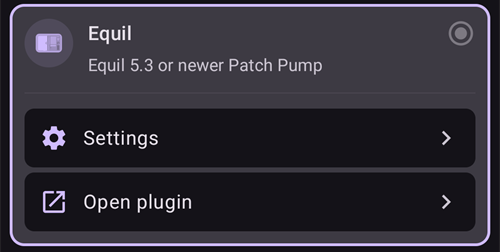

**Obrir plugin** (o **Gestionar** → **Bomba**) obre la pantalla de la bomba Equil. Abans d'emparellar una bomba, es veu així:

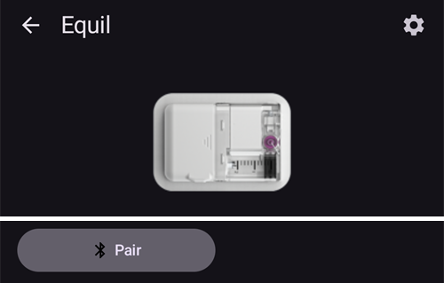

### Configuració

Obriu la configuració d'Equil amb **Configuració** a la targeta **Equil**, o amb la icona de l'engranatge a la cantonada superior dreta de la pantalla de la bomba.

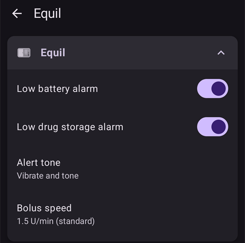

* **Alarma de bateria baixa**: us avisa quan la pila de la bomba és baixa.
* **Alarma de reservori baix**: us avisa quan queda poca insulina al reservori.
* **So d'alerta**: com us avisa la bomba: **Silenci**, **Només vibració**, **Només so** o **Vibració i so**.
* **Velocitat del bolus**: amb quina rapidesa s'administra un bolus: **1,5 U/min (estàndard)**, **3 U/min**, **6 U/min** o **12 U/min**. Un bolus més ràpid pot provocar més alarmes d'oclusió.

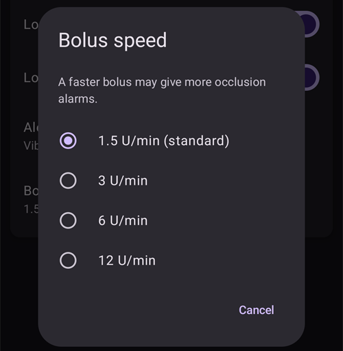

```{admonition} Max basal and max bolus on the patch
:class: note
El patch mateix rebutja qualsevol taxa basal per sobre d'un màxim que **AAPS** hi programa. **AAPS** pren el valor més alt entre la vostra **basal màxima** ([configuració](../SettingUpAaps/Preferences.md)) i la taxa basal horària més alta del vostre **Perfil**, de manera que el patch sempre accepta el vostre perfil i les basals temporals que demana el llaç. **AAPS** també envia al patch el bolus màxim permès.

Quan canvieu la vostra **basal màxima** o el **bolus màxim**, **AAPS** envia automàticament els nous valors al patch. També s'envien amb cada canvi de perfil. No cal configurar res al patch mateix.
```

### Emparellar la bomba

A la pantalla de la bomba, premeu **Emparellar**. Un assistent us guia pas a pas. La fila de punts de la part superior mostra fins on heu arribat.

Si Android pregunta si **AAPS** pot trobar dispositius propers i connectar-s'hi, premeu **Permet**. **AAPS** ho necessita per trobar la bomba.

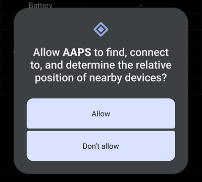

L'assistent té aquests passos. Premeu **Següent** per continuar, o **Cancel·lar** per sortir de l'assistent.

1. **Cal un perfil**: només es mostra si mai no heu activat cap **Perfil** a **AAPS**. Seleccioneu el perfil que voleu fer servir i premeu **Activar perfil**.
1. **Muntar bomba**: munteu la bomba, el reservori ple i la pila carregada.

   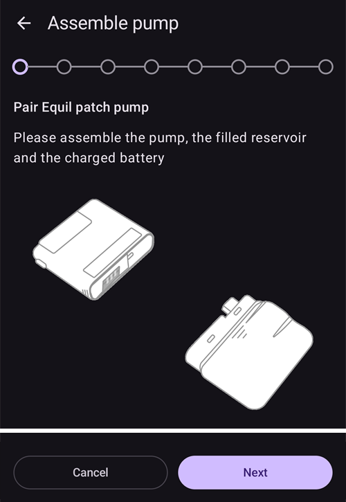

1. **Cercar bomba**: **AAPS** cerca bombes Equil properes. Seleccioneu la vostra bomba de la llista.

   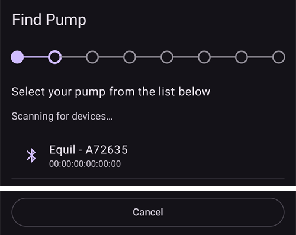
1. **Emparellar dispositiu**: podeu introduir una contrasenya d'emparellament a **Establir contrasenya d'emparellament**. Ha de tenir 4 caràcters, triats de `ABCDEF0123456789`. Premeu **Emparellar**.

   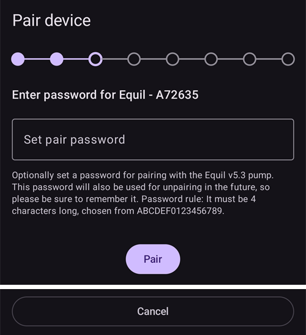

1. **Seleccionar insulina**: només es mostra si teniu més d'una insulina configurada. Seleccioneu la insulina que hi ha al reservori.
1. **Encebar / Omplir**: la bomba **no** ha d'estar a la seva placa base. Premeu **Encebar/Omplir** i encebeu el reservori fins que hi hagi una gota d'insulina a la punta de l'agulla. Premeu **Següent**.

   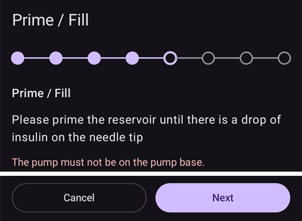
1. **Rotació de punts d'inserció**: només es mostra si **Gestionar la rotació del punt d'infusió de la bomba** està activat a la configuració de rotació de punts. Toqueu on col·locareu la bomba, o premeu **Ometre**.
1. **Col·locar bomba**: col·loqueu la bomba a la seva placa base.

   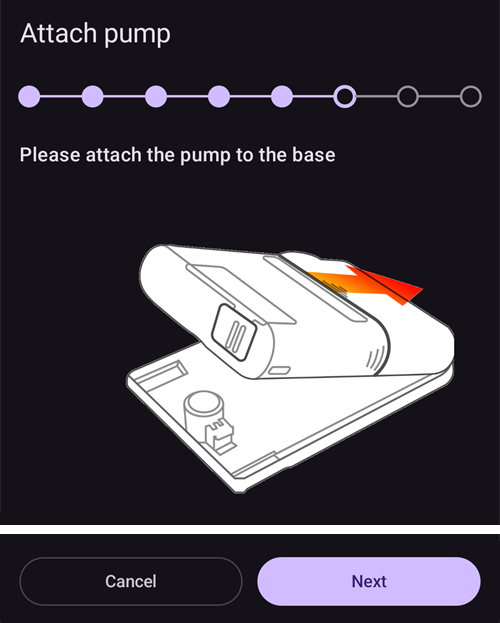
1. **Encebar cànula**: quan la bomba ja és a la placa base, premeu **Purgar l'aire** per treure l'aire de la cànula. Premeu **Següent**.

   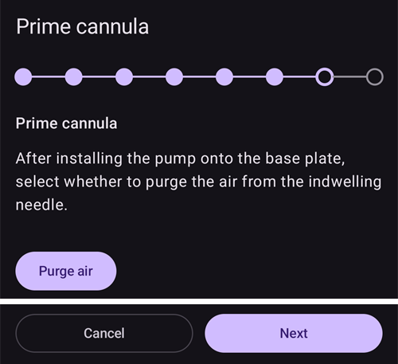

1. **Confirmar**: poseu-vos la bomba al cos i premeu **Finalitzar**.

   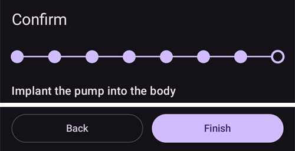

```{warning}
Si definiu la vostra pròpia contrasenya d'emparellament (recomanat per a la vostra seguretat), guardeu-la en un lloc segur. La contrasenya es desa a la bomba. La bomba la demana a cada emparellament nou fins que la desemparelleu correctament a **AAPS**. Fins aleshores, la bomba tampoc no es pot fer servir amb el controlador de mà original (PDA).
```

### Pantalla de la bomba després de l'emparellament

Un cop emparellada la bomba, la pantalla de la bomba mostra aquests botons:

* **Actualitzar**: llegeix ara l'estat i l'historial de la bomba.
* **Suspendre** / **Reprendre lliurament**: atura o torna a iniciar el lliurament d'insulina.
* **Canviar reservori**: us guia per treure la bomba, posar un reservori nou (i, si cal, una pila nova), encebar-la i tornar-la a col·locar. El primer pas pregunta *També col·locareu un set d'infusió nou (placa base i cànula)?*
  * **Sí, set d'infusió nou**: trieu el punt d'infusió, s'enceba la cànula i **AAPS** registra un canvi d'insulina i un canvi de cànula.
  * **No, només reservori o bateria**: la cànula no s'enceba i **AAPS** registra només un canvi d'insulina.

  Després d'un canvi de reservori, el nivell de la pila mostra **-** fins que **AAPS** el torna a llegir de la bomba.

  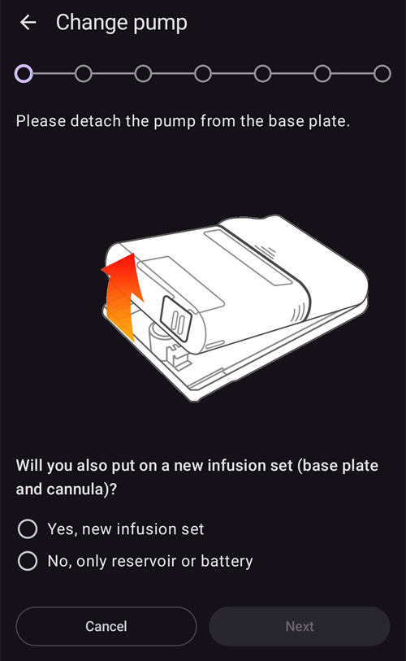

* **Historial**: mostra els esdeveniments registrats per la bomba.
* **Desemparellar dispositiu**: us guia per treure la bomba i desemparellar-la d'**AAPS**. Això atura el lliurament d'insulina, fa tornar l'èmbol de la bomba al fons i elimina l'emparellament.

### Alarmes

* L'alarma d'insulina baixa sona una vegada a cada nivell (10 U, 5 U i 2 U) i quan el reservori és buit. L'alarma de pila baixa sona una vegada al 10% i una altra al 5%. Cada nivell avisa només una vegada fins al següent canvi de reservori.
* Les alarmes i les aturades de la bomba també es registren com a anuncis als tractaments, a l'hora en què la bomba les va registrar, perquè després pugueu veure quan i per què es va aturar la bomba.
* Si el reservori es buida durant un bolus, **AAPS** registra només la insulina administrada fins aleshores i us indica les dues quantitats.

## On trobar ajuda

El desenvolupament del controlador Equil el fa la comunitat de manera **voluntària**. Abans de demanar ajuda:

1. **Llegiu** la secció corresponent d'aquesta documentació per confirmar com ha de funcionar la funció.
2. **Pregunteu** al canal *#AAPS* de [Discord](https://discord.gg/4fQUWHZ4Mw), o en un dels altres [canals de la comunitat](../GettingHelp/WhereCanIGetHelp.md).
3. **Informeu d'un error**: cerqueu primer entre les [incidències existents](https://github.com/nightscout/AndroidAPS/issues); si la vostra no hi és, obriu una [incidència nova](https://github.com/nightscout/AndroidAPS/issues) i adjunteu-hi els vostres [fitxers de registre](../GettingHelp/AccessingLogFiles.md).

Quan demaneu ajuda, indiqueu la marca i el model del telèfon, la versió d'Android, la versió d'**AAPS** i una descripció del problema amb paraules senzilles (què ha canviat, quan va funcionar per última vegada).
