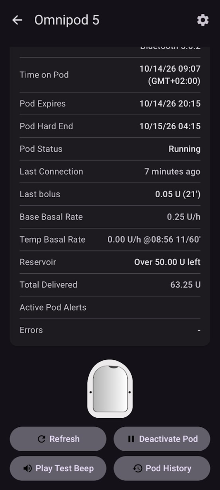
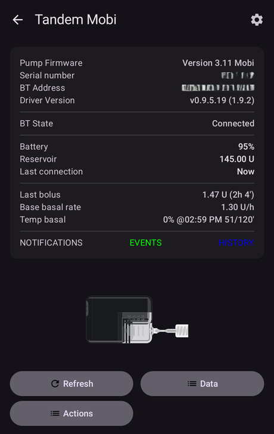

# Controladors de bomba futurs (possibles)

This is a list of some pumps on the market, the status of their support in other looping systems, and their status in AAPS. At the end there is some information about what a pump needs to be "Loop capable".

    {contents} Taula de continguts
    :depth: 1
    :local: true

## Pumps in AAPS integration phase

**Coming soon:** drivers for these pumps are in development and already running in test builds.

Omnipod 5 ([Homepage](https://www.omnipod.com/))

Tandem: t:Mobi ([Homepage](https://www.tandemdiabetes.com/))

## Bombes que es poden fer servir en llaç

### Kaleido ([Pàgina web](https://www.hellokaleido.com/))

**Estat del llaç:** La bomba és candidata per al llaç, però de moment el protocol és desconegut. El fabricant no té interès en el codi obert.

**Requisit de maquinari per a AAPS:** Cap. Sembla que té Bluetooth.

### Tandem: t:slim X3 ([Homepage](https://www.tandemdiabetes.com/about-us/pipeline))

**Loop status:** Possible future Loop candidate. The hope is that t:slim X3 will allow full control from a phone, which would enable AAPS support, but the timeline and features are still unknown.

**Requisit de maquinari per a AAPS:** Cap. It is expected to be Bluetooth enabled.

**Comments:** Not yet released. t:slim X3 appears to be repeatedly deprioritized on Tandem's roadmap in favour of t:Mobi (including a tubeless version) and Sigi (their patch pump).

### Twiist ([Homepage](https://www.twiist.com/))

**Loop status:** Loop candidate.

**Requisit de maquinari per a AAPS:** Cap. It is Bluetooth enabled.

### Bomba d'insulina Willcare ([Pàgina web](http://shinmyungmedi.com/en/))

**Loop status:** At the moment it is not a Loop candidate, but their staff contacted us and they are interested in making the pump loopable (it seems to be missing only the get/set profile commands).

**Requisit de maquinari per a AAPS:** Cap. Sembla que té Bluetooth.

**Comentaris:** Com que l'empresa està interessada en la integració amb AAPS, potser ella mateixa farà la implementació.

### Ypsopump ([Homepage](https://www.ypsomed.com/))

**Loop status:** Loop candidate. The pump's Bluetooth protocol has been reverse-engineered by the community, so communicating with it is possible in principle.

**Requisit de maquinari per a AAPS:** Cap. It is Bluetooth enabled.

**Comments:** The Ypsopump protects its Bluetooth communication with heavy third-party encryption. Working with it is technically demanding, which makes building and maintaining a reliable driver hard. There is no production-ready AAPS driver yet.

## Bombes que ja no es venen (empreses que ja no funcionen)

### Animas Vibe

### Animas Ping

### Cellnovo

### Accu-Chek Insight

**Comentaris:** Fi del suport el març del 2025.

## Bombes que no es poden fer servir en llaç

### Medtronic Bluetooth

**Comentaris:** Medtronic s'ha [retirat](https://www.tidepool.org/blog/tidepool-loop-partner-update-ace-pumps).

### Tandem: t:slim X2 ([Pàgina web](https://www.tandemdiabetes.com/))

**Comments:** The Tandem Bluetooth protocol has been reverse-engineered, but on the t:slim X2 only boluses can be delivered — basal delivery cannot be controlled — so it cannot be used safely for looping. This is unlikely to change unless Tandem allows full control of the X2 from a phone, which would more probably arrive with the t:slim X3 instead.

### Accu-Chek Solo

**Comentaris:** La comunitat no ha aconseguit comunicar-se amb la bomba Solo.

## Requisits perquè una bomba es pugui fer servir en llaç

**Requisit previ**

- La bomba ha d'acceptar algun tipus de control remot. (BT, radiofreqüència, etc.)
- El protocol s'ha desxifrat, està documentat, etc.

**Requisit mínim**

- Establir taxa basal temporal
- Obtenir estat
- Cancel·lar taxa basal temporal

**Per a oref1 (SMB) o per fer bolus:**

- Establir bolus

**Convenient**

- Cancel·lar bolus
- Obtenir perfil basal (gairebé obligatori)
- Establir perfil basal (convenient)
- Llegir historial 

**Altres (no obligatori però convenient)**

- Establir bolus estès
- Cancel·lar bolus estès
- Llegir historial
- Llegir TDD

### Suport per a altres bombes

Si hi ha altres bombes de les quals voleu conèixer l'estat, contacteu amb nosaltres a Discord.