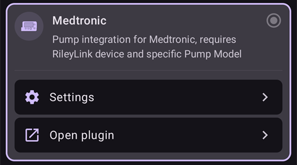
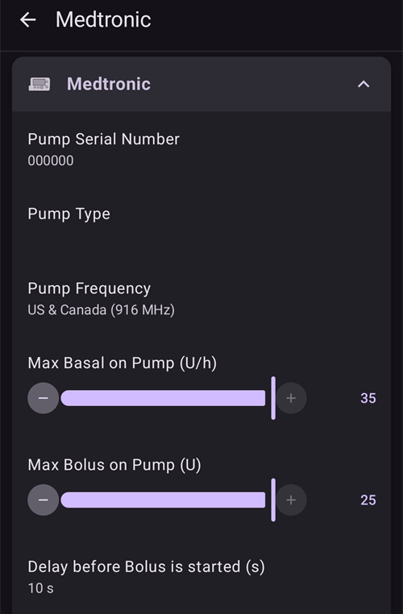
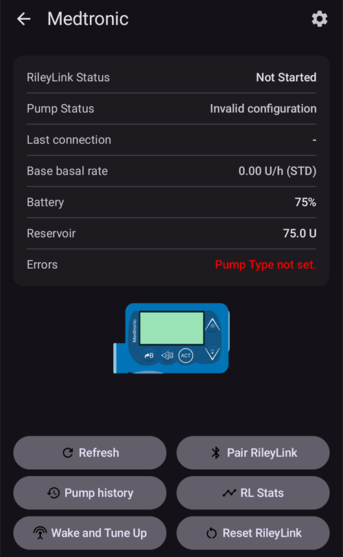
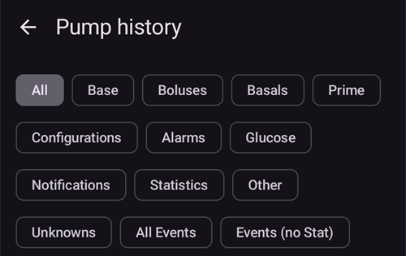
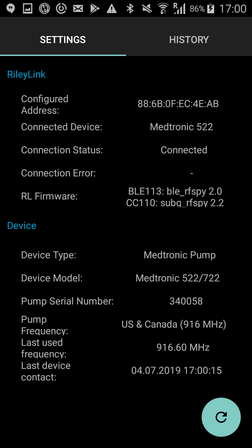
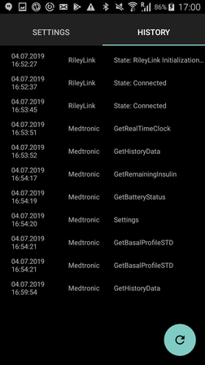
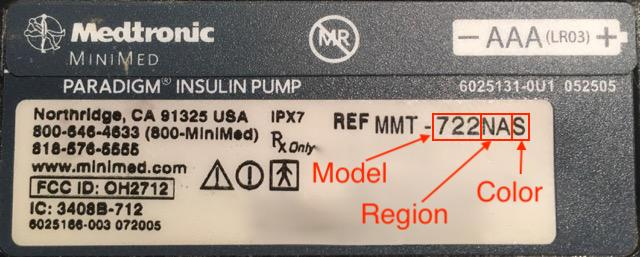

# Bombes Medtronic

El controlador no funciona amb cap model més nou, inclosos tots els models que acaben en G (530G, sèrie 600 [630G, 640G, 670G], sèrie 700 [770G, 780G], etc.).

Aquestes combinacions de model i firmware són compatibles:

- 512/712 (qualsevol versió de firmware)
- 515/715 (qualsevol versió de firmware)
- 522/722 (qualsevol versió de firmware)
- 523/723 (firmware 2.4A o inferior)
- 554/754 versió europea (firmware 2.6A o inferior)
- 554/754 versió canadenca (firmware 2.7A o inferior)

Podeu veure com comprovar el firmware de les bombes a la [documentació d'OpenAPS](https://openaps.readthedocs.io/en/latest/docs/Gear%20Up/pump.html#how-to-check-pump-firmware-check-for-absence-of-pc-connect) o a [LoopDocs](https://loopkit.github.io/loopdocs/build/step3/#medtronic-pump-firmware).

    {contents} Taula de continguts
    :depth: 1
    :local: true

## Capacitats de la bomba amb AAPS

* Cal un dispositiu compatible amb RileyLink per comunicar-se amb **AAPS**.
* Gestió automàtica de l'horari d'estiu i del fus horari.

## Requisits de maquinari i programari

- **Telèfon:** El controlador de Medtronic hauria de funcionar amb qualsevol telèfon Android que admeti connexions Bluetooth. **IMPORTANT: Cada fabricant de telèfons implementa el Bluetooth de manera diferent, per això cada model de telèfon es pot comportar de manera diferent. Per exemple, alguns telèfons gestionen d'una altra manera l'activació i la desactivació del Bluetooth. Això pot afectar l'experiència de l'usuari quan AAPS s'ha de tornar a connectar al vostre dispositiu de tipus RileyLink.**
- **Dispositiu compatible amb RileyLink:** els telèfons Android no es poden comunicar amb les bombes Medtronic sense un dispositiu a part que gestioni la comunicació. Aquest dispositiu es connecta amb el vostre telèfon per Bluetooth i amb la vostra bomba per una connexió de ràdio compatible. El primer dispositiu d'aquest tipus es deia RileyLink, però ara hi ha altres opcions que poden oferir funcions addicionals.
    
    - RileyLink disponible a [getrileylink.org](https://getrileylink.org/product/rileylink916)
    - OrangeLink disponible a [getrileylink.org](https://getrileylink.org/product/orangelink)
    - EmaLink (diversos models) disponible a [github.com](https://github.com/sks01/EmaLink)
    - Gnarl (cal una mica més de feina pròpia, DIY): detalls a [github.com](https://github.com/ecc1/gnarl)

Podeu trobar una taula comparativa dels diferents dispositius compatibles amb RileyLink a [getrileylink.org](https://getrileylink.org/rileylink-compatible-hardware-comparison-chart)

(MedtronicPump-configuration-of-the-pump)=

## Configuració de la bomba

Cal configurar aquestes opcions a la bomba perquè AAPS hi pugui enviar ordres a distància. Per a cada opció, entre parèntesis es mostren els passos per fer el canvi en una Medtronic 715. Els passos exactes poden variar segons el tipus de bomba i/o la versió del firmware.

- **Activeu el mode remot a la bomba** (a la bomba, premeu Act i aneu a Utilities -> Remote Options, seleccioneu On i a la pantalla següent feu Add ID i afegiu qualsevol identificador a l'atzar, per exemple 111111). Cal com a mínim un identificador a la llista Remote ID perquè la bomba accepti la comunicació remota.
- **Set Max Basal** (On the pump press Act and go to Basal and then select Max Basal Rate) As an example setting this value to four times your maximum standard basal rate would allow a 400% Temporary Basal Rate. El valor màxim que permet la bomba és de 34,9 unitats per hora.
- **Set Max Bolus** (On the pump press Act and go to Bolus and then select Max Bolus) This is the largest bolus that the pump will accept. El valor màxim que permet la bomba és 25.
- **Poseu el perfil a Standard**. (A la bomba, premeu Act i aneu a Basal i després a Select Patterns.) La bomba només necessita un perfil, perquè AAPS gestiona els diferents perfils al vostre telèfon. No calen altres patrons.
- **Configureu el tipus de taxa basal temporal** (a la bomba, premeu Act i aneu a Basal i després a Temp Basal Type). Seleccioneu Absolute (no Percent).

## Configuració del telèfon/AAPS per a Medtronic

- **No emparelleu el dispositiu compatible amb RileyLink des del menú Bluetooth del telèfon.** Si l'emparelleu des del menú Bluetooth del telèfon, AAPS no podrà veure el vostre dispositiu compatible amb RileyLink quan seguiu les instruccions de més avall.
- Desactiveu la rotació automàtica de la pantalla al vostre telèfon. En alguns dispositius, la rotació automàtica de la pantalla fa reiniciar les sessions Bluetooth, i això causaria problemes amb la vostra bomba Medtronic. 
- Hi ha dues maneres de configurar la vostra bomba Medtronic a AAPS:

1. Fer servir l'assistent de configuració en una instal·lació nova
2. A **Configurador** > **Bomba**, seleccionant **Medtronic**
    
    
    
    Quan està seleccionat, la targeta **Medtronic** mostra dos botons, **Configuració** i **Obrir plugin**:
    
    
    
    **Configuració** obre la configuració del controlador de Medtronic:
    
    
    
    **Obrir plugin** (o **Gestionar** > **Bomba**) obre la pantalla de la bomba Medtronic. Abans d'emparellar una bomba, es veu així:
    
    

Quan configureu la vostra bomba Medtronic amb l'assistent de configuració, és possible que no pugueu acabar la configuració per problemes de Bluetooth (p. ex. no aconseguiu connectar amb la bomba). Si passa això, seleccioneu l'opció de bomba virtual per completar la configuració i poder buscar la solució després amb l'opció 2.

Quan configureu AAPS per funcionar amb la vostra bomba Medtronic, heu de configurar aquestes opcions a **Configuració** (vegeu la imatge de la configuració més amunt):

- **Número de sèrie bomba**: es mostra a la part de darrere de la bomba i comença per SN. Només heu d'introduir els 6 números que es mostren, sense cap lletra (p. ex. 123456).
- **Tipus bomba**: el model de bomba que feu servir (p. ex. 522). 
- **Freqüència bomba**: hi ha dues opcions segons on es va distribuir originalment la vostra bomba. Please check the [FAQ](#MedtronicPump-faq) if you are unsure which option to select: 
    - for US & Canada, frequency used is 916 MHz
    - for Worldwide, frequency used is 868 MHz
- **Màx. basal a la bomba (U/h)**: ha de coincidir amb el valor configurat a la vostra bomba (vegeu Configuració de la bomba més amunt). També aquí cal triar aquest valor amb cura, perquè determina quanta insulina pot lliurar AAPS amb la vostra taxa basal. Això fixa, de fet, la taxa basal temporal màxima. Per exemple, si poseu aquest valor a quatre vegades la vostra taxa basal estàndard màxima, permetreu una taxa basal temporal del 400%. El valor màxim que permet la bomba és de 34,9 unitats per hora.
- **Màx. bolus a la bomba (U)** (en una hora): ha de coincidir amb el valor configurat a la vostra bomba (vegeu Configuració de la bomba més amunt). Cal pensar bé aquest valor, perquè determina el bolus més gran que AAPS podrà programar mai.
- **Retard fins que bolus comenci (s)**: el nombre de segons entre l'ordre de bolus i el moment en què l'ordre s'envia realment a la bomba. Aquest temps permet a l'usuari cancel·lar el bolus si s'ha enviat una ordre de bolus per error. No es pot cancel·lar un bolus que ha començat a través d'AAPS. L'única manera de cancel·lar un bolus que ja ha començat és suspendre la bomba manualment i després reprendre-la.
- **Medtronic Encoding**: Determines where the Medtronic encoding is carried out (hardware or software). És millor seleccionar la codificació per maquinari (és a dir, feta pel dispositiu compatible amb RileyLink), perquè així s'envien menys dades. Seleccionar la codificació per programari (és a dir, feta per AAPS) pot ajudar si hi ha desconnexions freqüents. Aquesta opció no es té en compte si els dispositius RileyLink tenen la versió de firmware 0.x.
- **Tipus de bateria (Vista d'energia)**: per calcular correctament la càrrega que queda a la pila, heu de seleccionar el tipus de pila AAA que feu servir. Si se selecciona un valor diferent de la vista simple, AAPS mostrarà el percentatge calculat de càrrega que queda a la pila i el voltatge. Hi ha aquestes opcions:
    
    - No seleccionat (Vista simple)
    - Alcalina (Vista ampliada)
    - Liti (Vista ampliada)
    - NiZn (Vista ampliada)
    - NiMH (Vista ampliada)
- **Fer servir escaneig**: activa l'escaneig Bluetooth abans de connectar amb els vostres dispositius compatibles amb RileyLink. Això hauria de millorar la fiabilitat de la connexió amb el dispositiu.

- **Mostrar nivell de bateria reportat per OrangeLink/EmaLink/DiaLink**: aquesta funció només és compatible amb els dispositius link més nous, com EmaLink o OrangeLink. El valor es mostra com a **Bateria RileyLink** a la pantalla de la bomba Medtronic.
- **Establir basals temporals neutres**: per defecte, les bombes Medtronic fan un bip a cada hora en punt quan hi ha una taxa basal temporal activa. Activar aquesta opció pot reduir el nombre de bips: interromp la basal temporal al canvi d'hora per evitar el bip.

(pairing-your-rileylink-compatible-device)=

### Emparellar el vostre dispositiu compatible amb RileyLink

El vostre dispositiu compatible amb RileyLink s'emparella des de la pantalla de la bomba Medtronic, no des del menú Bluetooth del telèfon:

- Obriu la pantalla de la bomba (**Gestionar** > **Bomba**, o **Obrir plugin** a la targeta Medtronic a **Configurador** > **Bomba**).
- Toqueu **Emparellar RileyLink**. **AAPS** busca dispositius compatibles amb RileyLink a prop.
- Toqueu el vostre dispositiu a la llista. Quan es mostri **RileyLink emparellat correctament**, toqueu **OK**.

## Pantalla de la bomba Medtronic

Per obrir la pantalla de la bomba Medtronic, aneu a **Gestionar** > **Bomba**. La pantalla de la bomba mostra la informació de l'estat actual de la bomba i algunes accions específiques de Medtronic (vegeu la imatge de la pantalla de la bomba més amunt).

- **Estat RileyLink**: l'estat actual de la connexió entre el vostre telèfon i el dispositiu compatible amb RileyLink. Hauria de mostrar sempre Connectat. Qualsevol altre estat pot necessitar que l'usuari intervingui. 
- **Bateria RileyLink**: el nivell actual de la bateria del vostre dispositiu EmaLink o OrangeLink. Només es mostra si **Mostrar nivell de bateria reportat per OrangeLink/EmaLink/DiaLink** està activat a la configuració de Medtronic.
- **Estat bomba**: l'estat actual de la connexió amb la bomba. Com que la bomba no està connectada tota l'estona, normalment es mostrarà la icona de repòs. Hi ha altres estats possibles, com ara «Despertant» quan AAPS intenta enviar una ordre, o altres ordres de la bomba com «Obtenir hora», «Establir TBR», etc.
- **Bateria**: mostra l'estat de la pila segons el valor triat a **Tipus de bateria (Vista d'energia)** a la configuració de Medtronic.
- **Última connexió**: quant de temps fa de l'última connexió correcta amb la bomba.
- **Darrer bolus**: quant de temps fa que es va lliurar correctament el darrer bolus.
- **Basal base**: la taxa basal base que la bomba fa servir en aquesta hora segons el vostre perfil actiu.
- **Basal temporal**: la basal temporal que s'està lliurant ara; pot ser de 0 unitats per hora.
- **Reservori**: quanta insulina hi ha al reservori (s'actualitza com a mínim cada hora).
- **Errors**: text de l'error si hi ha un problema (sobretot si hi ha un error a la configuració).

A la part de baix de la pantalla hi ha aquests botons:

- **Actualitzar** serveix per actualitzar l'estat actual de la bomba. Només s'hauria de fer servir si la connexió s'ha perdut durant molt de temps, perquè caldrà actualitzar totes les dades (llegir l'historial, llegir/configurar l'hora, llegir el perfil, llegir l'estat de la pila, etc.).
- **Emparellar RileyLink**: busca i emparella el vostre dispositiu compatible amb RileyLink (vegeu [més amunt](#pairing-your-rileylink-compatible-device)).
- **Historial de la bomba**: mostra l'historial de la bomba (vegeu [més avall](#MedtronicPump-pump-history)).
- **Estadístiques RL**: mostra les estadístiques RL (vegeu [més avall](#MedtronicPump-rl-status-rileylink-status)).
- **Engegar i ajustar** i **Restablir RileyLink**: vegeu [Accions](#medtronic-actions) més avall.
- **Esborrar bloc de bolus**: només es mostra una estona curta després d'un bolus, mentre **AAPS** espera que la bomba acabi de lliurar-lo. Si el toqueu, s'acaba aquesta espera.

(MedtronicPump-pump-history)=

## Historial de la bomba

L'historial de la bomba es llegeix cada 5 minuts i es desa al telèfon. Només es desa l'historial de les darreres 24 hores. Així podeu veure còmodament què ha fet la bomba, si cal. Només es desen les entrades rellevants per a AAPS; no s'hi inclouen les funcions de configuració que no tenen importància.

Toqueu **Historial de la bomba** a la pantalla de la bomba per obrir-lo. Per defecte, està seleccionat **Tots**. Toqueu un dels botons de filtre de la part de dalt (per exemple **Bolus**, **Basals** o **Alarmes**) per mostrar només un tipus d'entrada.

(MedtronicPump-rl-status-rileylink-status)=

## Estat RL (estat del RileyLink)

 

El diàleg d'estat RL té dues pestanyes:

- **Configuració**: mostra la configuració del dispositiu compatible amb RileyLink: adreça configurada, dispositiu connectat, estat de la connexió, error de connexió i versions del firmware del RileyLink. El tipus de dispositiu és sempre Medtronic Pump, el model és el vostre model, el número de sèrie és el número de sèrie configurat, la freqüència de la bomba mostra quina freqüència feu servir i la darrera freqüència és la darrera freqüència utilitzada.
- **Historial**: mostra l'historial de comunicació. Les entrades amb RileyLink mostren els canvis d'estat del RileyLink, i les entrades amb Medtronic mostren quines ordres s'han enviat a la bomba.

(medtronic-actions)=

## Accions

Quan es fa servir el controlador de Medtronic, hi ha dues accions addicionals a la pantalla de la bomba (**Gestionar** > **Bomba**):

- **Engegar i ajustar** - Si AAPS fa molt de temps que no es connecta a la vostra bomba (s'hi hauria de connectar cada 5 minuts), podeu forçar un ajust. Això intentarà contactar amb la vostra bomba buscant per totes les freqüències de ràdio possibles que fa servir la bomba. Si la connexió funciona, la freqüència que ha funcionat es fixarà com a freqüència per defecte. Mentre es fa l'ajust, l'estat del RileyLink a la pantalla de la bomba ho mostra. Si un ajust falla (per exemple, perquè la bomba era fora d'abast), **AAPS** ho torna a provar sol cada 10 minuts aproximadament.
- **Restablir RileyLink** - Si reinicieu el vostre dispositiu compatible amb RileyLink, potser haureu de fer servir aquesta acció perquè el dispositiu es torni a configurar (freqüència, tipus de freqüència i codificació).

## Notes importants

### Cal anar amb compte amb la configuració de NS

AAPS fa servir el número de sèrie per a la sincronització, i el número de sèrie es mostra a NS. Com que qui coneix el número de sèrie d'una bomba Medtronic antiga la pot controlar a distància, protegiu bé el vostre lloc de NS perquè no es filtri el número de sèrie (SN) de la vostra bomba. Vegeu https://nightscout.github.io/nightscout/security/

### Usuaris d'OpenAPS

Els usuaris d'OpenAPS han de tenir en compte que AAPS amb Medtronic funciona de manera completament diferent d'OpenAPS. Amb AAPS, la manera principal d'interactuar amb la bomba és a través del telèfon. In normal use cases it is likely that the only time it is required to use the pump menu is when changing reservoirs. Això és molt diferent d'OpenAPS, on normalment almenys una part del bolus es lliura amb els botons de bolus ràpid. Si es fa servir la bomba per lliurar un bolus manualment, hi pot haver problemes si AAPS intenta lliurar-ne un al mateix temps. Hi ha controls per intentar evitar problemes en aquests casos, però tot i així cal evitar-ho sempre que sigui possible.

### Registre

Si heu de resoldre problemes amb la vostra bomba Medtronic, seleccioneu la icona del menú a la cantonada superior esquerra de la pantalla, seleccioneu Manteniment i Configuració de registres. Per resoldre qualsevol problema de Medtronic, cal activar Pump, PumpComm i PumpBTComm.

### CGM de Medtronic

Ara mateix, el CGM de Medtronic NO és compatible.

### Ús manual de la bomba

Eviteu fer bolus manuals o configurar TBR directament a la bomba. Totes aquestes ordres s'han d'enviar a través d'AAPS. Si feu servir ordres manuals, hi ha d'haver com a mínim 3 minuts entre una i l'altra per reduir el risc de problemes.

### Canvis de fus horari i DST (horari d'estiu) o viatjar amb una bomba Medtronic i AAPS

AAPS detecta automàticament els canvis de fus horari i actualitza l'hora de la bomba quan el telèfon canvia a l'hora nova.

Viatjar cap a l'est vol dir que sumeu hores a l'hora actual (p. ex. de GMT+0 a GMT+2), i això no causa cap problema perquè no hi ha cap solapament (és a dir, no es pot tenir la mateixa hora dues vegades). En canvi, viatjar cap a l'oest pot causar problemes perquè, de fet, aneu enrere en el temps, i això pot donar dades d'IOB incorrectes.

Els desenvolupadors coneixen els problemes que passen quan es viatja cap a l'oest i treballen en una possible solució. Vegeu https://github.com/andyrozman/RileyLinkAAPS/issues/145 per a més detalls. De moment, tingueu en compte que aquest problema pot passar i vigileu bé quan canvieu de fus horari.

### Un GNARL és un dispositiu totalment compatible amb RileyLink?

El codi GNARL admet totes les funcions que fa servir el controlador de Medtronic a AAPS, per tant és totalment compatible. Tingueu en compte que això demana feina addicional: heu d'aconseguir maquinari compatible i després carregar el codi GNARL al dispositiu.

**Nota de l'autor:** Tingueu en compte que el programari GNARL encara és experimental i s'ha provat poc, i no s'ha de considerar tan segur com un RileyLink.

(MedtronicPump-faq)=

## Preguntes freqüents

(MedtronicPump-what-to-do-if-i-loose-connection-to-rileylink-and-or-pump)=

### What to do if I lose connection to RileyLink and/or pump?

Hi ha diverses opcions per intentar resoldre els problemes de connexió.

- Toqueu **Engegar i ajustar** a la pantalla de la bomba (**Gestionar** > **Bomba**), com s'explica més amunt.
- Desactiveu el Bluetooth al telèfon, espereu 10 segons i torneu-lo a activar. Així el dispositiu RileyLink s'haurà de tornar a connectar al telèfon.
- Reinicieu el dispositiu RileyLink. Després heu de tocar **Restablir RileyLink** a la pantalla de la bomba (**Gestionar** > **Bomba**).
- Altres usuaris han vist que aquests passos funcionen per recuperar la connexió quan els altres mètodes no han funcionat: 
    1. Reinicieu el telèfon
    2. *Mentre* el telèfon es reinicia, reinicieu el dispositiu RileyLink
    3. Obriu AAPS i deixeu que es recuperi la connexió

### Com saber quina freqüència fa servir la meva bomba

A la part de darrere de la bomba trobareu una línia amb el número de model i un codi especial de 3 lletres. Les dues primeres lletres indiquen el tipus de freqüència i la darrera indica el color. Aquests són els valors possibles de la freqüència:

- NA - Amèrica del Nord (a la selecció de freqüència heu de seleccionar «EUA i Canadà (916 MHz)»)
- CA - Canadà (a la selecció de freqüència heu de seleccionar «EUA i Canadà (916 MHz)»)
- WW - Worldwide (in frequency selection you need to select "Worldwide (868 MHz)")

(MedtronicPump-pump-unreachable)=

### Com solucionar l'error «Bomba no accessible»

Algunes bombes Medtronic mostren l'error «Bomba no accessible» després d'una actualització d'**AAPS**. Per solucionar-ho, canvieu el tipus de codificació:

1. Aneu a **Configurador** > **Bomba** i toqueu **Configuració** a la targeta **Medtronic**.
2. Set **Medtronic Encoding** to **Hardware 4b6b Encoding**.

## On trobar ajuda

El controlador de Medtronic el desenvolupa la comunitat de manera **voluntària**. Abans de demanar ajuda:

1. **Llegiu** la secció corresponent d'aquesta documentació per confirmar com ha de funcionar la funció.
2. **Pregunteu** al canal *#AAPS* de [Discord](https://discord.gg/4fQUWHZ4Mw) o en un dels altres [canals de la comunitat](../GettingHelp/WhereCanIGetHelp.md).
3. **Informeu d'un error** buscant entre les [incidències existents](https://github.com/nightscout/AndroidAPS/issues); si la vostra no hi és, obriu una [incidència nova](https://github.com/nightscout/AndroidAPS/issues) i adjunteu els vostres [fitxers de registre](../GettingHelp/AccessingLogFiles.md).

Quan demaneu ajuda, indiqueu la marca i el model del telèfon, la versió d'Android, la versió d'**AAPS** i una descripció senzilla del problema (què ha canviat, quan va funcionar per darrera vegada).