(medtrum-nano-300u)=
# Medtrum Nano 200U / 300U

Aquestes instruccions serveixen per configurar la bomba d'insulina Medtrum.

```{contents} Table of contents
:depth: 1
:local: true
```

## Capacitats de la bomba amb AAPS
* Totes les funcions del llaç són compatibles (SMB, TBR, etc.)
* Canvi automàtic d'horari d'estiu (DST) i de fus horari
* El controlador d'AAPS no admet el bolus estès

## Requisits de maquinari i programari
* **Bases de bomba i patches de reservori Medtrum compatibles**
    - Compatibles ara:
        - Medtrum TouchCare Nano 200U with pumpbase refs: **MD0201** and **MD8201**.
        - Medtrum TouchCare 300U amb base de bomba ref.: **MD8301**.
        - Si teniu un model no compatible i voleu donar maquinari o ajudar a fer proves, contacteu-nos per Discord [aquí](https://discordapp.com/channels/629952586895851530/1076120802476441641).
* **AAPS built and installed** using the [Build APK](../SettingUpAaps/BuildingAaps.md) instructions.
* **Telèfon Android compatible** amb connexió Bluetooth BLE
    - Vegeu les [Notes de la versió](../Maintenance/ReleaseNotes.md) d'AAPS

## Abans de començar

**PRIMER LA SEGURETAT** No feu aquest procés en un entorn on no us pugueu recuperar d'un error (cal tenir patches de recanvi, insulina i dispositius per controlar la bomba).

**El PDM i l'aplicació Medtrum no funcionaran amb un patch activat per AAPS.** Abans potser fèieu servir el PDM o l'aplicació Medtrum per enviar ordres a la bomba. Per motius de seguretat, el patch activat només es pot fer servir amb el dispositiu o l'aplicació que el va activar.

*Això NO vol dir que hàgiu de llençar el PDM. Es recomana guardar-lo en un lloc segur com a reserva per a emergències, per exemple si perdeu el telèfon o AAPS no funciona bé.*

**La bomba no deixa de lliurar insulina quan no està connectada a AAPS** Les taxes basals per defecte es programen a la bomba segons el perfil actiu. Mentre AAPS funciona, envia ordres de basal temporal que duren com a màxim 120 minuts. Si per algun motiu la bomba no rep ordres noves (per exemple, perquè s'ha perdut la comunicació per la distància entre la bomba i el telèfon), la bomba torna a la taxa basal per defecte programada a la bomba quan acaba la basal temporal.

**The AAPS Profile does not support a 30 minute basal rate time frame** If you are new to AAPS and are setting up your basal rate profile for the first time, please be aware that basal rates starting on a half-hour basis are not supported, and you will need to adjust your basal rate profile to start on the hour. Per exemple, si teniu una taxa basal d'1,1 unitats que comença a les 09:30 i dura 2 hores fins a les 11:30, no funcionarà. Haureu de canviar aquesta taxa basal d'1,1 unitats a un interval de 9:00–11:00 o de 10:00–12:00. Encara que el maquinari de la bomba Medtrum admet trams de 30 minuts al perfil basal, ara mateix els algoritmes d'AAPS no els poden tenir en compte.

**AAPS NO admet taxes basals de 0 U/h al perfil** Encara que la bomba Medtrum admet una taxa basal de zero, AAPS fa servir múltiples de la taxa basal del perfil per decidir els tractaments automàtics, i per això no pot funcionar amb una taxa basal de zero. The minimum profile basal rate is 0.05 U/h.

Podeu aconseguir una basal temporal de zero amb la funció «Desconnectar bomba» o amb una combinació de Desactivar llaç / basal temporal o Suspendre el llaç / basal temporal.

## Configuració

```{caution}
When you activate a patch with **AAPS**, you **MUST** turn off every other device that can talk to the Medtrum pump base, for example an active PDM or the Medtrum app.
```

### Pas 1: Seleccioneu la bomba Medtrum

#### Opció 1: Instal·lacions noves

If you are installing **AAPS** for the first time, the **Setup Wizard** guides you through the setup. Select **Medtrum** when you reach the **Pump** step.

If in doubt, you can also select **Virtual Pump** and select **Medtrum** later, after setting up **AAPS** (see option 2).


#### Opció 2: La pantalla Configurador

On an existing installation you can select the **Medtrum** pump in [Configuration > Pump](#Config-Builder-pump):

Open the top-left **menu** (☰), tap **Configuration** > **Pump**, and select the **Medtrum** card. Només pot estar activa una bomba alhora.


Once it is selected, the **Medtrum** card shows two buttons, **Settings** and **Open plugin**:

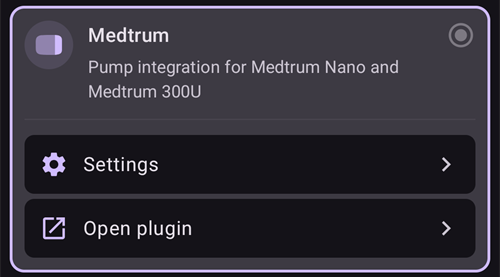

**Open plugin** (or **Manage → Pump**) opens the Medtrum pump screen. You use it to change patches and to see the pump status. Before a patch is activated it looks like this:

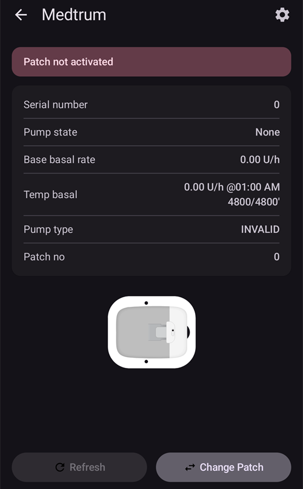

(medtrum-step-2)=
### Pas 2: Canvieu la configuració de Medtrum

Tap **Settings** on the **Medtrum** card in **Configuration** > **Pump**. You can also tap the gear icon in the top-right corner of the Medtrum pump screen. This opens the **Medtrum pump settings**:

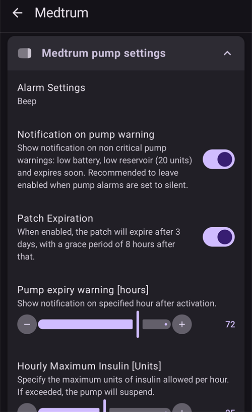

```{note}
There is no **Serial Number** setting any more. **AAPS** finds your pump base with a Bluetooth scan the first time you activate a patch (see [Step 3](#medtrum-activate-patch)), and remembers its serial number. To use a different pump base, see [Unpair](#medtrum-unpair).
```

#### Alarm Settings

***Per defecte: Bip.***

This setting changes the way that the pump alerts you when there is a warning or error.

- **Beep**: the patch beeps on alarms and warnings.
- **Silent**: the patch does not alert you on alarms and warnings.

Note: In silent mode **AAPS** still sounds the alarm, depending on your phone's volume settings. If you do not respond to the alarm, the patch eventually beeps.

#### Avís en cas d'advertència de la bomba

***Per defecte: activat.***

This setting changes the way **AAPS** shows notifications for non-critical pump warnings. When enabled, a notification is shown on the phone when a pump warning occurs, including:
- Bateria baixa
- Low reservoir (20 units)
- Patch expires soon

We recommend leaving this enabled when the pump alarms are set to **Silent**. In either case these warnings are also shown on the Medtrum pump screen under [Active alarms](#medtrum-active-alarms).

(medtrum-patch-expiration)=
#### Caducitat del patch

***Per defecte: activat.***

Aquesta opció canvia el comportament del patch. When enabled, the patch expires after 3 days and gives an audible warning if you have sound enabled. After 3 days and 8 hours the patch stops working.

If this setting is disabled, the patch does not warn you before it stops. With recent pump base firmware, a patch runs for 5 days at most.

#### Pump expiry warning [hours]

***Per defecte: 72 hores.***

This setting changes the time of the expiration warning. When [Patch Expiration](#medtrum-patch-expiration) is enabled, **AAPS** shows a notification this many hours after activation.

#### Hourly Maximum Insulin [Units]

***Per defecte: 25 U.***

Aquesta opció canvia la quantitat màxima d'insulina que es pot lliurar en una hora. If this limit is exceeded, the patch suspends and gives an alarm. You can reset the alarm with the **Reset alarms** button on the pump screen, see [Reset alarms](#nano-reset-alarms).

Poseu-hi un valor raonable per a les vostres necessitats d'insulina.

#### Daily Maximum Insulin [Units]

***Per defecte: 80 U.***

Aquesta opció canvia la quantitat màxima d'insulina que es pot lliurar en un dia. If this limit is exceeded, the patch suspends and gives an alarm. You can reset the alarm with the **Reset alarms** button on the pump screen, see [Reset alarms](#nano-reset-alarms).

Poseu-hi un valor raonable per a les vostres necessitats d'insulina.

#### Scan on connection error

***Per defecte: desactivat.***

Es troba a **Configuració avançada**.

Only enable this if you have connection problems. When enabled, the driver scans for the pump again before trying to reconnect to it. Make sure the Location permission for **AAPS** is set to "Allow all the time".

### Step 2b: AAPS alert settings

These settings are not part of the Medtrum driver. Open them from the **Settings** (gear) icon in the top-right corner of the main screen. See [Settings](../SettingUpAaps/Preferences.md) for more.

#### BT Watchdog

Open **Settings** > **Pump**:


**BT Watchdog** switches off the phone's Bluetooth for one second if **AAPS** cannot connect to the pump. This may help on some phones where Bluetooth freezes.

Enable this setting if you often have connection problems with your pump.

#### Alertes locals

Open **Settings** > **Local alerts**:


##### Alertar si la bomba no és accessible

***Per defecte: activat.***

This setting is forced on when the Medtrum driver is enabled. It alerts you when the pump is unreachable. This can happen when the pump is out of range, or when it is not responding because of a faulty patch or pump base, for example when water leaks between the pump base and the patch.

Per motius de seguretat, aquesta opció no es pot desactivar.

##### Pump unreachable threshold

***Per defecte: 30 min.***

This setting changes how long **AAPS** waits before alerting you that the pump is unreachable.

You can change this setting when using the Medtrum pump, but we recommend keeping it at 30 minutes for safety reasons.

(medtrum-activate-patch)=
### Pas 3: Activeu el patch

**Abans de continuar:**
- Have your Medtrum pump base and a new reservoir patch ready.
- Turn off other devices that can talk to the Medtrum pump (PDM and Medtrum app).
- Ideally, make sure **AAPS** is set up and a [profile is activated](../DailyLifeWithAaps/ProfileSwitch-ProfilePercentage.md). If no profile is active, the activation starts with a **Profile required** step where you choose the profile to activate.

#### Start the activation

Open the [Medtrum pump screen](#nano-overview) (**Manage → Pump**) and tap **Change Patch**. If you have set up [settings protection](#Preferences-protection), you must enter your password or PIN first.

If a patch is already active, you are asked to deactivate it first, see [Deactivate patch](#nano-deactivate-patch).

The activation is a step-by-step wizard. Seguiu les instruccions de la pantalla per omplir i activar un patch nou. Tap **Cancel** at any step to stop.

```{important}
Only put the patch on your body and insert the cannula when the wizard tells you to (after priming is complete).
```

The first steps you see depend on your setup:

1. **Profile required**: only if no profile is active. Select the profile to apply, then continue.
2. **Find Pump**: only the first time, or after you used [Unpair](#medtrum-unpair). Connect the pump base to a fresh patch to power it on. **AAPS** scans for nearby Medtrum pump bases (their names start with `MT`). Tap yours in the list. **AAPS** saves its serial number, then goes straight to filling the patch.

   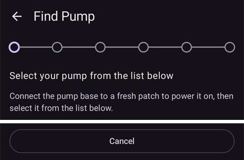

3. **Activate Patch**: only when **AAPS** already knows your pump base. The screen says "No active patch. Press **Next** to begin the activation process." Make sure the pump base is **not** connected to the patch yet, then tap **Next**.

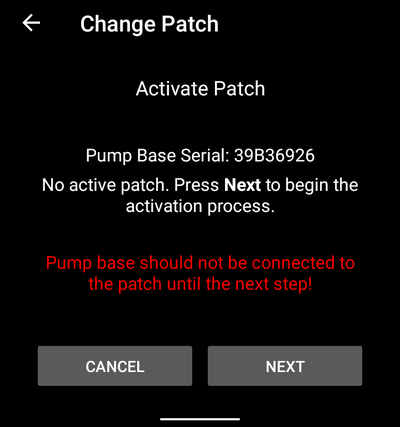

#### Connect and fill the patch

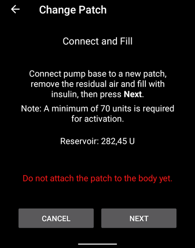

Connect the pump base to the patch, remove the residual air and fill the patch with insulin. A minimum of 70 units is needed for activation. The screen shows the reservoir level. Do not attach the patch to your body yet.

When the patch is detected and filled, the **Next** button appears. Tap it.

#### Select insulin

This step only appears if you have more than one insulin set up in **AAPS**. Select the insulin you are filling the patch with. **AAPS** applies a profile switch with this insulin after activation.

#### Encebar el patch

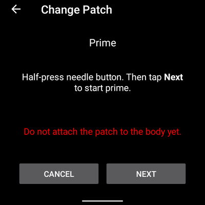

Do **not** remove the safety lock. Half-press the needle button on the patch, then tap **Next** to start priming.

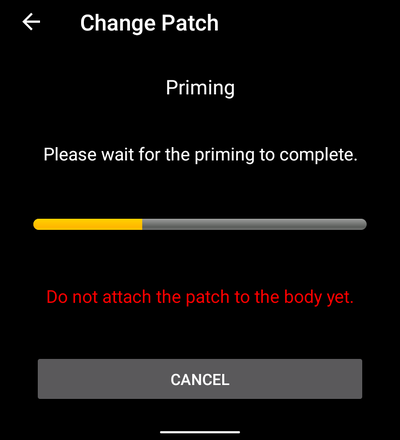

Wait for priming to complete.

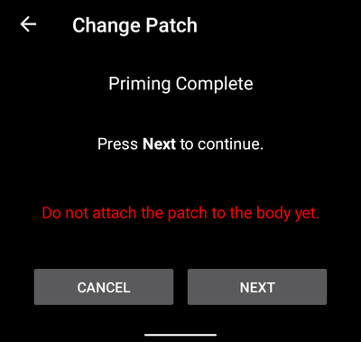

When priming is complete, tap **Next** to continue.

#### Rotació de punts d'inserció

This step only appears if you manage pump sites with [Site Rotation](#Aapsscreens-site-rotation) (setting **Manage pump site rotation**). Choose where you place the patch on your body, or skip this step.

#### Col·locar el patch

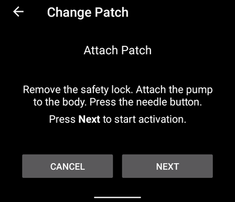

Clean the skin and remove the stickers. Remove the safety lock, attach the patch to your body, and press the needle button to insert the cannula.

Tap **Next** to activate the patch.

#### Activar el patch


**AAPS** activates the pump and sets the initial basal rate. Please wait. When activation is complete, the following screen appears:


```{admonition} Older screenshot
:class: note
Apart from **Find Pump**, the activation screenshots above are from an earlier **AAPS** version and may look different in **AAPS** 4.
```

It shows how many units are left in the patch. Tap **OK** to return to the pump screen.

```{tip}
After a new activation, [export your settings](../Maintenance/ExportImportSettings.md). This lets you recover this patch session later, for example on a new phone.
```

(nano-deactivate-patch)=

### Desactivar el patch

To deactivate the active patch, open the [Medtrum pump screen](#nano-overview) (**Manage → Pump**) and tap **Change Patch**.

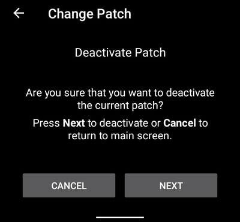

You are asked to confirm that you want to deactivate the current patch. **This cannot be undone.** Tap **Next** to deactivate, or **Cancel** to return to the pump screen.


If **AAPS** cannot deactivate the patch (for example because the pump base has already been removed from the patch), tap **Discard** to forget the current patch session. You can then activate a new patch.

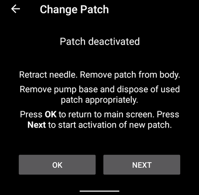

When deactivation is complete, retract the needle and remove the patch from your body. Remove the pump base and dispose of the used patch. Tap **OK** to return to the pump screen, or **Next** to start activating a new patch.

(nano-resume-interrupted-activation)=

### Reprendre una activació interrompuda

If a patch activation is interrupted, for example because the phone battery runs out, you can resume it. Open the [Medtrum pump screen](#nano-overview) (**Manage → Pump**) and tap **Change Patch**.

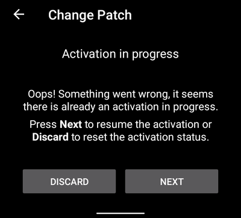

Tap **Next** to resume the activation. Tap **Discard** to reset the activation status, so you can activate a new patch.

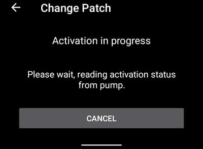

```{admonition} Older screenshot
:class: note
The screenshots in **Deactivate patch** and **Resume interrupted activation** are from an earlier **AAPS** version and may look different in **AAPS** 4.
```

The driver reads the activation status from the pump. If this works, the wizard continues at the step where it stopped.

(nano-overview)=

## Pump screen

The Medtrum pump screen (**Manage → Pump**) shows the current status of the Medtrum patch. It also has buttons to change the patch, reset alarms and refresh the status. A banner at the top shows important states, for example **Patch not activated** or **Pump is suspended**.

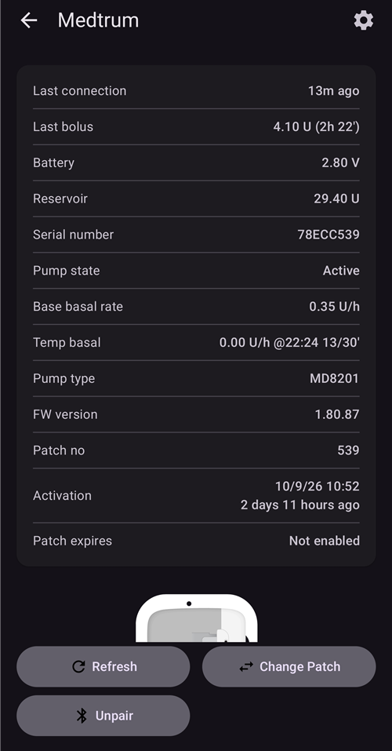

The screen can show these rows. Some rows only appear when they have a value.

- **Last connection**: how long ago **AAPS** last connected to the pump.
- **Last bolus**: the last bolus that was delivered.
- **Battery**: the current battery voltage of the patch.
- **Reservoir**: the current reservoir level.
- **Serial number**: the serial number of your pump base.
- **Pump state**: the current state of the pump. For example **Active** (the patch is activated and running normally) or **Stopped** (the patch is not activated).
- **Base basal rate**: the basal rate from your profile that is running now.
- **Temp basal**: the temporary basal rate, if one is running.
- **Active bolus**: the bolus that is being delivered right now.
- **Active alarms**: see [below](#medtrum-active-alarms).
- **Pump type**: the model of your pump base.
- **FW version**: the firmware version of the pump base.
- **Patch no**: the sequence number of the activated patch. It goes up by one every time you activate a new patch.
- **Activation**: the date and time the patch was activated, and how long ago that was.
- **Patch expires**: the date and time when the patch expires. Shows **Not enabled** if [Patch Expiration](#medtrum-patch-expiration) is off.

(medtrum-active-alarms)=
### Active alarms

This row shows any alarms that are active right now, for example a low reservoir or an expiring patch.

### Refresh

This button refreshes the status of the patch. It is only available when a patch is active and **AAPS** is not connected to the pump at that moment.

### Change Patch

This button starts the wizard to change the patch. Vegeu [Activar el patch](#medtrum-activate-patch) per a més informació.

(medtrum-unpair)=
### Unpair

This button only appears when **AAPS** knows a pump base. It clears the stored pump base serial number and disconnects. The next time you activate a patch, **AAPS** scans for a pump base again (the **Find Pump** step). Use this if you switch to a different pump base. Only do this when no patch is active.

(nano-reset-alarms)=

### Restablir alarmes

The **Reset alarms** button only appears on the pump screen when the patch has suspended itself, for example after a maximum daily insulin alarm. Tap it to reset the alarms and resume insulin delivery.

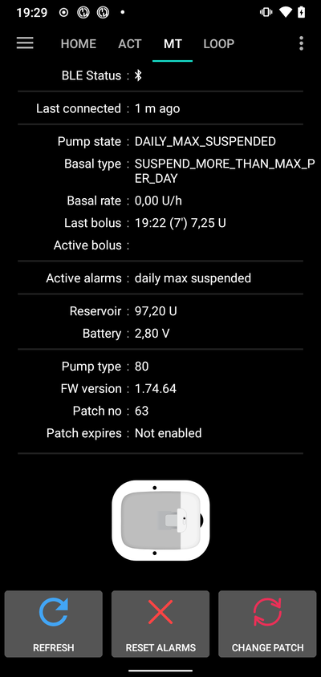

```{admonition} Older screenshot
:class: note
La captura de pantalla de dalt és d'una versió anterior d'**AAPS**. In **AAPS** 4 the pump screen looks different, but the **Reset alarms** button works the same way.
```

## Canvi de telèfon, exportar/importar la configuració

When you switch to a new phone, do the following:
* [Export settings](../Maintenance/ExportImportSettings.md) on your old phone.
* Transfer the settings file from the old phone to the new phone, and import it into **AAPS**. Tick **Also replace pump settings** on the import screen, otherwise the patch session is not transferred to the new phone.

The imported settings file must be from the patch session you are using now, otherwise the patch will not connect (see [Tubeless pumps](#ExportImportSettings-tubeless-pumps)).

After a settings import, the driver syncs the history with the pump. This can take a while, depending on the age of the settings file. The progress ("Syncing records, ... left") is shown on the main screen:


(medtrum-nano-troubleshooting)=

## Resolució de problemes

### Problemes de connexió

If you have connection timeouts or other connection problems:
- In the Android app settings for **AAPS**, set the Location permission to "Allow all the time".
- Try enabling **Scan on connection error** (Medtrum settings > **Advanced Settings**) and **BT Watchdog** (**Settings** > **Pump**), see [Step 2](#medtrum-step-2).

### Problemes de Bluetooth
Per a problemes coneguts amb connexions Bluetooth, talls de connexió amb bombes o pods, o problemes d'activació i connexió, vegeu [Problemes relacionats amb el Bluetooth](../GettingHelp/BluetoothTroubleshooting.md)

### Activació interrompuda

If the activation is interrupted, for example by an empty phone battery or a phone crash, you can resume it. Tap **Change Patch** on the pump screen and follow the steps in [Resume interrupted activation](#nano-resume-interrupted-activation).

### Com evitar errors del patch

El patch pot donar errors diferents. Per evitar errors freqüents:
- Assegureu-vos que la base de la bomba està ben encaixada al patch i que no es veu cap espai entre tots dos.
- Quan ompliu el patch, no premeu l'èmbol amb massa força. No intenteu omplir el patch per sobre del màxim del vostre model.

## On trobar ajuda

Tota la feina de desenvolupament del controlador Medtrum la fa la comunitat de manera **voluntària**. Us demanem que ho tingueu present i que seguiu aquestes pautes abans de demanar ajuda:

-  **Nivell 0:** Llegiu la secció corresponent d'aquesta documentació per assegurar-vos que enteneu com ha de funcionar la funció que us dona problemes.
-  **Nivell 1:** Si encara teniu problemes que no podeu resoldre amb aquest document, aneu al canal *#Medtrum* de **Discord** amb [aquest enllaç d'invitació](https://discord.gg/4fQUWHZ4Mw).
-  **Level 2:** Search existing issues to see if your issue has already been reported at [Issues](https://github.com/nightscout/AAPS/issues). If it exists, please confirm/comment/add information on your problem. Si no, creeu una [incidència nova](https://github.com/nightscout/AndroidAPS/issues) i adjunteu-hi [els vostres fitxers de registre](../GettingHelp/AccessingLogFiles.md).
-  **Tingueu paciència: la majoria dels membres de la nostra comunitat són voluntaris de bona fe, i resoldre problemes sovint demana temps i paciència tant als usuaris com als desenvolupadors.**