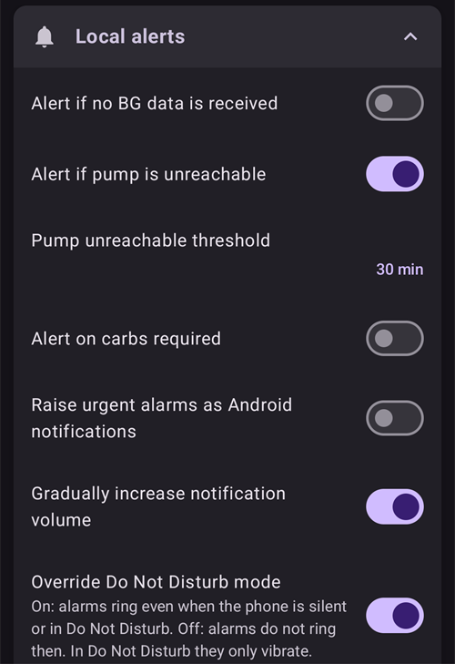
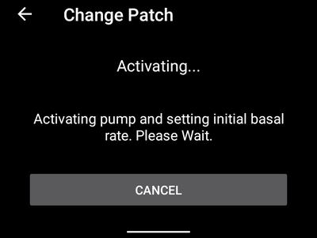
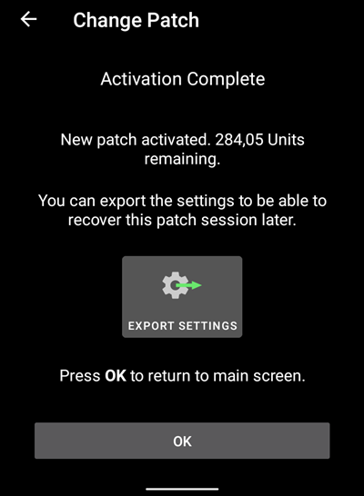
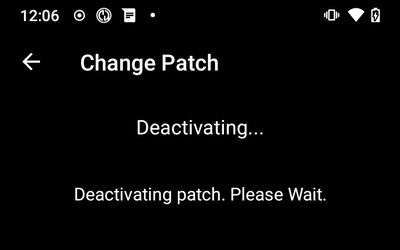
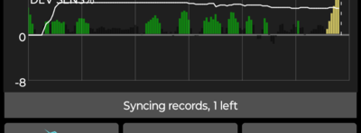

(medtrum-nano-300u)=
# Medtrum Nano 200U / 300U

Aquestes instruccions serveixen per configurar la bomba d'insulina Medtrum.

```{contents} Table of contents
:depth: 1
:local: true
```

## Capacitats de la bomba amb AAPS
* Totes les funcions del llaç són compatibles (SMB, TBR, etc.)
* Canvi automàtic d'horari d'estiu (DST) i de fus horari
* El controlador d'AAPS no admet el bolus estès

## Requisits de maquinari i programari
* **Bases de bomba i patches de reservori Medtrum compatibles**
    - Compatibles ara:
        - Medtrum TouchCare Nano 200U amb bases de bomba ref.: **MD0201** i **MD8201**.
        - Medtrum TouchCare 300U amb base de bomba ref.: **MD8301**.
        - Si teniu un model no compatible i voleu donar maquinari o ajudar a fer proves, contacteu-nos per Discord [aquí](https://discordapp.com/channels/629952586895851530/1076120802476441641).
* **AAPS compilat i instal·lat** seguint les instruccions de [Compilar AAPS](../SettingUpAaps/BuildingAaps.md).
* **Telèfon Android compatible** amb connexió Bluetooth BLE
    - Vegeu les [Notes de la versió](../Maintenance/ReleaseNotes.md) d'AAPS

## Abans de començar

**PRIMER LA SEGURETAT** No feu aquest procés en un entorn on no us pugueu recuperar d'un error (cal tenir patches de recanvi, insulina i dispositius per controlar la bomba).

**El PDM i l'aplicació Medtrum no funcionaran amb un patch activat per AAPS.** Abans potser fèieu servir el PDM o l'aplicació Medtrum per enviar ordres a la bomba. Per motius de seguretat, el patch activat només es pot fer servir amb el dispositiu o l'aplicació que el va activar.

*Això NO vol dir que hàgiu de llençar el PDM. Es recomana guardar-lo en un lloc segur com a reserva per a emergències, per exemple si perdeu el telèfon o AAPS no funciona bé.*

**La bomba no deixa de lliurar insulina quan no està connectada a AAPS** Les taxes basals per defecte es programen a la bomba segons el perfil actiu. Mentre AAPS funciona, envia ordres de basal temporal que duren com a màxim 120 minuts. Si per algun motiu la bomba no rep ordres noves (per exemple, perquè s'ha perdut la comunicació per la distància entre la bomba i el telèfon), la bomba torna a la taxa basal per defecte programada a la bomba quan acaba la basal temporal.

**El perfil d'AAPS no admet trams de 30 minuts a la taxa basal** Si sou nous a AAPS i configureu el perfil basal per primera vegada, tingueu en compte que no s'admeten taxes basals que comencin a la mitja hora. Haureu d'ajustar el perfil basal perquè cada tram comenci a l'hora en punt. Per exemple, si teniu una taxa basal d'1,1 unitats que comença a les 09:30 i dura 2 hores fins a les 11:30, no funcionarà. Haureu de canviar aquesta taxa basal d'1,1 unitats a un interval de 9:00–11:00 o de 10:00–12:00. Encara que el maquinari de la bomba Medtrum admet trams de 30 minuts al perfil basal, ara mateix els algoritmes d'AAPS no els poden tenir en compte.

**AAPS NO admet taxes basals de 0 U/h al perfil** Encara que la bomba Medtrum admet una taxa basal de zero, AAPS fa servir múltiples de la taxa basal del perfil per decidir els tractaments automàtics, i per això no pot funcionar amb una taxa basal de zero. La taxa basal mínima del perfil és de 0,05 U/h.

Podeu aconseguir una basal temporal de zero amb la funció «Desconnectar bomba» o amb una combinació de Desactivar llaç / basal temporal o Suspendre el llaç / basal temporal.

## Configuració

```{caution}
Quan activeu un patch amb **AAPS**, **CAL** que apagueu tots els altres dispositius que es poden comunicar amb la base de la bomba Medtrum, per exemple un PDM actiu o l'aplicació Medtrum.
```

### Pas 1: Seleccioneu la bomba Medtrum

#### Opció 1: Instal·lacions noves

Si instal·leu **AAPS** per primera vegada, l'**Assistent de configuració** us guia durant la configuració. Seleccioneu **Medtrum** quan arribeu al pas **Bomba**.

Si no esteu segurs, també podeu seleccionar **Bomba virtual** i seleccionar **Medtrum** més tard, després de configurar **AAPS** (vegeu l'opció 2).


#### Opció 2: La pantalla Configurador

En una instal·lació existent, podeu seleccionar la bomba **Medtrum** a [Configurador > Bomba](#Config-Builder-pump):

Obriu el **menú** de dalt a l'esquerra (☰), toqueu **Configurador** > **Bomba** i seleccioneu la targeta **Medtrum**. Només pot estar activa una bomba alhora.


Quan està seleccionada, la targeta **Medtrum** mostra dos botons, **Configuració** i **Obrir plugin**:


**Obrir plugin** (o **Gestionar → Bomba**) obre la pantalla de la bomba Medtrum. La feu servir per canviar patches i per veure l'estat de la bomba. Abans d'activar un patch, té aquest aspecte:


(medtrum-step-2)=
### Pas 2: Canvieu la configuració de Medtrum

Toqueu **Configuració** a la targeta **Medtrum** de **Configurador** > **Bomba**. També podeu tocar la icona de l'engranatge a la cantonada de dalt a la dreta de la pantalla de la bomba Medtrum. S'obre la **Configuració de la bomba Medtrum**:


```{note}
Ja no hi ha cap opció **Número de sèrie**. **AAPS** troba la base de la bomba amb una cerca Bluetooth la primera vegada que activeu un patch (vegeu el [pas 3](#medtrum-activate-patch)), i en recorda el número de sèrie. Per fer servir una altra base de bomba, vegeu [Desemparellar](#medtrum-unpair).
```

#### Configuració d'alarmes

***Per defecte: Bip.***

Aquesta opció canvia la manera com la bomba us avisa quan hi ha una advertència o un error.

- **Bip**: el patch fa bips en cas d'alarmes i advertències.
- **Silenci**: el patch no us avisa en cas d'alarmes i advertències.

Nota: en mode silenci, **AAPS** igualment fa sonar l'alarma, segons la configuració de volum del telèfon. Si no responeu a l'alarma, al final el patch fa bips.

#### Avís en cas d'advertència de la bomba

***Per defecte: activat.***

Aquesta opció canvia la manera com **AAPS** mostra avisos per a les advertències no crítiques de la bomba. Si està activada, el telèfon mostra un avís quan hi ha una advertència de la bomba, per exemple:
- Bateria baixa
- Reservori baix (20 unitats)
- El patch caduca aviat

Us recomanem deixar-la activada quan les alarmes de la bomba estan en **Silenci**. En tots dos casos, aquestes advertències també es mostren a la pantalla de la bomba Medtrum, a [Alarmes actives](#medtrum-active-alarms).

(medtrum-patch-expiration)=
#### Caducitat del patch

***Per defecte: activat.***

Aquesta opció canvia el comportament del patch. Si està activada, el patch caduca al cap de 3 dies i fa un avís sonor si teniu el so activat. Al cap de 3 dies i 8 hores, el patch deixa de funcionar.

Si aquesta opció està desactivada, el patch no us avisa abans d'aturar-se. Amb el firmware recent de la base de la bomba, un patch funciona com a màxim 5 dies.

#### Avís de caducitat de la bomba [hores]

***Per defecte: 72 hores.***

Aquesta opció canvia el moment de l'avís de caducitat. Quan [Caducitat del patch](#medtrum-patch-expiration) està activada, **AAPS** mostra un avís aquest nombre d'hores després de l'activació.

#### Insulina màxima per hora [unitats]

***Per defecte: 25 U.***

Aquesta opció canvia la quantitat màxima d'insulina que es pot lliurar en una hora. Si se supera aquest límit, el patch se suspèn i fa sonar una alarma. Podeu restablir l'alarma amb el botó **Restablir alarmes** de la pantalla de la bomba, vegeu [Restablir alarmes](#nano-reset-alarms).

Poseu-hi un valor raonable per a les vostres necessitats d'insulina.

#### Insulina màxima diària [unitats]

***Per defecte: 80 U.***

Aquesta opció canvia la quantitat màxima d'insulina que es pot lliurar en un dia. Si se supera aquest límit, el patch se suspèn i fa sonar una alarma. Podeu restablir l'alarma amb el botó **Restablir alarmes** de la pantalla de la bomba, vegeu [Restablir alarmes](#nano-reset-alarms).

Poseu-hi un valor raonable per a les vostres necessitats d'insulina.

#### Cercar en cas d'error de connexió

***Per defecte: desactivat.***

Es troba a **Configuració avançada**.

Activeu-la només si teniu problemes de connexió. Si està activada, el controlador torna a cercar la bomba abans d'intentar reconnectar-s'hi. Assegureu-vos que el permís d'Ubicació d'**AAPS** està configurat com a «Permet sempre».

### Pas 2b: Configuració d'alertes d'AAPS

Aquestes opcions no formen part del controlador Medtrum. Obriu-les des de la icona **Configuració** (engranatge) a la cantonada de dalt a la dreta de la pantalla principal. Vegeu [Configuració](../SettingUpAaps/Preferences.md) per a més informació.

#### BT Watchdog

Obriu **Configuració** > **Bomba**:


**BT Watchdog** apaga el Bluetooth del telèfon durant un segon si **AAPS** no es pot connectar a la bomba. Això pot ajudar en alguns telèfons on el Bluetooth es bloqueja.

Activeu aquesta opció si sovint teniu problemes de connexió amb la bomba.

#### Alertes locals

Obriu **Configuració** > **Alertes locals**:



##### Alertar si la bomba no és accessible

***Per defecte: activat.***

Aquesta opció està sempre activada quan el controlador Medtrum està activat. Us avisa quan la bomba no és accessible. Això pot passar quan la bomba està fora d'abast, o quan no respon per un patch o una base de bomba defectuosos, per exemple quan entra aigua entre la base de la bomba i el patch.

Per motius de seguretat, aquesta opció no es pot desactivar.

##### Llindar de bomba no accessible

***Per defecte: 30 min.***

Aquesta opció canvia quant de temps espera **AAPS** abans d'avisar-vos que la bomba no és accessible.

Podeu canviar aquesta opció quan feu servir la bomba Medtrum, però per motius de seguretat us recomanem deixar-la a 30 minuts.

(medtrum-activate-patch)=
### Pas 3: Activeu el patch

**Abans de continuar:**
- Tingueu a punt la base de la bomba Medtrum i un patch de reservori nou.
- Apagueu els altres dispositius que es poden comunicar amb la bomba Medtrum (el PDM i l'aplicació Medtrum).
- L'ideal és que **AAPS** estigui configurat i que hi hagi un [perfil activat](../DailyLifeWithAaps/ProfileSwitch-ProfilePercentage.md). Si no hi ha cap perfil actiu, l'activació comença amb un pas **Cal un perfil**, on trieu el perfil que voleu activar.

#### Iniciar l'activació

Obriu la [pantalla de la bomba Medtrum](#nano-overview) (**Gestionar → Bomba**) i toqueu **Canviar patch**. Si heu configurat la [protecció de la configuració](#Preferences-protection), primer heu d'introduir la contrasenya o el PIN.

Si ja hi ha un patch actiu, primer se us demana que el desactiveu, vegeu [Desactivar el patch](#nano-deactivate-patch).

L'activació és un assistent pas a pas. Seguiu les instruccions de la pantalla per omplir i activar un patch nou. Toqueu **Cancel·lar** en qualsevol pas per aturar-la.

```{important}
Col·loqueu el patch al cos i inseriu la cànula només quan l'assistent us ho digui (després que l'encebament s'hagi completat).
```

Els primers passos que veieu depenen de la vostra configuració:

1. **Cal un perfil**: només si no hi ha cap perfil actiu. Seleccioneu el perfil que voleu aplicar i després continueu.
2. **Cercar bomba**: només la primera vegada, o després d'haver fet servir [Desemparellar](#medtrum-unpair). Connecteu la base de la bomba a un patch nou per engegar-la. **AAPS** cerca les bases de bomba Medtrum properes (els seus noms comencen per `MT`). Toqueu la vostra a la llista. **AAPS** en desa el número de sèrie i després passa directament a omplir el patch.

   

3. **Activar patch**: només quan **AAPS** ja coneix la vostra base de bomba. La pantalla diu «Cap patch actiu. Premeu **Següent** per començar el procés d'activació.» Assegureu-vos que la base de la bomba **encara no** està connectada al patch i després toqueu **Següent**.


#### Connectar i omplir el patch


Connecteu la base de la bomba al patch, traieu l'aire que queda i ompliu el patch d'insulina. Cal un mínim de 70 unitats per a l'activació. La pantalla mostra el nivell del reservori. Encara no col·loqueu el patch al cos.

Quan el patch es detecta i està ple, apareix el botó **Següent**. Toqueu-lo.

#### Seleccionar insulina

Aquest pas només apareix si teniu més d'una insulina configurada a **AAPS**. Seleccioneu la insulina amb què ompliu el patch. Després de l'activació, **AAPS** aplica un canvi de perfil amb aquesta insulina.

#### Encebar el patch


**No** traieu el bloqueig de seguretat. Premeu el botó de l'agulla del patch fins a la meitat i després toqueu **Següent** per iniciar l'encebament.


Espereu que l'encebament acabi.


Quan l'encebament s'hagi completat, toqueu **Següent** per continuar.

#### Rotació de punts d'inserció

Aquest pas només apareix si gestioneu els punts d'infusió amb [Rotació de punts d'inserció](#Aapsscreens-site-rotation) (opció **Gestionar la rotació del punt d'infusió de la bomba**). Trieu on col·loqueu el patch al cos, o salteu aquest pas.

#### Col·locar el patch


Netegeu la pell i traieu els adhesius protectors. Traieu el bloqueig de seguretat, col·loqueu el patch al cos i premeu el botó de l'agulla per inserir la cànula.

Toqueu **Següent** per activar el patch.

#### Activar el patch



**AAPS** activa la bomba i estableix la taxa basal inicial. Espereu. Quan l'activació s'ha completat, apareix aquesta pantalla:



```{admonition} Older screenshot
:class: note
A part de **Cercar bomba**, les captures de pantalla de l'activació d'aquí dalt són d'una versió anterior d'**AAPS** i poden ser diferents a **AAPS** 4.
```

Mostra quantes unitats queden al patch. Toqueu **OK** per tornar a la pantalla de la bomba.

```{tip}
Després d'una activació nova, [exporteu la configuració](../Maintenance/ExportImportSettings.md). Així podreu recuperar aquesta sessió del patch més endavant, per exemple en un telèfon nou.
```

(nano-deactivate-patch)=

### Desactivar el patch

Per desactivar el patch actiu, obriu la [pantalla de la bomba Medtrum](#nano-overview) (**Gestionar → Bomba**) i toqueu **Canviar patch**.


Se us demana que confirmeu que voleu desactivar el patch actual. **Això no es pot desfer.** Toqueu **Següent** per desactivar-lo o **Cancel·lar** per tornar a la pantalla de la bomba.



Si **AAPS** no pot desactivar el patch (per exemple, perquè la base de la bomba ja s'ha tret del patch), toqueu **Descartar** per oblidar la sessió del patch actual. Després podeu activar un patch nou.


Quan la desactivació s'ha completat, retireu l'agulla i traieu el patch del cos. Traieu la base de la bomba i llenceu el patch usat. Toqueu **OK** per tornar a la pantalla de la bomba, o **Següent** per començar a activar un patch nou.

(nano-resume-interrupted-activation)=

### Reprendre una activació interrompuda

Si l'activació d'un patch s'interromp, per exemple perquè el telèfon es queda sense bateria, la podeu reprendre. Obriu la [pantalla de la bomba Medtrum](#nano-overview) (**Gestionar → Bomba**) i toqueu **Canviar patch**.


Toqueu **Següent** per reprendre l'activació. Toqueu **Descartar** per restablir l'estat d'activació i poder activar un patch nou.


```{admonition} Older screenshot
:class: note
Les captures de pantalla de **Desactivar el patch** i **Reprendre una activació interrompuda** són d'una versió anterior d'**AAPS** i poden ser diferents a **AAPS** 4.
```

El controlador llegeix l'estat d'activació de la bomba. Si funciona, l'assistent continua al pas on s'havia aturat.

(nano-overview)=

## Pantalla de la bomba

La pantalla de la bomba Medtrum (**Gestionar → Bomba**) mostra l'estat actual del patch Medtrum. També té botons per canviar el patch, restablir les alarmes i actualitzar l'estat. Una franja a la part de dalt mostra els estats importants, per exemple **Patch no activat** o **La bomba està suspesa**.


La pantalla pot mostrar aquestes files. Algunes files només apareixen quan tenen un valor.

- **Última connexió**: quant de temps fa que **AAPS** es va connectar a la bomba per última vegada.
- **Darrer bolus**: l'últim bolus lliurat.
- **Bateria**: el voltatge actual de la bateria del patch.
- **Reservori**: el nivell actual del reservori.
- **Nr. de sèrie**: el número de sèrie de la base de la bomba.
- **Estat de la bomba**: l'estat actual de la bomba. Per exemple **Actiu** (el patch està activat i funciona amb normalitat) o **Aturat** (el patch no està activat).
- **Taxa basal base**: la taxa basal del vostre perfil que s'està fent ara.
- **Basal temporal**: la basal temporal, si n'hi ha una en curs.
- **Bolus actiu**: el bolus que s'està lliurant en aquest moment.
- **Alarmes actives**: vegeu [més avall](#medtrum-active-alarms).
- **Tipus de bomba**: el model de la base de la bomba.
- **Versió FW**: la versió del firmware de la base de la bomba.
- **Núm. de patch**: el número de seqüència del patch activat. Augmenta en u cada vegada que activeu un patch nou.
- **Activació**: la data i l'hora en què es va activar el patch, i quant de temps fa.
- **El patch caduca**: la data i l'hora en què caduca el patch. Mostra **No activat** si [Caducitat del patch](#medtrum-patch-expiration) està desactivada.

(medtrum-active-alarms)=
### Alarmes actives

Aquesta fila mostra les alarmes actives en aquest moment, per exemple reservori baix o un patch que caduca aviat.

### Actualitzar

Aquest botó actualitza l'estat del patch. Només està disponible quan hi ha un patch actiu i **AAPS** no està connectat a la bomba en aquell moment.

### Canviar patch

Aquest botó inicia l'assistent per canviar el patch. Vegeu [Activar el patch](#medtrum-activate-patch) per a més informació.

(medtrum-unpair)=
### Desemparellar

Aquest botó només apareix quan **AAPS** coneix una base de bomba. Esborra el número de sèrie desat de la base de la bomba i es desconnecta. La propera vegada que activeu un patch, **AAPS** tornarà a cercar una base de bomba (el pas **Cercar bomba**). Feu-lo servir si canvieu a una altra base de bomba. Feu-ho només quan no hi hagi cap patch actiu.

(nano-reset-alarms)=

### Restablir alarmes

El botó **Restablir alarmes** només apareix a la pantalla de la bomba quan el patch s'ha suspès ell mateix, per exemple després d'una alarma d'insulina màxima diària. Toqueu-lo per restablir les alarmes i reprendre el lliurament d'insulina.


```{admonition} Older screenshot
:class: note
La captura de pantalla de dalt és d'una versió anterior d'**AAPS**. A **AAPS** 4 la pantalla de la bomba és diferent, però el botó **Restablir alarmes** funciona igual.
```

## Canvi de telèfon, exportar/importar la configuració

Quan canvieu a un telèfon nou, feu el següent:
* [Exporteu la configuració](../Maintenance/ExportImportSettings.md) al telèfon antic.
* Passeu el fitxer de configuració del telèfon antic al telèfon nou i importeu-lo a **AAPS**. Marqueu **Substituir també la configuració de la bomba** a la pantalla d'importació; si no, la sessió del patch no passa al telèfon nou.

El fitxer de configuració importat ha de ser de la sessió del patch que feu servir ara; si no, el patch no es connectarà (vegeu [Bombes sense tub](#ExportImportSettings-tubeless-pumps)).

Després d'importar la configuració, el controlador sincronitza l'historial amb la bomba. Pot trigar una estona, segons l'antiguitat del fitxer de configuració. El progrés («Sincronitzant registres, en queden ...») es mostra a la pantalla principal:



(medtrum-nano-troubleshooting)=

## Resolució de problemes

### Problemes de connexió

Si teniu errors de temps d'espera de connexió o altres problemes de connexió:
- A la configuració d'aplicacions d'Android per a **AAPS**, configureu el permís d'Ubicació com a «Permet sempre».
- Proveu d'activar **Cercar en cas d'error de connexió** (configuració de Medtrum > **Configuració avançada**) i **BT Watchdog** (**Configuració** > **Bomba**), vegeu el [pas 2](#medtrum-step-2).

### Problemes de Bluetooth
Per a problemes coneguts amb connexions Bluetooth, talls de connexió amb bombes o pods, o problemes d'activació i connexió, vegeu [Problemes relacionats amb el Bluetooth](../GettingHelp/BluetoothTroubleshooting.md)

### Activació interrompuda

Si l'activació s'interromp, per exemple perquè el telèfon es queda sense bateria o es penja, la podeu reprendre. Toqueu **Canviar patch** a la pantalla de la bomba i seguiu els passos de [Reprendre una activació interrompuda](#nano-resume-interrupted-activation).

### Com evitar errors del patch

El patch pot donar errors diferents. Per evitar errors freqüents:
- Assegureu-vos que la base de la bomba està ben encaixada al patch i que no es veu cap espai entre tots dos.
- Quan ompliu el patch, no premeu l'èmbol amb massa força. No intenteu omplir el patch per sobre del màxim del vostre model.

## On trobar ajuda

Tota la feina de desenvolupament del controlador Medtrum la fa la comunitat de manera **voluntària**. Us demanem que ho tingueu present i que seguiu aquestes pautes abans de demanar ajuda:

-  **Nivell 0:** Llegiu la secció corresponent d'aquesta documentació per assegurar-vos que enteneu com ha de funcionar la funció que us dona problemes.
-  **Nivell 1:** Si encara teniu problemes que no podeu resoldre amb aquest document, aneu al canal *#Medtrum* de **Discord** amb [aquest enllaç d'invitació](https://discord.gg/4fQUWHZ4Mw).
-  **Nivell 2:** Cerqueu a les incidències existents per veure si el vostre problema ja s'ha informat a [Issues](https://github.com/nightscout/AAPS/issues). Si ja existeix, confirmeu-lo, comenteu-lo o afegiu-hi informació sobre el vostre problema. Si no, creeu una [incidència nova](https://github.com/nightscout/AndroidAPS/issues) i adjunteu-hi [els vostres fitxers de registre](../GettingHelp/AccessingLogFiles.md).
-  **Tingueu paciència: la majoria dels membres de la nostra comunitat són voluntaris de bona fe, i resoldre problemes sovint demana temps i paciència tant als usuaris com als desenvolupadors.**