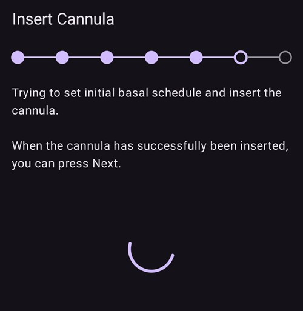
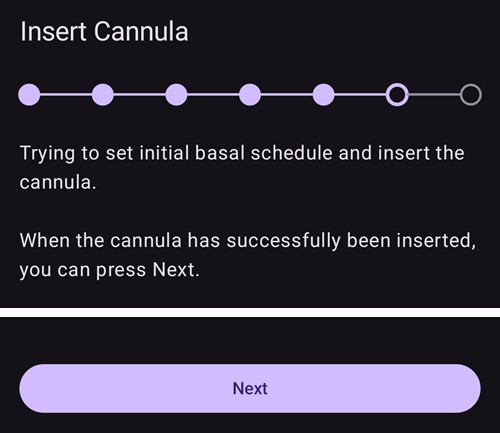
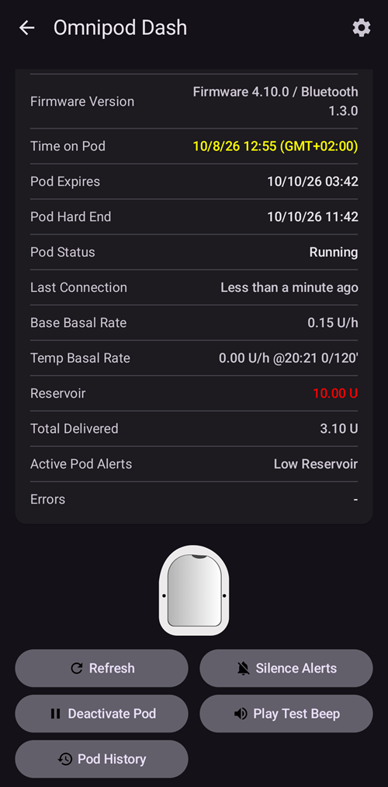

# Omnipod DASH

Aquestes instruccions són per configurar la bomba de la generació **Omnipod DASH** **(NO Omnipod Eros)**. El controlador DASH és una manera ben establerta de fer llaç amb Omnipod.

```{contents} Table of contents
:depth: 1
:local: true
```

## Especificacions d'Omnipod DASH

Característiques principals de l'**Omnipod DASH** («DASH»):

- Els pods DASH es reconeixen pel **tap de l'agulla blau** (el pod EROS, més antic, té el tap de l'agulla transparent). Per la resta, els pods són idèntics pel que fa a les mides físiques.
- DASH no necessita cap dispositiu pont BLE (NO cal RileyLink, OrangeLink ni EmaLink).
- La connexió Bluetooth del DASH només s'utilitza quan s'envia una ordre (per exemple, un bolus), i es desconnecta just després d'enviar l'ordre.
- **AAPS** esperarà que el pod sigui accessible per enviar les ordres.
- En activar el pod, **AAPS** trobarà un pod DASH nou i s'hi connectarà.
- Abast previst des del telèfon: 5–10 metres (pot variar).

(omnipod-dash-constraints)=

## Limitacions i problemes coneguts d'Omnipod DASH amb AAPS
- En general es recomana fer servir **AAPS** amb Android 14 o 16. Amb Android 15, la comunitat ha informat de molts [problemes](https://github.com/nightscout/AndroidAPS/issues/3471). Tanmateix, si feu servir Android 15, probablement haureu d'activar la **Vinculació Bluetooth** (a la secció **Configuració avançada** de la [configuració de Dash](#omnipod-dash-advanced-settings)) per poder activar i fer servir els pods; vegeu [Resolució de problemes](../GettingHelp/GeneralTroubleshooting.md) per a més informació sobre la vinculació.
- Els canvis d'horari d'estiu i de zona horària no s'apliquen automàticament. Després d'un canvi d'hora, heu d'actualitzar el pod manualment: premeu **Actualitzar** a la pantalla de la bomba DASH i després premeu **Configurar hora** (apareix quan la zona horària del pod i la del telèfon són diferents) o feu un **canvi de perfil** (vegeu [Canvi de zona horària amb Omnipod Dash](#timezone-traveling-with-pumps)).
- Dash només admet la taxa basal en passos de 0,05 U/h. Si intenteu establir la basal en passos de 0,01 al vostre **perfil d'AAPS**, AAPS no mostrarà cap avís, tot i que el pod arrodonirà la taxa a passos de 0,05. Si obriu l'**Historial del pod** a la pantalla de la bomba DASH, hi veureu que s'ha establert una basal de 0,05. Això també vol dir que la taxa basal més baixa que admet el DASH a **AAPS** és 0,05 U/h.
- El fitxer de configuració conté la sessió activa del pod. Exporteu la configuració després de cada activació de pod, i llegiu [Exportar i importar la configuració](#omnipod-dash-export-import) abans d'importar una configuració.
- Quan s'estableix un nou perfil basal, DASH suspèn el lliurament abans d'establir el nou **perfil** basal. Si hi ha una interrupció o un error de comunicació, el perfil basal no es tornarà a iniciar automàticament. Vegeu la secció [Reprendre el lliurament d'insulina](#omnipod-dash-resuming-insulin-delivery) per a més detalls.
- Si les alertes estan configurades i el pod està a punt de caducar, el pod continuarà fent bips fins que silencieu les alertes; vegeu [Silenciar les alertes del pod](#omnipod-dash-silencing-pod-alerts) per a més detalls.
- Hi ha diversos problemes coneguts amb el Bluetooth que poden causar problemes en l'activació del pod. Vegeu [Problemes relacionats amb el Bluetooth](../GettingHelp/BluetoothTroubleshooting.md) per al problema conegut i les solucions.

(hardware-software-requirements)=

(omnipod-dash-hardware-software-requirements)=
## Requisits de maquinari i programari

- Omnipod DASH es reconeix pel tap de l'agulla blau.


- **Un telèfon Android compatible** amb Bluetooth Low Energy (BLE) (vegeu [Telèfons](../Getting-Started/Phones.md) per a més informació). A més, la informació següent us ajudarà amb altres aspectes importants per activar i fer servir correctament el DASH en un telèfon compatible:
    -  El controlador Omnipod Dash d'**AAPS** es connecta amb el pod DASH per Bluetooth.  
      **AAPS** crea automàticament una nova connexió Bluetooth amb el pod cada vegada que ha d'enviar una ordre (per exemple, un bolus); després d'enviar l'ordre, la connexió Bluetooth es desconnecta immediatament.
       - **NOTA:**
         - La connexió Bluetooth es pot interrompre o pertorbar per altres dispositius Bluetooth connectats al telèfon on funciona **AAPS**, com ara auriculars, etc. Aquests dispositius poden causar errors de connexió o problemes d'activació del pod en alguns models de telèfon. Quan trieu el telèfon per a Omnipod DASH, és bona idea revisar la llista de [configuracions de maquinari provades](https://docs.google.com/spreadsheets/u/1/d/e/2PACX-1vScCNaIguEZVTVFAgpv1kXHdsHl3fs6xT6RB2Z1CeVJ561AvvqGwxMhlmSHk4J056gMCAQE02sAWJvT/pubhtml?gid=683363241&single=true), amb configuracions que se sap que funcionen.
         - Hi ha diversos problemes coneguts amb el Bluetooth que poden causar problemes en l'activació del pod (vegeu [Resolució de problemes](#omnipod-dash-troubleshooting) per a consells sobre altres problemes de Bluetooth), en concret la secció [Problemes relacionats amb el Bluetooth](#omnipod-dash-bluetooth-related-issues).
    - El telèfon ha de tenir **Android 12 o més nou**, amb **AAPS** compilat i instal·lat segons les instruccions de [**Compilar AAPS**](../SettingUpAaps/BuildingAaps.md). Feu servir sempre l'última versió publicada.
- Un [**monitor continu de glucosa (CGM)**](../Getting-Started/CompatiblesCgms.md) compatible

Les instruccions següents expliquen com activar una nova sessió de pod amb **AAPS**. Hauríeu d'esperar que el pod actual estigui a punt de caducar, perquè haureu d'activar un pod nou amb **AAPS**. Un cop desactivat, un pod no es pot tornar a fer servir ni a activar: la desactivació és definitiva.

## Abans de començar

Assegureu-vos d'haver llegit i entès tota aquesta guia, la secció **Abans de començar** i també **[Limitacions i problemes d'Omnipod amb AAPS](#omnipod-dash-constraints)**, per evitar problemes coneguts.

### **PRIMER, LA SEGURETAT**: **NO** intenteu connectar **AAPS** a un pod per primera vegada sense tenir a l'abast tot el següent:
1. Pods de recanvi (3 o més)
2. Insulina de recanvi i material per a injeccions múltiples (MDI)
3. Un PDM d'Omnipod que funcioni (per si **AAPS** falla)
4. Cal un telèfon compatible! (Vegeu [Requisits de maquinari i programari](#hardware-software-requirements))
5. La versió correcta d'AAPS compilada i instal·lada

### El PDM d'Omnipod Dash deixarà de ser necessari un cop el controlador Dash d'AAPS activi el pod.
- Abans d'utilitzar **AAPS**, vosaltres o el vostre cuidador havíeu de gestionar el pod amb el PDM d'Omnipod (o, en algunes regions, amb una aplicació del telèfon) per enviar ordres al DASH (per exemple, un bolus).
- El DASH només admet la connexió d'un sol dispositiu Bluetooth (per exemple, el PDM o el telèfon) per gestionar-lo i enviar-li ordres.
- El dispositiu que activa el pod amb èxit és l'únic dispositiu que es pot comunicar amb aquest pod a partir d'aquell moment. Això vol dir que, un cop activeu un DASH amb el vostre telèfon Android amb **AAPS**, **ja no podreu fer servir el PDM amb aquest pod!** Mentre aquest pod estigui actiu, el controlador Dash d'**AAPS** del vostre telèfon Android és el nou PDM del pod.
- **NO llenceu el PDM!** Es recomana guardar-lo com a reserva i per a emergències, per exemple si perdeu el telèfon o si **AAPS** no funciona correctament.

### El pod **NO** deixarà de lliurar insulina quan no estigui connectat a AAPS.
En activar el pod, s'hi programen les taxes basals per defecte tal com estan definides al [**perfil**](../SettingUpAaps/YourAapsProfile.md) actiu actual.  
Mentre **AAPS** funcioni, enviarà ordres d'ajust de la taxa basal que duren un màxim de 120 minuts.  
Si per algun motiu el pod no rep ordres noves (per exemple, perquè s'ha perdut la comunicació per la distància entre el pod ➜ telèfon), el pod tornarà automàticament a les taxes basals per defecte definides al vostre [**perfil**](../SettingUpAaps/YourAapsProfile.md).

### Els perfils d'AAPS no admeten trams de taxa basal de 30 minuts
Si sou nous a **AAPS** i configureu el [**perfil**](../SettingUpAaps/YourAapsProfile.md) de taxa basal per primera vegada, tingueu en compte que no s'admeten taxes basals que comencin a la mitja hora. Per exemple, si al PDM d'Omnipod teniu una taxa basal d'1,1 unitats que comença a les 09:30 i dura 2 hores fins a les 11:30, no és possible copiar exactament aquest **perfil** basal a **AAPS**.  
Haureu de canviar aquesta taxa basal d'1,1 unitats a un interval de 9:00–11:00 o de 10:00–12:00. Tot i que el maquinari del DASH admet trams de 30 minuts al **perfil** basal, **AAPS** NO admet aquesta funció.

### AAPS NO admet taxes basals de 0 U/h al perfil
Tot i que el DASH admet una taxa basal de zero, **AAPS** fa servir múltiples de la taxa basal del **perfil** de l'usuari per decidir el tractament automàtic; no pot funcionar amb una taxa basal de zero.  
En lloc d'això, podeu aconseguir una taxa basal temporal de zero amb la funció «Desconnectar bomba», o combinant Desactivar llaç/basal temporal o Suspendre el llaç/basal temporal.  
**NOTA:** La taxa basal més baixa que admet el DASH a **AAPS** és 0,05 U/h.

## Seleccionar Dash a AAPS

Hi ha **dues** maneres de seleccionar el controlador Omnipod DASH a **AAPS**:

### Opció 1: Instal·lacions noves

Quan instal·leu **AAPS** per primera vegada, l'**Assistent de configuració** us guia per les funcions principals i els requisits d'instal·lació d'**AAPS**. Quan arribeu al pas **Bomba**, seleccioneu **Omnipod Dash**.


Si encara no esteu segurs, de moment podeu seleccionar **Bomba virtual** i seleccionar **Omnipod Dash** més tard, després de configurar **AAPS** (vegeu l'opció 2).

(omnipod-dash-option-2-config-builder)=
### Opció 2: La pantalla Configurador

En una instal·lació existent, podeu seleccionar la bomba **Omnipod Dash** a la pantalla **Configurador**:

1. Obriu el **menú** (☰) a la cantonada superior esquerra de la pantalla principal i seleccioneu **Configurador**.
2. Toqueu **Bomba** i seleccioneu el botó d'opció d'**Omnipod Dash** (*«Integració de la bomba per Omnipod Dash (el nou model amb Bluetooth i agulla amb tap blau).»*).

3. Un cop seleccionada, la targeta **Omnipod Dash** mostra dos botons:
   - **Configuració** obre la [configuració de Dash](#omnipod-dash-settings).
   - **Obrir plugin** obre la [pantalla de la bomba DASH](#omnipod-dash-tab).

   

### Comprovar la selecció del controlador Omnipod

Per comprovar que **Omnipod Dash** està seleccionat, obriu **Gestionar** (navegació inferior de la pantalla principal) i toqueu **Bomba**. S'obre la pantalla de la bomba DASH, tal com es mostra a la secció següent.

(omnipod-dash-tab)=

## La pantalla de la bomba DASH

A la pantalla de la bomba DASH és on gestioneu els pods: activar-los i desactivar-los, actualitzar l'estat del pod, silenciar alertes i consultar l'historial del pod. Obriu-la amb **Gestionar** > **Bomba**, o amb **Obrir plugin** a la targeta **Omnipod Dash** de **Configurador** > **Bomba**.

Aquesta és la pantalla sense cap pod actiu:


I aquesta és la pantalla amb un pod actiu:


La icona **Configuració** (engranatge) de la cantonada superior dreta obre la [configuració de Dash](#omnipod-dash-settings).

***NOTA:** Si un camp de la pantalla de la bomba mostra (dubtós), premeu **Actualitzar** per actualitzar l'estat del pod.*

### Camps

- **Adreça Bluetooth:** L'adreça Bluetooth del pod.

- **Qualitat de la connexió:** Amb quina fiabilitat es connecta **AAPS** al pod, es mostra com a *connexions correctes / tots els intents de connexió :: percentatge d'èxit*, per exemple `412/420 :: 98.10 %`. Després de més de 50 connexions correctes, el valor es torna groc per sota del 90% i vermell per sota del 70%. Un valor baix indica un problema de Bluetooth (vegeu [Problemes relacionats amb el Bluetooth](#omnipod-dash-bluetooth-related-issues)).

- **Estat del lliurament:** L'estat del lliurament sense processar que informa el pod. Aquest camp només es mostra a les compilacions en mode enginyeria.

- **ID únic:** L'ID únic que **AAPS** ha donat al pod durant l'activació.

- **Nr. LOT:** El número de lot de producció del pod.

- **Nr. de seqüència:** El número de seqüència del pod.

- **Versió del firmware:** Les versions del firmware i del Bluetooth del pod.

- **Hora al pod:** L'hora actual del pod, amb la seva zona horària. El text es torna vermell quan la zona horària del pod és diferent de la del telèfon, i groc quan l'hora del pod té més de 10 minuts de diferència.

- **El pod expira:** La data i l'hora en què caduca el pod (72 hores després de l'activació). El text es torna groc durant les últimes 4 hores abans d'aquest moment. No es torna mai vermell, perquè el pod continua lliurant insulina després.

- **Fi definitiva del pod:** El final del període de gràcia del pod (8 hores després de **El pod expira**, per a una vida màxima del pod de 80 hores). El text es torna groc quan comença el període de gràcia (a **El pod expira**) i vermell durant les últimes 4 hores abans de la fi definitiva. Durant el període de gràcia també mostra el temps que queda, per exemple *(queden 17m)*. El pod deixa de lliurar insulina a la fi definitiva i s'ha de canviar.

- **Estat pod:** L'estat del pod: **Cap pod actiu**, **Configuració en curs**, **Funcionant**, **Suspès** o, després d'un error del pod, **ALARM**.

- **Última connexió:** Quant de temps fa que **AAPS** es va comunicar per última vegada amb el pod.

  - *Fa un moment*: fa menys de 10 segons.

  - *Fa menys d'un minut*: fa entre 10 i 60 segons.

  - *Fa XX minuts*: fa més d'1 minut (i *Fa X hores i XX minuts* després d'una hora).

- **Darrer bolus:** La quantitat de l'últim bolus enviat al pod i quant de temps fa que es va lliurar. Un bolus no confirmat es marca com a (dubtós).

- **Basal base:** La taxa basal programada per a l'hora actual al vostre **perfil** basal.

- **Basal temporal:** La taxa basal temporal (TBR) que està en curs, amb l'hora d'inici i la durada. Aquest camp només es mostra mentre hi ha una TBR en curs.

- **Reservori:** Mostra *Queden més de 50 U* quan queden més de 50 unitats al reservori. Per sota de 50 unitats, es mostra la quantitat exacta. El valor es torna vermell per sota de 20 unitats.

- **Total lliurat:** La quantitat total d'insulina lliurada des del reservori. Inclou la insulina utilitzada per encebar.

- **Alertes pod actiu:** Les alertes que estan actives al pod, per exemple *El pod està a punt de caducar* o *Reservori baix*.

- **Errors:** L'error del pod, si el pod ha fallat, que es mostra en vermell com a *Error del pod:* seguit del codi i el nom de l'error, per exemple *Error del pod: 020 ALARM_OCCLUDED*. Reviseu l'[historial del pod](#omnipod-dash-view-pod-history) i els fitxers de registre per veure errors anteriors i informació més detallada. Vegeu [Errors del pod](#omnipod-dash-pod-failures).

- **Avís del PDM:** Només es mostra després d'un error del pod. Mostra l'error de la mateixa manera que l'hauria mostrat el PDM d'Omnipod: un títol (per exemple *Oclusió detectada*, *Reservori buit* o *Pod caducat*), què ha passat (per exemple *Lliurament d'insulina aturat. Canvieu el pod ara.*) i un codi *Ref:*.

### Botons

Els botons de la part inferior de la pantalla de la bomba canvien segons l'estat del pod. Només es mostren els botons que tenen sentit en aquell moment.

- **Actualitzar:** Demana al pod el seu estat actual.
  - *Feu-lo servir per actualitzar l'estat del pod i per esborrar els camps que mostren (dubtós).*
  - *Vegeu la secció [Resolució de problemes](#omnipod-dash-troubleshooting) més avall per a més informació.*

- **Silenciar alertes:** Atura els bips d'alerta del pod (per exemple, de caducitat del pod o de reservori baix). Només es mostra mentre el pod té una alerta activa. Vegeu [Silenciar les alertes del pod](#omnipod-dash-silencing-pod-alerts).

- **Reprendre lliurament:** Reprèn el lliurament d'insulina d'un pod suspès. Només es mostra quan el lliurament està suspès. Vegeu [Reprendre el lliurament d'insulina](#omnipod-dash-resuming-insulin-delivery).

- **Configurar hora:** Posa el pod a la zona horària del telèfon tornant a enviar el vostre **perfil** basal. Només es mostra quan la zona horària del pod és diferent de la del telèfon.

- [**Activar pod**](#omnipod-dash-activate-pod): enceba i activa un pod nou. Es mostra quan no hi ha cap pod actiu.

- [**Desactivar pod**](#omnipod-dash-deactivate-pod): desactiva el pod actiu. Es mostra tan aviat com un pod està emparellat amb **AAPS**, també quan una activació s'ha aturat a mitges (per exemple, perquè el pod ha fallat durant l'activació). **AAPS** us demana confirmació abans de desactivar el pod.

- **Fer sonar bip de prova:** Fa que el pod faci un sol bip de prova.

- [**Historial del pod**](#omnipod-dash-view-pod-history): mostra l'historial d'activitat del pod actiu.

- **Descartar pod:** Elimina d'**AAPS** un pod que no s'ha acabat d'activar. Només es mostra quan l'activació d'un pod s'ha aturat a mitges. **AAPS** us demana confirmació. Després de descartar-lo, **AAPS** ja no es pot comunicar amb aquest pod: traieu-lo del cos.

(omnipod-dash-activate-pod)=

## Activar pod

1. Obriu la pantalla de la bomba DASH (**Gestionar** > **Bomba**) i premeu **Activar pod**. S'obre l'assistent d'activació.

   

   ```{admonition} Older screenshot
   :class: note
   La captura de pantalla de dalt és d'una versió anterior d'**AAPS**. A **AAPS** 4, **Activar pod** és un botó directament a la pantalla de la bomba DASH, en lloc d'estar al menú **Gestió del pod**.
   ```

   Si mai no heu activat cap **perfil** a **AAPS**, l'assistent primer mostra el pas **Cal un perfil**: seleccioneu el perfil que s'aplicarà en l'activació i continueu.

2. Es mostra el pas **Omplir pod**. Ompliu un pod nou amb prou insulina per a 3 dies, **com a mínim 80 unitats**. Escolteu els dos bips del pod: volen dir que s'ha omplert la quantitat mínima de 80 unitats. Buideu del tot la xeringa d'ompliment, encara que ja hàgiu sentit els dos bips. No traieu encara el tap de l'agulla del pod.

   ***NOTA:** Quan calculeu la quantitat d'insulina que necessiteu per a 3 dies, recordeu que encebar el pod fa servir unes 3–10 unitats.*

   

   

   Assegureu-vos que el pod nou i el telèfon amb **AAPS** són a prop l'un de l'altre i premeu **Següent**.

3. Si feu servir més d'una insulina a **AAPS**, es mostra el pas **Seleccionar insulina**. Mostra la insulina **Activa actualment**. Si heu omplert el pod amb una altra insulina, premeu **Canviar** i seleccioneu-la. **AAPS** aplica un **canvi de perfil** amb aquesta insulina quan acaba l'activació. Premeu **Següent**.

   

4. Al pas **Inicialitzar pod**, **AAPS** s'emparella amb el pod nou i l'enceba. Sentireu un clic i després una sèrie de sons de tic-tac mentre el pod s'enceba. Quan això ha acabat correctament, apareix el botó **Següent**. Premeu **Següent**.

       

   ***NOTA**: Si apareix un missatge d'error com _Ha fallat l'escaneig_ o _«Could not find an available pod for activation»_ (no s'ha trobat cap pod disponible per activar; pot passar), no us espanteu. Premeu **Reintentar**. En la majoria dels casos, l'activació continua llavors correctament.*

   

   Si el pod ha fallat (per exemple, perquè s'ha superat el seu temps d'activació), es mostra **Desactivar pod** en lloc de **Reintentar**. Feu-lo servir i torneu a començar amb un pod nou.

   Si premeu **Cancel·lar** abans que acabi l'activació, **AAPS** us demana que confirmeu que voleu sortir. Premeu **OK** per sortir de l'assistent, o **Cancel·lar** per quedar-vos-hi.

   

5. Si gestioneu la rotació del punt d'infusió de la bomba a **AAPS** (**Gestionar la rotació del punt d'infusió de la bomba** a la configuració de [Rotació de punts d'inserció](#Aapsscreens-site-rotation)), es mostra el pas **Punt d'inserció**. Seleccioneu al diagrama del cos on col·locareu el pod i premeu **Següent**, o premeu **Ometre**.

   

6. A continuació, prepareu el punt d'infusió per al pod nou. Renteu-vos les mans per evitar qualsevol risc d'infecció. Netegeu el punt d'infusió amb aigua i sabó o amb una tovalloleta d'alcohol, i deixeu que la pell s'assequi del tot a l'aire abans de continuar. Si l'adhesiu us irrita la pell, podeu fer servir una tovalloleta o un esprai de barrera.

   Al pas **Adherir pod**, traieu el tap blau de plàstic de l'agulla del pod. Si la cànula o qualsevol altra cosa sobresurt del pod, o té un aspecte estrany, **ATUREU-VOS**: premeu **Cancel·lar** i torneu a començar amb un pod nou. Si tot sembla **correcte**, traieu el paper blanc de l'adhesiu i enganxeu el pod al punt del cos que heu triat.

   Quan acabeu, premeu **Següent**.

   

7. Apareix un diàleg de confirmació: *Quan premeu OK, la cànula serà inserida.* **Premeu OK NOMÉS si esteu preparats per inserir la cànula!**

   

8. Al pas **Inserir cànula**, **AAPS** estableix la vostra programació basal i el pod insereix la cànula. Pot trigar una mica (1–2 minuts com a màxim). **Tingueu paciència!**

   ***NOTA:** És una bona pràctica pessigar la pell a prop del punt d'inserció abans que s'insereixi la cànula. Això ajuda que l'agulla entri bé i redueix el risc d'oclusions (obstruccions).*

       

9. Quan la cànula s'ha inserit correctament, apareix el botó **Següent**. Premeu **Següent**.

   

10. Es mostra el pas **Pod activat**. Comproveu que la cànula s'ha inserit correctament, i canvieu el pod si creieu que no.

    Premeu **Finalitzar**.

    Enhorabona! Ara heu iniciat una nova sessió de pod.

    

11. Torneu a ser a la pantalla de la bomba DASH. Ara mostra la informació del vostre pod actiu, inclosa la taxa basal actual, el nivell del reservori, la insulina lliurada, els errors i les alertes del pod. **Activar pod** se substitueix per **Desactivar pod**: no podeu activar un altre pod sense desactivar primer el pod actiu.

    ***NOTA:** Per a més detalls sobre la informació que es mostra, vegeu [La pantalla de la bomba DASH](#omnipod-dash-tab).*

    

    ***NOTA:** És una bona pràctica exportar la configuració DESPRÉS d'activar el pod. Exporteu la configuració després de cada canvi de pod i un cop al mes. Copieu el fitxer de configuració exportat a un emmagatzematge al núvol (per exemple, Google Drive) o a un altre lloc fora del telèfon, per si el perdeu (vegeu [**Exportar configuració**](../Maintenance/ExportImportSettings.md)).*

Si una activació anterior es va aturar després d'encebar el pod, en prémer **Activar pod** es continua des del pas **Adherir pod**.

(omnipod-dash-deactivate-pod)=

## Desactivar pod

En condicions normals, un pod dura tres dies (72 hores), més un període de gràcia de 8 hores després de l'avís de caducitat del pod: 80 hores en total.

Per desactivar un pod (perquè ha caducat o perquè ha fallat):

1. Obriu la pantalla de la bomba DASH (**Gestionar** > **Bomba**) i premeu **Desactivar pod**.

   

2. Al pas **Desactivar pod**, premeu **Següent**. Un diàleg pregunta *Un pod desactivat no es pot tornar a fer servir. Voleu desactivar aquest pod ara?* Premeu **OK** per començar a desactivar el pod, o **Cancel·lar** per mantenir-lo. La desactivació suspèn tot el lliurament d'insulina i no es pot desfer.

   

3. Es mostra el pas **Desactivant pod** mentre **AAPS** desactiva el pod. El pod fa bips per confirmar que la desactivació s'ha fet correctament.

   

   ```{admonition} Older screenshot
   :class: note
   La captura de pantalla de dalt és d'una versió anterior d'**AAPS**. A **AAPS** 4, l'assistent mostra el progrés amb una fila de punts a la part superior en lloc d'una barra de progrés.
   ```

   Quan la desactivació ha acabat correctament, apareix el botó **Següent**. Premeu **Següent**.

   

   Si la desactivació falla, es mostren un missatge d'error i un botó **Descartar pod**. Llegiu [Descartar un pod](#omnipod-dash-discard-pod) més avall abans de fer-lo servir. També podeu prémer **Cancel·lar** i tornar a provar **Desactivar pod** més tard.

4. Es mostra el pas **Pod desactivat**. Traieu el pod del cos i premeu **Finalitzar**.

   

5. Torneu a ser a la pantalla de la bomba DASH. Comproveu que el camp **Estat pod** mostra **Cap pod actiu** i que torna a aparèixer el botó **Activar pod**.

   

(omnipod-dash-discard-pod)=

### Descartar un pod

Descarteu un pod només quan tota la comunicació amb ell continua fallant. Si **AAPS** encara es pot comunicar amb el pod, feu servir **Desactivar pod**.

- **AAPS** us demana confirmació abans de descartar el pod.
- Després, **AAPS** ja no es pot comunicar amb aquest pod.
- **El lliurament d'insulina NO s'ha suspès**, perquè el pod no s'ha desactivat correctament. **Traieu el pod del cos!**
- El pas **Pod descartat** confirma que s'ha descartat l'estat del pod. Premeu **Finalitzar**. Ara podeu activar un pod nou.

(omnipod-dash-resuming-insulin-delivery)=

## Reprendre el lliurament d'insulina

**NOTA**: Durant els **canvis de perfil**, igual que amb el PDM, **AAPS** ha de suspendre el lliurament del pod abans d'establir el nou **perfil** basal. Si la comunicació falla entre les ordres de suspendre i reprendre, el lliurament pot quedar suspès. Llegiu [**Lliurament suspès**](#omnipod-dash-delivery-suspended) a la secció de resolució de problemes per a més detalls.

Quan el lliurament d'insulina està suspès, heu de dir al pod que reprengui el lliurament d'insulina. Quan l'ordre s'ha processat correctament, el pod torna a lliurar insulina amb la taxa basal de l'hora actual del vostre **perfil** basal actiu. El pod torna a acceptar ordres de bolus, **TBR** i **SMB**.

1. Obriu la pantalla de la bomba DASH i comproveu que el camp **Estat pod** mostra **Suspès**. Premeu **Reprendre lliurament** per dir al pod que reprengui el lliurament normal d'insulina.

   

2. Quan l'ordre s'ha fet correctament, el camp **Estat pod** mostra **Funcionant** i el botó **Reprendre lliurament** desapareix.

   

   

   ```{admonition} Older screenshot
   :class: note
   Les captures de pantalla de dalt són d'una versió anterior d'**AAPS**, que mostrava un diàleg de confirmació. A **AAPS** 4 confirmeu el resultat a la pantalla de la bomba DASH: el camp **Estat pod** mostra **Funcionant** i el botó **Reprendre lliurament** ja no hi és.
   ```

   Si l'ordre falla, **AAPS** mostra un diàleg d'avís que comença amb *Error en reprendre lliurament*. Premeu **Actualitzar** i torneu-ho a provar.

   

(omnipod-dash-silencing-pod-alerts)=

## Silenciar les alertes del pod

Aquesta secció explica com aturar els bips del pod quan el pod s'acosta al final de la seva vida. El moment en què comencen aquests bips depèn de la configuració d'**Alertes** (vegeu [Configuració de Dash](#omnipod-dash-settings)):

- **Recordatori hores abans de l'expiració (72 hores):** quantes hores abans de la caducitat de les 72 hores el pod comença a fer bips.
- **Alerta hores abans de l'apagada (80 hores):** quantes hores abans de l'apagada de les 80 hores el pod torna a fer bips.

La vida màxima d'un pod és de 80 hores (3 dies i 8 hores). Tanmateix, el fabricant del pod recomana no passar de 72 hores (3 dies).

***NOTA**: El botó **Silenciar alertes** només es mostra a la pantalla de la bomba DASH mentre el pod té una alerta activa, per exemple de caducitat del pod o de reservori baix. Si el botó **Silenciar alertes** no es mostra però sentiu que el pod fa bips, premeu **Actualitzar**.*

1. Quan arriba l'hora del recordatori, el pod fa bips per avisar-vos que caducarà aviat i que l'heu de canviar. A la pantalla de la bomba DASH, el camp **El pod expira (1)** mostra l'hora exacta en què caducarà el pod (72 hores després de l'activació). El text es torna groc 4 hores abans d'aquest moment. Després, **Fi definitiva del pod** es torna groc i mostra el temps que queda fins que el pod deixi de lliurar insulina. El camp **Alertes pod actiu (2)** mostra **El pod està a punt de caducar**, i es mostra el botó **Silenciar alertes (3)**.

   

2. Premeu **Silenciar alertes**. **AAPS** envia l'ordre al pod per aturar els bips de caducitat.

   

   ```{admonition} Older screenshot
   :class: note
   La captura de pantalla de dalt és d'una versió anterior d'**AAPS**, on aquesta pantalla era la pestanya **DASH**. A **AAPS** 4, el botó **Silenciar alertes** és a la pantalla de la bomba DASH (**Gestionar** > **Bomba**).
   ```

3. Quan les alertes s'han silenciat, l'alerta ja no es mostra al camp **Alertes pod actiu**, el botó **Silenciar alertes** desapareix i el pod deixa de fer els bips de caducitat.

   

   ```{admonition} Older screenshot
   :class: note
   La captura de pantalla de dalt és d'una versió anterior d'**AAPS**, que mostrava un diàleg de confirmació. A **AAPS** 4 confirmeu el resultat a la pantalla de la bomba DASH: l'alerta ja no és al camp **Alertes pod actiu**.
   ```

   Si l'ordre falla, **AAPS** mostra un diàleg d'avís que comença amb *Error en silenciar alertes*. Premeu **Actualitzar** i torneu-ho a provar.

L'alerta de reservori baix funciona de la mateixa manera. Quan la insulina que queda al pod baixa fins al **Nr. d'unitats** establert a la configuració d'**Alertes**, el pod fa bips. El camp **Reservori** mostra la quantitat que queda, el camp **Alertes pod actiu** mostra **Reservori baix** i es mostra el botó **Silenciar alertes**. Premeu **Silenciar alertes** per aturar els bips, i planifiqueu el proper canvi de pod.



(omnipod-dash-view-pod-history)=

## Veure l'historial del pod

Aquesta secció explica com consultar l'historial del vostre pod actiu i filtrar-lo per tipus d'acció. L'historial del pod mostra les ordres enviades al pod actiu i els seus resultats durant els seus tres dies de vida (72–80 hores).

És útil per comprovar els bolus, les TBR i les ordres de basal que s'han enviat al pod. Les altres categories ajuden a resoldre problemes i mostren l'ordre dels esdeveniments que han portat a un error.

**NOTA:** **Només l'última ordre pot ser dubtosa**. Les ordres noves *no s'envien* fins que **l'última ordre «dubtosa» passa a «confirmada» o «descartada»**. Per «arreglar» una ordre dubtosa, premeu **Actualitzar** a la pantalla de la bomba DASH.

1. Obriu la pantalla de la bomba DASH i premeu **Historial del pod**.

   

   ```{admonition} Older screenshot
   :class: note
   La captura de pantalla de dalt és d'una versió anterior d'**AAPS**. A **AAPS** 4, **Historial del pod** és un botó directament a la pantalla de la bomba DASH, en lloc d'estar al menú **Gestió del pod**.
   ```

2. La pantalla **Historial del pod** s'obre amb el filtre **Tots** seleccionat. Mostra cada ordre amb la seva hora i el seu resultat, de la més nova a la més antiga, agrupades per dia. Feu servir els botons de filtre de la part superior (per exemple **Bolus** o **Basals**) per mostrar només un tipus d'ordre. Premeu la fletxa enrere per tornar a la pantalla de la bomba DASH.

    

   ```{admonition} Older screenshot
   :class: note
   La segona captura de pantalla de dalt és d'una versió anterior d'**AAPS**, on triàveu el tipus d'ordre d'una llista **Tipus**. A **AAPS** 4 feu servir els botons de filtre que es veuen a la primera captura de pantalla.
   ```

   Als bolus, després de la quantitat es mostra el tipus de bolus quan no és un bolus normal, per exemple *0,05 U (SMB)* o *0,05 U (Correcció de basal)*. Una correcció de basal és un bolus molt petit (un pols del pod, 0,05 U) que el controlador envia tot sol; no l'heu demanat vosaltres.

   ```{admonition} Why basal corrections happen
   :class: note
   El pod lliura la insulina basal en polsos de 0,05 U, segons un rellotge intern. Cada vegada que canvia la taxa basal (per exemple, quan el llaç estableix una nova **TBR**), el pod torna a iniciar aquest rellotge, i el pols que estava comptant es perd. Com que el llaç canvia sovint la taxa basal, sobretot a la nit, el pod pot acabar lliurant menys insulina basal del que caldria.

   **AAPS** compara la insulina basal que el pod informa com a lliurada amb la que hauria d'haver lliurat. Quan la diferència arriba a mig pols o més, el controlador lliura un pols extra com a correcció de basal, perquè rebeu igualment la insulina basal que demanen el vostre perfil i el llaç. No s'envia cap correcció mentre el pod està suspès, ni mentre hi ha una **TBR** de zero en curs.
   ```

(omnipod-dash-settings)=

## Configuració de Dash

Hi ha dues maneres d'obrir la configuració del controlador Dash:

- Premeu la icona **Configuració** (engranatge) a la cantonada superior dreta de la [pantalla de la bomba DASH](#omnipod-dash-tab).
- Obriu el **menú** (☰) a la cantonada superior esquerra de la pantalla principal i seleccioneu **Configurador** > **Bomba**. A la targeta **Omnipod Dash**, premeu **Configuració**.

La configuració està agrupada en quatre seccions desplegables: **Bips de confirmació**, **Alertes**, **Notificacions** i **Configuració avançada**. Toqueu una secció per obrir-la:


La majoria d'opcions són interruptors d'activar/desactivar.

### Bips de confirmació


Bips de confirmació del pod per al lliurament i els canvis de bolus, basal, SMB i TBR.

**Bips de bolus activats:**    El pod fa bips quan es lliura un bolus. Activat per defecte.

**Bips de basal activats:**    El pod fa bips quan s'estableix una nova taxa basal, o quan la taxa basal activa es cancel·la o canvia. Desactivat per defecte.

**Bips d'SMB activats:**  El pod fa bips quan es lliura un SMB. Activat per defecte.

**Bips de basals temporals activats:**  El pod fa bips quan s'estableix o es cancel·la una TBR. Desactivat per defecte.

### Alertes


```{admonition} Older screenshot
:class: note
La captura de pantalla de dalt és d'una versió anterior d'**AAPS**. A **AAPS** 4 aquestes opcions són a la secció desplegable **Alertes**.
```

Alertes del pod per a la caducitat del pod, l'apagada i el reservori baix. Quan canvieu aquestes opcions amb un pod actiu, **AAPS** envia la nova configuració d'alertes al pod.

***NOTA:** SEMPRE es mostra un avís d'**AAPS** per a qualsevol alerta un cop **AAPS** s'ha comunicat amb el pod després que s'activés l'alerta. Tancar l'avís NO atura l'alerta del pod. Per aturar l'alerta, obriu la pantalla de la bomba DASH i premeu **Silenciar alertes**.*

**Recordatori d'expiració activat:**    Quan està activat, el pod fa bips quan s'arriba a l'hora del recordatori. Activat per defecte.

**Recordatori hores abans de l'expiració (72 hores):** Quantes hores abans de la caducitat del pod a les 72 hores comença el recordatori (d'1 a 24 hores; per defecte 4).

**Alerta d'expiració activada:**   Quan està activada, el pod fa bips quan s'arriba a l'hora de l'alerta, i un altre cop 1 hora abans de l'apagada. Activat per defecte.

**Alerta hores abans de l'apagada (80 hores):**  Quantes hores abans de l'apagada del pod a les 80 hores comença l'alerta (d'1 a 8 hores; per defecte 8).

**Alerta de reservori baix activada:**    El pod us avisa quan la insulina que queda al reservori baixa fins al valor de **Nr. d'unitats**. Activat per defecte.

**Nr. d'unitats:**    El nombre d'unitats a partir del qual s'activa l'alerta de reservori baix (de 5 a 50 unitats; per defecte 20).

### Notificacions


Trieu si **AAPS** fa sonar un so amb els seus avisos quan no és segur si s'ha lliurat una TBR, un SMB o un bolus, i quan el lliurament està suspès.

***NOTA:** Són només avisos del telèfon; el pod mateix no fa bips.*

**Habilitat so per avisos de TBR dubtoses:**  Fa sonar un so amb l'avís quan **AAPS** no és segur si s'ha establert una TBR.

**Habilitat so per avisos d'SMB dubtosos:**  Fa sonar un so amb l'avís quan **AAPS** no és segur si s'ha lliurat un SMB.

**Habilitat so per avisos de bolus dubtosos:**    Fa sonar un so amb l'avís quan **AAPS** no és segur si s'ha lliurat un bolus.

**Habilitat so per avís de lliurament suspès:**     Fa sonar un so amb l'avís quan el lliurament d'insulina està suspès.

(omnipod-dash-advanced-settings)=

### Configuració avançada


**Vinculació Bluetooth:**  Vincula el pod amb el telèfon per Bluetooth. Proveu-ho només si el pod no pot mantenir una connexió estable, per exemple amb Android 15 (vegeu [Limitacions i problemes coneguts d'Omnipod DASH amb AAPS](#omnipod-dash-constraints)). Quan està activada, el telèfon mostra sol·licituds d'emparellament que heu d'acceptar. Deixeu-la desactivada si el pod es connecta bé. No té cap efecte amb versions anteriors a Android 15. Desactivat per defecte.

## Edat de la insulina i de la cànula

La [fila d'estat](#screens-sensor-level-battery) de la pantalla principal mostra l'edat de la insulina i de la cànula. Amb Omnipod, això funciona una mica diferent que amb les bombes amb tub.

**AAPS** registra automàticament un canvi de cànula i un canvi d'insulina cada vegada que activeu un pod. Això posa a zero l'edat de la **Insulina** i de la **Cànula** després de cada canvi de pod. No cal que les registreu vosaltres amb **Encebar**. Això és perquè el pod insereix la cànula directament a la pell on està enganxat: Omnipod no fa servir tub.

L'edat de la **Pila de la bomba** no s'informa: la pila i el reservori d'insulina estan integrats a cada pod, i la pila sempre dura més que el mateix pod (màxim 80 hores).


```{admonition} Older screenshot
:class: note
La captura de pantalla de dalt és d'una versió anterior d'**AAPS**, on aquestes edats es mostraven a la secció **Portal de cures** de la pestanya **Accions**. A **AAPS** 4 es mostren a la fila d'estat de la pantalla principal.
```

### Nivell

**Nivell d'insulina**

El nivell d'insulina que es mostra és la quantitat que informa el pod. Tanmateix, el pod només informa del nivell real del reservori quan és inferior a 50 unitats. Fins llavors, es mostra *Queden més de 50 U*. La quantitat informada no és exacta: quan el pod informa «buit», en la majoria dels casos al reservori encara hi queden unes quantes unitats d'insulina.

La pantalla de la bomba DASH mostra el nivell així:

  * **Queden més de 50 U**: el pod informa de més de 50 unitats al reservori.
  * **Per sota de 50 unitats**: la quantitat exacta d'insulina que queda al reservori, tal com l'informa el pod.

Nota addicional:
  * **SMS**: retorna el valor, o 50+U quan hi ha més de 50 unitats, a les respostes SMS.
  * **Nightscout**: envia a Nightscout un valor de 50 quan hi ha més de 50 unitats (versió 14.07 i anteriors). Les versions més noves informen d'un valor de 50+ quan hi ha més de 50 unitats.

(omnipod-dash-troubleshooting)=

## Resolució de problemes

Aquesta secció tracta problemes coneguts habituals, i les seves solucions, quan es fa servir Omnipod DASH amb AAPS. A la documentació també hi ha la secció [Resolució de problemes](../GettingHelp/GeneralTroubleshooting.md), que val la pena revisar perquè també tracta temes rellevants per a alguns problemes del pod.

---

(omnipod-dash-bluetooth-related-issues)=

## Problemes relacionats amb el Bluetooth

Per a problemes coneguts amb connexions Bluetooth, talls de connexió amb bombes o pods, o problemes d'activació i connexió, vegeu [Problemes relacionats amb el Bluetooth](../GettingHelp/BluetoothTroubleshooting.md)

---

(omnipod-dash-delivery-suspended)=

### Lliurament suspès

  - Ja no hi ha botó per suspendre. Si voleu «suspendre» el pod, podeu establir una **TBR** de zero durant x minuts.
  - Durant els **canvis de perfil**, DASH ha de suspendre el lliurament abans d'establir el nou **perfil** basal. Si la comunicació falla entre les dues ordres, el lliurament pot quedar suspès. Quan passa això:
     - No hi haurà lliurament d'insulina, això inclou la basal, els SMB, els bolus manuals, etc.
     - Pot aparèixer un avís que una de les ordres no està confirmada: depèn de quan s'ha produït l'error.
     - **AAPS** intentarà establir el nou perfil basal cada 15 minuts.
     - **AAPS** mostrarà cada 15 minuts un avís que el lliurament està suspès, si el lliurament continua suspès (no s'ha pogut reprendre el lliurament).
     - El botó [**Reprendre lliurament**](#omnipod-dash-resuming-insulin-delivery) es mostra a la pantalla de la bomba DASH si voleu reprendre el lliurament manualment.
     - Si **AAPS** no aconsegueix reprendre el lliurament tot sol (passa si el pod no és accessible, el so està silenciat, etc.), el pod començarà a fer 4 bips cada minut durant 3 minuts, i després ho repetirà cada 15 minuts si el lliurament continua suspès més de 20 minuts.
  - Per a les ordres no confirmades, premeu **Actualitzar** a la pantalla de la bomba DASH per confirmar-les o descartar-les.

*****NOTA:** Quan sentiu bips del pod, no doneu per fet que el lliurament continuarà sense comprovar el telèfon; el lliurament pot quedar suspès, ***per tant, cal que ho comproveu!******

---
(omnipod-dash-pod-failures)=

### Errors del pod

- De vegades els pods fallen per diversos motius, també per problemes de maquinari del mateix pod.
- És millor no obrir casos de suport o de substitució amb Insulet, perquè AAPS no és una manera aprovada de fer servir els pods.
- Hi ha una llista de codis d'error [**aquí**](https://github.com/openaps/openomni/wiki/Fault-event-codes) que us ajuda a trobar la causa.

Quan un pod falla, deixa de lliurar insulina i fa bips sense parar. **AAPS** mostra un avís a la pantalla principal amb el codi i el nom de l'error, i el codi *Ref:*, per exemple *Error del pod: 020 ALARM_OCCLUDED*. Premeu **Ignorar** per tancar l'avís. Això no atura els bips del pod.


A la pantalla de la bomba DASH, el camp **Estat pod** mostra **ALARM**, el camp **Errors** mostra l'error del pod i el camp **Avís del PDM** l'explica, per exemple *Oclusió detectada. Lliurament d'insulina aturat. Canvieu el pod ara. Comproveu la glucèmia*.


Un pod que ha fallat no es pot tornar a fer servir. Comproveu la glucèmia, després [desactiveu el pod](#omnipod-dash-deactivate-pod) i activeu-ne un de nou.

---
### Evitar errors 49 del pod

Aquest error està relacionat amb un estat incorrecte del pod per a una ordre o amb un error durant una ordre de lliurament d'insulina. Passa quan el controlador i el pod no coincideixen sobre l'estat real. Llavors el pod (per una mesura de seguretat interna) reacciona amb un codi d'error irrecuperable 49 (0x31) i acaba en el que es coneix com a «screamer»: el bip llarg i molest que només es pot aturar fent un forat al lloc adequat de la part posterior del pod. L'origen exacte d'un «error 49 del pod» sovint és difícil de trobar. Pot passar, per exemple, després d'un tancament inesperat de l'aplicació, quan feu servir una versió de desenvolupament o després d'una reinstal·lació.

---

### Alertes de bomba no accessible

Quan no es pot establir comunicació amb el pod durant un temps configurat, apareix una alerta «Bomba no accessible». Les alertes de bomba no accessible es poden configurar prement la icona **Configuració** (engranatge) a la part superior dreta de la pantalla principal i seleccionant **Alertes locals** ➜ **Llindar de bomba no accessible**. El valor recomanat és alertar després de **120** minuts.

---
(omnipod-dash-export-import)=
### Exportar i importar la configuració

Exportar la configuració d'**AAPS** us permet restaurar tota la configuració i els objectius, per exemple després de reinstal·lar **AAPS** o en un telèfon nou. **Exporteu la configuració just després de cada activació de pod** i copieu el fitxer en un lloc segur fora del telèfon (per exemple, Google Drive), perquè també es pugui restaurar el pod actiu. Vegeu [Crear i restaurar còpies de seguretat](#ExportImportSettings-Settings-Export).

```{admonition} Importing settings can end your active Pod
:class: warning
Al telèfon que ja controla el pod, deixeu **Substituir també la configuració de la bomba** sense marcar: la sessió del pod es manté i només s'importa la resta de la configuració. Marqueu-la només en un telèfon nou, amb un fitxer exportat durant el pod que porteu ara. Vegeu [Bombes sense tub](#ExportImportSettings-tubeless-pumps).
```

Si la configuració importada conté un pod que ja no està actiu, vegeu la secció següent.

---
### Importar una configuració que conté l'estat d'un pod inactiu

Quan importeu una configuració que conté dades d'un pod que ja no està actiu, AAPS intentarà connectar-s'hi, i és clar que fallarà. En aquesta situació no podeu activar un pod nou.

Per eliminar la sessió del pod antic:
1. A la pantalla de la bomba DASH, premeu **Desactivar pod**. El més probable és que la desactivació falli.
2. Quan falli, premeu **Descartar pod** i confirmeu (vegeu [Descartar un pod](#omnipod-dash-discard-pod)).
3. Un cop eliminat el pod antic, podeu activar un pod nou.

### Generic error: java.lang.IllegalStateException: Trying to set a Bluetooth Address to ***, but it is already set to ***.

Si rebeu aquest error quan intenteu inicialitzar un pod nou, **AAPS** falla perquè encara té guardada a la configuració la informació d'un pod antic.


Pot passar si restaureu una còpia de seguretat o si falla la desactivació d'un pod.

Per resoldre-ho, premeu **Cancel·lar** per sortir de l'activació. A la pantalla de la bomba DASH, premeu **Descartar pod** si es mostra. Si no, premeu **Desactivar pod** i, quan la desactivació falli, premeu **Descartar pod** (vegeu [Descartar un pod](#omnipod-dash-discard-pod)).

Ara ja hauríeu de poder activar un pod nou.

---
### Reinstal·lar AAPS

Quan desinstal·leu **AAPS**, perdreu tota la configuració, els objectius i la sessió actual del pod. **Per restaurar-los, assegureu-vos que teniu un fitxer de configuració exportat recent!**

Amb un pod actiu, feu servir una exportació feta durant la sessió actual del pod (vegeu [Exportar i importar la configuració](#omnipod-dash-export-import)).

1. Exporteu la configuració i guardeu-ne una còpia en un lloc segur (per exemple, Google Drive).
2. Desinstal·leu **AAPS** i reinicieu el telèfon.
3. Instal·leu la nova versió d'**AAPS**.
4. Importeu la vostra configuració.
5. Comproveu tota la configuració (si voleu, torneu a importar la configuració).
6. Activeu un pod nou.
7. Quan acabeu: exporteu la configuració actual.

---
### Actualitzar AAPS a una versió més nova

En la majoria dels casos no cal desinstal·lar. Podeu fer una instal·lació «damunt» de l'actual: només cal iniciar la instal·lació de la nova versió. També és possible amb una sessió de pod activa.

1. Exporteu la vostra configuració.
2. Instal·leu la nova versió d'**AAPS**.
3. Comproveu que la instal·lació s'ha fet correctament
4. REPRENEU el lliurament del pod o activeu un pod nou.
5. Quan acabeu: exporteu la configuració actual.

---
### Alertes del controlador Omnipod

El controlador Omnipod Dash mostra diverses alertes pròpies a la **pantalla principal**; la majoria són informatives i es poden tancar, mentre que algunes demanen a l'usuari una acció per resoldre la causa de l'alerta.

A continuació teniu un resum de les alertes principals que podeu trobar:

- *Error del pod: XXX NOM*, seguit de *Ref: ...*: el pod ha fallat i ha deixat de lliurar insulina. Canvieu el pod. Vegeu [Errors del pod](#omnipod-dash-pod-failures).
- *Cap pod actiu*: no s'ha trobat cap sessió de pod. Aquest avís continua apareixent fins que activeu un pod nou. Un cop activat un pod, desapareix automàticament.
- *Lliurament d'insulina suspès*: el pod ha suspès el lliurament d'insulina. Vegeu [Reprendre el lliurament d'insulina](#omnipod-dash-resuming-insulin-delivery).
- *Possible error en establir el perfil basal. El lliurament podria estar suspès! Actualitzeu manualment l'estat del pod a la pantalla de la bomba i repreneu el lliurament si cal.* Pot ser que no s'hagi pogut establir el **perfil** basal al pod. Premeu **Actualitzar** a la pantalla de la bomba DASH i premeu **Reprendre lliurament** si es mostra.
- *No es pot verificar si l'SMB (X U) s'ha lliurat correctament. Actualitzeu l'estat del pod per confirmar o descartar aquesta ordre.* **AAPS** no ha pogut confirmar que s'hagi lliurat l'**SMB**. Premeu **Actualitzar** a la pantalla de la bomba DASH i comproveu el camp **Darrer bolus**.
- *Estat del lliurament del bolus incert. Actualitzeu l'estat del pod per confirmar-lo o descartar-lo.* El mateix per a un bolus normal: premeu **Actualitzar** a la pantalla de la bomba DASH.
- *La zona horària del pod és diferent de la del telèfon. La taxa basal és incorrecta. Canvieu de perfil per corregir-ho* Vegeu la nota sobre l'horari d'estiu i la zona horària a [Limitacions i problemes coneguts d'Omnipod DASH amb AAPS](#omnipod-dash-constraints).

(omnipod-dash-where-to-get-help-for-dash)=

## On trobar ajuda

Tot el desenvolupament de DASH el fa la comunitat de manera **voluntària**; tingueu-ho en compte i seguiu aquestes indicacions abans de demanar ajuda:

-  **Nivell 0:** Llegiu la secció corresponent d'aquesta documentació per assegurar-vos que enteneu com ha de funcionar la funció que us dona problemes.
-  **Nivell 1:** Si encara teniu problemes que no podeu resoldre amb aquest document, aneu al canal *#AAPS* de **Discord** amb [aquest enllaç d'invitació](https://discord.gg/4fQUWHZ4Mw). També hi ha molts grups de Facebook i d'altres on podeu preguntar (vegeu [**On puc trobar ajuda?**](../GettingHelp/WhereCanIGetHelp.md))
-  **Nivell 2:** Cerqueu als problemes existents si el vostre problema ja s'ha informat a [Issues](https://github.com/nightscout/AndroidAPS/issues). Si ja existeix, confirmeu-lo, comenteu-lo o afegiu-hi informació sobre el vostre problema. Si no, creeu una [incidència nova](https://github.com/nightscout/AndroidAPS/issues) i adjunteu-hi [els vostres fitxers de registre](../GettingHelp/AccessingLogFiles.md).
-  **Tingueu paciència: la majoria dels membres de la nostra comunitat són voluntaris de bona fe, i resoldre problemes sovint demana temps i paciència tant als usuaris com als desenvolupadors.**

Quan demaneu ajuda, prepareu la informació següent per ajudar la comunitat amb les vostres preguntes i problemes concrets:
- Marca i model del telèfon Android
- Versió d'Android (per exemple, 15 o 16)
  - Heu actualitzat la versió d'Android fa poc?
- La versió d'**AAPS** que feu servir
- Una descripció senzilla del problema que teniu, pensant en alguns d'aquests punts
   - Abans funcionava?
   - Quan funcionava i quan no?
   - Heu fet canvis a la configuració o al perfil?
   - Heu emparellat un dispositiu Bluetooth nou?
   - Heu actualitzat o instal·lat alguna aplicació nova?
   - Quant de temps va funcionar abans de deixar de funcionar?
