# Omnipod DASH

Aquestes instruccions són per configurar la bomba de la generació **Omnipod DASH** **(NO Omnipod Eros)**. El controlador DASH és una manera ben establerta de fer llaç amb Omnipod.

```{contents} Table of contents
:depth: 1
:local: true
```

## Especificacions d'Omnipod DASH

Característiques principals de l'**Omnipod DASH** («DASH»):

- Els pods DASH es reconeixen pel **tap de l'agulla blau** (el pod EROS, més antic, té el tap de l'agulla transparent). Per la resta, els pods són idèntics pel que fa a les mides físiques.
- DASH no necessita cap dispositiu pont BLE (NO cal RileyLink, OrangeLink ni EmaLink).
- La connexió Bluetooth del DASH només s'utilitza quan s'envia una ordre (per exemple, un bolus), i es desconnecta just després d'enviar l'ordre.
- **AAPS** esperarà que el pod sigui accessible per enviar les ordres.
- En activar el pod, **AAPS** trobarà un pod DASH nou i s'hi connectarà.
- Abast previst des del telèfon: 5–10 metres (pot variar).

(omnipod-dash-constraints)=

## Limitacions i problemes coneguts d'Omnipod DASH amb AAPS
- En general es recomana fer servir **AAPS** amb Android 14 o 16. Amb Android 15, la comunitat ha informat de molts [problemes](https://github.com/nightscout/AndroidAPS/issues/3471). Tanmateix, si feu servir Android 15, probablement haureu d'activar la **Vinculació Bluetooth** (a la secció **Configuració avançada** de la [configuració de Dash](#omnipod-dash-advanced-settings)) per poder activar i fer servir els pods; vegeu [Resolució de problemes](../GettingHelp/GeneralTroubleshooting.md) per a més informació sobre la vinculació.
- Els canvis d'horari d'estiu i de zona horària no s'apliquen automàticament. Després d'un canvi d'hora, heu d'actualitzar el pod manualment: premeu **Actualitzar** a la pantalla de la bomba DASH i després premeu **Configurar hora** (apareix quan la zona horària del pod i la del telèfon són diferents) o feu un **canvi de perfil** (vegeu [Canvi de zona horària amb Omnipod Dash](#timezone-traveling-with-pumps)).
- Dash només admet la taxa basal en passos de 0,05 U/h. Si intenteu establir la basal en passos de 0,01 al vostre **perfil d'AAPS**, AAPS no mostrarà cap avís, tot i que el pod arrodonirà la taxa a passos de 0,05. Si obriu l'**Historial del pod** a la pantalla de la bomba DASH, hi veureu que s'ha establert una basal de 0,05. Això també vol dir que la taxa basal més baixa que admet el DASH a **AAPS** és 0,05 U/h.
- El fitxer de configuració conté la sessió activa del pod. Exporteu la configuració després de cada activació de pod, i llegiu [Exportar i importar la configuració](#omnipod-dash-export-import) abans d'importar una configuració.
- Quan s'estableix un nou perfil basal, DASH suspèn el lliurament abans d'establir el nou **perfil** basal. Si hi ha una interrupció o un error de comunicació, el perfil basal no es tornarà a iniciar automàticament. Vegeu la secció [Reprendre el lliurament d'insulina](#omnipod-dash-resuming-insulin-delivery) per a més detalls.
- Si les alertes estan configurades i el pod està a punt de caducar, el pod continuarà fent bips fins que silencieu les alertes; vegeu [Silenciar les alertes del pod](#omnipod-dash-silencing-pod-alerts) per a més detalls.
- Hi ha diversos problemes coneguts amb el Bluetooth que poden causar problemes en l'activació del pod. Vegeu [Problemes relacionats amb el Bluetooth](../GettingHelp/BluetoothTroubleshooting.md) per al problema conegut i les solucions.

(hardware-software-requirements)=

(omnipod-dash-hardware-software-requirements)=
## Requisits de maquinari i programari

- Omnipod DASH es reconeix pel tap de l'agulla blau.

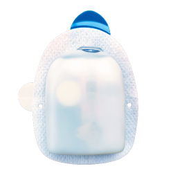

- **A Compatible Android phone** with Bluetooth Low Energy (BLE) (see [Phones](../Getting-Started/Phones.md) for more info). In addition, the following information will help guide you on other key considerations around successfully activating and using the DASH on a compatible phone:
    -  El controlador Omnipod Dash d'**AAPS** es connecta amb el pod DASH per Bluetooth.  
      **AAPS** crea automàticament una nova connexió Bluetooth amb el pod cada vegada que ha d'enviar una ordre (per exemple, un bolus); després d'enviar l'ordre, la connexió Bluetooth es desconnecta immediatament.
       - **NOTA:**
         - La connexió Bluetooth es pot interrompre o pertorbar per altres dispositius Bluetooth connectats al telèfon on funciona **AAPS**, com ara auriculars, etc. Aquests dispositius poden causar errors de connexió o problemes d'activació del pod en alguns models de telèfon. Quan trieu el telèfon per a Omnipod DASH, és bona idea revisar la llista de [configuracions de maquinari provades](https://docs.google.com/spreadsheets/u/1/d/e/2PACX-1vScCNaIguEZVTVFAgpv1kXHdsHl3fs6xT6RB2Z1CeVJ561AvvqGwxMhlmSHk4J056gMCAQE02sAWJvT/pubhtml?gid=683363241&single=true), amb configuracions que se sap que funcionen.
         - There are a number of known issues with Bluetooth which can cause pod activation problems (See [Troubleshooting](#omnipod-dash-troubleshooting) for advice on other Bluetooth issues) specifically the [Bluetooth related issues](#omnipod-dash-bluetooth-related-issues) section.
    - El telèfon ha de tenir **Android 12 o més nou**, amb **AAPS** compilat i instal·lat segons les instruccions de [**Compilar AAPS**](../SettingUpAaps/BuildingAaps.md). Feu servir sempre l'última versió publicada.
- Un [**monitor continu de glucosa (CGM)**](../Getting-Started/CompatiblesCgms.md) compatible

Les instruccions següents expliquen com activar una nova sessió de pod amb **AAPS**. You should wait for your current Pod to be close to expiry, as you will need to activate a new Pod with **AAPS**. Un cop desactivat, un pod no es pot tornar a fer servir ni a activar: la desactivació és definitiva.

## Abans de començar

Assegureu-vos d'haver llegit i entès tota aquesta guia, la secció **Abans de començar** i també **[Limitacions i problemes d'Omnipod amb AAPS](#omnipod-dash-constraints)**, per evitar problemes coneguts.

### **PRIMER, LA SEGURETAT**: **NO** intenteu connectar **AAPS** a un pod per primera vegada sense tenir a l'abast tot el següent:
1. Pods de recanvi (3 o més)
2. Insulina de recanvi i material per a injeccions múltiples (MDI)
3. Un PDM d'Omnipod que funcioni (per si **AAPS** falla)
4. Cal un telèfon compatible! (Vegeu [Requisits de maquinari i programari](#hardware-software-requirements))
5. La versió correcta d'AAPS compilada i instal·lada

### El PDM d'Omnipod Dash deixarà de ser necessari un cop el controlador Dash d'AAPS activi el pod.
- Abans d'utilitzar **AAPS**, vosaltres o el vostre cuidador havíeu de gestionar el pod amb el PDM d'Omnipod (o, en algunes regions, amb una aplicació del telèfon) per enviar ordres al DASH (per exemple, un bolus).
- El DASH només admet la connexió d'un sol dispositiu Bluetooth (per exemple, el PDM o el telèfon) per gestionar-lo i enviar-li ordres.
- El dispositiu que activa el pod amb èxit és l'únic dispositiu que es pot comunicar amb aquest pod a partir d'aquell moment. Això vol dir que, un cop activeu un DASH amb el vostre telèfon Android amb **AAPS**, **ja no podreu fer servir el PDM amb aquest pod!** Mentre aquest pod estigui actiu, el controlador Dash d'**AAPS** del vostre telèfon Android és el nou PDM del pod.
- **NO llenceu el PDM!** Es recomana guardar-lo com a reserva i per a emergències, per exemple si perdeu el telèfon o si **AAPS** no funciona correctament.

### El pod **NO** deixarà de lliurar insulina quan no estigui connectat a AAPS.
En activar el pod, s'hi programen les taxes basals per defecte tal com estan definides al [**perfil**](../SettingUpAaps/YourAapsProfile.md) actiu actual.  
Mentre **AAPS** funcioni, enviarà ordres d'ajust de la taxa basal que duren un màxim de 120 minuts.  
Si per algun motiu el pod no rep ordres noves (per exemple, perquè s'ha perdut la comunicació per la distància entre el pod ➜ telèfon), el pod tornarà automàticament a les taxes basals per defecte definides al vostre [**perfil**](../SettingUpAaps/YourAapsProfile.md).

### Els perfils d'AAPS no admeten trams de taxa basal de 30 minuts
Si sou nous a **AAPS** i configureu el [**perfil**](../SettingUpAaps/YourAapsProfile.md) de taxa basal per primera vegada, tingueu en compte que no s'admeten taxes basals que comencin a la mitja hora. Per exemple, si al PDM d'Omnipod teniu una taxa basal d'1,1 unitats que comença a les 09:30 i dura 2 hores fins a les 11:30, no és possible copiar exactament aquest **perfil** basal a **AAPS**.  
Haureu de canviar aquesta taxa basal d'1,1 unitats a un interval de 9:00–11:00 o de 10:00–12:00. Tot i que el maquinari del DASH admet trams de 30 minuts al **perfil** basal, **AAPS** NO admet aquesta funció.

### AAPS NO admet taxes basals de 0 U/h al perfil
Tot i que el DASH admet una taxa basal de zero, **AAPS** fa servir múltiples de la taxa basal del **perfil** de l'usuari per decidir el tractament automàtic; no pot funcionar amb una taxa basal de zero.  
En lloc d'això, podeu aconseguir una taxa basal temporal de zero amb la funció «Desconnectar bomba», o combinant Desactivar llaç/basal temporal o Suspendre el llaç/basal temporal.  
**NOTA:** La taxa basal més baixa que admet el DASH a **AAPS** és 0,05 U/h.

## Seleccionar Dash a AAPS

Hi ha **dues** maneres de seleccionar el controlador Omnipod DASH a **AAPS**:

### Opció 1: Instal·lacions noves

Quan instal·leu **AAPS** per primera vegada, l'**Assistent de configuració** us guia per les funcions principals i els requisits d'instal·lació d'**AAPS**. Quan arribeu al pas **Bomba**, seleccioneu **Omnipod Dash**.


Si encara no esteu segurs, de moment podeu seleccionar **Bomba virtual** i seleccionar **Omnipod Dash** més tard, després de configurar **AAPS** (vegeu l'opció 2).

(omnipod-dash-option-2-config-builder)=
### Opció 2: La pantalla Configurador

En una instal·lació existent, podeu seleccionar la bomba **Omnipod Dash** a la pantalla **Configurador**:

1. Obriu el **menú** (☰) a la cantonada superior esquerra de la pantalla principal i seleccioneu **Configurador**.
2. Toqueu **Bomba** i seleccioneu el botó d'opció d'**Omnipod Dash** (*«Integració de la bomba per Omnipod Dash (el nou model amb Bluetooth i agulla amb tap blau).»*).

3. Un cop seleccionada, la targeta **Omnipod Dash** mostra dos botons:
   - **Configuració** obre la [configuració de Dash](#omnipod-dash-settings).
   - **Obrir plugin** obre la [pantalla de la bomba DASH](#omnipod-dash-tab).

   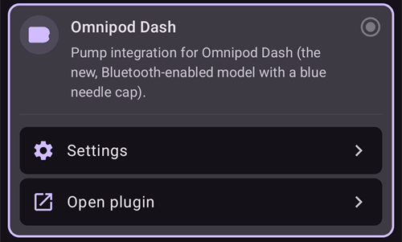

### Comprovar la selecció del controlador Omnipod

Per comprovar que **Omnipod Dash** està seleccionat, obriu **Gestionar** (navegació inferior de la pantalla principal) i toqueu **Bomba**. S'obre la pantalla de la bomba DASH, tal com es mostra a la secció següent.

(omnipod-dash-tab)=

## La pantalla de la bomba DASH

A la pantalla de la bomba DASH és on gestioneu els pods: activar-los i desactivar-los, actualitzar l'estat del pod, silenciar alertes i consultar l'historial del pod. Obriu-la amb **Gestionar** > **Bomba**, o amb **Obrir plugin** a la targeta **Omnipod Dash** de **Configurador** > **Bomba**.

Aquesta és la pantalla sense cap pod actiu:


I aquesta és la pantalla amb un pod actiu:

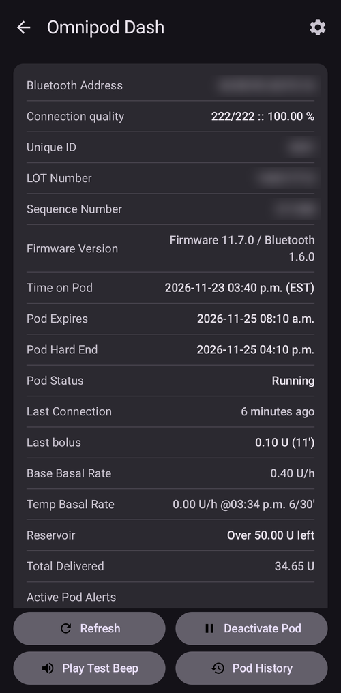

La icona **Configuració** (engranatge) de la cantonada superior dreta obre la [configuració de Dash](#omnipod-dash-settings).

***NOTA:** Si un camp de la pantalla de la bomba mostra (dubtós), premeu **Actualitzar** per actualitzar l'estat del pod.*

### Camps

- **Adreça Bluetooth:** L'adreça Bluetooth del pod.

- **Qualitat de la connexió:** Amb quina fiabilitat es connecta **AAPS** al pod, es mostra com a *connexions correctes / tots els intents de connexió :: percentatge d'èxit*, per exemple `412/420 :: 98.10 %`. Després de més de 50 connexions correctes, el valor es torna groc per sota del 90% i vermell per sota del 70%. Un valor baix indica un problema de Bluetooth (vegeu [Problemes relacionats amb el Bluetooth](#omnipod-dash-bluetooth-related-issues)).

- **Estat del lliurament:** L'estat del lliurament sense processar que informa el pod. Aquest camp només es mostra a les compilacions en mode enginyeria.

- **ID únic:** L'ID únic que **AAPS** ha donat al pod durant l'activació.

- **Nr. LOT:** El número de lot de producció del pod.

- **Nr. de seqüència:** El número de seqüència del pod.

- **Versió del firmware:** Les versions del firmware i del Bluetooth del pod.

- **Hora al pod:** L'hora actual del pod, amb la seva zona horària. El text es torna vermell quan la zona horària del pod és diferent de la del telèfon, i groc quan l'hora del pod té més de 10 minuts de diferència.

- **El pod expira:** La data i l'hora en què caduca el pod (72 hores després de l'activació). El text es torna groc durant les últimes 4 hores abans d'aquest moment. No es torna mai vermell, perquè el pod continua lliurant insulina després.

- **Fi definitiva del pod:** El final del període de gràcia del pod (8 hores després de **El pod expira**, per a una vida màxima del pod de 80 hores). El text es torna groc quan comença el període de gràcia (a **El pod expira**) i vermell durant les últimes 4 hores abans de la fi definitiva. Durant el període de gràcia també mostra el temps que queda, per exemple *(queden 17m)*. El pod deixa de lliurar insulina a la fi definitiva i s'ha de canviar.

- **Estat pod:** L'estat del pod: **Cap pod actiu**, **Configuració en curs**, **Funcionant**, **Suspès** o, després d'un error del pod, **ALARM**.

- **Última connexió:** Quant de temps fa que **AAPS** es va comunicar per última vegada amb el pod.

  - *Fa un moment*: fa menys de 10 segons.

  - *Fa menys d'un minut*: fa entre 10 i 60 segons.

  - *Fa XX minuts*: fa més d'1 minut (i *Fa X hores i XX minuts* després d'una hora).

- **Darrer bolus:** La quantitat de l'últim bolus enviat al pod i quant de temps fa que es va lliurar. Un bolus no confirmat es marca com a (dubtós).

- **Basal base:** La taxa basal programada per a l'hora actual al vostre **perfil** basal.

- **Basal temporal:** La taxa basal temporal (TBR) que està en curs, amb l'hora d'inici i la durada. Aquest camp només es mostra mentre hi ha una TBR en curs.

- **Reservori:** Mostra *Queden més de 50 U* quan queden més de 50 unitats al reservori. Per sota de 50 unitats, es mostra la quantitat exacta. El valor es torna vermell per sota de 20 unitats.

- **Total lliurat:** La quantitat total d'insulina lliurada des del reservori. Inclou la insulina utilitzada per encebar.

- **Alertes pod actiu:** Les alertes que estan actives al pod, per exemple *El pod està a punt de caducar* o *Reservori baix*.

- **Errors:** L'error del pod, si el pod ha fallat, que es mostra en vermell com a *Error del pod:* seguit del codi i el nom de l'error, per exemple *Error del pod: 020 ALARM_OCCLUDED*. Reviseu l'[historial del pod](#omnipod-dash-view-pod-history) i els fitxers de registre per veure errors anteriors i informació més detallada. Vegeu [Errors del pod](#omnipod-dash-pod-failures).

- **Avís del PDM:** Només es mostra després d'un error del pod. Mostra l'error de la mateixa manera que l'hauria mostrat el PDM d'Omnipod: un títol (per exemple *Oclusió detectada*, *Reservori buit* o *Pod caducat*), què ha passat (per exemple *Lliurament d'insulina aturat. Canvieu el pod ara.*) i un codi *Ref:*.

### Botons

Els botons de la part inferior de la pantalla de la bomba canvien segons l'estat del pod. Només es mostren els botons que tenen sentit en aquell moment.

- **Actualitzar:** Demana al pod el seu estat actual.
  - *Feu-lo servir per actualitzar l'estat del pod i per esborrar els camps que mostren (dubtós).*
  - *Vegeu la secció [Resolució de problemes](#omnipod-dash-troubleshooting) més avall per a més informació.*

- **Silenciar alertes:** Atura els bips d'alerta del pod (per exemple, de caducitat del pod o de reservori baix). Només es mostra mentre el pod té una alerta activa. Vegeu [Silenciar les alertes del pod](#omnipod-dash-silencing-pod-alerts).

- **Reprendre lliurament:** Reprèn el lliurament d'insulina d'un pod suspès. Només es mostra quan el lliurament està suspès. Vegeu [Reprendre el lliurament d'insulina](#omnipod-dash-resuming-insulin-delivery).

- **Configurar hora:** Posa el pod a la zona horària del telèfon tornant a enviar el vostre **perfil** basal. Només es mostra quan la zona horària del pod és diferent de la del telèfon.

- [**Activar pod**](#omnipod-dash-activate-pod): enceba i activa un pod nou. Es mostra quan no hi ha cap pod actiu.

- [**Desactivar pod**](#omnipod-dash-deactivate-pod): desactiva el pod actiu. Es mostra tan aviat com un pod està emparellat amb **AAPS**, també quan una activació s'ha aturat a mitges (per exemple, perquè el pod ha fallat durant l'activació). **AAPS** us demana confirmació abans de desactivar el pod.

- **Fer sonar bip de prova:** Fa que el pod faci un sol bip de prova.

- [**Historial del pod**](#omnipod-dash-view-pod-history): mostra l'historial d'activitat del pod actiu.

- **Descartar pod:** Elimina d'**AAPS** un pod que no s'ha acabat d'activar. Només es mostra quan l'activació d'un pod s'ha aturat a mitges. **AAPS** us demana confirmació. Després de descartar-lo, **AAPS** ja no es pot comunicar amb aquest pod: traieu-lo del cos.

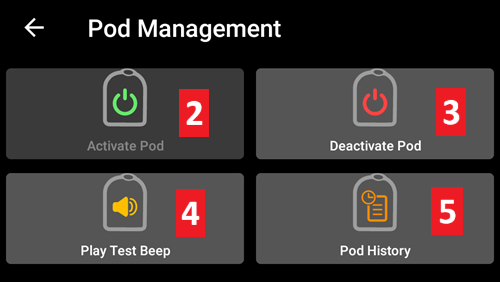

```{admonition} Older screenshot
:class: note
La captura de pantalla de dalt és d'una versió anterior d'**AAPS**, que tenia un menú **Gestió del pod** separat. A **AAPS** 4 totes aquestes accions, incloses **Activar pod**, **Desactivar pod**, **Fer sonar bip de prova** i **Historial del pod**, són botons amb text directament a la pantalla de la bomba.
```

(omnipod-dash-activate-pod)=

## Activar pod

1. Obriu la pantalla de la bomba DASH (**Gestionar** > **Bomba**) i premeu **Activar pod**. S'obre l'assistent d'activació.

   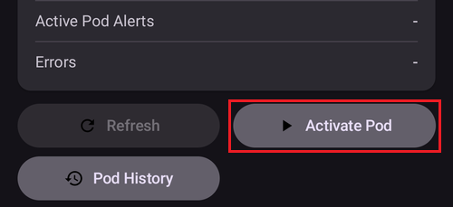

   ```{admonition} Older screenshot
   :class: note
   La captura de pantalla de dalt és d'una versió anterior d'**AAPS**. A **AAPS** 4, **Activar pod** és un botó directament a la pantalla de la bomba DASH, en lloc d'estar al menú **Gestió del pod**.
   ```

   Si mai no heu activat cap **perfil** a **AAPS**, l'assistent primer mostra el pas **Cal un perfil**: seleccioneu el perfil que s'aplicarà en l'activació i continueu.

2. Es mostra el pas **Omplir pod**. Ompliu un pod nou amb prou insulina per a 3 dies, **com a mínim 80 unitats**. Escolteu els dos bips del pod: volen dir que s'ha omplert la quantitat mínima de 80 unitats. Buideu del tot la xeringa d'ompliment, encara que ja hàgiu sentit els dos bips. No traieu encara el tap de l'agulla del pod.

   ***NOTA:** Quan calculeu la quantitat d'insulina que necessiteu per a 3 dies, recordeu que encebar el pod fa servir unes 3–10 unitats.*

   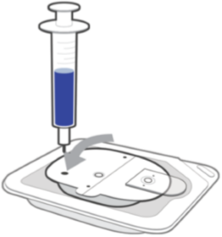

   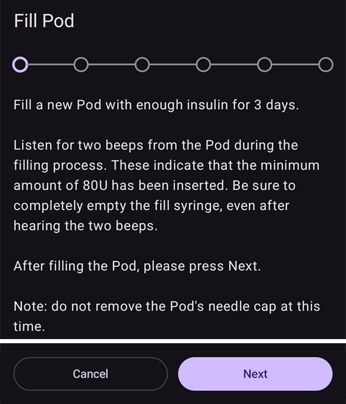

   Assegureu-vos que el pod nou i el telèfon amb **AAPS** són a prop l'un de l'altre i premeu **Següent**.

3. Si feu servir més d'una insulina a **AAPS**, es mostra el pas **Seleccionar insulina**. Mostra la insulina **Activa actualment**. Si heu omplert el pod amb una altra insulina, premeu **Canviar** i seleccioneu-la. **AAPS** aplica un **canvi de perfil** amb aquesta insulina quan acaba l'activació. Premeu **Següent**.

   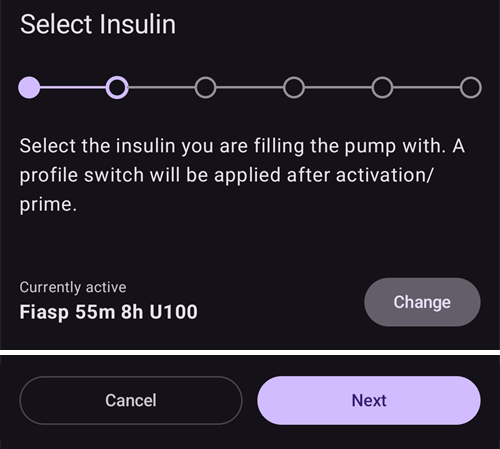

4. Al pas **Inicialitzar pod**, **AAPS** s'emparella amb el pod nou i l'enceba. Sentireu un clic i després una sèrie de sons de tic-tac mentre el pod s'enceba. Quan això ha acabat correctament, apareix el botó **Següent**. Premeu **Següent**.

   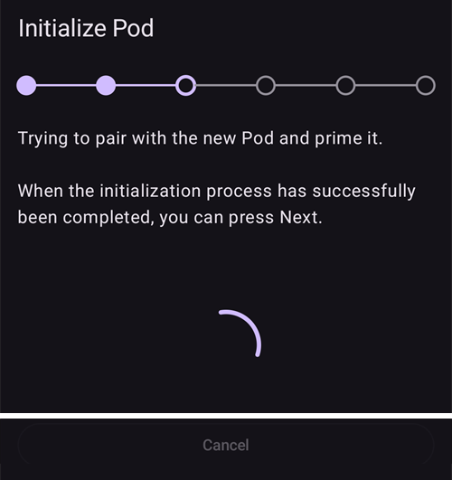    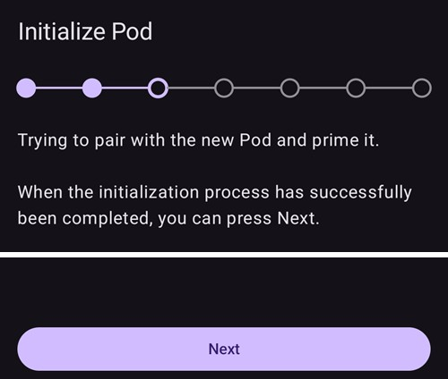

   ***NOTA**: Si apareix un missatge d'error com _Ha fallat l'escaneig_ o _«Could not find an available pod for activation»_ (no s'ha trobat cap pod disponible per activar; pot passar), no us espanteu. Premeu **Reintentar**. En la majoria dels casos, l'activació continua llavors correctament.*

   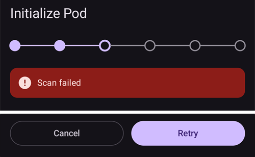

   Si el pod ha fallat (per exemple, perquè s'ha superat el seu temps d'activació), es mostra **Desactivar pod** en lloc de **Reintentar**. Feu-lo servir i torneu a començar amb un pod nou.

   Si premeu **Cancel·lar** abans que acabi l'activació, **AAPS** us demana que confirmeu que voleu sortir. Premeu **OK** per sortir de l'assistent, o **Cancel·lar** per quedar-vos-hi.

   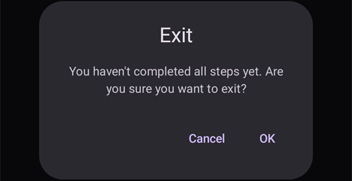

5. Si gestioneu la rotació del punt d'infusió de la bomba a **AAPS** (**Gestionar la rotació del punt d'infusió de la bomba** a la configuració de [Rotació de punts d'inserció](#Aapsscreens-site-rotation)), es mostra el pas **Punt d'inserció**. Seleccioneu al diagrama del cos on col·locareu el pod i premeu **Següent**, o premeu **Ometre**.

   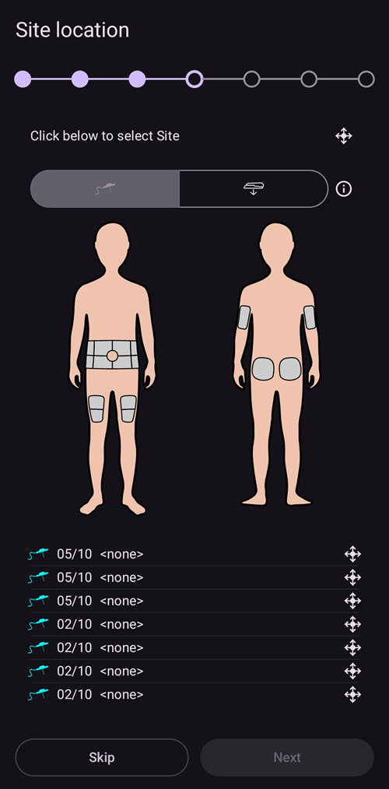

6. A continuació, prepareu el punt d'infusió per al pod nou. Renteu-vos les mans per evitar qualsevol risc d'infecció. Netegeu el punt d'infusió amb aigua i sabó o amb una tovalloleta d'alcohol, i deixeu que la pell s'assequi del tot a l'aire abans de continuar. Si l'adhesiu us irrita la pell, podeu fer servir una tovalloleta o un esprai de barrera.

   Al pas **Adherir pod**, traieu el tap blau de plàstic de l'agulla del pod. Si la cànula o qualsevol altra cosa sobresurt del pod, o té un aspecte estrany, **ATUREU-VOS**: premeu **Cancel·lar** i torneu a començar amb un pod nou. Si tot sembla **correcte**, traieu el paper blanc de l'adhesiu i enganxeu el pod al punt del cos que heu triat.

   Quan acabeu, premeu **Següent**.

   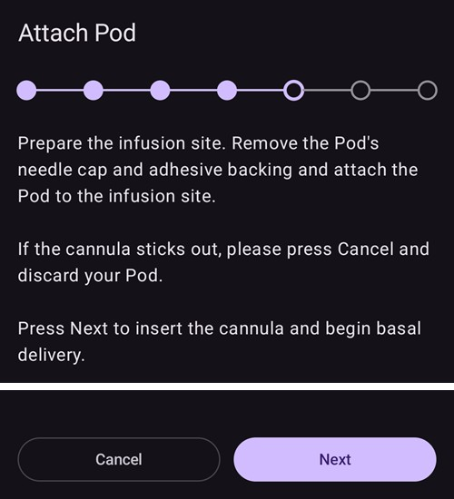

7. Apareix un diàleg de confirmació: *Quan premeu OK, la cànula serà inserida.* **Premeu OK NOMÉS si esteu preparats per inserir la cànula!**

   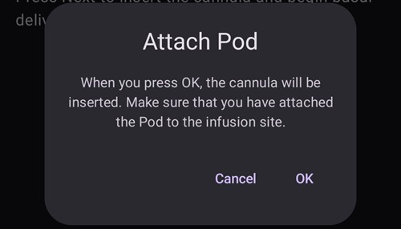

8. Al pas **Inserir cànula**, **AAPS** estableix la vostra programació basal i el pod insereix la cànula. Pot trigar una mica (1–2 minuts com a màxim). **Tingueu paciència!**

   ***NOTA:** És una bona pràctica pessigar la pell a prop del punt d'inserció abans que s'insereixi la cànula. This helps the needle go in smoothly and lowers your chance of occlusions (blockages).*

   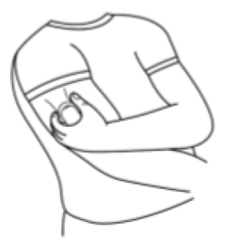    

9. When the cannula has been inserted successfully, the **Next** button appears. Premeu **Següent**.

   

10. The **Pod Activated** step is shown. Check that the cannula has been inserted correctly, and change the pod if you think it has not.

    Press **Finish**.

    Enhorabona! Ara heu iniciat una nova sessió de pod.

    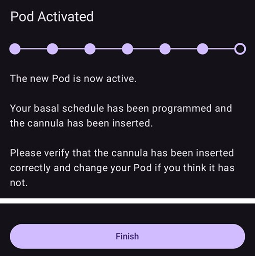

11. You are back on the DASH pump screen. It now shows the information of your active pod, including the current basal rate, reservoir level, insulin delivered, pod errors and alerts. **Activate Pod** is replaced by **Deactivate Pod**: you cannot activate another pod without deactivating the active pod first.

    ***NOTE:** For more details on the information shown, see [The DASH pump screen](#omnipod-dash-tab).*

    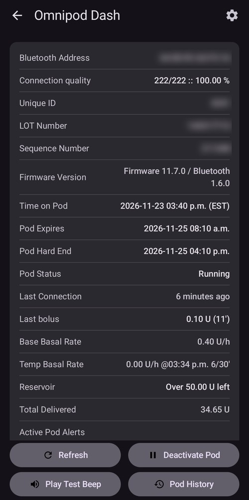

    ***NOTE:** It is good practice to export your settings AFTER activating the pod. Export your settings after each pod change and once a month. Copy the exported settings file to a cloud storage location (for example Google Drive) or somewhere off your phone in case you lose your phone (see [**Export settings**](../Maintenance/ExportImportSettings.md)).*

If an earlier activation stopped after the pod was primed, pressing **Activate Pod** continues from the **Attach Pod** step.

(omnipod-dash-deactivate-pod)=

## Desactivar pod

Under normal circumstances, a pod lasts three days (72 hours), plus a grace period of 8 hours after the pod expiry warning: 80 hours in total.

To deactivate a pod (either because it expired or because it failed):

1. Open the DASH pump screen (**Manage** > **Pump**) and press **Deactivate Pod**.

   

2. On the **Deactivate Pod** step, press **Next**. A dialog asks *A deactivated Pod can not be used again. Deactivate this Pod now?* Press **OK** to start deactivating the pod, or **Cancel** to keep it. Deactivation suspends all insulin delivery and cannot be undone.

   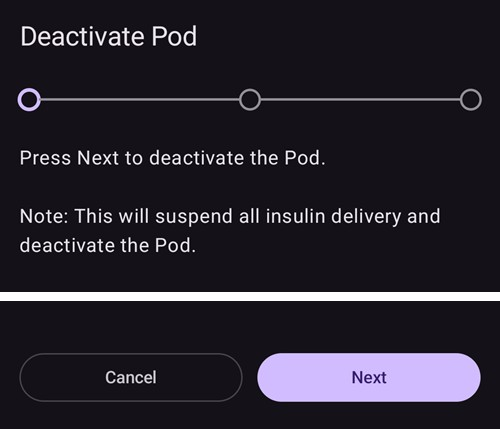

3. The **Deactivating Pod** step is shown while **AAPS** deactivates the pod. The pod beeps to confirm that deactivation was successful.

   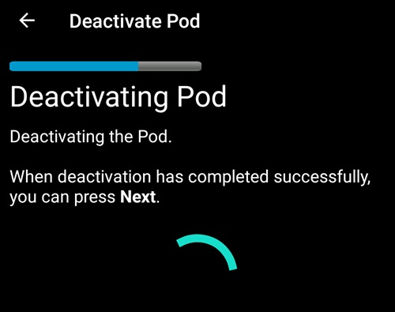

   ```{admonition} Older screenshot
   :class: note
   La captura de pantalla de dalt és d'una versió anterior d'**AAPS**. In **AAPS** 4 the wizard shows its progress as a row of dots at the top instead of a progress bar.
   ```

   When deactivation has finished successfully, the **Next** button appears. Premeu **Següent**.

   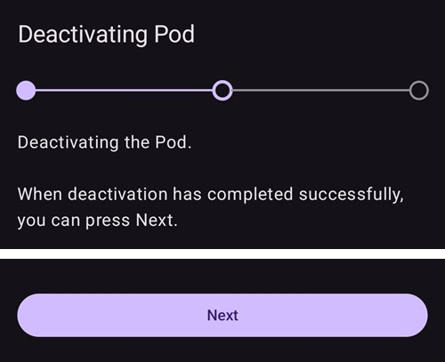

   If deactivation fails, an error message and a **Discard Pod** button are shown. See [Discarding a pod](#omnipod-dash-discard-pod) below before you use it. You can also press **Cancel** and try **Deactivate Pod** again later.

4. The **Pod Deactivated** step is shown. Remove the pod from your body and press **Finish**.

   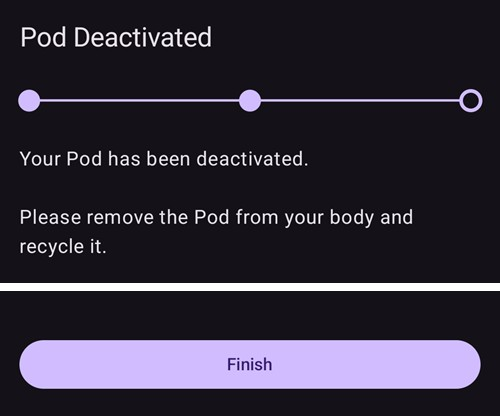

5. You are back on the DASH pump screen. Check that the **Pod Status** field shows **No Active Pod** and that the **Activate Pod** button is shown again.

   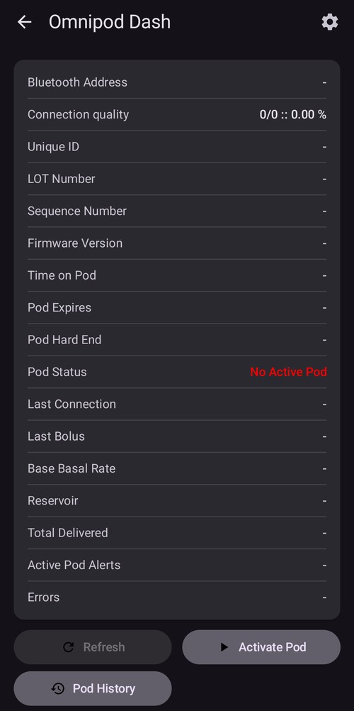

(omnipod-dash-discard-pod)=

### Discarding a pod

Only discard a pod when all communication with it keeps failing. If **AAPS** can still communicate with the pod, use **Deactivate Pod** instead.

- **AAPS** asks you to confirm before it discards the pod.
- After that, **AAPS** can no longer communicate with that pod.
- **Insulin delivery has NOT been suspended**, because the pod was not deactivated properly. **Remove the pod from your body!**
- The **Pod Discarded** step confirms that the pod state has been discarded. Press **Finish**. You can now activate a new pod.

(omnipod-dash-resuming-insulin-delivery)=

## Reprendre el lliurament d'insulina

**NOTE**: During **Profile Switches**, like when using the PDM, **AAPS** must suspend delivery on the pod before setting the new basal **Profile**. If communication fails between the suspend and resume commands, delivery can stay suspended. Read [**Delivery suspended**](#omnipod-dash-delivery-suspended) in the troubleshooting section for more details.

When insulin delivery is suspended, you need to tell the pod to resume insulin delivery. When the command has been processed successfully, the pod delivers insulin again using the basal rate for the current time from your active basal **Profile**. The pod again accepts commands for bolus, **TBR** and **SMB**.

1. Open the DASH pump screen and check that the **Pod Status** field shows **Suspended**. Press **Resume Delivery** to tell the pod to resume normal insulin delivery.

   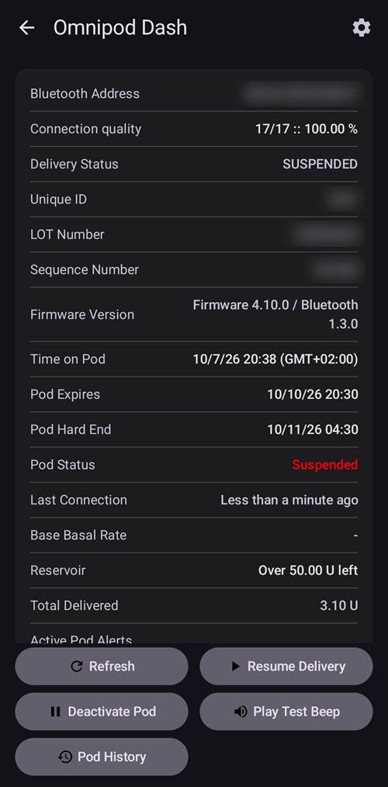

2. When the command was successful, the **Pod Status** field shows **Running** and the **Resume Delivery** button disappears.

   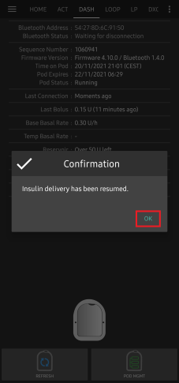

   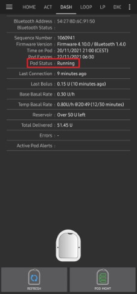

   ```{admonition} Older screenshot
   :class: note
   The screenshots above are from an earlier **AAPS** version, which showed a confirmation dialog. In **AAPS** 4 you confirm the result on the DASH pump screen: the **Pod Status** field shows **Running** and the **Resume Delivery** button is gone.
   ```

   If the command fails, **AAPS** shows a warning dialog starting with *Failed to resume delivery*. Press **Refresh** and try again.

   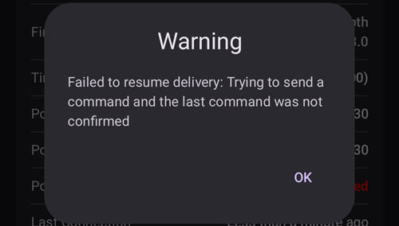

(omnipod-dash-silencing-pod-alerts)=

## Silenciar les alertes del pod

This section explains how to stop the pod beeps when the pod approaches the end of its life. When these beeps start depends on the **Alerts** settings (see [Dash Settings](#omnipod-dash-settings)):

- **Reminder at hours before expiry (72 Hours):** how many hours before the 72-hour expiry the pod starts to beep.
- **Alert at hours before shutdown (80 Hours):** how many hours before the 80-hour shutdown the pod beeps again.

The maximum life of a pod is 80 hours (3 days 8 hours). However, the pod manufacturer recommends not going beyond 72 hours (3 days).

***NOTE**: The **Silence Alerts** button is only shown on the DASH pump screen while the pod has an active alert, for example pod expiry or low reservoir. If the **Silence Alerts** button is not shown but you hear the pod beeping, press **Refresh**.*

1. When the reminder time is reached, the pod beeps to tell you that it will expire soon and that you need to change it. On the DASH pump screen, the **Pod Expires (1)** field shows the exact time the pod will expire (72 hours after activation). The text turns yellow 4 hours before this time. After it, **Pod Hard End** turns yellow and shows the time left until the pod stops delivering insulin. The **Active Pod Alerts (2)** field shows **Pod will expire soon**, and the **Silence Alerts (3)** button is shown.

   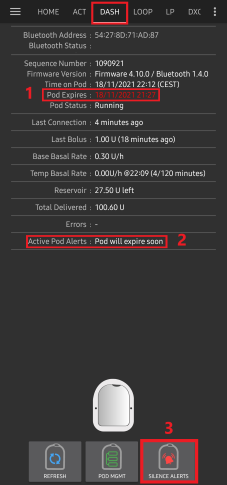

2. Press **Silence Alerts**. **AAPS** sends the command to the pod to stop the expiry beeps.

   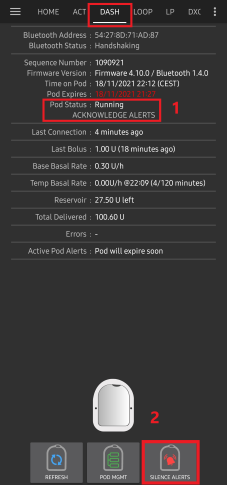

   ```{admonition} Older screenshot
   :class: note
   The screenshot above is from an earlier **AAPS** version, where this screen was the **DASH** tab. In **AAPS** 4 the **Silence Alerts** button is on the DASH pump screen (**Manage** > **Pump**).
   ```

3. When the alerts have been silenced, the alert is no longer shown in the **Active Pod Alerts** field, the **Silence Alerts** button disappears, and the pod stops its expiry beeps.

   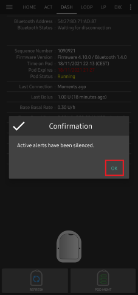

   ```{admonition} Older screenshot
   :class: note
   The screenshot above is from an earlier **AAPS** version, which showed a confirmation dialog. In **AAPS** 4 you confirm the result on the DASH pump screen: the alert is gone from the **Active Pod Alerts** field.
   ```

   If the command fails, **AAPS** shows a warning dialog starting with *Failed to silence alerts*. Press **Refresh** and try again.

The low reservoir alert works the same way. When the insulin left in the pod drops to the **Number of units** set in the **Alerts** settings, the pod beeps. The **Reservoir** field shows the amount left, the **Active Pod Alerts** field shows **Low Reservoir**, and the **Silence Alerts** button is shown. Press **Silence Alerts** to stop the beeps, and plan your next pod change.


(omnipod-dash-view-pod-history)=

## Veure l'historial del pod

This section explains how to look at the history of your active pod and filter it by type of action. The pod history shows the commands sent to your active pod and their results during its three-day (72 - 80 hours) life.

It is useful to check the boluses, TBRs and basal commands that were sent to the pod. The other categories help with troubleshooting and show the order of events that led up to a failure.

**NOTE:** **Only the last command can be uncertain**. New commands *are not sent* until the **last 'uncertain' command becomes 'confirmed' or 'denied'**. To 'fix' an uncertain command, press **Refresh** on the DASH pump screen.

1. Open the DASH pump screen and press **Pod History**.

   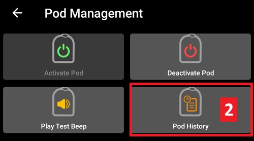

   ```{admonition} Older screenshot
   :class: note
   La captura de pantalla de dalt és d'una versió anterior d'**AAPS**. In **AAPS** 4 **Pod History** is a button directly on the DASH pump screen instead of in the **Pod Management** menu.
   ```

2. The **Pod History** screen opens with the **All** filter selected. It lists every command with its time and result, newest first, grouped by day. Use the filter buttons at the top (for example **Boluses** or **Basals**) to show only one type of command. Press the back arrow to return to the DASH pump screen.

   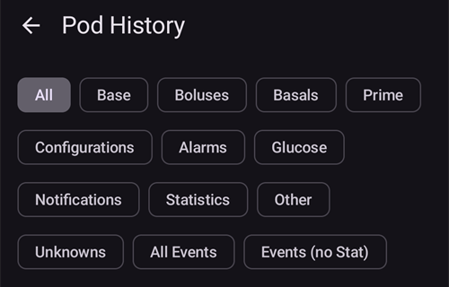 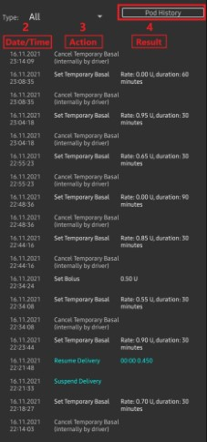

   ```{admonition} Older screenshot
   :class: note
   The second screenshot above is from an earlier **AAPS** version, where you picked the type of command from a **Type** list. In **AAPS** 4 you use the filter buttons shown in the first screenshot.
   ```

   For boluses, the amount is followed by the bolus type when it is not a normal bolus, for example *0.05 U (SMB)* or *0.05 U (Basal correction)*. A basal correction is a very small bolus (one pod pulse, 0.05 U) that the driver sends by itself; you did not request it.

   ```{admonition} Why basal corrections happen
   :class: note
   The pod delivers basal insulin in pulses of 0.05 U, timed by an internal clock. Each time the basal rate changes (for example when the loop sets a new **TBR**), the pod restarts this clock, and the pulse it was counting towards is lost. Because the loop changes the basal rate often, especially overnight, the pod can end up delivering less basal insulin than expected.

   **AAPS** compares the basal insulin the pod reports as delivered with what it should have delivered. When the shortfall reaches half a pulse or more, the driver delivers one extra pulse as a basal correction, so you still get the basal insulin your profile and the loop asked for. No correction is sent while the pod is suspended, or while a zero **TBR** is running.
   ```

(omnipod-dash-settings)=

## Configuració de Dash

There are two ways to open the Dash driver settings:

- Press the **Settings** (gear) icon in the top-right corner of the [DASH pump screen](#omnipod-dash-tab).
- Open the **menu** (☰) in the top-left corner of the main screen and select **Configuration** > **Pump**. On the **Omnipod Dash** card, press **Settings**.

The settings are grouped into four expandable sections: **Confirmation Beeps**, **Alerts**, **Notifications** and **Advanced Settings**. Tap a section to open it:

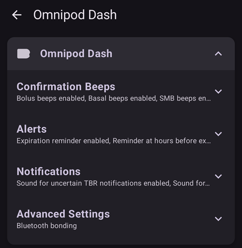

Most settings are on/off switches.

### Confirmation Beeps

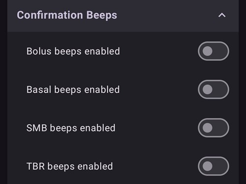

Confirmation beeps from the pod for bolus, basal, SMB and TBR delivery and changes.

**Bolus beeps enabled:**    The pod beeps when a bolus is delivered. On by default.

**Basal beeps enabled:**    The pod beeps when a new basal rate is set, or when the active basal rate is canceled or changed. Off by default.

**SMB beeps enabled:**  The pod beeps when an SMB is delivered. On by default.

**TBR beeps enabled:**  The pod beeps when a TBR is set or canceled. Off by default.

### Alertes

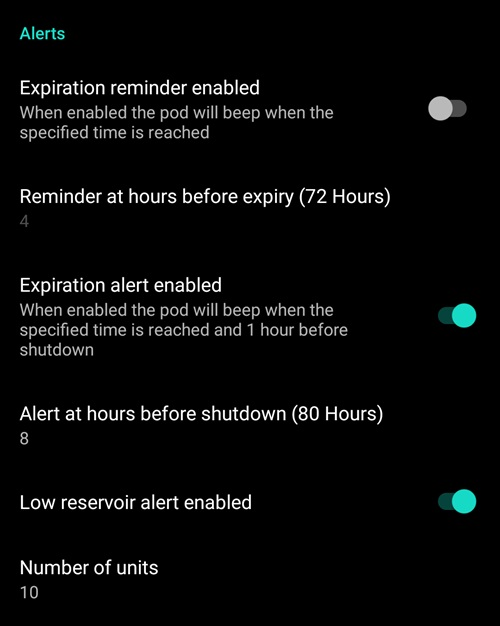

```{admonition} Older screenshot
:class: note
The screenshot above is from an earlier **AAPS** version. In **AAPS** 4 these settings are in the expandable **Alerts** section.
```

Pod alerts for pod expiry, shutdown and low reservoir. When you change these settings while a pod is active, **AAPS** sends the new alert settings to the pod.

***NOTE:** An **AAPS** notification is ALWAYS shown for any alert once **AAPS** has communicated with the pod after the alert was triggered. Dismissing the notification does NOT stop the pod alert. To stop the alert, open the DASH pump screen and press **Silence Alerts**.*

**Expiration reminder enabled:**    When this is on, the pod beeps when the reminder time is reached. On by default.

**Reminder at hours before expiry (72 Hours):** How many hours before the 72-hour pod expiry the reminder starts (1 to 24 hours; default 4).

**Expiration alert enabled:**   When this is on, the pod beeps when the alert time is reached, and again 1 hour before shutdown. On by default.

**Alert at hours before shutdown (80 Hours):**  How many hours before the 80-hour pod shutdown the alert starts (1 to 8 hours; default 8).

**Low reservoir alert enabled:**    The pod alerts you when the insulin left in the reservoir drops to the value in **Number of units**. On by default.

**Number of units:**    The number of units at which the low reservoir alert is triggered (5 to 50 units; default 20).

### Notificacions

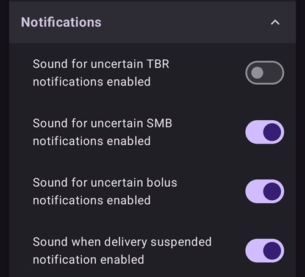

Choose whether **AAPS** plays a sound with its notifications when it is uncertain whether a TBR, SMB or bolus was delivered, and when delivery is suspended.

***NOTE:** These are phone notifications only; the pod itself does not beep.*

**Sound for uncertain TBR notifications enabled:**  Plays a sound with the notification when **AAPS** is uncertain whether a TBR was set.

**Sound for uncertain SMB notifications enabled:**  Plays a sound with the notification when **AAPS** is uncertain whether an SMB was delivered.

**Sound for uncertain bolus notifications enabled:**    Plays a sound with the notification when **AAPS** is uncertain whether a bolus was delivered.

**Sound when delivery suspended notification enabled:**     Plays a sound with the notification when insulin delivery is suspended.

(omnipod-dash-advanced-settings)=

### Configuració avançada

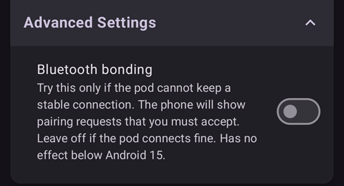

**Bluetooth bonding:**  Bonds the pod with the phone over Bluetooth. Try it only if the pod cannot keep a stable connection, for example on Android 15 (see [Omnipod DASH known AAPS constraints/issues](#omnipod-dash-constraints)). When it is on, the phone shows pairing requests that you must accept. Leave it off if the pod connects fine. It has no effect below Android 15. Off by default.

## Insulin and cannula age

The [status row](#screens-sensor-level-battery) on the main screen shows the age of your insulin and cannula. With Omnipod, these work a little differently than with tube-based pumps.

**AAPS** records a cannula change and an insulin change automatically each time you activate a pod. This resets the **Insulin** and **Cannula** ages to zero after every pod change. You do not need to record them yourself with **Prime/Fill**. This is because the pod inserts the cannula directly into the skin where it is attached: Omnipod does not use a tube.

**Pump battery** age is not reported: the battery and the insulin reservoir are built into each pod, and the battery always lasts longer than the pod itself (maximum 80 hours).


```{admonition} Older screenshot
:class: note
The screenshot above is from an earlier **AAPS** version, where these ages were shown in the **Careportal** section of the **Actions** tab. In **AAPS** 4 they are shown in the status row on the main screen.
```

### Nivell

**Nivell d'insulina**

The insulin level shown is the amount reported by the pod. However, the pod only reports the actual reservoir level when it is below 50 units. Until then, *Over 50 U left* is shown. The amount reported is not exact: when the pod reports 'empty', in most cases the reservoir still has a few units of insulin left.

The DASH pump screen shows the level as follows:

  * **Over 50 U left** - The pod reports more than 50 units in the reservoir.
  * **Below 50 units** - The exact amount of insulin left in the reservoir, as reported by the pod.

Nota addicional:
  * **SMS** - Returns the value, or 50+U when over 50 units, in SMS responses.
  * **Nightscout** - Uploads a value of 50 when over 50 units to Nightscout (version 14.07 and older). Newer versions report a value of 50+ when over 50 units.

(omnipod-dash-troubleshooting)=

## Resolució de problemes

Aquesta secció tracta problemes coneguts habituals, i les seves solucions, quan es fa servir Omnipod DASH amb AAPS. A la documentació també hi ha la secció [Resolució de problemes](../GettingHelp/GeneralTroubleshooting.md), que val la pena revisar perquè també tracta temes rellevants per a alguns problemes del pod.

---

(omnipod-dash-bluetooth-related-issues)=

## Problemes relacionats amb el Bluetooth

Per a problemes coneguts amb connexions Bluetooth, talls de connexió amb bombes o pods, o problemes d'activació i connexió, vegeu [Problemes relacionats amb el Bluetooth](../GettingHelp/BluetoothTroubleshooting.md)

---

(omnipod-dash-delivery-suspended)=

### Lliurament suspès

  - Ja no hi ha botó per suspendre. Si voleu «suspendre» el pod, podeu establir una **TBR** de zero durant x minuts.
  - Durant els **canvis de perfil**, DASH ha de suspendre el lliurament abans d'establir el nou **perfil** basal. Si la comunicació falla entre les dues ordres, el lliurament pot quedar suspès. Quan passa això:
     - No hi haurà lliurament d'insulina, això inclou la basal, els SMB, els bolus manuals, etc.
     - Pot aparèixer un avís que una de les ordres no està confirmada: depèn de quan s'ha produït l'error.
     - **AAPS** intentarà establir el nou perfil basal cada 15 minuts.
     - **AAPS** mostrarà cada 15 minuts un avís que el lliurament està suspès, si el lliurament continua suspès (no s'ha pogut reprendre el lliurament).
     - The [**Resume Delivery**](#omnipod-dash-resuming-insulin-delivery) button is shown on the DASH pump screen if you want to resume delivery manually.
     - Si **AAPS** no aconsegueix reprendre el lliurament tot sol (passa si el pod no és accessible, el so està silenciat, etc.), el pod començarà a fer 4 bips cada minut durant 3 minuts, i després ho repetirà cada 15 minuts si el lliurament continua suspès més de 20 minuts.
  - For unconfirmed commands, press **Refresh** on the DASH pump screen to confirm or deny them.

*****NOTA:** Quan sentiu bips del pod, no doneu per fet que el lliurament continuarà sense comprovar el telèfon; el lliurament pot quedar suspès, ***per tant, cal que ho comproveu!******

---
(omnipod-dash-pod-failures)=

### Errors del pod

- De vegades els pods fallen per diversos motius, també per problemes de maquinari del mateix pod.
- És millor no obrir casos de suport o de substitució amb Insulet, perquè AAPS no és una manera aprovada de fer servir els pods.
- Hi ha una llista de codis d'error [**aquí**](https://github.com/openaps/openomni/wiki/Fault-event-codes) que us ajuda a trobar la causa.

When a pod fails, it stops delivering insulin and beeps continuously. **AAPS** shows a notification on the main screen with the fault code and name, and the *Ref:* code, for example *Pod Fault: 020 ALARM_OCCLUDED*. Press **Dismiss** to close the notification. This does not stop the pod beeping.

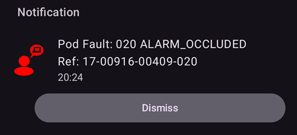

On the DASH pump screen, the **Pod Status** field shows **ALARM**, the **Errors** field shows the pod fault, and the **PDM Notification** field explains it, for example *Occlusion Detected. Insulin delivery stopped. Change Pod now. Check your BG*.

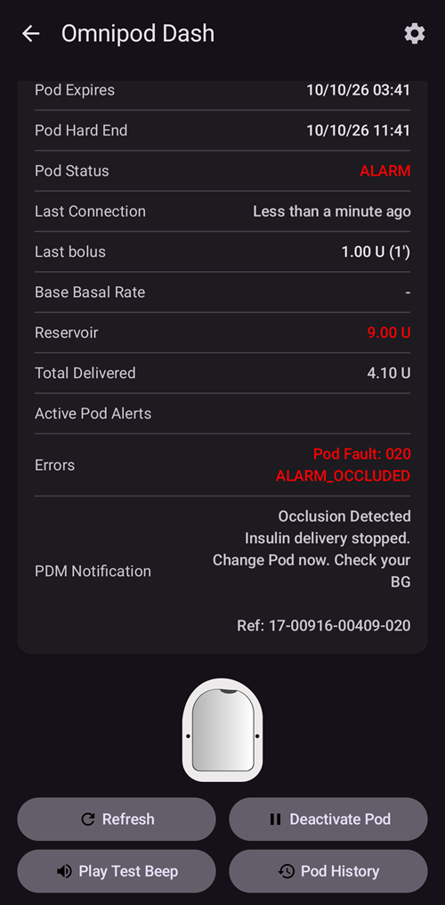

A failed pod cannot be used again. Check your blood glucose, then [deactivate the pod](#omnipod-dash-deactivate-pod) and activate a new one.

---
### Evitar errors 49 del pod

Aquest error està relacionat amb un estat incorrecte del pod per a una ordre o amb un error durant una ordre de lliurament d'insulina. Passa quan el controlador i el pod no coincideixen sobre l'estat real. Llavors el pod (per una mesura de seguretat interna) reacciona amb un codi d'error irrecuperable 49 (0x31) i acaba en el que es coneix com a «screamer»: el bip llarg i molest que només es pot aturar fent un forat al lloc adequat de la part posterior del pod. L'origen exacte d'un «error 49 del pod» sovint és difícil de trobar. It can happen, for example, after application crashes, when running a development version or after a re-installation.

---

### Alertes de bomba no accessible

Quan no es pot establir comunicació amb el pod durant un temps configurat, apareix una alerta «Bomba no accessible». Pump unreachable alerts can be configured by pressing the **Settings** (gear) icon on the top right of the main screen, then selecting **Local Alerts** ➜ **Pump unreachable threshold**. El valor recomanat és alertar després de **120** minuts.

---
(omnipod-dash-export-import)=
### Export and import settings

Exporting **AAPS** settings lets you restore all your settings and Objectives, for example after reinstalling **AAPS** or on a new phone. **Export your settings right after each Pod activation** and copy the file to a safe place off your phone (for example Google Drive), so the active Pod can be restored too. See [Creating and restoring back-ups](#ExportImportSettings-Settings-Export).

```{admonition} Importing settings can end your active Pod
:class: warning
On the phone that is already running the Pod, leave **Also replace pump settings** unticked: the Pod session is kept and only the other settings are imported. Tick it only on a new phone, with a file exported during the Pod you are wearing now. See [Tubeless pumps](#ExportImportSettings-tubeless-pumps).
```

If the imported settings contain a Pod that is no longer active, see the next section.

---
### Importar una configuració que conté l'estat d'un pod inactiu

Quan importeu una configuració que conté dades d'un pod que ja no està actiu, AAPS intentarà connectar-s'hi, i és clar que fallarà. You cannot activate a new Pod in this situation.

Per eliminar la sessió del pod antic:
1. On the DASH pump screen, press **Deactivate Pod**. The deactivation will most likely fail.
2. When it fails, press **Discard Pod** and confirm (see [Discarding a pod](#omnipod-dash-discard-pod)).
3. Once the old pod is removed, you can activate a new pod.

### Generic error: java.lang.IllegalStateException: Trying to set a Bluetooth Address to ***, but it is already set to ***.

Si rebeu aquest error quan intenteu inicialitzar un pod nou, **AAPS** falla perquè encara té guardada a la configuració la informació d'un pod antic.

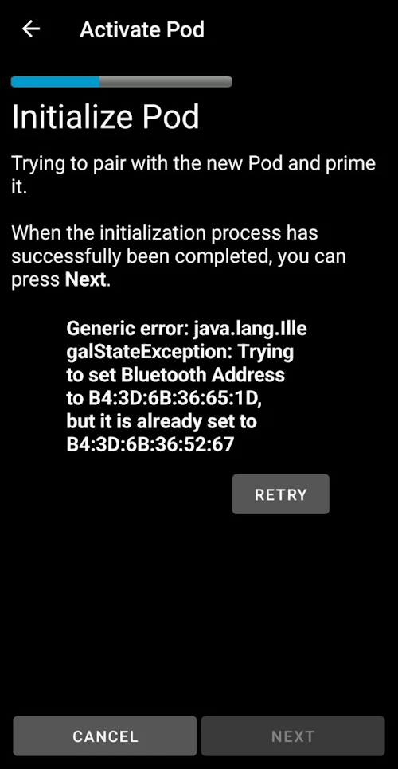

Pot passar si restaureu una còpia de seguretat o si falla la desactivació d'un pod.

To resolve it, press **Cancel** to leave the activation. On the DASH pump screen, press **Discard Pod** if it is shown. Otherwise press **Deactivate Pod**, and when the deactivation fails, press **Discard Pod** (see [Discarding a pod](#omnipod-dash-discard-pod)).

Ara ja hauríeu de poder activar un pod nou.

---
### Reinstal·lar AAPS

Quan desinstal·leu **AAPS**, perdreu tota la configuració, els objectius i la sessió actual del pod. **Per restaurar-los, assegureu-vos que teniu un fitxer de configuració exportat recent!**

When on an active Pod, use an export made during the current Pod session (see [Export and import settings](#omnipod-dash-export-import)).

1. Exporteu la configuració i guardeu-ne una còpia en un lloc segur (per exemple, Google Drive).
2. Desinstal·leu **AAPS** i reinicieu el telèfon.
3. Instal·leu la nova versió d'**AAPS**.
4. Importeu la vostra configuració.
5. Comproveu tota la configuració (si voleu, torneu a importar la configuració).
6. Activeu un pod nou.
7. Quan acabeu: exporteu la configuració actual.

---
### Actualitzar AAPS a una versió més nova

En la majoria dels casos no cal desinstal·lar. Podeu fer una instal·lació «damunt» de l'actual: només cal iniciar la instal·lació de la nova versió. També és possible amb una sessió de pod activa.

1. Exporteu la vostra configuració.
2. Instal·leu la nova versió d'**AAPS**.
3. Comproveu que la instal·lació s'ha fet correctament
4. REPRENEU el lliurament del pod o activeu un pod nou.
5. Quan acabeu: exporteu la configuració actual.

---
### Alertes del controlador Omnipod

The Omnipod Dash driver presents a variety of unique alerts on the **main screen**, most of them are informational and can be dismissed while some provide the user with an action requiring their input to resolve the cause of the triggered alert.

A continuació teniu un resum de les alertes principals que podeu trobar:

- *Pod Fault: XXX NAME*, followed by *Ref: ...*: the pod has failed and stopped delivering insulin. Change the pod. Vegeu [Errors del pod](#omnipod-dash-pod-failures).
- *No Active Pod*: no pod session was found. This notification keeps coming back until you activate a new pod. Once a pod is activated, it disappears automatically.
- *Insulin delivery suspended*: the pod has suspended insulin delivery. Vegeu [Reprendre el lliurament d'insulina](#omnipod-dash-resuming-insulin-delivery).
- *Setting basal profile might have failed. El lliurament podria estar suspès! Please manually refresh the Pod status on the pump screen and resume delivery if needed.* Setting the basal **Profile** on the pod may have failed. Press **Refresh** on the DASH pump screen, and press **Resume Delivery** if it is shown.
- *Unable to verify whether SMB (X U) succeeded. Refresh pod status to confirm or deny this command.* **AAPS** could not confirm that the **SMB** was delivered. Press **Refresh** on the DASH pump screen and check the **Last bolus** field.
- *Bolus delivery status uncertain. Refresh pod status to confirm or deny.* The same for a normal bolus: press **Refresh** on the DASH pump screen.
- *Timezone on pod is different from the timezone on phone. Basal rate is incorrect. Switch profile to fix* See the DST and timezone note in [Omnipod DASH known AAPS constraints/issues](#omnipod-dash-constraints).

(omnipod-dash-where-to-get-help-for-dash)=

## On trobar ajuda

Tot el desenvolupament de DASH el fa la comunitat de manera **voluntària**; tingueu-ho en compte i seguiu aquestes indicacions abans de demanar ajuda:

-  **Nivell 0:** Llegiu la secció corresponent d'aquesta documentació per assegurar-vos que enteneu com ha de funcionar la funció que us dona problemes.
-  **Nivell 1:** Si encara teniu problemes que no podeu resoldre amb aquest document, aneu al canal *#AAPS* de **Discord** amb [aquest enllaç d'invitació](https://discord.gg/4fQUWHZ4Mw). També hi ha molts grups de Facebook i d'altres on podeu preguntar (vegeu [**On puc trobar ajuda?**](../GettingHelp/WhereCanIGetHelp.md))
-  **Level 2:** Search existing issues to see if your issue has already been reported at [Issues](https://github.com/nightscout/AndroidAPS/issues). If it exists, please confirm/comment/add information on your problem. Si no, creeu una [incidència nova](https://github.com/nightscout/AndroidAPS/issues) i adjunteu-hi [els vostres fitxers de registre](../GettingHelp/AccessingLogFiles.md).
-  **Tingueu paciència: la majoria dels membres de la nostra comunitat són voluntaris de bona fe, i resoldre problemes sovint demana temps i paciència tant als usuaris com als desenvolupadors.**

Quan demaneu ajuda, prepareu la informació següent per ajudar la comunitat amb les vostres preguntes i problemes concrets:
- Marca i model del telèfon Android
- Versió d'Android (per exemple, 15 o 16)
  - Heu actualitzat la versió d'Android fa poc?
- La versió d'**AAPS** que feu servir
- Una descripció senzilla del problema que teniu, pensant en alguns d'aquests punts
   - Abans funcionava?
   - Quan funcionava i quan no?
   - Heu fet canvis a la configuració o al perfil?
   - Did you pair a new Bluetooth device?
   - Heu actualitzat o instal·lat alguna aplicació nova?
   - Quant de temps va funcionar abans de deixar de funcionar?
