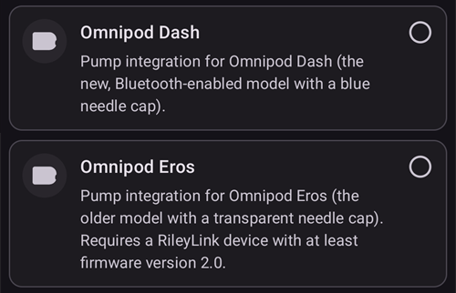
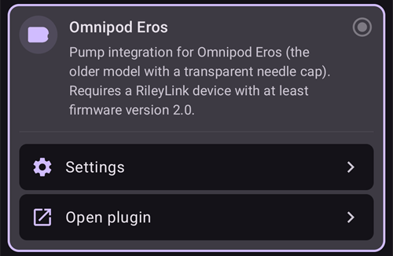
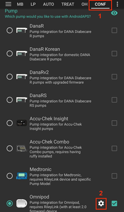
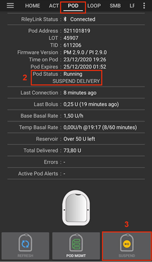
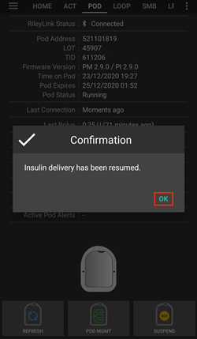
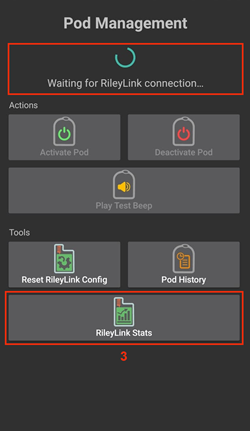
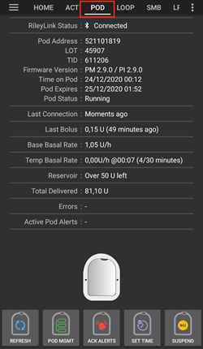
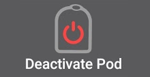
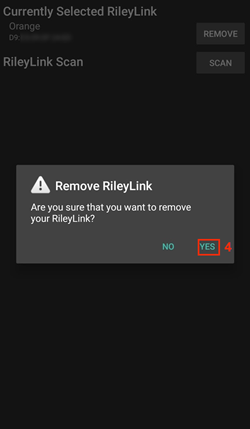
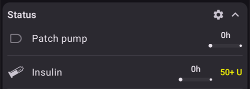

# Omnipod Eros

Aquestes instruccions són per configurar la bomba Omnipod de la generació Eros (**NO l'Omnipod Dash**).

```{admonition} Omnipod Eros is being phased out
:class: note

El [sistema Omnipod](https://www.omnipod.com/current-podders/resources/omnipod-system) (l'Omnipod original, format pel gestor personal de diabetis (PDM) i el pod) es deixa de fabricar, i la data final depèn de cada país. Per exemple, al Canadà ja no estarà disponible després del 30 de juny de 2026. Si depeneu de la bomba Eros, planifiqueu amb temps el pas a una bomba compatible.
```

**Aquest programari forma part d'una solució de pàncrees artificial DIY (fet per un mateix). No és un producte: requereix que VOSALTRES llegiu, aprengueu i entengueu el sistema, també com s'ha de fer servir. Només vosaltres sou responsables del que feu amb el sistema.**

```{contents} Table of contents
:depth: 1
:local: true
```

## Requisits de maquinari i programari

- **Dispositiu de comunicació amb el pod**

> Component que fa de pont en la comunicació entre el vostre telèfon amb AAPS i els pods de la generació Eros.
> 
> > -   [Web d'OrangeLink](https://getrileylink.org/product/orangelink)
> > -  [RileyLink de 433 MHz](https://getrileylink.org/product/rileylink433)
> > -   [Web d'EmaLink](https://github.com/sks01/EmaLink) - [Contacte](mailto:getemalink@gmail.com)
> > -   DiaLink - [Contacte](mailto:Boshetyn@ukr.net)
> > -   [Web de LoopLink](https://www.getlooplink.org/) - [Contacte](https://jameswedding.substack.com/) - No provat

-   **Telèfon mòbil**

> Component que executa AAPS i envia les ordres de control al dispositiu de comunicació amb el pod.
> 
> > - Un [telèfon Android](#Phones-list-of-tested-phones) compatible amb **AAPS** i els components relacionats configurats.

-   **Dispositiu de lliurament d'insulina**

> Component que interpreta les ordres que rep del dispositiu de comunicació amb el pod i que vénen del vostre telèfon amb AAPS.
> 
> > - Un pod Omnipod nou (generació Eros - **NO DASH**)

Aquestes instruccions suposen que comenceu una nova sessió de pod. Si no és així, tingueu paciència i comenceu aquest procés en el proper canvi de pod.

En aquesta pàgina, **RileyLink** vol dir qualsevol dels dispositius de comunicació amb el pod de la llista de dalt.

## Abans de començar

**PRIMER, LA SEGURETAT** - no feu aquest procés en una situació on no us pugueu recuperar d'un error (pods de recanvi, insulina, un RileyLink carregat i els telèfons són imprescindibles).

**El vostre PDM d'Omnipod deixarà de funcionar quan el controlador Omnipod d'AAPS activi el vostre pod**. Abans fèieu servir el PDM d'Omnipod per enviar ordres al vostre pod Omnipod Eros. Un pod Omnipod Eros només permet que un sol dispositiu es comuniqui amb ell. El dispositiu que activa el pod correctament és, des d'aquell moment, l'únic dispositiu que s'hi pot comunicar. Això vol dir que, quan activeu un pod Omnipod Eros amb el vostre RileyLink a través del controlador Omnipod d'AAPS, **ja no podreu fer servir el PDM amb aquest pod**. Ara el controlador Omnipod d'AAPS amb el RileyLink fa la funció del vostre PDM. *Això NO vol dir que hàgiu de llençar el PDM. Es recomana guardar-lo com a reserva i per a emergències, quan AAPS no funcioni correctament.*

**Només un RileyLink alhora es pot comunicar amb un pod.** **AAPS** recorda un sol RileyLink emparellat. Si n'emparelleu un altre, substitueix l'anterior.

**El pod no s'apaga quan el RileyLink està fora d'abast.** Quan el RileyLink està fora d'abast o el senyal no pot arribar al pod actiu, el pod continua lliurant insulina basal. Quan activeu un pod, el perfil basal definit a AAPS es programa al pod nou. Si perdeu el contacte amb el pod, el pod torna a aquest perfil basal. No podreu enviar ordres noves fins que el RileyLink torni a estar a l'abast i restableixi la connexió.

**Els perfils de taxa basal de 30 min NO són compatibles amb AAPS.** Si sou nous a AAPS i configureu el perfil de taxa basal per primera vegada, tingueu en compte que les taxes basals que comencen a la mitja hora no són compatibles. Haureu d'ajustar el perfil de taxa basal perquè comenci a l'hora en punt. Per exemple, si teniu una taxa basal de 1,1 U que comença a les 09:30 i dura 2 hores, fins a les 11:30, això no funcionarà.  Haureu de canviar aquesta taxa basal de 1,1 U a l'interval 9:00-11:00 o 10:00-12:00.  Encara que el maquinari Omnipod admet increments de 30 min en el perfil de taxa basal, ara mateix AAPS no els pot tenir en compte en els seus algoritmes.

## Activar el controlador Omnipod a AAPS

Podeu activar el controlador Omnipod a AAPS de **dues maneres**:

### Opció 1: l'Assistent de configuració

Després d'instal·lar una versió nova d'AAPS, l'**Assistent de configuració** s'inicia automàticament. Si ja heu exportat la configuració d'una instal·lació anterior, la podeu importar a l'assistent. Per a instal·lacions noves, continueu a continuació.

Seguiu l'[Assistent de configuració d'AAPS](../SettingUpAaps/SetupWizard.md) fins al pas **Bomba** i seleccioneu **Omnipod Eros** (la descripció diu «Integració de la bomba per Omnipod Eros»).



L'Assistent de configuració no emparella el RileyLink. Quan acabeu l'assistent, obriu la pantalla de la bomba Omnipod i emparelleu-lo com s'explica a la [secció Configuració del RileyLink](#OmnipodEros-rileylink-setup).

**O**

### Opció 2: La pantalla Configurador

Obriu el **menú** (☰) de dalt a l'esquerra > **Configurador** > **Bomba** i seleccioneu el **botó d'opció** d'**Omnipod Eros**.

Quan està seleccionat, la targeta **Omnipod Eros** mostra dos botons, **Configuració** i **Obrir plugin**:



**Configuració** obre la configuració del controlador Omnipod (vegeu [Configuració d'Omnipod](#OmnipodEros-omnipod-settings)):


**Obrir plugin** obre la pantalla de la bomba Omnipod. També la podeu obrir en qualsevol moment des de la pantalla principal amb **Gestionar** > **Bomba**. En aquesta pàgina l'anomenem **pantalla de la bomba Omnipod**. Abans d'emparellar un RileyLink i d'activar un pod, té aquest aspecte:


### Comprovar la selecció del controlador Omnipod

Per comprovar que heu activat el controlador Omnipod, obriu **Gestionar** > **Bomba** des de la pantalla principal. Hauríeu de veure la pantalla de la bomba **Omnipod Eros** de dalt. Si encara no heu emparellat cap RileyLink, **Estat RileyLink** mostra **No iniciat** i **Estat pod** mostra **Cap pod actiu**.

## Configuració d'Omnipod

Totes les funcions del pod i del RileyLink són botons de la [pantalla de la bomba Omnipod](#OmnipodEros-omnipod-pod-tab) (**Gestionar** > **Bomba**). Alguns botons només apareixen en certes situacions, per exemple quan hi ha un pod actiu.

>  Actualitzar la connexió i l'estat del pod
> 
>  Gestió del pod (activar, desactivar, fer sonar un bip de prova, estadístiques de RileyLink i historial del pod)

```{admonition} Older screenshot
:class: note
Les captures de pantalla de dalt són d'una versió anterior d'**AAPS**. A **AAPS** 4 no hi ha el botó **POD MGMT** ni el menú de gestió del pod: **Actualitzar** i totes les accions de gestió del pod són botons de la pantalla de la bomba Omnipod.
```

(OmnipodEros-rileylink-setup)=

### Configuració del RileyLink

Si ja heu emparellat el RileyLink, continueu a la [secció Activar un pod](#OmnipodEros-activating-a-pod) de sota.

*Nota: un bon indicador visual que el RileyLink no està connectat és que falten els botons de tractament (barra d'accés ràpid) a la pantalla principal. Això també passa durant uns 30 segons després d'iniciar AAPS, mentre es connecta al RileyLink.*

1. Assegureu-vos que el RileyLink està carregat del tot i encès.

2. Col·loqueu el RileyLink [a prop del telèfon](#OmnipodEros-optimal-omnipod-and-rileylink-positioning) (uns 30 cm o menys).

3. Obriu la pantalla de la bomba Omnipod (**Gestionar** > **Bomba**) i premeu **Emparellar RileyLink**.

4. La pantalla **Emparellar RileyLink** comença a buscar dispositius Bluetooth de seguida. Toqueu el vostre RileyLink a la llista de dispositius trobats.

   

5. Quan es mostri **RileyLink emparellat correctament** amb el nom i l'adreça del dispositiu, premeu **OK**.

6. De tornada a la pantalla de la bomba Omnipod, comproveu que **Estat RileyLink** canvia a **Connectat**. **Estat pod** hauria de mostrar **Cap pod actiu**. Si el RileyLink no es connecta, premeu **Restablir RileyLink** o reinicieu **AAPS**.

 

 


```{admonition} Older screenshot
:class: note
Les sis captures de pantalla de dalt (després del pas 6) són d'una versió anterior d'**AAPS**. A **AAPS** 4 emparelleu el RileyLink amb el botó **Emparellar RileyLink** de la pantalla de la bomba Omnipod, en lloc de **RileyLink Configuration** a la configuració d'Omnipod, i la cerca comença automàticament.
```

```{note}
Per canviar a un altre RileyLink (per exemple un dispositiu de reserva), torneu a prémer **Emparellar RileyLink** i seleccioneu el dispositiu nou. Substitueix el que estava emparellat abans. No cal eliminar primer el dispositiu antic.
```

(OmnipodEros-activating-a-pod)=

### Activar un pod

Abans d'activar un pod, assegureu-vos que el RileyLink està emparellat i que **Estat RileyLink** mostra **Connectat**. El botó **Activar pod** està desactivat fins que el RileyLink està a punt.

*RECORDEU: per raons de seguretat, durant l'activació (emparellament) el pod només es comunica a poca distància. Abans de l'emparellament el senyal de ràdio del pod és més feble; després de l'emparellament funciona amb la potència completa. Durant aquests procediments, assegureu-vos que el pod és* [a prop](#OmnipodEros-optimal-omnipod-and-rileylink-positioning) *(uns 30 cm o menys), però no a sobre ni just al costat del RileyLink.*

01. Obriu la pantalla de la bomba Omnipod (**Gestionar** > **Bomba**) i premeu **Activar pod**.

    Si no heu activat mai cap perfil, primer apareix el pas **Cal un perfil**. Seleccioneu el perfil que s'aplicarà en l'activació.

    >   
    > 
    > ```{admonition} Older screenshot
    >     :class: note
    >     Les captures de pantalla de dalt són d'una versió anterior d'**AAPS**. A **AAPS** 4 **Activar pod** és un botó de la pantalla de la bomba Omnipod, en lloc d'estar al menú **POD MGMT**.
    > ```

02. Es mostra la pantalla **Omplir pod**. Ompliu un pod nou amb prou insulina per a 3 dies i espereu a sentir dos bips. Volen dir que s'ha omplert la quantitat mínima de 80 unitats. Buideu del tot la xeringa d'ompliment, encara que ja hàgiu sentit els dos bips. Quan calculeu la quantitat total d'insulina que necessiteu per a 3 dies, tingueu en compte que l'encebament del pod fa servir de 12 a 15 U. No traieu encara el tap de l'agulla del pod.

    > 
    > 
    > Assegureu-vos que el pod nou i el RileyLink són a prop l'un de l'altre (uns 30 cm o menys) i premeu **Següent**.

03. **Seleccionar insulina** (només es mostra si teniu més d'una insulina configurada): seleccioneu la insulina amb què ompliu el pod i premeu **Següent**. Després de l'activació s'aplica un canvi de perfil amb aquesta insulina.

04. A la pantalla **Inicialitzar pod**, el pod comença l'encebament (sentireu un clic i després una sèrie de tic-tacs mentre el pod s'enceba). Si el RileyLink està fora de l'abast del pod que s'està activant, rebreu el missatge d'error **El pod no respon**. Si passa això, [acosteu el RileyLink](#OmnipodEros-optimal-omnipod-and-rileylink-positioning) al pod (uns 30 cm o menys), però no a sobre ni just al costat, i premeu **Reintentar**.

    >  

05. Quan l'encebament es fa correctament, es mostra una marca verda i el botó **Següent** s'activa. Premeu **Següent**.

    > 

06. **Punt d'inserció** (només es mostra si **Gestionar la rotació del punt d'infusió de la bomba** està activat a [Rotació de punts d'inserció](#Aapsscreens-site-rotation)): seleccioneu on col·loqueu el pod al cos i premeu **Següent**.

07. Es mostra la pantalla **Adherir pod**. Prepareu el punt d'infusió del pod nou. Traieu el tap de plàstic de l'agulla del pod i el paper blanc de l'adhesiu, i enganxeu el pod al lloc del cos que heu triat. Si la cànula surt cap a fora, premeu **Cancel·lar** i descarteu el pod. Quan acabeu, premeu **Següent**.

    > 

08. Apareix un diàleg de confirmació: «Quan premeu OK, s'inserirà la cànula». **Premeu OK NOMÉS si esteu preparats per inserir la cànula**.

    > 

09. A la pantalla **Inserir cànula**, l'Omnipod pot tardar una mica a respondre i inserir la cànula (1-2 minuts com a màxim). Tingueu paciència.

    > Si el RileyLink està fora de l'abast del pod que s'està activant, rebreu el missatge d'error **El pod no respon**. Si passa això, acosteu el RileyLink al pod (uns 30 cm o menys), però no a sobre ni just al costat, i premeu **Reintentar**.
    > 
    > Si el RileyLink està fora de l'abast del Bluetooth o no té una connexió activa amb el telèfon, rebreu el missatge d'error **RileyLink no respon**. Si passa això, acosteu el RileyLink al telèfon i premeu **Reintentar**.
    > 
    > *NOTA: abans d'inserir la cànula, és bona pràctica pessigar la pell a prop del punt d'inserció de la cànula. Així l'agulla entra suaument i hi ha menys risc d'oclusions.*
    > 
    > 
    > 
    >  

10. Quan la cànula s'ha inserit correctament, apareix una marca verda i el botó **Següent** s'activa. Premeu **Següent**.

    > 

11. Es mostra la pantalla **Pod activat**. Comproveu que la cànula s'ha inserit correctament, i canvieu el pod si creieu que no. Premeu **Finalitzar**. Enhorabona! Ara heu començat una nova sessió de pod actiu.

    >  
    > 
    > ```{admonition} Older screenshot
    >     :class: note
    >     Les captures de pantalla dels passos 2 a 11 són d'una versió anterior d'**AAPS** i poden ser diferents a **AAPS** 4. Els passos **Seleccionar insulina** i **Punt d'inserció** no surten a les imatges.
    > ```

12. Torneu a la pantalla de la bomba Omnipod. El botó **Activar pod** es canvia per **Desactivar pod**, perquè no podeu activar un altre pod sense desactivar primer el pod actiu.

    Ara la pantalla de la bomba mostra informació sobre el pod actiu, com ara la taxa basal actual, el nivell del reservori, la insulina lliurada, els errors i les alertes del pod. Per a més detalls, vegeu la secció [Pantalla de la bomba Omnipod](#OmnipodEros-omnipod-pod-tab).

     

    ```{admonition} Older screenshot
    :class: note
    Les captures de pantalla de dalt són d'una versió anterior d'**AAPS**. A **AAPS** 4 no hi ha menú de gestió del pod: torneu directament a la pantalla de la bomba Omnipod, on **Desactivar pod** substitueix **Activar pod**.
    ```

```{note}
Si l'activació s'ha interromput després de l'encebament (per exemple, perquè s'ha tancat l'aplicació), torneu a prémer **Activar pod**. L'assistent continua des dels passos d'inserció de la cànula.
```

### Desactivar un pod

En condicions normals, un pod dura tres dies (72 hores) i 8 hores més després de l'avís d'expiració del pod, en total 80 hores d'ús del pod.

Per desactivar un pod (perquè ha expirat o perquè ha fallat):

1. Obriu la pantalla de la bomba Omnipod (**Gestionar** > **Bomba**) i premeu **Desactivar pod**.

   >   
   > 
   > ```{admonition} Older screenshot
   >    :class: note
   >    Les captures de pantalla de dalt són d'una versió anterior d'**AAPS**. A **AAPS** 4 **Desactivar pod** és un botó de la pantalla de la bomba Omnipod, en lloc d'estar al menú **POD MGMT**.
   > ```

2. A la pantalla **Desactivar pod**, primer assegureu-vos que el RileyLink és a prop del pod, però no a sobre ni just al costat del pod. Després premeu **Següent**. Un diàleg pregunta *Un pod desactivat no es pot tornar a fer servir. Voleu desactivar aquest pod ara?* Premeu **OK** per començar a desactivar el pod, o **Cancel·lar** per mantenir-lo. La desactivació suspèn tot el lliurament d'insulina i no es pot desfer.

   > 

3. Apareix la pantalla **Desactivant pod**, i el pod fa un bip de confirmació quan la desactivació s'ha fet correctament.

   > 
   > 
   > **SI la desactivació falla** i no sentiu cap bip de confirmació, pot ser que rebeu el missatge **RileyLink no respon** o **El pod no respon**. Premeu **Reintentar** per tornar a provar la desactivació. Si la desactivació continua fallant, premeu **Descartar pod** i confirmeu. Llavors **AAPS** oblida el pod. El lliurament d'insulina **no** s'ha suspès, per tant traieu-vos el pod del cos. Si el pod fa sonar una alarma contínua, potser l'haureu de silenciar manualment (amb una agulla o un clip), perquè **Descartar pod** no la silencia.
   > 
   > >   

4. Quan la desactivació es fa correctament, apareix una marca verda. Premeu **Següent** per mostrar la pantalla **Pod desactivat**. Ara podeu treure el pod, perquè la sessió activa s'ha desactivat.

   > 

5. Premeu **Finalitzar** per tornar a la pantalla de la bomba Omnipod.

   >  
   > 
   > ```{admonition} Older screenshot
   >    :class: note
   >    Les captures de pantalla dels passos 2 a 5 són d'una versió anterior d'**AAPS** i poden ser diferents a **AAPS** 4.
   > ```

6. A la pantalla de la bomba Omnipod, comproveu que **Estat RileyLink** mostra **Connectat** i que **Estat pod** mostra **Cap pod actiu**.

   >    
   > 
   > ```{admonition} Older screenshot
   >    :class: note
   >    Les captures de pantalla de dalt són d'una versió anterior d'**AAPS**. A **AAPS** 4 **Finalitzar** us torna directament a la pantalla de la bomba Omnipod; no hi ha menú de gestió del pod ni pestanya **Omnipod (POD)**.
   > ```

### Suspendre i reprendre el lliurament d'insulina

El procés de sota explica com suspendre i reprendre el lliurament d'insulina.

*NOTA - si no veieu el botó **Suspendre***, és perquè està amagat per defecte. Activeu **Mostrar el botó Suspendre a la pantalla de la bomba** a la [configuració d'Omnipod](#OmnipodEros-omnipod-settings), a **Altres**.

#### Suspendre el lliurament d'insulina

Feu servir aquesta ordre per posar el pod actiu en estat suspès. En aquest estat suspès, el pod ja no lliura gens d'insulina. Aquesta ordre imita la funció de suspensió que el PDM original d'Omnipod envia a un pod actiu.

1. Obriu la pantalla de la bomba Omnipod (**Gestionar** > **Bomba**) i premeu **Suspendre**. L'ordre de suspensió s'envia al pod actiu a través del RileyLink.

2. Quan el pod ha suspès tot el lliurament d'insulina, **Estat pod** mostra **Suspès** i el botó **Suspendre** es canvia per **Reprendre lliurament**.

   >  
   > 
   > 
   > 
   >  
   > 
   > ```{admonition} Older screenshot
   >    :class: note
   >    Les captures de pantalla de dalt són d'una versió anterior d'**AAPS**. A **AAPS** 4 aquests passos es fan a la pantalla de la bomba Omnipod en lloc de la pestanya **Omnipod (POD)**, i el resultat es mostra a **Estat pod**.
   > ```

Si l'ordre falla, un diàleg d'**Advertència** mostra «Error en suspendre el lliurament» amb el motiu. Comproveu la connexió del RileyLink i torneu-ho a provar.

#### Reprendre el lliurament d'insulina

Feu servir aquesta ordre perquè el pod actiu, ara suspès, torni a lliurar insulina. Quan l'ordre s'ha processat correctament, la insulina es torna a lliurar amb normalitat, amb la taxa basal del perfil basal actiu per a l'hora actual. El pod torna a acceptar ordres de bolus, TBR i SMB.

1. Obriu la pantalla de la bomba Omnipod i comproveu que **Estat pod** mostra **Suspès**. Premeu **Reprendre lliurament**.

2. Quan l'ordre funciona, **Estat pod** torna a mostrar **Funcionant** i el botó **Reprendre lliurament** desapareix (el botó **Suspendre** torna a aparèixer si l'heu activat).

   >  
   > 
   > 
   > 
   >  
   > 
   > ```{admonition} Older screenshot
   >    :class: note
   >    Les captures de pantalla de dalt són d'una versió anterior d'**AAPS**. A **AAPS** 4 aquests passos es fan a la pantalla de la bomba Omnipod en lloc de la pestanya **Omnipod (POD)**, i el resultat es mostra a **Estat pod**.
   > ```

Si l'ordre falla, un diàleg d'**Advertència** mostra «Error en reprendre lliurament» amb el motiu. Comproveu la connexió del RileyLink i torneu-ho a provar.

### Silenciar les alertes del pod

*NOTA - El botó **Silenciar alertes** només apareix a la pantalla de la bomba Omnipod mentre el pod té una alerta activa (per exemple, l'alerta d'expiració del pod o de reservori baix), i només si **Silenciar automàticament alertes del pod** està desactivat.*

El procés de sota explica com silenciar els bips del pod que comencen quan el pod arriba a l'hora d'avís abans d'expirar. Aquesta hora d'avís es configura amb **Alerta hores abans de l'apagada (80 hores)** a la configuració d'**Alertes** d'Omnipod. La vida màxima d'un pod és de 80 hores (3 dies i 8 hores), però Insulet recomana no passar del límit de 72 hores (3 dies).

*NOTA - Si heu activat **Silenciar automàticament alertes del pod** a la configuració d'**Alertes** d'Omnipod, **AAPS** silencia l'alerta automàticament en la següent comunicació amb el pod, i NO cal que ho feu manualment.*

1. Quan arriba l'hora d'avís, el pod fa bips per avisar-vos que aviat expirarà i que l'heu de canviar. A la pantalla de la bomba Omnipod, **El pod expira** mostra l'hora exacta en què expira el pod (72 hores després de l'activació); es posa **groc** 4 hores abans. **Fi definitiva del pod** mostra quan el pod deixa de lliurar insulina. **Alertes pod actiu** mostra **El pod està a punt de caducar**, i apareix el botó **Silenciar alertes**. **AAPS** també mostra un avís sobre la propera expiració del pod.

   >   
   > 
   > ```{admonition} Older screenshot
   >    :class: note
   >    Les captures de pantalla de dalt són d'una versió anterior d'**AAPS**. A **AAPS** 4 el botó **ACK ALERTS** s'anomena **Silenciar alertes** i és a la pantalla de la bomba Omnipod.
   > ```

2. Premeu **Silenciar alertes**. El RileyLink envia al pod l'ordre per aturar els bips d'avís d'expiració.

   >  
   > 
   > ```{admonition} Older screenshot
   >    :class: note
   >    La captura de pantalla de dalt és d'una versió anterior d'**AAPS**. A **AAPS** 4 el botó s'anomena **Silenciar alertes**.
   > ```

3. Quan les alertes se silencien, el pod fa dos bips. **Alertes pod actiu** ja no mostra l'avís, el botó **Silenciar alertes** desapareix i el pod deixa de fer els bips d'avís d'expiració.

   >  
   > 
   > ```{admonition} Older screenshot
   >    :class: note
   >    La captura de pantalla de dalt és d'una versió anterior d'**AAPS**. A **AAPS** 4 el resultat es mostra a la pantalla de la bomba Omnipod: l'avís desapareix d'**Alertes pod actiu**.
   > ```

Si l'ordre falla (per exemple, si el RileyLink és fora de l'abast del pod), un diàleg d'**Advertència** mostra «Error en silenciar alertes» amb el motiu. Acosteu el RileyLink al pod i torneu-ho a provar.


```{admonition} Older screenshot
:class: note
La captura de pantalla de dalt és d'una versió anterior d'**AAPS**. A **AAPS** 4 el diàleg d'**Advertència** mostra «Error en silenciar alertes» amb el motiu.
```

(OmnipodEros-view-pod-history)=

### Veure l'historial del pod

Aquesta secció explica com revisar l'historial del pod actiu i filtrar-lo per categories d'accions. L'eina d'historial del pod us permet veure les accions enviades al pod actiu i els seus resultats durant els tres dies de vida del pod (72 - 80 hores).

Aquesta funció és útil per comprovar bolus, TBR i canvis de basal que s'han enviat però que no esteu segurs si s'han completat. Les altres categories són útils en general per resoldre problemes i per saber en quin ordre van passar els esdeveniments abans d'un error.

*NOTA:* Les ordres **dubtoses** apareixen a l'historial del pod, però per la seva naturalesa no se'n pot garantir l'exactitud.

1. Obriu la pantalla de la bomba Omnipod (**Gestionar** > **Bomba**) i premeu **Historial del pod**.

   >   
   > 
   > ```{admonition} Older screenshot
   >    :class: note
   >    Les captures de pantalla de dalt són d'una versió anterior d'**AAPS**. A **AAPS** 4 **Historial del pod** és un botó de la pantalla de la bomba Omnipod, en lloc d'estar al menú **POD MGMT**.
   > ```

2. La pantalla **Historial del pod** mostra totes les accions del pod i els seus resultats, de la més nova a la més antiga, agrupades per dia. Per defecte està seleccionat **Tot**. Toqueu un dels botons de filtre de dalt per mostrar només una categoria. Feu servir la fletxa enrere de dalt a l'esquerra per tornar a la pantalla de la bomba Omnipod.

   > 

   >  
   > 
   > ```{admonition} Older screenshot
   >    :class: note
   >    La segona captura de pantalla és d'una versió anterior d'**AAPS** i pot ser diferent a **AAPS** 4.
   > ```

### Veure la configuració i l'historial del RileyLink

La pantalla **Estadístiques RileyLink** mostra la configuració del RileyLink i del pod actiu, i l'historial de comunicació de tots dos. Té dues pestanyes: **Configuració** i **Historial**.

El botó **Estadístiques RileyLink** està amagat per defecte. Per mostrar-lo a la pantalla de la bomba Omnipod, activeu **Mostrar botó "Estadístiques RileyLink" al menú de gestió del pod** a la [configuració d'Omnipod](#OmnipodEros-omnipod-settings), a **Altres**.

#### Restablir manualment la connexió Bluetooth del dispositiu de comunicació amb el pod

Si el dispositiu de comunicació amb el pod ha estat una estona fora de l'abast del Bluetooth del telèfon, pot ser que **Estat RileyLink** mostri **RileyLink no accessible** a la pantalla de la bomba Omnipod. Normalment **AAPS** es torna a connectar sol quan el dispositiu torna a estar a l'abast. Si no ho fa:

1. Assegureu-vos que el RileyLink està encès, carregat i a prop del telèfon.

2. A la pantalla de la bomba Omnipod, premeu **Restablir RileyLink**. Un missatge confirma **Configuració de RileyLink restablerta**. Vegeu les [notes sobre Restablir RileyLink](#OmnipodEros-reset-rileylink-config-notes) de sota.

3. Si la **connexió Bluetooth** no es restableix, proveu de **desactivar** i tornar a **activar** manualment el Bluetooth del telèfon.

4. Si encara no es torna a connectar, premeu **Emparellar RileyLink** i torneu a seleccionar el vostre RileyLink.

5. Quan la connexió s'ha restablert, **Estat RileyLink** mostra **Connectat**. També podeu comprovar l'**Estat de la connexió** a la pestanya **Configuració** de la pantalla **Estadístiques RileyLink**. Enhorabona, ja heu tornat a connectar a AAPS el vostre dispositiu de comunicació amb el pod!

 


```{admonition} Older screenshot
:class: note
Les captures de pantalla de dalt són d'una versió anterior d'**AAPS**. A **AAPS** 4 torneu a connectar amb **Restablir RileyLink** o **Emparellar RileyLink** a la pantalla de la bomba Omnipod, en lloc del botó d'actualitzar de la pantalla de configuració del RileyLink.
```

#### Configuració del dispositiu de comunicació amb el pod i del pod actiu

Aquesta pantalla mostra informació i l'estat tant del dispositiu de comunicació amb el pod emparellat ara com del pod Omnipod Eros actiu. La informació s'actualitza automàticament.

1. Obriu la pantalla de la bomba Omnipod (**Gestionar** > **Bomba**) i premeu **Estadístiques RileyLink**. La pestanya **Configuració** mostra el **RileyLink** emparellat ara i el pod actiu (**Dispositiu**).

   >   
   > 
   > ```{admonition} Older screenshot
   >    :class: note
   >    Les captures de pantalla de dalt són d'una versió anterior d'**AAPS**. A **AAPS** 4 **Estadístiques RileyLink** és un botó de la pantalla de la bomba Omnipod, en lloc d'estar al menú **POD MGMT**.
   > ```

   > 

##### Camps del RileyLink

> - **Adreça:** adreça MAC del dispositiu de comunicació amb el pod emparellat.
> - **Nom:** nom Bluetooth del dispositiu de comunicació amb el pod emparellat.
> - **Nivell de la bateria:** el nivell actual de la bateria del dispositiu de comunicació amb el pod connectat. Només es mostra quan **Mostrar nivell de bateria reportat per OrangeLink/EmaLink/DiaLink** està activat.
> - **Estat de la connexió**: l'estat actual de la connexió Bluetooth entre el dispositiu de comunicació amb el pod i el telèfon amb AAPS.
> - **Error de connexió:** si hi ha un error en la connexió Bluetooth del dispositiu de comunicació amb el pod, aquí se'n mostren els detalls.
> - **Versió del firmware:** la versió del firmware instal·lada al dispositiu de comunicació amb el pod connectat.

##### Camps del dispositiu - amb un pod actiu

> - **Tipus de dispositiu:** el tipus de dispositiu que es comunica amb el dispositiu de comunicació amb el pod (Omnipod (Eros)).
> - **Model dispositiu configurat:** el model del dispositiu configurat per comunicar-se amb el dispositiu de comunicació amb el pod.
> - **Model dispositiu connectat:** el model del dispositiu que es comunica ara amb el dispositiu de comunicació amb el pod.
> - **Número de sèrie bomba:** número de sèrie del pod activat ara.
> - **Freqüència bomba:** freqüència de ràdio que es fa servir per comunicar-se amb el pod.
> - **Darrera freqüència utilitzada:** l'última freqüència de ràdio coneguda que el pod ha fet servir per comunicar-se amb el dispositiu de comunicació amb el pod.
> - **Últim contacte dispositiu:** data i hora de l'últim contacte del pod amb el dispositiu de comunicació amb el pod.

(omnipod-eros-rileylink-and-active-pod-history)=
#### Historial del RileyLink i del pod actiu

Aquesta pestanya mostra, del més nou al més antic, cada estat o acció del RileyLink o del pod connectat ara. L'historial només està disponible per al pod actiu. Després d'un canvi de pod, aquest historial s'esborra i només es registren i es mostren els esdeveniments del pod nou.

1. Obriu la pantalla de la bomba Omnipod (**Gestionar** > **Bomba**), premeu **Estadístiques RileyLink** i després toqueu la pestanya **Historial**.

   >   
   > 
   > ```{admonition} Older screenshot
   >    :class: note
   >    Les captures de pantalla de dalt són d'una versió anterior d'**AAPS**. A **AAPS** 4 **Estadístiques RileyLink** és un botó de la pantalla de la bomba Omnipod, en lloc d'estar al menú **POD MGMT**.
   > ```

   > 

##### Camps

Cada entrada mostra:

> - **Dispositiu:** el dispositiu al qual fa referència l'acció o l'estat.
> - **Hora:** l'hora de l'esdeveniment.
> - **Estat o acció:** l'estat del dispositiu o l'acció que ha fet.

(OmnipodEros-omnipod-pod-tab)=

## Pantalla de la bomba Omnipod

A continuació s'expliquen els camps d'estat i els botons de la **pantalla de la bomba Omnipod** (**Gestionar** > **Bomba**, o **Configurador** > **Bomba** > **Obrir plugin**).

La icona de l'engranatge de dalt a la dreta obre la [configuració d'Omnipod](#OmnipodEros-omnipod-settings).

*NOTA: si algun camp d'estat mostra (dubtós), premeu **Actualitzar** per actualitzar l'estat del pod i esborrar-lo.*




```{admonition} Older screenshot
:class: note
La captura de pantalla de dalt és d'una versió anterior d'**AAPS**, on aquesta pantalla era la pestanya **Omnipod (POD)**. A **AAPS** 4 és la pantalla de la bomba Omnipod, i alguns noms de camps i botons són diferents.
```

### Camps

- **Estat RileyLink:** mostra l'estat actual de la connexió del RileyLink. Els errors es mostren en vermell.

- *No iniciat* - encara no hi ha cap RileyLink emparellat, o la connexió no ha començat.
- *RileyLink no accessible* - el dispositiu de comunicació amb el pod és fora de l'abast del Bluetooth del telèfon, està apagat o té una avaria que impedeix la comunicació Bluetooth.
- *RileyLink a punt* - el dispositiu de comunicació amb el pod està encès i està iniciant la connexió Bluetooth.
- *Connectat* - el dispositiu de comunicació amb el pod està encès, connectat i es pot comunicar per Bluetooth.

- **ID únic:** mostra l'adreça del pod actiu.

- **Nr. LOT:** mostra el número de lot (LOT) del pod actiu.

- **Nr. de seqüència:** mostra el número de sèrie (TID) del pod.

- **Versió del firmware:** mostra la versió del firmware del pod actiu.

- **Hora al pod:** mostra l'hora actual del pod actiu. Es destaca quan és diferent de l'hora del telèfon en més de 5 minuts.

- **El pod expira:** mostra la data i l'hora en què expirarà el pod actiu. El text es torna groc durant les últimes 4 hores abans d'aquest moment. No es torna mai vermell, perquè el pod continua lliurant insulina després.

- **Fi definitiva del pod:** mostra el final del període de gràcia del pod (8 hores després de **El pod expira**, per a una vida màxima del pod de 80 hores). El text es torna groc quan comença el període de gràcia (a **El pod expira**) i vermell durant les últimes 4 hores abans de la fi definitiva. Durant el període de gràcia també mostra el temps que queda, per exemple *(queden 17m)*. El pod deixa de lliurar insulina a la fi definitiva i s'ha de canviar.

- **Estat pod:** mostra l'estat del pod actiu (per exemple **Cap pod actiu**, **Funcionant** o **Suspès**).

- **Última connexió:** mostra l'última vegada que hi va haver comunicació amb el pod actiu. El text es posa vermell quan es supera el [llindar de bomba no accessible](#OmnipodEros-troubleshooting).

- *Fa un moment* - fa menys de 20 segons.
- *Fa menys d'un minut* - fa més de 20 segons però menys de 60 segons.
- *Fa 1 minut* - fa més de 60 segons però menys de 120 segons (2 min)
- *Fa XX minuts* - fa més de 2 minuts; XX és el nombre de minuts

- **Darrer bolus:** mostra la dosi de l'últim bolus enviat al pod actiu i, entre parèntesis, quant de temps fa que es va enviar.

- **Basal base:** mostra la taxa basal programada per a l'hora actual segons el perfil de taxa basal.

- **Basal temporal:** només es mostra mentre hi ha una basal temporal en curs. La mostra amb aquest format:

- Unitats / hora @ hora en què es va enviar la TBR (minuts transcorreguts / minuts totals de la TBR)
- *Exemple:* 0,00U/h @18:25 ( 90/120 minuts)

- **Reservori:** mostra **Queden més de 50 U** quan al reservori queden més de 50 unitats. Per sota d'aquest valor es mostra el nombre aproximat d'unitats. El text es posa vermell per sota del llindar de reservori baix definit a la [configuració d'Alertes](#OmnipodEros-omnipod-settings).

- **Total lliurat:** mostra el nombre total d'unitats d'insulina lliurades des del reservori. *Tingueu en compte que és una aproximació, perquè l'encebament i l'emplenament del pod no són processos exactes.*

- **Alertes pod actiu:** reservat per a les alertes actives del pod actiu. Normalment es fa servir quan el pod ha passat de les 72 hores i sonen els bips d'alerta propis del pod.

- **Errors:** mostra l'últim error (en vermell). Reviseu l'[historial del pod](#OmnipodEros-view-pod-history), l'[historial del RileyLink](#omnipod-eros-rileylink-and-active-pod-history) i els fitxers de registre per trobar errors anteriors i informació més detallada.

### Botons

Els botons de la part de baix de la pantalla de la bomba canvien segons la situació. Els botons que ara no es poden fer servir es mostren en gris, per exemple mentre el RileyLink no està connectat.

**Botons d'estat del pod** (es mostren quan hi ha un pod actiu):

- **Actualitzar:** envia una ordre d'actualització al pod actiu per actualitzar-ne l'estat. Feu-lo servir per actualitzar l'estat del pod i esborrar els camps d'estat que contenen el text (dubtós). Vegeu la [secció de resolució de problemes](#OmnipodEros-troubleshooting) de sota per a més informació.

  

  ```{admonition} Older screenshot
  :class: note
  La captura de pantalla de dalt és d'una versió anterior d'**AAPS**. A **AAPS** 4 és un botó de text anomenat **Actualitzar** a la pantalla de la bomba Omnipod.
  ```

- **Silenciar alertes:** silencia els bips i els avisos d'expiració del pod i de reservori baix. Només es mostra quan el pod té una alerta activa i **Silenciar automàticament alertes del pod** està desactivat. Quan les alertes s'han silenciat, el botó desapareix.

  

  ```{admonition} Older screenshot
  :class: note
  La captura de pantalla de dalt és d'una versió anterior d'**AAPS**. A **AAPS** 4 aquest botó s'anomena **Silenciar alertes**.
  ```

- **Configurar hora:** posa al pod l'hora actual del telèfon. Només es mostra quan l'hora del pod és diferent de l'hora del telèfon en més de 5 minuts.

  

  ```{admonition} Older screenshot
  :class: note
  La captura de pantalla de dalt és d'una versió anterior d'**AAPS**. A **AAPS** 4 és un botó de text anomenat **Configurar hora** a la pantalla de la bomba Omnipod.
  ```

- **Suspendre:** suspèn el lliurament d'insulina del pod actiu. Només es mostra si està activat a la configuració (**Mostrar el botó Suspendre a la pantalla de la bomba**).

  

  ```{admonition} Older screenshot
  :class: note
  La captura de pantalla de dalt és d'una versió anterior d'**AAPS**. A **AAPS** 4 és un botó de text anomenat **Suspendre** a la pantalla de la bomba Omnipod.
  ```

- **Reprendre lliurament:** torna a iniciar el lliurament d'insulina del pod actiu, ara suspès. Només es mostra mentre el pod està suspès.

  

  ```{admonition} Older screenshot
  :class: note
  La captura de pantalla de dalt és d'una versió anterior d'**AAPS**. A **AAPS** 4 és un botó de text anomenat **Reprendre lliurament** a la pantalla de la bomba Omnipod.
  ```

**Botons de gestió del pod i del RileyLink:**


```{admonition} Older screenshot
:class: note
La captura de pantalla de dalt és d'una versió anterior d'**AAPS**. A **AAPS** 4 no hi ha menú de gestió del pod: aquestes accions són botons directament a la pantalla de la bomba Omnipod.
```

- **Activar pod:** enceba i activa un pod nou. Es mostra quan no hi ha cap pod actiu. Només està activat quan el RileyLink està connectat.

  

  ```{admonition} Older screenshot
  :class: note
  La captura de pantalla de dalt és d'una versió anterior d'**AAPS**. A **AAPS** 4 **Activar pod** és un botó de la pantalla de la bomba Omnipod, en lloc d'estar al menú de gestió del pod.
  ```

- **Desactivar pod:** desactiva el pod actiu. Es mostra tan aviat com hi ha un pod emparellat, també quan una activació s'ha aturat a mitges (per exemple, perquè el pod ha fallat durant l'activació). Només està activat quan el RileyLink està connectat. **AAPS** us demana confirmació abans de desactivar el pod.

- Feu servir aquesta ordre per desactivar un pod que xiscla (error 49).
- Si la desactivació falla, l'assistent de desactivació ofereix l'opció **Descartar pod**.

  

  ```{admonition} Older screenshot
  :class: note
  La captura de pantalla de dalt és d'una versió anterior d'**AAPS**. A **AAPS** 4 **Desactivar pod** és un botó de la pantalla de la bomba Omnipod, en lloc d'estar al menú de gestió del pod.
  ```

- **Fer sonar bip de prova:** en prémer-lo, el pod fa un sol bip de prova. Es mostra quan hi ha un pod emparellat.

  

  ```{admonition} Older screenshot
  :class: note
  La captura de pantalla de dalt és d'una versió anterior d'**AAPS**. A **AAPS** 4 **Fer sonar bip de prova** és un botó de la pantalla de la bomba Omnipod, en lloc d'estar al menú de gestió del pod.
  ```

- **Historial del pod:** mostra l'historial d'activitat del pod actiu. Vegeu [Veure l'historial del pod](#OmnipodEros-view-pod-history).

  

  ```{admonition} Older screenshot
  :class: note
  La captura de pantalla de dalt és d'una versió anterior d'**AAPS**. A **AAPS** 4 **Historial del pod** és un botó de la pantalla de la bomba Omnipod, en lloc d'estar al menú de gestió del pod.
  ```

- **Emparellar RileyLink:** busca el vostre dispositiu de comunicació amb el pod i l'emparella. Vegeu [Configuració del RileyLink](#OmnipodEros-rileylink-setup).

- **Estadístiques RileyLink:** obre la pantalla Estadístiques RileyLink, que té dues pestanyes. Només es mostra si està activat a la configuració (**Mostrar botó "Estadístiques RileyLink" al menú de gestió del pod**).

- **Configuració** - mostra la configuració del RileyLink i del pod actiu
- **Historial** - mostra l'historial de comunicació del RileyLink i del pod

  

  ```{admonition} Older screenshot
  :class: note
  La captura de pantalla de dalt és d'una versió anterior d'**AAPS**. A **AAPS** 4 **Estadístiques RileyLink** és un botó de la pantalla de la bomba Omnipod, en lloc d'estar al menú de gestió del pod.
  ```

- **Restablir RileyLink:** restableix la configuració del dispositiu de comunicació amb el pod connectat ara. Quan comença la comunicació, s'envien i s'estableixen dades concretes al RileyLink:

- S'estableixen els registres de memòria
- S'estableixen els protocols de comunicació
- S'estableix la freqüència de ràdio sintonitzada
  > 
  > Vegeu les [notes addicionals](#OmnipodEros-reset-rileylink-config-notes) de sota.

  

  ```{admonition} Older screenshot
  :class: note
  La captura de pantalla de dalt és d'una versió anterior d'**AAPS**. A **AAPS** 4 aquest botó s'anomena **Restablir RileyLink** i és a la pantalla de la bomba Omnipod.
  ```

- **Descartar pod:** descarta l'estat d'un pod que no respon, després d'una confirmació. Només es mostra quan un pod s'ha començat a activar però no s'ha emparellat del tot, perquè ja no es pot desactivar correctament:

- Un **pod no està emparellat del tot** i per això no fa cas de les ordres de desactivació.
- Un **pod s'ha quedat encallat** entre dos passos del procés d'emparellament.
- Un **pod no s'emparella de cap manera.**
  > 
  > Després de descartar un pod, **AAPS** ja no s'hi pot comunicar. Traieu-vos el pod del cos.

  

  ```{admonition} Older screenshot
  :class: note
  La captura de pantalla de dalt és d'una versió anterior d'**AAPS**. A **AAPS** 4 **Descartar pod** és un botó de la pantalla de la bomba Omnipod, en lloc d'estar al menú de gestió del pod.
  ```

(OmnipodEros-reset-rileylink-config-notes)=

#### *Notes sobre Restablir RileyLink*

- Aquesta funció es fa servir sobretot quan el dispositiu de comunicació amb el pod actiu no respon i la comunicació queda bloquejada.
- Si el dispositiu de comunicació amb el pod s'apaga i es torna a encendre, premeu **Restablir RileyLink** perquè aquests paràmetres de comunicació es tornin a establir al dispositiu de comunicació amb el pod.
- Si NO ho feu, caldrà reiniciar AAPS després d'apagar i tornar a encendre el dispositiu de comunicació amb el pod.
- **NO** cal prémer aquest botó quan canvieu d'un dispositiu de comunicació amb el pod a un altre.

(OmnipodEros-omnipod-settings)=

## Configuració d'Omnipod

Per obrir la configuració del controlador Omnipod, podeu:

- prémer la icona de l'engranatge de dalt a la dreta de la pantalla de la bomba Omnipod (**Gestionar** > **Bomba**), o
- obrir el **menú** (☰) de dalt a l'esquerra > **Configurador** > **Bomba** i prémer **Configuració** a la targeta **Omnipod Eros**.


```{admonition} Older screenshot
:class: note
La captura de pantalla de dalt és d'una versió anterior d'**AAPS**. A **AAPS** 4 obriu la configuració amb **Configuració** a la targeta **Omnipod Eros** o amb la icona de l'engranatge de la pantalla de la bomba Omnipod, en lloc de l'engranatge de configuració del **Configurador** o del menú de 3 punts.
```

La configuració està agrupada com es mostra a continuació. Toqueu un grup per desplegar-lo. La majoria d'opcions són interruptors que podeu activar o desactivar:


*NOTA: un asterisc (\*) indica que la configuració està activada per defecte.*

### RileyLink

Configuració del dispositiu de comunicació amb el pod. El dispositiu s'emparella amb el botó **Emparellar RileyLink** de la pantalla de la bomba (vegeu [Configuració del RileyLink](#OmnipodEros-rileylink-setup)).

- **Fer servir escaneig:** busca el dispositiu abans de connectar-se a l'OrangeLink. Això pot millorar les connexions. També es pot fer servir amb altres clons del RileyLink si cal.

- **Mostrar nivell de bateria reportat per OrangeLink/EmaLink/DiaLink:** mostra el nivell real de la bateria de l'OrangeLink/EmaLink/DiaLink. Es **recomana molt** que tots els usuaris d'OrangeLink/EmaLink/DiaLink activin aquesta opció.

- NO funciona amb el RileyLink original.
- Pot ser que no funcioni amb alternatives al RileyLink.
- Activada - mostra el nivell actual de la bateria dels dispositius de comunicació amb el pod compatibles.
- Desactivada - mostra el valor n/a.

- **Activar registre de canvi de pila a Accions:** només disponible quan l'opció d'informació de la bateria de dalt està activada. Alguns dispositius de comunicació amb el pod poden fer servir piles normals que podeu canviar. Amb aquesta opció activada, podeu registrar una entrada de [portal de cures](#aaps-screens-careportal) **Canvi de pila de la bomba** per anotar el canvi i posar a zero l'edat de la pila.

### Bips de confirmació

Fa que el pod emeti bips de confirmació per al lliurament i els canvis de bolus, basal, SMB i TBR.

- **\*Bips de bolus activats:** activa o desactiva els bips de confirmació quan es lliura un bolus.
- **Bips de basal activats:** activa o desactiva els bips de confirmació quan s'estableix una taxa basal nova, es cancel·la la taxa basal activa o es canvia la taxa basal actual.
- **\*Bips d'SMB activats:** activa o desactiva els bips de confirmació quan es lliura un SMB.
- **Bips de basals temporals activats:** activa o desactiva els bips de confirmació quan s'estableix o es cancel·la una TBR.

### Alertes

Mostra alertes d'AAPS i anuncis a Nightscout per a l'expiració del pod, l'apagada i el reservori baix, segons el llindar d'unitats definit.

*Tingueu en compte que AAPS SEMPRE mostra un avís per a qualsevol alerta, després de la primera comunicació amb el pod des que es va activar l'alerta. Descartar l'avís NO silencia l'alerta, LLEVAT QUE **Silenciar automàticament alertes del pod** estigui activat. Per silenciar l'alerta MANUALMENT, obriu la pantalla de la bomba Omnipod i premeu **Silenciar alertes**.*

- **\*Recordatori d'expiració activat:** si està activat, el pod fa bips quan s'arriba a l'hora definida a sota.
- **Alerta hores abans de l'apagada (80 hores):** quantes hores abans que el pod s'apagui (80 hores després de l'activació) sona el recordatori d'expiració (d'1 a 8 hores, per defecte 8).
- **\*Alerta de reservori baix activada:** activa o desactiva una alerta quan les unitats que queden al pod arriben al límit de reservori baix definit al camp Nr. d'unitats.
- **Nr. d'unitats:** el nombre d'unitats a partir del qual sona l'alerta de reservori baix del pod (de 5 a 50, per defecte 20).
- **Silenciar automàticament alertes del pod:** si està activat, encara es mostra un avís, però l'alerta se silencia automàticament en la primera comunicació amb el pod després que l'alerta hagi començat.

### Notificacions

Mostra avisos d'AAPS i alertes sonores al telèfon quan no és segur si els esdeveniments de TBR, SMB o bolus s'han completat correctament.

*NOTA: són només avisos; el pod no fa cap bip d'alerta.*

- **\*Habilitat so per avisos de TBR dubtoses:** activeu o desactiveu aquesta opció per tenir una alerta sonora i un avís visual quan AAPS no està segur si una TBR s'ha establert correctament.
- **\*Habilitat so per avisos d'SMB dubtosos:** activeu o desactiveu aquesta opció per tenir una alerta sonora i un avís visual quan AAPS no està segur si un SMB s'ha lliurat correctament.
- **\*Habilitat so per avisos de bolus dubtosos:** activeu o desactiveu aquesta opció per tenir una alerta sonora i un avís visual quan AAPS no està segur si un bolus s'ha lliurat correctament.

### Altres

Ofereix opcions avançades per ajudar a depurar errors.

- **Mostrar el botó Suspendre a la pantalla de la bomba:** amaga o mostra el botó **Suspendre** a la pantalla de la bomba Omnipod.
- **Mostrar botó "Registre de pols" al menú de gestió del pod:** aquesta opció encara apareix a la llista, però la versió actual de la pantalla de la bomba no té cap botó **Registre de pols**.

- **Mostrar botó "Estadístiques RileyLink" al menú de gestió del pod:** amaga o mostra el botó **Estadístiques RileyLink** a la pantalla de la bomba Omnipod.
- **\*Detecció d'horari d'estiu/hivern activada:** permet detectar automàticament els canvis de fus horari si el telèfon es fa servir en una zona amb horari d'estiu.

### Canviar o eliminar un dispositiu de comunicació amb el pod actiu (RileyLink)

Hi ha molts models alternatius al RileyLink original (com OrangeLink o EmaLink), i també podeu tenir diversos dispositius de comunicació amb el pod iguals o de reserva. Per això potser haureu de canviar a un altre dispositiu.

Per canviar-lo, obriu la pantalla de la bomba Omnipod (**Gestionar** > **Bomba**), premeu **Emparellar RileyLink** i seleccioneu el dispositiu nou, com s'explica a [Configuració del RileyLink](#OmnipodEros-rileylink-setup). El dispositiu nou substitueix el que estava emparellat abans.

 


 

```{admonition} Older screenshot
:class: note
Les captures de pantalla de dalt són d'una versió anterior d'**AAPS**. A **AAPS** 4 afegiu un dispositiu amb **Emparellar RileyLink** a la pantalla de la bomba Omnipod, en lloc de **RileyLink Configuration** a la configuració d'Omnipod, i la cerca comença automàticament.
```

No hi ha cap botó a part per eliminar un dispositiu emparellat. Si deixeu de fer servir un RileyLink, simplement emparelleu el nou quan el necessiteu.





```{admonition} Older screenshot
:class: note
Les captures de pantalla de dalt són d'una versió anterior d'**AAPS**. A **AAPS** 4 no hi ha botó **Eliminar**: emparellar un RileyLink nou substitueix l'anterior.
```

## Fila d'estat i portal de cures

Hi ha algunes coses específiques de com el pod Omnipod és diferent de les bombes amb tub, sobretot després de posar un pod nou.

Les edats de la **insulina** i de la **cànula** a la [fila d'estat](#screens-sensor-level-battery) de la pantalla principal es **posen a zero** (0 dies i 0 hores) **després de cada canvi de pod**. Això és així per com està construïda i com funciona la bomba Omnipod. La **pila de la bomba** i el **reservori d'insulina** són dins de cada pod. Com que el pod insereix la cànula directament a la pell, al lloc on s'enganxa el pod, les bombes Omnipod no fan servir un tub tradicional. *Per això, després d'un canvi de pod, l'edat de cadascun d'aquests valors es posa a zero automàticament.* L'**edat de la pila de la bomba** no es mostra, perquè la pila del pod sempre dura més que el pod (màxim 80 hores).



### Nivells

**Nivell d'insulina**

La quantitat d'insulina que es mostra per al pod Omnipod Eros no és exacta. Això és perquè no se sap exactament quanta insulina s'ha posat al pod; només se sap que, quan sonen els 2 bips mentre s'omple el pod, s'han omplert com a mínim 80 unitats. Un pod pot contenir com a màxim 200 unitats. L'encebament també pot introduir variacions, perquè no és un procés exacte. Per aquests dos motius, el controlador Omnipod s'ha escrit per donar la millor aproximació de la insulina que queda al reservori.

> - **Per sobre de 50 unitats** - mostra el valor 50+U quan al reservori hi ha més de 50 unitats.
> - **Per sota de 50 unitats** - mostra un valor calculat aproximat de la insulina que queda al reservori.
> - **SMS** - retorna el valor o 50+U a les respostes per SMS
> - **Nightscout** - envia a Nightscout el valor 50 quan hi ha més de 50 unitats (versió 14.07 i anteriors).  Les versions més noves mostren el valor 50+ quan hi ha més de 50 unitats.

**Nivell de la bateria**

La informació del nivell de la bateria és una opció que es pot activar per mostrar el nivell actual de la bateria dels dispositius de comunicació amb el pod, com OrangeLink, EmaLink o DiaLink.  El maquinari del RileyLink no pot informar del seu nivell de bateria.  El nivell de la bateria s'actualitza després de cada comunicació amb el pod, per això, mentre es carrega, pot ser que no vegeu un augment lineal.  Una actualització manual mostra el nivell actual de la bateria.  Quan un dispositiu de comunicació amb el pod compatible es desconnecta, es mostra el valor 0%.

> - **El maquinari del RileyLink NO pot informar del nivell de la bateria**
> - **L'opció «Mostrar nivell de bateria reportat per OrangeLink/EmaLink/DiaLink» HA d'estar activada a la configuració d'Omnipod per mostrar els valors del nivell de la bateria**
> - **La informació del nivell de la bateria NOMÉS funciona amb els dispositius OrangeLink, EmaLink i DiaLink**
> - **La informació del nivell de la bateria POT funcionar amb altres dispositius (excepte el RileyLink)**
> - **SMS** - retorna el nivell actual de la bateria com a resposta quan hi ha un nivell real; el valor n/a no es retorna
> - **Nightscout** - el nivell de la bateria s'envia quan hi ha un nivell real; el valor n/a no s'envia

(OmnipodEros-troubleshooting)=

## Resolució de problemes

### Errors del pod

De vegades els pods fallen per diversos motius, també per problemes de maquinari del mateix pod. És millor no comunicar aquests errors a Insulet, perquè AAPS no és un ús aprovat. [Aquí](https://github.com/openaps/openomni/wiki/Fault-event-codes) trobareu una llista de codis d'error que us ajudarà a saber-ne la causa.

### Evitar errors 49 del pod

Aquest error està relacionat amb un estat incorrecte del pod per a una ordre o amb un error durant una ordre de lliurament d'insulina. Recomanem configurar la sincronització amb Nightscout en mode *només enviar*: deixeu desactivades totes les opcions «Rebre ... de NS» a la configuració de sincronització del client de Nightscout (vegeu [Nightscout](../SettingUpAaps/Nightscout.md)) per evitar possibles errors.

### Alertes de bomba no accessible

Recomanem posar les alertes de bomba no accessible a **120 minuts**. Premeu la icona de **Configuració** (engranatge) de dalt a la dreta de la pantalla principal, seleccioneu **Alertes locals** > **Llindar de bomba no accessible** i poseu-lo a **120**.

(OmnipodEros-import-settings-from-previous-aaps)=
### Importar la configuració d'un AAPS anterior

```{admonition} Importing settings can end your active Pod
:class: warning
Al telèfon que ja controla el pod, deixeu **Substituir també la configuració de la bomba** sense marcar: la sessió del pod es manté i només s'importa la resta de la configuració. Marqueu-ho només amb un fitxer exportat durant el pod que porteu ara. Vegeu [Bombes sense tub](#ExportImportSettings-tubeless-pumps).
```

La manera més segura de reinstal·lar **AAPS** és entre dos pods:

1. Desactiveu la sessió del pod. Comproveu que no teniu cap sessió de pod activa.
2. Exporteu la configuració i guardeu-ne una còpia en un lloc segur.
3. Desinstal·leu la versió anterior d'AAPS i reinicieu el telèfon.
4. Instal·leu la versió nova d'AAPS i comproveu que no teniu cap sessió de pod activa.
5. Importeu la configuració i activeu el pod nou.

### Alertes del controlador Omnipod

Tingueu en compte que el controlador Omnipod mostra diverses alertes pròpies a la **pantalla principal**. La majoria són informatives i es poden descartar, però algunes indiquen a l'usuari què ha de fer per resoldre la causa de l'alerta. A continuació teniu un resum de les alertes principals que podeu trobar:

#### Cap pod actiu

No s'ha detectat cap sessió de pod activa. Podeu descartar aquesta alerta temporalment prement **Postposar**, però tornarà a sonar mentre no activeu un pod nou. Quan activeu un pod, aquesta alerta se silencia automàticament.

#### Pod suspès

Alerta informativa: el pod s'ha suspès.

#### Error en establir perfil basal. El lliurament podria estar suspès! Actualitzeu manualment l'estat del pod a la pantalla de la bomba i repreneu el lliurament si cal.

Alerta informativa: no s'ha pogut establir el perfil basal del pod. Obriu la pantalla de la bomba Omnipod i premeu **Actualitzar**, i després **Reprendre lliurament** si cal.

#### No s'ha pogut verificar si el bolus SMB ha estat lliurat. Si esteu segurs que el bolus no s'ha lliurat, haurieu d'eliminar manualment el registre de SMB a Tractaments.

Alerta: no s'ha pogut verificar si el bolus SMB s'ha lliurat correctament. Mireu el camp **Darrer bolus** de la pantalla de la bomba Omnipod per veure si l'SMB s'ha lliurat. Si no s'ha lliurat, elimineu l'entrada dels tractaments.

#### No és segur si «bolus/TBR/SMB» s'ha completat. Comproveu manualment si s'ha fet correctament.

Per la manera com es comuniquen el RileyLink i l'Omnipod, de vegades *no és segur* si una ordre s'ha processat correctament. Calia informar l'usuari d'aquesta incertesa.

A continuació teniu alguns exemples de quan pot aparèixer un avís de dubte.

- **Bolus** - els bolus dubtosos no es poden verificar automàticament. L'avís es manté fins al bolus següent, però una actualització manual del pod l'esborra. *Per defecte, els bips d'alerta estan activats per a aquest tipus d'avís, perquè l'usuari els haurà de verificar manualment.*
- **TBR, estats del pod, canvis de perfil, canvis d'hora** - una actualització manual del pod esborra el missatge.
- **Desviació de l'hora del pod -** Quan l'hora del pod i l'hora del telèfon són massa diferents, el llaç d'AAPS té dificultats per funcionar i per fer prediccions i recomanacions de dosi precises. Si la diferència d'hora entre el pod i el telèfon és de més de 5 minuts, apareix un botó **Configurar hora** a la pantalla de la bomba Omnipod. Premeu **Configurar hora** per sincronitzar l'hora del pod amb l'hora del telèfon. Si després **Estat pod** mostra **Suspès**, premeu **Reprendre lliurament** per continuar amb el funcionament normal del pod.

## Bones pràctiques

(OmnipodEros-optimal-omnipod-and-rileylink-positioning)=

### Posició òptima de l'Omnipod i el RileyLink

L'antena que fa servir el RileyLink per comunicar-se amb un pod Omnipod és una antena helicoidal de 433 MHz. Per la seva construcció, emet un senyal omnidireccional amb forma de dònut tridimensional, on l'eix z representa l'antena vertical. Això vol dir que hi ha posicions òptimes per col·locar el RileyLink, sobretot durant l'activació i la desactivació del pod.


> *(Fig. 1. Gràfic d'una antena helicoidal amb un patró omnidireccional*)

Per motius de seguretat, l'*activació* del pod s'ha de fer a una distància *més curta (uns 30 cm o menys)* que altres operacions, com ara posar un bolus, establir una TBR o simplement actualitzar l'estat del pod. Per la manera com el RileyLink emet el senyal, NO es recomana posar el pod just a sobre o just al costat del RileyLink.

La imatge de sota mostra la millor manera de col·locar el RileyLink durant l'activació i la desactivació del pod. El pod es pot activar en altres posicions, però tindreu més èxit amb la posició de la imatge de sota.

*Nota: si la comunicació falla després de col·locar el pod i el RileyLink en la posició òptima, pot ser per una bateria baixa, que redueix l'abast de l'antena del RileyLink. Per evitar-ho, assegureu-vos que el RileyLink està ben carregat o connectat directament a un cable de càrrega durant aquest procés.*


## On trobar ajuda

Tot el desenvolupament del controlador Omnipod el fa la comunitat de manera voluntària. Us demanem que seguiu aquestes pautes quan demaneu ajuda:

- **Nivell 0:** Llegiu la secció corresponent d'aquesta documentació per assegurar-vos que enteneu com ha de funcionar la funció que us dona problemes.
- **Nivell 1:** Si encara teniu problemes que no podeu resoldre amb aquest document, aneu al canal *#androidaps* de **Discord** amb [aquest enllaç d'invitació](https://discord.gg/4fQUWHZ4Mw).
- **Nivell 2:** Busqueu entre les incidències existents per veure si el vostre problema ja s'ha comunicat; si no, creeu una [incidència](https://github.com/nightscout/AndroidAPS/issues) nova i adjunteu-hi els vostres [fitxers de registre](../GettingHelp/AccessingLogFiles.md).
- **Tingueu paciència: la majoria dels membres de la nostra comunitat són voluntaris de bona fe, i resoldre problemes sovint demana temps i paciència tant als usuaris com als desenvolupadors.**
