# Omnipod Eros

Aquestes instruccions són per configurar la bomba Omnipod de la generació Eros (**NO l'Omnipod Dash**).

```{admonition} Omnipod Eros is being phased out
:class: note

El [sistema Omnipod](https://www.omnipod.com/current-podders/resources/omnipod-system) (l'Omnipod original, format pel gestor personal de diabetis (PDM) i el pod) es deixa de fabricar, i la data final depèn de cada país. Per exemple, al Canadà ja no estarà disponible després del 30 de juny de 2026. Si depeneu de la bomba Eros, planifiqueu amb temps el pas a una bomba compatible.
```

**Aquest programari forma part d'una solució de pàncrees artificial DIY (fet per un mateix). No és un producte: requereix que VOSALTRES llegiu, aprengueu i entengueu el sistema, també com s'ha de fer servir. Només vosaltres sou responsables del que feu amb el sistema.**

```{contents} Table of contents
:depth: 1
:local: true
```

## Requisits de maquinari i programari

- **Dispositiu de comunicació amb el pod**

> Component que fa de pont en la comunicació entre el vostre telèfon amb AAPS i els pods de la generació Eros.
> 
> > -   [Web d'OrangeLink](https://getrileylink.org/product/orangelink)
> > -  [RileyLink de 433 MHz](https://getrileylink.org/product/rileylink433)
> > -   [Web d'EmaLink](https://github.com/sks01/EmaLink) - [Contacte](mailto:getemalink@gmail.com)
> > -   DiaLink - [Contacte](mailto:Boshetyn@ukr.net)
> > -   [Web de LoopLink](https://www.getlooplink.org/) - [Contacte](https://jameswedding.substack.com/) - No provat

-   **Telèfon mòbil**

> Component que executa AAPS i envia les ordres de control al dispositiu de comunicació amb el pod.
> 
> > - Un [telèfon Android](#Phones-list-of-tested-phones) compatible amb **AAPS** i els components relacionats configurats.

- 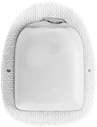  **Dispositiu de lliurament d'insulina**

> Component that will interpret commands received from the Pod communication device originating from your AAPS enabled phone.
> 
> > - Un pod Omnipod nou (generació Eros - **NO DASH**)

Aquestes instruccions suposen que comenceu una nova sessió de pod. Si no és així, tingueu paciència i comenceu aquest procés en el proper canvi de pod.

En aquesta pàgina, **RileyLink** vol dir qualsevol dels dispositius de comunicació amb el pod de la llista de dalt.

## Abans de començar

**PRIMER, LA SEGURETAT** - no feu aquest procés en una situació on no us pugueu recuperar d'un error (pods de recanvi, insulina, un RileyLink carregat i els telèfons són imprescindibles).

**El vostre PDM d'Omnipod deixarà de funcionar quan el controlador Omnipod d'AAPS activi el vostre pod**. Abans fèieu servir el PDM d'Omnipod per enviar ordres al vostre pod Omnipod Eros. Un pod Omnipod Eros només permet que un sol dispositiu es comuniqui amb ell. El dispositiu que activa el pod correctament és, des d'aquell moment, l'únic dispositiu que s'hi pot comunicar. Això vol dir que, quan activeu un pod Omnipod Eros amb el vostre RileyLink a través del controlador Omnipod d'AAPS, **ja no podreu fer servir el PDM amb aquest pod**. Ara el controlador Omnipod d'AAPS amb el RileyLink fa la funció del vostre PDM. *This does NOT mean you should throw away your PDM, it is recommended to keep it around as a backup, and for emergencies when AAPS is not working correctly.*

**Només un RileyLink alhora es pot comunicar amb un pod.** **AAPS** recorda un sol RileyLink emparellat. Si n'emparelleu un altre, substitueix l'anterior.

**El pod no s'apaga quan el RileyLink està fora d'abast.** Quan el RileyLink està fora d'abast o el senyal no pot arribar al pod actiu, el pod continua lliurant insulina basal. Quan activeu un pod, el perfil basal definit a AAPS es programa al pod nou. Si perdeu el contacte amb el pod, el pod torna a aquest perfil basal. No podreu enviar ordres noves fins que el RileyLink torni a estar a l'abast i restableixi la connexió.

**Els perfils de taxa basal de 30 min NO són compatibles amb AAPS.** Si sou nous a AAPS i configureu el perfil de taxa basal per primera vegada, tingueu en compte que les taxes basals que comencen a la mitja hora no són compatibles. Haureu d'ajustar el perfil de taxa basal perquè comenci a l'hora en punt. Per exemple, si teniu una taxa basal de 1,1 U que comença a les 09:30 i dura 2 hores, fins a les 11:30, això no funcionarà.  Haureu de canviar aquesta taxa basal de 1,1 U a l'interval 9:00-11:00 o 10:00-12:00.  Encara que el maquinari Omnipod admet increments de 30 min en el perfil de taxa basal, ara mateix AAPS no els pot tenir en compte en els seus algoritmes.

## Activar el controlador Omnipod a AAPS

Podeu activar el controlador Omnipod a AAPS de **dues maneres**:

### Opció 1: l'Assistent de configuració

Després d'instal·lar una versió nova d'AAPS, l'**Assistent de configuració** s'inicia automàticament. Si ja heu exportat la configuració d'una instal·lació anterior, la podeu importar a l'assistent. Per a instal·lacions noves, continueu a continuació.

Seguiu l'[Assistent de configuració d'AAPS](../SettingUpAaps/SetupWizard.md) fins al pas **Bomba** i seleccioneu **Omnipod Eros** (la descripció diu «Integració de la bomba per Omnipod Eros»).


L'Assistent de configuració no emparella el RileyLink. Quan acabeu l'assistent, obriu la pantalla de la bomba Omnipod i emparelleu-lo com s'explica a la [secció Configuració del RileyLink](#OmnipodEros-rileylink-setup).

**O**

### Opció 2: La pantalla Configurador

Obriu el **menú** (☰) de dalt a l'esquerra > **Configurador** > **Bomba** i seleccioneu el **botó d'opció** d'**Omnipod Eros**.

Quan està seleccionat, la targeta **Omnipod Eros** mostra dos botons, **Configuració** i **Obrir plugin**:


**Configuració** obre la configuració del controlador Omnipod (vegeu [Configuració d'Omnipod](#OmnipodEros-omnipod-settings)):

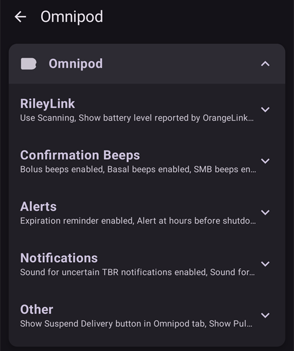

**Obrir plugin** obre la pantalla de la bomba Omnipod. També la podeu obrir en qualsevol moment des de la pantalla principal amb **Gestionar** > **Bomba**. En aquesta pàgina l'anomenem **pantalla de la bomba Omnipod**. Abans d'emparellar un RileyLink i d'activar un pod, té aquest aspecte:

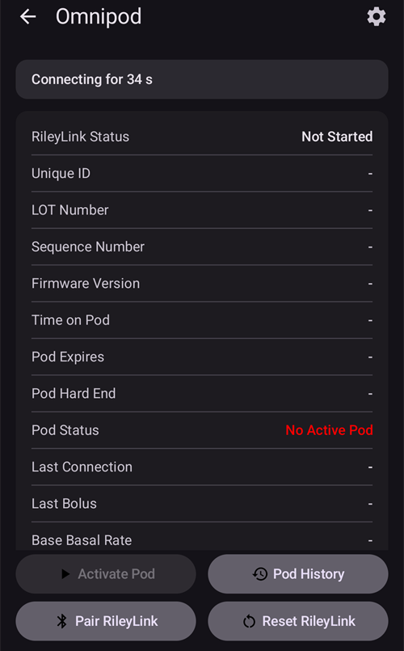

### Comprovar la selecció del controlador Omnipod

Per comprovar que heu activat el controlador Omnipod, obriu **Gestionar** > **Bomba** des de la pantalla principal. Hauríeu de veure la pantalla de la bomba **Omnipod Eros** de dalt. Si encara no heu emparellat cap RileyLink, **Estat RileyLink** mostra **No iniciat** i **Estat pod** mostra **Cap pod actiu**.

## Configuració d'Omnipod

Totes les funcions del pod i del RileyLink són botons de la [pantalla de la bomba Omnipod](#OmnipodEros-omnipod-pod-tab) (**Gestionar** > **Bomba**). Alguns botons només apareixen en certes situacions, per exemple quan hi ha un pod actiu.

>  Actualitzar la connexió i l'estat del pod
> 
>  Gestió del pod (activar, desactivar, fer sonar un bip de prova, estadístiques de RileyLink i historial del pod)

```{admonition} Older screenshot
:class: note
Les captures de pantalla de dalt són d'una versió anterior d'**AAPS**. A **AAPS** 4 no hi ha el botó **POD MGMT** ni el menú de gestió del pod: **Actualitzar** i totes les accions de gestió del pod són botons de la pantalla de la bomba Omnipod.
```

(OmnipodEros-rileylink-setup)=

### Configuració del RileyLink

Si ja heu emparellat el RileyLink, continueu a la [secció Activar un pod](#OmnipodEros-activating-a-pod) de sota.

*Nota: un bon indicador visual que el RileyLink no està connectat és que falten els botons de tractament (barra d'accés ràpid) a la pantalla principal. Això també passa durant uns 30 segons després d'iniciar AAPS, mentre es connecta al RileyLink.*

1. Assegureu-vos que el RileyLink està carregat del tot i encès.

2. Col·loqueu el RileyLink [a prop del telèfon](#OmnipodEros-optimal-omnipod-and-rileylink-positioning) (uns 30 cm o menys).

3. Obriu la pantalla de la bomba Omnipod (**Gestionar** > **Bomba**) i premeu **Emparellar RileyLink**.

4. La pantalla **Emparellar RileyLink** comença a buscar dispositius Bluetooth de seguida. Toqueu el vostre RileyLink a la llista de dispositius trobats.

   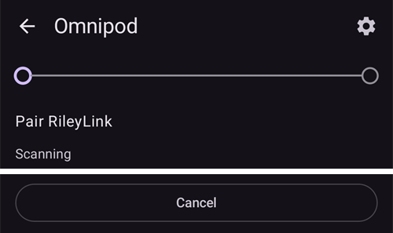

5. Quan es mostri **RileyLink emparellat correctament** amb el nom i l'adreça del dispositiu, premeu **OK**.

6. De tornada a la pantalla de la bomba Omnipod, comproveu que **Estat RileyLink** canvia a **Connectat**. **Estat pod** hauria de mostrar **Cap pod actiu**. Si el RileyLink no es connecta, premeu **Restablir RileyLink** o reinicieu **AAPS**.

 

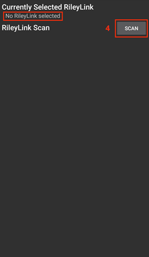 


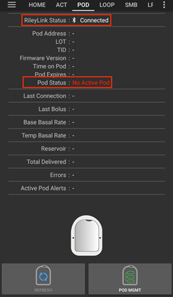

```{admonition} Older screenshot
:class: note
Les sis captures de pantalla de dalt (després del pas 6) són d'una versió anterior d'**AAPS**. A **AAPS** 4 emparelleu el RileyLink amb el botó **Emparellar RileyLink** de la pantalla de la bomba Omnipod, en lloc de **RileyLink Configuration** a la configuració d'Omnipod, i la cerca comença automàticament.
```

```{note}
Per canviar a un altre RileyLink (per exemple un dispositiu de reserva), torneu a prémer **Emparellar RileyLink** i seleccioneu el dispositiu nou. Substitueix el que estava emparellat abans. No cal eliminar primer el dispositiu antic.
```

(OmnipodEros-activating-a-pod)=

### Activar un pod

Abans d'activar un pod, assegureu-vos que el RileyLink està emparellat i que **Estat RileyLink** mostra **Connectat**. El botó **Activar pod** està desactivat fins que el RileyLink està a punt.

*RECORDEU: per raons de seguretat, durant l'activació (emparellament) el pod només es comunica a poca distància. Abans de l'emparellament el senyal de ràdio del pod és més feble; després de l'emparellament funciona amb la potència completa. Durant aquests procediments, assegureu-vos que el pod és* [a prop](#OmnipodEros-optimal-omnipod-and-rileylink-positioning) *(uns 30 cm o menys), però no a sobre ni just al costat del RileyLink.*

01. Obriu la pantalla de la bomba Omnipod (**Gestionar** > **Bomba**) i premeu **Activar pod**.

    Si no heu activat mai cap perfil, primer apareix el pas **Cal un perfil**. Seleccioneu el perfil que s'aplicarà en l'activació.

    > 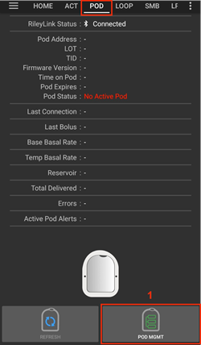 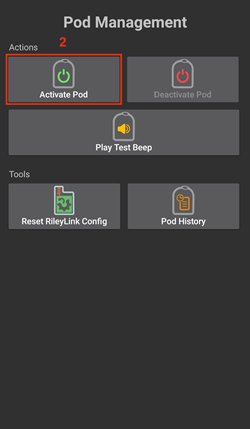 
    > 
    > ```{admonition} Older screenshot
    >     :class: note
    >     Les captures de pantalla de dalt són d'una versió anterior d'**AAPS**. A **AAPS** 4 **Activar pod** és un botó de la pantalla de la bomba Omnipod, en lloc d'estar al menú **POD MGMT**.
    > ```

02. Es mostra la pantalla **Omplir pod**. Ompliu un pod nou amb prou insulina per a 3 dies i espereu a sentir dos bips. Volen dir que s'ha omplert la quantitat mínima de 80 unitats. Buideu del tot la xeringa d'ompliment, encara que ja hàgiu sentit els dos bips. Quan calculeu la quantitat total d'insulina que necessiteu per a 3 dies, tingueu en compte que l'encebament del pod fa servir de 12 a 15 U. No traieu encara el tap de l'agulla del pod.

    > 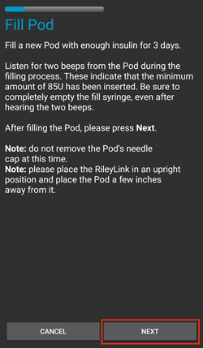
    > 
    > Assegureu-vos que el pod nou i el RileyLink són a prop l'un de l'altre (uns 30 cm o menys) i premeu **Següent**.

03. **Seleccionar insulina** (només es mostra si teniu més d'una insulina configurada): seleccioneu la insulina amb què ompliu el pod i premeu **Següent**. Després de l'activació s'aplica un canvi de perfil amb aquesta insulina.

04. A la pantalla **Inicialitzar pod**, el pod comença l'encebament (sentireu un clic i després una sèrie de tic-tacs mentre el pod s'enceba). Si el RileyLink està fora de l'abast del pod que s'està activant, rebreu el missatge d'error **El pod no respon**. Si passa això, [acosteu el RileyLink](#OmnipodEros-optimal-omnipod-and-rileylink-positioning) al pod (uns 30 cm o menys), però no a sobre ni just al costat, i premeu **Reintentar**.

    > 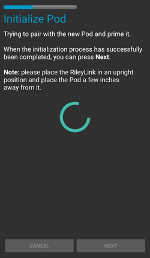 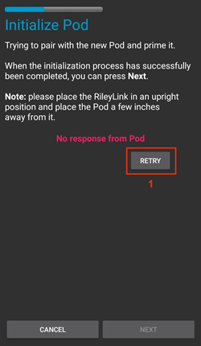

05. Quan l'encebament es fa correctament, es mostra una marca verda i el botó **Següent** s'activa. Premeu **Següent**.

    > 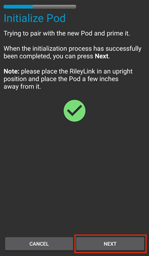

06. **Punt d'inserció** (només es mostra si **Gestionar la rotació del punt d'infusió de la bomba** està activat a [Rotació de punts d'inserció](#Aapsscreens-site-rotation)): seleccioneu on col·loqueu el pod al cos i premeu **Següent**.

07. Es mostra la pantalla **Adherir pod**. Prepareu el punt d'infusió del pod nou. Traieu el tap de plàstic de l'agulla del pod i el paper blanc de l'adhesiu, i enganxeu el pod al lloc del cos que heu triat. Si la cànula surt cap a fora, premeu **Cancel·lar** i descarteu el pod. Quan acabeu, premeu **Següent**.

    > 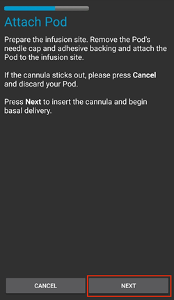

08. Apareix un diàleg de confirmació: «Quan premeu OK, s'inserirà la cànula». **Premeu OK NOMÉS si esteu preparats per inserir la cànula**.

    > 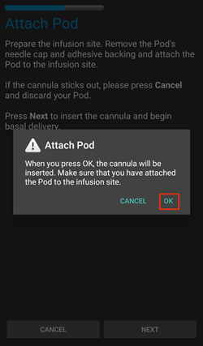

09. A la pantalla **Inserir cànula**, l'Omnipod pot tardar una mica a respondre i inserir la cànula (1-2 minuts com a màxim). Tingueu paciència.

    > Si el RileyLink està fora de l'abast del pod que s'està activant, rebreu el missatge d'error **El pod no respon**. Si passa això, acosteu el RileyLink al pod (uns 30 cm o menys), però no a sobre ni just al costat, i premeu **Reintentar**.
    > 
    > Si el RileyLink està fora de l'abast del Bluetooth o no té una connexió activa amb el telèfon, rebreu el missatge d'error **RileyLink no respon**. Si passa això, acosteu el RileyLink al telèfon i premeu **Reintentar**.
    > 
    > *NOTA: abans d'inserir la cànula, és bona pràctica pessigar la pell a prop del punt d'inserció de la cànula. Així l'agulla entra suaument i hi ha menys risc d'oclusions.*
    > 
    > 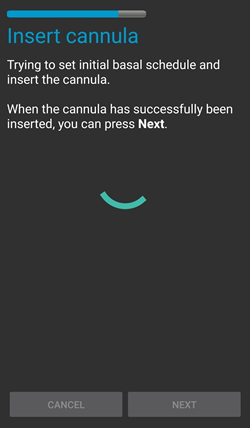
    > 
    >  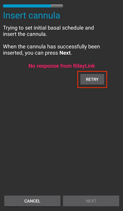

10. Quan la cànula s'ha inserit correctament, apareix una marca verda i el botó **Següent** s'activa. Premeu **Següent**.

    > 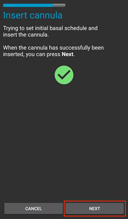

11. The **Pod Activated** screen is displayed. Comproveu que la cànula s'ha inserit correctament, i canvieu el pod si creieu que no. Premeu **Finalitzar**. Enhorabona! Ara heu començat una nova sessió de pod actiu.

    > 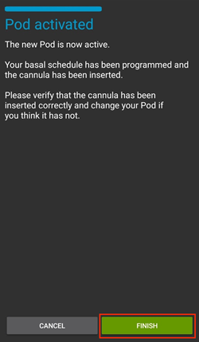 
    > 
    > ```{admonition} Older screenshot
    >     :class: note
    >     The screenshots in steps 2 to 11 are from an earlier **AAPS** version and may look different in **AAPS** 4. Els passos **Seleccionar insulina** i **Punt d'inserció** no surten a les imatges.
    > ```

12. You are returned to the Omnipod pump screen. The **Activate Pod** button is replaced by **Deactivate Pod**, because you cannot activate another pod without deactivating the active one first.

    The pump screen now shows information about your active pod, including the current basal rate, reservoir level, insulin delivered, pod errors and alerts. For more details, see the [Omnipod pump screen](#OmnipodEros-omnipod-pod-tab) section.

    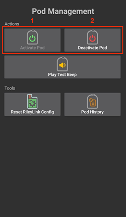 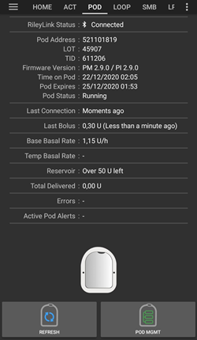

    ```{admonition} Older screenshot
    :class: note
    Les captures de pantalla de dalt són d'una versió anterior d'**AAPS**. In **AAPS** 4 there is no Pod Management menu: you return directly to the Omnipod pump screen, where **Deactivate Pod** replaces **Activate Pod**.
    ```

```{note}
If activation was interrupted after priming (for example the app was closed), press **Activate Pod** again. The wizard continues from the cannula insertion steps.
```

### Desactivar un pod

En condicions normals, un pod dura tres dies (72 hores) i 8 hores més després de l'avís d'expiració del pod, en total 80 hores d'ús del pod.

Per desactivar un pod (perquè ha expirat o perquè ha fallat):

1. Open the Omnipod pump screen (**Manage** > **Pump**) and press **Deactivate Pod**.

   > 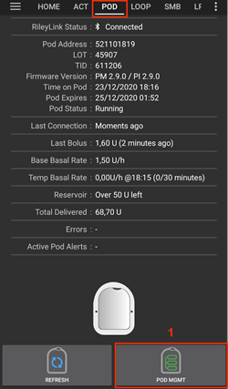 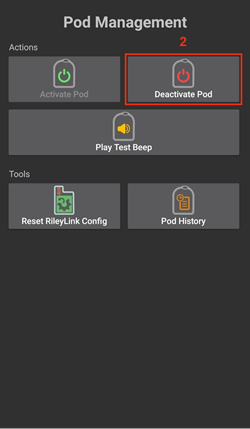 
   > 
   > ```{admonition} Older screenshot
   >    :class: note
   >    The screenshots above are from an earlier **AAPS** version. In **AAPS** 4 **Deactivate Pod** is a button on the Omnipod pump screen instead of in the **POD MGMT** menu.
   > ```

2. On the **Deactivate Pod** screen, first make sure the RileyLink is in close proximity to the pod but not on top of or right next to the pod. Then press **Next**. Un diàleg pregunta *Un pod desactivat no es pot tornar a fer servir. Voleu desactivar aquest pod ara?* Premeu **OK** per començar a desactivar el pod, o **Cancel·lar** per mantenir-lo. La desactivació suspèn tot el lliurament d'insulina i no es pot desfer.

   > 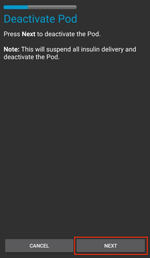

3. The **Deactivating Pod** screen appears, and you will receive a confirmation beep from the pod that deactivation was successful.

   > 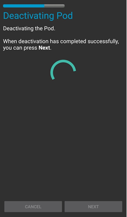
   > 
   > **IF deactivation fails** and you do not receive a confirmation beep, you may receive a **No response from RileyLink** or **No response from Pod** message. Press **Retry** to attempt deactivation again. If deactivation keeps failing, press **Discard Pod** and confirm. **AAPS** then forgets the pod. Insulin delivery has **not** been suspended, so remove the pod from your body. If your pod has a screaming alarm, you may need to silence it manually (using a pin or a paperclip), because **Discard Pod** does not silence it.
   > 
   > > 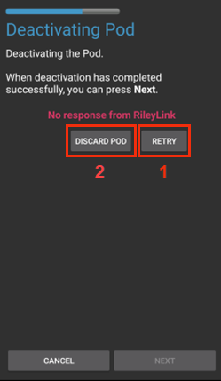  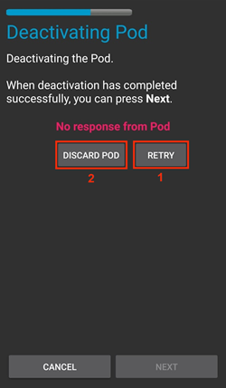

4. A green checkmark appears when deactivation is successful. Press **Next** to display the **Pod Deactivated** screen. Ara podeu treure el pod, perquè la sessió activa s'ha desactivat.

   > 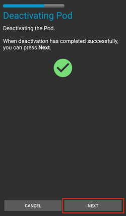

5. Press **Finish** to return to the Omnipod pump screen.

   > 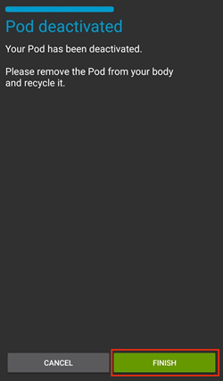 
   > 
   > ```{admonition} Older screenshot
   >    :class: note
   >    The screenshots in steps 2 to 5 are from an earlier **AAPS** version and may look different in **AAPS** 4.
   > ```

6. On the Omnipod pump screen, check that **RileyLink Status** shows **Connected** and **Pod Status** shows **No Active Pod**.

   > 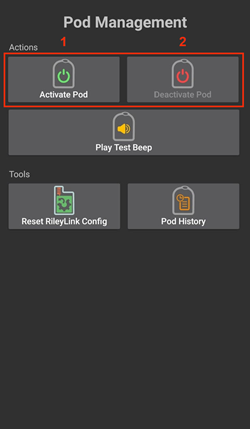   
   > 
   > ```{admonition} Older screenshot
   >    :class: note
   >    The screenshots above are from an earlier **AAPS** version. In **AAPS** 4 **Finish** returns you directly to the Omnipod pump screen; there is no Pod Management menu or **Omnipod (POD)** tab.
   > ```

### Suspendre i reprendre el lliurament d'insulina

The process below shows you how to suspend and resume insulin delivery.

*NOTE - if you do not see a **Suspend** button*, it is hidden by default. Enable **Show Suspend Delivery button in Omnipod tab** in the [Omnipod settings](#OmnipodEros-omnipod-settings) under **Other**.

#### Suspendre el lliurament d'insulina

Feu servir aquesta ordre per posar el pod actiu en estat suspès. En aquest estat suspès, el pod ja no lliura gens d'insulina. Aquesta ordre imita la funció de suspensió que el PDM original d'Omnipod envia a un pod actiu.

1. Open the Omnipod pump screen (**Manage** > **Pump**) and press **Suspend**. The suspend command is sent through the RileyLink to the active pod.

2. When the pod has suspended all insulin delivery, **Pod Status** shows **Suspended** and the **Suspend** button is replaced by **Resume Delivery**.

   > 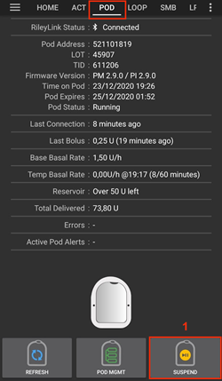 
   > 
   > 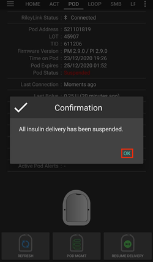
   > 
   > 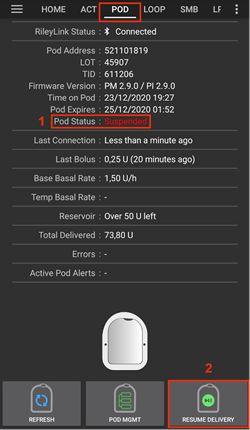 
   > 
   > ```{admonition} Older screenshot
   >    :class: note
   >    The screenshots above are from an earlier **AAPS** version. In **AAPS** 4 these steps take place on the Omnipod pump screen instead of the **Omnipod (POD)** tab, and the result is shown in **Pod Status**.
   > ```

If the command fails, a **Warning** dialog shows "Failed to suspend delivery" with the reason. Check the RileyLink connection and try again.

#### Reprendre el lliurament d'insulina

Feu servir aquesta ordre perquè el pod actiu, ara suspès, torni a lliurar insulina. Quan l'ordre s'ha processat correctament, la insulina es torna a lliurar amb normalitat, amb la taxa basal del perfil basal actiu per a l'hora actual. El pod torna a acceptar ordres de bolus, TBR i SMB.

1. Open the Omnipod pump screen and check that **Pod Status** shows **Suspended**. Press **Resume Delivery**.

2. When the command succeeds, **Pod Status** shows **Running** again and the **Resume Delivery** button disappears (the **Suspend** button is shown again if you have enabled it).

   > 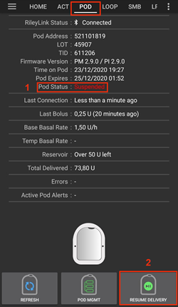 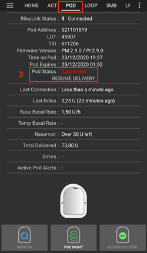
   > 
   > 
   > 
   > 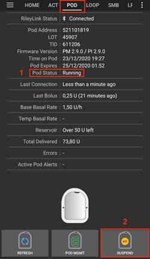 
   > 
   > ```{admonition} Older screenshot
   >    :class: note
   >    The screenshots above are from an earlier **AAPS** version. In **AAPS** 4 these steps take place on the Omnipod pump screen instead of the **Omnipod (POD)** tab, and the result is shown in **Pod Status**.
   > ```

If the command fails, a **Warning** dialog shows "Failed to resume delivery" with the reason. Check the RileyLink connection and try again.

### Silenciar les alertes del pod

*NOTE - The **Silence Alerts** button is only shown on the Omnipod pump screen while the pod has an active alert (for example the pod expiration or low reservoir alert), and only if **Automatically silence Pod alerts** is disabled.*

The process below shows you how to silence pod beeps that start when the pod reaches the warning time before it expires. This warning time is set with **Alert at hours before shutdown (80 Hours)** in the Omnipod **Alerts** settings. La vida màxima d'un pod és de 80 hores (3 dies i 8 hores), però Insulet recomana no passar del límit de 72 hores (3 dies).

*NOTE - If you have enabled **Automatically silence Pod alerts** in the Omnipod **Alerts** settings, **AAPS** silences the alert automatically at the next communication with the pod, and you do NOT need to do it manually.*

1. When the warning time is reached, the pod beeps to tell you that it will soon expire and needs to be changed. On the Omnipod pump screen, **Pod Expires** shows the exact time the pod expires (72 hours after activation); it turns **yellow** 4 hours before. **Pod Hard End** shows when the pod stops delivering insulin. **Active Pod Alerts** shows **Pod will expire soon**, and the **Silence Alerts** button appears. **AAPS** also shows a notification about the upcoming pod expiration.

   > 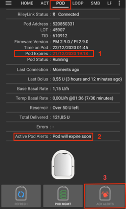 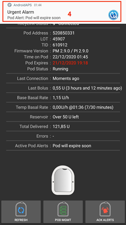 
   > 
   > ```{admonition} Older screenshot
   >    :class: note
   >    The screenshots above are from an earlier **AAPS** version. In **AAPS** 4 the **ACK ALERTS** button is called **Silence Alerts** and is on the Omnipod pump screen.
   > ```

2. Premeu **Silenciar alertes**. The RileyLink sends the command to the pod to stop the expiration warning beeps.

   > 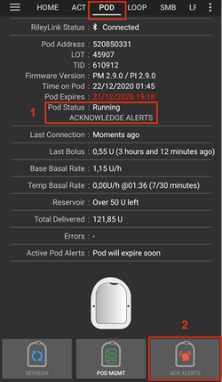 
   > 
   > ```{admonition} Older screenshot
   >    :class: note
   >    La captura de pantalla de dalt és d'una versió anterior d'**AAPS**. In **AAPS** 4 the button is called **Silence Alerts**.
   > ```

3. When the alerts are silenced, the pod beeps twice. **Active Pod Alerts** no longer shows the warning, the **Silence Alerts** button disappears and the pod stops its expiration warning beeps.

   > 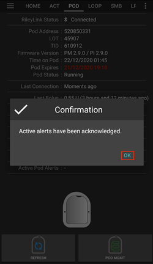 
   > 
   > ```{admonition} Older screenshot
   >    :class: note
   >    La captura de pantalla de dalt és d'una versió anterior d'**AAPS**. In **AAPS** 4 the result is shown on the Omnipod pump screen: the warning disappears from **Active Pod Alerts**.
   > ```

If the command fails (for example the RileyLink is out of range of the pod), a **Warning** dialog shows "Failed to silence alerts" with the reason. Move the RileyLink closer to the pod and try again.

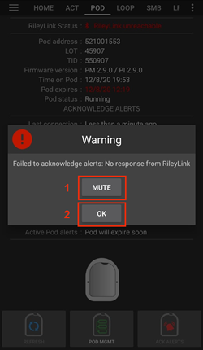

```{admonition} Older screenshot
:class: note
La captura de pantalla de dalt és d'una versió anterior d'**AAPS**. In **AAPS** 4 the **Warning** dialog shows "Failed to silence alerts" with the reason.
```

(OmnipodEros-view-pod-history)=

### Veure l'historial del pod

Aquesta secció explica com revisar l'historial del pod actiu i filtrar-lo per categories d'accions. L'eina d'historial del pod us permet veure les accions enviades al pod actiu i els seus resultats durant els tres dies de vida del pod (72 - 80 hores).

Aquesta funció és útil per comprovar bolus, TBR i canvis de basal que s'han enviat però que no esteu segurs si s'han completat. Les altres categories són útils en general per resoldre problemes i per saber en quin ordre van passar els esdeveniments abans d'un error.

*NOTA:* Les ordres **dubtoses** apareixen a l'historial del pod, però per la seva naturalesa no se'n pot garantir l'exactitud.

1. Open the Omnipod pump screen (**Manage** > **Pump**) and press **Pod History**.

   > 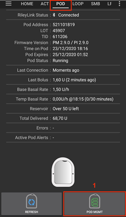 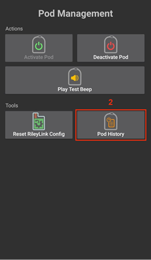 
   > 
   > ```{admonition} Older screenshot
   >    :class: note
   >    The screenshots above are from an earlier **AAPS** version. In **AAPS** 4 **Pod History** is a button on the Omnipod pump screen instead of in the **POD MGMT** menu.
   > ```

2. The **Pod History** screen lists all pod actions and their results, newest first, grouped by day. By default **All** is selected. Tap one of the filter buttons at the top to show only one category. Use the back arrow at the top left to return to the Omnipod pump screen.

   > 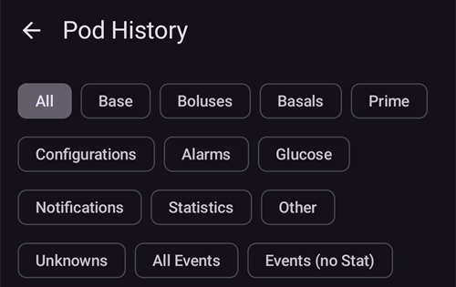

   > 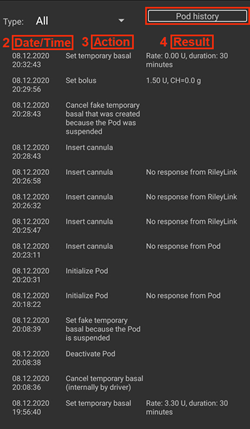 
   > 
   > ```{admonition} Older screenshot
   >    :class: note
   >    The second screenshot is from an earlier **AAPS** version and may look different in **AAPS** 4.
   > ```

### Veure la configuració i l'historial del RileyLink

The **RileyLink Stats** screen shows the settings of your RileyLink and active pod, and the communication history of both. It has two tabs: **Settings** and **History**.

The **RileyLink Stats** button is hidden by default. To show it on the Omnipod pump screen, enable **Show RileyLink Stats button in Pod Management menu** in the [Omnipod settings](#OmnipodEros-omnipod-settings) under **Other**.

#### Restablir manualment la connexió Bluetooth del dispositiu de comunicació amb el pod

If your pod communication device was out of Bluetooth range of your phone for a while, **RileyLink Status** may report **RileyLink unreachable** on the Omnipod pump screen. **AAPS** normally reconnects by itself when the device is back in range. If it does not:

1. Make sure the RileyLink is powered on, charged and close to your phone.

2. On the Omnipod pump screen, press **Reset RileyLink**. A message confirms **RileyLink configuration reset**. See the [Reset RileyLink notes](#OmnipodEros-reset-rileylink-config-notes) below.

3. Si la **connexió Bluetooth** no es restableix, proveu de **desactivar** i tornar a **activar** manualment el Bluetooth del telèfon.

4. If it still does not reconnect, press **Pair RileyLink** and select your RileyLink again.

5. After a successful reconnection, **RileyLink Status** shows **Connected**. You can also check **Connection Status** on the **Settings** tab of the **RileyLink Stats** screen. Enhorabona, ja heu tornat a connectar a AAPS el vostre dispositiu de comunicació amb el pod!

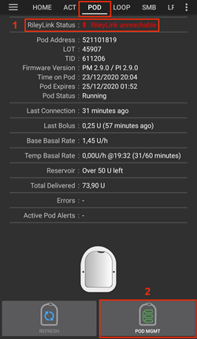 

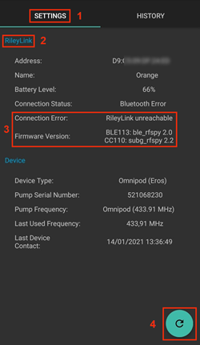

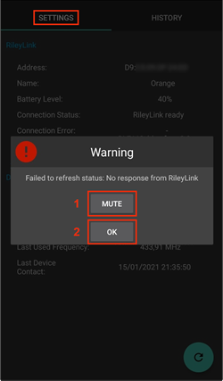

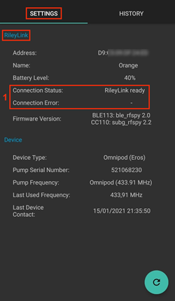

```{admonition} Older screenshot
:class: note
Les captures de pantalla de dalt són d'una versió anterior d'**AAPS**. In **AAPS** 4 you reconnect with **Reset RileyLink** or **Pair RileyLink** on the Omnipod pump screen instead of the refresh button on the RileyLink Settings screen.
```

#### Configuració del dispositiu de comunicació amb el pod i del pod actiu

This screen shows information and status for both the currently paired pod communication device and the currently active Omnipod Eros pod. The information refreshes automatically.

1. Open the Omnipod pump screen (**Manage** > **Pump**) and press **RileyLink Stats**. The **Settings** tab shows your currently paired **RileyLink** and the active pod (**Device**).

   >  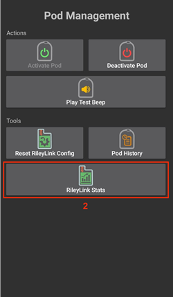 
   > 
   > ```{admonition} Older screenshot
   >    :class: note
   >    The screenshots above are from an earlier **AAPS** version. In **AAPS** 4 **RileyLink Stats** is a button on the Omnipod pump screen instead of in the **POD MGMT** menu.
   > ```

   > 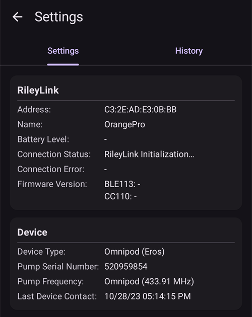

##### RileyLink fields

> - **Address:** MAC address of the paired pod communication device.
> - **Name:** Bluetooth name of the paired pod communication device.
> - **Battery Level:** The current battery level of the connected pod communication device. Only shown when **Show battery level reported by OrangeLink/EmaLink/DiaLink** is enabled.
> - **Estat de la connexió**: l'estat actual de la connexió Bluetooth entre el dispositiu de comunicació amb el pod i el telèfon amb AAPS.
> - **Connection Error:** If there is an error with the pod communication device Bluetooth connection, details are displayed here.
> - **Versió del firmware:** la versió del firmware instal·lada al dispositiu de comunicació amb el pod connectat.

##### Device fields - With an Active Pod

> - **Device Type:** The type of device communicating with the pod communication device (Omnipod (Eros)).
> - **Configured Device Model:** The model of the device configured to communicate with the pod communication device.
> - **Connected Device Model:** The model of the device currently communicating with the pod communication device.
> - **Pump Serial Number:** Serial number of the currently activated pod.
> - **Pump Frequency:** Radio frequency used to communicate with the pod.
> - **Last Used Frequency:** Last known radio frequency the pod used to communicate with the pod communication device.
> - **Últim contacte dispositiu:** data i hora de l'últim contacte del pod amb el dispositiu de comunicació amb el pod.

(omnipod-eros-rileylink-and-active-pod-history)=
#### Historial del RileyLink i del pod actiu

This tab lists, newest first, each state or action of the RileyLink or the currently connected pod. The history is only available for the currently active pod. After a pod change, this history is erased and only events from the newly activated pod are recorded and shown.

1. Open the Omnipod pump screen (**Manage** > **Pump**), press **RileyLink Stats** and then tap the **History** tab.

   >   
   > 
   > ```{admonition} Older screenshot
   >    :class: note
   >    The screenshots above are from an earlier **AAPS** version. In **AAPS** 4 **RileyLink Stats** is a button on the Omnipod pump screen instead of in the **POD MGMT** menu.
   > ```

   > 

##### Camps

Each entry shows:

> - **Device:** The device to which the action or state refers.
> - **Time:** The time of the event.
> - **State or Action:** The state of the device or the action it performed.

(OmnipodEros-omnipod-pod-tab)=

## Omnipod pump screen

Below is an explanation of the status fields and buttons on the **Omnipod pump screen** (**Manage** > **Pump**, or **Configuration** > **Pump** > **Open plugin**).

The gear icon at the top right opens the [Omnipod settings](#OmnipodEros-omnipod-settings).

*NOTE: If any status field shows (uncertain), press **Refresh** to refresh the pod status and clear it.*


```{admonition} Older screenshot
:class: note
The screenshot above is from an earlier **AAPS** version, where this screen was the **Omnipod (POD)** tab. In **AAPS** 4 it is the Omnipod pump screen, and some field names and buttons differ.
```

### Camps

- **RileyLink Status:** Displays the current connection status of the RileyLink. Errors are shown in red.

- *Not Started* - no RileyLink is paired yet, or the connection has not started.
- *RileyLink unreachable* - pod communication device is either not within Bluetooth range of the phone, powered off or has a failure preventing Bluetooth communication.
- *RileyLink ready* - pod communication device is powered on and actively initializing the Bluetooth connection.
- *Connectat* - el dispositiu de comunicació amb el pod està encès, connectat i es pot comunicar per Bluetooth.

- **Unique ID:** Displays the address of the active pod.

- **LOT Number:** Displays the LOT number of the active pod.

- **Sequence Number:** Displays the serial number (TID) of the pod.

- **Versió del firmware:** mostra la versió del firmware del pod actiu.

- **Hora al pod:** mostra l'hora actual del pod actiu. It is highlighted when it differs from the phone time by more than 5 minutes.

- **Pod Expires:** Displays the date and time when the active pod will expire. El text es torna groc durant les últimes 4 hores abans d'aquest moment. No es torna mai vermell, perquè el pod continua lliurant insulina després.

- **Pod Hard End:** Displays the end of the pod's grace period (8 hours after **Pod Expires**, for a maximum pod life of 80 hours). El text es torna groc quan comença el període de gràcia (a **El pod expira**) i vermell durant les últimes 4 hores abans de la fi definitiva. Durant el període de gràcia també mostra el temps que queda, per exemple *(queden 17m)*. El pod deixa de lliurar insulina a la fi definitiva i s'ha de canviar.

- **Pod Status:** Displays the status of the active pod (for example **No Active Pod**, **Running** or **Suspended**).

- **Last Connection:** Displays the last time communication with the active pod was achieved. The text turns red when the [pump unreachable threshold](#OmnipodEros-troubleshooting) is exceeded.

- *Fa un moment* - fa menys de 20 segons.
- *Fa menys d'un minut* - fa més de 20 segons però menys de 60 segons.
- *Fa 1 minut* - fa més de 60 segons però menys de 120 segons (2 min)
- *Fa XX minuts* - fa més de 2 minuts; XX és el nombre de minuts

- **Last Bolus:** Displays the dosage of the last bolus sent to the active pod and how long ago it was issued in parenthesis.

- **Base Basal Rate:** Displays the basal rate programmed for the current time from the basal rate profile.

- **Temp Basal Rate:** Only shown while a Temporary Basal Rate is running. Displays it in the following format:

- Unitats / hora @ hora en què es va enviar la TBR (minuts transcorreguts / minuts totals de la TBR)
- *Exemple:* 0,00U/h @18:25 ( 90/120 minuts)

- **Reservoir:** Displays **Over 50 U left** when more than 50 units are left in the reservoir. Below this value the approximate number of units is displayed. The text turns red below the low reservoir threshold set in the [Alerts settings](#OmnipodEros-omnipod-settings).

- **Total Delivered:** Displays the total number of units of insulin delivered from the reservoir. *Tingueu en compte que és una aproximació, perquè l'encebament i l'emplenament del pod no són processos exactes.*

- **Active Pod Alerts:** Reserved for currently running alerts on the active pod. Normalment es fa servir quan el pod ha passat de les 72 hores i sonen els bips d'alerta propis del pod.

- **Errors:** Displays the last error encountered (shown in red). Reviseu l'[historial del pod](#OmnipodEros-view-pod-history), l'[historial del RileyLink](#omnipod-eros-rileylink-and-active-pod-history) i els fitxers de registre per trobar errors anteriors i informació més detallada.

### Botons

The buttons at the bottom of the pump screen change depending on the situation. Buttons that cannot be used right now are greyed out, for example while the RileyLink is not connected.

**Pod status buttons** (shown when a pod is active):

- **Refresh:** Sends a refresh command to the active pod to update its status. Use it to refresh the pod status and clear status fields that contain the text (uncertain). Vegeu la [secció de resolució de problemes](#OmnipodEros-troubleshooting) de sota per a més informació.

  

  ```{admonition} Older screenshot
  :class: note
  The screenshot above is from an earlier **AAPS** version. In **AAPS** 4 this is a text button named **Refresh** on the Omnipod pump screen.
  ```

- **Silence Alerts:** Silences the pod expiration and low reservoir beeps and notifications. Only shown when the pod has an active alert and **Automatically silence Pod alerts** is disabled. After the alerts are silenced, the button disappears.

  

  ```{admonition} Older screenshot
  :class: note
  The screenshot above is from an earlier **AAPS** version. In **AAPS** 4 this button is called **Silence Alerts**.
  ```

- **Set time:** Updates the time on the pod with the current time on your phone. Only shown when the time on the pod differs from the phone time by more than 5 minutes.

  

  ```{admonition} Older screenshot
  :class: note
  The screenshot above is from an earlier **AAPS** version. In **AAPS** 4 this is a text button named **Set time** on the Omnipod pump screen.
  ```

- **Suspend:** Suspends insulin delivery on the active pod. Only shown if enabled in the settings (**Show Suspend Delivery button in Omnipod tab**).

  

  ```{admonition} Older screenshot
  :class: note
  The screenshot above is from an earlier **AAPS** version. In **AAPS** 4 this is a text button named **Suspend** on the Omnipod pump screen.
  ```

- **Resume Delivery:** Resumes insulin delivery on the currently suspended, active pod. Only shown while the pod is suspended.

  

  ```{admonition} Older screenshot
  :class: note
  The screenshot above is from an earlier **AAPS** version. In **AAPS** 4 this is a text button named **Resume Delivery** on the Omnipod pump screen.
  ```

**Pod and RileyLink management buttons:**


```{admonition} Older screenshot
:class: note
La captura de pantalla de dalt és d'una versió anterior d'**AAPS**. In **AAPS** 4 there is no Pod Management menu: these actions are buttons directly on the Omnipod pump screen.
```

- **Activate Pod:** Primes and activates a new pod. Es mostra quan no hi ha cap pod actiu. It is enabled only when the RileyLink is connected.

  

  ```{admonition} Older screenshot
  :class: note
  The screenshot above is from an earlier **AAPS** version. In **AAPS** 4 **Activate Pod** is a button on the Omnipod pump screen instead of in the Pod Management menu.
  ```

- **Deactivate Pod:** Deactivates the currently active pod. Shown as soon as a pod is paired, also when an activation stopped part-way (for example because the pod failed during activation). It is enabled only when the RileyLink is connected. **AAPS** us demana confirmació abans de desactivar el pod.

- Feu servir aquesta ordre per desactivar un pod que xiscla (error 49).
- If deactivation fails, the deactivation wizard offers a **Discard Pod** option.

  

  ```{admonition} Older screenshot
  :class: note
  The screenshot above is from an earlier **AAPS** version. In **AAPS** 4 **Deactivate Pod** is a button on the Omnipod pump screen instead of in the Pod Management menu.
  ```

- **Play Test Beep:** Plays a single test beep on the pod when pressed. Shown when a pod is paired.

  

  ```{admonition} Older screenshot
  :class: note
  The screenshot above is from an earlier **AAPS** version. In **AAPS** 4 **Play Test Beep** is a button on the Omnipod pump screen instead of in the Pod Management menu.
  ```

- **Pod History:** Displays the active pod activity history. See [View Pod History](#OmnipodEros-view-pod-history).

  

  ```{admonition} Older screenshot
  :class: note
  The screenshot above is from an earlier **AAPS** version. In **AAPS** 4 **Pod History** is a button on the Omnipod pump screen instead of in the Pod Management menu.
  ```

- **Pair RileyLink:** Scans for your pod communication device and pairs it. See [RileyLink Setup](#OmnipodEros-rileylink-setup).

- **RileyLink Stats:** Opens the RileyLink Stats screen with two tabs. Only shown if enabled in the settings (**Show RileyLink Stats button in Pod Management menu**).

- **Configuració** - mostra la configuració del RileyLink i del pod actiu
- **Historial** - mostra l'historial de comunicació del RileyLink i del pod

  

  ```{admonition} Older screenshot
  :class: note
  The screenshot above is from an earlier **AAPS** version. In **AAPS** 4 **RileyLink Stats** is a button on the Omnipod pump screen instead of in the Pod Management menu.
  ```

- **Reset RileyLink:** Resets the configuration of the currently connected pod communication device. When communication is started, specific data is sent to and set in the RileyLink:

- Memory Registers are set
- Communication Protocols are set
- Tuned Radio Frequency is set
  > 
  > See [additional notes](#OmnipodEros-reset-rileylink-config-notes) below.

  

  ```{admonition} Older screenshot
  :class: note
  The screenshot above is from an earlier **AAPS** version. In **AAPS** 4 this button is called **Reset RileyLink** and is on the Omnipod pump screen.
  ```

- **Discard Pod:** Discards the pod state of an unresponsive pod, after a confirmation. Only shown when a pod has been started but not fully paired, as proper deactivation is no longer possible:

- Un **pod no està emparellat del tot** i per això no fa cas de les ordres de desactivació.
- A **pod is stuck** during the pairing process between steps.
- Un **pod no s'emparella de cap manera.**
  > 
  > After you discard a pod, **AAPS** can no longer communicate with it. Remove the pod from your body.

  

  ```{admonition} Older screenshot
  :class: note
  The screenshot above is from an earlier **AAPS** version. In **AAPS** 4 **Discard Pod** is a button on the Omnipod pump screen instead of in the Pod Management menu.
  ```

(OmnipodEros-reset-rileylink-config-notes)=

#### *Reset RileyLink Notes*

- Aquesta funció es fa servir sobretot quan el dispositiu de comunicació amb el pod actiu no respon i la comunicació queda bloquejada.
- If the pod communication device is turned off and then back on, press **Reset RileyLink** so that these communication parameters are set again in the pod communication device.
- Si NO ho feu, caldrà reiniciar AAPS després d'apagar i tornar a encendre el dispositiu de comunicació amb el pod.
- This button **DOES NOT** need to be pressed when switching between different pod communication devices.

(OmnipodEros-omnipod-settings)=

## Configuració d'Omnipod

To open the Omnipod driver settings, either:

- press the gear icon at the top right of the Omnipod pump screen (**Manage** > **Pump**), or
- open the top-left **menu** (☰) > **Configuration** > **Pump** and press **Settings** on the **Omnipod Eros** card.


```{admonition} Older screenshot
:class: note
La captura de pantalla de dalt és d'una versió anterior d'**AAPS**. In **AAPS** 4 you open the settings with **Settings** on the **Omnipod Eros** card or the gear icon on the Omnipod pump screen, instead of the settings gear in **Configuration** or the 3-dot menu.
```

The settings are grouped as listed below. Tap a group to expand it. Most entries are switches you can enable or disable:


*NOTA: un asterisc (\*) indica que la configuració està activada per defecte.*

### RileyLink

Settings for the pod communication device. You pair the device itself with the **Pair RileyLink** button on the pump screen (see [RileyLink Setup](#OmnipodEros-rileylink-setup)).

- **Use Scanning:** Scans before connecting to the OrangeLink. This can improve connections. It can also be used with other RileyLink clones if needed.

- **Show battery level reported by OrangeLink/EmaLink/DiaLink:** Reports the actual battery level of the OrangeLink/EmaLink/DiaLink. Es **recomana molt** que tots els usuaris d'OrangeLink/EmaLink/DiaLink activin aquesta opció.

- NO funciona amb el RileyLink original.
- Pot ser que no funcioni amb alternatives al RileyLink.
- Activada - mostra el nivell actual de la bateria dels dispositius de comunicació amb el pod compatibles.
- Desactivada - mostra el valor n/a.

- **Enable battery change logging in Actions:** Only available when the battery reporting setting above is enabled. Some pod communication devices can use regular batteries that you can change. With this setting enabled, you can record a **Pump Battery Change** [careportal entry](#aaps-screens-careportal) to note the change and reset the battery age.

### Bips de confirmació

Fa que el pod emeti bips de confirmació per al lliurament i els canvis de bolus, basal, SMB i TBR.

- **\*Bips de bolus activats:** activa o desactiva els bips de confirmació quan es lliura un bolus.
- **Basal beeps enabled:** Enable or disable confirmation beeps when a new basal rate is set, active basal rate is canceled or current basal rate is changed.
- **\*Bips d'SMB activats:** activa o desactiva els bips de confirmació quan es lliura un SMB.
- **Bips de basals temporals activats:** activa o desactiva els bips de confirmació quan s'estableix o es cancel·la una TBR.

### Alertes

Mostra alertes d'AAPS i anuncis a Nightscout per a l'expiració del pod, l'apagada i el reservori baix, segons el llindar d'unitats definit.

*Tingueu en compte que AAPS SEMPRE mostra un avís per a qualsevol alerta, després de la primera comunicació amb el pod des que es va activar l'alerta. Dismissing the notification will NOT silence the alert UNLESS **Automatically silence Pod alerts** is enabled. To silence the alert MANUALLY, open the Omnipod pump screen and press **Silence Alerts**.*

- **\*Expiration reminder enabled:** When enabled, the pod beeps when the time set below is reached.
- **Alert at hours before shutdown (80 Hours):** The number of hours before the pod shuts down (80 hours after activation) at which the expiration reminder is triggered (1 to 8 hours, default 8).
- **\*Alerta de reservori baix activada:** activa o desactiva una alerta quan les unitats que queden al pod arriben al límit de reservori baix definit al camp Nr. d'unitats.
- **Number of units:** The number of units at which to trigger the pod low reservoir alert (5 to 50, default 20).
- **Automatically silence Pod alerts:** When enabled, a notification is still issued, but the alert is silenced automatically at the next communication with the pod after the alert started.

### Notificacions

Mostra avisos d'AAPS i alertes sonores al telèfon quan no és segur si els esdeveniments de TBR, SMB o bolus s'han completat correctament.

*NOTA: són només avisos; el pod no fa cap bip d'alerta.*

- **\*Sound for uncertain TBR notifications enabled:** Enable or disable this setting to trigger an audible alert and visual notification when AAPS is uncertain if a TBR was successfully set.
- **\*Habilitat so per avisos d'SMB dubtosos:** activeu o desactiveu aquesta opció per tenir una alerta sonora i un avís visual quan AAPS no està segur si un SMB s'ha lliurat correctament.
- **\*Habilitat so per avisos de bolus dubtosos:** activeu o desactiveu aquesta opció per tenir una alerta sonora i un avís visual quan AAPS no està segur si un bolus s'ha lliurat correctament.

### Altres

Ofereix opcions avançades per ajudar a depurar errors.

- **Show Suspend Delivery button in Omnipod tab:** Hide or display the **Suspend** button in the Omnipod tab.
- **Show Pulse Log button in Pod Management menu:** This setting is still listed, but the current version of the pump screen has no **Pulse Log** button.

- **Show RileyLink Stats button in Pod Management menu:** Hide or display the **RileyLink Stats** button on the Omnipod pump screen.
- **\*DST/Time zone detection enabled:** Allows time zone changes to be automatically detected if the phone is used in an area where DST is observed.

### Canviar o eliminar un dispositiu de comunicació amb el pod actiu (RileyLink)

With many alternative models to the original RileyLink available (such as OrangeLink or EmaLink), or the need to have multiple or backup versions of the same pod communication device, you may need to switch to another device.

To switch, open the Omnipod pump screen (**Manage** > **Pump**), press **Pair RileyLink** and select the new device, as described in [RileyLink Setup](#OmnipodEros-rileylink-setup). The new device replaces the previously paired one.

 


 

```{admonition} Older screenshot
:class: note
Les captures de pantalla de dalt són d'una versió anterior d'**AAPS**. In **AAPS** 4 you add a device with **Pair RileyLink** on the Omnipod pump screen instead of **RileyLink Configuration** in the Omnipod settings, and scanning starts automatically.
```

There is no separate button to remove a paired device. If you stop using a RileyLink, simply pair the new one when you need it.


```{admonition} Older screenshot
:class: note
Les captures de pantalla de dalt són d'una versió anterior d'**AAPS**. In **AAPS** 4 there is no **Remove** button: pairing a new RileyLink replaces the previous one.
```

## Status row and careportal

There are a few items that are specific to how the Omnipod pod differs from tube based pumps, especially after applying a new pod.

The **insulin** and **cannula** ages in the [status row](#screens-sensor-level-battery) of the main screen are **reset** to 0 days and 0 hours **after each pod change**. Això és així per com està construïda i com funciona la bomba Omnipod. La **pila de la bomba** i el **reservori d'insulina** són dins de cada pod. Com que el pod insereix la cànula directament a la pell, al lloc on s'enganxa el pod, les bombes Omnipod no fan servir un tub tradicional. *Per això, després d'un canvi de pod, l'edat de cadascun d'aquests valors es posa a zero automàticament.* L'**edat de la pila de la bomba** no es mostra, perquè la pila del pod sempre dura més que el pod (màxim 80 hores).


### Nivells

**Nivell d'insulina**

La quantitat d'insulina que es mostra per al pod Omnipod Eros no és exacta. This is because it is not known exactly how much insulin was put in the pod, only that when the 2 beeps are triggered while filling the pod at least 80 units have been filled. Un pod pot contenir com a màxim 200 unitats. Priming can also introduce variance as it is not an exact process. Per aquests dos motius, el controlador Omnipod s'ha escrit per donar la millor aproximació de la insulina que queda al reservori.

> - **Per sobre de 50 unitats** - mostra el valor 50+U quan al reservori hi ha més de 50 unitats.
> - **Per sota de 50 unitats** - mostra un valor calculat aproximat de la insulina que queda al reservori.
> - **SMS** - retorna el valor o 50+U a les respostes per SMS
> - **Nightscout** - envia a Nightscout el valor 50 quan hi ha més de 50 unitats (versió 14.07 i anteriors).  Les versions més noves mostren el valor 50+ quan hi ha més de 50 unitats.

**Nivell de la bateria**

La informació del nivell de la bateria és una opció que es pot activar per mostrar el nivell actual de la bateria dels dispositius de comunicació amb el pod, com OrangeLink, EmaLink o DiaLink.  El maquinari del RileyLink no pot informar del seu nivell de bateria.  El nivell de la bateria s'actualitza després de cada comunicació amb el pod, per això, mentre es carrega, pot ser que no vegeu un augment lineal.  Una actualització manual mostra el nivell actual de la bateria.  Quan un dispositiu de comunicació amb el pod compatible es desconnecta, es mostra el valor 0%.

> - **El maquinari del RileyLink NO pot informar del nivell de la bateria**
> - **L'opció «Mostrar nivell de bateria reportat per OrangeLink/EmaLink/DiaLink» HA d'estar activada a la configuració d'Omnipod per mostrar els valors del nivell de la bateria**
> - **La informació del nivell de la bateria NOMÉS funciona amb els dispositius OrangeLink, EmaLink i DiaLink**
> - **La informació del nivell de la bateria POT funcionar amb altres dispositius (excepte el RileyLink)**
> - **SMS** - retorna el nivell actual de la bateria com a resposta quan hi ha un nivell real; el valor n/a no es retorna
> - **Nightscout** - el nivell de la bateria s'envia quan hi ha un nivell real; el valor n/a no s'envia

(OmnipodEros-troubleshooting)=

## Resolució de problemes

### Errors del pod

De vegades els pods fallen per diversos motius, també per problemes de maquinari del mateix pod. És millor no comunicar aquests errors a Insulet, perquè AAPS no és un ús aprovat. [Aquí](https://github.com/openaps/openomni/wiki/Fault-event-codes) trobareu una llista de codis d'error que us ajudarà a saber-ne la causa.

### Evitar errors 49 del pod

Aquest error està relacionat amb un estat incorrecte del pod per a una ordre o amb un error durant una ordre de lliurament d'insulina. We recommend that you set Nightscout synchronization to *upload only*: keep all the "Receive ... from NS" options disabled in the synchronization settings of the Nightscout client (see [Nightscout](../SettingUpAaps/Nightscout.md)) to prevent possible failures.

### Alertes de bomba no accessible

We recommend setting pump unreachable alerts to **120 minutes**. Press the **Settings** (gear) icon at the top right of the main screen, select **Local alerts** > **Pump unreachable threshold** and set it to **120**.

(OmnipodEros-import-settings-from-previous-aaps)=
### Importar la configuració d'un AAPS anterior

```{admonition} Importing settings can end your active Pod
:class: warning
Al telèfon que ja controla el pod, deixeu **Substituir també la configuració de la bomba** sense marcar: la sessió del pod es manté i només s'importa la resta de la configuració. Tick it only with a file exported during the Pod you are wearing now. Vegeu [Bombes sense tub](#ExportImportSettings-tubeless-pumps).
```

The safest way to reinstall **AAPS** is between two Pods:

1. Desactiveu la sessió del pod. Comproveu que no teniu cap sessió de pod activa.
2. Exporteu la configuració i guardeu-ne una còpia en un lloc segur.
3. Desinstal·leu la versió anterior d'AAPS i reinicieu el telèfon.
4. Instal·leu la versió nova d'AAPS i comproveu que no teniu cap sessió de pod activa.
5. Importeu la configuració i activeu el pod nou.

### Alertes del controlador Omnipod

Please note that the Omnipod driver presents a variety of unique alerts on the **main screen**, most of them are informational and can be dismissed while some provide the user with an action to take to resolve the cause of the triggered alert. A continuació teniu un resum de les alertes principals que podeu trobar:

#### Cap pod actiu

No s'ha detectat cap sessió de pod activa. Podeu descartar aquesta alerta temporalment prement **Postposar**, però tornarà a sonar mentre no activeu un pod nou. Quan activeu un pod, aquesta alerta se silencia automàticament.

#### Pod suspès

Alerta informativa: el pod s'ha suspès.

#### Error en establir perfil basal. El lliurament podria estar suspès! Please manually refresh the Pod status on the pump screen and resume delivery if needed.

Informational alert that the Pod basal profile setting has failed. Open the Omnipod pump screen and press **Refresh**, then **Resume Delivery** if needed.

#### No s'ha pogut verificar si el bolus SMB ha estat lliurat. Si esteu segurs que el bolus no s'ha lliurat, haurieu d'eliminar manualment el registre de SMB a Tractaments.

Alert that the SMB bolus success could not be verified. Check the **Last Bolus** field on the Omnipod pump screen to see if the SMB succeeded. If it did not, remove the entry from the treatments.

#### No és segur si «bolus/TBR/SMB» s'ha completat. Comproveu manualment si s'ha fet correctament.

Per la manera com es comuniquen el RileyLink i l'Omnipod, de vegades *no és segur* si una ordre s'ha processat correctament. Calia informar l'usuari d'aquesta incertesa.

A continuació teniu alguns exemples de quan pot aparèixer un avís de dubte.

- **Bolus** - els bolus dubtosos no es poden verificar automàticament. L'avís es manté fins al bolus següent, però una actualització manual del pod l'esborra. *Per defecte, els bips d'alerta estan activats per a aquest tipus d'avís, perquè l'usuari els haurà de verificar manualment.*
- **TBR, estats del pod, canvis de perfil, canvis d'hora** - una actualització manual del pod esborra el missatge.
- **Pod Time Deviation -** When the time on the pod and the time on your phone differ too much, it is difficult for the AAPS loop to function and make accurate predictions and dosage recommendations. If the time difference between the pod and the phone is more than 5 minutes, a **Set time** button appears on the Omnipod pump screen. Press **Set time** to synchronize the time on the pod with the time on the phone. If **Pod Status** shows **Suspended** afterwards, press **Resume Delivery** to continue normal pod operations.

## Bones pràctiques

(OmnipodEros-optimal-omnipod-and-rileylink-positioning)=

### Posició òptima de l'Omnipod i el RileyLink

L'antena que fa servir el RileyLink per comunicar-se amb un pod Omnipod és una antena helicoidal de 433 MHz. Per la seva construcció, emet un senyal omnidireccional amb forma de dònut tridimensional, on l'eix z representa l'antena vertical. Això vol dir que hi ha posicions òptimes per col·locar el RileyLink, sobretot durant l'activació i la desactivació del pod.


> *(Fig. 1. Gràfic d'una antena helicoidal amb un patró omnidireccional*)

Per motius de seguretat, l'*activació* del pod s'ha de fer a una distància *més curta (uns 30 cm o menys)* que altres operacions, com ara posar un bolus, establir una TBR o simplement actualitzar l'estat del pod. Per la manera com el RileyLink emet el senyal, NO es recomana posar el pod just a sobre o just al costat del RileyLink.

La imatge de sota mostra la millor manera de col·locar el RileyLink durant l'activació i la desactivació del pod. El pod es pot activar en altres posicions, però tindreu més èxit amb la posició de la imatge de sota.

*Nota: si la comunicació falla després de col·locar el pod i el RileyLink en la posició òptima, pot ser per una bateria baixa, que redueix l'abast de l'antena del RileyLink. Per evitar-ho, assegureu-vos que el RileyLink està ben carregat o connectat directament a un cable de càrrega durant aquest procés.*


## On trobar ajuda

Tot el desenvolupament del controlador Omnipod el fa la comunitat de manera voluntària. Us demanem que seguiu aquestes pautes quan demaneu ajuda:

- **Nivell 0:** Llegiu la secció corresponent d'aquesta documentació per assegurar-vos que enteneu com ha de funcionar la funció que us dona problemes.
- **Nivell 1:** Si encara teniu problemes que no podeu resoldre amb aquest document, aneu al canal *#androidaps* de **Discord** amb [aquest enllaç d'invitació](https://discord.gg/4fQUWHZ4Mw).
- **Nivell 2:** Busqueu entre les incidències existents per veure si el vostre problema ja s'ha comunicat; si no, creeu una [incidència](https://github.com/nightscout/AndroidAPS/issues) nova i adjunteu-hi els vostres [fitxers de registre](../GettingHelp/AccessingLogFiles.md).
- **Tingueu paciència: la majoria dels membres de la nostra comunitat són voluntaris de bona fe, i resoldre problemes sovint demana temps i paciència tant als usuaris com als desenvolupadors.**
