# Pantalles d'AAPS

```{contents}
:backlinks: entry
:depth: 2
```

(the-homescreen)= (AapsScreens-the-homescreen)=

## La pantalla principal

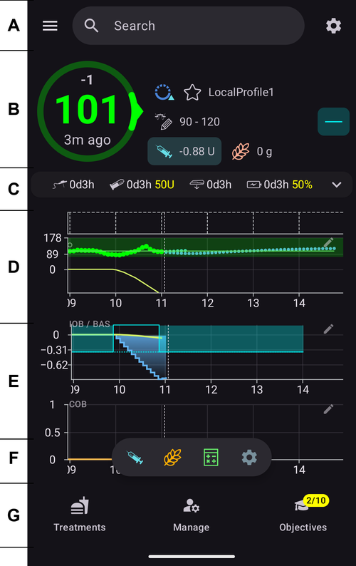

Aquesta és la primera pantalla que veureu quan obriu **AAPS**, i conté la major part de la informació que necessitareu cada dia.

### Secció A - Barra superior

* El **menú** (☰) de l'esquerra obre el calaix de navegació amb **Historial de tractaments**, **Historial**, **Estadístiques**, **Assistent de perfil**, **Manteniment**, **Assistent de configuració**, **Configurador** i més.
* La **barra de cerca** troba configuracions, diàlegs i documentació: només cal que comenceu a escriure (vegeu [Cerca global](../DailyLifeWithAaps/GlobalSearch.md)).
* La icona **Configuració** (engranatge) de la dreta obre tota la [configuració](../SettingUpAaps/Preferences.md).

(aaps-screens-profile--target)=

### Secció B - Bloc d'estat

#### Glucèmia actual

L'última lectura de glucèmia del CGM es mostra al cercle gran de l'esquerra, juntament amb la diferència respecte a la lectura anterior (delta) i l'antiguitat de la lectura.

El color del valor de glucèmia mostra l'estat respecte al [rang](#Preferences-range-for-visualization) definit.

* verd = dins del rang
* vermell = per sota del rang
* groc = per sobre del rang

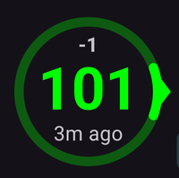 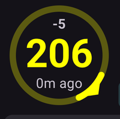 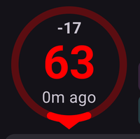

(loop-status)= (AapsScreens-loop-status)=

#### Estat del llaç


Al costat del cercle de glucèmia, una icona mostra el mode de funcionament del llaç (de dalt a baix a la imatge):

1. Cercle verd = [llaç tancat](#KeyAapsFeatures-ClosedLoop), llaç en funcionament
2. Cercle lila amb línia de punts = [suspensió per glucèmia baixa (LGS)](#KeyAapsFeatures-LGS)
3. Cercle blau amb línia de punts = [llaç obert](#KeyAapsFeatures-OpenLoop)
4. Cercle vermell amb una creu = llaç desactivat (no funciona de manera permanent)
5. Icona vermella de pausa = llaç suspès (aturat temporalment, però es dona la insulina basal); el temps restant es mostra al costat de la icona
6. Cercle gris amb un endoll = bomba desconnectada (temporalment no es dona gens d'insulina); el temps restant es mostra al costat de la icona

Premeu la icona per obrir el diàleg del llaç. El contingut del diàleg depèn de l'estat actual:

* Mentre el llaç està **en funcionament** (tancat, obert o LGS), podeu canviar el mode de funcionament (Llaç tancat, Suspensió per glucèmia baixa, Llaç obert o Desactivar llaç), **suspendre** el llaç o **desconnectar** la bomba durant el temps que trieu.
* Mentre el llaç està **desactivat**, el podeu tornar a activar triant un mode de funcionament, o podeu desconnectar la bomba.
* Mentre el llaç està **suspès**, el podeu **reprendre**, podeu desconnectar la bomba, o podeu triar una durada nova a **Suspendre el llaç** per allargar la suspensió.
* Mentre la bomba està **desconnectada**, podeu **reconnectar** la bomba, o podeu triar una durada nova a **Desconnectar bomba** per allargar la desconnexió.

Quan allargueu una suspensió o una desconnexió, la durada nova **comença ara**: substitueix el temps restant, no s'hi suma. No cal reprendre ni reconnectar abans.

El diàleg mentre el llaç funciona en llaç tancat:

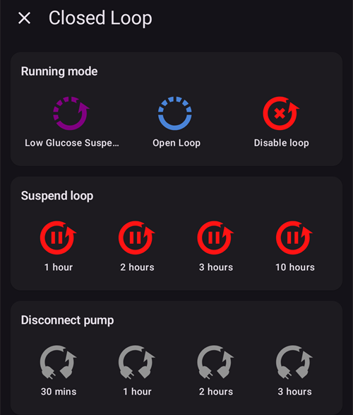

El diàleg mentre el llaç està suspès, amb **Reprendre** i les durades per allargar la suspensió:

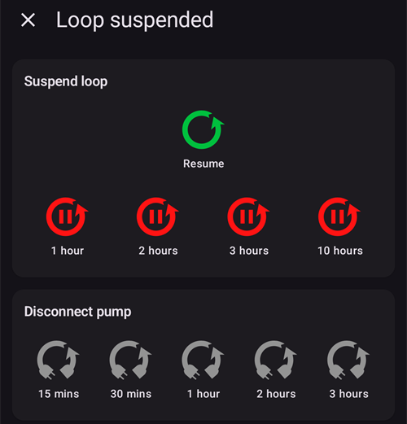

El diàleg mentre la bomba està desconnectada, amb **Reconnectar bomba** i les durades per allargar la desconnexió:

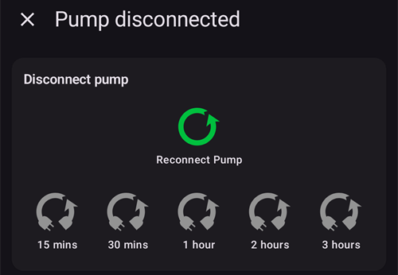

El diàleg en Suspensió per glucèmia baixa, en llaç obert i amb el llaç desactivat només canvia en els modes de funcionament que ofereix:

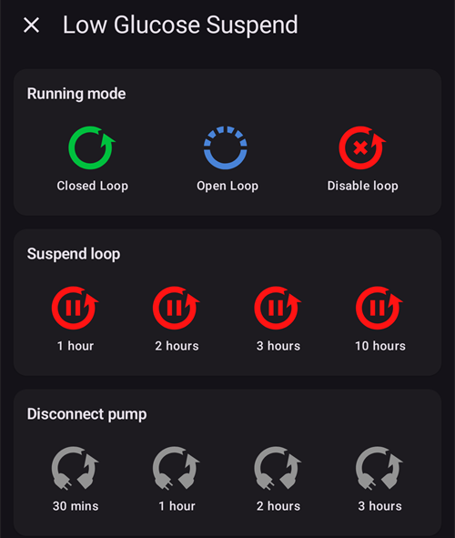

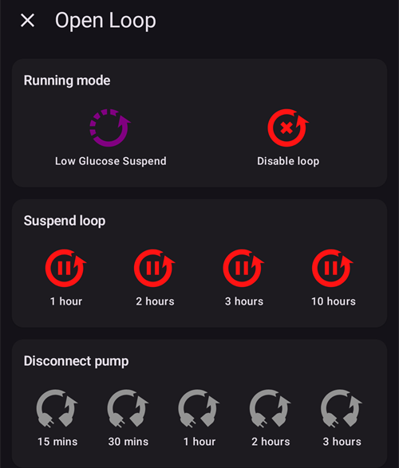

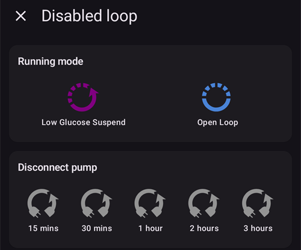

Així es veu la pantalla principal en cada mode. La franja de color a la part de dalt del gràfic canvia en el moment del canvi.

Suspensió per glucèmia baixa:

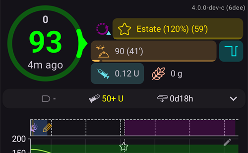

Llaç obert:

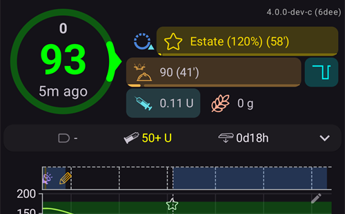

Llaç desactivat:

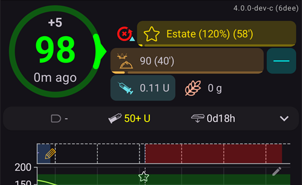

Llaç suspès; el temps restant es mostra al costat de la icona:

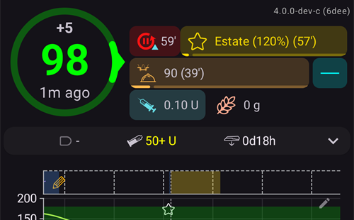

Bomba desconnectada; el temps restant es mostra al costat de la icona. Els botons de tractament es queden a la barra d'accés ràpid, així que encara podeu registrar insulina posada amb ploma o carbohidrats:

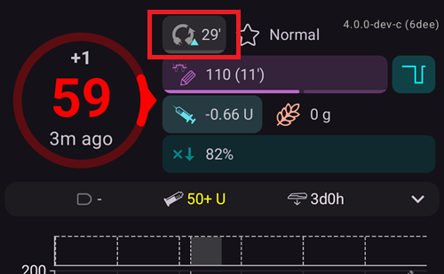

Cal una confirmació després de cada selecció.

```{admonition} Alarma: la bomba no ha acceptat la basal temporal zero :class: warning Mentre la bomba està desconnectada, **AAPS** manté una basal temporal zero a la bomba i la torna a establir si falta. Si després de 10 minuts encara falla, **AAPS** fa sonar una alarma urgent: *«La bomba no ha acceptat la basal temporal zero. És possible que encara estigui donant insulina basal. Comproveu la bomba.»* L'alarma es repeteix cada 15 minuts fins que s'estableix la basal temporal zero o s'acaba la desconnexió. Si la veieu, comproveu la bomba: és possible que estigui lliurant insulina basal tot i que **AAPS** la mostra com a desconnectada.

    <br />Nota: els modes disponibles depenen del vostre progrés als [Objectius](../SettingUpAaps/CompletingTheObjectives.md); Llaç tancat i LGS només es fan disponibles a mesura que els completeu.
    
    (aaps-screens-bg-warning-sign)=
    #### Senyal d'avís de glucèmia
    
    Si **AAPS** detecta un problema amb les lectures de glucèmia que rep, a la barra inferior de la pantalla principal apareix una drecera a l'origen de glucèmia (amb el seu nom, per exemple **xDrip+ BG**), amb una insígnia vermella d'avís. Toqueu-la per obrir la [pantalla de l'origen de glucèmia](#aaps-screens-bg-source).
    
    ##### Dades de glucèmia duplicades
    
    El senyal vermell d'avís us diu que actueu immediatament: rebeu **dades de glucèmia duplicades**, i això impedeix que el llaç faci bé la seva feina. **AAPS** no pot calcular de manera fiable la tendència de la glucèmia amb lectures duplicades, i per això deixa de corregir.
    
    Si el llaç estava tancat, **AAPS** el passa al mode [Suspensió per glucèmia baixa (LGS)](#KeyAapsFeatures-LGS): la icona del llaç es torna lila.
    
      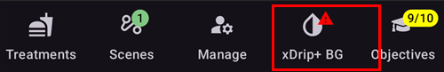
    
    Premeu la icona del llaç: la targeta **Restriccions** de la part de dalt us diu per què: «BgQualityCheck: Mode LGS per valors duplicats a l'origen de glucèmia».
    
      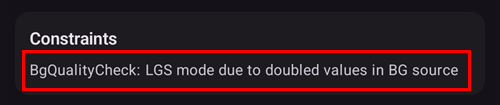
    
    ```{admonition} El vostre llaç funciona en Suspensió per glucèmia baixa
    :class: note
    El llaç continua funcionant, però només per protegir-vos de les hipoglucèmies: **AAPS** encara pot reduir o suspendre la basal, i no donarà cap insulina de correcció fins que no resolgueu aquest problema!
    

Heu de trobar per què rebeu glucèmies duplicades:

* Teniu activat el pont de Dexcom (Dexcom bridge) al vostre lloc Nightscout? Desactiveu el pont al tauler d'administració de la vostra instància de Nightscout: editeu la variable "enable" i traieu-ne la part "bridge". (Per a Heroku, [trobareu els detalls aquí](https://nightscout.github.io/troubleshoot/troubleshoot/#heroku).)
* Hi ha diverses fonts que envien la vostra glucèmia a Nightscout? Si feu servir l'aplicació BYODA, activeu l'enviament a **AAPS**, però no l'activeu a xDrip, si el feu servir.
* Teniu seguidors que reben la vostra glucèmia però que també la tornen a enviar al vostre lloc Nightscout?
* Últim recurs: a la [configuració de NSClient](#Preferences-nsclient), obriu la configuració de sincronització i desactiveu l'opció «Rebre dades de CGM de NS».

Per treure l'avís immediatament i que el llaç torni a corregir, elimineu les entrades duplicades a la pantalla de l'origen de glucèmia: toqueu la drecera de la barra inferior. La lectura duplicada es ressalta en vermell. Manteniu premuda una lectura per començar a seleccionar, marqueu els duplicats i toqueu la icona de la paperera a dalt a la dreta.

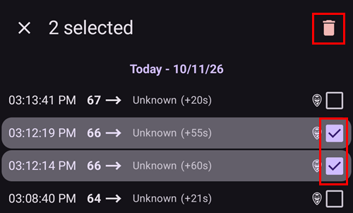

Però si hi ha molts duplicats, pot ser més fàcil

* [fer una còpia de seguretat de la configuració](../Maintenance/ExportImportSettings.md),
* restablir la base de dades al menú Manteniment i
* [tornar a importar la configuració](../Maintenance/ExportImportSettings.md)

    {admonition} Torneu vosaltres mateixos a Llaç tancat
    :class: important
    **AAPS** no torna sol a **Llaç tancat** quan els duplicats ja no hi són. Premeu la icona del llaç a la pantalla principal i torneu a seleccionar **Llaç tancat**.

##### Dades de glucèmia planes

Amb alguns orígens de glucèmia (Libre 1, AiDEX, Glutec, Medtronic i els orígens que no informen del tipus de sensor), **AAPS** també comprova si hi ha lectures que no canvien: si la glucèmia ha canviat menys de 2 mg/dl (0,1 mmol/l) durant 45 minuts, les dades es consideren errònies. La drecera de l'origen de glucèmia mostra llavors una insígnia vermella de tendència plana, i el llaç atura qualsevol basal temporal alta i no dona insulina de correcció fins que les lectures tornen a canviar. Comproveu el sensor i l'aplicació que envia les lectures.

##### Dades de glucèmia irregulars

Quan les lectures arriben a intervals irregulars o en falten algunes, **AAPS** torna a calcular valors cada 5 minuts a partir de les lectures que té. Això passa, per exemple, després d'un canvi de sensor, o amb els sensors Libre, que s'endarrereixen un minut o dos cada poques hores. El llaç continua funcionant i no cal que feu res. **AAPS** 4 ja no mostra cap senyal groc d'avís per a això.

#### Perfil actual

El perfil actual es mostra al costat de la icona de l'estrella.

Toqueu el nom del perfil per obrir la [pantalla Perfil](#aaps-screens-profile), on podeu veure els detalls del perfil i [canviar entre perfils diferents](../DailyLifeWithAaps/ProfileSwitch-ProfilePercentage.md).

Per **canviar el percentatge del perfil** (i la seva durada), toqueu el nom del perfil i després toqueu el botó rodó **▶** (Activar) a baix a la dreta de la pantalla Perfil. A **AAPS** 3.x aquesta pantalla s'obria mantenint premut el nom del perfil; a **AAPS** 4 mantenir-lo premut no fa res. Pas a pas: [Canviar el percentatge del perfil](#ProfileSwitch-change-percentage).


1. Visualització normal amb l'activació d'un perfil estàndard.
2. Canvi de perfil amb un percentatge específic del 90% i 9 minuts restants; el nom del perfil es torna groc mentre hi ha un canvi de perfil temporal en curs.
3. Canvi de perfil amb un desplaçament horari d'1 hora i 9 minuts restants.

#### Objectiu


L'objectiu de glucèmia actual es mostra sota el nom del perfil.

Premeu breument l'objectiu per obrir la pantalla **[Objectiu temporal](../DailyLifeWithAaps/TempTargets.md)**.

1. Visualització normal: el rang objectiu definit al vostre perfil.
2. Si hi ha un objectiu temporal, l'objectiu es torna groc/taronja amb la icona del predefinit utilitzat, i el temps restant en minuts es mostra entre parèntesis.

(AapsScreens-visualization-of-dynamic-target-adjustment)=

#### Visualització de l'ajust dinàmic de l'objectiu

Si feu servir l'[algoritme SMB](#Config-Builder-aps) i la funció [Autosens](#Open-APS-features-autosens), **AAPS** pot ajustar l'objectiu de manera dinàmica segons la sensibilitat.

Activeu una o les dues opcions següents a la [configuració d'OpenAPS SMB](#Preferences-openaps-smb-settings):

* «La sensibilitat puja l'objectiu» i/o
* «La resistència baixa l'objectiu»

Si **AAPS** detecta resistència o sensibilitat, l'objectiu canviarà respecte al que hi ha al perfil, i l'objectiu que es mostra canvia de color per indicar l'ajust.

(aaps-screens-iob-cob-basal-sens)=

#### IOB, COB, basal i sensibilitat


1. **Xeringa**: insulina a bord (IOB): quantitat d'insulina activa dins del vostre cos  
    La xifra d'insulina a bord seria zero si només funcionés la basal estàndard i no quedés insulina de bolus anteriors. 
    * L'IOB pot ser negativa si hi ha hagut fa poc períodes amb menys basal.
    * Premeu el xip per veure la divisió entre insulina de bolus i insulina basal (primer diàleg de la imatge; aquí amb una IOB negativa després d'un període amb menys basal)
2. **Gra**: [carbohidrats a bord (COB)](../DailyLifeWithAaps/CobCalculation.md): carbohidrats que heu menjat abans i que encara no s'han absorbit
3. El botó verd blavós de la dreta mostra el **lliurament basal actual**: una línia plana quan funciona la basal del perfil, i una icona diferent mentre hi ha una basal temporal activa
4. La **fila del percentatge** mostra la sensibilitat actual ([Autosens](#Open-APS-features-autosens) / [DynamicISF](../DailyLifeWithAaps/DynamicISF.md)). Quan el llaç canvia el vostre ISF, la fila també mostra l'ISF del perfil, una fletxa i l'ISF que el llaç fa servir ara, per exemple «80% 2.0 ↗ 2.5». Premeu-la per veure el valor d'Autosens i l'ISF efectiu (segon diàleg de la imatge). Si el llaç treballa amb un valor diferent de l'últim resultat d'Autosens (per exemple, perquè un objectiu temporal canvia la vostra sensibilitat), el diàleg també mostra aquest valor com a **Autosens a l'algoritme**. Quan Autosens està desactivat, el llaç manté l'ISF del perfil i no es mostra cap ISF efectiu.

El diàleg d'IOB, que s'obre prement el xip d'IOB:

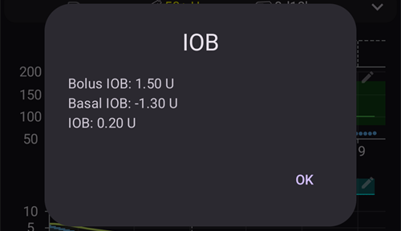

Premeu el botó verd blavós per veure la basal temporal que està funcionant, quan va començar i quant de temps fa que funciona:

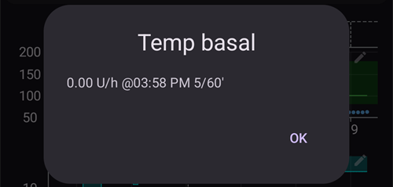

(aaps-screens-carbs-required)=

#### Calen carbohidrats

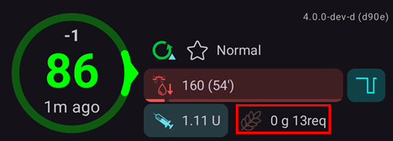

Els suggeriments de carbohidrats apareixen quan el disseny de referència detecta que calen carbohidrats.

Això passa quan l'algoritme oref creu que no us pot salvar amb una basal temporal zero i que necessitareu carbohidrats per corregir-ho.

Els avisos de carbohidrats són molt més elaborats que els de la calculadora de bolus. És possible que vegeu un suggeriment de carbohidrats mentre la calculadora de bolus no mostra carbohidrats que falten.

Si voleu, els avisos de carbohidrats necessaris es poden enviar a Nightscout. En aquest cas es mostrarà i es difondrà un avís.

### Secció C - Fila d'estat


La fila d'estat dona un avís visual per a

* Edat de la cànula
* Edat de la insulina (dies que fa que es fa servir el reservori) i nivell del reservori (unitats)
* Edat del sensor
* Edat i nivell (%) de la pila de la bomba

Si se supera el llindar d'avís, els valors es mostren en groc.

Si se supera el llindar crític, els valors es mostren en vermell.

L'edat sempre es mostra en format curt, sigui quina sigui la mida de la pantalla: *4h* el primer dia, *3d4h* més endavant.

Els llindars es poden canviar amb la petita icona **Configuració** que apareix quan la fila d'estat està **desplegada** (fletxa de la dreta); vegeu [Llums d'estat](#Preferences-status-lights).

El panell d'estat desplegat també té un botó al final d'algunes files per registrar un canvi, que posa a zero l'edat corresponent: **Afegir** a la fila **Sensor** registra la inserció d'un sensor. Si la vostra bomba ho permet, **Encebar** apareix a les files **Cànula** (o **Bomba patch**) i **Insulina**, i **Afegir** a la fila **Pila de la bomba**.


Segons la bomba que feu servir, potser no tindreu totes aquestes icones.

(screens-sensor-level-battery)=

#### Nivell del sensor (bateria)

Funciona per a CGM amb un transmissor addicional com el MiaoMiao 2. (Tècnicament, el sensor ha d'enviar la informació del nivell de bateria a xDrip.)

Els llindars es poden definir a [Llums d'estat](#Preferences-status-lights).

(aaps-screens-main-graph)=

### Secció D - Gràfic principal

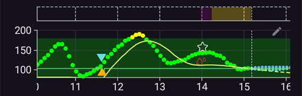

El gràfic mostra la vostra glucèmia tal com la llegeix el monitor de glucosa (CGM).

Feu servir els gestos de desplaçar i de pinçar per fer zoom al gràfic per canviar el període de temps visible.

L'àrea verda mostra el vostre rang objectiu.

Aquesta informació també es mostra en aquest gràfic:

* Bolus manuals: triangle blau just a sobre de la corba de glucèmia, que apunta cap avall a la lectura d'aquell moment, amb la quantitat d'insulina
* Entrades de carbohidrats: triangle taronja just a sota de la corba de glucèmia, que apunta cap amunt a la lectura, amb la quantitat de carbohidrats. Un àpat introduït amb el seu bolus es veu com una sola marca, partida per la lectura.
* Els triangles tenen tres mides (petita, mitjana, gran), segons la quantitat comparada amb la més gran del dia. Si no hi ha cap lectura de glucèmia en aquell moment (buit del sensor), el triangle es dibuixa a la part de baix del gràfic.
* Controls de glucèmia i calibracions: es dibuixen al seu valor mesurat, perquè els pugueu comparar amb la corba del sensor
* Objectiu definit al perfil o modificat per un objectiu temporal: línia verda
* Canvis de perfil: icones d'estrella a la part de dalt del gràfic
* Estat del llaç: franja de color a la part de dalt del gràfic quan el [mode de funcionament](#AapsScreens-loop-status) no és llaç tancat: blau = llaç obert, lila = LGS, vermell = llaç desactivat, groc = llaç suspès, gris = bomba desconnectada, taronja = superbolus (a la captura: lila i després groc). L'historial d'aquests canvis es mostra a [Mode de funcionament](#AapsScreens-running-mode)
* Els [SMB](#Open-APS-features-super-micro-bolus-smb) no es dibuixen al gràfic de glucèmia (n'hi hauria un cada pocs minuts): es mostren al [gràfic d'IOB](#aaps-screens-iob).

Toqueu un **Control glucèmia** al gràfic per veure'n el valor i la nota, si n'heu escrit una.

(aaps-screens-graph-press-and-hold)=

#### Veure els valors en un moment concret

**Manteniu premut** el gràfic de glucèmia un moment per veure els valors d'una lectura. Un punt marca la lectura més propera, es dibuixa una línia discontínua en aquell moment a tots els gràfics, i una finestra a la part de dalt del gràfic mostra:

* l'hora i el valor de glucèmia
* IOB, COB (només quan és més de 0 g) i la taxa basal en aquell moment; la icona de la basal mostra si hi havia una basal temporal en funcionament, com a la pantalla principal
* qualsevol bolus, SMB o carbohidrats en aquell moment, amb els mateixos triangles que als gràfics

Mantingueu el dit a la pantalla i moveu-lo a l'esquerra o a la dreta per anar d'una lectura a la següent. Notareu una vibració suau a cada lectura, i el gràfic no es desplaça mentre ho feu. La finestra es queda 2 segons després d'aixecar el dit.

Funciona igual als [gràfics addicionals](#aaps-screens-additional-graphs) sota el gràfic de glucèmia (IOB, COB...): manteniu premut qualsevol d'ells.

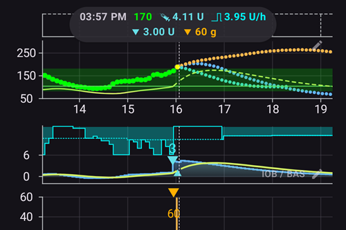

(aaps-screens-graph-clock-change)=

#### Canvis d'hora

Quan el rellotge del telèfon ha fet un salt, en un canvi d'horari d'estiu o en un fus horari nou, una línia vertical discontínua marca aquest moment al gràfic de glucèmia, amb una petita icona de rellotge a la base. La mateixa línia discontínua travessa els [gràfics addicionals](#aaps-screens-additional-graphs) de sota.

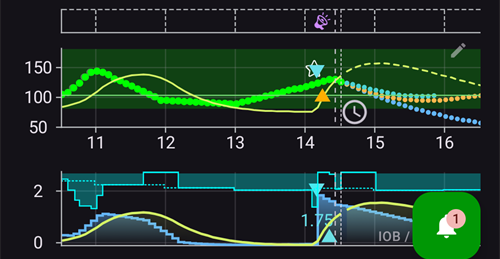

(AapsScreens-activate-optional-information)=

#### Activar informació opcional

Premeu la icona del **llapis** a la cantonada de dalt a la dreta del gràfic per obrir la configuració del gràfic:


* **Alçada del gràfic** ajusta l'altura del gràfic.
* **ACT** superposa la corba d'activitat de la insulina: una línia contínua groc verdosa <span style="background:#141218;color:#D3F166;padding:0 0.3em;border:1px solid #141218;border-radius:4px">━━━━</span> (no la confongueu amb la predicció UAM groga de punts)
* **PRED** superposa les [línies de predicció](#aaps-screens-prediction-lines) (vegeu més avall)

(aaps-screens-prediction-lines)=

#### Línies de predicció

Quan **PRED** està activat, AAPS dibuixa les prediccions com a **línies de punts** a la dreta de la línia «ara». Cada predicció té el seu color. El tema fosc fa servir tons més clars dels mateixos colors, i una línia dins del rang objectiu verd pot semblar una mica més verda.

| Línia                      | Tema clar                                                                                                                         | Tema fosc                                                                                                                          | Què prediu                             |
| -------------------------- | --------------------------------------------------------------------------------------------------------------------------------- | ---------------------------------------------------------------------------------------------------------------------------------- | -------------------------------------- |
| **IOB** (blau)             | <span style="background:#FFFFFF;color:#1E88E5;padding:0 0.3em;border:1px solid #CCCCCC;border-radius:4px">●●●●</span>             | <span style="background:#141218;color:#64B5F6;padding:0 0.3em;border:1px solid #141218;border-radius:4px">●●●●</span>              | només insulina                         |
| **COB** (taronja)          | <span style="background:#FFFFFF;color:#FB8C00;padding:0 0.3em;border:1px solid #CCCCCC;border-radius:4px">●●●●</span>             | <span style="background:#141218;color:#FFB74D;padding:0 0.3em;border:1px solid #141218;border-radius:4px">●●●●</span>              | carbohidrats a bord                    |
| **UAM** (groc)             | <span style="background:#FFFFFF;color:#C9BD60;padding:0 0.3em;border:1px solid #CCCCCC;border-radius:4px">●●●●</span>             | <span style="background:#141218;color:#E6D39A;padding:0 0.3em;border:1px solid #141218;border-radius:4px">●●●●</span>              | àpat no anunciat                       |
| **ZT** (cian)              | <span style="background:#FFFFFF;color:#00D2D2;padding:0 0.3em;border:1px solid #CCCCCC;border-radius:4px">●●●●</span>             | <span style="background:#141218;color:#4DD4D4;padding:0 0.3em;border:1px solid #141218;border-radius:4px">●●●●</span>              | basal temporal zero (insulina aturada) |
| **aCOB** (taronja pàl·lid) | <span style="background:#FFFFFF;color:rgba(251,140,0,0.5);padding:0 0.3em;border:1px solid #CCCCCC;border-radius:4px">●●●●</span> | <span style="background:#141218;color:rgba(255,183,77,0.5);padding:0 0.3em;border:1px solid #141218;border-radius:4px">●●●●</span> | només l'algoritme AMA, més antic       |

Quan dues prediccions donen els mateixos valors, els punts se superposen i només veieu un dels colors (per exemple, UAM sobre IOB quan la glucèmia és plana).

* Línia **COB** (taronja): [carbohidrats a bord](CobCalculation.md) (a tot AAPS el taronja es fa servir per al COB i els carbohidrats)
    
    Aquesta línia de predicció mostra cap on anirà la vostra glucèmia (no el COB mateix!) segons la configuració actual del **perfil**, suposant que les desviacions per l'absorció de carbohidrats es mantenen constants. Aquesta línia només apareix si hi ha COB conegut.

* Línia **IOB** (blava): insulina a bord (a tot AAPS el blau es fa servir per a l'IOB i la insulina)
    
    Aquesta línia de predicció mostra què passaria només amb l'efecte de la insulina. Per exemple, si us heu posat insulina i després no heu menjat carbohidrats.

* Línia **ZT** (cian): basal temporal zero (glucèmia prevista si s'establís una basal temporal del 0%)
    
    Aquesta línia de predicció mostra com canviaria la trajectòria de la glucèmia si la bomba aturés tot el lliurament d'insulina (TBR del 0%). La línia s'atura quan puja per sobre del vostre objectiu.
    
    *Aquesta línia només apareix quan es fa servir l'algoritme [SMB](#Config-Builder-aps).*

* Línia **UAM** (groga): [àpats no anunciats](#SensitivityDetectionAndCob-sensitivity-oref1)
    
    Àpats no anunciats vol dir que es detecta una pujada important de la glucèmia per àpats, adrenalina o altres causes. Aquesta línia de predicció és semblant a la **línia taronja del COB**, però suposa que les desviacions baixaran a un ritme constant (allargant el ritme actual de reducció).
    
    *Aquesta línia només apareix quan es fa servir l'algoritme [SMB](#Config-Builder-aps), **Activar UAM** està activat a la configuració d'OpenAPS SMB i la glucèmia puja més del que explica només la insulina.*

* Línia **aCOB** (taronja pàl·lid i transparent): absorció accelerada de carbohidrats
    
    Semblant al COB, però suposant una velocitat d'absorció de carbohidrats fixa de 10 mg/dl/5 min (0,555 mmol/l/5 min). Obsolet i de poca utilitat.
    
    *Aquesta línia només apareix quan es fa servir l'algoritme [AMA](#Config-Builder-aps), més antic.*

Normalment la vostra corba real de glucèmia acaba al mig d'aquestes línies, o a prop de la línia les suposicions de la qual s'assemblen més a la vostra situació.

(aaps-screens-how-predictions-become-a-dosing-decision)=

#### Com converteix AAPS les prediccions en una decisió de dosi

AAPS no dosifica la insulina només segons la glucèmia actual: a cada cicle del llaç (aproximadament cada 5 minuts) mira totes les línies de predicció de dalt juntes i decideix l'acció més segura.

La regla bàsica és **primer la seguretat**: si *qualsevol* línia de predicció, en qualsevol moment, baixa per sota del vostre llindar de seguretat baix, AAPS estableix una basal temporal zero (basal temporal del 0%) i no dona més insulina, encara que la glucèmia actual sigui alta. Només quan totes les línies de predicció es mantenen per sobre d'aquest llindar, AAPS es planteja donar més insulina.

Quan és segur donar més insulina, AAPS mira on es preveu que acabarà la glucèmia (la **glucèmia final**) segons les prediccions combinades, i calcula quanta correcció cal per tornar aquesta glucèmia final a l'objectiu; la dona com a basal temporal augmentada o (si l'algoritme oref1/[SMB](#Open-APS-features-super-micro-bolus-smb) està activat) com un petit bolus immediat. Si la glucèmia és alta ara però ja baixa prou sola, AAPS espera, o fins i tot pot reduir la taxa basal, en lloc d'afegir insulina que només faria més baixa una hipoglucèmia posterior.

Per veure exemples pràctics d'aquesta lògica de decisió amb captures reals, vegeu els [escenaris de dosificació de la guia per a professionals sanitaris](#clinicianguide-dosing-scenarios); es van escriure per a professionals sanitaris, però serveixen per a qualsevol usuari d'AAPS.

*Per a l'explicació tècnica completa de com es calculen aquestes prediccions i la decisió de dosi que en resulta, vegeu la [documentació de determine-basal d'OpenAPS](https://openaps.readthedocs.io/en/latest/docs/While%20You%20Wait%20For%20Gear/Understand-determine-basal.html).*

#### Basals

Una línia **blava contínua** mostra el lliurament basal de la bomba i reflecteix el lliurament real al llarg del temps.

La línia **blava de punts** és la taxa basal que hi hauria sense ajustos de basal temporal (TBR).

Quan es dona la taxa basal estàndard, l'àrea sota la corba es mostra en blau fosc. Quan la taxa basal s'ajusta temporalment (augmentada o reduïda), l'àrea sota la corba es mostra en blau clar.

#### Activitat

La línia **groga fina** mostra l'activitat de la insulina.

Es basa en la baixada de glucèmia esperada per la insulina del vostre cos si no hi hagués altres factors (com els carbohidrats).

(AapsScreens-section-g-additional-graphs)= (aaps-screens-additional-graphs)=

### Secció E - Gràfics addicionals

Podeu activar gràfics addicionals sota el gràfic principal. En [Mode simple](#preferences-simple-mode), els gràfics addicionals estan predefinits i no es poden canviar. Desactiveu el **Mode simple** si voleu configurar vosaltres mateixos els gràfics addicionals.

Els gràfics addicionals segueixen el gràfic principal: quan desplaceu o feu zoom al gràfic de glucèmia, es mouen amb ell. Arrossegar de costat un gràfic addicional també desplaça tots els gràfics. No tenen etiquetes d'hora pròpies: llegiu l'hora al gràfic de glucèmia.

Per configurar un gràfic addicional, premeu la icona del **llapis** a la seva cantonada de dalt a la dreta:


Seleccioneu els xips de les dades que voleu veure en aquest gràfic; el botó **Eliminar** esborra el gràfic.

Per crear un gràfic més, premeu **Afegir gràfic** sota l'últim gràfic i seleccioneu-ne els xips de la mateixa manera:

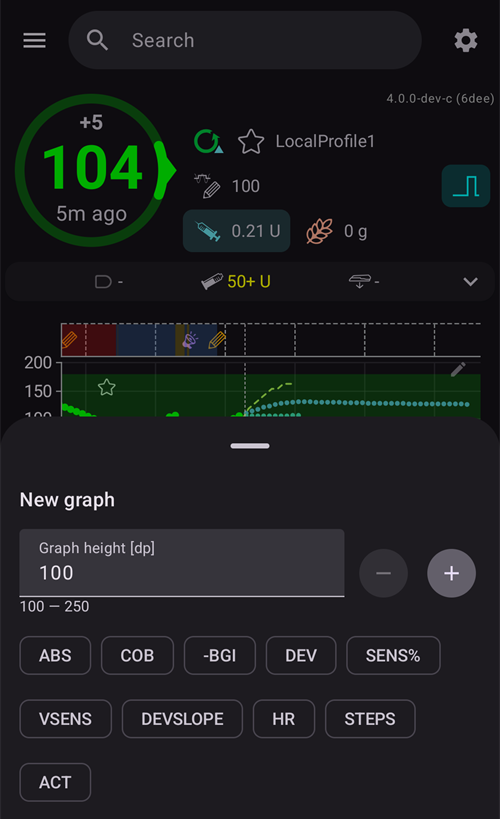

El gràfic nou s'afegeix sota els altres; aquí, un segon gràfic addicional amb **SENS%** i **DEV**:

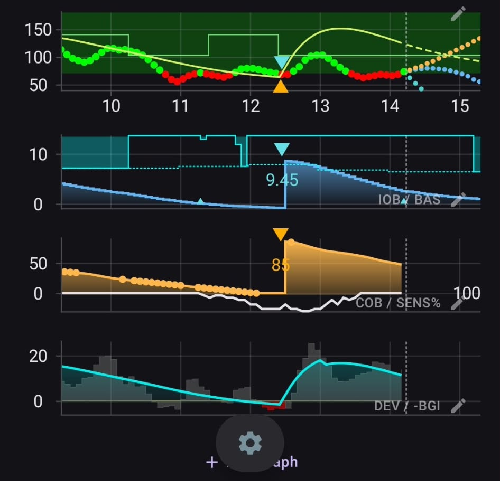

La majoria d'usuaris troben adequada aquesta configuració de gràfics addicionals:

* Gràfic 1 amb IOB, BAS
* Gràfic 2 amb COB, Canvi de sensibilitat
* Gràfic 3 amb Desviacions i BGI.

#### Insulina absoluta (ABS)

Insulina activa, incloent-hi els bolus **i la basal**.

(aaps-screens-iob)=

#### Insulina a bord (IOB)

Mostra la insulina a bord (= insulina activa al vostre cos). Inclou la insulina dels bolus i de la basal temporal (**però no les taxes basals definides al perfil**).

Si durant el temps de la DIA no hi hagués hagut [SMB](#Open-APS-features-super-micro-bolus-smb), ni bolus, ni TBR, seria zero.

Els SMB es mostren en aquest gràfic com a triangles blaus, en tres mides segons la quantitat comparada amb l'SMB més gran del dia.

L'IOB pot ser negativa si no us queda insulina de bolus i durant molt de temps heu tingut una basal temporal zero o baixa.

L'absorció depèn de la vostra [configuració de la DIA i del tipus d'insulina](#Config-Builder-insulin-dia).

#### Carbohidrats a bord (COB)

Mostra els carbohidrats a bord (= carbohidrats actius al vostre cos que encara no s'han absorbit).

L'absorció depèn de les [desviacions que detecta l'algoritme](../DailyLifeWithAaps/CobCalculation.md).

Si detecta una absorció de carbohidrats més alta de l'esperada, es donarà insulina i això farà pujar l'IOB (més o menys, segons la vostra configuració de seguretat).

#### Canvi de sensibilitat (SENS%)

Mostra la sensibilitat que ha detectat [Autosens](#Open-APS-features-autosens).

La sensibilitat és un càlcul de la sensibilitat a la insulina com a resultat de l'esport, les hormones, etc.

Tingueu en compte que heu d'estar a l'[Objectiu 8](#objectives-objective8) perquè la Detecció de sensibilitat/[Autosens](#Open-APS-features-autosens) pugui ajustar automàticament la quantitat d'insulina lliurada. Abans d'arribar a aquest objectiu, la línia del gràfic només es mostra a títol informatiu.

### Sensibilitat variable (VSENS)

Mostra la sensibilitat calculada per [DynamicISF](../DailyLifeWithAaps/DynamicISF.md). Només té dades si feu servir aquesta funció.

(screen-heart-rate-steps)=

#### Freqüència cardíaca (HR) i passos

Aquestes dades poden estar disponibles si feu servir un [rellotge intel·ligent Wear OS](../WearOS/WearOsSmartwatch.md). Activeu-les a l'aplicació **AAPS** Wear i doneu permís per a les dades de salut.

Els passos es dibuixen com a columnes, i la freqüència cardíaca com una línia corba que s'interromp on el rellotge no ha enviat dades.

#### Desviacions (DEV)

* Les barres **grises** mostren una desviació deguda als carbohidrats.
* Les barres **verdes** mostren que la glucèmia és més alta del que esperava l'algoritme. Les barres verdes serveixen per augmentar la resistència a [Autosens](#Open-APS-features-autosens).
* Les barres **vermelles** mostren que la glucèmia és més baixa del que esperava l'algoritme. Les barres vermelles serveixen per augmentar la sensibilitat a [Autosens](#Open-APS-features-autosens).
* Les barres **grogues** mostren una desviació deguda a UAM.
* Les barres **negres** mostren desviacions petites que no es tenen en compte per a la sensibilitat

#### Impacte en la glucèmia (-BGI)

Aquesta línia mostra quant «hauria» de pujar o baixar la glucèmia només per l'activitat de la insulina.

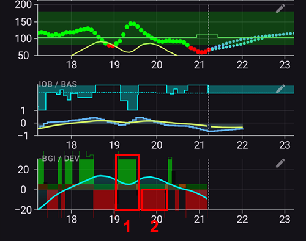

És una bona combinació mostrar aquesta línia juntament amb les barres de desviació. Comparteixen la mateixa escala, però és diferent de la de les altres dades opcionals, per això és bona idea mostrar-les en un gràfic separat, com es veu a dalt. Comparar la línia BGI i les barres de desviació és una altra manera d'entendre com varia la **glucèmia**. Aquí, al moment marcat amb **1**, les barres de desviació estan molt per sobre de la línia BGI: la glucèmia puja més del que explica només l'activitat de la insulina (per exemple, després de menjar carbohidrats). Al moment marcat amb **2**, les barres de desviació estan per sota de zero (vermelles): la glucèmia és més baixa del que esperava l'algoritme.

### Secció F - Barra d'accés ràpid


La barra flotant de la part de baix de la pantalla conté les vostres accions d'**[accés ràpid](../DailyLifeWithAaps/QuickLaunch.md)**. El petit **engranatge** obre la configuració de l'accés ràpid, on trieu quins botons es mostren (tractaments, entrades del portal de cures, accions del CGM, les pantalles del full **Gestionar**, botons d'[Assistent ràpid](../DailyLifeWithAaps/QuickWizards.md), [Escenes](../DailyLifeWithAaps/Scenes.md) i més).

A dalt es mostra una configuració típica: **Insulina**, **Carbs** i la **Calculadora de bolus**.

Mentre la bomba està **desconnectada**, els botons de tractament es queden a la barra, per exemple per registrar insulina posada amb ploma (vegeu [Insulina](#aaps-screens-buttons-insulin) més avall). Les mateixes accions també estan disponibles al [full Tractaments](#aaps-screens-treatments-sheet) de la navegació inferior.

(aaps-screens-buttons-insulin)=

#### Insulina


Per donar una quantitat d'insulina sense fer servir la [calculadora de bolus](#aaps-screens-bolus-wizard).

Si activeu **Iniciar OT: Menjar aviat**, podeu iniciar automàticament el vostre [objectiu temporal Menjar aviat](#TempTargets-eating-soon-temp-target).

Si no voleu fer el bolus amb la bomba, sinó registrar una quantitat d'insulina (p. ex. insulina posada amb ploma), activeu «**El bolus només es registrarà (la bomba no el lliurarà)**». Una fila addicional **Hora**, posada a **Ara**, us permet registrar una injecció d'insulina feta en el passat: feu servir **-** / **+** per canviar-la, o toqueu la fletxa per escriure els minuts o triar una data i una hora.

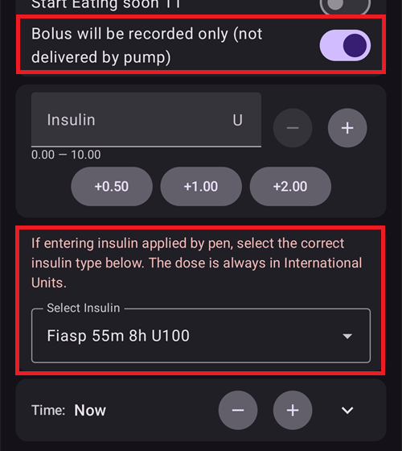 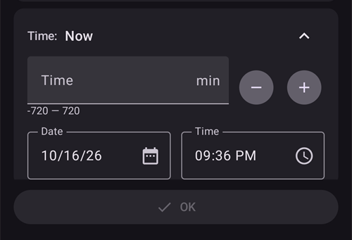

Podeu fer servir els botons **+0.5 / +1.0 / +2.0** per augmentar ràpidament la quantitat d'insulina. Els valors d'increment es poden canviar a la [configuració de la calculadora de bolus](#Preferences-deliver-this-part-of-bolus-wizard-result).

El diàleg d'insulina també es pot fer servir quan la bomba està suspesa o desconnectada, per exemple per registrar insulina injectada amb ploma. En aquest cas, «**El bolus només es registrarà (la bomba no el lliurarà)**» està forçat a activat (es mostra en vermell) i apareixen camps addicionals per seleccionar el tipus d'insulina i un desplaçament d'**Hora** per a una injecció feta en el passat:

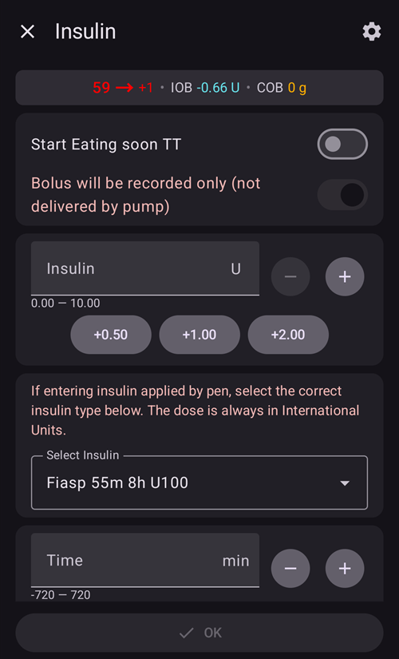

#### Carbs


Per registrar carbohidrats sense fer un bolus.

Alguns [objectius temporals predefinits](#TempTargets-hypo-temp-target) (Hipo, Menjar aviat, Activitat) es poden iniciar directament amb els interruptors de dalt.

**Hora dels carbohidrats**: quan menjareu o heu menjat els carbohidrats.

**Durada**: s'utilitza per als [«carbohidrats estesos»](ExtendedCarbs.md). Aquesta fila està plegada perquè no hi escriviu els grams per error: feu servir **-** / **+** per canviar-la, o toqueu la fletxa per obrir-la i escriure un valor.

Podeu fer servir els botons **+5 / +10 / +20** per augmentar ràpidament la quantitat de carbohidrats.

#### Assistent ràpid

Introduïu fàcilment la quantitat de carbohidrats i definiu les bases del càlcul amb un sol botó preconfigurat.

Els detalls es configuren a [Assistent ràpid](../DailyLifeWithAaps/QuickWizards.md).

(aaps-screens-treatments-sheet)=

### Secció G - Navegació inferior

La barra de navegació inferior dona accés a:

* **Tractaments**: un full d'accions ràpides amb les vostres accions de tractament:
    
    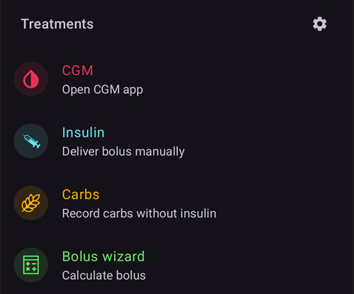

* **Escenes**: només es mostra si teniu com a mínim una [escena](../DailyLifeWithAaps/Scenes.md) o una tasca d'**Automatització** marcada com a **Acció de l'usuari**. Obre un full des del qual les podeu iniciar; una insígnia mostra quantes en podeu iniciar ara mateix. El **llapis** de la part de dalt del full obre **Gestionar → Escenes**.

* **Gestionar**: el centre de tot el que gestioneu a **AAPS**: Perfil, Configuració d'insulina, Objectiu temporal, Assistent ràpid, Escenes, Automatització, Aliments, Rotació de punts d'inserció, Bomba i Clients autoritzats. A sota hi ha accions de dispositius i de basal, com Inserció del sensor i Basal temporal. Alguns elements només apareixen quan s'apliquen a la vostra configuració; per exemple, Encebar i el canvi de pila depenen de la bomba, i Basal temporal, Bolus estès i les entrades del portal de cures s'amaguen en [Mode simple](#preferences-simple-mode):
    
    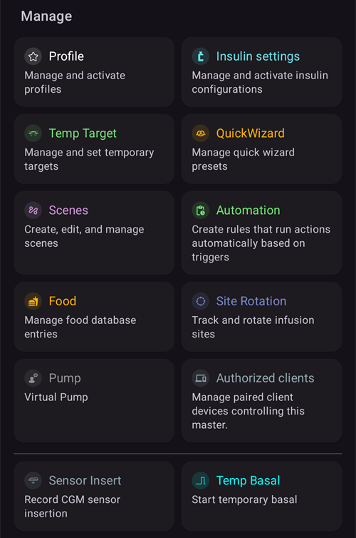

* **Objectius**: el vostre progrés als [objectius](../SettingUpAaps/CompletingTheObjectives.md); una insígnia mostra quants n'heu completat. Aquest element desapareix quan s'han acabat tots els objectius, i no hi és a **AAPSClient**.

(aaps-screens-notifications)=

#### Notificacions

Pot aparèixer una **bombolla d'avisos** a sobre de la barra inferior, a la dreta. Recull els avisos actius d'**AAPS**; el número petit mostra quants n'hi ha. El seu color segueix el més important: vermell per a un missatge urgent, verd per a una simple informació.

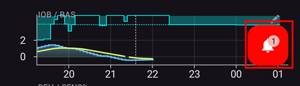

Toqueu la bombolla per obrir el panell d'**Avís**. Cada missatge mostra l'hora en què va aparèixer. Premeu **Ignorar** sota un missatge per treure'l; alguns missatges tenen un altre botó en lloc d'aquest, que us porta a la configuració que necessita la vostra atenció.

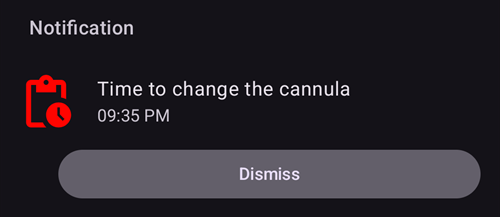

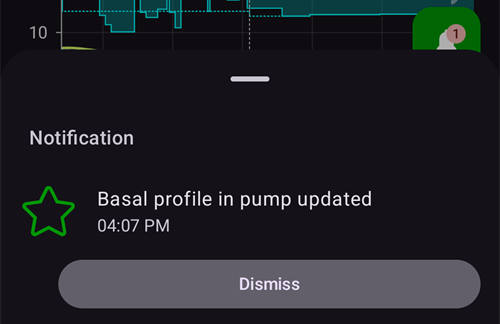

(bolus-wizard)= (aaps-screens-bolus-wizard)=

## Calculadora de bolus


Quan vulgueu fer un bolus d'àpat, normalment el fareu des d'aquí.

### Secció I

La capçalera **Càlcul** mostra el bolus calculat. Si la insulina a bord ja supera el bolus calculat, només mostrarà la quantitat de carbohidrats que encara calen.

La calculadora de bolus es pot fer servir sigui quina sigui la **glucèmia** actual, també quan és massa alta o massa baixa. Si la **glucèmia** és per sobre de l'objectiu, s'afegeix una correcció al bolus d'àpat. Si la **glucèmia** és per sota de l'objectiu, el bolus es redueix i, si la insulina a bord ja és més de la necessària, la calculadora us diu quants carbohidrats encara calen en lloc de proposar insulina.

La fila d'icones sota la capçalera mostra quines dades entren al càlcul (glucèmia, tendència, IOB, objectiu temporal, COB). Prémer una icona activa / desactiva aquesta dada al càlcul; la icona **(i)** mostra els números detallats del càlcul.

#### Combinacions de COB i IOB i què volen dir

* Per seguretat, la dada IOB no es pot desactivar quan el COB està activat, perquè podríeu arriscar-vos a posar massa insulina, ja que **AAPS** no tindria en compte la que ja s'ha donat.
* Si activeu COB i IOB, es tindran en compte els carbohidrats no absorbits que encara no estan coberts amb insulina + tota la insulina lliurada com a TBR o SMB.
* Si activeu IOB sense COB, **AAPS** té en compte la insulina ja lliurada, però no la compensa amb els carbohidrats que encara s'han d'absorbir. Això provoca un avís de «carbohidrats que falten».
* Si feu un bolus per a **menjar addicional** poc després d'un bolus d'àpat (p. ex. unes postres), pot ser útil **desactivar totes les dades**. Així només s'afegeixen els carbohidrats nous, perquè l'àpat principal no s'ha d'haver absorbit necessàriament, i l'IOB no coincidirà exactament amb el COB poc després d'un bolus d'àpat.
* Per seguretat, un **objectiu temporal** només s'inclou al càlcul si activeu aquesta dada manualment.

(AapsScreens-section-j)=

### Secció J - Camps d'entrada

Al camp **Carbs** introduïu la vostra estimació de la quantitat de carbohidrats, **en grams**, per a la qual voleu fer el bolus; els botons **+** de sota afegeixen carbohidrats ràpidament. **AAPS** només treballa amb grams: si compteu en racions o unitats de pa (*p. ex.* intercanvis «CHO» de DAFNE), convertiu-les a grams abans d'introduir-les. Vegeu la [nota sobre les unitats de pa](#your-aaps-profile-insulin-to-carbs-ratio) a la pàgina del perfil.

#### Tipus de carbohidrats: pa, pastís o pizza

Sota el camp **Carbs**, els botons **Pa**, **Pastís** i **Pizza** diuen a **AAPS** com de ràpid s'absorbeix l'àpat. Amb **Pastís** i **Pizza**, el bolus cobreix ara només una part dels carbohidrats i la resta s'afegeix més tard com a e-carbs. Vegeu [Tipus de carbohidrats: pa, pastís o pizza](#AapsScreens-carbs-type) a la pàgina de carbohidrats estesos per als percentatges i els temps.

La fila **Correcció** serveix si voleu modificar la dosi final per algun motiu.

Només el camp **Carbs** està sempre obert. Les altres files (**Correcció**, **Hora dels carbohidrats**, **Glucèmia** i **Utilitzar percentatge**) estan plegades: mostren el seu valor amb els botons **-** / **+**, perquè el pugueu canviar a passos petits. Toqueu la fletxa per obrir una fila i escriure un valor, i torneu-la a tocar per tancar la fila. Així s'evita escriure grams al camp **Correcció** per error.

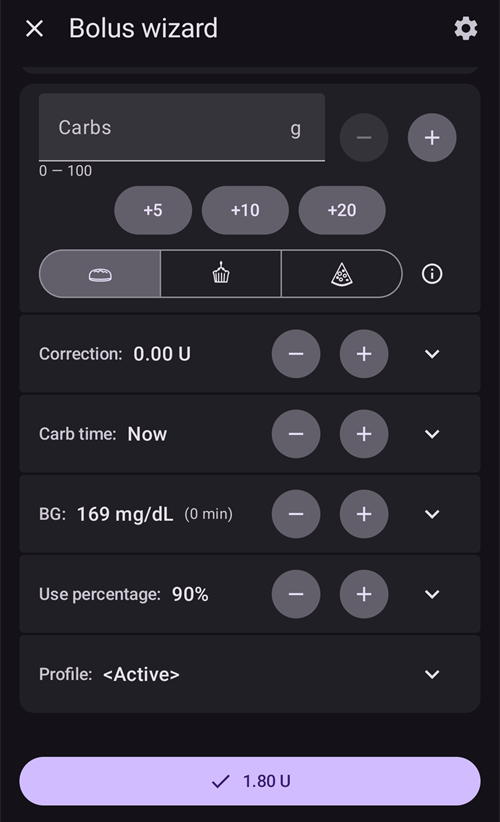

Toqueu qualsevol punt de la fila **Perfil** per obrir la llista dels vostres perfils, i després toqueu un nom per fer servir aquest perfil per a aquest càlcul.

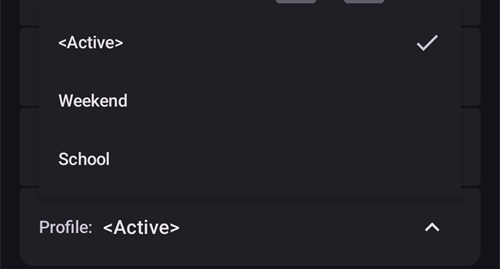

El camp **Hora dels carbohidrats** serveix per al prebolus: així podeu dir al sistema que els carbohidrats arribaran amb un retard. Podeu posar un nombre negatiu en aquest camp si feu un bolus per carbohidrats passats.

**Establir alarma** (recordatori per menjar): quan s'introdueix una hora dels carbohidrats en el futur, apareix un interruptor «**Establir alarma**» perquè us recordi a l'hora indicada que mengeu els carbohidrats que heu introduït a **AAPS**:


El recordatori comença quan s'ha lliurat el bolus. Mentre funciona, una barra **Hora de menjar** a la pantalla principal fa el compte enrere, amb **Aturar** i **+5 min**. **+5 min** mou el final de l'espera cinc minuts més tard, i la barra mostra l'espera total. Quan arriba l'hora, el recordatori sona amb el seu propi so, un temporitzador de cuina suau. A més de **Silenciar alarma** (la pantalla es queda oberta) i **Silenciar i tancar**, la pantalla de l'alarma ofereix **+5 min**, que comença una nova espera de cinc minuts. Un cop ha sonat, la barra diu *S'ha acabat el temps* amb **+5 min** i **Ignorar**; **Silenciar i tancar** també treu la barra. La barra i l'alarma també es mostren a **AAPSClient** i al [rellotge](#WearOsSmartwatch-wizard-carb-time). El recordatori no crea cap temporitzador a l'aplicació de rellotge del telèfon. Si Android no deixa que **AAPS** posi alarmes, la calculadora us demana que permeteu *Alarmes i recordatoris* per a **AAPS** a la configuració d'Android. La campana no s'ofereix per a una hora dels carbohidrats en el passat.

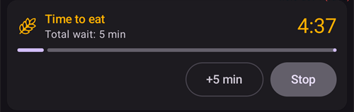

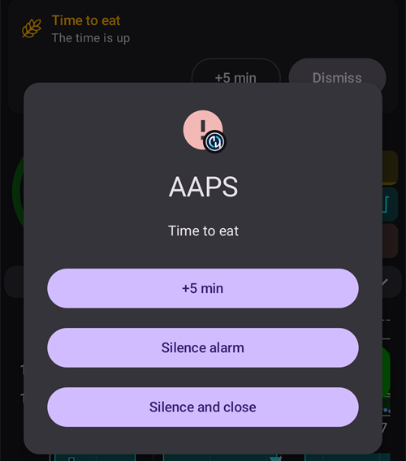

El camp **Glucèmia** normalment ja té l'última lectura del CGM. Si no teniu un CGM que funcioni, estarà en blanc. Quan la lectura és recent, la fila **Glucèmia** es queda plegada. El camp segueix les lectures noves mentre la calculadora està oberta, fins que el canvieu vosaltres.

El botó de resultat de la part de baix mostra el bolus proposat; si el premeu, demana confirmació abans de lliurar cap insulina. Mentre la confirmació està esperant, el llaç no dona SMB, així el bolus que confirmeu continua sent correcte. Si s'està lliurant un SMB en aquell moment, **OK** espera fins que acabi.

Bo de saber:

* Si el bolus calculat és més alt que el vostre **[Bolus màxim](#Preferences-maximum-bolus)**, es redueix al bolus màxim, i la confirmació mostra l'avís «Restricció de bolus aplicada». En canvi, un [Assistent ràpid](../DailyLifeWithAaps/QuickWizards.md) es rebutja.
* Quan el bolus només es registra (per exemple, mentre la bomba està desconnectada), l'avís «**El bolus només es registrarà (la bomba no el lliurarà)**» es queda a la part de dalt del diàleg, també quan us desplaceu.
* Un bolus que doneu a mà té prioritat sobre un [SMB](#Open-APS-features-super-micro-bolus-smb) que està esperant per lliurar-se: l'SMB es descarta i el llaç torna a calcular. Si s'està lliurant un SMB en aquest moment, el vostre bolus es rebutja amb el missatge «S'està lliurant un SMB en aquest moment. Torneu-ho a provar quan hagi acabat.» No es dona insulina, i els carbohidrats introduïts amb aquest bolus no es desen: espereu un moment i torneu-los a introduir.

(AapsScreens-wrong-cob-detection)=

#### Detecció errònia del COB


Si veieu l'avís de dalt després de fer servir la calculadora de bolus, **AAPS** ha detectat que el valor de COB calculat pot ser erroni. Per tant, si voleu tornar a fer un bolus després d'un àpat anterior amb COB, tingueu cura de no fer una sobredosi!

Per a més detalls, vegeu els consells a la [pàgina Càlcul del COB](#CobCalculation-detection-of-wrong-cob-values).

Busqueu la pestanya **Accions** d'**AAPS** 3.x? Les seves funcions s'han mogut a la pantalla principal, al full **Gestionar** i a la barra d'accés ràpid: vegeu [On és la pestanya Accions?](#screens-action-tab).

(aaps-screens-careportal)=

## Entrades del portal de cures

Les edats i els nivells que es mostren a la [fila d'estat](#screens-sensor-level-battery) (sensor, insulina, cànula, pila de la bomba) es basen en entrades del portal de cures: **Encebar** (registra els canvis del punt d'infusió i del cartutx d'insulina), **Inserció del sensor** i **Canvi de pila de la bomba**.

Les podeu registrar des del panell d'estat desplegat de la pantalla principal, des del full **Gestionar** o amb botons d'[accés ràpid](../DailyLifeWithAaps/QuickLaunch.md).

**Encebar** registra un canvi del punt d'infusió i/o un canvi del cartutx d'insulina, i pot lliurar una quantitat d'encebament:

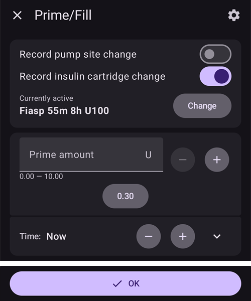

**Inserció del sensor** i **Canvi de pila de la bomba** només demanen l'hora de l'esdeveniment:

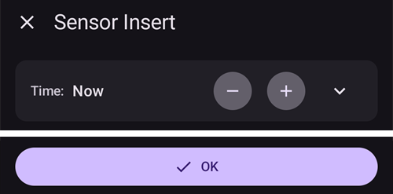

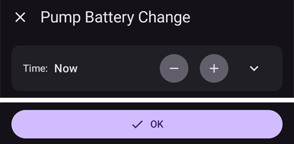 Les entrades d'esport, avís, pregunta i nota reflecteixen el portal de cures de Nightscout i són formes especials de notes.

Al full **Gestionar**, desplaceu-vos cap avall i premeu **Portal de cures** per mostrar aquestes entrades: **Control glucèmia**, **Nota**, **Esport**, **Pregunta** i **Avís**.

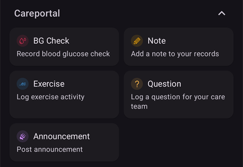

**Control glucèmia**, **Pregunta** i **Avís** us permeten introduir un valor de glucèmia (d'un glucòmetre, del sensor o d'una altra font), una nota i l'hora de l'esdeveniment. A **Pregunta** i **Avís**, la fila de glucèmia està plegada i mostra el tipus de mesura al costat del valor: si canvieu el valor, el tipus canvia de **Sensor** a **Glucòmetre**.

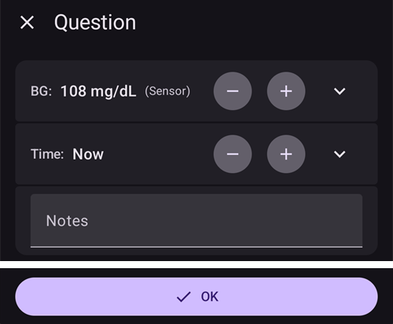

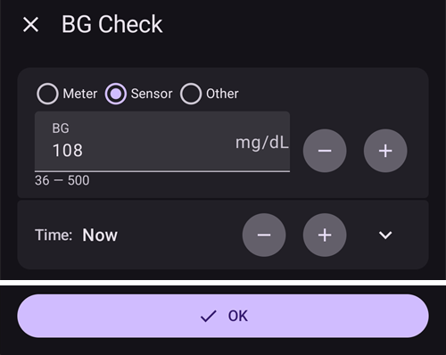

**Nota** i **Esport** us permeten introduir una durada (una fila plegada: feu servir **-** / **+**, o toqueu la fletxa per escriure-la), una nota i l'hora de l'esdeveniment:

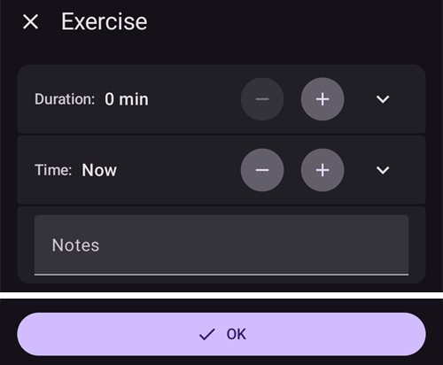

En tots aquests diàlegs (**Encebar**, **Inserció del sensor**, **Canvi de pila de la bomba** i les entrades del portal de cures), l'hora de l'esdeveniment fa servir la mateixa fila **Hora** que el [diàleg d'insulina](#aaps-screens-buttons-insulin) i la calculadora de bolus: feu servir **-** / **+** per moure l'hora a passos de 5 minuts (fins a una setmana enrere i 12 hores endavant), o toqueu la fletxa per triar qualsevol data i hora.

## Rotació de punts d'inserció

**Gestionar → Rotació de punts d'inserció** registra on s'ha posat cada cànula i cada sensor en un mapa del cos, perquè pugueu anar canviant els punts: vegeu [Rotació de punts d'inserció](#Aapsscreens-site-rotation) a la pàgina Bombes i cànules.

La **TDD** (dosi diària total) i la regla pràctica de la proporció basal/bolus s'expliquen amb la [pestanya Insulina de les estadístiques](#reviewing-tdd).

(AapsScreens-insulin-profile)=

## Insulina


**Gestionar → Configuració d'insulina** mostra i gestiona les vostres configuracions d'insulina. Cada configuració es mostra en una targeta amb el seu **temps del pic** i la seva **[DIA](#Config-Builder-insulin-dia)**; la que s'està fent servir està marcada com a **ACTIU**. Sota la targeta veieu la corba d'activitat. Podeu editar el nom, el pic i la DIA de qualsevol configuració excepte l'activa: per canviar la insulina que feu servir, [afegiu una configuració nova i activeu-la](#Config-Builder-insulin-change-active).

Vegeu [Durada de l'acció de la insulina](#Config-Builder-insulin-dia) per saber més sobre què és i com configurar-la.

## Estat bomba

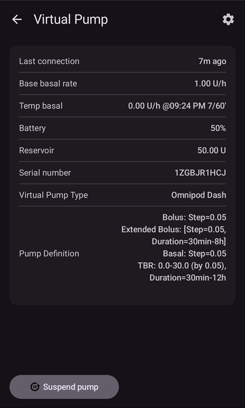

**Gestionar → Bomba** (o **Configurador → Bomba → Obrir plugin**) mostra l'estat de la bomba: última connexió, taxa basal base, bateria, reservori...

* La informació que es mostra depèn del model de la vostra bomba.
* Vegeu la [pàgina de bombes](../Getting-Started/CompatiblePumps.md) per a més detalls.

## Llaç, AMA / SMB

**Configurador → Llaços → Obrir plugin** (i **Configurador → APS → Obrir plugin**) mostren detalls dels càlculs de l'algoritme i per què **AAPS** actua com actua: última execució, la petició resultant i les restriccions. La pantalla **Llaç** només mostra les restriccions que realment han limitat la basal temporal o l'SMB lliurats (i per què no es permet el llaç tancat, si és el cas); la pantalla **APS** mostra totes les restriccions que han entrat al càlcul.

Els càlculs es fan cada vegada que el sistema rep una lectura nova del CGM.

Per a més detalls, vegeu la [secció APS de la pàgina Configurador](#Config-Builder-aps).

(aaps-screens-profile)=

## Perfil

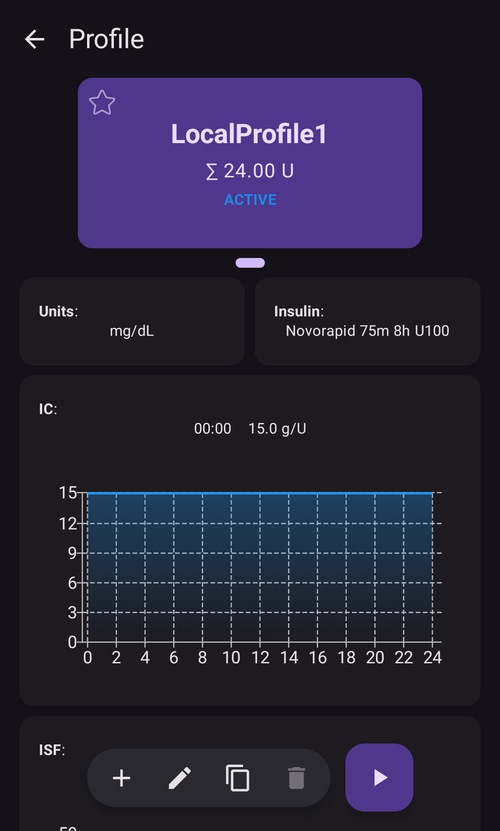

**Gestionar → Perfil** (o un toc al nom del perfil a la pantalla principal) obre la pantalla Perfil: els vostres perfils com un carrusel de targetes que podeu fer lliscar, amb botons per afegir, editar, duplicar, eliminar i **activar** un perfil.

El perfil conté la informació sobre la configuració personal de la vostra diabetis. Per a més informació, vegeu la pàgina detallada **[El vostre perfil d'AAPS](../SettingUpAaps/YourAapsProfile.md)**.

## Automatització

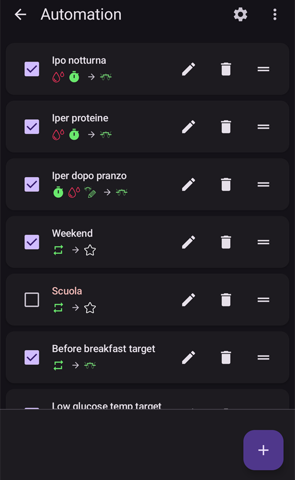

**Gestionar → Automatització** mostra les vostres tasques d'automatització. Vegeu la pàgina dedicada [aquí](../DailyLifeWithAaps/Automations.md).

## NSClient

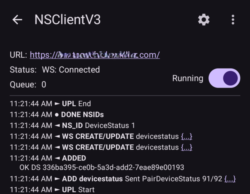

**Configurador → Comunicació → NSClientV3 → Obrir plugin** mostra l'estat de la connexió amb el vostre lloc Nightscout: URL, estat del websocket, cua i un registre de l'activitat de sincronització.

La configuració es pot canviar a la [configuració de NSClient](#Preferences-nsclient).

Per resoldre problemes, vegeu aquesta [pàgina](../GettingHelp/TroubleshootingNsClient.md).

(aaps-screens-bg-source)=

## Origen glucèmia - xDrip, BYODA...


**Configurador → Origen glucèmia → Obrir plugin** mostra l'historial de lectures del CGM i ofereix l'opció d'eliminar lectures en cas d'error (p. ex. una falsa baixada per compressió) o de lectures duplicades.

## Historial de tractaments

Obriu el **menú** (☰) i seleccioneu **Historial de tractaments** per veure, comprovar i corregir tot el que **AAPS** ha registrat: carbohidrats i bolus, basals temporals, objectius temporals, canvis de perfil, entrades del portal de cures, canvis del mode del llaç i entrades d'usuari. Vegeu [Historial de tractaments](#aaps-screens-treatments) a la pàgina Revisar les vostres dades.

## Historial


Obriu el **menú** (☰) i seleccioneu **Historial**.

Us permet tornar enrere a l'historial d'**AAPS**. Vegeu la pàgina dedicada [Revisar les vostres dades > Historial](../Maintenance/Reviewing.md).

(aaps-screens-statistics)=

## Estadístiques


Obriu el **menú** (☰) i seleccioneu **Estadístiques**.

Us dona estadístiques sobre la dosi diària total, el temps en rang, el vostre perfil de glucèmia al llarg del dia (AGP) i el vostre patró de cicle d'insulina, en quatre pestanyes. Vegeu la pàgina dedicada [Revisar les vostres dades > Estadístiques](#reviewing-statistics).

(aaps-screens-profile-helper)=

## Assistent de perfil

Obriu el **menú** (☰) i seleccioneu **Assistent de perfil**.


L'assistent de perfil us permet comparar perfils i generar perfils inicials per a nens. Vegeu [El vostre perfil d'AAPS](../SettingUpAaps/YourAapsProfile.md), seccions [Crear un perfil des de zero per a un nen](#your-aaps-profile-profile-from-scratch-for-a-kid) i [Comparar dos perfils](#your-aaps-profile-compare-profiles).

(aaps-screens-widgets)=

## Widgets de la pantalla d'inici

**AAPS** ofereix cinc widgets que podeu afegir a la pantalla d'inici del telèfon, per veure les vostres dades sense obrir l'aplicació. Vegeu la pàgina dedicada [Widgets de la pantalla d'inici](../DailyLifeWithAaps/Widgets.md).

