# Automatització

```{contents} In this page
:backlinks: entry
:depth: 2
```

## Què és una automatització?

L'«**Automatització**» és una funció que pot automatitzar tasques a AAPS.

L'automatització fa accions concretes a partir d'una o més condicions o activadors. Els activadors poden ser esdeveniments irregulars, com nivells de glucèmia baixos o alts, o una quantitat definida d'insulina a bord (IOB) negativa. Les automatitzacions també poden gestionar esdeveniments recurrents, com àpats o esport a certes hores del dia, o quan l'usuari és a una distància concreta d'una ubicació GPS o dins de la zona d'un SSID de Wi-Fi. L'automatització pot fer còpies de seguretat de la configuració d'AAPS segons un horari o a cada canvi de pod.

Les tasques d'automatització es creen i es modifiquen a la pantalla **Automatització** (**Gestionar → Automatització**). Cada tasca es defineix amb dues propietats:

- Una o més condicions o «activadors» que inicien una acció.

    Penseu en un horari concret, un esdeveniment o el valor d'una propietat a AAPS

- Una o més accions que cal fer.

    Such as an alarm or setting a profile percentage or exporting the AAPS settings on Pod change.


Hi ha moltes opcions d'automatització; us recomanem estudiar-les a l'aplicació AAPS, a la secció Automatització. També podeu cercar exemples d'automatització d'altres usuaris als grups d'usuaris d'AAPS a [**Facebook**](https://www.facebook.com/groups/AndroidAPSUsers) i a [**Discord**](https://discord.gg/4fQUWHZ4Mw).

## Com us pot ajudar l'automatització

1. **Automatitzar tasques recurrents:** fer automàticament accions programades sense que l'usuari hagi d'intervenir.

1. **Menys fatiga per decisions:** el principal benefici de les **automatitzacions** és alliberar l'usuari de la càrrega d'haver de fer intervencions manuals a **AAPS**. Una [recerca](https://www.ncbi.nlm.nih.gov/pmc/articles/PMC6286423/#ref4) calcula que les persones amb diabetis tipus 1 han de prendre de mitjana 180 decisions més cada dia. Les **automatitzacions** poden reduir la càrrega mental i deixar més energia mental a l'usuari per a altres aspectes de la vida.

1. **Possible millora del control glucèmic:** per exemple, les **automatitzacions** poden ajudar a assegurar que els **objectius temporals** sempre es posen quan cal, fins i tot en dies molt ocupats o en moments d'oblit. Per exemple, si un nen amb diabetis té esport a l'escola els dimarts a les 10:00 i els dijous a les 14:00 i necessita un objectiu temporal alt («OT») 30 minuts abans de l'activitat esportiva, l'**objectiu temporal** es pot activar amb una **Automatització**.

1. **Permetre personalitzar molt AAPS** perquè sigui més o menys agressiu en situacions concretes, segons la preferència de l'usuari. Per exemple, activar durant un temps definit un % reduït temporal del **perfil** si apareix **IOB** negatiu a mitja nit, cosa que indica que el **perfil** actual pot ser massa fort.

L'exemple següent mostra com una **Automatització** pot estalviar passos.

L'usuari fa esport cada matí a les 6:00: ha de recordar posar manualment un «Objectiu temporal Activitat (esport)» a AAPS a les 5:00, abans de fer esport.

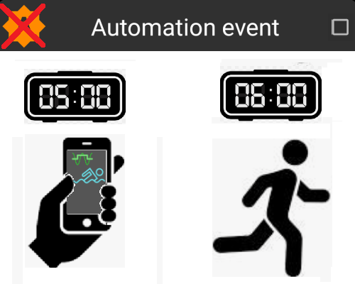

L'usuari ha configurat una **Automatització** que activa a les 5:00 un «Objectiu temporal Activitat (esport)» perquè la seva **glucèmia** i el seu **IOB** siguin òptims per a l'esport de les 6:00:

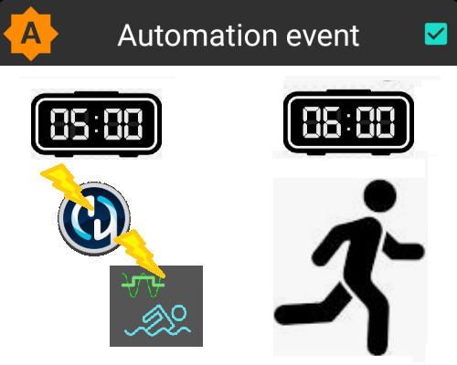

## Aspectes clau abans de començar amb les automatitzacions

1. Abans de configurar certes automatitzacions, hauríeu de tenir un control raonable de la **glucèmia** amb **AAPS**. Les automatitzacions no s'han de fer servir per compensar una configuració poc ajustada de la basal, de l'**ISF** o de la **CR** (vegeu més avall). Eviteu posar un **canvi de perfil** automàtic per compensar pujades de **glucèmia** causades, _p. ex._, pel menjar; és millor tractar-les amb altres estratègies (SMB, etc.).

1. Com qualsevol tecnologia, els **CGM**, les **bombes** i els telèfons poden fallar: problemes tècnics o errors del sensor poden interrompre les accions de l'**Automatització**, i pot caldre una intervenció manual.

1. **Requirements for Automations are likely to change as routines change**. Quan canvieu entre períodes de feina, d'escola o de vacances, poseu un recordatori al calendari per revisar quines **automatitzacions** estan actives (és fàcil activar-les i desactivar-les). Per exemple, si aneu de vacances i ja no necessiteu una automatització per a l'esport de l'escola o l'exercici diari, o si heu d'ajustar els horaris.

1. Les **automatitzacions** poden entrar en conflicte entre elles. És bo revisar amb cura la configuració de qualsevol **automatització** nova en un entorn segur, i entendre per què una **Automatització** s'ha activat o no com esperàveu.

1. Si feu servir Autosens, intenteu fer servir **objectius temporals** en lloc de **canvis de perfil**. Els **objectius temporals** no restableixen Autosens a 0. Els **canvis de perfil** restableixen Autosens.

1. La majoria de les **automatitzacions** només s'haurien de definir per a una **durada limitada**; després **AAPS** pot tornar a avaluar i repetir l'**Automatització**, si cal i si la condició encara es compleix. Per exemple, «iniciar un objectiu temporal de 7,0 mmol/l durant 30 min» o «iniciar el **perfil** al 110% durant 10 min» _i_ «iniciar un objectiu temporal de 5,0 mmol/l durant 10 min». Fer servir **automatitzacions** per crear canvis permanents (p. ex. un % del perfil més fort) comporta risc d'hipoglucèmia.

## Quan puc començar a fer servir l'automatització?

Les **automatitzacions** es poden començar a fer servir a l'**objectiu 10**.

## On és l'automatització a AAPS?

Obriu **Gestionar** a la barra de navegació inferior de la pantalla principal i seleccioneu **Automatització**.

## Com puc configurar una automatització?

Per configurar una **Automatització**, premeu el botó **+** a la pantalla Automatització per crear una «tasca»:

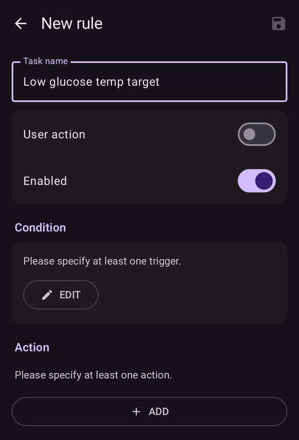

* doneu un títol a la «tasca» (Nom de la tasca);
* premeu «**EDITAR**» sota **Condició**. A la pantalla **Condició**, trieu com es combinen els activadors (**I**, **O**, **Exclusiu o**) i premeu «**Afegir activador**»:

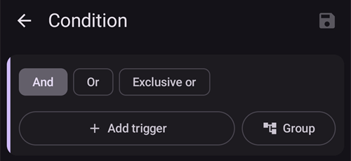

* afegiu com a mínim un activador:

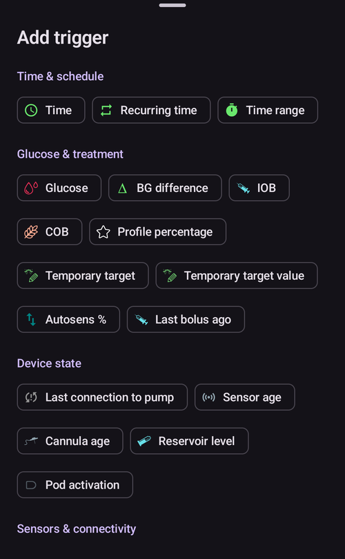

* premeu «**AFEGIR**» sota **Acció** i seleccioneu una acció:

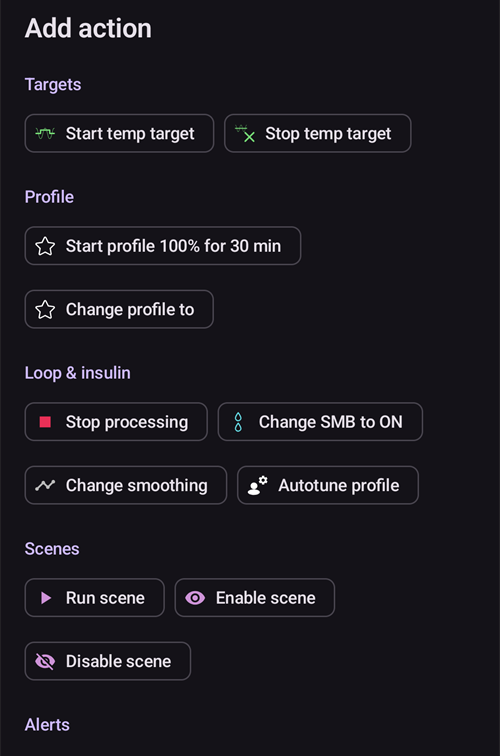

* deseu la tasca amb el botó **Desar** i assegureu-vos que la casella a l'esquerra del nom de la tasca està «marcada» per activar l'**Automatització**:


Per desactivar una tasca d'**Automatització**, desmarqueu la casella a l'esquerra del nom de l'**Automatització**. L'exemple següent mostra una **Automatització** activada («marcada») o desactivada («desmarcada»):

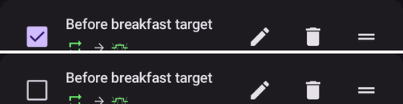


Quan configureu una **Automatització**, primer la podeu provar activant l'opció «avís» a «Accions». Així **AAPS** primer mostra un avís en lloc de fer realment una acció automàtica. Quan estigueu segurs que l'avís s'ha activat a l'hora i en les condicions correctes, podeu actualitzar la tasca d'**Automatització** per substituir l'«Avís» per una «Acció».

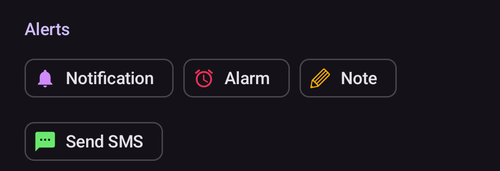

```{admonition} Important note
:class: note

Les **automatitzacions** continuen actives quan el llaç està desactivat!
```


## Quan es comproven les tasques

**AAPS** comprova totes les tasques d'**Automatització** cada vegada que s'ha processat una nova lectura de glucèmia, de manera que les tasques s'avaluen al ritme del vostre CGM, també amb la pantalla del telèfon apagada. Les tasques també es comproven quan el telèfon comença a carregar, quan canvia la xarxa o la ubicació, i quan es connecta un dispositiu Bluetooth. Només es fa una comprovació alhora, de manera que una tasca amb accions que triguen una estona (per exemple, una ordre a la bomba) no es pot executar dues vegades.

## Límits de seguretat

Hi ha límits de seguretat per a les **automatitzacions**:

* Un **objectiu temporal** posat per una **Automatització** ha d'estar entre 72 i 180 mg/dl (o entre 4 i 10 mmol/l).
* El **Percentatge de perfil** ha d'estar entre el 50% i el 130%.
* There is a 5 minute time limit between executions of **Automation** (and first execution).

## Ús correcte dels valors negatius

```{admonition} Warning
:class: warning

Aneu amb compte quan trieu un valor negatiu a l'**Automatització**
```

Aneu amb compte quan trieu un «valor negatiu» dins d'una «Condició» com «és més petit que» a les **automatitzacions**. Per exemple:

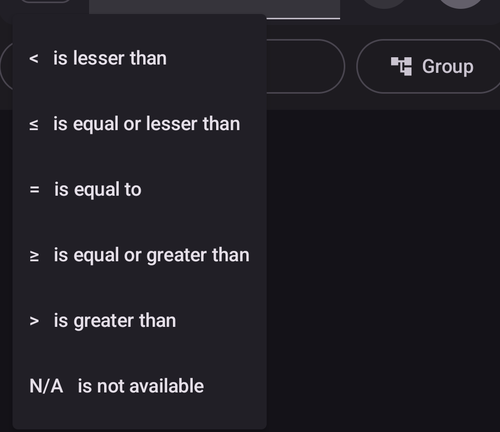

**Exemple 1:** Crear una condició **«és més petit que»** «-0,1 mmol/l» (o «-2 mg/dl») farà:

Activar una **Automatització** per a qualsevol número que sigui **estrictament més petit que** -0,1 (-2). Això inclou números com -0,2, -0,3, -0,4 (-4, -6, -8), etc. Recordeu que el mateix -0,1 (-2) **no** s'inclou en aquesta condició. (La condició «és igual o més petit que -0,1 mmol/l (-2 mg/dl)» _sí que_ inclouria -0,1 mmol/l o -2 mg/dl).

**Exemple 2:** Crear una condició «és més gran que» -0,1 mmol/l (-2 mg/dl) farà:

Activar una **Automatització** per a qualsevol número que sigui **més gran que** -0,1 mmol/l (-2 mg/dl). Això inclou números com 0, 0,2, 0,4 mmol/l (0, 4, 8 mg/dl) i qualsevol altre número positiu.

És important pensar bé quina és la intenció exacta de la vostra **Automatització** quan trieu aquestes condicions i valors.

(automations-automation-triggers)=
## Activadors de l'automatització


Desplaceu-vos cap avall per veure la resta de la llista:

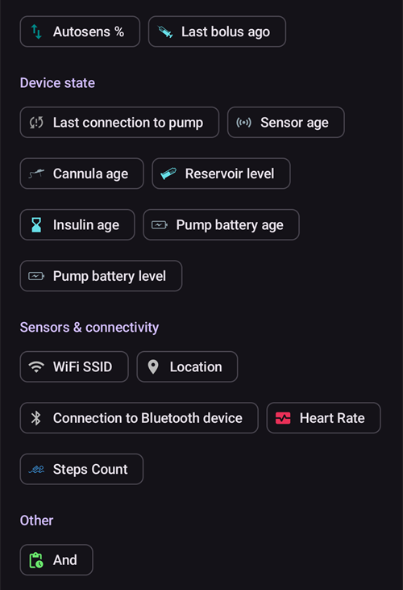

L'usuari pot triar diversos «activadors». Els activadors són les condicions que s'han de complir perquè l'automatització s'executi. La llista següent no és completa:

**Activador:** enllaçar condicions

**Opcions:**

Es poden enllaçar diverses condicions amb
* «I»
* «O»
* «Exclusiu o» (vol dir que si es compleix una de les condicions, i només una, es farà l'acció o les accions)

**Activador:** hora o temps recurrent

**Opcions:**

* hora = un esdeveniment que passa una sola vegada
* temps recurrent = una cosa que passa regularment (p. ex. un cop per setmana, cada dia feiner, etc.)

**Activador:** ubicació

**Opcions:**

* a [Configuració > Automatització](#preferences-maintenance-settings), l'usuari pot triar el servei d'ubicació que necessita.

**Activador:** servei d'ubicació

**Opcions:**

* Utilitzar ubicació passiva: **AAPS** només agafa la ubicació quan altres aplicacions la demanen.
* Utilitzar ubicació de la xarxa: la ubicació de la vostra Wi-Fi.
* Utilitzar ubicació GPS (Atenció! Això pot gastar molta bateria!)

**Activadors**: dades de la bomba i del sensor

* Activador d'edat de la cànula: disponible per a totes les bombes
* Activador d'edat de la insulina: disponible per a les bombes compatibles
* Activador d'edat de la pila: disponible per a les bombes compatibles
* Activador d'edat del sensor: sempre disponible
* Activador d'activació del pod: disponible per a les bombes patch

Tingueu en compte que, en tots els activadors d'edat, és poc probable que la comparació «igual» s'activi; en aquest cas calen dos activadors per crear un rang

* Activador de nivell del reservori: disponible per a totes les bombes; la comparació "NOT\_AVAILABLE" no funciona per a aquest activador perquè el valor sempre està omplert a **AAPS**
* Activador de nivell de la pila de la bomba: disponible per a les bombes compatibles; la comparació "NOT\_AVAILABLE" no funciona per a aquest activador perquè el valor sempre està omplert a **AAPS**

(automations-automation-action)=
## Acció


Desplaceu-vos cap avall per veure la resta de la llista:

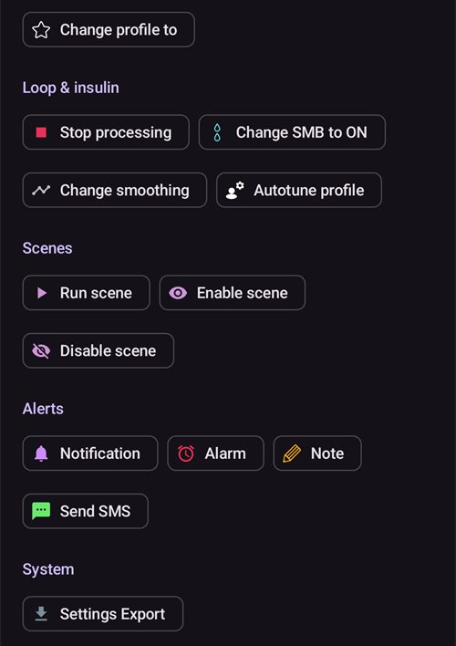

**Accions:** iniciar un **objectiu temporal**

**Opcions:**

* La **glucèmia** ha d'estar entre 72 mg/dl i 180 mg/dl (4 mmol/l i 10 mmol/l)
* L'**OT** només funciona si no hi ha cap objectiu temporal anterior: **AAPS** ho afegeix automàticament a la tasca com una línia «**Precondicions: Objectiu temporal no existeix**»

**Accions:** aturar l'**objectiu temporal**

**Opcions:**

cap

**Accions:** **Percentatge de perfil**

**Opcions:**

* El **perfil** ha d'estar entre el 50% i el 130%
* només funciona si el percentatge anterior és 100%

**Actions:** **Change smoothing** (in the **Loop & insulin** group)

**Opcions:**

* select the [smoothing method](../CompatibleCgms/SmoothingBloodGlucoseData.md) to switch to. The list is the same as under **Configuration** > **Smoothing**, and the action does exactly what a change there does: the new method is saved, synced to paired clients, and the BG data is smoothed again right away.
* només s'executa si aquest mètode de suavitzat encara no està actiu: **AAPS** ho afegeix automàticament a la tasca com una línia «**Precondicions: El suavitzat … no està actiu**». Quan el suavitzat seleccionat ja està actiu, la tasca se salta sense avís.
* Example: a new sensor is often noisy during its first day. Two rules with the **Sensor age** trigger give stronger filtering while the sensor settles, and lag-free smoothing after that:
  * **Sensor age** less than 24 h: **Change smoothing** to **Unscented Kalman Filter**
  * **Sensor age** more than 24 h: **Change smoothing** to **Average smoothing**

**Accions:** **Nota** (al grup **Alertes** de la llista)

**Opcions:**

* seleccioneu l'esdeveniment que voleu registrar: **Nota**, **Esport**, **Pregunta**, **Avís** o **Canvi de cànula**, i una nota opcional. El nom de l'acció canvia segons l'esdeveniment que seleccioneu.
* **Durada**: es fa servir per a **Nota**, **Esport** i **Canvi de cànula**. **Pregunta** i **Avís** no tenen durada: en lloc d'això registren la vostra glucèmia actual.
* **Canvi de cànula** restableix l'edat de la cànula, com si haguéssiu registrat un canvi de cànula a mà. Exemple: algunes bombes (com la Combo) registren soles un canvi de reservori, però no el canvi de cànula. Si sempre canvieu les dues coses alhora, una tasca amb **Edat de la insulina** menor d'1 hora i **Edat de la cànula** major de 24 hores pot registrar el canvi de cànula per vosaltres.

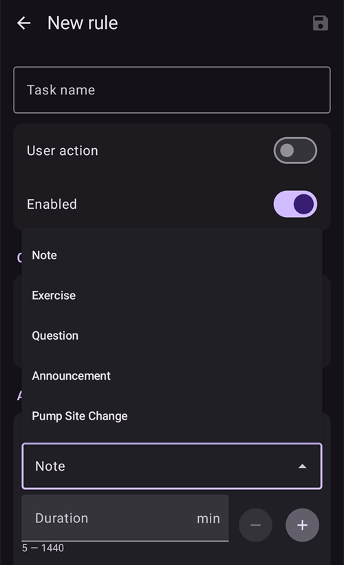 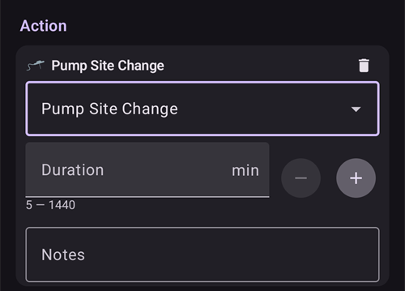

**Actions:** **Send SMS to all numbers** (in the **Alerts** group)

**Opcions:**

* escriviu el text del missatge. S'envia a tots els números de telèfon permesos a la configuració del [Comunicador SMS](../RemoteFeatures/SMSCommands.md). El plugin Comunicador SMS ha d'estar activat.

**Accions:** **Canviar perfil a** (al grup **Perfil**)

**Opcions:**

* seleccioneu el **perfil** que voleu activar. S'activa al 100%, sense desplaçament horari. Si aquest perfil ja està actiu, l'acció no fa res.

**Accions:** **Activar/desactivar SMB** (al grup **Llaç i insulina**)

**Opcions:**

* trieu **On** o **Off**. Això canvia l'opció **Activar SMB** d'OpenAPS SMB, exactament com si l'haguéssiu canviat a **Configuració**, i es manté fins que vosaltres o una altra tasca la torneu a canviar.

**Actions:** **Run Autotune** (in the **Loop & insulin** group)

**Opcions:**

* seleccioneu el perfil que voleu ajustar i el nombre de dies: vegeu [Executar Autotune amb una tasca d'automatització](#autotune-run-autotune-with-an-automation-rule).

**Accions:** **Aturar el processament** (al grup **Llaç i insulina**)

**Opcions:**

* cap. While the conditions of a rule with this action are true, **AAPS** does not check the rules below it in the list. As soon as its conditions are false again, the rules below are checked as usual. Afegiu-la a una tasca que ha de tenir prioritat sobre les tasques que té a sota (vegeu [l'ordre de les automatitzacions](#Automations-the-order-of-the-automations-in-the-list-matters)).

**Accions:** **Executar escena**, **Activar escena**, **Desactivar escena** (al grup **Escenes**)

**Opcions:**

* seleccioneu l'[escena](Scenes.md) que voleu executar, activar o desactivar.

Un cop afegida l'«Acció», cal canviar els valors per defecte pel número que voleu: feu clic als valors per defecte i ajusteu-los.

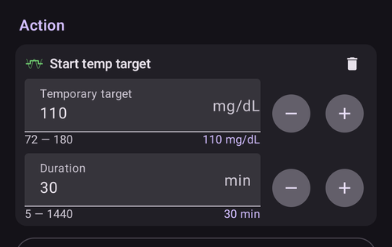

(Automations-the-order-of-the-automations-in-the-list-matters)=
## L'ordre de les **automatitzacions** a la llista és important
 **AAPS** executarà les tasques creades per ordre de preferència, començant per la part de dalt de la llista d'**Automatització**. For example, if the ‘Low’ **Automation** is the most important **Automation**, above all other rules, then this **Automation** should appear at the top of the user’s **Automation** list as demonstrated below:


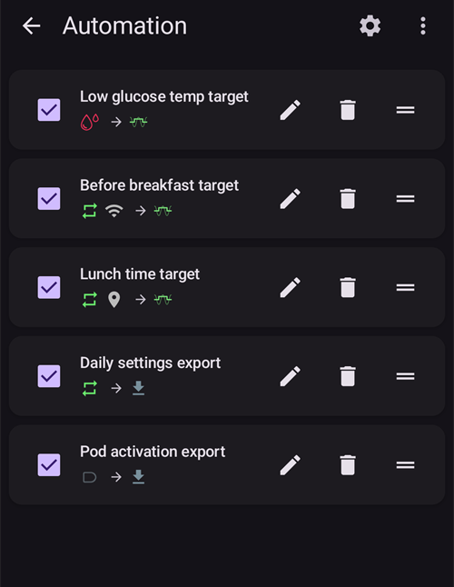

Per canviar la prioritat de les tasques d'**Automatització**, manteniu premuda la nansa **=** a la dreta de la tasca. Reorder the **Automations** by moving the rules up or down.

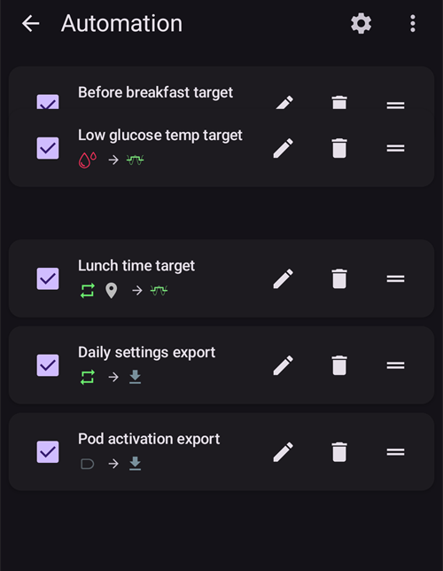

## Com eliminar tasques d'automatització

Per eliminar una tasca d'**Automatització**, feu clic a la icona de la paperera.


## Exemples d'automatitzacions

A continuació hi ha exemples d'**automatitzacions**. Further discussion on **Automations** and how users have individualised their **Automation** can be found in Facebook discussions groups or on Discord. No copieu els exemples següents si no enteneu bé com funcionarà l'**Automatització**.

(automations-low-glucose-temp-target)=
### Objectiu temporal per glucèmia baixa

Aquesta **Automatització** activa un **objectiu temporal** automàtic quan la **glucèmia** baixa d'un cert llindar: aquí, quan la glucèmia és més petita que 70 mg/dl, s'inicia un objectiu de 110 mg/dl durant 30 minuts:

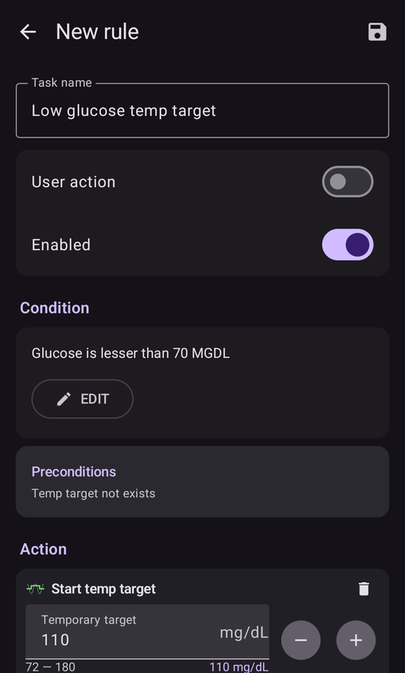

### Objectiu temporal a l'hora de dinar (amb «Ubicació»)

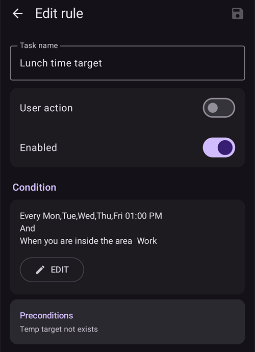

Aquesta **Automatització** s'ha creat per a un usuari que dina a la feina cada dia feiner més o menys a la mateixa hora, però només s'activa si l'usuari és dins d'una «ubicació» definida.  Així, si un dia l'usuari no és a la feina, aquesta **Automatització** no s'activarà.

Aquesta **Automatització** posarà un **objectiu temporal** baix (Menjar aviat) a les 13:00 per portar la glucèmia a 90 mg/dl (o 5 mmol/l) abans de dinar.

L'«activador» d'ubicació té un nom, una posició (toqueu **Triar al mapa** o feu servir la vostra ubicació actual) i un radi en metres, i s'activa quan sou dins (o fora) de la zona:

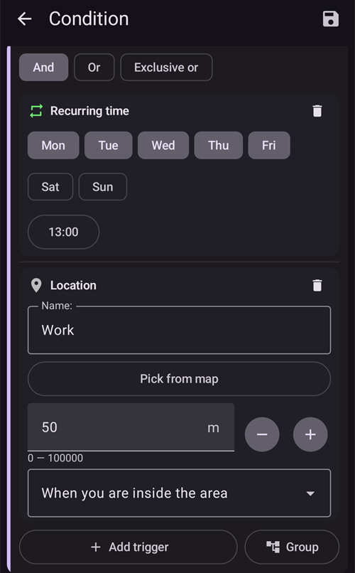

A causa de l'enllaç «I», l'**Automatització** només passa durant l'«hora triada» i si l'usuari és a la ubicació seleccionada.

L'**Automatització** no s'activarà en cap altre moment en aquesta ubicació, ni a aquesta hora fora del radi de 50 metres al voltant de la posició triada.

### Automatització amb ubicació per SSID de Wi-Fi

Fer servir un SSID de Wi-Fi és una bona opció per activar una **Automatització** quan sou dins de l'abast d'una xarxa Wi-Fi concreta (en comparació amb el GPS): és força precís, gasta menys bateria i funciona en espais tancats on el GPS i altres serveis d'ubicació potser no estan disponibles.

Here is another example of setting up a **Temp Target** for work days only before breakfast (1).


The **Automation** will trigger at 05:30am only on Monday-Friday (2)  
and while being connected to a home Wi-Fi network (3).


Llavors posarà un **objectiu temporal** de 75 mg/dl durant 30 minuts (4). Un dels avantatges d'incloure la ubicació és que, per exemple, no s'activarà si l'usuari és de vacances.

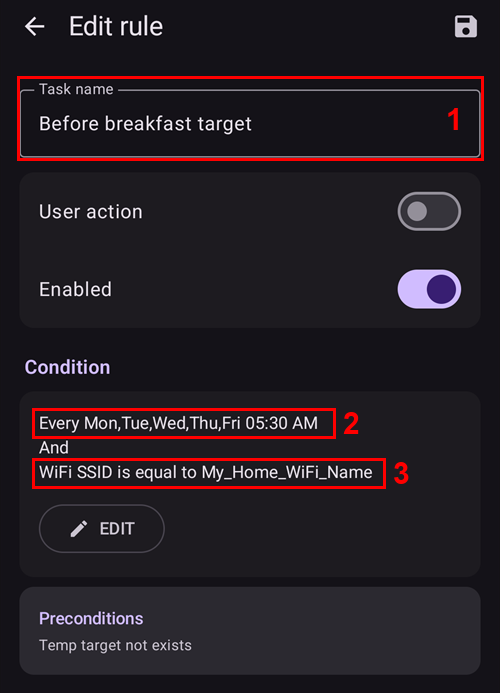

Desplaceu-vos cap avall per veure l'acció: un **objectiu temporal** de 75 mg/dl durant 30 minuts (4).

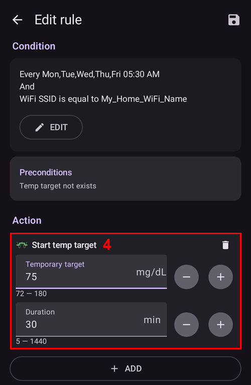

Aquesta és la captura de pantalla amb el detall dels activadors de l'**Automatització**:

1) Sota la condició principal «I» (cal que es compleixin les dues condicions per activar-la) 1) Temps recurrent = Dl,Dt,Dc,Dj,Dv a les 5:30  
1) WiFi SSID = My_Home_WiFi_Name

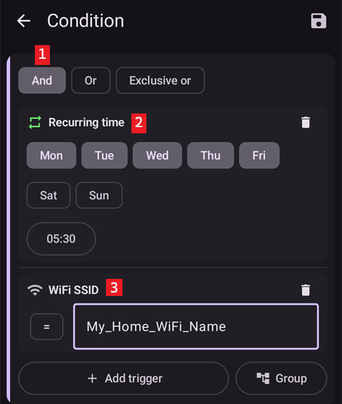

(automating-preference-settings-export)=

## Automatitzar l'exportació de la configuració

### Exportacions automàtiques: programades (cada dia)

Captures de pantalla amb el detall dels activadors de l'automatització:

1) Condició: Temps recurrent = Dl,Dt,Dc,Dj,Dv a les 8:00 1) Acció: Exportació de configuració (a «Text als tractaments» escriviu «Diari»)

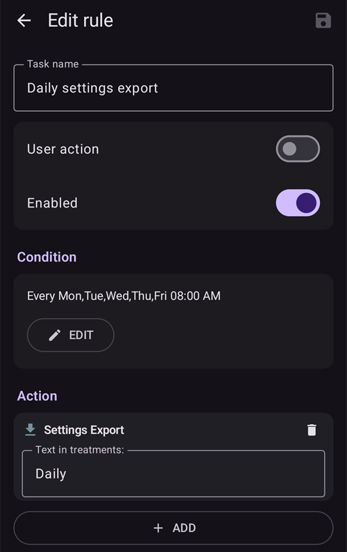

Nota: l'execució de l'exportació es registra al Portal de cures

### Exportacions automàtiques: Activació del pod (només bombes patch)

Captures de pantalla amb el detall dels activadors de l'automatització:

1) Condició: Activació del pod 1) Acció: Exportació de configuració (a «Text als tractaments» escriviu «Activació del pod: exportació de configuració»)

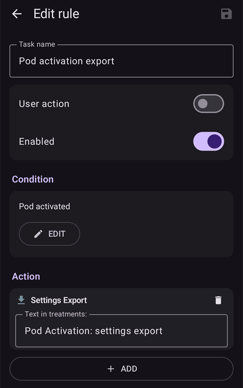

Nota: l'execució de l'exportació es registra al Portal de cures. Nota: l'automatització **no s'activarà mai** si abans no heu fet una exportació manual de la configuració. Vegeu [Configuració → Manteniment](#preferences-maintenance-settings) per activar correctament l'exportació automàtica de la configuració.


## Registre de l'automatització

**AAPS** mostra un registre dels esdeveniments d'**Automatització** més recents a la part de baix de la pantalla **Automatització**, sota les tasques. Feu-lo servir per comprovar que les vostres tasques s'han activat quan esperàveu.

A l'exemple següent, la tasca **Objectiu temporal per glucèmia baixa** (1) (vegeu [Objectiu temporal per glucèmia baixa](#automations-low-glucose-temp-target) més amunt) està activada. El registre (2) mostra que a les 15:09 la glucèmia ha baixat de 70 mg/dl i la tasca s'ha activat:
* l'acció ha estat «Iniciar objectiu temporal: 110mg/dL@30 min»: un **objectiu temporal** de 110 mg/dl durant 30 minuts;
* **OK** al final vol dir que l'acció s'ha fet correctament.

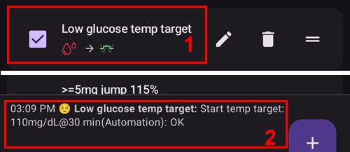

(automations-troubleshooting)=

## Resolució de problemes

* Problema: __AAPS no activa les meves automatitzacions?__

Comproveu que la casella a l'esquerra del nom de l'**Automatització** està «marcada» per assegurar que la tasca està activada:


* Problema: __Les meves automatitzacions s'activen en un ordre incorrecte.__

Comproveu l'ordre de prioritat de les vostres tasques, com s'explica més amunt.

* Problema: __Una condició mostra «Activador desconegut … - no es compleix mai».__

La tasca conté un activador que aquesta versió d'**AAPS** no pot llegir, per exemple després de tornar a una versió anterior o d'importar la configuració d'una versió més nova. Un activador així no es compleix mai, de manera que la tasca no s'executa. Es manté sense canvis, perquè una versió més nova el pugui continuar fent servir. Editeu la tasca i substituïu l'activador, o actualitzeu **AAPS**.

## Alternatives a les automatitzacions

Per als usuaris avançats, hi ha altres maneres d'automatitzar tasques amb IFTTT o amb una aplicació Android d'un tercer anomenada Automate. 
