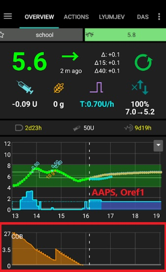
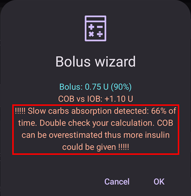

# Càlcul del COB

## Com calcula AAPS el valor del COB?

Quan l'usuari introdueix carbohidrats com a part d'un àpat o d'una correcció de carbohidrats, **AAPS** els suma als carbohidrats a bord actuals (**COB**). Després **AAPS** calcula l'absorció dels carbohidrats de l'usuari a partir de les desviacions observades en els valors de **glucèmia** de l'usuari. The rate of absorption depends on the carb’s sensitivity factor (**CSF**). No és un paràmetre del **perfil** de l'usuari, sinó que **AAPS** el calcula a partir de la configuració de l'**ISF/I:C**, i indica quants mg/dl fa pujar 1 g de carbohidrats la **glucèmia** de l'usuari.

## Factor de sensibilitat als carbohidrats

La fórmula que fa servir **AAPS** és:

- absorbed_carbs = deviation * ic / isf.

L'efecte sobre el **perfil** de l'usuari serà:

- _increase_ **IC** - by increasing the carbs absorbed every 5 minutes thus shorten total time of absorption;

- _augmentar_ l'**ISF**: disminueix els carbohidrats absorbits cada 5 minuts i així allarga el temps total d'absorció; i

- _change_ **Profile Percentage** - increase/decrease both values thus has no impact on carbs absorption time.

For example, if the user’s **Profile** **ISF** is 100 and the **I:C** is 5, the user’s Carb Sensitivity Factor would be 20. Per cada 20 mg/dl que puja la **glucèmia** de l'usuari, **AAPS** calcula 1 g de carbohidrats absorbit. Un **IOB** positiu també afecta el càlcul del **COB**. Per tant, si **AAPS** preveu que la **glucèmia** de l'usuari baixarà 20 mg/dl a causa de l'**IOB** i en canvi es queda estable, **AAPS** també calcularà 1 g de carbohidrats absorbit.

Els carbohidrats també s'absorbeixen segons els mètodes descrits a continuació, depenent de l'algoritme de sensibilitat que l'usuari hagi triat a **AAPS**.

## Sensibilitat als carbohidrats - Oref1

Els carbohidrats no absorbits s'eliminen després d'un temps determinat:




```{admonition} Older screenshot
:class: note
La captura de pantalla de dalt és d'una versió anterior d'**AAPS**: a **AAPS** 4 els gràfics es veuen una mica diferents, però el gràfic del **COB** mostra la mateixa informació.
```


## Sensibilitat als carbohidrats - WeightedAverage (mitjana ponderada)

L'absorció es calcula de manera que el COB sigui 0 després d'un temps determinat:


Si es fa servir l'absorció mínima de carbohidrats (min_5m_carbimpact) en lloc del valor calculat a partir de les desviacions de la **glucèmia**, apareix un punt taronja al gràfic del **COB**.

(CobCalculation-detection-of-wrong-cob-values)=
## Detecció de valors de COB incorrectes

**AAPS** will warn the user if they are about to bolus with **COB** from a previous meal if the algorithm detects current **COB** calculation as incorrect. En aquest cas, l'usuari veurà un avís addicional a la pantalla de confirmació després de fer servir la calculadora de bolus.

### Com detecta AAPS els valors de COB incorrectes?

Normalment __AAPS__ detecta l'absorció de carbohidrats a partir de les desviacions de la **glucèmia**. Si l'usuari ha introduït carbohidrats però **AAPS** no pot detectar-ne l'absorció estimada a partir de les desviacions de la **glucèmia**, farà servir el mètode [min_5m_carbimpact](#Preferences-min_5m_carbimpact) per calcular l'absorció (l'anomenat «fallback», mètode de reserva). Com que aquest mètode només calcula l'absorció mínima de carbohidrats sense tenir en compte les desviacions de la **glucèmia**, pot donar valors de COB incorrectes.



A la captura de pantalla de dalt, el 66% del temps l'absorció de carbohidrats es va calcular amb min_5m_carbimpact en lloc del valor detectat a partir de les desviacions. Això indica que potser l'usuari tenia menys **COB** del que ha calculat l'algoritme.

### Què cal fer amb aquest avís?

- Penseu a cancel·lar el tractament: premeu «Cancel·lar» en lloc d'OK.
- Torneu a calcular el proper àpat amb la calculadora de bolus sense marcar el **COB**.
- Si necessiteu un bolus de correcció, introduïu-lo manualment.
- Be careful not to overdose or stack insulin!


### Per què l'algoritme no detecta bé el COB?

Això pot ser perquè:
- Potser l'usuari va sobreestimar els carbohidrats quan els va introduir.
- Activitat o esport després de l'àpat anterior.
- Cal ajustar la ràtio I:C.
- El valor de min_5m_carbimpact és incorrecte (el recomanat és 8 amb SMB i 3 amb AMA).


## Correcció manual dels carbohidrats introduïts

Si els carbohidrats s'han sobreestimat o subestimat, es pot corregir a la pantalla **Historial de tractaments**, com s'explica [aquí](#screens-bolus-carbs).


## Correcció de carbohidrats: com eliminar una entrada de carbohidrats dels tractaments


La pantalla **Historial de tractaments** permet corregir una entrada de carbohidrats errònia eliminant-la. Això pot ser perquè l'usuari va sobreestimar o subestimar els carbohidrats introduïts:


1. Comproveu i recordeu el **COB** i l'**IOB** actuals a la pantalla principal d'**AAPS**.
2. Obriu **Historial de tractaments** (menú lateral → *Historial de tractaments*), pestanya **Carbohidrats i bolus**. Depending on the pump, the carbs might show together with insulin in one line or as a separate entry (e.g. with Dana RS).
3. **Mantingueu premuda** l'entrada de carbohidrats errònia: la llista passa al **mode de selecció** amb una casella a cada línia, i l'entrada queda marcada (marca **1** de dalt). Marqueu també qualsevol altra entrada que vulgueu eliminar.
4. Premeu la icona **🗑 Eliminar** a la barra superior (marca **2**) i confirmeu: el diàleg de confirmació mostra exactament què s'eliminarà.
5. Comproveu que els carbohidrats s'han eliminat bé mirant de nou el **COB** a la pantalla principal d'**AAPS**.
6. Feu el mateix amb l'**IOB** si hi ha una sola línia amb carbohidrats i insulina.
7. Si no s'eliminen els carbohidrats com cal i s'afegeixen carbohidrats nous com s'explica en aquesta secció, el valor del **COB** serà massa alt i això podria fer que **AAPS** lliuri massa insulina.
8. Introduïu la quantitat correcta de carbohidrats amb el diàleg **Carbs** (**Tractaments** → **Carbs**) i poseu l'hora correcta de l'esdeveniment.
9. Si hi havia una sola línia amb carbohidrats i insulina, l'usuari també ha de tornar a afegir la quantitat d'insulina. Assegureu-vos de posar l'hora correcta de l'esdeveniment i comproveu l'**IOB** a la pantalla principal després de confirmar la nova entrada.

