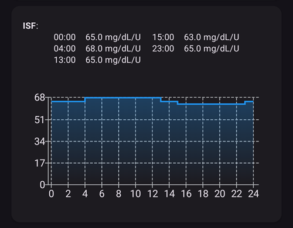
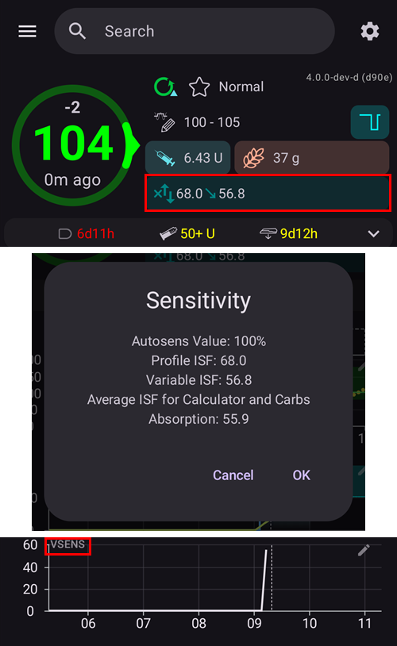
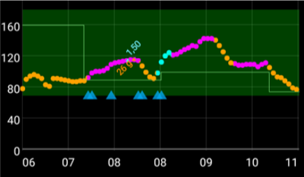
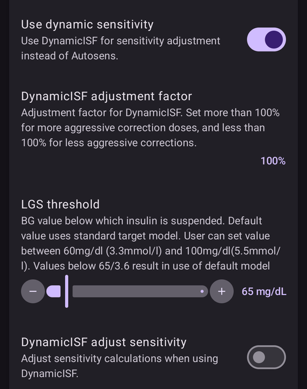

(Open-APS-features-DynamicISF)=
# ISF dinàmic (DynISF)

Fins ara, amb **AMA** i **SMB**, l'**ISF** es definia al **perfil** i era fix per a cada franja definida del dia. Però en realitat l'**ISF** d'una persona no és tan fix i varia segons el nivell de **glucèmia**: amb una glucèmia alta, l'usuari necessita més insulina per baixar la **glucèmia** 50 mg/dl / 3 mmol/l que amb una **glucèmia** més baixa. [Autosens](#Open-APS-features-autosens) va ser el primer algoritme que va intentar resoldre aquest problema, ajustant l'**ISF** fora de les hores dels àpats.

L'**ISF dinàmic** (també anomenat **DynISF**) té el mateix objectiu, però és més avançat, perquè es pot fer servir en tot moment. Només es recomana per a usuaris avançats que controlen bé el funcionament i el seguiment del seu **AAPS**. Abans de provar-lo, llegiu més avall [Què cal tenir en compte en activar l'ISF dinàmic](#dyn-isf-things-to-consider-when-activating-dynamicisf).

```{admonition} CAUTION - Automations or Profile Percentage change
:class: warning

Les **automatitzacions** s'han de fer servir sempre amb compte. Això és especialment important amb l'**ISF dinàmic**.

Quan feu servir l'**ISF dinàmic**, desactiveu qualsevol canvi temporal de **perfil** fet per una regla d'**automatització**, perquè faria que l'**ISF dinàmic** fos massa agressiu amb els bolus de correcció i provocaria hipoglucèmies. Aquesta és justament la funció de l'**ISF dinàmic**, i per això no cal que una automatització digui a **AAPS** que doni insulina addicional quan la **glucèmia** és alta.

```

Per fer servir l'**ISF dinàmic**, la base de dades d'**AAPS** necessita com a mínim 7 dies de dades d'**AAPS** de l'usuari.

## What does Dynamic ISF do?

L'**ISF dinàmic** adapta el factor de sensibilitat a la insulina (**ISF**) de manera dinàmica segons:

- la dosi diària total d'insulina (**TDD**); i
- els valors de glucèmia actuals i previstos.

When using **Dynamic ISF**, the **ISF** values entered in the **Profile** are not used at all anymore, except as a fallback if there is not enough TDD data in **AAPS** database (*i.e.* fresh reinstallation of the app).

**SMB/AMA**: exemple d'un **perfil** d'usuari amb un **ISF** fix, tal com l'ha definit l'usuari, i que fan servir **SMB** i **AMA**.



**ISF dinàmic**: exemple d'un **ISF** d'usuari que canvia segons el que determina l'**ISF dinàmic**.



La part encerclada en vermell mostra: `profile ISF` -> `ISF as calculated by DynISF`. <br/> Tapping on this section shows a dialog with additional information, such as the **ISF** used for the calculator and carbs absorption (see [Other usages of ISF](#dynisf-other-usages-of-isf) below).

El valor del **DynISF** també es pot mostrar en un gràfic: toqueu **Afegir gràfic** a sota dels gràfics de la pantalla principal i seleccioneu **VSENS** (sensibilitat variable). Es mostra com una línia blanca (a la part de baix de la imatge anterior).

## How is Dynamic ISF calculated?

L'**ISF dinàmic** fa servir el model de Chris Wilson per determinar l'**ISF**, en lloc del valor fix d'**ISF** que l'usuari ha definit al **perfil**. Trobareu una explicació detallada aquí: [Chris Wilson on Insulin Sensitivity (Correction Factor) with Loop and Learn, 2/6/2022](https://www.youtube.com/watch?v=oL49FhOts3c).

L'equació de l'**ISF dinàmic** que s'ha implementat és: `ISF = 1800 / ((TDD * DynISF Adjust Factor) * Ln (( current BG / insulin divisor) + 1 ))`

Les variables d'aquesta equació s'expliquen a continuació.<br/> Nota: `Ln` vol dir logaritme natural, una funció matemàtica.

La implementació fa servir aquesta equació per calcular l'**ISF** actual i en les [prediccions d'oref1 per a **IOB**, **ZT** (zero-temping, basal temporal a zero) i **UAM**](#aaps-screens-prediction-lines). També es fa servir per al **COB** i a la calculadora de bolus (vegeu més avall [Altres usos de l'ISF](#dynisf-other-usages-of-isf)).

### TDD (dosi diària total)
La TDD fa servir una combinació dels valors següents:
1.  la **TDD** mitjana de 7 dies;
2.  la **TDD** del dia anterior; i
3.  una mitjana ponderada de l'ús d'insulina de les últimes vuit (8) hores, extrapolada a 24 hores.

La **TDD** que es fa servir a l'equació anterior dona un pes d'un terç a cadascun dels valors anteriors.

### Factor d'ajust de l'ISF dinàmic

Aquest valor s'estableix a la **Configuració** de l'usuari i serveix per fer l'**ISF dinàmic** més o menys agressiu. Vegeu més avall la secció [Configuració](#dyn-isf-preferences).

### Divisor d'insulina
El divisor d'insulina depèn del pic de la insulina que feu servir i és inversament proporcional al temps del pic. Per a Lyumjev aquest valor és 75, per a Fiasp 65 i per a la insulina ràpida normal 55.

### ISF basat en la glucèmia prevista per a les decisions de dosi

La sensibilitat dinàmica es calcula amb el valor de la **glucèmia actual** i es mostra com el vostre ISF actual a **AAPS**. Però quan fa els càlculs de dosi, l'algoritme oref1 calcula i fa servir l'**ISF futur**.

Això es fa per evitar donar massa insulina quan la **glucèmia** és baixa o es preveu que baixi.

L'**ISF futur** fa servir la mateixa fórmula descrita abans, però pot fer servir la **glucèmia mínima prevista** en lloc de la **glucèmia actual**. La **glucèmia mínima prevista**, [tal com la calcula oref1](#aaps-screens-how-predictions-become-a-dosing-decision), és el valor mínim que es preveu que assoleixi la vostra glucèmia durant tot el període de les prediccions.

* If the current **BG** is above target<br/> **and** if **BG** levels are flat, within +/- 3 mg/dL:<br/>BG is used in the formula as follows: `average(minimum predicted BG, current BG)`.
* If eventual **BG** is above target and glucose levels are increasing,<br/> **or** eventual **BG** is above current **BG**:<br/>BG is used in the formula as follows: `current BG`.
* En els altres casos:<br/>a la fórmula es fa servir aquesta glucèmia: `minimum predicted BG`.

Per a una explicació més senzilla, mireu la captura de pantalla de més avall, que mostra la situació descrita. Els punts taronja fan servir la **glucèmia prevista**, els punts liles fan servir la **mitjana(glucèmia prevista, glucèmia actual)** i els punts blaus fan servir la **glucèmia actual**.



(dynisf-other-usages-of-isf)=
## Altres usos de l'ISF

### ISF i absorció del COB

Com s'explica a la pàgina [Càlcul del COB](../DailyLifeWithAaps/CobCalculation.md), normalment l'absorció del COB es calcula amb aquesta fórmula:   
`absorbed_carbs = deviation * ic / isf`  
Quan feu servir l'**ISF dinàmic**, l'**ISF** que es fa servir aquí és la mitjana dels valors de l'ISF dinàmic de les últimes 24 h.

### ISF a la calculadora de bolus

Quan feu servir la [calculadora de bolus](#aaps-screens-bolus-wizard), l'**ISF** serveix per afegir una correcció si la **glucèmia** és per sobre de l'objectiu.

Quan feu servir l'**ISF dinàmic**, l'**ISF** que es fa servir aquí és la mitjana dels valors de l'ISF dinàmic de les últimes 24 h.

(dyn-isf-preferences)=
## Configuració

Per activar-lo, marqueu **Utilitzar sensibilitat dinàmica** a [Configuració > OpenAPS SMB](#Preferences-openaps-smb-settings). Quan l'activeu, apareixen noves opcions de configuració.



(dyn-isf-adjustment-factor)=
### Factor d'ajust de DynamicISF
L'**ISF dinàmic** funciona amb una sola regla que hauria de valer per a tothom. Això vol dir que les persones amb la mateixa **TDD** tindrien la mateixa sensibilitat. Com que cada usuari té la seva pròpia sensibilitat, el **factor d'ajust** permet a l'usuari indicar si és més o menys sensible a la insulina que la persona «estàndard».

El **factor d'ajust** és un valor entre l'1% i el 300%. Actua com a multiplicador del valor de la **TDD**.

* Si augmenteu aquest valor per sobre del 100%, el **DynISF** és més agressiu: els valors d'**ISF** es fan *més petits* (_és a dir,_ cal més insulina per baixar una mica la **glucèmia**)
* Si baixeu aquest valor per sota del 100%, el **DynISF** és menys agressiu: els valors d'**ISF** es fan més grans (_és a dir,_ cal menys insulina per baixar una mica la **glucèmia**).

El **factor d'ajust** també canvia quan activeu un [**canvi de perfil** amb percentatge](../DailyLifeWithAaps/ProfileSwitch-ProfilePercentage.md). Un **percentatge del perfil** més baix baixa el **factor d'ajust**, i un **percentatge del perfil** més alt l'augmenta.

For example, if your **Adjustment Factor** is 80%, and **Profile Switch** to 80% is actioned, the resulting **Adjustment Factor** will be `0.8*0.8=0.64`.

Això vol dir que, quan feu servir el **DynISF**, podeu fer servir el **percentatge del perfil** per ajustar manualment la vostra sensibilitat de manera temporal. Això pot ser útil per a l'activitat física (percentatge més baix), una malaltia (percentatge més alt), etc.

### Llindar LGS

Valor de **glucèmia** per sota del qual se suspèn la insulina (suspensió per glucèmia baixa). El valor per defecte fa servir el model d'objectiu estàndard. Podeu establir aquest valor entre 60 mg/dl (3,3 mmol/l) i 100 mg/dl (5,5 mmol/l). Els valors per sota de 65/3,6 fan que es faci servir el model per defecte.

### DynamicISF ajusta la sensibilitat

Aquesta opció (*«Ajustar els càlculs de sensibilitat quan s'utilitza DynamicISF»*) substitueix Autosens i fa servir la relació **TDD** de les últimes 24 h / **TDD** de 7 dies com a base per augmentar o baixar la taxa basal, de la mateixa manera que ho fa Autosens estàndard. Aquest valor calculat també serveix per ajustar l'objectiu, si les opcions per ajustar l'objectiu amb la sensibilitat estan activades. A diferència d'Autosens, aquesta opció no ajusta els valors d'**ISF**.

(dyn-isf-things-to-consider-when-activating-dynamicisf)=
## Què cal tenir en compte en activar l'ISF dinàmic

* L'**ISF dinàmic** només es recomana per a usuaris avançats que controlen bé el funcionament i el seguiment del seu **AAPS**. Idealment, els usuaris haurien d'haver aconseguit un bon control amb **SMB** abans de passar a l'**ISF dinàmic**.
* Com hem dit abans, desactiveu totes les [**automatitzacions**](../DailyLifeWithAaps/Automations.md) que activen un **percentatge del perfil** segons la **glucèmia**, perquè serà massa agressiu i pot lliurar massa insulina! Això ja forma part de l'algoritme de l'**ISF dinàmic**.
* El [percentatge del perfil](../DailyLifeWithAaps/ProfileSwitch-ProfilePercentage.md) es té en compte en el càlcul de l'ISF dinàmic (vegeu més amunt [Factor d'ajust de l'ISF dinàmic](#dyn-isf-adjustment-factor)). No és bona pràctica fer servir durant molt de temps un **percentatge del perfil** diferent del 100%. Si veieu que el vostre **perfil** ha canviat, creeu un **perfil** nou amb els valors revisats en lloc de fer servir el **perfil** amb un percentatge concret.
* L'**ISF dinàmic** pot no funcionar per a tothom. En concret, podeu veure resultats inesperats si us trobeu en una d'aquestes situacions:
  * Estil de vida variable (hàbits d'àpats o d'activitat física irregulars)
  * TDD o sensibilitat irregulars d'un dia a l'altre.
* No hi ha cap guia precisa per establir el valor inicial del **factor d'ajust**. Tot i així, com a punt de partida: si els valors del vostre **perfil** són correctes, quan esteu dins del rang i la **glucèmia** és estable, el valor del **DynISF** hauria de ser més o menys el mateix que teníeu abans al **perfil**.<br/>Si veieu que l'**ISF dinàmic** és massa agressiu, baixeu el **factor d'ajust**, i al revés.
* Encara que el **DynISF** no fa servir gens l'**ISF del perfil**, si veieu que la vostra sensibilitat és molt diferent de la que teníeu guardada al **perfil**, us recomanem mantenir-lo actualitzat. This may be useful in case you lose your **AAPS** data (_e.g._ new phone, new **AAPS** version…), as your **Profile ISF** will be used as fallback for the next 7 days.