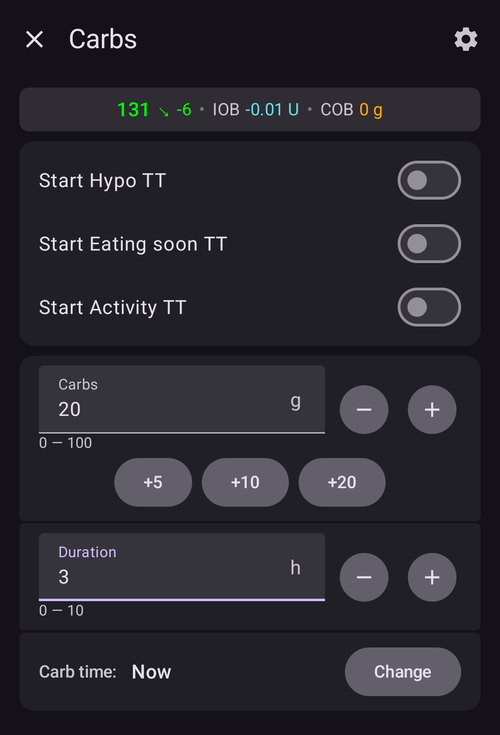
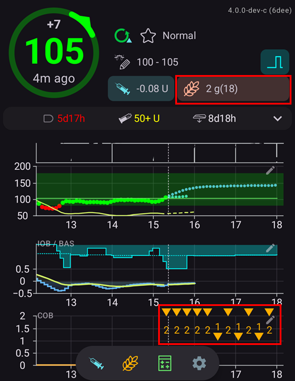
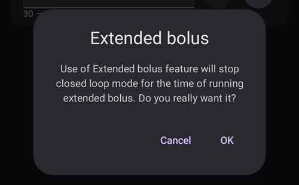
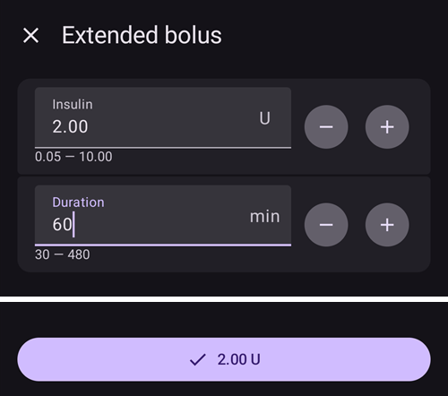
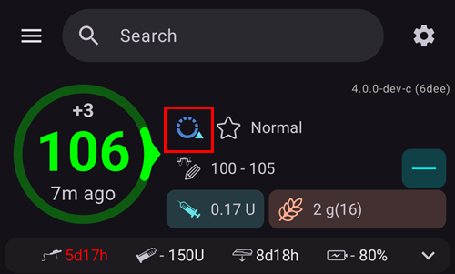
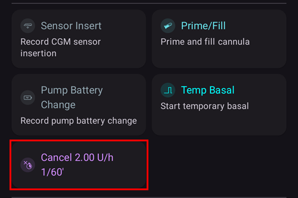

(Extended-Carbs-extended-carbs-ecarbs)=
# Carbohidrats estesos / «e-carbs»

## Què són els e-carbs i quan són útils?

En una teràpia normal amb bomba, els bolus estesos són una bona manera de tractar àpats grassos o que s'absorbeixen lentament per altres motius, que fan pujar la glucèmia durant més temps que l'efecte de la insulina. En un llaç, però, els bolus estesos no tenen tant de sentit (i causen problemes tècnics), perquè són bàsicament una basal temporal alta i fixa. Això va en contra de com funciona el llaç, que ajusta la taxa basal de manera dinàmica. Per a més detalls, vegeu [bolus estès](#extended-bolus-and-why-they-wont-work-in-closed-loop-environment) més avall.

Però la necessitat de tractar aquests àpats continua existint. Per això AAPS permet els anomenats carbohidrats estesos o e-carbs.

Els e-carbs són carbohidrats repartits al llarg de diverses hores. Per a àpats normals amb més carbohidrats que greix/proteïna, introduir els carbohidrats al principi (i reduir el bolus inicial si cal) normalment és suficient per evitar un lliurament d'insulina massa d'hora.  Però per a àpats d'absorció més lenta, on introduir tots els carbohidrats al principi dona massa IOB per SMB, es poden fer servir els e-carbs per simular amb més exactitud com s'absorbeixen els carbohidrats (i els equivalents de carbohidrats que introduïu per altres macronutrients) i com influeixen en la glucèmia. Amb aquesta informació, el llaç pot donar SMB de manera més gradual per tractar aquests carbohidrats. Això es pot veure com un bolus estès dinàmic (també hauria de funcionar sense SMB, però probablement és menys eficaç).

**Nota:** els e-carbs no són només per a àpats rics en greix o proteïna: també es poden fer servir en qualsevol situació en què hi hagi influències que fan pujar la glucèmia, p. ex. altres medicaments com els corticoides.

## Com es fan servir els e-carbs

Per introduir e-carbs, obriu el diàleg **Carbs** (**Tractaments** → **Carbs**), introduïu el total de carbohidrats, establiu una **Durada** i, si voleu, desplaceu l'inici amb **Hora dels carbohidrats** (*els números de sota només són exemples; haureu de provar els vostres propis valors per aconseguir una resposta de glucèmia satisfactòria en els vostres casos*):

Els e-carbs a la pantalla principal: el número entre parèntesis al camp **COB** mostra els carbohidrats que encara han de venir, i el gràfic **COB** mostra cada entrada futura d'e-carbs com una marca taronja. Si no veieu cap gràfic **COB**, afegiu-ne un amb **Afegir gràfic** sota els gràfics (vegeu [Pantalles d'AAPS](../DailyLifeWithAaps/AapsScreens.md)).

(AapsScreens-carbs-type)=
## Tipus de carbohidrats a la Calculadora de bolus: pa, pastís o pizza

A la [Calculadora de bolus](#aaps-screens-bolus-wizard), tres botons sota el camp **Carbs** us permeten triar com de ràpid s'absorbeix el vostre àpat. Trieu-ne un abans de confirmar. Segons el tipus, **AAPS** pren una part dels carbohidrats que heu escrit com a carbohidrats normals i afegeix [carbohidrats estesos («e-carbs»)](#Extended-Carbs-extended-carbs-ecarbs) més tard per a àpats lents i rics. Premeu la icona **(i)** al costat dels botons per veure els aliments típics del tipus seleccionat i què fa amb els vostres carbohidrats.

| Tipus                | Aliments típics (exemples de l'aplicació)                                                                                            | Carbohidrats ara, fets servir per al bolus | E-carbs afegits                                         |
| -------------------- | ------------------------------------------------------------------------------------------------------------------------------------ | ------------------------------------------ | ------------------------------------------------------- |
| **Pa** (per defecte) | Pa, pastes salades, iogurt, fruita, patates, arròs, flocs de civada, verdures                                                        | 100%                                       | Cap                                                     |
| **Pastís**           | Boles de massa (dumplings), pasta, cuina asiàtica rica en carbohidrats i greixos, pastes dolces i de llevat, cereals, mel, melmelada | 90%                                        | 20%, començant 60 minuts més tard, repartits en 2 hores |
| **Pizza**            | Lasanya, pizza, hamburgueses, patates fregides, patates al forn, patates xips                                                        | 80%                                        | 35%, començant 60 minuts més tard, repartits en 3 hores |

**Exemple**: escriviu 100 g i trieu **Pizza**. El bolus es calcula per a 80 g, registrats ara. 35 g d'e-carbs comencen 1 hora més tard i es reparteixen en 3 hores.

Bo de saber:
* No és un simple repartiment: amb **Pastís** i **Pizza**, els carbohidrats registrats sumen **més del que heu escrit** (110% i 115%). La part extra només és als e-carbs.
* El bolus només cobreix els carbohidrats presos ara. **AAPS** no fa cap bolus per avançat per als e-carbs: el llaç els té en compte quan comencen, com qualsevol altre [e-carbs](#Extended-Carbs-extended-carbs-ecarbs).
* Si establiu una **Hora dels carbohidrats**, els e-carbs comencen 60 minuts després d'aquesta hora.
* El diàleg de confirmació mostra els e-carbs en una línia pròpia, _p. ex._ «e-carbs 35 g / 3 h (+60 min)».
* Els grams s'arrodoneixen cap avall a nombres enters.
* Els percentatges, els retards i les durades són fixos; no es poden canviar a la configuració.
* La tria no es recorda: la calculadora s'obre cada vegada amb **Pa**.

______________________________________________________________________

Aquí es descriu una manera de tractar el greix i la proteïna amb aquesta funció: [https://adriansloop.blogspot.com/2018/04/page-margin-0.html](https://adriansloop.blogspot.com/2018/04/page-margin-0.html)

______________________________________________________________________

## Configuració recomanada, exemple i notes importants

La configuració recomanada és fer servir el plugin APS OpenAPS SMB, amb els SMB activats i també amb l'opció *Activar SMB amb COB* activada.

Per exemple, per a una pizza podeu donar un bolus (parcial) al principi amb la *Calculadora de bolus* i després fer servir el diàleg *Carbs* per introduir la resta de carbohidrats amb una durada de 4–6 hores, començant al cap d'1 o 2 hores.

Per començar més ràpid, la *Calculadora de bolus* pot afegir e-carbs per vosaltres: trieu el [tipus de carbohidrats](#AapsScreens-carbs-type) **Pastís** o **Pizza** sota el camp **Carbs** (vegeu més amunt). Les quantitats i el temps són fixos; per tant, si voleu altres valors, feu servir el diàleg *Carbs*.

**Notes importants:** Per descomptat, haureu de provar quins valors concrets us funcionen. També podeu ajustar amb cura l'opció *Màxim de minuts de basal per limitar l'SMB* perquè l'algoritme sigui més o menys agressiu. Amb àpats baixos en carbohidrats i rics en greix/proteïna, pot ser suficient fer servir només e-carbs sense bolus manuals (vegeu l'article del blog de dalt). Quan es creen e-carbs, també es crea una nota al Portal de cures que documenta totes les dades introduïdes. Així és més fàcil provar i millorar els valors.

(extended-bolus-and-why-they-wont-work-in-closed-loop-environment)=
## Els bolus estesos i per què no funcionen en un llaç tancat

Com s'ha dit abans, els bolus estesos o multiona no funcionen bé en un llaç tancat. [Vegeu més avall](#why-extended-boluses-won-t-work-in-a-closed-loop-environment) per a més detalls

(Extended-Carbs-extended-bolus-and-switch-to-open-loop-dana-and-insight-pump-only)=
### Bolus estès i canvi a llaç obert - només bombes Dana i Insight

Algunes persones demanaven una opció per fer servir el bolus estès a AAPS igualment, perquè volien tractar alguns aliments especials com estan acostumades.

Per això **AAPS** ofereix un bolus estès per als usuaris de bombes Dana i Insight: obriu **Gestionar** i seleccioneu **Bolus estès**.

**AAPS** primer us avisa que el llaç tancat s'aturarà mentre duri el bolus estès. Toqueu **OK** per continuar:

Introduïu la quantitat d'**Insulina** i la **Durada**, després toqueu el botó de confirmar a la part de baix i **OK**:

A la bomba Insight, el bolus estès *no està disponible* si es fa servir l'[emulació de TBR](#Accu-Chek-Insight-Pump-settings-in-aaps).

Mentre el bolus estès està en marxa, el llaç funciona en mode **Llaç obert** (la icona del llaç a la pantalla principal canvia), i el llaç tancat es torna a activar automàticament quan acaba el bolus estès:

El menú **Gestionar** mostra un botó **Cancel·lar** amb la taxa i el temps passat / total (per exemple **Cancel·lar 2.00 U/h 1/60'**). Toqueu-lo per aturar el bolus estès abans d'hora:

(why-extended-boluses-won-t-work-in-a-closed-loop-environment)=
### Per què els bolus estesos no funcionen en un llaç tancat

1. El llaç decideix que ara s'han de lliurar 1,55 U/h. Per a l'algoritme no importa si això es lliura com a bolus estès o com a TBR. De fet, algunes bombes fan servir el bolus estès. Què hauria de passar llavors? La majoria de controladors de bomba aturen llavors el bolus estès -> No calia ni iniciar-lo.

2. Si el bolus estès fos una dada d'entrada, què hauria de passar al model?

   1. S'hauria de considerar neutre, juntament amb la taxa basal, i fer el llaç sobre aquesta base? Llavors el llaç també hauria de poder reduir el bolus si, per exemple, baixeu massa i es treu tota la insulina «neutra»?
   2. S'hauria de sumar simplement el bolus estès? Llavors el llaç simplement hauria de poder continuar? Fins i tot amb la pitjor hipo? No crec que això sigui tan bo: es preveu una hipo, però no es pot evitar?

3. L'IOB que crea el bolus estès apareix al cap de 5 minuts, a la següent execució. Per tant, el llaç donaria menys basal. Així que no canvia gaire... excepte que es perd la possibilitat d'evitar la hipo.
